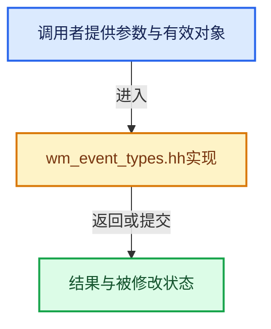

# 实现依赖专题：source/blender/windowmanager/wm_event_types.hh

[实现依赖导航](../../README.md) · [符号索引](../../../00-课程指南/02-源码与提交索引/符号依赖与实现索引.md)

本专题从正文实际调用进入，集中保存共享实现。函数有稳定锚点，可从调用处直接跳到对应完整函数；递归与互相调用通过回链组织。

## 本文件的实现关系





<a id="m-c49069802f97"></a>

## 宏 `ISTIMER`

<!-- annotated:69367624734e6a -->

```cpp
#define ISTIMER(event_type) ((event_type) >= TIMER && (event_type) <= _TIMER_MAX)

```

<details>
<summary>核对原始源码：source/blender/windowmanager/wm_event_types.hh · L390—L391</summary>

<!-- original:69367624734e6a:source/blender/windowmanager/wm_event_types.hh:390:391 -->

```cpp
#define ISTIMER(event_type) ((event_type) >= TIMER && (event_type) <= _TIMER_MAX)

```

</details>

宏在预处理阶段展开，参数替换、重复求值和条件编译应直接从该定义检查。与普通函数不同，宏不会自动提供参数类型检查；构建配置选择哪个定义需结合外围条件。

<a id="m-76524fbe7e34"></a>

## 宏 `ISKEYBOARD`

<!-- annotated:cb0015c765531e -->

```cpp
#define ISKEYBOARD(event_type) \
  (((event_type) >= _EVT_KEYBOARD_MIN && (event_type) <= _EVT_KEYBOARD_MAX) || \
   ((event_type) >= EVT_F1KEY && (event_type) <= EVT_F24KEY))

```

<details>
<summary>核对原始源码：source/blender/windowmanager/wm_event_types.hh · L393—L396</summary>

<!-- original:cb0015c765531e:source/blender/windowmanager/wm_event_types.hh:393:396 -->

```cpp
#define ISKEYBOARD(event_type) \
  (((event_type) >= _EVT_KEYBOARD_MIN && (event_type) <= _EVT_KEYBOARD_MAX) || \
   ((event_type) >= EVT_F1KEY && (event_type) <= EVT_F24KEY))

```

</details>

宏在预处理阶段展开，参数替换、重复求值和条件编译应直接从该定义检查。与普通函数不同，宏不会自动提供参数类型检查；构建配置选择哪个定义需结合外围条件。

<a id="m-dd3ea9938bde"></a>

## 宏 `ISMOUSE_MOTION`

<!-- annotated:912921951c26bd -->

```cpp
#define ISMOUSE_MOTION(event_type) ELEM(event_type, MOUSEMOVE, INBETWEEN_MOUSEMOVE)
/** Test whether the event is a mouse button (excluding mouse-wheel). */
```

<details>
<summary>核对原始源码：source/blender/windowmanager/wm_event_types.hh · L422—L423</summary>

<!-- original:912921951c26bd:source/blender/windowmanager/wm_event_types.hh:422:423 -->

```cpp
#define ISMOUSE_MOTION(event_type) ELEM(event_type, MOUSEMOVE, INBETWEEN_MOUSEMOVE)
/** Test whether the event is a mouse button (excluding mouse-wheel). */
```

</details>

宏在预处理阶段展开，参数替换、重复求值和条件编译应直接从该定义检查。与普通函数不同，宏不会自动提供参数类型检查；构建配置选择哪个定义需结合外围条件。

<a id="m-81751ae40f08"></a>

## 宏 `ISMOUSE_BUTTON`

<!-- annotated:3a0cefecec25c1 -->

```cpp
#define ISMOUSE_BUTTON(event_type) \
  (ELEM(event_type, \
        LEFTMOUSE, \
        MIDDLEMOUSE, \
        RIGHTMOUSE, \
        BUTTON4MOUSE, \
        BUTTON5MOUSE, \
        BUTTON6MOUSE, \
        BUTTON7MOUSE))
/** Test whether the event is a mouse wheel. */
```

<details>
<summary>核对原始源码：source/blender/windowmanager/wm_event_types.hh · L424—L433</summary>

<!-- original:3a0cefecec25c1:source/blender/windowmanager/wm_event_types.hh:424:433 -->

```cpp
#define ISMOUSE_BUTTON(event_type) \
  (ELEM(event_type, \
        LEFTMOUSE, \
        MIDDLEMOUSE, \
        RIGHTMOUSE, \
        BUTTON4MOUSE, \
        BUTTON5MOUSE, \
        BUTTON6MOUSE, \
        BUTTON7MOUSE))
/** Test whether the event is a mouse wheel. */
```

</details>

宏在预处理阶段展开，参数替换、重复求值和条件编译应直接从该定义检查。与普通函数不同，宏不会自动提供参数类型检查；构建配置选择哪个定义需结合外围条件。

<a id="m-626dead523f4"></a>

## 宏 `ISNDOF_BUTTON`

<!-- annotated:39682582e912b1 -->

```cpp
#define ISNDOF_BUTTON(event_type) \
  ((event_type) >= _NDOF_BUTTON_MIN && (event_type) <= _NDOF_BUTTON_MAX)

```

<details>
<summary>核对原始源码：source/blender/windowmanager/wm_event_types.hh · L442—L444</summary>

<!-- original:39682582e912b1:source/blender/windowmanager/wm_event_types.hh:442:444 -->

```cpp
#define ISNDOF_BUTTON(event_type) \
  ((event_type) >= _NDOF_BUTTON_MIN && (event_type) <= _NDOF_BUTTON_MAX)

```

</details>

宏在预处理阶段展开，参数替换、重复求值和条件编译应直接从该定义检查。与普通函数不同，宏不会自动提供参数类型检查；构建配置选择哪个定义需结合外围条件。

<a id="m-b2053a79667e"></a>

## 宏 `ISHOTKEY`

<!-- annotated:58ae91979b4327 -->

```cpp
#define ISHOTKEY(event_type) \
  ((ISKEYBOARD(event_type) || ISMOUSE_BUTTON(event_type) || ISMOUSE_WHEEL(event_type) || \
    ISNDOF_BUTTON(event_type)) && \
   (ISKEYMODIFIER(event_type) == false))

```

<details>
<summary>核对原始源码：source/blender/windowmanager/wm_event_types.hh · L461—L465</summary>

<!-- original:58ae91979b4327:source/blender/windowmanager/wm_event_types.hh:461:465 -->

```cpp
#define ISHOTKEY(event_type) \
  ((ISKEYBOARD(event_type) || ISMOUSE_BUTTON(event_type) || ISMOUSE_WHEEL(event_type) || \
    ISNDOF_BUTTON(event_type)) && \
   (ISKEYMODIFIER(event_type) == false))

```

</details>

宏在预处理阶段展开，参数替换、重复求值和条件编译应直接从该定义检查。与普通函数不同，宏不会自动提供参数类型检查；构建配置选择哪个定义需结合外围条件。

## 完整成员与函数实现
