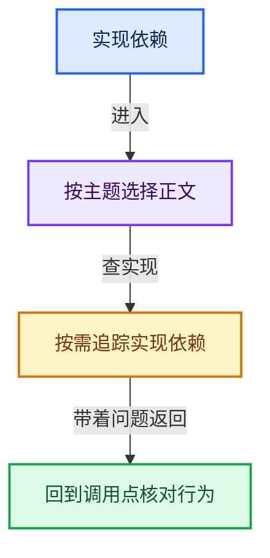
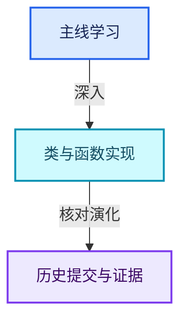

# 实现依赖专题

[总入口](../README.md) · [符号索引](../00-课程指南/02-源码与提交索引/符号依赖与实现索引.md)

这些是正文引用的辅助实现资料，按实际源码模块分类；不需要从头顺序阅读全部文件。文件名保留对应源码扩展名，便于识别头文件与实现文件。

- [01-BLI基础库 · 203份](01-BLI基础库/README.md)
- [02-BKE几何与数据 · 307份](02-BKE几何与数据/README.md)
- [03-FN函数与求值 · 4份](03-FN函数与求值/README.md)
- [04-Nodes节点系统 · 119份](04-Nodes节点系统/README.md)
- [05-Geometry几何算法 · 17份](05-Geometry几何算法/README.md)
- [06-Depsgraph依赖图 · 45份](06-Depsgraph依赖图/README.md)
- [07-Intern运行时与平台 · 167份](07-Intern运行时与平台/README.md)
- [08-其他Blender模块 · 890份](08-其他Blender模块/README.md)

