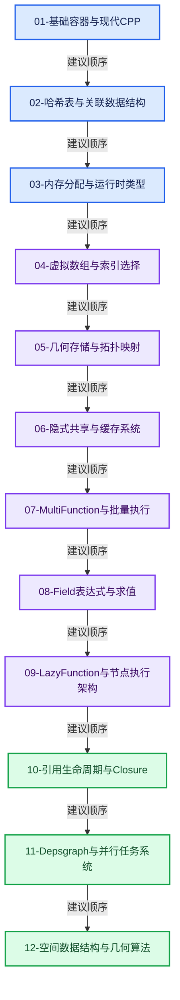

# Blender 源码全面学习

132篇正文 · 12个方向 · 中文语法与源码讲解 · 彩色Mermaid · 历史证据与实现练习

基准：`cbda6b96c26c0dee3c3b5cbb93960c4ac06a6b30`，记录日期2026-10-14。以主讲文件SHA-256约束实际源码；工作区存在其他产品代码修改，原始状态记录在证据文件中。

## 从这里开始

先读基础容器与内存，再用几何存储和共享缓存把知识连到实际功能，随后学习MultiFunction、Field、惰性执行器。高级部分研究引用寿命、场景依赖与空间算法。

| 方向 | 正文数 | 入口 |
|---|---|---|
| 01-基础容器与现代CPP | 20 | [方向导航](01-%E5%9F%BA%E7%A1%80%E5%AE%B9%E5%99%A8%E4%B8%8E%E7%8E%B0%E4%BB%A3CPP/README.md) |
| 02-哈希表与关联数据结构 | 10 | [方向导航](02-%E5%93%88%E5%B8%8C%E8%A1%A8%E4%B8%8E%E5%85%B3%E8%81%94%E6%95%B0%E6%8D%AE%E7%BB%93%E6%9E%84/README.md) |
| 03-内存分配与运行时类型 | 12 | [方向导航](03-%E5%86%85%E5%AD%98%E5%88%86%E9%85%8D%E4%B8%8E%E8%BF%90%E8%A1%8C%E6%97%B6%E7%B1%BB%E5%9E%8B/README.md) |
| 04-虚拟数组与索引选择 | 12 | [方向导航](04-%E8%99%9A%E6%8B%9F%E6%95%B0%E7%BB%84%E4%B8%8E%E7%B4%A2%E5%BC%95%E9%80%89%E6%8B%A9/README.md) |
| 05-几何存储与拓扑映射 | 10 | [方向导航](05-%E5%87%A0%E4%BD%95%E5%AD%98%E5%82%A8%E4%B8%8E%E6%8B%93%E6%89%91%E6%98%A0%E5%B0%84/README.md) |
| 06-隐式共享与缓存系统 | 10 | [方向导航](06-%E9%9A%90%E5%BC%8F%E5%85%B1%E4%BA%AB%E4%B8%8E%E7%BC%93%E5%AD%98%E7%B3%BB%E7%BB%9F/README.md) |
| 07-MultiFunction与批量执行 | 10 | [方向导航](07-MultiFunction%E4%B8%8E%E6%89%B9%E9%87%8F%E6%89%A7%E8%A1%8C/README.md) |
| 08-Field表达式与求值 | 12 | [方向导航](08-Field%E8%A1%A8%E8%BE%BE%E5%BC%8F%E4%B8%8E%E6%B1%82%E5%80%BC/README.md) |
| 09-LazyFunction与节点执行架构 | 12 | [方向导航](09-LazyFunction%E4%B8%8E%E8%8A%82%E7%82%B9%E6%89%A7%E8%A1%8C%E6%9E%B6%E6%9E%84/README.md) |
| 10-引用生命周期与Closure | 8 | [方向导航](10-%E5%BC%95%E7%94%A8%E7%94%9F%E5%91%BD%E5%91%A8%E6%9C%9F%E4%B8%8EClosure/README.md) |
| 11-Depsgraph与并行任务系统 | 8 | [方向导航](11-Depsgraph%E4%B8%8E%E5%B9%B6%E8%A1%8C%E4%BB%BB%E5%8A%A1%E7%B3%BB%E7%BB%9F/README.md) |
| 12-空间数据结构与几何算法 | 8 | [方向导航](12-%E7%A9%BA%E9%97%B4%E6%95%B0%E6%8D%AE%E7%BB%93%E6%9E%84%E4%B8%8E%E5%87%A0%E4%BD%95%E7%AE%97%E6%B3%95/README.md) |

## 课程依赖图

## 三层阅读法

## 索引与检查证据

- [学习路线与阶段验收](%E5%AD%A6%E4%B9%A0%E8%B7%AF%E7%BA%BF%E4%B8%8E%E9%98%B6%E6%AE%B5%E9%AA%8C%E6%94%B6.md)
- [源码版本与覆盖索引](%E6%BA%90%E7%A0%81%E7%89%88%E6%9C%AC%E4%B8%8E%E8%A6%86%E7%9B%96%E7%B4%A2%E5%BC%95.md)
- [历史提交与设计演化索引](%E5%8E%86%E5%8F%B2%E6%8F%90%E4%BA%A4%E4%B8%8E%E8%AE%BE%E8%AE%A1%E6%BC%94%E5%8C%96%E7%B4%A2%E5%BC%95.md)
- [术语语法与跨库对比索引](%E6%9C%AF%E8%AF%AD%E8%AF%AD%E6%B3%95%E4%B8%8E%E8%B7%A8%E5%BA%93%E5%AF%B9%E6%AF%94%E7%B4%A2%E5%BC%95.md)
- [图表配色与阅读约定](%E5%9B%BE%E8%A1%A8%E9%85%8D%E8%89%B2%E4%B8%8E%E9%98%85%E8%AF%BB%E7%BA%A6%E5%AE%9A.md)
- [校验报告](验收报告.md)
- [机器可读覆盖清单](_evidence/coverage.json)
- [源码基准](_evidence/source-baseline.json)

正文的逐行语义表配合完整源码摘录阅读。静态同名引用定位不等于编译器解析后的调用图；动态行为和性能结论需要相应测试。目录存在、行数足够或覆盖表完整，也不能替代技术内容复核。
