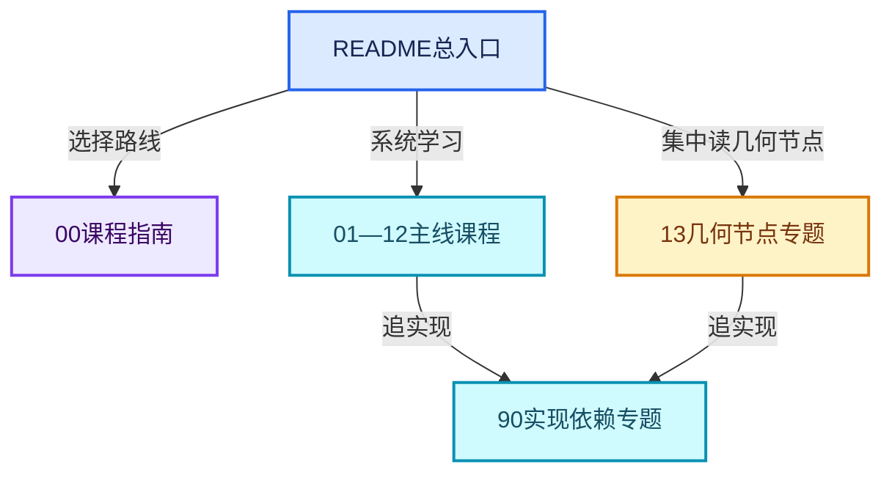
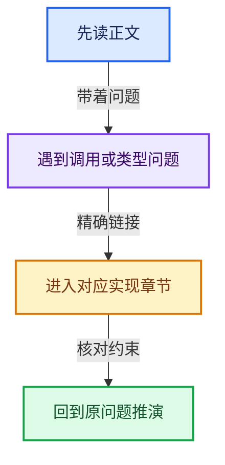

# Blender 源码学习

从本页选择学习路线。正文、几何节点专题、实现依赖和校验产物各有固定位置；根目录只保留这一份入口文档。

## 四个入口

- **[课程指南](00-课程指南/README.md)**：路线、阅读规范、源码与提交索引、验收记录。
- **[几何节点专题](13-几何节点专题/README.md)**：24篇集中专题，按接口、几何、Field、Zone和性能分组。
- **[实现依赖专题](90-实现依赖专题/README.md)**：按实际源码模块归类的辅助实现；从正文链接按需阅读。
- **[工具与校验产物说明](_evidence/README.md)**：解释JSON记录、测试产物和Mermaid渲染图片的用途。

## 12条主线课程

| 方向 | 原有正文数 | 导航 |
|---|---|---|
| 01-基础容器与现代CPP | 20 | [打开课程](01-基础容器与现代CPP/README.md) |
| 02-哈希表与关联数据结构 | 10 | [打开课程](02-哈希表与关联数据结构/README.md) |
| 03-内存分配与运行时类型 | 12 | [打开课程](03-内存分配与运行时类型/README.md) |
| 04-虚拟数组与索引选择 | 12 | [打开课程](04-虚拟数组与索引选择/README.md) |
| 05-几何存储与拓扑映射 | 10 | [打开课程](05-几何存储与拓扑映射/README.md) |
| 06-隐式共享与缓存系统 | 10 | [打开课程](06-隐式共享与缓存系统/README.md) |
| 07-MultiFunction与批量执行 | 10 | [打开课程](07-MultiFunction与批量执行/README.md) |
| 08-Field表达式与求值 | 12 | [打开课程](08-Field表达式与求值/README.md) |
| 09-LazyFunction与节点执行架构 | 12 | [打开课程](09-LazyFunction与节点执行架构/README.md) |
| 10-引用生命周期与Closure | 8 | [打开课程](10-引用生命周期与Closure/README.md) |
| 11-Depsgraph与并行任务系统 | 8 | [打开课程](11-Depsgraph与并行任务系统/README.md) |
| 12-空间数据结构与几何算法 | 8 | [打开课程](12-空间数据结构与几何算法/README.md) |

主线共132篇；几何节点另有24篇集中专题。实现依赖不计入主线篇数。内容复核与结构校验的实际范围见课/程指南中的验收记录。

