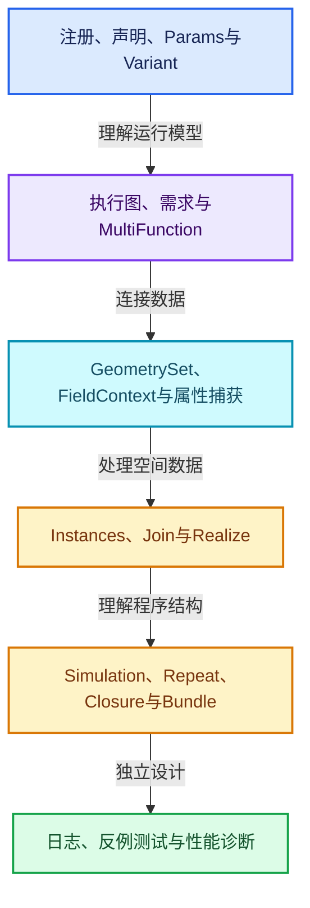
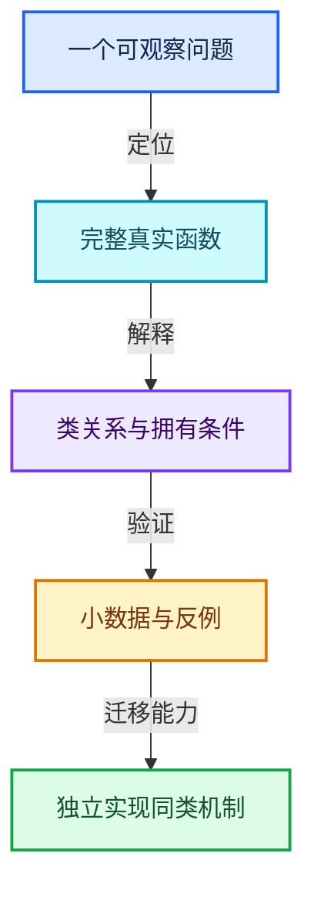

# 几何节点扩展学习地图

本轮新增24篇按机制组织的专题，放入原有12方向中的相关目录。建议先读架构与参数，再读几何表示和属性，最后进入实例与Zone；共享依赖专题按需进入。

## 主线与专题入口

| 编号 | 专题 | 所选完整函数数 |
|---|---|---|
| GN-01 | [几何节点从编辑树到执行结果的全景](09-LazyFunction%E4%B8%8E%E8%8A%82%E7%82%B9%E6%89%A7%E8%A1%8C%E6%9E%B6%E6%9E%84/%E6%89%A9%E5%B1%9501-%E5%87%A0%E4%BD%95%E8%8A%82%E7%82%B9%E4%BB%8E%E7%BC%96%E8%BE%91%E6%A0%91%E5%88%B0%E6%89%A7%E8%A1%8C%E7%BB%93%E6%9E%9C%E7%9A%84%E5%85%A8%E6%99%AF.md) | 1 |
| GN-02 | [节点注册声明与引用关系契约](09-LazyFunction%E4%B8%8E%E8%8A%82%E7%82%B9%E6%89%A7%E8%A1%8C%E6%9E%B6%E6%9E%84/%E6%89%A9%E5%B1%9502-%E8%8A%82%E7%82%B9%E6%B3%A8%E5%86%8C%E5%A3%B0%E6%98%8E%E4%B8%8E%E5%BC%95%E7%94%A8%E5%85%B3%E7%B3%BB%E5%A5%91%E7%BA%A6.md) | 5 |
| GN-03 | [GeoNodeExecParams参数适配与移动语义](09-LazyFunction%E4%B8%8E%E8%8A%82%E7%82%B9%E6%89%A7%E8%A1%8C%E6%9E%B6%E6%9E%84/%E6%89%A9%E5%B1%9503-GeoNodeExecParams%E5%8F%82%E6%95%B0%E9%80%82%E9%85%8D%E4%B8%8E%E7%A7%BB%E5%8A%A8%E8%AF%AD%E4%B9%89.md) | 3 |
| GN-04 | [SocketValueVariant异构值与转换边界](09-LazyFunction%E4%B8%8E%E8%8A%82%E7%82%B9%E6%89%A7%E8%A1%8C%E6%9E%B6%E6%9E%84/%E6%89%A9%E5%B1%9504-SocketValueVariant%E5%BC%82%E6%9E%84%E5%80%BC%E4%B8%8E%E8%BD%AC%E6%8D%A2%E8%BE%B9%E7%95%8C.md) | 6 |
| GN-05 | [执行图构建缓存与树副本所有权](09-LazyFunction%E4%B8%8E%E8%8A%82%E7%82%B9%E6%89%A7%E8%A1%8C%E6%9E%B6%E6%9E%84/%E6%89%A9%E5%B1%9505-%E6%89%A7%E8%A1%8C%E5%9B%BE%E6%9E%84%E5%BB%BA%E7%BC%93%E5%AD%98%E4%B8%8E%E6%A0%91%E5%89%AF%E6%9C%AC%E6%89%80%E6%9C%89%E6%9D%83.md) | 3 |
| GN-06 | [按需执行匿名输出与Switch需求传播](09-LazyFunction%E4%B8%8E%E8%8A%82%E7%82%B9%E6%89%A7%E8%A1%8C%E6%9E%B6%E6%9E%84/%E6%89%A9%E5%B1%9506-%E6%8C%89%E9%9C%80%E6%89%A7%E8%A1%8C%E5%8C%BF%E5%90%8D%E8%BE%93%E5%87%BA%E4%B8%8ESwitch%E9%9C%80%E6%B1%82%E4%BC%A0%E6%92%AD.md) | 2 |
| GN-07 | [数学节点从MultiFunction到FieldOperation](07-MultiFunction%E4%B8%8E%E6%89%B9%E9%87%8F%E6%89%A7%E8%A1%8C/%E6%89%A9%E5%B1%9501-%E6%95%B0%E5%AD%A6%E8%8A%82%E7%82%B9%E4%BB%8EMultiFunction%E5%88%B0FieldOperation.md) | 2 |
| GN-08 | [GeometrySet组件组合与写时分离](05-%E5%87%A0%E4%BD%95%E5%AD%98%E5%82%A8%E4%B8%8E%E6%8B%93%E6%89%91%E6%98%A0%E5%B0%84/%E6%89%A9%E5%B1%9501-GeometrySet%E7%BB%84%E4%BB%B6%E7%BB%84%E5%90%88%E4%B8%8E%E5%86%99%E6%97%B6%E5%88%86%E7%A6%BB.md) | 4 |
| GN-09 | [几何FieldContext属性域与跨域求值](08-Field%E8%A1%A8%E8%BE%BE%E5%BC%8F%E4%B8%8E%E6%B1%82%E5%80%BC/%E6%89%A9%E5%B1%9501-%E5%87%A0%E4%BD%95FieldContext%E5%B1%9E%E6%80%A7%E5%9F%9F%E4%B8%8E%E8%B7%A8%E5%9F%9F%E6%B1%82%E5%80%BC.md) | 2 |
| GN-10 | [SetPosition读取写入与贝塞尔控制柄](08-Field%E8%A1%A8%E8%BE%BE%E5%BC%8F%E4%B8%8E%E6%B1%82%E5%80%BC/%E6%89%A9%E5%B1%9502-SetPosition%E8%AF%BB%E5%8F%96%E5%86%99%E5%85%A5%E4%B8%8E%E8%B4%9D%E5%A1%9E%E5%B0%94%E6%8E%A7%E5%88%B6%E6%9F%84.md) | 3 |
| GN-11 | [StoreNamedAttribute类型域与部分写入](08-Field%E8%A1%A8%E8%BE%BE%E5%BC%8F%E4%B8%8E%E6%B1%82%E5%80%BC/%E6%89%A9%E5%B1%9503-StoreNamedAttribute%E7%B1%BB%E5%9E%8B%E5%9F%9F%E4%B8%8E%E9%83%A8%E5%88%86%E5%86%99%E5%85%A5.md) | 2 |
| GN-12 | [属性捕获求值暂存与提交协议](05-%E5%87%A0%E4%BD%95%E5%AD%98%E5%82%A8%E4%B8%8E%E6%8B%93%E6%89%91%E6%98%A0%E5%B0%84/%E6%89%A9%E5%B1%9502-%E5%B1%9E%E6%80%A7%E6%8D%95%E8%8E%B7%E6%B1%82%E5%80%BC%E6%9A%82%E5%AD%98%E4%B8%8E%E6%8F%90%E4%BA%A4%E5%8D%8F%E8%AE%AE.md) | 2 |
| GN-13 | [CaptureAttribute匿名属性引用与清理](10-%E5%BC%95%E7%94%A8%E7%94%9F%E5%91%BD%E5%91%A8%E6%9C%9F%E4%B8%8EClosure/%E6%89%A9%E5%B1%9501-CaptureAttribute%E5%8C%BF%E5%90%8D%E5%B1%9E%E6%80%A7%E5%BC%95%E7%94%A8%E4%B8%8E%E6%B8%85%E7%90%86.md) | 2 |
| GN-14 | [Instances引用表句柄与变换数组](05-%E5%87%A0%E4%BD%95%E5%AD%98%E5%82%A8%E4%B8%8E%E6%8B%93%E6%89%91%E6%98%A0%E5%B0%84/%E6%89%A9%E5%B1%9503-Instances%E5%BC%95%E7%94%A8%E8%A1%A8%E5%8F%A5%E6%9F%84%E4%B8%8E%E5%8F%98%E6%8D%A2%E6%95%B0%E7%BB%84.md) | 5 |
| GN-15 | [InstanceOnPoints选择压缩与引用重映射](05-%E5%87%A0%E4%BD%95%E5%AD%98%E5%82%A8%E4%B8%8E%E6%8B%93%E6%89%91%E6%98%A0%E5%B0%84/%E6%89%A9%E5%B1%9504-InstanceOnPoints%E9%80%89%E6%8B%A9%E5%8E%8B%E7%BC%A9%E4%B8%8E%E5%BC%95%E7%94%A8%E9%87%8D%E6%98%A0%E5%B0%84.md) | 1 |
| GN-16 | [JoinGeometry组件分派与Realize复用](05-%E5%87%A0%E4%BD%95%E5%AD%98%E5%82%A8%E4%B8%8E%E6%8B%93%E6%89%91%E6%98%A0%E5%B0%84/%E6%89%A9%E5%B1%9505-JoinGeometry%E7%BB%84%E4%BB%B6%E5%88%86%E6%B4%BE%E4%B8%8ERealize%E5%A4%8D%E7%94%A8.md) | 3 |
| GN-17 | [RealizeInstances深度Field与任务流水线](05-%E5%87%A0%E4%BD%95%E5%AD%98%E5%82%A8%E4%B8%8E%E6%8B%93%E6%89%91%E6%98%A0%E5%B0%84/%E6%89%A9%E5%B1%9506-RealizeInstances%E6%B7%B1%E5%BA%A6Field%E4%B8%8E%E4%BB%BB%E5%8A%A1%E6%B5%81%E6%B0%B4%E7%BA%BF.md) | 3 |
| GN-18 | [Simulation状态协议缓存与时间步](10-%E5%BC%95%E7%94%A8%E7%94%9F%E5%91%BD%E5%91%A8%E6%9C%9F%E4%B8%8EClosure/%E6%89%A9%E5%B1%9502-Simulation%E7%8A%B6%E6%80%81%E5%8D%8F%E8%AE%AE%E7%BC%93%E5%AD%98%E4%B8%8E%E6%97%B6%E9%97%B4%E6%AD%A5.md) | 2 |
| GN-19 | [Repeat与Foreach执行状态及上下文身份](10-%E5%BC%95%E7%94%A8%E7%94%9F%E5%91%BD%E5%91%A8%E6%9C%9F%E4%B8%8EClosure/%E6%89%A9%E5%B1%9503-Repeat%E4%B8%8EForeach%E6%89%A7%E8%A1%8C%E7%8A%B6%E6%80%81%E5%8F%8A%E4%B8%8A%E4%B8%8B%E6%96%87%E8%BA%AB%E4%BB%BD.md) | 3 |
| GN-20 | [Closure可传递程序捕获与调用边界](10-%E5%BC%95%E7%94%A8%E7%94%9F%E5%91%BD%E5%91%A8%E6%9C%9F%E4%B8%8EClosure/%E6%89%A9%E5%B1%9504-Closure%E5%8F%AF%E4%BC%A0%E9%80%92%E7%A8%8B%E5%BA%8F%E6%8D%95%E8%8E%B7%E4%B8%8E%E8%B0%83%E7%94%A8%E8%BE%B9%E7%95%8C.md) | 2 |
| GN-21 | [Bundle嵌套值路径查找与写时复制](10-%E5%BC%95%E7%94%A8%E7%94%9F%E5%91%BD%E5%91%A8%E6%9C%9F%E4%B8%8EClosure/%E6%89%A9%E5%B1%9505-Bundle%E5%B5%8C%E5%A5%97%E5%80%BC%E8%B7%AF%E5%BE%84%E6%9F%A5%E6%89%BE%E4%B8%8E%E5%86%99%E6%97%B6%E5%A4%8D%E5%88%B6.md) | 3 |
| GN-22 | [ComputeContext日志映射与副作用根](09-LazyFunction%E4%B8%8E%E8%8A%82%E7%82%B9%E6%89%A7%E8%A1%8C%E6%9E%B6%E6%9E%84/%E6%89%A9%E5%B1%9507-ComputeContext%E6%97%A5%E5%BF%97%E6%98%A0%E5%B0%84%E4%B8%8E%E5%89%AF%E4%BD%9C%E7%94%A8%E6%A0%B9.md) | 2 |
| GN-23 | [几何节点性能诊断与架构训练](06-%E9%9A%90%E5%BC%8F%E5%85%B1%E4%BA%AB%E4%B8%8E%E7%BC%93%E5%AD%98%E7%B3%BB%E7%BB%9F/%E6%89%A9%E5%B1%9501-%E5%87%A0%E4%BD%95%E8%8A%82%E7%82%B9%E6%80%A7%E8%83%BD%E8%AF%8A%E6%96%AD%E4%B8%8E%E6%9E%B6%E6%9E%84%E8%AE%AD%E7%BB%83.md) | 2 |
| GN-24 | [Jacques与Hans提交中的架构演化](09-LazyFunction%E4%B8%8E%E8%8A%82%E7%82%B9%E6%89%A7%E8%A1%8C%E6%9E%B6%E6%9E%84/%E6%89%A9%E5%B1%9508-Jacques%E4%B8%8EHans%E6%8F%90%E4%BA%A4%E4%B8%AD%E7%9A%84%E6%9E%B6%E6%9E%84%E6%BC%94%E5%8C%96.md) | 2 |

## 六阶段学习路线

## 扩展知识怎样对应代码

| 扩展概念 | 对应专题 | 训练目标 |
|---|---|---|
| 编译器中间表示与解释执行 | [GN-01](09-LazyFunction%E4%B8%8E%E8%8A%82%E7%82%B9%E6%89%A7%E8%A1%8C%E6%9E%B6%E6%9E%84/%E6%89%A9%E5%B1%9501-%E5%87%A0%E4%BD%95%E8%8A%82%E7%82%B9%E4%BB%8E%E7%BC%96%E8%BE%91%E6%A0%91%E5%88%B0%E6%89%A7%E8%A1%8C%E7%BB%93%E6%9E%9C%E7%9A%84%E5%85%A8%E6%99%AF.md) | 区分编辑表示与运行表示 |
| 内部DSL与声明式契约 | [GN-02](09-LazyFunction%E4%B8%8E%E8%8A%82%E7%82%B9%E6%89%A7%E8%A1%8C%E6%9E%B6%E6%9E%84/%E6%89%A9%E5%B1%9502-%E8%8A%82%E7%82%B9%E6%B3%A8%E5%86%8C%E5%A3%B0%E6%98%8E%E4%B8%8E%E5%BC%95%E7%94%A8%E5%85%B3%E7%B3%BB%E5%A5%91%E7%BA%A6.md) | 从Builder生成可分析关系 |
| 类型擦除、模板与移动语义 | [GN-03](09-LazyFunction%E4%B8%8E%E8%8A%82%E7%82%B9%E6%89%A7%E8%A1%8C%E6%9E%B6%E6%9E%84/%E6%89%A9%E5%B1%9503-GeoNodeExecParams%E5%8F%82%E6%95%B0%E9%80%82%E9%85%8D%E4%B8%8E%E7%A7%BB%E5%8A%A8%E8%AF%AD%E4%B9%89.md) | 明确接口值和存储值 |
| 异构值转换与失败策略 | [GN-04](09-LazyFunction%E4%B8%8E%E8%8A%82%E7%82%B9%E6%89%A7%E8%A1%8C%E6%9E%B6%E6%9E%84/%E6%89%A9%E5%B1%9504-SocketValueVariant%E5%BC%82%E6%9E%84%E5%80%BC%E4%B8%8E%E8%BD%AC%E6%8D%A2%E8%BE%B9%E7%95%8C.md) | 分离查询、转换与默认值 |
| 程序资源寿命与缓存 | [GN-05](09-LazyFunction%E4%B8%8E%E8%8A%82%E7%82%B9%E6%89%A7%E8%A1%8C%E6%9E%B6%E6%9E%84/%E6%89%A9%E5%B1%9505-%E6%89%A7%E8%A1%8C%E5%9B%BE%E6%9E%84%E5%BB%BA%E7%BC%93%E5%AD%98%E4%B8%8E%E6%A0%91%E5%89%AF%E6%9C%AC%E6%89%80%E6%9C%89%E6%9D%83.md) | 让产物持有必要资源 |
| 需求传播与保守分析 | [GN-06](09-LazyFunction%E4%B8%8E%E8%8A%82%E7%82%B9%E6%89%A7%E8%A1%8C%E6%9E%B6%E6%9E%84/%E6%89%A9%E5%B1%9506-%E6%8C%89%E9%9C%80%E6%89%A7%E8%A1%8C%E5%8C%BF%E5%90%8D%E8%BE%93%E5%87%BA%E4%B8%8ESwitch%E9%9C%80%E6%B1%82%E4%BC%A0%E6%92%AD.md) | 不能用单值分支裁掉Field分支 |
| 数据并行与表达式共享 | [GN-07](07-MultiFunction%E4%B8%8E%E6%89%B9%E9%87%8F%E6%89%A7%E8%A1%8C/%E6%89%A9%E5%B1%9501-%E6%95%B0%E5%AD%A6%E8%8A%82%E7%82%B9%E4%BB%8EMultiFunction%E5%88%B0FieldOperation.md) | 复用计算内核而非复制业务 |
| 写时复制与分层拥有 | [GN-08](05-%E5%87%A0%E4%BD%95%E5%AD%98%E5%82%A8%E4%B8%8E%E6%8B%93%E6%89%91%E6%98%A0%E5%B0%84/%E6%89%A9%E5%B1%9501-GeometrySet%E7%BB%84%E4%BB%B6%E7%BB%84%E5%90%88%E4%B8%8E%E5%86%99%E6%97%B6%E5%88%86%E7%A6%BB.md) | 区分组件独占与数组独占 |
| 拓扑域映射 | [GN-09](08-Field%E8%A1%A8%E8%BE%BE%E5%BC%8F%E4%B8%8E%E6%B1%82%E5%80%BC/%E6%89%A9%E5%B1%9501-%E5%87%A0%E4%BD%95FieldContext%E5%B1%9E%E6%80%A7%E5%9F%9F%E4%B8%8E%E8%B7%A8%E5%9F%9F%E6%B1%82%E5%80%BC.md) | 不要用相同索引替代邻接关系 |
| 两阶段求值与提交 | [GN-12](05-%E5%87%A0%E4%BD%95%E5%AD%98%E5%82%A8%E4%B8%8E%E6%8B%93%E6%89%91%E6%98%A0%E5%B0%84/%E6%89%A9%E5%B1%9502-%E5%B1%9E%E6%80%A7%E6%8D%95%E8%8E%B7%E6%B1%82%E5%80%BC%E6%9A%82%E5%AD%98%E4%B8%8E%E6%8F%90%E4%BA%A4%E5%8D%8F%E8%AE%AE.md) | 避免写入污染尚未完成的读取 |
| 符号引用与数据寿命 | [GN-13](10-%E5%BC%95%E7%94%A8%E7%94%9F%E5%91%BD%E5%91%A8%E6%9C%9F%E4%B8%8EClosure/%E6%89%A9%E5%B1%9501-CaptureAttribute%E5%8C%BF%E5%90%8D%E5%B1%9E%E6%80%A7%E5%BC%95%E7%94%A8%E4%B8%8E%E6%B8%85%E7%90%86.md) | 让引用与承载数据共同传播 |
| 索引空间与句柄重映射 | [GN-14](05-%E5%87%A0%E4%BD%95%E5%AD%98%E5%82%A8%E4%B8%8E%E6%8B%93%E6%89%91%E6%98%A0%E5%B0%84/%E6%89%A9%E5%B1%9503-Instances%E5%BC%95%E7%94%A8%E8%A1%A8%E5%8F%A5%E6%9F%84%E4%B8%8E%E5%8F%98%E6%8D%A2%E6%95%B0%E7%BB%84.md) | 区分来源、实例和紧凑输出位置 |
| 任务预处理与不相交写入 | [GN-17](05-%E5%87%A0%E4%BD%95%E5%AD%98%E5%82%A8%E4%B8%8E%E6%8B%93%E6%89%91%E6%98%A0%E5%B0%84/%E6%89%A9%E5%B1%9506-RealizeInstances%E6%B7%B1%E5%BA%A6Field%E4%B8%8E%E4%BB%BB%E5%8A%A1%E6%B5%81%E6%B0%B4%E7%BA%BF.md) | 先确定输出布局再执行任务 |
| 状态机与策略variant | [GN-18](10-%E5%BC%95%E7%94%A8%E7%94%9F%E5%91%BD%E5%91%A8%E6%9C%9F%E4%B8%8EClosure/%E6%89%A9%E5%B1%9502-Simulation%E7%8A%B6%E6%80%81%E5%8D%8F%E8%AE%AE%E7%BC%93%E5%AD%98%E4%B8%8E%E6%97%B6%E9%97%B4%E6%AD%A5.md) | 明确互斥状态及所需数据 |
| 执行身份与副作用 | [GN-19](10-%E5%BC%95%E7%94%A8%E7%94%9F%E5%91%BD%E5%91%A8%E6%9C%9F%E4%B8%8EClosure/%E6%89%A9%E5%B1%9503-Repeat%E4%B8%8EForeach%E6%89%A7%E8%A1%8C%E7%8A%B6%E6%80%81%E5%8F%8A%E4%B8%8A%E4%B8%8B%E6%96%87%E8%BA%AB%E4%BB%BD.md) | 复用函数同时区分调用位置 |
| 可传递程序与捕获环境 | [GN-20](10-%E5%BC%95%E7%94%A8%E7%94%9F%E5%91%BD%E5%91%A8%E6%9C%9F%E4%B8%8EClosure/%E6%89%A9%E5%B1%9504-Closure%E5%8F%AF%E4%BC%A0%E9%80%92%E7%A8%8B%E5%BA%8F%E6%8D%95%E8%8E%B7%E4%B8%8E%E8%B0%83%E7%94%A8%E8%BE%B9%E7%95%8C.md) | 同时设计函数寿命和捕获寿命 |
| 嵌套结构的写时复制 | [GN-21](10-%E5%BC%95%E7%94%A8%E7%94%9F%E5%91%BD%E5%91%A8%E6%9C%9F%E4%B8%8EClosure/%E6%89%A9%E5%B1%9505-Bundle%E5%B5%8C%E5%A5%97%E5%80%BC%E8%B7%AF%E5%BE%84%E6%9F%A5%E6%89%BE%E4%B8%8E%E5%86%99%E6%97%B6%E5%A4%8D%E5%88%B6.md) | 逐层分离共享容器 |
| 可观察性与性能实验 | [GN-23](06-%E9%9A%90%E5%BC%8F%E5%85%B1%E4%BA%AB%E4%B8%8E%E7%BC%93%E5%AD%98%E7%B3%BB%E7%BB%9F/%E6%89%A9%E5%B1%9501-%E5%87%A0%E4%BD%95%E8%8A%82%E7%82%B9%E6%80%A7%E8%83%BD%E8%AF%8A%E6%96%AD%E4%B8%8E%E6%9E%B6%E6%9E%84%E8%AE%AD%E7%BB%83.md) | 先测真实瓶颈再改架构 |

[新增专题验收报告](几何节点新增专题验收.md) · [全套入口](README.md)
