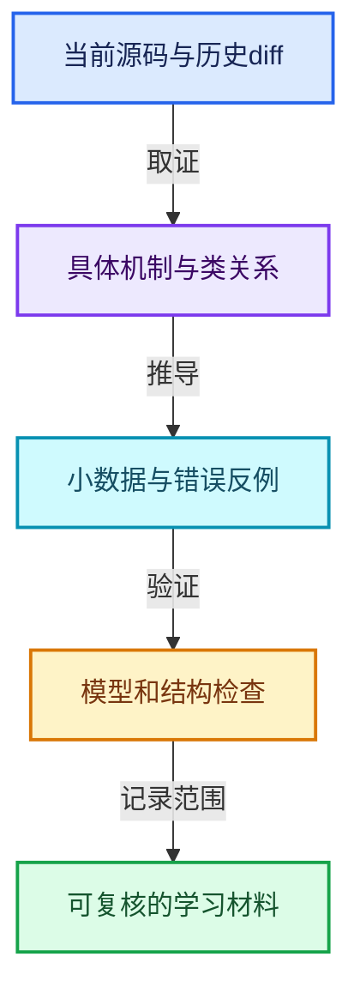
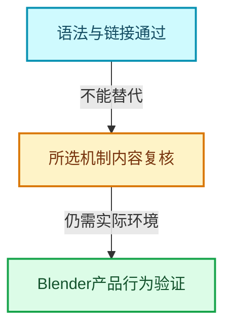

# 几何节点新增专题验收

本轮新增24篇专题，接入既有12方向中的6个相关方向，不建立与原课程脱节的新目录。基准HEAD：`cbda6b96c26c0dee3c3b5cbb93960c4ac06a6b30`。

[新增学习地图](几何节点扩展学习地图.md) · [原有全套报告](验收报告.md)

## 内容与范围

- 65个完整函数讲解单元，按完整函数边界摘录；其中重复跨专题解释的函数另有阅读目的。
- 71个源码摘录；正文摘录与类定义入口共涉及47个当前源码文件，SHA-256逐项记录。
- 正文共96张专用彩色图，每篇4张，分别表达类与数据关系、处理阶段、小数据推演和反例边界。
- 27个历史阅读记录；最后一篇专门分析4个已读取实际diff的Jacques/Hans提交，其他篇提供与主讲文件相关的历史样本。

机制包括注册声明、GeoNodeExecParams、SocketValueVariant、执行图缓存、需求传播、MultiFunction转Field、组件共享、域适配、Set Position、命名与匿名属性、实例引用、Join/Realize、Simulation、Repeat/Foreach、Closure、Bundle、日志与性能诊断。

## 验证结果

| 检查 | 结果 |
|---|---|
| 源码和教学代码 | 本轮检查包含24篇新增正文及全部根目录和方向导航，原文区间、源码哈希、去掉新增注释后的代码一致性均检查。 |
| Markdown与链接 | 本轮结构检查错误0个；覆盖本地文件与显式锚点、围栏、图数。 |
| Mermaid | 当前全局记录解析7679张，错误0个；其中新增正文实际渲染96/96张。 |
| 教学模型 | 11组模型验证通过，包含200组固定种子的随机句柄重映射；不是Blender集成测试。 |

## 模型验证的具体责任

验证了引用表重映射、稀疏选择到紧凑输出、负索引绕回、先求值后提交、部分写入保留未选值、单值与Field条件的需求区别、嵌套容器分离、调用上下文身份、缺输入恢复执行和32位元素计数边界。模型源码使用assert执行，不以文字示例充当运行证据。

模型仅验证本文用于推理的状态关系，未调用Blender的GeometrySet或执行器。原有Vector真实头文件测试仍是独立证据，不借它宣称几何节点已通过产品测试。

## 仍需区分的边界

- 所选函数中1个带结构解析恢复标记；对应摘录可与原文核对，不能称为全部预处理配置下的编译器边界证明。
- 新正文保留121个需要实际类型、模板实例或回调环境进一步确认的调用记录；没有用同名函数强行冒充确定目标。
- 本轮按所选机制补充讲解，不声称所涉及47个文件或原有全套课程全部完成逐行语义审查。
- 不提供未经测量的性能数字；历史提交中的动机与本地测试结果分开标识。
- 未运行完整Blender或交互节点树测试；复杂拓扑、曲线域插值、Simulation持久化和Closure兼容的生产行为仍应在Blender测试环境中验证。

## 文档清单

| 编号 | 文档 | 行数 | 完整函数单元 |
|---|---|---|---|
| GN-01 | [扩展01-几何节点从编辑树到执行结果的全景](09-LazyFunction%E4%B8%8E%E8%8A%82%E7%82%B9%E6%89%A7%E8%A1%8C%E6%9E%B6%E6%9E%84/%E6%89%A9%E5%B1%9501-%E5%87%A0%E4%BD%95%E8%8A%82%E7%82%B9%E4%BB%8E%E7%BC%96%E8%BE%91%E6%A0%91%E5%88%B0%E6%89%A7%E8%A1%8C%E7%BB%93%E6%9E%9C%E7%9A%84%E5%85%A8%E6%99%AF.md) | 586 | 1 |
| GN-02 | [扩展02-节点注册声明与引用关系契约](09-LazyFunction%E4%B8%8E%E8%8A%82%E7%82%B9%E6%89%A7%E8%A1%8C%E6%9E%B6%E6%9E%84/%E6%89%A9%E5%B1%9502-%E8%8A%82%E7%82%B9%E6%B3%A8%E5%86%8C%E5%A3%B0%E6%98%8E%E4%B8%8E%E5%BC%95%E7%94%A8%E5%85%B3%E7%B3%BB%E5%A5%91%E7%BA%A6.md) | 441 | 5 |
| GN-03 | [扩展03-GeoNodeExecParams参数适配与移动语义](09-LazyFunction%E4%B8%8E%E8%8A%82%E7%82%B9%E6%89%A7%E8%A1%8C%E6%9E%B6%E6%9E%84/%E6%89%A9%E5%B1%9503-GeoNodeExecParams%E5%8F%82%E6%95%B0%E9%80%82%E9%85%8D%E4%B8%8E%E7%A7%BB%E5%8A%A8%E8%AF%AD%E4%B9%89.md) | 484 | 3 |
| GN-04 | [扩展04-SocketValueVariant异构值与转换边界](09-LazyFunction%E4%B8%8E%E8%8A%82%E7%82%B9%E6%89%A7%E8%A1%8C%E6%9E%B6%E6%9E%84/%E6%89%A9%E5%B1%9504-SocketValueVariant%E5%BC%82%E6%9E%84%E5%80%BC%E4%B8%8E%E8%BD%AC%E6%8D%A2%E8%BE%B9%E7%95%8C.md) | 504 | 6 |
| GN-05 | [扩展05-执行图构建缓存与树副本所有权](09-LazyFunction%E4%B8%8E%E8%8A%82%E7%82%B9%E6%89%A7%E8%A1%8C%E6%9E%B6%E6%9E%84/%E6%89%A9%E5%B1%9505-%E6%89%A7%E8%A1%8C%E5%9B%BE%E6%9E%84%E5%BB%BA%E7%BC%93%E5%AD%98%E4%B8%8E%E6%A0%91%E5%89%AF%E6%9C%AC%E6%89%80%E6%9C%89%E6%9D%83.md) | 581 | 3 |
| GN-06 | [扩展06-按需执行匿名输出与Switch需求传播](09-LazyFunction%E4%B8%8E%E8%8A%82%E7%82%B9%E6%89%A7%E8%A1%8C%E6%9E%B6%E6%9E%84/%E6%89%A9%E5%B1%9506-%E6%8C%89%E9%9C%80%E6%89%A7%E8%A1%8C%E5%8C%BF%E5%90%8D%E8%BE%93%E5%87%BA%E4%B8%8ESwitch%E9%9C%80%E6%B1%82%E4%BC%A0%E6%92%AD.md) | 407 | 2 |
| GN-07 | [扩展01-数学节点从MultiFunction到FieldOperation](07-MultiFunction%E4%B8%8E%E6%89%B9%E9%87%8F%E6%89%A7%E8%A1%8C/%E6%89%A9%E5%B1%9501-%E6%95%B0%E5%AD%A6%E8%8A%82%E7%82%B9%E4%BB%8EMultiFunction%E5%88%B0FieldOperation.md) | 382 | 2 |
| GN-08 | [扩展01-GeometrySet组件组合与写时分离](05-%E5%87%A0%E4%BD%95%E5%AD%98%E5%82%A8%E4%B8%8E%E6%8B%93%E6%89%91%E6%98%A0%E5%B0%84/%E6%89%A9%E5%B1%9501-GeometrySet%E7%BB%84%E4%BB%B6%E7%BB%84%E5%90%88%E4%B8%8E%E5%86%99%E6%97%B6%E5%88%86%E7%A6%BB.md) | 510 | 4 |
| GN-09 | [扩展01-几何FieldContext属性域与跨域求值](08-Field%E8%A1%A8%E8%BE%BE%E5%BC%8F%E4%B8%8E%E6%B1%82%E5%80%BC/%E6%89%A9%E5%B1%9501-%E5%87%A0%E4%BD%95FieldContext%E5%B1%9E%E6%80%A7%E5%9F%9F%E4%B8%8E%E8%B7%A8%E5%9F%9F%E6%B1%82%E5%80%BC.md) | 396 | 2 |
| GN-10 | [扩展02-SetPosition读取写入与贝塞尔控制柄](08-Field%E8%A1%A8%E8%BE%BE%E5%BC%8F%E4%B8%8E%E6%B1%82%E5%80%BC/%E6%89%A9%E5%B1%9502-SetPosition%E8%AF%BB%E5%8F%96%E5%86%99%E5%85%A5%E4%B8%8E%E8%B4%9D%E5%A1%9E%E5%B0%94%E6%8E%A7%E5%88%B6%E6%9F%84.md) | 477 | 3 |
| GN-11 | [扩展03-StoreNamedAttribute类型域与部分写入](08-Field%E8%A1%A8%E8%BE%BE%E5%BC%8F%E4%B8%8E%E6%B1%82%E5%80%BC/%E6%89%A9%E5%B1%9503-StoreNamedAttribute%E7%B1%BB%E5%9E%8B%E5%9F%9F%E4%B8%8E%E9%83%A8%E5%88%86%E5%86%99%E5%85%A5.md) | 498 | 2 |
| GN-12 | [扩展02-属性捕获求值暂存与提交协议](05-%E5%87%A0%E4%BD%95%E5%AD%98%E5%82%A8%E4%B8%8E%E6%8B%93%E6%89%91%E6%98%A0%E5%B0%84/%E6%89%A9%E5%B1%9502-%E5%B1%9E%E6%80%A7%E6%8D%95%E8%8E%B7%E6%B1%82%E5%80%BC%E6%9A%82%E5%AD%98%E4%B8%8E%E6%8F%90%E4%BA%A4%E5%8D%8F%E8%AE%AE.md) | 641 | 2 |
| GN-13 | [扩展01-CaptureAttribute匿名属性引用与清理](10-%E5%BC%95%E7%94%A8%E7%94%9F%E5%91%BD%E5%91%A8%E6%9C%9F%E4%B8%8EClosure/%E6%89%A9%E5%B1%9501-CaptureAttribute%E5%8C%BF%E5%90%8D%E5%B1%9E%E6%80%A7%E5%BC%95%E7%94%A8%E4%B8%8E%E6%B8%85%E7%90%86.md) | 496 | 2 |
| GN-14 | [扩展03-Instances引用表句柄与变换数组](05-%E5%87%A0%E4%BD%95%E5%AD%98%E5%82%A8%E4%B8%8E%E6%8B%93%E6%89%91%E6%98%A0%E5%B0%84/%E6%89%A9%E5%B1%9503-Instances%E5%BC%95%E7%94%A8%E8%A1%A8%E5%8F%A5%E6%9F%84%E4%B8%8E%E5%8F%98%E6%8D%A2%E6%95%B0%E7%BB%84.md) | 400 | 5 |
| GN-15 | [扩展04-InstanceOnPoints选择压缩与引用重映射](05-%E5%87%A0%E4%BD%95%E5%AD%98%E5%82%A8%E4%B8%8E%E6%8B%93%E6%89%91%E6%98%A0%E5%B0%84/%E6%89%A9%E5%B1%9504-InstanceOnPoints%E9%80%89%E6%8B%A9%E5%8E%8B%E7%BC%A9%E4%B8%8E%E5%BC%95%E7%94%A8%E9%87%8D%E6%98%A0%E5%B0%84.md) | 497 | 1 |
| GN-16 | [扩展05-JoinGeometry组件分派与Realize复用](05-%E5%87%A0%E4%BD%95%E5%AD%98%E5%82%A8%E4%B8%8E%E6%8B%93%E6%89%91%E6%98%A0%E5%B0%84/%E6%89%A9%E5%B1%9505-JoinGeometry%E7%BB%84%E4%BB%B6%E5%88%86%E6%B4%BE%E4%B8%8ERealize%E5%A4%8D%E7%94%A8.md) | 538 | 3 |
| GN-17 | [扩展06-RealizeInstances深度Field与任务流水线](05-%E5%87%A0%E4%BD%95%E5%AD%98%E5%82%A8%E4%B8%8E%E6%8B%93%E6%89%91%E6%98%A0%E5%B0%84/%E6%89%A9%E5%B1%9506-RealizeInstances%E6%B7%B1%E5%BA%A6Field%E4%B8%8E%E4%BB%BB%E5%8A%A1%E6%B5%81%E6%B0%B4%E7%BA%BF.md) | 806 | 3 |
| GN-18 | [扩展02-Simulation状态协议缓存与时间步](10-%E5%BC%95%E7%94%A8%E7%94%9F%E5%91%BD%E5%91%A8%E6%9C%9F%E4%B8%8EClosure/%E6%89%A9%E5%B1%9502-Simulation%E7%8A%B6%E6%80%81%E5%8D%8F%E8%AE%AE%E7%BC%93%E5%AD%98%E4%B8%8E%E6%97%B6%E9%97%B4%E6%AD%A5.md) | 446 | 2 |
| GN-19 | [扩展03-Repeat与Foreach执行状态及上下文身份](10-%E5%BC%95%E7%94%A8%E7%94%9F%E5%91%BD%E5%91%A8%E6%9C%9F%E4%B8%8EClosure/%E6%89%A9%E5%B1%9503-Repeat%E4%B8%8EForeach%E6%89%A7%E8%A1%8C%E7%8A%B6%E6%80%81%E5%8F%8A%E4%B8%8A%E4%B8%8B%E6%96%87%E8%BA%AB%E4%BB%BD.md) | 455 | 3 |
| GN-20 | [扩展04-Closure可传递程序捕获与调用边界](10-%E5%BC%95%E7%94%A8%E7%94%9F%E5%91%BD%E5%91%A8%E6%9C%9F%E4%B8%8EClosure/%E6%89%A9%E5%B1%9504-Closure%E5%8F%AF%E4%BC%A0%E9%80%92%E7%A8%8B%E5%BA%8F%E6%8D%95%E8%8E%B7%E4%B8%8E%E8%B0%83%E7%94%A8%E8%BE%B9%E7%95%8C.md) | 459 | 2 |
| GN-21 | [扩展05-Bundle嵌套值路径查找与写时复制](10-%E5%BC%95%E7%94%A8%E7%94%9F%E5%91%BD%E5%91%A8%E6%9C%9F%E4%B8%8EClosure/%E6%89%A9%E5%B1%9505-Bundle%E5%B5%8C%E5%A5%97%E5%80%BC%E8%B7%AF%E5%BE%84%E6%9F%A5%E6%89%BE%E4%B8%8E%E5%86%99%E6%97%B6%E5%A4%8D%E5%88%B6.md) | 378 | 3 |
| GN-22 | [扩展07-ComputeContext日志映射与副作用根](09-LazyFunction%E4%B8%8E%E8%8A%82%E7%82%B9%E6%89%A7%E8%A1%8C%E6%9E%B6%E6%9E%84/%E6%89%A9%E5%B1%9507-ComputeContext%E6%97%A5%E5%BF%97%E6%98%A0%E5%B0%84%E4%B8%8E%E5%89%AF%E4%BD%9C%E7%94%A8%E6%A0%B9.md) | 361 | 2 |
| GN-23 | [扩展01-几何节点性能诊断与架构训练](06-%E9%9A%90%E5%BC%8F%E5%85%B1%E4%BA%AB%E4%B8%8E%E7%BC%93%E5%AD%98%E7%B3%BB%E7%BB%9F/%E6%89%A9%E5%B1%9501-%E5%87%A0%E4%BD%95%E8%8A%82%E7%82%B9%E6%80%A7%E8%83%BD%E8%AF%8A%E6%96%AD%E4%B8%8E%E6%9E%B6%E6%9E%84%E8%AE%AD%E7%BB%83.md) | 272 | 2 |
| GN-24 | [扩展08-Jacques与Hans提交中的架构演化](09-LazyFunction%E4%B8%8E%E8%8A%82%E7%82%B9%E6%89%A7%E8%A1%8C%E6%9E%B6%E6%9E%84/%E6%89%A9%E5%B1%9508-Jacques%E4%B8%8EHans%E6%8F%90%E4%BA%A4%E4%B8%AD%E7%9A%84%E6%9E%B6%E6%9E%84%E6%BC%94%E5%8C%96.md) | 344 | 2 |

## 证据与维护入口

- [geometry-extension.json](_evidence/geometry-extension.json)
- [geometry-models-test.json](_evidence/geometry-models-test.json)
- [geometry-extension-check.json](_evidence/geometry-extension-check.json)
- [revision-check.json](_evidence/revision-check.json)
- [mermaid-check.json](_evidence/mermaid-check.json)

内容维护：`_tools/geometry_topics.py`；生成：`_tools/build_geometry_extension.py`；模型验证：`_tools/geometry_models_test.py`。来源哈希不匹配时生成脚本停止，要求先刷新结构索引后重新核对。

