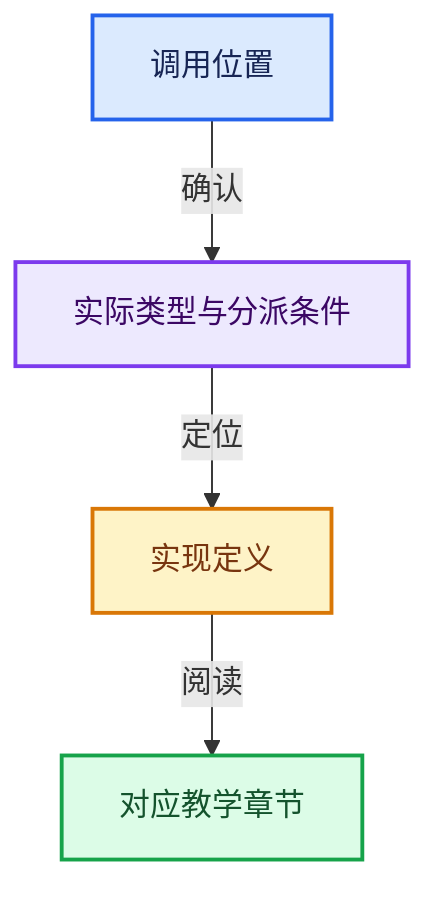
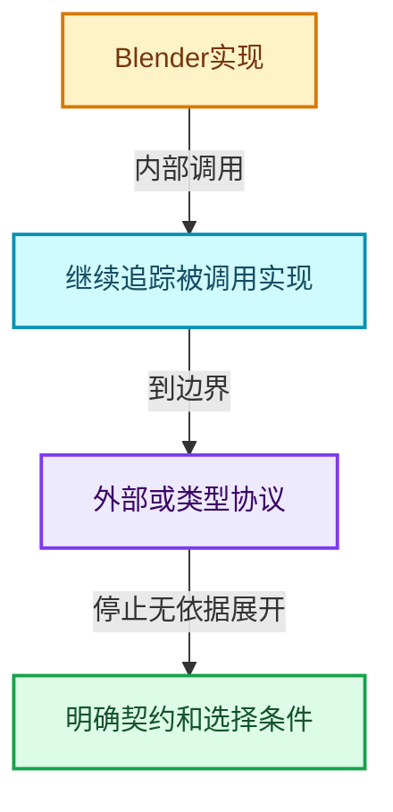

# 符号依赖与实现索引

从调用表达式定位到实现，再定位到教学章节。类型相关协议、宏分支、函数指针和外部契约分别记录，不用同名引用冒充已证明的动态调用。

## 按实现文件查找

- [intern/atomic/intern/atomic_ops_ext.h](05-%E5%87%A0%E4%BD%95%E5%AD%98%E5%82%A8%E4%B8%8E%E6%8B%93%E6%89%91%E6%98%A0%E5%B0%84/%E4%BE%9D%E8%B5%96-atomic_ops_ext-271a62.md)
- [intern/atomic/intern/atomic_ops_msvc.h](05-%E5%87%A0%E4%BD%95%E5%AD%98%E5%82%A8%E4%B8%8E%E6%8B%93%E6%89%91%E6%98%A0%E5%B0%84/%E4%BE%9D%E8%B5%96-atomic_ops_msvc-14f679.md)
- [intern/atomic/intern/atomic_ops_unix.h](05-%E5%87%A0%E4%BD%95%E5%AD%98%E5%82%A8%E4%B8%8E%E6%8B%93%E6%89%91%E6%98%A0%E5%B0%84/%E4%BE%9D%E8%B5%96-atomic_ops_unix-6b7be2.md)
- [intern/clog/CLG_log.h](05-%E5%87%A0%E4%BD%95%E5%AD%98%E5%82%A8%E4%B8%8E%E6%8B%93%E6%89%91%E6%98%A0%E5%B0%84/%E4%BE%9D%E8%B5%96-CLG_log-e9051b.md)
- [intern/clog/clog.cc](05-%E5%87%A0%E4%BD%95%E5%AD%98%E5%82%A8%E4%B8%8E%E6%8B%93%E6%89%91%E6%98%A0%E5%B0%84/%E4%BE%9D%E8%B5%96-clog-a0bec8.md)
- [intern/cycles/app/cycles_standalone.cpp](05-%E5%87%A0%E4%BD%95%E5%AD%98%E5%82%A8%E4%B8%8E%E6%8B%93%E6%89%91%E6%98%A0%E5%B0%84/%E4%BE%9D%E8%B5%96-cycles_standalone-7f3bbe.md)
- [intern/cycles/app/cycles_xml.h](05-%E5%87%A0%E4%BD%95%E5%AD%98%E5%82%A8%E4%B8%8E%E6%8B%93%E6%89%91%E6%98%A0%E5%B0%84/%E4%BE%9D%E8%B5%96-cycles_xml-1f0542.md)
- [intern/cycles/blender/id_map.h](05-%E5%87%A0%E4%BD%95%E5%AD%98%E5%82%A8%E4%B8%8E%E6%8B%93%E6%89%91%E6%98%A0%E5%B0%84/%E4%BE%9D%E8%B5%96-id_map-959220.md)
- [intern/cycles/blender/python.cpp](05-%E5%87%A0%E4%BD%95%E5%AD%98%E5%82%A8%E4%B8%8E%E6%8B%93%E6%89%91%E6%98%A0%E5%B0%84/%E4%BE%9D%E8%B5%96-python-ee139d.md)
- [intern/cycles/blender/session.cpp](05-%E5%87%A0%E4%BD%95%E5%AD%98%E5%82%A8%E4%B8%8E%E6%8B%93%E6%89%91%E6%98%A0%E5%B0%84/%E4%BE%9D%E8%B5%96-session-bf7379.md)
- [intern/cycles/blender/util.h](05-%E5%87%A0%E4%BD%95%E5%AD%98%E5%82%A8%E4%B8%8E%E6%8B%93%E6%89%91%E6%98%A0%E5%B0%84/%E4%BE%9D%E8%B5%96-util-8a10d2.md)
- [intern/cycles/bvh/binning.cpp](05-%E5%87%A0%E4%BD%95%E5%AD%98%E5%82%A8%E4%B8%8E%E6%8B%93%E6%89%91%E6%98%A0%E5%B0%84/%E4%BE%9D%E8%B5%96-binning-6d6f5c.md)
- [intern/cycles/device/queue.h](05-%E5%87%A0%E4%BD%95%E5%AD%98%E5%82%A8%E4%B8%8E%E6%8B%93%E6%89%91%E6%98%A0%E5%B0%84/%E4%BE%9D%E8%B5%96-queue-9648eb.md)
- [intern/cycles/graph/node.cpp](05-%E5%87%A0%E4%BD%95%E5%AD%98%E5%82%A8%E4%B8%8E%E6%8B%93%E6%89%91%E6%98%A0%E5%B0%84/%E4%BE%9D%E8%B5%96-node-d6ff7e.md)
- [intern/cycles/graph/node_type.cpp](05-%E5%87%A0%E4%BD%95%E5%AD%98%E5%82%A8%E4%B8%8E%E6%8B%93%E6%89%91%E6%98%A0%E5%B0%84/%E4%BE%9D%E8%B5%96-node_type-7c58a3.md)
- [intern/cycles/graph/node_type.h](05-%E5%87%A0%E4%BD%95%E5%AD%98%E5%82%A8%E4%B8%8E%E6%8B%93%E6%89%91%E6%98%A0%E5%B0%84/%E4%BE%9D%E8%B5%96-node_type-22d623.md)
- [intern/cycles/hydra/render_buffer.cpp](05-%E5%87%A0%E4%BD%95%E5%AD%98%E5%82%A8%E4%B8%8E%E6%8B%93%E6%89%91%E6%98%A0%E5%B0%84/%E4%BE%9D%E8%B5%96-render_buffer-3897e3.md)
- [intern/cycles/kernel/device/cuda/compat.h](05-%E5%87%A0%E4%BD%95%E5%AD%98%E5%82%A8%E4%B8%8E%E6%8B%93%E6%89%91%E6%98%A0%E5%B0%84/%E4%BE%9D%E8%B5%96-compat-e9eab7.md)
- [intern/cycles/kernel/device/hip/compat.h](05-%E5%87%A0%E4%BD%95%E5%AD%98%E5%82%A8%E4%B8%8E%E6%8B%93%E6%89%91%E6%98%A0%E5%B0%84/%E4%BE%9D%E8%B5%96-compat-9e0a25.md)
- [intern/cycles/kernel/device/metal/compat.h](05-%E5%87%A0%E4%BD%95%E5%AD%98%E5%82%A8%E4%B8%8E%E6%8B%93%E6%89%91%E6%98%A0%E5%B0%84/%E4%BE%9D%E8%B5%96-compat-efe0e9.md)
- [intern/cycles/kernel/device/oneapi/compat.h](05-%E5%87%A0%E4%BD%95%E5%AD%98%E5%82%A8%E4%B8%8E%E6%8B%93%E6%89%91%E6%98%A0%E5%B0%84/%E4%BE%9D%E8%B5%96-compat-56205c.md)
- [intern/cycles/kernel/integrator/guiding.h](05-%E5%87%A0%E4%BD%95%E5%AD%98%E5%82%A8%E4%B8%8E%E6%8B%93%E6%89%91%E6%98%A0%E5%B0%84/%E4%BE%9D%E8%B5%96-guiding-98f15c.md)
- [intern/cycles/kernel/osl/shaders/node_math.h](05-%E5%87%A0%E4%BD%95%E5%AD%98%E5%82%A8%E4%B8%8E%E6%8B%93%E6%89%91%E6%98%A0%E5%B0%84/%E4%BE%9D%E8%B5%96-node_math-ec728a.md)
- [intern/cycles/kernel/osl/shaders/node_noise.h](05-%E5%87%A0%E4%BD%95%E5%AD%98%E5%82%A8%E4%B8%8E%E6%8B%93%E6%89%91%E6%98%A0%E5%B0%84/%E4%BE%9D%E8%B5%96-node_noise-c645a4.md)
- [intern/cycles/kernel/osl/shaders/node_radial_tiling_shared.h](05-%E5%87%A0%E4%BD%95%E5%AD%98%E5%82%A8%E4%B8%8E%E6%8B%93%E6%89%91%E6%98%A0%E5%B0%84/%E4%BE%9D%E8%B5%96-node_radial_tiling_shared-b14bc2.md)
- [intern/cycles/kernel/svm/radial_tiling_shared.h](05-%E5%87%A0%E4%BD%95%E5%AD%98%E5%82%A8%E4%B8%8E%E6%8B%93%E6%89%91%E6%98%A0%E5%B0%84/%E4%BE%9D%E8%B5%96-radial_tiling_shared-98abf9.md)
- [intern/cycles/scene/attribute.cpp](05-%E5%87%A0%E4%BD%95%E5%AD%98%E5%82%A8%E4%B8%8E%E6%8B%93%E6%89%91%E6%98%A0%E5%B0%84/%E4%BE%9D%E8%B5%96-attribute-dd7b4e.md)
- [intern/cycles/scene/geometry.cpp](05-%E5%87%A0%E4%BD%95%E5%AD%98%E5%82%A8%E4%B8%8E%E6%8B%93%E6%89%91%E6%98%A0%E5%B0%84/%E4%BE%9D%E8%B5%96-geometry-390a47.md)
- [intern/cycles/scene/geometry.h](05-%E5%87%A0%E4%BD%95%E5%AD%98%E5%82%A8%E4%B8%8E%E6%8B%93%E6%89%91%E6%98%A0%E5%B0%84/%E4%BE%9D%E8%B5%96-geometry-3276f6.md)
- [intern/cycles/scene/hair.h](05-%E5%87%A0%E4%BD%95%E5%AD%98%E5%82%A8%E4%B8%8E%E6%8B%93%E6%89%91%E6%98%A0%E5%B0%84/%E4%BE%9D%E8%B5%96-hair-67e944.md)
- [intern/cycles/scene/image_cache.cpp](05-%E5%87%A0%E4%BD%95%E5%AD%98%E5%82%A8%E4%B8%8E%E6%8B%93%E6%89%91%E6%98%A0%E5%B0%84/%E4%BE%9D%E8%B5%96-image_cache-2a529e.md)
- [intern/cycles/scene/image_cache.h](05-%E5%87%A0%E4%BD%95%E5%AD%98%E5%82%A8%E4%B8%8E%E6%8B%93%E6%89%91%E6%98%A0%E5%B0%84/%E4%BE%9D%E8%B5%96-image_cache-ab8b3b.md)
- [intern/cycles/scene/mesh.cpp](05-%E5%87%A0%E4%BD%95%E5%AD%98%E5%82%A8%E4%B8%8E%E6%8B%93%E6%89%91%E6%98%A0%E5%B0%84/%E4%BE%9D%E8%B5%96-mesh-a4d7f1.md)
- [intern/cycles/scene/mesh.h](05-%E5%87%A0%E4%BD%95%E5%AD%98%E5%82%A8%E4%B8%8E%E6%8B%93%E6%89%91%E6%98%A0%E5%B0%84/%E4%BE%9D%E8%B5%96-mesh-3a7c29.md)
- [intern/cycles/scene/pass.cpp](05-%E5%87%A0%E4%BD%95%E5%AD%98%E5%82%A8%E4%B8%8E%E6%8B%93%E6%89%91%E6%98%A0%E5%B0%84/%E4%BE%9D%E8%B5%96-pass-d31598.md)
- [intern/cycles/scene/pointcloud.cpp](05-%E5%87%A0%E4%BD%95%E5%AD%98%E5%82%A8%E4%B8%8E%E6%8B%93%E6%89%91%E6%98%A0%E5%B0%84/%E4%BE%9D%E8%B5%96-pointcloud-ada28f.md)
- [intern/cycles/scene/shader_nodes.h](05-%E5%87%A0%E4%BD%95%E5%AD%98%E5%82%A8%E4%B8%8E%E6%8B%93%E6%89%91%E6%98%A0%E5%B0%84/%E4%BE%9D%E8%B5%96-shader_nodes-5bcedf.md)
- [intern/cycles/session/display_driver.cpp](05-%E5%87%A0%E4%BD%95%E5%AD%98%E5%82%A8%E4%B8%8E%E6%8B%93%E6%89%91%E6%98%A0%E5%B0%84/%E4%BE%9D%E8%B5%96-display_driver-7f7844.md)
- [intern/cycles/subd/osd.cpp](05-%E5%87%A0%E4%BD%95%E5%AD%98%E5%82%A8%E4%B8%8E%E6%8B%93%E6%89%91%E6%98%A0%E5%B0%84/%E4%BE%9D%E8%B5%96-osd-7e2706.md)
- [intern/cycles/subd/patch.cpp](05-%E5%87%A0%E4%BD%95%E5%AD%98%E5%82%A8%E4%B8%8E%E6%8B%93%E6%89%91%E6%98%A0%E5%B0%84/%E4%BE%9D%E8%B5%96-patch-26f041.md)
- [intern/cycles/subd/split.cpp](05-%E5%87%A0%E4%BD%95%E5%AD%98%E5%82%A8%E4%B8%8E%E6%8B%93%E6%89%91%E6%98%A0%E5%B0%84/%E4%BE%9D%E8%B5%96-split-5f5804.md)
- [intern/cycles/subd/subpatch.h](05-%E5%87%A0%E4%BD%95%E5%AD%98%E5%82%A8%E4%B8%8E%E6%8B%93%E6%89%91%E6%98%A0%E5%B0%84/%E4%BE%9D%E8%B5%96-subpatch-ee57c2.md)
- [intern/cycles/test/util_half_test.h](05-%E5%87%A0%E4%BD%95%E5%AD%98%E5%82%A8%E4%B8%8E%E6%8B%93%E6%89%91%E6%98%A0%E5%B0%84/%E4%BE%9D%E8%B5%96-util_half_test-cbec66.md)
- [intern/cycles/util/aligned_malloc.cpp](05-%E5%87%A0%E4%BD%95%E5%AD%98%E5%82%A8%E4%B8%8E%E6%8B%93%E6%89%91%E6%98%A0%E5%B0%84/%E4%BE%9D%E8%B5%96-aligned_malloc-6a6909.md)
- [intern/cycles/util/array.h](05-%E5%87%A0%E4%BD%95%E5%AD%98%E5%82%A8%E4%B8%8E%E6%8B%93%E6%89%91%E6%98%A0%E5%B0%84/%E4%BE%9D%E8%B5%96-array-0b4e3f.md)
- [intern/cycles/util/defines.h](05-%E5%87%A0%E4%BD%95%E5%AD%98%E5%82%A8%E4%B8%8E%E6%8B%93%E6%89%91%E6%98%A0%E5%B0%84/%E4%BE%9D%E8%B5%96-defines-cd82f8.md)
- [intern/cycles/util/guarded_allocator.cpp](05-%E5%87%A0%E4%BD%95%E5%AD%98%E5%82%A8%E4%B8%8E%E6%8B%93%E6%89%91%E6%98%A0%E5%B0%84/%E4%BE%9D%E8%B5%96-guarded_allocator-6ffa00.md)
- [intern/cycles/util/guarded_allocator.h](05-%E5%87%A0%E4%BD%95%E5%AD%98%E5%82%A8%E4%B8%8E%E6%8B%93%E6%89%91%E6%98%A0%E5%B0%84/%E4%BE%9D%E8%B5%96-guarded_allocator-e5a8cb.md)
- [intern/cycles/util/math_base.h](05-%E5%87%A0%E4%BD%95%E5%AD%98%E5%82%A8%E4%B8%8E%E6%8B%93%E6%89%91%E6%98%A0%E5%B0%84/%E4%BE%9D%E8%B5%96-math_base-b01ba9.md)
- [intern/cycles/util/math_dual.h](05-%E5%87%A0%E4%BD%95%E5%AD%98%E5%82%A8%E4%B8%8E%E6%8B%93%E6%89%91%E6%98%A0%E5%B0%84/%E4%BE%9D%E8%B5%96-math_dual-a0f3ee.md)
- [intern/cycles/util/math_fast.h](05-%E5%87%A0%E4%BD%95%E5%AD%98%E5%82%A8%E4%B8%8E%E6%8B%93%E6%89%91%E6%98%A0%E5%B0%84/%E4%BE%9D%E8%B5%96-math_fast-146819.md)
- [intern/cycles/util/math_float2.h](05-%E5%87%A0%E4%BD%95%E5%AD%98%E5%82%A8%E4%B8%8E%E6%8B%93%E6%89%91%E6%98%A0%E5%B0%84/%E4%BE%9D%E8%B5%96-math_float2-be3c03.md)
- [intern/cycles/util/math_float3.h](05-%E5%87%A0%E4%BD%95%E5%AD%98%E5%82%A8%E4%B8%8E%E6%8B%93%E6%89%91%E6%98%A0%E5%B0%84/%E4%BE%9D%E8%B5%96-math_float3-eb3e6f.md)
- [intern/cycles/util/math_float4.h](05-%E5%87%A0%E4%BD%95%E5%AD%98%E5%82%A8%E4%B8%8E%E6%8B%93%E6%89%91%E6%98%A0%E5%B0%84/%E4%BE%9D%E8%B5%96-math_float4-2d91ea.md)
- [intern/cycles/util/math_float8.h](05-%E5%87%A0%E4%BD%95%E5%AD%98%E5%82%A8%E4%B8%8E%E6%8B%93%E6%89%91%E6%98%A0%E5%B0%84/%E4%BE%9D%E8%B5%96-math_float8-4760ed.md)
- [intern/cycles/util/math_int3.h](05-%E5%87%A0%E4%BD%95%E5%AD%98%E5%82%A8%E4%B8%8E%E6%8B%93%E6%89%91%E6%98%A0%E5%B0%84/%E4%BE%9D%E8%B5%96-math_int3-53dfcc.md)
- [intern/cycles/util/math_int4.h](05-%E5%87%A0%E4%BD%95%E5%AD%98%E5%82%A8%E4%B8%8E%E6%8B%93%E6%89%91%E6%98%A0%E5%B0%84/%E4%BE%9D%E8%B5%96-math_int4-34bf39.md)
- [intern/cycles/util/math_int8.h](05-%E5%87%A0%E4%BD%95%E5%AD%98%E5%82%A8%E4%B8%8E%E6%8B%93%E6%89%91%E6%98%A0%E5%B0%84/%E4%BE%9D%E8%B5%96-math_int8-80ce43.md)
- [intern/cycles/util/math_quaternion.h](05-%E5%87%A0%E4%BD%95%E5%AD%98%E5%82%A8%E4%B8%8E%E6%8B%93%E6%89%91%E6%98%A0%E5%B0%84/%E4%BE%9D%E8%B5%96-math_quaternion-957b27.md)
- [intern/cycles/util/path.cpp](05-%E5%87%A0%E4%BD%95%E5%AD%98%E5%82%A8%E4%B8%8E%E6%8B%93%E6%89%91%E6%98%A0%E5%B0%84/%E4%BE%9D%E8%B5%96-path-126dbb.md)
- [intern/cycles/util/simd.h](05-%E5%87%A0%E4%BD%95%E5%AD%98%E5%82%A8%E4%B8%8E%E6%8B%93%E6%89%91%E6%98%A0%E5%B0%84/%E4%BE%9D%E8%B5%96-simd-b50468.md)
- [intern/cycles/util/transform.h](05-%E5%87%A0%E4%BD%95%E5%AD%98%E5%82%A8%E4%B8%8E%E6%8B%93%E6%89%91%E6%98%A0%E5%B0%84/%E4%BE%9D%E8%B5%96-transform-df248a.md)
- [intern/cycles/util/types_dual.h](05-%E5%87%A0%E4%BD%95%E5%AD%98%E5%82%A8%E4%B8%8E%E6%8B%93%E6%89%91%E6%98%A0%E5%B0%84/%E4%BE%9D%E8%B5%96-types_dual-2ddd2c.md)
- [intern/cycles/util/types_float2.h](05-%E5%87%A0%E4%BD%95%E5%AD%98%E5%82%A8%E4%B8%8E%E6%8B%93%E6%89%91%E6%98%A0%E5%B0%84/%E4%BE%9D%E8%B5%96-types_float2-e7a8fa.md)
- [intern/cycles/util/types_float3.h](05-%E5%87%A0%E4%BD%95%E5%AD%98%E5%82%A8%E4%B8%8E%E6%8B%93%E6%89%91%E6%98%A0%E5%B0%84/%E4%BE%9D%E8%B5%96-types_float3-48c65a.md)
- [intern/cycles/util/types_float3x3.h](05-%E5%87%A0%E4%BD%95%E5%AD%98%E5%82%A8%E4%B8%8E%E6%8B%93%E6%89%91%E6%98%A0%E5%B0%84/%E4%BE%9D%E8%B5%96-types_float3x3-79862d.md)
- [intern/cycles/util/types_float4.h](05-%E5%87%A0%E4%BD%95%E5%AD%98%E5%82%A8%E4%B8%8E%E6%8B%93%E6%89%91%E6%98%A0%E5%B0%84/%E4%BE%9D%E8%B5%96-types_float4-fe598f.md)
- [intern/cycles/util/types_float8.h](05-%E5%87%A0%E4%BD%95%E5%AD%98%E5%82%A8%E4%B8%8E%E6%8B%93%E6%89%91%E6%98%A0%E5%B0%84/%E4%BE%9D%E8%B5%96-types_float8-8fe1c9.md)
- [intern/cycles/util/types_int3.h](05-%E5%87%A0%E4%BD%95%E5%AD%98%E5%82%A8%E4%B8%8E%E6%8B%93%E6%89%91%E6%98%A0%E5%B0%84/%E4%BE%9D%E8%B5%96-types_int3-7d3986.md)
- [intern/cycles/util/types_int4.h](05-%E5%87%A0%E4%BD%95%E5%AD%98%E5%82%A8%E4%B8%8E%E6%8B%93%E6%89%91%E6%98%A0%E5%B0%84/%E4%BE%9D%E8%B5%96-types_int4-5a7d8e.md)
- [intern/cycles/util/types_int8.h](05-%E5%87%A0%E4%BD%95%E5%AD%98%E5%82%A8%E4%B8%8E%E6%8B%93%E6%89%91%E6%98%A0%E5%B0%84/%E4%BE%9D%E8%B5%96-types_int8-f5dcfc.md)
- [intern/cycles/util/types_quaternion.h](05-%E5%87%A0%E4%BD%95%E5%AD%98%E5%82%A8%E4%B8%8E%E6%8B%93%E6%89%91%E6%98%A0%E5%B0%84/%E4%BE%9D%E8%B5%96-types_quaternion-4c3c66.md)
- [intern/cycles/util/types_uchar4.h](05-%E5%87%A0%E4%BD%95%E5%AD%98%E5%82%A8%E4%B8%8E%E6%8B%93%E6%89%91%E6%98%A0%E5%B0%84/%E4%BE%9D%E8%B5%96-types_uchar4-f8b270.md)
- [intern/cycles/util/types_uint2.h](05-%E5%87%A0%E4%BD%95%E5%AD%98%E5%82%A8%E4%B8%8E%E6%8B%93%E6%89%91%E6%98%A0%E5%B0%84/%E4%BE%9D%E8%B5%96-types_uint2-d0ea06.md)
- [intern/cycles/util/types_uint3.h](05-%E5%87%A0%E4%BD%95%E5%AD%98%E5%82%A8%E4%B8%8E%E6%8B%93%E6%89%91%E6%98%A0%E5%B0%84/%E4%BE%9D%E8%B5%96-types_uint3-654ef1.md)
- [intern/cycles/util/types_uint4.h](05-%E5%87%A0%E4%BD%95%E5%AD%98%E5%82%A8%E4%B8%8E%E6%8B%93%E6%89%91%E6%98%A0%E5%B0%84/%E4%BE%9D%E8%B5%96-types_uint4-675ccb.md)
- [intern/cycles/util/unique_ptr_vector.h](05-%E5%87%A0%E4%BD%95%E5%AD%98%E5%82%A8%E4%B8%8E%E6%8B%93%E6%89%91%E6%98%A0%E5%B0%84/%E4%BE%9D%E8%B5%96-unique_ptr_vector-b13772.md)
- [intern/dbus_dynload/intern/dbus_dynload_utils.h](05-%E5%87%A0%E4%BD%95%E5%AD%98%E5%82%A8%E4%B8%8E%E6%8B%93%E6%89%91%E6%98%A0%E5%B0%84/%E4%BE%9D%E8%B5%96-dbus_dynload_utils-f2a236.md)
- [intern/dualcon/intern/Projections.cpp](05-%E5%87%A0%E4%BD%95%E5%AD%98%E5%82%A8%E4%B8%8E%E6%8B%93%E6%89%91%E6%98%A0%E5%B0%84/%E4%BE%9D%E8%B5%96-Projections-91a559.md)
- [intern/dualcon/intern/Queue.h](05-%E5%87%A0%E4%BD%95%E5%AD%98%E5%82%A8%E4%B8%8E%E6%8B%93%E6%89%91%E6%98%A0%E5%B0%84/%E4%BE%9D%E8%B5%96-Queue-104268.md)
- [intern/dualcon/intern/dualcon_c_api.cpp](05-%E5%87%A0%E4%BD%95%E5%AD%98%E5%82%A8%E4%B8%8E%E6%8B%93%E6%89%91%E6%98%A0%E5%B0%84/%E4%BE%9D%E8%B5%96-dualcon_c_api-e6fd00.md)
- [intern/dualcon/intern/octree.cpp](05-%E5%87%A0%E4%BD%95%E5%AD%98%E5%82%A8%E4%B8%8E%E6%8B%93%E6%89%91%E6%98%A0%E5%B0%84/%E4%BE%9D%E8%B5%96-octree-c5818b.md)
- [intern/dualcon/intern/octree.h](05-%E5%87%A0%E4%BD%95%E5%AD%98%E5%82%A8%E4%B8%8E%E6%8B%93%E6%89%91%E6%98%A0%E5%B0%84/%E4%BE%9D%E8%B5%96-octree-aa27b7.md)
- [intern/eigen/intern/eigenvalues.cc](05-%E5%87%A0%E4%BD%95%E5%AD%98%E5%82%A8%E4%B8%8E%E6%8B%93%E6%89%91%E6%98%A0%E5%B0%84/%E4%BE%9D%E8%B5%96-eigenvalues-22cfe0.md)
- [intern/eigen/intern/linear_solver.cc](05-%E5%87%A0%E4%BD%95%E5%AD%98%E5%82%A8%E4%B8%8E%E6%8B%93%E6%89%91%E6%98%A0%E5%B0%84/%E4%BE%9D%E8%B5%96-linear_solver-fa35c0.md)
- [intern/eigen/intern/matrix.cc](05-%E5%87%A0%E4%BD%95%E5%AD%98%E5%82%A8%E4%B8%8E%E6%8B%93%E6%89%91%E6%98%A0%E5%B0%84/%E4%BE%9D%E8%B5%96-matrix-01436c.md)
- [intern/eigen/intern/svd.cc](05-%E5%87%A0%E4%BD%95%E5%AD%98%E5%82%A8%E4%B8%8E%E6%8B%93%E6%89%91%E6%98%A0%E5%B0%84/%E4%BE%9D%E8%B5%96-svd-d0c031.md)
- [intern/ghost/GHOST_IWindow.hh](05-%E5%87%A0%E4%BD%95%E5%AD%98%E5%82%A8%E4%B8%8E%E6%8B%93%E6%89%91%E6%98%A0%E5%B0%84/%E4%BE%9D%E8%B5%96-GHOST_IWindow-540ee7.md)
- [intern/ghost/GHOST_Rect.hh](05-%E5%87%A0%E4%BD%95%E5%AD%98%E5%82%A8%E4%B8%8E%E6%8B%93%E6%89%91%E6%98%A0%E5%B0%84/%E4%BE%9D%E8%B5%96-GHOST_Rect-b69c82.md)
- [intern/ghost/GHOST_Types.hh](05-%E5%87%A0%E4%BD%95%E5%AD%98%E5%82%A8%E4%B8%8E%E6%8B%93%E6%89%91%E6%98%A0%E5%B0%84/%E4%BE%9D%E8%B5%96-GHOST_Types-79c088.md)
- [intern/ghost/intern/GHOST_Debug.hh](05-%E5%87%A0%E4%BD%95%E5%AD%98%E5%82%A8%E4%B8%8E%E6%8B%93%E6%89%91%E6%98%A0%E5%B0%84/%E4%BE%9D%E8%B5%96-GHOST_Debug-d2cec3.md)
- [intern/ghost/intern/GHOST_ISystem.cc](05-%E5%87%A0%E4%BD%95%E5%AD%98%E5%82%A8%E4%B8%8E%E6%8B%93%E6%89%91%E6%98%A0%E5%B0%84/%E4%BE%9D%E8%B5%96-GHOST_ISystem-75010f.md)
- [intern/ghost/intern/GHOST_ISystemPaths.cc](05-%E5%87%A0%E4%BD%95%E5%AD%98%E5%82%A8%E4%B8%8E%E6%8B%93%E6%89%91%E6%98%A0%E5%B0%84/%E4%BE%9D%E8%B5%96-GHOST_ISystemPaths-b4bf3d.md)
- [intern/ghost/intern/GHOST_ImeWin32.cc](05-%E5%87%A0%E4%BD%95%E5%AD%98%E5%82%A8%E4%B8%8E%E6%8B%93%E6%89%91%E6%98%A0%E5%B0%84/%E4%BE%9D%E8%B5%96-GHOST_ImeWin32-d625ae.md)
- [intern/ghost/intern/GHOST_NDOFManager.cc](05-%E5%87%A0%E4%BD%95%E5%AD%98%E5%82%A8%E4%B8%8E%E6%8B%93%E6%89%91%E6%98%A0%E5%B0%84/%E4%BE%9D%E8%B5%96-GHOST_NDOFManager-a4d1bc.md)
- [intern/ghost/intern/GHOST_System.cc](05-%E5%87%A0%E4%BD%95%E5%AD%98%E5%82%A8%E4%B8%8E%E6%8B%93%E6%89%91%E6%98%A0%E5%B0%84/%E4%BE%9D%E8%B5%96-GHOST_System-94cdd0.md)
- [intern/ghost/intern/GHOST_SystemWayland.cc](05-%E5%87%A0%E4%BD%95%E5%AD%98%E5%82%A8%E4%B8%8E%E6%8B%93%E6%89%91%E6%98%A0%E5%B0%84/%E4%BE%9D%E8%B5%96-GHOST_SystemWayland-7c97b0.md)
- [intern/ghost/intern/GHOST_Window.cc](05-%E5%87%A0%E4%BD%95%E5%AD%98%E5%82%A8%E4%B8%8E%E6%8B%93%E6%89%91%E6%98%A0%E5%B0%84/%E4%BE%9D%E8%B5%96-GHOST_Window-d88676.md)
- [intern/ghost/intern/GHOST_Window.hh](05-%E5%87%A0%E4%BD%95%E5%AD%98%E5%82%A8%E4%B8%8E%E6%8B%93%E6%89%91%E6%98%A0%E5%B0%84/%E4%BE%9D%E8%B5%96-GHOST_Window-47becc.md)
- [intern/ghost/intern/GHOST_WindowSDL.cc](05-%E5%87%A0%E4%BD%95%E5%AD%98%E5%82%A8%E4%B8%8E%E6%8B%93%E6%89%91%E6%98%A0%E5%B0%84/%E4%BE%9D%E8%B5%96-GHOST_WindowSDL-fd52db.md)
- [intern/ghost/intern/GHOST_WindowWayland.cc](05-%E5%87%A0%E4%BD%95%E5%AD%98%E5%82%A8%E4%B8%8E%E6%8B%93%E6%89%91%E6%98%A0%E5%B0%84/%E4%BE%9D%E8%B5%96-GHOST_WindowWayland-934deb.md)
- [intern/ghost/intern/GHOST_WindowWin32.cc](05-%E5%87%A0%E4%BD%95%E5%AD%98%E5%82%A8%E4%B8%8E%E6%8B%93%E6%89%91%E6%98%A0%E5%B0%84/%E4%BE%9D%E8%B5%96-GHOST_WindowWin32-a91c51.md)
- [intern/ghost/intern/GHOST_WindowX11.cc](05-%E5%87%A0%E4%BD%95%E5%AD%98%E5%82%A8%E4%B8%8E%E6%8B%93%E6%89%91%E6%98%A0%E5%B0%84/%E4%BE%9D%E8%B5%96-GHOST_WindowX11-4ac837.md)
- [intern/ghost/intern/GHOST_XrException.hh](05-%E5%87%A0%E4%BD%95%E5%AD%98%E5%82%A8%E4%B8%8E%E6%8B%93%E6%89%91%E6%98%A0%E5%B0%84/%E4%BE%9D%E8%B5%96-GHOST_XrException-37f429.md)
- [intern/ghost/intern/GHOST_utildefines.hh](05-%E5%87%A0%E4%BD%95%E5%AD%98%E5%82%A8%E4%B8%8E%E6%8B%93%E6%89%91%E6%98%A0%E5%B0%84/%E4%BE%9D%E8%B5%96-GHOST_utildefines-34b996.md)
- [intern/guardedalloc/MEM_guardedalloc.h](03-%E5%86%85%E5%AD%98%E5%88%86%E9%85%8D%E4%B8%8E%E8%BF%90%E8%A1%8C%E6%97%B6%E7%B1%BB%E5%9E%8B/%E4%BE%9D%E8%B5%96-MEM_guardedalloc-b54eca.md)
- [intern/guardedalloc/MEM_safe_multiply.h](03-%E5%86%85%E5%AD%98%E5%88%86%E9%85%8D%E4%B8%8E%E8%BF%90%E8%A1%8C%E6%97%B6%E7%B1%BB%E5%9E%8B/%E4%BE%9D%E8%B5%96-MEM_safe_multiply-8c8a79.md)
- [intern/guardedalloc/intern/leak_detector.cc](03-%E5%86%85%E5%AD%98%E5%88%86%E9%85%8D%E4%B8%8E%E8%BF%90%E8%A1%8C%E6%97%B6%E7%B1%BB%E5%9E%8B/%E4%BE%9D%E8%B5%96-leak_detector-b5da14.md)
- [intern/guardedalloc/intern/mallocn.cc](03-%E5%86%85%E5%AD%98%E5%88%86%E9%85%8D%E4%B8%8E%E8%BF%90%E8%A1%8C%E6%97%B6%E7%B1%BB%E5%9E%8B/%E4%BE%9D%E8%B5%96-mallocn-afdcd4.md)
- [intern/guardedalloc/intern/mallocn_guarded_impl.cc](03-%E5%86%85%E5%AD%98%E5%88%86%E9%85%8D%E4%B8%8E%E8%BF%90%E8%A1%8C%E6%97%B6%E7%B1%BB%E5%9E%8B/%E4%BE%9D%E8%B5%96-mallocn_guarded_impl-6e71f1.md)
- [intern/guardedalloc/intern/mallocn_inline.hh](03-%E5%86%85%E5%AD%98%E5%88%86%E9%85%8D%E4%B8%8E%E8%BF%90%E8%A1%8C%E6%97%B6%E7%B1%BB%E5%9E%8B/%E4%BE%9D%E8%B5%96-mallocn_inline-a8e1da.md)
- [intern/guardedalloc/intern/mallocn_intern.hh](03-%E5%86%85%E5%AD%98%E5%88%86%E9%85%8D%E4%B8%8E%E8%BF%90%E8%A1%8C%E6%97%B6%E7%B1%BB%E5%9E%8B/%E4%BE%9D%E8%B5%96-mallocn_intern-e4d317.md)
- [intern/guardedalloc/intern/mallocn_lockfree_impl.cc](03-%E5%86%85%E5%AD%98%E5%88%86%E9%85%8D%E4%B8%8E%E8%BF%90%E8%A1%8C%E6%97%B6%E7%B1%BB%E5%9E%8B/%E4%BE%9D%E8%B5%96-mallocn_lockfree_impl-53d317.md)
- [intern/guardedalloc/intern/memory_usage.cc](03-%E5%86%85%E5%AD%98%E5%88%86%E9%85%8D%E4%B8%8E%E8%BF%90%E8%A1%8C%E6%97%B6%E7%B1%BB%E5%9E%8B/%E4%BE%9D%E8%B5%96-memory_usage-0a2000.md)
- [intern/iksolver/intern/IK_Math.h](05-%E5%87%A0%E4%BD%95%E5%AD%98%E5%82%A8%E4%B8%8E%E6%8B%93%E6%89%91%E6%98%A0%E5%B0%84/%E4%BE%9D%E8%B5%96-IK_Math-614efe.md)
- [intern/itasc/Object.hpp](05-%E5%87%A0%E4%BD%95%E5%AD%98%E5%82%A8%E4%B8%8E%E6%8B%93%E6%89%91%E6%98%A0%E5%B0%84/%E4%BE%9D%E8%B5%96-Object-7634b3.md)
- [intern/itasc/kdl/frames.hpp](05-%E5%87%A0%E4%BD%95%E5%AD%98%E5%82%A8%E4%B8%8E%E6%8B%93%E6%89%91%E6%98%A0%E5%B0%84/%E4%BE%9D%E8%B5%96-frames-531715.md)
- [intern/itasc/kdl/utilities/rall2d.h](05-%E5%87%A0%E4%BD%95%E5%AD%98%E5%82%A8%E4%B8%8E%E6%8B%93%E6%89%91%E6%98%A0%E5%B0%84/%E4%BE%9D%E8%B5%96-rall2d-144372.md)
- [intern/itasc/kdl/utilities/traits.h](05-%E5%87%A0%E4%BD%95%E5%AD%98%E5%82%A8%E4%B8%8E%E6%8B%93%E6%89%91%E6%98%A0%E5%B0%84/%E4%BE%9D%E8%B5%96-traits-655f3e.md)
- [intern/libmv/intern/camera_intrinsics.cc](05-%E5%87%A0%E4%BD%95%E5%AD%98%E5%82%A8%E4%B8%8E%E6%8B%93%E6%89%91%E6%98%A0%E5%B0%84/%E4%BE%9D%E8%B5%96-camera_intrinsics-1694e4.md)
- [intern/libmv/intern/homography.cc](05-%E5%87%A0%E4%BD%95%E5%AD%98%E5%82%A8%E4%B8%8E%E6%8B%93%E6%89%91%E6%98%A0%E5%B0%84/%E4%BE%9D%E8%B5%96-homography-9e66f4.md)
- [intern/libmv/intern/stub.cc](05-%E5%87%A0%E4%BD%95%E5%AD%98%E5%82%A8%E4%B8%8E%E6%8B%93%E6%89%91%E6%98%A0%E5%B0%84/%E4%BE%9D%E8%B5%96-stub-989cd2.md)
- [intern/libmv/intern/utildefines.h](05-%E5%87%A0%E4%BD%95%E5%AD%98%E5%82%A8%E4%B8%8E%E6%8B%93%E6%89%91%E6%98%A0%E5%B0%84/%E4%BE%9D%E8%B5%96-utildefines-f77ca8.md)
- [intern/libmv/libmv/autotrack/marker.h](05-%E5%87%A0%E4%BD%95%E5%AD%98%E5%82%A8%E4%B8%8E%E6%8B%93%E6%89%91%E6%98%A0%E5%B0%84/%E4%BE%9D%E8%B5%96-marker-f88969.md)
- [intern/libmv/libmv/multiview/conditioning.cc](05-%E5%87%A0%E4%BD%95%E5%AD%98%E5%82%A8%E4%B8%8E%E6%8B%93%E6%89%91%E6%98%A0%E5%B0%84/%E4%BE%9D%E8%B5%96-conditioning-d281d0.md)
- [intern/libmv/libmv/multiview/homography.cc](05-%E5%87%A0%E4%BD%95%E5%AD%98%E5%82%A8%E4%B8%8E%E6%8B%93%E6%89%91%E6%98%A0%E5%B0%84/%E4%BE%9D%E8%B5%96-homography-9e018a.md)
- [intern/libmv/libmv/multiview/homography_parameterization.h](05-%E5%87%A0%E4%BD%95%E5%AD%98%E5%82%A8%E4%B8%8E%E6%8B%93%E6%89%91%E6%98%A0%E5%B0%84/%E4%BE%9D%E8%B5%96-homography_parameterization-428227.md)
- [intern/libmv/libmv/multiview/projection.cc](05-%E5%87%A0%E4%BD%95%E5%AD%98%E5%82%A8%E4%B8%8E%E6%8B%93%E6%89%91%E6%98%A0%E5%B0%84/%E4%BE%9D%E8%B5%96-projection-2cdbfd.md)
- [intern/libmv/libmv/multiview/projection.h](05-%E5%87%A0%E4%BD%95%E5%AD%98%E5%82%A8%E4%B8%8E%E6%8B%93%E6%89%91%E6%98%A0%E5%B0%84/%E4%BE%9D%E8%B5%96-projection-10222f.md)
- [intern/libmv/libmv/numeric/dogleg.h](05-%E5%87%A0%E4%BD%95%E5%AD%98%E5%82%A8%E4%B8%8E%E6%8B%93%E6%89%91%E6%98%A0%E5%B0%84/%E4%BE%9D%E8%B5%96-dogleg-f988a4.md)
- [intern/libmv/libmv/numeric/levenberg_marquardt.h](05-%E5%87%A0%E4%BD%95%E5%AD%98%E5%82%A8%E4%B8%8E%E6%8B%93%E6%89%91%E6%98%A0%E5%B0%84/%E4%BE%9D%E8%B5%96-levenberg_marquardt-261f51.md)
- [intern/libmv/libmv/numeric/numeric.cc](05-%E5%87%A0%E4%BD%95%E5%AD%98%E5%82%A8%E4%B8%8E%E6%8B%93%E6%89%91%E6%98%A0%E5%B0%84/%E4%BE%9D%E8%B5%96-numeric-651f85.md)
- [intern/libmv/libmv/numeric/numeric.h](05-%E5%87%A0%E4%BD%95%E5%AD%98%E5%82%A8%E4%B8%8E%E6%8B%93%E6%89%91%E6%98%A0%E5%B0%84/%E4%BE%9D%E8%B5%96-numeric-03255c.md)
- [intern/libmv/libmv/simple_pipeline/camera_intrinsics.cc](05-%E5%87%A0%E4%BD%95%E5%AD%98%E5%82%A8%E4%B8%8E%E6%8B%93%E6%89%91%E6%98%A0%E5%B0%84/%E4%BE%9D%E8%B5%96-camera_intrinsics-bf941a.md)
- [intern/libmv/libmv/simple_pipeline/camera_intrinsics.h](05-%E5%87%A0%E4%BD%95%E5%AD%98%E5%82%A8%E4%B8%8E%E6%8B%93%E6%89%91%E6%98%A0%E5%B0%84/%E4%BE%9D%E8%B5%96-camera_intrinsics-06d2db.md)
- [intern/libmv/libmv/simple_pipeline/camera_intrinsics_impl.h](05-%E5%87%A0%E4%BD%95%E5%AD%98%E5%82%A8%E4%B8%8E%E6%8B%93%E6%89%91%E6%98%A0%E5%B0%84/%E4%BE%9D%E8%B5%96-camera_intrinsics_impl-47a22e.md)
- [intern/mantaflow/intern/MANTA_main.h](05-%E5%87%A0%E4%BD%95%E5%AD%98%E5%82%A8%E4%B8%8E%E6%8B%93%E6%89%91%E6%98%A0%E5%B0%84/%E4%BE%9D%E8%B5%96-MANTA_main-c7c58e.md)
- [intern/mantaflow/intern/manta_fluid_API.cpp](05-%E5%87%A0%E4%BD%95%E5%AD%98%E5%82%A8%E4%B8%8E%E6%8B%93%E6%89%91%E6%98%A0%E5%B0%84/%E4%BE%9D%E8%B5%96-manta_fluid_API-567b6c.md)
- [intern/memutil/MEM_CacheLimiter.h](05-%E5%87%A0%E4%BD%95%E5%AD%98%E5%82%A8%E4%B8%8E%E6%8B%93%E6%89%91%E6%98%A0%E5%B0%84/%E4%BE%9D%E8%B5%96-MEM_CacheLimiter-f3a9af.md)
- [intern/memutil/MEM_alloc_string_storage.hh](05-%E5%87%A0%E4%BD%95%E5%AD%98%E5%82%A8%E4%B8%8E%E6%8B%93%E6%89%91%E6%98%A0%E5%B0%84/%E4%BE%9D%E8%B5%96-MEM_alloc_string_storage-330cf5.md)
- [intern/memutil/intern/MEM_CacheLimiterC-Api.cpp](05-%E5%87%A0%E4%BD%95%E5%AD%98%E5%82%A8%E4%B8%8E%E6%8B%93%E6%89%91%E6%98%A0%E5%B0%84/%E4%BE%9D%E8%B5%96-MEM_CacheLimiterC-Api-008d33.md)
- [intern/memutil/intern/MEM_alloc_string_storage.cc](05-%E5%87%A0%E4%BD%95%E5%AD%98%E5%82%A8%E4%B8%8E%E6%8B%93%E6%89%91%E6%98%A0%E5%B0%84/%E4%BE%9D%E8%B5%96-MEM_alloc_string_storage-807aa2.md)
- [intern/mikktspace/mikk_atomic_hash_set.hh](05-%E5%87%A0%E4%BD%95%E5%AD%98%E5%82%A8%E4%B8%8E%E6%8B%93%E6%89%91%E6%98%A0%E5%B0%84/%E4%BE%9D%E8%B5%96-mikk_atomic_hash_set-70d27d.md)
- [intern/mikktspace/mikk_float3.hh](05-%E5%87%A0%E4%BD%95%E5%AD%98%E5%82%A8%E4%B8%8E%E6%8B%93%E6%89%91%E6%98%A0%E5%B0%84/%E4%BE%9D%E8%B5%96-mikk_float3-227415.md)
- [intern/mikktspace/mikk_util.hh](05-%E5%87%A0%E4%BD%95%E5%AD%98%E5%82%A8%E4%B8%8E%E6%8B%93%E6%89%91%E6%98%A0%E5%B0%84/%E4%BE%9D%E8%B5%96-mikk_util-9cf568.md)
- [intern/mikktspace/mikktspace.hh](05-%E5%87%A0%E4%BD%95%E5%AD%98%E5%82%A8%E4%B8%8E%E6%8B%93%E6%89%91%E6%98%A0%E5%B0%84/%E4%BE%9D%E8%B5%96-mikktspace-9523a0.md)
- [intern/opensubdiv/internal/base/type_convert.cc](05-%E5%87%A0%E4%BD%95%E5%AD%98%E5%82%A8%E4%B8%8E%E6%8B%93%E6%89%91%E6%98%A0%E5%B0%84/%E4%BE%9D%E8%B5%96-type_convert-a4989a.md)
- [intern/opensubdiv/internal/evaluator/evaluator_cache_impl.cc](05-%E5%87%A0%E4%BD%95%E5%AD%98%E5%82%A8%E4%B8%8E%E6%8B%93%E6%89%91%E6%98%A0%E5%B0%84/%E4%BE%9D%E8%B5%96-evaluator_cache_impl-ab04ec.md)
- [intern/opensubdiv/internal/evaluator/evaluator_capi.cc](05-%E5%87%A0%E4%BD%95%E5%AD%98%E5%82%A8%E4%B8%8E%E6%8B%93%E6%89%91%E6%98%A0%E5%B0%84/%E4%BE%9D%E8%B5%96-evaluator_capi-ad4bf6.md)
- [intern/opensubdiv/internal/evaluator/evaluator_impl.cc](05-%E5%87%A0%E4%BD%95%E5%AD%98%E5%82%A8%E4%B8%8E%E6%8B%93%E6%89%91%E6%98%A0%E5%B0%84/%E4%BE%9D%E8%B5%96-evaluator_impl-1b310e.md)
- [intern/opensubdiv/internal/evaluator/gpu_patch_table.cc](05-%E5%87%A0%E4%BD%95%E5%AD%98%E5%82%A8%E4%B8%8E%E6%8B%93%E6%89%91%E6%98%A0%E5%B0%84/%E4%BE%9D%E8%B5%96-gpu_patch_table-b5a6f3.md)
- [intern/opensubdiv/internal/evaluator/gpu_patch_table.hh](05-%E5%87%A0%E4%BD%95%E5%AD%98%E5%82%A8%E4%B8%8E%E6%8B%93%E6%89%91%E6%98%A0%E5%B0%84/%E4%BE%9D%E8%B5%96-gpu_patch_table-7ca9ff.md)
- [intern/opensubdiv/internal/topology/topology_refiner_factory.cc](05-%E5%87%A0%E4%BD%95%E5%AD%98%E5%82%A8%E4%B8%8E%E6%8B%93%E6%89%91%E6%98%A0%E5%B0%84/%E4%BE%9D%E8%B5%96-topology_refiner_factory-02f84a.md)
- [intern/opensubdiv/opensubdiv_capi_type.hh](05-%E5%87%A0%E4%BD%95%E5%AD%98%E5%82%A8%E4%B8%8E%E6%8B%93%E6%89%91%E6%98%A0%E5%B0%84/%E4%BE%9D%E8%B5%96-opensubdiv_capi_type-98b663.md)
- [intern/opensubdiv/opensubdiv_topology_refiner.hh](05-%E5%87%A0%E4%BD%95%E5%AD%98%E5%82%A8%E4%B8%8E%E6%8B%93%E6%89%91%E6%98%A0%E5%B0%84/%E4%BE%9D%E8%B5%96-opensubdiv_topology_refiner-815e34.md)
- [intern/opensubdiv/stub/opensubdiv_evaluator_stub.cc](05-%E5%87%A0%E4%BD%95%E5%AD%98%E5%82%A8%E4%B8%8E%E6%8B%93%E6%89%91%E6%98%A0%E5%B0%84/%E4%BE%9D%E8%B5%96-opensubdiv_evaluator_stub-ec0cf1.md)
- [intern/profile/PRF_profile.hh](05-%E5%87%A0%E4%BD%95%E5%AD%98%E5%82%A8%E4%B8%8E%E6%8B%93%E6%89%91%E6%98%A0%E5%B0%84/%E4%BE%9D%E8%B5%96-PRF_profile-5a3577.md)
- [intern/rigidbody/rb_bullet_api.cpp](05-%E5%87%A0%E4%BD%95%E5%AD%98%E5%82%A8%E4%B8%8E%E6%8B%93%E6%89%91%E6%98%A0%E5%B0%84/%E4%BE%9D%E8%B5%96-rb_bullet_api-cba13d.md)
- [intern/sky/source/sky_math.h](05-%E5%87%A0%E4%BD%95%E5%AD%98%E5%82%A8%E4%B8%8E%E6%8B%93%E6%89%91%E6%98%A0%E5%B0%84/%E4%BE%9D%E8%B5%96-sky_math-8091a6.md)
- [intern/utfconv/utf_winfunc.cc](05-%E5%87%A0%E4%BD%95%E5%AD%98%E5%82%A8%E4%B8%8E%E6%8B%93%E6%89%91%E6%98%A0%E5%B0%84/%E4%BE%9D%E8%B5%96-utf_winfunc-288522.md)
- [intern/utfconv/utfconv.cc](05-%E5%87%A0%E4%BD%95%E5%AD%98%E5%82%A8%E4%B8%8E%E6%8B%93%E6%89%91%E6%98%A0%E5%B0%84/%E4%BE%9D%E8%B5%96-utfconv-434070.md)
- [intern/utfconv/utfconv.hh](05-%E5%87%A0%E4%BD%95%E5%AD%98%E5%82%A8%E4%B8%8E%E6%8B%93%E6%89%91%E6%98%A0%E5%B0%84/%E4%BE%9D%E8%B5%96-utfconv-431f5d.md)
- [intern/wayland_dynload/extern/wayland_dynload_client.h](05-%E5%87%A0%E4%BD%95%E5%AD%98%E5%82%A8%E4%B8%8E%E6%8B%93%E6%89%91%E6%98%A0%E5%B0%84/%E4%BE%9D%E8%B5%96-wayland_dynload_client-d1b1d8.md)
- [intern/wayland_dynload/intern/wayland_dynload_client.c](05-%E5%87%A0%E4%BD%95%E5%AD%98%E5%82%A8%E4%B8%8E%E6%8B%93%E6%89%91%E6%98%A0%E5%B0%84/%E4%BE%9D%E8%B5%96-wayland_dynload_client-60e29f.md)
- [intern/wayland_dynload/intern/wayland_dynload_cursor.c](05-%E5%87%A0%E4%BD%95%E5%AD%98%E5%82%A8%E4%B8%8E%E6%8B%93%E6%89%91%E6%98%A0%E5%B0%84/%E4%BE%9D%E8%B5%96-wayland_dynload_cursor-6a3e12.md)
- [intern/wayland_dynload/intern/wayland_dynload_egl.c](05-%E5%87%A0%E4%BD%95%E5%AD%98%E5%82%A8%E4%B8%8E%E6%8B%93%E6%89%91%E6%98%A0%E5%B0%84/%E4%BE%9D%E8%B5%96-wayland_dynload_egl-83e9ec.md)
- [intern/wayland_dynload/intern/wayland_dynload_utils.h](05-%E5%87%A0%E4%BD%95%E5%AD%98%E5%82%A8%E4%B8%8E%E6%8B%93%E6%89%91%E6%98%A0%E5%B0%84/%E4%BE%9D%E8%B5%96-wayland_dynload_utils-982c8e.md)
- [source/blender/animrig/ANIM_action.hh](05-%E5%87%A0%E4%BD%95%E5%AD%98%E5%82%A8%E4%B8%8E%E6%8B%93%E6%89%91%E6%98%A0%E5%B0%84/%E4%BE%9D%E8%B5%96-ANIM_action-8e402f.md)
- [source/blender/animrig/ANIM_armature.hh](05-%E5%87%A0%E4%BD%95%E5%AD%98%E5%82%A8%E4%B8%8E%E6%8B%93%E6%89%91%E6%98%A0%E5%B0%84/%E4%BE%9D%E8%B5%96-ANIM_armature-72ec83.md)
- [source/blender/animrig/ANIM_armature_iter.hh](05-%E5%87%A0%E4%BD%95%E5%AD%98%E5%82%A8%E4%B8%8E%E6%8B%93%E6%89%91%E6%98%A0%E5%B0%84/%E4%BE%9D%E8%B5%96-ANIM_armature_iter-ef2cb2.md)
- [source/blender/animrig/ANIM_bone_collections.hh](05-%E5%87%A0%E4%BD%95%E5%AD%98%E5%82%A8%E4%B8%8E%E6%8B%93%E6%89%91%E6%98%A0%E5%B0%84/%E4%BE%9D%E8%B5%96-ANIM_bone_collections-b169c9.md)
- [source/blender/animrig/ANIM_evaluation.hh](05-%E5%87%A0%E4%BD%95%E5%AD%98%E5%82%A8%E4%B8%8E%E6%8B%93%E6%89%91%E6%98%A0%E5%B0%84/%E4%BE%9D%E8%B5%96-ANIM_evaluation-a2dc3b.md)
- [source/blender/animrig/ANIM_keyingsets.hh](05-%E5%87%A0%E4%BD%95%E5%AD%98%E5%82%A8%E4%B8%8E%E6%8B%93%E6%89%91%E6%98%A0%E5%B0%84/%E4%BE%9D%E8%B5%96-ANIM_keyingsets-16f7a3.md)
- [source/blender/animrig/intern/action.cc](05-%E5%87%A0%E4%BD%95%E5%AD%98%E5%82%A8%E4%B8%8E%E6%8B%93%E6%89%91%E6%98%A0%E5%B0%84/%E4%BE%9D%E8%B5%96-action-a70714.md)
- [source/blender/animrig/intern/action_iterators.cc](05-%E5%87%A0%E4%BD%95%E5%AD%98%E5%82%A8%E4%B8%8E%E6%8B%93%E6%89%91%E6%98%A0%E5%B0%84/%E4%BE%9D%E8%B5%96-action_iterators-f53e91.md)
- [source/blender/animrig/intern/action_legacy.cc](05-%E5%87%A0%E4%BD%95%E5%AD%98%E5%82%A8%E4%B8%8E%E6%8B%93%E6%89%91%E6%98%A0%E5%B0%84/%E4%BE%9D%E8%B5%96-action_legacy-97c3c1.md)
- [source/blender/animrig/intern/action_runtime.cc](05-%E5%87%A0%E4%BD%95%E5%AD%98%E5%82%A8%E4%B8%8E%E6%8B%93%E6%89%91%E6%98%A0%E5%B0%84/%E4%BE%9D%E8%B5%96-action_runtime-212101.md)
- [source/blender/animrig/intern/anim_rna.cc](05-%E5%87%A0%E4%BD%95%E5%AD%98%E5%82%A8%E4%B8%8E%E6%8B%93%E6%89%91%E6%98%A0%E5%B0%84/%E4%BE%9D%E8%B5%96-anim_rna-f43021.md)
- [source/blender/animrig/intern/animdata.cc](05-%E5%87%A0%E4%BD%95%E5%AD%98%E5%82%A8%E4%B8%8E%E6%8B%93%E6%89%91%E6%98%A0%E5%B0%84/%E4%BE%9D%E8%B5%96-animdata-f7cd6c.md)
- [source/blender/animrig/intern/bone_collections.cc](05-%E5%87%A0%E4%BD%95%E5%AD%98%E5%82%A8%E4%B8%8E%E6%8B%93%E6%89%91%E6%98%A0%E5%B0%84/%E4%BE%9D%E8%B5%96-bone_collections-88bf14.md)
- [source/blender/animrig/intern/evaluation.cc](05-%E5%87%A0%E4%BD%95%E5%AD%98%E5%82%A8%E4%B8%8E%E6%8B%93%E6%89%91%E6%98%A0%E5%B0%84/%E4%BE%9D%E8%B5%96-evaluation-cf27ff.md)
- [source/blender/animrig/intern/fcurve.cc](05-%E5%87%A0%E4%BD%95%E5%AD%98%E5%82%A8%E4%B8%8E%E6%8B%93%E6%89%91%E6%98%A0%E5%B0%84/%E4%BE%9D%E8%B5%96-fcurve-53c215.md)
- [source/blender/animrig/intern/keyframing.cc](05-%E5%87%A0%E4%BD%95%E5%AD%98%E5%82%A8%E4%B8%8E%E6%8B%93%E6%89%91%E6%98%A0%E5%B0%84/%E4%BE%9D%E8%B5%96-keyframing-a5a71b.md)
- [source/blender/animrig/intern/keyframing_auto.cc](05-%E5%87%A0%E4%BD%95%E5%AD%98%E5%82%A8%E4%B8%8E%E6%8B%93%E6%89%91%E6%98%A0%E5%B0%84/%E4%BE%9D%E8%B5%96-keyframing_auto-71b185.md)
- [source/blender/animrig/intern/nla.cc](05-%E5%87%A0%E4%BD%95%E5%AD%98%E5%82%A8%E4%B8%8E%E6%8B%93%E6%89%91%E6%98%A0%E5%B0%84/%E4%BE%9D%E8%B5%96-nla-f2a71a.md)
- [source/blender/animrig/intern/pose.cc](05-%E5%87%A0%E4%BD%95%E5%AD%98%E5%82%A8%E4%B8%8E%E6%8B%93%E6%89%91%E6%98%A0%E5%B0%84/%E4%BE%9D%E8%B5%96-pose-a7d738.md)
- [source/blender/animrig/intern/versioning.cc](05-%E5%87%A0%E4%BD%95%E5%AD%98%E5%82%A8%E4%B8%8E%E6%8B%93%E6%89%91%E6%98%A0%E5%B0%84/%E4%BE%9D%E8%B5%96-versioning-fb0df5.md)
- [source/blender/animrig/intern/visualkey.cc](05-%E5%87%A0%E4%BD%95%E5%AD%98%E5%82%A8%E4%B8%8E%E6%8B%93%E6%89%91%E6%98%A0%E5%B0%84/%E4%BE%9D%E8%B5%96-visualkey-93a48f.md)
- [source/blender/asset_system/AS_remote_library.hh](05-%E5%87%A0%E4%BD%95%E5%AD%98%E5%82%A8%E4%B8%8E%E6%8B%93%E6%89%91%E6%98%A0%E5%B0%84/%E4%BE%9D%E8%B5%96-AS_remote_library-b6a587.md)
- [source/blender/asset_system/intern/asset_library.cc](05-%E5%87%A0%E4%BD%95%E5%AD%98%E5%82%A8%E4%B8%8E%E6%8B%93%E6%89%91%E6%98%A0%E5%B0%84/%E4%BE%9D%E8%B5%96-asset_library-77812f.md)
- [source/blender/asset_system/intern/asset_library_service.cc](05-%E5%87%A0%E4%BD%95%E5%AD%98%E5%82%A8%E4%B8%8E%E6%8B%93%E6%89%91%E6%98%A0%E5%B0%84/%E4%BE%9D%E8%B5%96-asset_library_service-73631e.md)
- [source/blender/asset_system/intern/asset_library_service.hh](05-%E5%87%A0%E4%BD%95%E5%AD%98%E5%82%A8%E4%B8%8E%E6%8B%93%E6%89%91%E6%98%A0%E5%B0%84/%E4%BE%9D%E8%B5%96-asset_library_service-d7b8df.md)
- [source/blender/asset_system/intern/asset_representation.cc](05-%E5%87%A0%E4%BD%95%E5%AD%98%E5%82%A8%E4%B8%8E%E6%8B%93%E6%89%91%E6%98%A0%E5%B0%84/%E4%BE%9D%E8%B5%96-asset_representation-2e7ea0.md)
- [source/blender/asset_system/intern/library_types/essentials_library.cc](05-%E5%87%A0%E4%BD%95%E5%AD%98%E5%82%A8%E4%B8%8E%E6%8B%93%E6%89%91%E6%98%A0%E5%B0%84/%E4%BE%9D%E8%B5%96-essentials_library-b263fd.md)
- [source/blender/asset_system/intern/library_types/remote_library.cc](05-%E5%87%A0%E4%BD%95%E5%AD%98%E5%82%A8%E4%B8%8E%E6%8B%93%E6%89%91%E6%98%A0%E5%B0%84/%E4%BE%9D%E8%B5%96-remote_library-20ac78.md)
- [source/blender/asset_system/intern/utils.cc](05-%E5%87%A0%E4%BD%95%E5%AD%98%E5%82%A8%E4%B8%8E%E6%8B%93%E6%89%91%E6%98%A0%E5%B0%84/%E4%BE%9D%E8%B5%96-utils-26a821.md)
- [source/blender/blenfont/intern/blf.cc](05-%E5%87%A0%E4%BD%95%E5%AD%98%E5%82%A8%E4%B8%8E%E6%8B%93%E6%89%91%E6%98%A0%E5%B0%84/%E4%BE%9D%E8%B5%96-blf-1ee3d6.md)
- [source/blender/blenfont/intern/blf_default.cc](05-%E5%87%A0%E4%BD%95%E5%AD%98%E5%82%A8%E4%B8%8E%E6%8B%93%E6%89%91%E6%98%A0%E5%B0%84/%E4%BE%9D%E8%B5%96-blf_default-2ce71d.md)
- [source/blender/blenfont/intern/blf_dir.cc](05-%E5%87%A0%E4%BD%95%E5%AD%98%E5%82%A8%E4%B8%8E%E6%8B%93%E6%89%91%E6%98%A0%E5%B0%84/%E4%BE%9D%E8%B5%96-blf_dir-569dc6.md)
- [source/blender/blenfont/intern/blf_font.cc](05-%E5%87%A0%E4%BD%95%E5%AD%98%E5%82%A8%E4%B8%8E%E6%8B%93%E6%89%91%E6%98%A0%E5%B0%84/%E4%BE%9D%E8%B5%96-blf_font-763011.md)
- [source/blender/blenfont/intern/blf_glyph.cc](05-%E5%87%A0%E4%BD%95%E5%AD%98%E5%82%A8%E4%B8%8E%E6%8B%93%E6%89%91%E6%98%A0%E5%B0%84/%E4%BE%9D%E8%B5%96-blf_glyph-e4ad17.md)
- [source/blender/blenfont/intern/blf_glyph_curves.cc](05-%E5%87%A0%E4%BD%95%E5%AD%98%E5%82%A8%E4%B8%8E%E6%8B%93%E6%89%91%E6%98%A0%E5%B0%84/%E4%BE%9D%E8%B5%96-blf_glyph_curves-46ff02.md)
- [source/blender/blenfont/intern/blf_internal_types.hh](05-%E5%87%A0%E4%BD%95%E5%AD%98%E5%82%A8%E4%B8%8E%E6%8B%93%E6%89%91%E6%98%A0%E5%B0%84/%E4%BE%9D%E8%B5%96-blf_internal_types-828120.md)
- [source/blender/blenfont/intern/blf_thumbs.cc](05-%E5%87%A0%E4%BD%95%E5%AD%98%E5%82%A8%E4%B8%8E%E6%8B%93%E6%89%91%E6%98%A0%E5%B0%84/%E4%BE%9D%E8%B5%96-blf_thumbs-6adab2.md)
- [source/blender/blenkernel/BKE_animsys.hh](05-%E5%87%A0%E4%BD%95%E5%AD%98%E5%82%A8%E4%B8%8E%E6%8B%93%E6%89%91%E6%98%A0%E5%B0%84/%E4%BE%9D%E8%B5%96-BKE_animsys-e75fd5.md)
- [source/blender/blenkernel/BKE_annotations.h](05-%E5%87%A0%E4%BD%95%E5%AD%98%E5%82%A8%E4%B8%8E%E6%8B%93%E6%89%91%E6%98%A0%E5%B0%84/%E4%BE%9D%E8%B5%96-BKE_annotations-5516fd.md)
- [source/blender/blenkernel/BKE_anonymous_attribute_make.hh](10-%E5%BC%95%E7%94%A8%E7%94%9F%E5%91%BD%E5%91%A8%E6%9C%9F%E4%B8%8EClosure/%E4%BE%9D%E8%B5%96-BKE_anonymous_attribute_make-27a67d.md)
- [source/blender/blenkernel/BKE_asset.hh](05-%E5%87%A0%E4%BD%95%E5%AD%98%E5%82%A8%E4%B8%8E%E6%8B%93%E6%89%91%E6%98%A0%E5%B0%84/%E4%BE%9D%E8%B5%96-BKE_asset-d39881.md)
- [source/blender/blenkernel/BKE_attribute.h](05-%E5%87%A0%E4%BD%95%E5%AD%98%E5%82%A8%E4%B8%8E%E6%8B%93%E6%89%91%E6%98%A0%E5%B0%84/%E4%BE%9D%E8%B5%96-BKE_attribute-613f58.md)
- [source/blender/blenkernel/BKE_attribute.hh](05-%E5%87%A0%E4%BD%95%E5%AD%98%E5%82%A8%E4%B8%8E%E6%8B%93%E6%89%91%E6%98%A0%E5%B0%84/%E4%BE%9D%E8%B5%96-BKE_attribute-eeea72.md)
- [source/blender/blenkernel/BKE_attribute_enums.hh](05-%E5%87%A0%E4%BD%95%E5%AD%98%E5%82%A8%E4%B8%8E%E6%8B%93%E6%89%91%E6%98%A0%E5%B0%84/%E4%BE%9D%E8%B5%96-BKE_attribute_enums-4912bd.md)
- [source/blender/blenkernel/BKE_attribute_math.hh](05-%E5%87%A0%E4%BD%95%E5%AD%98%E5%82%A8%E4%B8%8E%E6%8B%93%E6%89%91%E6%98%A0%E5%B0%84/%E4%BE%9D%E8%B5%96-BKE_attribute_math-ac7998.md)
- [source/blender/blenkernel/BKE_attribute_storage.hh](05-%E5%87%A0%E4%BD%95%E5%AD%98%E5%82%A8%E4%B8%8E%E6%8B%93%E6%89%91%E6%98%A0%E5%B0%84/%E4%BE%9D%E8%B5%96-BKE_attribute_storage-58c142.md)
- [source/blender/blenkernel/BKE_blender_project.hh](05-%E5%87%A0%E4%BD%95%E5%AD%98%E5%82%A8%E4%B8%8E%E6%8B%93%E6%89%91%E6%98%A0%E5%B0%84/%E4%BE%9D%E8%B5%96-BKE_blender_project-d4cd26.md)
- [source/blender/blenkernel/BKE_blendfile_link_append.hh](05-%E5%87%A0%E4%BD%95%E5%AD%98%E5%82%A8%E4%B8%8E%E6%8B%93%E6%89%91%E6%98%A0%E5%B0%84/%E4%BE%9D%E8%B5%96-BKE_blendfile_link_append-b4f1c8.md)
- [source/blender/blenkernel/BKE_brush.hh](05-%E5%87%A0%E4%BD%95%E5%AD%98%E5%82%A8%E4%B8%8E%E6%8B%93%E6%89%91%E6%98%A0%E5%B0%84/%E4%BE%9D%E8%B5%96-BKE_brush-637f8e.md)
- [source/blender/blenkernel/BKE_bvh.hh](05-%E5%87%A0%E4%BD%95%E5%AD%98%E5%82%A8%E4%B8%8E%E6%8B%93%E6%89%91%E6%98%A0%E5%B0%84/%E4%BE%9D%E8%B5%96-BKE_bvh-c100f7.md)
- [source/blender/blenkernel/BKE_camera.h](05-%E5%87%A0%E4%BD%95%E5%AD%98%E5%82%A8%E4%B8%8E%E6%8B%93%E6%89%91%E6%98%A0%E5%B0%84/%E4%BE%9D%E8%B5%96-BKE_camera-c06735.md)
- [source/blender/blenkernel/BKE_ccg.hh](05-%E5%87%A0%E4%BD%95%E5%AD%98%E5%82%A8%E4%B8%8E%E6%8B%93%E6%89%91%E6%98%A0%E5%B0%84/%E4%BE%9D%E8%B5%96-BKE_ccg-361d09.md)
- [source/blender/blenkernel/BKE_cloth.hh](05-%E5%87%A0%E4%BD%95%E5%AD%98%E5%82%A8%E4%B8%8E%E6%8B%93%E6%89%91%E6%98%A0%E5%B0%84/%E4%BE%9D%E8%B5%96-BKE_cloth-7f6fa8.md)
- [source/blender/blenkernel/BKE_collection.hh](05-%E5%87%A0%E4%BD%95%E5%AD%98%E5%82%A8%E4%B8%8E%E6%8B%93%E6%89%91%E6%98%A0%E5%B0%84/%E4%BE%9D%E8%B5%96-BKE_collection-5db915.md)
- [source/blender/blenkernel/BKE_colortools.hh](05-%E5%87%A0%E4%BD%95%E5%AD%98%E5%82%A8%E4%B8%8E%E6%8B%93%E6%89%91%E6%98%A0%E5%B0%84/%E4%BE%9D%E8%B5%96-BKE_colortools-d1056d.md)
- [source/blender/blenkernel/BKE_compute_context_cache.hh](05-%E5%87%A0%E4%BD%95%E5%AD%98%E5%82%A8%E4%B8%8E%E6%8B%93%E6%89%91%E6%98%A0%E5%B0%84/%E4%BE%9D%E8%B5%96-BKE_compute_context_cache-4a440b.md)
- [source/blender/blenkernel/BKE_compute_contexts.hh](05-%E5%87%A0%E4%BD%95%E5%AD%98%E5%82%A8%E4%B8%8E%E6%8B%93%E6%89%91%E6%98%A0%E5%B0%84/%E4%BE%9D%E8%B5%96-BKE_compute_contexts-620a2f.md)
- [source/blender/blenkernel/BKE_context.hh](05-%E5%87%A0%E4%BD%95%E5%AD%98%E5%82%A8%E4%B8%8E%E6%8B%93%E6%89%91%E6%98%A0%E5%B0%84/%E4%BE%9D%E8%B5%96-BKE_context-fe0648.md)
- [source/blender/blenkernel/BKE_crazyspace.hh](05-%E5%87%A0%E4%BD%95%E5%AD%98%E5%82%A8%E4%B8%8E%E6%8B%93%E6%89%91%E6%98%A0%E5%B0%84/%E4%BE%9D%E8%B5%96-BKE_crazyspace-6fda68.md)
- [source/blender/blenkernel/BKE_cryptomatte.h](05-%E5%87%A0%E4%BD%95%E5%AD%98%E5%82%A8%E4%B8%8E%E6%8B%93%E6%89%91%E6%98%A0%E5%B0%84/%E4%BE%9D%E8%B5%96-BKE_cryptomatte-b220b9.md)
- [source/blender/blenkernel/BKE_curve.hh](05-%E5%87%A0%E4%BD%95%E5%AD%98%E5%82%A8%E4%B8%8E%E6%8B%93%E6%89%91%E6%98%A0%E5%B0%84/%E4%BE%9D%E8%B5%96-BKE_curve-04dd17.md)
- [source/blender/blenkernel/BKE_curves.hh](05-%E5%87%A0%E4%BD%95%E5%AD%98%E5%82%A8%E4%B8%8E%E6%8B%93%E6%89%91%E6%98%A0%E5%B0%84/%E4%BE%9D%E8%B5%96-BKE_curves-a4dcb4.md)
- [source/blender/blenkernel/BKE_curves_utils.hh](05-%E5%87%A0%E4%BD%95%E5%AD%98%E5%82%A8%E4%B8%8E%E6%8B%93%E6%89%91%E6%98%A0%E5%B0%84/%E4%BE%9D%E8%B5%96-BKE_curves_utils-4dc953.md)
- [source/blender/blenkernel/BKE_customdata.hh](05-%E5%87%A0%E4%BD%95%E5%AD%98%E5%82%A8%E4%B8%8E%E6%8B%93%E6%89%91%E6%98%A0%E5%B0%84/%E4%BE%9D%E8%B5%96-BKE_customdata-f70cc3.md)
- [source/blender/blenkernel/BKE_effect.h](05-%E5%87%A0%E4%BD%95%E5%AD%98%E5%82%A8%E4%B8%8E%E6%8B%93%E6%89%91%E6%98%A0%E5%B0%84/%E4%BE%9D%E8%B5%96-BKE_effect-aa7436.md)
- [source/blender/blenkernel/BKE_geometry_fields.hh](05-%E5%87%A0%E4%BD%95%E5%AD%98%E5%82%A8%E4%B8%8E%E6%8B%93%E6%89%91%E6%98%A0%E5%B0%84/%E4%BE%9D%E8%B5%96-BKE_geometry_fields-318f04.md)
- [source/blender/blenkernel/BKE_geometry_set.hh](06-%E9%9A%90%E5%BC%8F%E5%85%B1%E4%BA%AB%E4%B8%8E%E7%BC%93%E5%AD%98%E7%B3%BB%E7%BB%9F/%E4%BE%9D%E8%B5%96-BKE_geometry_set-0a0da4.md)
- [source/blender/blenkernel/BKE_grease_pencil.hh](05-%E5%87%A0%E4%BD%95%E5%AD%98%E5%82%A8%E4%B8%8E%E6%8B%93%E6%89%91%E6%98%A0%E5%B0%84/%E4%BE%9D%E8%B5%96-BKE_grease_pencil-42a7a1.md)
- [source/blender/blenkernel/BKE_idprop.hh](05-%E5%87%A0%E4%BD%95%E5%AD%98%E5%82%A8%E4%B8%8E%E6%8B%93%E6%89%91%E6%98%A0%E5%B0%84/%E4%BE%9D%E8%B5%96-BKE_idprop-fe422c.md)
- [source/blender/blenkernel/BKE_image.hh](05-%E5%87%A0%E4%BD%95%E5%AD%98%E5%82%A8%E4%B8%8E%E6%8B%93%E6%89%91%E6%98%A0%E5%B0%84/%E4%BE%9D%E8%B5%96-BKE_image-10b63f.md)
- [source/blender/blenkernel/BKE_image_format.hh](05-%E5%87%A0%E4%BD%95%E5%AD%98%E5%82%A8%E4%B8%8E%E6%8B%93%E6%89%91%E6%98%A0%E5%B0%84/%E4%BE%9D%E8%B5%96-BKE_image_format-0f3fb2.md)
- [source/blender/blenkernel/BKE_image_save.hh](05-%E5%87%A0%E4%BD%95%E5%AD%98%E5%82%A8%E4%B8%8E%E6%8B%93%E6%89%91%E6%98%A0%E5%B0%84/%E4%BE%9D%E8%B5%96-BKE_image_save-03ca2c.md)
- [source/blender/blenkernel/BKE_instances.hh](05-%E5%87%A0%E4%BD%95%E5%AD%98%E5%82%A8%E4%B8%8E%E6%8B%93%E6%89%91%E6%98%A0%E5%B0%84/%E4%BE%9D%E8%B5%96-BKE_instances-b32a94.md)
- [source/blender/blenkernel/BKE_key.hh](05-%E5%87%A0%E4%BD%95%E5%AD%98%E5%82%A8%E4%B8%8E%E6%8B%93%E6%89%91%E6%98%A0%E5%B0%84/%E4%BE%9D%E8%B5%96-BKE_key-b867b5.md)
- [source/blender/blenkernel/BKE_layer.hh](05-%E5%87%A0%E4%BD%95%E5%AD%98%E5%82%A8%E4%B8%8E%E6%8B%93%E6%89%91%E6%98%A0%E5%B0%84/%E4%BE%9D%E8%B5%96-BKE_layer-810074.md)
- [source/blender/blenkernel/BKE_lib_id.hh](05-%E5%87%A0%E4%BD%95%E5%AD%98%E5%82%A8%E4%B8%8E%E6%8B%93%E6%89%91%E6%98%A0%E5%B0%84/%E4%BE%9D%E8%B5%96-BKE_lib_id-3c6ccd.md)
- [source/blender/blenkernel/BKE_lib_override.hh](05-%E5%87%A0%E4%BD%95%E5%AD%98%E5%82%A8%E4%B8%8E%E6%8B%93%E6%89%91%E6%98%A0%E5%B0%84/%E4%BE%9D%E8%B5%96-BKE_lib_override-90e85f.md)
- [source/blender/blenkernel/BKE_lib_query.hh](05-%E5%87%A0%E4%BD%95%E5%AD%98%E5%82%A8%E4%B8%8E%E6%8B%93%E6%89%91%E6%98%A0%E5%B0%84/%E4%BE%9D%E8%B5%96-BKE_lib_query-b986a2.md)
- [source/blender/blenkernel/BKE_lib_remap.hh](05-%E5%87%A0%E4%BD%95%E5%AD%98%E5%82%A8%E4%B8%8E%E6%8B%93%E6%89%91%E6%98%A0%E5%B0%84/%E4%BE%9D%E8%B5%96-BKE_lib_remap-e9ac23.md)
- [source/blender/blenkernel/BKE_main.hh](05-%E5%87%A0%E4%BD%95%E5%AD%98%E5%82%A8%E4%B8%8E%E6%8B%93%E6%89%91%E6%98%A0%E5%B0%84/%E4%BE%9D%E8%B5%96-BKE_main-626d8f.md)
- [source/blender/blenkernel/BKE_mesh.h](05-%E5%87%A0%E4%BD%95%E5%AD%98%E5%82%A8%E4%B8%8E%E6%8B%93%E6%89%91%E6%98%A0%E5%B0%84/%E4%BE%9D%E8%B5%96-BKE_mesh-59f808.md)
- [source/blender/blenkernel/BKE_mesh.hh](05-%E5%87%A0%E4%BD%95%E5%AD%98%E5%82%A8%E4%B8%8E%E6%8B%93%E6%89%91%E6%98%A0%E5%B0%84/%E4%BE%9D%E8%B5%96-BKE_mesh-aad89c.md)
- [source/blender/blenkernel/BKE_mesh_legacy_convert.hh](05-%E5%87%A0%E4%BD%95%E5%AD%98%E5%82%A8%E4%B8%8E%E6%8B%93%E6%89%91%E6%98%A0%E5%B0%84/%E4%BE%9D%E8%B5%96-BKE_mesh_legacy_convert-3a760f.md)
- [source/blender/blenkernel/BKE_mesh_types.hh](05-%E5%87%A0%E4%BD%95%E5%AD%98%E5%82%A8%E4%B8%8E%E6%8B%93%E6%89%91%E6%98%A0%E5%B0%84/%E4%BE%9D%E8%B5%96-BKE_mesh_types-c419ce.md)
- [source/blender/blenkernel/BKE_modifier.hh](05-%E5%87%A0%E4%BD%95%E5%AD%98%E5%82%A8%E4%B8%8E%E6%8B%93%E6%89%91%E6%98%A0%E5%B0%84/%E4%BE%9D%E8%B5%96-BKE_modifier-47a96c.md)
- [source/blender/blenkernel/BKE_node.hh](05-%E5%87%A0%E4%BD%95%E5%AD%98%E5%82%A8%E4%B8%8E%E6%8B%93%E6%89%91%E6%98%A0%E5%B0%84/%E4%BE%9D%E8%B5%96-BKE_node-4006d7.md)
- [source/blender/blenkernel/BKE_node_runtime.hh](05-%E5%87%A0%E4%BD%95%E5%AD%98%E5%82%A8%E4%B8%8E%E6%8B%93%E6%89%91%E6%98%A0%E5%B0%84/%E4%BE%9D%E8%B5%96-BKE_node_runtime-ee561b.md)
- [source/blender/blenkernel/BKE_node_socket_value.hh](05-%E5%87%A0%E4%BD%95%E5%AD%98%E5%82%A8%E4%B8%8E%E6%8B%93%E6%89%91%E6%98%A0%E5%B0%84/%E4%BE%9D%E8%B5%96-BKE_node_socket_value-24f0e5.md)
- [source/blender/blenkernel/BKE_node_socket_value_iter.hh](05-%E5%87%A0%E4%BD%95%E5%AD%98%E5%82%A8%E4%B8%8E%E6%8B%93%E6%89%91%E6%98%A0%E5%B0%84/%E4%BE%9D%E8%B5%96-BKE_node_socket_value_iter-ce0ec3.md)
- [source/blender/blenkernel/BKE_node_tree_interface.hh](05-%E5%87%A0%E4%BD%95%E5%AD%98%E5%82%A8%E4%B8%8E%E6%8B%93%E6%89%91%E6%98%A0%E5%B0%84/%E4%BE%9D%E8%B5%96-BKE_node_tree_interface-a38e1b.md)
- [source/blender/blenkernel/BKE_node_tree_zones.hh](05-%E5%87%A0%E4%BD%95%E5%AD%98%E5%82%A8%E4%B8%8E%E6%8B%93%E6%89%91%E6%98%A0%E5%B0%84/%E4%BE%9D%E8%B5%96-BKE_node_tree_zones-856b67.md)
- [source/blender/blenkernel/BKE_object.hh](05-%E5%87%A0%E4%BD%95%E5%AD%98%E5%82%A8%E4%B8%8E%E6%8B%93%E6%89%91%E6%98%A0%E5%B0%84/%E4%BE%9D%E8%B5%96-BKE_object-ee6850.md)
- [source/blender/blenkernel/BKE_paint.hh](05-%E5%87%A0%E4%BD%95%E5%AD%98%E5%82%A8%E4%B8%8E%E6%8B%93%E6%89%91%E6%98%A0%E5%B0%84/%E4%BE%9D%E8%B5%96-BKE_paint-5c7185.md)
- [source/blender/blenkernel/BKE_paint_bvh.hh](05-%E5%87%A0%E4%BD%95%E5%AD%98%E5%82%A8%E4%B8%8E%E6%8B%93%E6%89%91%E6%98%A0%E5%B0%84/%E4%BE%9D%E8%B5%96-BKE_paint_bvh-80f563.md)
- [source/blender/blenkernel/BKE_particle.h](05-%E5%87%A0%E4%BD%95%E5%AD%98%E5%82%A8%E4%B8%8E%E6%8B%93%E6%89%91%E6%98%A0%E5%B0%84/%E4%BE%9D%E8%B5%96-BKE_particle-4071a0.md)
- [source/blender/blenkernel/BKE_preview_image.hh](05-%E5%87%A0%E4%BD%95%E5%AD%98%E5%82%A8%E4%B8%8E%E6%8B%93%E6%89%91%E6%98%A0%E5%B0%84/%E4%BE%9D%E8%B5%96-BKE_preview_image-376d86.md)
- [source/blender/blenkernel/BKE_recents.hh](05-%E5%87%A0%E4%BD%95%E5%AD%98%E5%82%A8%E4%B8%8E%E6%8B%93%E6%89%91%E6%98%A0%E5%B0%84/%E4%BE%9D%E8%B5%96-BKE_recents-d2c760.md)
- [source/blender/blenkernel/BKE_report.hh](05-%E5%87%A0%E4%BD%95%E5%AD%98%E5%82%A8%E4%B8%8E%E6%8B%93%E6%89%91%E6%98%A0%E5%B0%84/%E4%BE%9D%E8%B5%96-BKE_report-17e93a.md)
- [source/blender/blenkernel/BKE_rigidbody.h](05-%E5%87%A0%E4%BD%95%E5%AD%98%E5%82%A8%E4%B8%8E%E6%8B%93%E6%89%91%E6%98%A0%E5%B0%84/%E4%BE%9D%E8%B5%96-BKE_rigidbody-874696.md)
- [source/blender/blenkernel/BKE_scene.hh](05-%E5%87%A0%E4%BD%95%E5%AD%98%E5%82%A8%E4%B8%8E%E6%8B%93%E6%89%91%E6%98%A0%E5%B0%84/%E4%BE%9D%E8%B5%96-BKE_scene-a9d9f6.md)
- [source/blender/blenkernel/BKE_screen.hh](05-%E5%87%A0%E4%BD%95%E5%AD%98%E5%82%A8%E4%B8%8E%E6%8B%93%E6%89%91%E6%98%A0%E5%B0%84/%E4%BE%9D%E8%B5%96-BKE_screen-deaa4e.md)
- [source/blender/blenkernel/BKE_sound.hh](05-%E5%87%A0%E4%BD%95%E5%AD%98%E5%82%A8%E4%B8%8E%E6%8B%93%E6%89%91%E6%98%A0%E5%B0%84/%E4%BE%9D%E8%B5%96-BKE_sound-4b4318.md)
- [source/blender/blenkernel/BKE_sound_sample.hh](05-%E5%87%A0%E4%BD%95%E5%AD%98%E5%82%A8%E4%B8%8E%E6%8B%93%E6%89%91%E6%98%A0%E5%B0%84/%E4%BE%9D%E8%B5%96-BKE_sound_sample-57af36.md)
- [source/blender/blenkernel/BKE_subdiv_ccg.hh](05-%E5%87%A0%E4%BD%95%E5%AD%98%E5%82%A8%E4%B8%8E%E6%8B%93%E6%89%91%E6%98%A0%E5%B0%84/%E4%BE%9D%E8%B5%96-BKE_subdiv_ccg-b67d4c.md)
- [source/blender/blenkernel/BKE_subdiv_modifier.hh](05-%E5%87%A0%E4%BD%95%E5%AD%98%E5%82%A8%E4%B8%8E%E6%8B%93%E6%89%91%E6%98%A0%E5%B0%84/%E4%BE%9D%E8%B5%96-BKE_subdiv_modifier-8fccac.md)
- [source/blender/blenkernel/BKE_texture.h](05-%E5%87%A0%E4%BD%95%E5%AD%98%E5%82%A8%E4%B8%8E%E6%8B%93%E6%89%91%E6%98%A0%E5%B0%84/%E4%BE%9D%E8%B5%96-BKE_texture-748fde.md)
- [source/blender/blenkernel/BKE_type_conversions.hh](05-%E5%87%A0%E4%BD%95%E5%AD%98%E5%82%A8%E4%B8%8E%E6%8B%93%E6%89%91%E6%98%A0%E5%B0%84/%E4%BE%9D%E8%B5%96-BKE_type_conversions-74e976.md)
- [source/blender/blenkernel/BKE_vfont.hh](05-%E5%87%A0%E4%BD%95%E5%AD%98%E5%82%A8%E4%B8%8E%E6%8B%93%E6%89%91%E6%98%A0%E5%B0%84/%E4%BE%9D%E8%B5%96-BKE_vfont-93f9f8.md)
- [source/blender/blenkernel/BKE_volume_grid.hh](05-%E5%87%A0%E4%BD%95%E5%AD%98%E5%82%A8%E4%B8%8E%E6%8B%93%E6%89%91%E6%98%A0%E5%B0%84/%E4%BE%9D%E8%B5%96-BKE_volume_grid-cde05a.md)
- [source/blender/blenkernel/BKE_volume_grid_process.hh](05-%E5%87%A0%E4%BD%95%E5%AD%98%E5%82%A8%E4%B8%8E%E6%8B%93%E6%89%91%E6%98%A0%E5%B0%84/%E4%BE%9D%E8%B5%96-BKE_volume_grid_process-493995.md)
- [source/blender/blenkernel/BKE_volume_openvdb.hh](05-%E5%87%A0%E4%BD%95%E5%AD%98%E5%82%A8%E4%B8%8E%E6%8B%93%E6%89%91%E6%98%A0%E5%B0%84/%E4%BE%9D%E8%B5%96-BKE_volume_openvdb-4fd2e3.md)
- [source/blender/blenkernel/intern/action.cc](05-%E5%87%A0%E4%BD%95%E5%AD%98%E5%82%A8%E4%B8%8E%E6%8B%93%E6%89%91%E6%98%A0%E5%B0%84/%E4%BE%9D%E8%B5%96-action-b3a47a.md)
- [source/blender/blenkernel/intern/action_bones.cc](05-%E5%87%A0%E4%BD%95%E5%AD%98%E5%82%A8%E4%B8%8E%E6%8B%93%E6%89%91%E6%98%A0%E5%B0%84/%E4%BE%9D%E8%B5%96-action_bones-48dc79.md)
- [source/blender/blenkernel/intern/addon.cc](05-%E5%87%A0%E4%BD%95%E5%AD%98%E5%82%A8%E4%B8%8E%E6%8B%93%E6%89%91%E6%98%A0%E5%B0%84/%E4%BE%9D%E8%B5%96-addon-a39fac.md)
- [source/blender/blenkernel/intern/anim_data.cc](05-%E5%87%A0%E4%BD%95%E5%AD%98%E5%82%A8%E4%B8%8E%E6%8B%93%E6%89%91%E6%98%A0%E5%B0%84/%E4%BE%9D%E8%B5%96-anim_data-56c81c.md)
- [source/blender/blenkernel/intern/anim_data_bmain_utils.cc](05-%E5%87%A0%E4%BD%95%E5%AD%98%E5%82%A8%E4%B8%8E%E6%8B%93%E6%89%91%E6%98%A0%E5%B0%84/%E4%BE%9D%E8%B5%96-anim_data_bmain_utils-7be283.md)
- [source/blender/blenkernel/intern/anim_path.cc](05-%E5%87%A0%E4%BD%95%E5%AD%98%E5%82%A8%E4%B8%8E%E6%8B%93%E6%89%91%E6%98%A0%E5%B0%84/%E4%BE%9D%E8%B5%96-anim_path-3d7dfa.md)
- [source/blender/blenkernel/intern/anim_sys.cc](05-%E5%87%A0%E4%BD%95%E5%AD%98%E5%82%A8%E4%B8%8E%E6%8B%93%E6%89%91%E6%98%A0%E5%B0%84/%E4%BE%9D%E8%B5%96-anim_sys-5a63db.md)
- [source/blender/blenkernel/intern/anim_visualization.cc](05-%E5%87%A0%E4%BD%95%E5%AD%98%E5%82%A8%E4%B8%8E%E6%8B%93%E6%89%91%E6%98%A0%E5%B0%84/%E4%BE%9D%E8%B5%96-anim_visualization-8b5ba6.md)
- [source/blender/blenkernel/intern/annotations.cc](05-%E5%87%A0%E4%BD%95%E5%AD%98%E5%82%A8%E4%B8%8E%E6%8B%93%E6%89%91%E6%98%A0%E5%B0%84/%E4%BE%9D%E8%B5%96-annotations-5a70d3.md)
- [source/blender/blenkernel/intern/annotations_geom.cc](05-%E5%87%A0%E4%BD%95%E5%AD%98%E5%82%A8%E4%B8%8E%E6%8B%93%E6%89%91%E6%98%A0%E5%B0%84/%E4%BE%9D%E8%B5%96-annotations_geom-a28fa4.md)
- [source/blender/blenkernel/intern/appdir.cc](05-%E5%87%A0%E4%BD%95%E5%AD%98%E5%82%A8%E4%B8%8E%E6%8B%93%E6%89%91%E6%98%A0%E5%B0%84/%E4%BE%9D%E8%B5%96-appdir-5d7b58.md)
- [source/blender/blenkernel/intern/armature.cc](05-%E5%87%A0%E4%BD%95%E5%AD%98%E5%82%A8%E4%B8%8E%E6%8B%93%E6%89%91%E6%98%A0%E5%B0%84/%E4%BE%9D%E8%B5%96-armature-cc8366.md)
- [source/blender/blenkernel/intern/armature_deform.cc](05-%E5%87%A0%E4%BD%95%E5%AD%98%E5%82%A8%E4%B8%8E%E6%8B%93%E6%89%91%E6%98%A0%E5%B0%84/%E4%BE%9D%E8%B5%96-armature_deform-1f81ac.md)
- [source/blender/blenkernel/intern/armature_update.cc](05-%E5%87%A0%E4%BD%95%E5%AD%98%E5%82%A8%E4%B8%8E%E6%8B%93%E6%89%91%E6%98%A0%E5%B0%84/%E4%BE%9D%E8%B5%96-armature_update-3ccb02.md)
- [source/blender/blenkernel/intern/asset.cc](05-%E5%87%A0%E4%BD%95%E5%AD%98%E5%82%A8%E4%B8%8E%E6%8B%93%E6%89%91%E6%98%A0%E5%B0%84/%E4%BE%9D%E8%B5%96-asset-354441.md)
- [source/blender/blenkernel/intern/asset_edit.cc](05-%E5%87%A0%E4%BD%95%E5%AD%98%E5%82%A8%E4%B8%8E%E6%8B%93%E6%89%91%E6%98%A0%E5%B0%84/%E4%BE%9D%E8%B5%96-asset_edit-4fa3ad.md)
- [source/blender/blenkernel/intern/asset_weak_reference.cc](10-%E5%BC%95%E7%94%A8%E7%94%9F%E5%91%BD%E5%91%A8%E6%9C%9F%E4%B8%8EClosure/%E4%BE%9D%E8%B5%96-asset_weak_reference-948455.md)
- [source/blender/blenkernel/intern/attribute.cc](05-%E5%87%A0%E4%BD%95%E5%AD%98%E5%82%A8%E4%B8%8E%E6%8B%93%E6%89%91%E6%98%A0%E5%B0%84/%E4%BE%9D%E8%B5%96-attribute-2d9c29.md)
- [source/blender/blenkernel/intern/attribute_access.cc](05-%E5%87%A0%E4%BD%95%E5%AD%98%E5%82%A8%E4%B8%8E%E6%8B%93%E6%89%91%E6%98%A0%E5%B0%84/%E4%BE%9D%E8%B5%96-attribute_access-bceef3.md)
- [source/blender/blenkernel/intern/attribute_legacy_convert.cc](05-%E5%87%A0%E4%BD%95%E5%AD%98%E5%82%A8%E4%B8%8E%E6%8B%93%E6%89%91%E6%98%A0%E5%B0%84/%E4%BE%9D%E8%B5%96-attribute_legacy_convert-5c03a1.md)
- [source/blender/blenkernel/intern/attribute_math.cc](05-%E5%87%A0%E4%BD%95%E5%AD%98%E5%82%A8%E4%B8%8E%E6%8B%93%E6%89%91%E6%98%A0%E5%B0%84/%E4%BE%9D%E8%B5%96-attribute_math-ecaf96.md)
- [source/blender/blenkernel/intern/attribute_storage.cc](05-%E5%87%A0%E4%BD%95%E5%AD%98%E5%82%A8%E4%B8%8E%E6%8B%93%E6%89%91%E6%98%A0%E5%B0%84/%E4%BE%9D%E8%B5%96-attribute_storage-1cb73b.md)
- [source/blender/blenkernel/intern/attribute_storage_access.cc](05-%E5%87%A0%E4%BD%95%E5%AD%98%E5%82%A8%E4%B8%8E%E6%8B%93%E6%89%91%E6%98%A0%E5%B0%84/%E4%BE%9D%E8%B5%96-attribute_storage_access-f9a095.md)
- [source/blender/blenkernel/intern/attribute_storage_access.hh](05-%E5%87%A0%E4%BD%95%E5%AD%98%E5%82%A8%E4%B8%8E%E6%8B%93%E6%89%91%E6%98%A0%E5%B0%84/%E4%BE%9D%E8%B5%96-attribute_storage_access-8d5498.md)
- [source/blender/blenkernel/intern/blender.cc](05-%E5%87%A0%E4%BD%95%E5%AD%98%E5%82%A8%E4%B8%8E%E6%8B%93%E6%89%91%E6%98%A0%E5%B0%84/%E4%BE%9D%E8%B5%96-blender-0166ac.md)
- [source/blender/blenkernel/intern/blender_project.cc](05-%E5%87%A0%E4%BD%95%E5%AD%98%E5%82%A8%E4%B8%8E%E6%8B%93%E6%89%91%E6%98%A0%E5%B0%84/%E4%BE%9D%E8%B5%96-blender_project-e71755.md)
- [source/blender/blenkernel/intern/blender_user_menu.cc](05-%E5%87%A0%E4%BD%95%E5%AD%98%E5%82%A8%E4%B8%8E%E6%8B%93%E6%89%91%E6%98%A0%E5%B0%84/%E4%BE%9D%E8%B5%96-blender_user_menu-51a71e.md)
- [source/blender/blenkernel/intern/blendfile.cc](05-%E5%87%A0%E4%BD%95%E5%AD%98%E5%82%A8%E4%B8%8E%E6%8B%93%E6%89%91%E6%98%A0%E5%B0%84/%E4%BE%9D%E8%B5%96-blendfile-94979c.md)
- [source/blender/blenkernel/intern/blendfile_link_append.cc](05-%E5%87%A0%E4%BD%95%E5%AD%98%E5%82%A8%E4%B8%8E%E6%8B%93%E6%89%91%E6%98%A0%E5%B0%84/%E4%BE%9D%E8%B5%96-blendfile_link_append-c970f5.md)
- [source/blender/blenkernel/intern/bpath.cc](05-%E5%87%A0%E4%BD%95%E5%AD%98%E5%82%A8%E4%B8%8E%E6%8B%93%E6%89%91%E6%98%A0%E5%B0%84/%E4%BE%9D%E8%B5%96-bpath-8b7c95.md)
- [source/blender/blenkernel/intern/brush.cc](05-%E5%87%A0%E4%BD%95%E5%AD%98%E5%82%A8%E4%B8%8E%E6%8B%93%E6%89%91%E6%98%A0%E5%B0%84/%E4%BE%9D%E8%B5%96-brush-7c0efe.md)
- [source/blender/blenkernel/intern/bvh.cc](05-%E5%87%A0%E4%BD%95%E5%AD%98%E5%82%A8%E4%B8%8E%E6%8B%93%E6%89%91%E6%98%A0%E5%B0%84/%E4%BE%9D%E8%B5%96-bvh-718c1e.md)
- [source/blender/blenkernel/intern/cachefile.cc](05-%E5%87%A0%E4%BD%95%E5%AD%98%E5%82%A8%E4%B8%8E%E6%8B%93%E6%89%91%E6%98%A0%E5%B0%84/%E4%BE%9D%E8%B5%96-cachefile-fec8cc.md)
- [source/blender/blenkernel/intern/callbacks.cc](05-%E5%87%A0%E4%BD%95%E5%AD%98%E5%82%A8%E4%B8%8E%E6%8B%93%E6%89%91%E6%98%A0%E5%B0%84/%E4%BE%9D%E8%B5%96-callbacks-448f23.md)
- [source/blender/blenkernel/intern/camera.cc](05-%E5%87%A0%E4%BD%95%E5%AD%98%E5%82%A8%E4%B8%8E%E6%8B%93%E6%89%91%E6%98%A0%E5%B0%84/%E4%BE%9D%E8%B5%96-camera-dbe667.md)
- [source/blender/blenkernel/intern/cloth.cc](05-%E5%87%A0%E4%BD%95%E5%AD%98%E5%82%A8%E4%B8%8E%E6%8B%93%E6%89%91%E6%98%A0%E5%B0%84/%E4%BE%9D%E8%B5%96-cloth-91d9f7.md)
- [source/blender/blenkernel/intern/collection.cc](05-%E5%87%A0%E4%BD%95%E5%AD%98%E5%82%A8%E4%B8%8E%E6%8B%93%E6%89%91%E6%98%A0%E5%B0%84/%E4%BE%9D%E8%B5%96-collection-e11dcd.md)
- [source/blender/blenkernel/intern/collision.cc](05-%E5%87%A0%E4%BD%95%E5%AD%98%E5%82%A8%E4%B8%8E%E6%8B%93%E6%89%91%E6%98%A0%E5%B0%84/%E4%BE%9D%E8%B5%96-collision-f2e5c0.md)
- [source/blender/blenkernel/intern/colorband.cc](05-%E5%87%A0%E4%BD%95%E5%AD%98%E5%82%A8%E4%B8%8E%E6%8B%93%E6%89%91%E6%98%A0%E5%B0%84/%E4%BE%9D%E8%B5%96-colorband-8196f8.md)
- [source/blender/blenkernel/intern/colortools.cc](05-%E5%87%A0%E4%BD%95%E5%AD%98%E5%82%A8%E4%B8%8E%E6%8B%93%E6%89%91%E6%98%A0%E5%B0%84/%E4%BE%9D%E8%B5%96-colortools-8bc37a.md)
- [source/blender/blenkernel/intern/compositor.cc](05-%E5%87%A0%E4%BD%95%E5%AD%98%E5%82%A8%E4%B8%8E%E6%8B%93%E6%89%91%E6%98%A0%E5%B0%84/%E4%BE%9D%E8%B5%96-compositor-ce5aa3.md)
- [source/blender/blenkernel/intern/compute_contexts.cc](05-%E5%87%A0%E4%BD%95%E5%AD%98%E5%82%A8%E4%B8%8E%E6%8B%93%E6%89%91%E6%98%A0%E5%B0%84/%E4%BE%9D%E8%B5%96-compute_contexts-daf7f5.md)
- [source/blender/blenkernel/intern/constraint.cc](05-%E5%87%A0%E4%BD%95%E5%AD%98%E5%82%A8%E4%B8%8E%E6%8B%93%E6%89%91%E6%98%A0%E5%B0%84/%E4%BE%9D%E8%B5%96-constraint-42d573.md)
- [source/blender/blenkernel/intern/context.cc](05-%E5%87%A0%E4%BD%95%E5%AD%98%E5%82%A8%E4%B8%8E%E6%8B%93%E6%89%91%E6%98%A0%E5%B0%84/%E4%BE%9D%E8%B5%96-context-a929d9.md)
- [source/blender/blenkernel/intern/crazyspace.cc](05-%E5%87%A0%E4%BD%95%E5%AD%98%E5%82%A8%E4%B8%8E%E6%8B%93%E6%89%91%E6%98%A0%E5%B0%84/%E4%BE%9D%E8%B5%96-crazyspace-e15fef.md)
- [source/blender/blenkernel/intern/cryptomatte.cc](05-%E5%87%A0%E4%BD%95%E5%AD%98%E5%82%A8%E4%B8%8E%E6%8B%93%E6%89%91%E6%98%A0%E5%B0%84/%E4%BE%9D%E8%B5%96-cryptomatte-457bfc.md)
- [source/blender/blenkernel/intern/curve.cc](05-%E5%87%A0%E4%BD%95%E5%AD%98%E5%82%A8%E4%B8%8E%E6%8B%93%E6%89%91%E6%98%A0%E5%B0%84/%E4%BE%9D%E8%B5%96-curve-ae13d5.md)
- [source/blender/blenkernel/intern/curve_bevel.cc](05-%E5%87%A0%E4%BD%95%E5%AD%98%E5%82%A8%E4%B8%8E%E6%8B%93%E6%89%91%E6%98%A0%E5%B0%84/%E4%BE%9D%E8%B5%96-curve_bevel-a226b9.md)
- [source/blender/blenkernel/intern/curve_bezier.cc](05-%E5%87%A0%E4%BD%95%E5%AD%98%E5%82%A8%E4%B8%8E%E6%8B%93%E6%89%91%E6%98%A0%E5%B0%84/%E4%BE%9D%E8%B5%96-curve_bezier-e098bb.md)
- [source/blender/blenkernel/intern/curve_catmull_rom.cc](05-%E5%87%A0%E4%BD%95%E5%AD%98%E5%82%A8%E4%B8%8E%E6%8B%93%E6%89%91%E6%98%A0%E5%B0%84/%E4%BE%9D%E8%B5%96-curve_catmull_rom-e9ebc0.md)
- [source/blender/blenkernel/intern/curve_deform.cc](05-%E5%87%A0%E4%BD%95%E5%AD%98%E5%82%A8%E4%B8%8E%E6%8B%93%E6%89%91%E6%98%A0%E5%B0%84/%E4%BE%9D%E8%B5%96-curve_deform-cace29.md)
- [source/blender/blenkernel/intern/curve_legacy_convert.cc](05-%E5%87%A0%E4%BD%95%E5%AD%98%E5%82%A8%E4%B8%8E%E6%8B%93%E6%89%91%E6%98%A0%E5%B0%84/%E4%BE%9D%E8%B5%96-curve_legacy_convert-a698dd.md)
- [source/blender/blenkernel/intern/curve_nurbs.cc](05-%E5%87%A0%E4%BD%95%E5%AD%98%E5%82%A8%E4%B8%8E%E6%8B%93%E6%89%91%E6%98%A0%E5%B0%84/%E4%BE%9D%E8%B5%96-curve_nurbs-fced28.md)
- [source/blender/blenkernel/intern/curve_poly.cc](05-%E5%87%A0%E4%BD%95%E5%AD%98%E5%82%A8%E4%B8%8E%E6%8B%93%E6%89%91%E6%98%A0%E5%B0%84/%E4%BE%9D%E8%B5%96-curve_poly-183836.md)
- [source/blender/blenkernel/intern/curve_to_mesh_convert.cc](05-%E5%87%A0%E4%BD%95%E5%AD%98%E5%82%A8%E4%B8%8E%E6%8B%93%E6%89%91%E6%98%A0%E5%B0%84/%E4%BE%9D%E8%B5%96-curve_to_mesh_convert-b4cd69.md)
- [source/blender/blenkernel/intern/curveprofile.cc](05-%E5%87%A0%E4%BD%95%E5%AD%98%E5%82%A8%E4%B8%8E%E6%8B%93%E6%89%91%E6%98%A0%E5%B0%84/%E4%BE%9D%E8%B5%96-curveprofile-85268d.md)
- [source/blender/blenkernel/intern/curves.cc](05-%E5%87%A0%E4%BD%95%E5%AD%98%E5%82%A8%E4%B8%8E%E6%8B%93%E6%89%91%E6%98%A0%E5%B0%84/%E4%BE%9D%E8%B5%96-curves-fcb14d.md)
- [source/blender/blenkernel/intern/curves_attributes.cc](05-%E5%87%A0%E4%BD%95%E5%AD%98%E5%82%A8%E4%B8%8E%E6%8B%93%E6%89%91%E6%98%A0%E5%B0%84/%E4%BE%9D%E8%B5%96-curves_attributes-871a75.md)
- [source/blender/blenkernel/intern/curves_geometry.cc](05-%E5%87%A0%E4%BD%95%E5%AD%98%E5%82%A8%E4%B8%8E%E6%8B%93%E6%89%91%E6%98%A0%E5%B0%84/%E4%BE%9D%E8%B5%96-curves_geometry-ad7f9f.md)
- [source/blender/blenkernel/intern/curves_utils.cc](05-%E5%87%A0%E4%BD%95%E5%AD%98%E5%82%A8%E4%B8%8E%E6%8B%93%E6%89%91%E6%98%A0%E5%B0%84/%E4%BE%9D%E8%B5%96-curves_utils-29d2f5.md)
- [source/blender/blenkernel/intern/customdata.cc](05-%E5%87%A0%E4%BD%95%E5%AD%98%E5%82%A8%E4%B8%8E%E6%8B%93%E6%89%91%E6%98%A0%E5%B0%84/%E4%BE%9D%E8%B5%96-customdata-2eef81.md)
- [source/blender/blenkernel/intern/customdata_file.cc](05-%E5%87%A0%E4%BD%95%E5%AD%98%E5%82%A8%E4%B8%8E%E6%8B%93%E6%89%91%E6%98%A0%E5%B0%84/%E4%BE%9D%E8%B5%96-customdata_file-ae3747.md)
- [source/blender/blenkernel/intern/data_transfer.cc](05-%E5%87%A0%E4%BD%95%E5%AD%98%E5%82%A8%E4%B8%8E%E6%8B%93%E6%89%91%E6%98%A0%E5%B0%84/%E4%BE%9D%E8%B5%96-data_transfer-8584e8.md)
- [source/blender/blenkernel/intern/deform.cc](05-%E5%87%A0%E4%BD%95%E5%AD%98%E5%82%A8%E4%B8%8E%E6%8B%93%E6%89%91%E6%98%A0%E5%B0%84/%E4%BE%9D%E8%B5%96-deform-6949f4.md)
- [source/blender/blenkernel/intern/displist.cc](05-%E5%87%A0%E4%BD%95%E5%AD%98%E5%82%A8%E4%B8%8E%E6%8B%93%E6%89%91%E6%98%A0%E5%B0%84/%E4%BE%9D%E8%B5%96-displist-7e6457.md)
- [source/blender/blenkernel/intern/dynamicpaint.cc](05-%E5%87%A0%E4%BD%95%E5%AD%98%E5%82%A8%E4%B8%8E%E6%8B%93%E6%89%91%E6%98%A0%E5%B0%84/%E4%BE%9D%E8%B5%96-dynamicpaint-bdf7e4.md)
- [source/blender/blenkernel/intern/editmesh.cc](05-%E5%87%A0%E4%BD%95%E5%AD%98%E5%82%A8%E4%B8%8E%E6%8B%93%E6%89%91%E6%98%A0%E5%B0%84/%E4%BE%9D%E8%B5%96-editmesh-1ee56f.md)
- [source/blender/blenkernel/intern/editmesh_bvh.cc](05-%E5%87%A0%E4%BD%95%E5%AD%98%E5%82%A8%E4%B8%8E%E6%8B%93%E6%89%91%E6%98%A0%E5%B0%84/%E4%BE%9D%E8%B5%96-editmesh_bvh-78b927.md)
- [source/blender/blenkernel/intern/editmesh_cache.cc](05-%E5%87%A0%E4%BD%95%E5%AD%98%E5%82%A8%E4%B8%8E%E6%8B%93%E6%89%91%E6%98%A0%E5%B0%84/%E4%BE%9D%E8%B5%96-editmesh_cache-deec82.md)
- [source/blender/blenkernel/intern/editmesh_tangent.cc](05-%E5%87%A0%E4%BD%95%E5%AD%98%E5%82%A8%E4%B8%8E%E6%8B%93%E6%89%91%E6%98%A0%E5%B0%84/%E4%BE%9D%E8%B5%96-editmesh_tangent-0227c5.md)
- [source/blender/blenkernel/intern/effect.cc](05-%E5%87%A0%E4%BD%95%E5%AD%98%E5%82%A8%E4%B8%8E%E6%8B%93%E6%89%91%E6%98%A0%E5%B0%84/%E4%BE%9D%E8%B5%96-effect-9eb97f.md)
- [source/blender/blenkernel/intern/fcurve.cc](05-%E5%87%A0%E4%BD%95%E5%AD%98%E5%82%A8%E4%B8%8E%E6%8B%93%E6%89%91%E6%98%A0%E5%B0%84/%E4%BE%9D%E8%B5%96-fcurve-593e2e.md)
- [source/blender/blenkernel/intern/fcurve_driver.cc](05-%E5%87%A0%E4%BD%95%E5%AD%98%E5%82%A8%E4%B8%8E%E6%8B%93%E6%89%91%E6%98%A0%E5%B0%84/%E4%BE%9D%E8%B5%96-fcurve_driver-ac5bc2.md)
- [source/blender/blenkernel/intern/file_handler.cc](05-%E5%87%A0%E4%BD%95%E5%AD%98%E5%82%A8%E4%B8%8E%E6%8B%93%E6%89%91%E6%98%A0%E5%B0%84/%E4%BE%9D%E8%B5%96-file_handler-b4f1b9.md)
- [source/blender/blenkernel/intern/fluid.cc](05-%E5%87%A0%E4%BD%95%E5%AD%98%E5%82%A8%E4%B8%8E%E6%8B%93%E6%89%91%E6%98%A0%E5%B0%84/%E4%BE%9D%E8%B5%96-fluid-2d2f3b.md)
- [source/blender/blenkernel/intern/fmodifier.cc](05-%E5%87%A0%E4%BD%95%E5%AD%98%E5%82%A8%E4%B8%8E%E6%8B%93%E6%89%91%E6%98%A0%E5%B0%84/%E4%BE%9D%E8%B5%96-fmodifier-bf33eb.md)
- [source/blender/blenkernel/intern/freestyle.cc](05-%E5%87%A0%E4%BD%95%E5%AD%98%E5%82%A8%E4%B8%8E%E6%8B%93%E6%89%91%E6%98%A0%E5%B0%84/%E4%BE%9D%E8%B5%96-freestyle-17a7e1.md)
- [source/blender/blenkernel/intern/geometry_component_curves.cc](05-%E5%87%A0%E4%BD%95%E5%AD%98%E5%82%A8%E4%B8%8E%E6%8B%93%E6%89%91%E6%98%A0%E5%B0%84/%E4%BE%9D%E8%B5%96-geometry_component_curves-b84d24.md)
- [source/blender/blenkernel/intern/geometry_component_edit_data.cc](05-%E5%87%A0%E4%BD%95%E5%AD%98%E5%82%A8%E4%B8%8E%E6%8B%93%E6%89%91%E6%98%A0%E5%B0%84/%E4%BE%9D%E8%B5%96-geometry_component_edit_data-c26582.md)
- [source/blender/blenkernel/intern/geometry_component_grease_pencil.cc](05-%E5%87%A0%E4%BD%95%E5%AD%98%E5%82%A8%E4%B8%8E%E6%8B%93%E6%89%91%E6%98%A0%E5%B0%84/%E4%BE%9D%E8%B5%96-geometry_component_grease_pencil-01c648.md)
- [source/blender/blenkernel/intern/geometry_component_instances.cc](05-%E5%87%A0%E4%BD%95%E5%AD%98%E5%82%A8%E4%B8%8E%E6%8B%93%E6%89%91%E6%98%A0%E5%B0%84/%E4%BE%9D%E8%B5%96-geometry_component_instances-4b1341.md)
- [source/blender/blenkernel/intern/geometry_component_mesh.cc](05-%E5%87%A0%E4%BD%95%E5%AD%98%E5%82%A8%E4%B8%8E%E6%8B%93%E6%89%91%E6%98%A0%E5%B0%84/%E4%BE%9D%E8%B5%96-geometry_component_mesh-de716f.md)
- [source/blender/blenkernel/intern/geometry_component_pointcloud.cc](05-%E5%87%A0%E4%BD%95%E5%AD%98%E5%82%A8%E4%B8%8E%E6%8B%93%E6%89%91%E6%98%A0%E5%B0%84/%E4%BE%9D%E8%B5%96-geometry_component_pointcloud-0caac6.md)
- [source/blender/blenkernel/intern/geometry_component_volume.cc](05-%E5%87%A0%E4%BD%95%E5%AD%98%E5%82%A8%E4%B8%8E%E6%8B%93%E6%89%91%E6%98%A0%E5%B0%84/%E4%BE%9D%E8%B5%96-geometry_component_volume-b14dd5.md)
- [source/blender/blenkernel/intern/geometry_set_instances.cc](06-%E9%9A%90%E5%BC%8F%E5%85%B1%E4%BA%AB%E4%B8%8E%E7%BC%93%E5%AD%98%E7%B3%BB%E7%BB%9F/%E4%BE%9D%E8%B5%96-geometry_set_instances-cb6843.md)
- [source/blender/blenkernel/intern/grease_pencil.cc](05-%E5%87%A0%E4%BD%95%E5%AD%98%E5%82%A8%E4%B8%8E%E6%8B%93%E6%89%91%E6%98%A0%E5%B0%84/%E4%BE%9D%E8%B5%96-grease_pencil-f750d6.md)
- [source/blender/blenkernel/intern/grease_pencil_attributes.cc](05-%E5%87%A0%E4%BD%95%E5%AD%98%E5%82%A8%E4%B8%8E%E6%8B%93%E6%89%91%E6%98%A0%E5%B0%84/%E4%BE%9D%E8%B5%96-grease_pencil_attributes-248043.md)
- [source/blender/blenkernel/intern/grease_pencil_convert_legacy.cc](05-%E5%87%A0%E4%BD%95%E5%AD%98%E5%82%A8%E4%B8%8E%E6%8B%93%E6%89%91%E6%98%A0%E5%B0%84/%E4%BE%9D%E8%B5%96-grease_pencil_convert_legacy-d3d41f.md)
- [source/blender/blenkernel/intern/grease_pencil_fills.cc](05-%E5%87%A0%E4%BD%95%E5%AD%98%E5%82%A8%E4%B8%8E%E6%8B%93%E6%89%91%E6%98%A0%E5%B0%84/%E4%BE%9D%E8%B5%96-grease_pencil_fills-e96a03.md)
- [source/blender/blenkernel/intern/grease_pencil_modifiers.cc](05-%E5%87%A0%E4%BD%95%E5%AD%98%E5%82%A8%E4%B8%8E%E6%8B%93%E6%89%91%E6%98%A0%E5%B0%84/%E4%BE%9D%E8%B5%96-grease_pencil_modifiers-4584a5.md)
- [source/blender/blenkernel/intern/grease_pencil_vertex_groups.cc](05-%E5%87%A0%E4%BD%95%E5%AD%98%E5%82%A8%E4%B8%8E%E6%8B%93%E6%89%91%E6%98%A0%E5%B0%84/%E4%BE%9D%E8%B5%96-grease_pencil_vertex_groups-f8b0e1.md)
- [source/blender/blenkernel/intern/icons.cc](05-%E5%87%A0%E4%BD%95%E5%AD%98%E5%82%A8%E4%B8%8E%E6%8B%93%E6%89%91%E6%98%A0%E5%B0%84/%E4%BE%9D%E8%B5%96-icons-4f3340.md)
- [source/blender/blenkernel/intern/idprop.cc](05-%E5%87%A0%E4%BD%95%E5%AD%98%E5%82%A8%E4%B8%8E%E6%8B%93%E6%89%91%E6%98%A0%E5%B0%84/%E4%BE%9D%E8%B5%96-idprop-006c65.md)
- [source/blender/blenkernel/intern/idprop_create.cc](05-%E5%87%A0%E4%BD%95%E5%AD%98%E5%82%A8%E4%B8%8E%E6%8B%93%E6%89%91%E6%98%A0%E5%B0%84/%E4%BE%9D%E8%B5%96-idprop_create-f89f51.md)
- [source/blender/blenkernel/intern/idprop_utils.cc](05-%E5%87%A0%E4%BD%95%E5%AD%98%E5%82%A8%E4%B8%8E%E6%8B%93%E6%89%91%E6%98%A0%E5%B0%84/%E4%BE%9D%E8%B5%96-idprop_utils-f11117.md)
- [source/blender/blenkernel/intern/idtype.cc](05-%E5%87%A0%E4%BD%95%E5%AD%98%E5%82%A8%E4%B8%8E%E6%8B%93%E6%89%91%E6%98%A0%E5%B0%84/%E4%BE%9D%E8%B5%96-idtype-cbba99.md)
- [source/blender/blenkernel/intern/image.cc](05-%E5%87%A0%E4%BD%95%E5%AD%98%E5%82%A8%E4%B8%8E%E6%8B%93%E6%89%91%E6%98%A0%E5%B0%84/%E4%BE%9D%E8%B5%96-image-4859ac.md)
- [source/blender/blenkernel/intern/image_format.cc](05-%E5%87%A0%E4%BD%95%E5%AD%98%E5%82%A8%E4%B8%8E%E6%8B%93%E6%89%91%E6%98%A0%E5%B0%84/%E4%BE%9D%E8%B5%96-image_format-a25a14.md)
- [source/blender/blenkernel/intern/image_gpu.cc](05-%E5%87%A0%E4%BD%95%E5%AD%98%E5%82%A8%E4%B8%8E%E6%8B%93%E6%89%91%E6%98%A0%E5%B0%84/%E4%BE%9D%E8%B5%96-image_gpu-0d1d94.md)
- [source/blender/blenkernel/intern/image_intern.hh](05-%E5%87%A0%E4%BD%95%E5%AD%98%E5%82%A8%E4%B8%8E%E6%8B%93%E6%89%91%E6%98%A0%E5%B0%84/%E4%BE%9D%E8%B5%96-image_intern-102ca5.md)
- [source/blender/blenkernel/intern/image_save.cc](05-%E5%87%A0%E4%BD%95%E5%AD%98%E5%82%A8%E4%B8%8E%E6%8B%93%E6%89%91%E6%98%A0%E5%B0%84/%E4%BE%9D%E8%B5%96-image_save-4a442e.md)
- [source/blender/blenkernel/intern/instances.cc](05-%E5%87%A0%E4%BD%95%E5%AD%98%E5%82%A8%E4%B8%8E%E6%8B%93%E6%89%91%E6%98%A0%E5%B0%84/%E4%BE%9D%E8%B5%96-instances-5b2776.md)
- [source/blender/blenkernel/intern/instances_attributes.cc](05-%E5%87%A0%E4%BD%95%E5%AD%98%E5%82%A8%E4%B8%8E%E6%8B%93%E6%89%91%E6%98%A0%E5%B0%84/%E4%BE%9D%E8%B5%96-instances_attributes-ebca21.md)
- [source/blender/blenkernel/intern/key.cc](05-%E5%87%A0%E4%BD%95%E5%AD%98%E5%82%A8%E4%B8%8E%E6%8B%93%E6%89%91%E6%98%A0%E5%B0%84/%E4%BE%9D%E8%B5%96-key-2b3be3.md)
- [source/blender/blenkernel/intern/keyconfig.cc](05-%E5%87%A0%E4%BD%95%E5%AD%98%E5%82%A8%E4%B8%8E%E6%8B%93%E6%89%91%E6%98%A0%E5%B0%84/%E4%BE%9D%E8%B5%96-keyconfig-60c760.md)
- [source/blender/blenkernel/intern/lattice.cc](05-%E5%87%A0%E4%BD%95%E5%AD%98%E5%82%A8%E4%B8%8E%E6%8B%93%E6%89%91%E6%98%A0%E5%B0%84/%E4%BE%9D%E8%B5%96-lattice-b3920b.md)
- [source/blender/blenkernel/intern/lattice_deform.cc](05-%E5%87%A0%E4%BD%95%E5%AD%98%E5%82%A8%E4%B8%8E%E6%8B%93%E6%89%91%E6%98%A0%E5%B0%84/%E4%BE%9D%E8%B5%96-lattice_deform-0c25d0.md)
- [source/blender/blenkernel/intern/layer.cc](05-%E5%87%A0%E4%BD%95%E5%AD%98%E5%82%A8%E4%B8%8E%E6%8B%93%E6%89%91%E6%98%A0%E5%B0%84/%E4%BE%9D%E8%B5%96-layer-0bc136.md)
- [source/blender/blenkernel/intern/layer_utils.cc](05-%E5%87%A0%E4%BD%95%E5%AD%98%E5%82%A8%E4%B8%8E%E6%8B%93%E6%89%91%E6%98%A0%E5%B0%84/%E4%BE%9D%E8%B5%96-layer_utils-31ba6d.md)
- [source/blender/blenkernel/intern/lib_id.cc](05-%E5%87%A0%E4%BD%95%E5%AD%98%E5%82%A8%E4%B8%8E%E6%8B%93%E6%89%91%E6%98%A0%E5%B0%84/%E4%BE%9D%E8%B5%96-lib_id-d4e6bd.md)
- [source/blender/blenkernel/intern/lib_id_delete.cc](05-%E5%87%A0%E4%BD%95%E5%AD%98%E5%82%A8%E4%B8%8E%E6%8B%93%E6%89%91%E6%98%A0%E5%B0%84/%E4%BE%9D%E8%B5%96-lib_id_delete-0cb33f.md)
- [source/blender/blenkernel/intern/lib_id_eval.cc](05-%E5%87%A0%E4%BD%95%E5%AD%98%E5%82%A8%E4%B8%8E%E6%8B%93%E6%89%91%E6%98%A0%E5%B0%84/%E4%BE%9D%E8%B5%96-lib_id_eval-64a517.md)
- [source/blender/blenkernel/intern/lib_id_remapper.cc](05-%E5%87%A0%E4%BD%95%E5%AD%98%E5%82%A8%E4%B8%8E%E6%8B%93%E6%89%91%E6%98%A0%E5%B0%84/%E4%BE%9D%E8%B5%96-lib_id_remapper-733436.md)
- [source/blender/blenkernel/intern/lib_override.cc](05-%E5%87%A0%E4%BD%95%E5%AD%98%E5%82%A8%E4%B8%8E%E6%8B%93%E6%89%91%E6%98%A0%E5%B0%84/%E4%BE%9D%E8%B5%96-lib_override-90a5a9.md)
- [source/blender/blenkernel/intern/lib_override_proxy_conversion.cc](05-%E5%87%A0%E4%BD%95%E5%AD%98%E5%82%A8%E4%B8%8E%E6%8B%93%E6%89%91%E6%98%A0%E5%B0%84/%E4%BE%9D%E8%B5%96-lib_override_proxy_conversion-45fe06.md)
- [source/blender/blenkernel/intern/lib_query.cc](05-%E5%87%A0%E4%BD%95%E5%AD%98%E5%82%A8%E4%B8%8E%E6%8B%93%E6%89%91%E6%98%A0%E5%B0%84/%E4%BE%9D%E8%B5%96-lib_query-3f8b96.md)
- [source/blender/blenkernel/intern/lib_remap.cc](05-%E5%87%A0%E4%BD%95%E5%AD%98%E5%82%A8%E4%B8%8E%E6%8B%93%E6%89%91%E6%98%A0%E5%B0%84/%E4%BE%9D%E8%B5%96-lib_remap-25f80e.md)
- [source/blender/blenkernel/intern/library.cc](05-%E5%87%A0%E4%BD%95%E5%AD%98%E5%82%A8%E4%B8%8E%E6%8B%93%E6%89%91%E6%98%A0%E5%B0%84/%E4%BE%9D%E8%B5%96-library-b754fe.md)
- [source/blender/blenkernel/intern/light.cc](05-%E5%87%A0%E4%BD%95%E5%AD%98%E5%82%A8%E4%B8%8E%E6%8B%93%E6%89%91%E6%98%A0%E5%B0%84/%E4%BE%9D%E8%B5%96-light-254629.md)
- [source/blender/blenkernel/intern/lightprobe.cc](05-%E5%87%A0%E4%BD%95%E5%AD%98%E5%82%A8%E4%B8%8E%E6%8B%93%E6%89%91%E6%98%A0%E5%B0%84/%E4%BE%9D%E8%B5%96-lightprobe-fba855.md)
- [source/blender/blenkernel/intern/main.cc](05-%E5%87%A0%E4%BD%95%E5%AD%98%E5%82%A8%E4%B8%8E%E6%8B%93%E6%89%91%E6%98%A0%E5%B0%84/%E4%BE%9D%E8%B5%96-main-ffa8b3.md)
- [source/blender/blenkernel/intern/main_idmap.cc](05-%E5%87%A0%E4%BD%95%E5%AD%98%E5%82%A8%E4%B8%8E%E6%8B%93%E6%89%91%E6%98%A0%E5%B0%84/%E4%BE%9D%E8%B5%96-main_idmap-d73128.md)
- [source/blender/blenkernel/intern/main_invariants.cc](05-%E5%87%A0%E4%BD%95%E5%AD%98%E5%82%A8%E4%B8%8E%E6%8B%93%E6%89%91%E6%98%A0%E5%B0%84/%E4%BE%9D%E8%B5%96-main_invariants-daa29b.md)
- [source/blender/blenkernel/intern/main_namemap.cc](05-%E5%87%A0%E4%BD%95%E5%AD%98%E5%82%A8%E4%B8%8E%E6%8B%93%E6%89%91%E6%98%A0%E5%B0%84/%E4%BE%9D%E8%B5%96-main_namemap-dbe2fc.md)
- [source/blender/blenkernel/intern/mask.cc](05-%E5%87%A0%E4%BD%95%E5%AD%98%E5%82%A8%E4%B8%8E%E6%8B%93%E6%89%91%E6%98%A0%E5%B0%84/%E4%BE%9D%E8%B5%96-mask-6d7faa.md)
- [source/blender/blenkernel/intern/mask_evaluate.cc](05-%E5%87%A0%E4%BD%95%E5%AD%98%E5%82%A8%E4%B8%8E%E6%8B%93%E6%89%91%E6%98%A0%E5%B0%84/%E4%BE%9D%E8%B5%96-mask_evaluate-be60bf.md)
- [source/blender/blenkernel/intern/material.cc](05-%E5%87%A0%E4%BD%95%E5%AD%98%E5%82%A8%E4%B8%8E%E6%8B%93%E6%89%91%E6%98%A0%E5%B0%84/%E4%BE%9D%E8%B5%96-material-aea8ec.md)
- [source/blender/blenkernel/intern/mball.cc](05-%E5%87%A0%E4%BD%95%E5%AD%98%E5%82%A8%E4%B8%8E%E6%8B%93%E6%89%91%E6%98%A0%E5%B0%84/%E4%BE%9D%E8%B5%96-mball-9a7f23.md)
- [source/blender/blenkernel/intern/mball_tessellate.cc](05-%E5%87%A0%E4%BD%95%E5%AD%98%E5%82%A8%E4%B8%8E%E6%8B%93%E6%89%91%E6%98%A0%E5%B0%84/%E4%BE%9D%E8%B5%96-mball_tessellate-eb42cc.md)
- [source/blender/blenkernel/intern/mesh_attributes.cc](05-%E5%87%A0%E4%BD%95%E5%AD%98%E5%82%A8%E4%B8%8E%E6%8B%93%E6%89%91%E6%98%A0%E5%B0%84/%E4%BE%9D%E8%B5%96-mesh_attributes-dc90c4.md)
- [source/blender/blenkernel/intern/mesh_calc_edges.cc](05-%E5%87%A0%E4%BD%95%E5%AD%98%E5%82%A8%E4%B8%8E%E6%8B%93%E6%89%91%E6%98%A0%E5%B0%84/%E4%BE%9D%E8%B5%96-mesh_calc_edges-37447c.md)
- [source/blender/blenkernel/intern/mesh_convert.cc](05-%E5%87%A0%E4%BD%95%E5%AD%98%E5%82%A8%E4%B8%8E%E6%8B%93%E6%89%91%E6%98%A0%E5%B0%84/%E4%BE%9D%E8%B5%96-mesh_convert-9d2753.md)
- [source/blender/blenkernel/intern/mesh_data_update.cc](05-%E5%87%A0%E4%BD%95%E5%AD%98%E5%82%A8%E4%B8%8E%E6%8B%93%E6%89%91%E6%98%A0%E5%B0%84/%E4%BE%9D%E8%B5%96-mesh_data_update-f96015.md)
- [source/blender/blenkernel/intern/mesh_evaluate.cc](05-%E5%87%A0%E4%BD%95%E5%AD%98%E5%82%A8%E4%B8%8E%E6%8B%93%E6%89%91%E6%98%A0%E5%B0%84/%E4%BE%9D%E8%B5%96-mesh_evaluate-427cfd.md)
- [source/blender/blenkernel/intern/mesh_flip_faces.cc](05-%E5%87%A0%E4%BD%95%E5%AD%98%E5%82%A8%E4%B8%8E%E6%8B%93%E6%89%91%E6%98%A0%E5%B0%84/%E4%BE%9D%E8%B5%96-mesh_flip_faces-227102.md)
- [source/blender/blenkernel/intern/mesh_legacy_convert.cc](05-%E5%87%A0%E4%BD%95%E5%AD%98%E5%82%A8%E4%B8%8E%E6%8B%93%E6%89%91%E6%98%A0%E5%B0%84/%E4%BE%9D%E8%B5%96-mesh_legacy_convert-87e0b4.md)
- [source/blender/blenkernel/intern/mesh_mirror.cc](05-%E5%87%A0%E4%BD%95%E5%AD%98%E5%82%A8%E4%B8%8E%E6%8B%93%E6%89%91%E6%98%A0%E5%B0%84/%E4%BE%9D%E8%B5%96-mesh_mirror-fdab9a.md)
- [source/blender/blenkernel/intern/mesh_normals.cc](05-%E5%87%A0%E4%BD%95%E5%AD%98%E5%82%A8%E4%B8%8E%E6%8B%93%E6%89%91%E6%98%A0%E5%B0%84/%E4%BE%9D%E8%B5%96-mesh_normals-78ade8.md)
- [source/blender/blenkernel/intern/mesh_remap.cc](05-%E5%87%A0%E4%BD%95%E5%AD%98%E5%82%A8%E4%B8%8E%E6%8B%93%E6%89%91%E6%98%A0%E5%B0%84/%E4%BE%9D%E8%B5%96-mesh_remap-b14c80.md)
- [source/blender/blenkernel/intern/mesh_remesh_voxel.cc](05-%E5%87%A0%E4%BD%95%E5%AD%98%E5%82%A8%E4%B8%8E%E6%8B%93%E6%89%91%E6%98%A0%E5%B0%84/%E4%BE%9D%E8%B5%96-mesh_remesh_voxel-ec8066.md)
- [source/blender/blenkernel/intern/mesh_sample.cc](05-%E5%87%A0%E4%BD%95%E5%AD%98%E5%82%A8%E4%B8%8E%E6%8B%93%E6%89%91%E6%98%A0%E5%B0%84/%E4%BE%9D%E8%B5%96-mesh_sample-68a358.md)
- [source/blender/blenkernel/intern/mesh_tangent.cc](05-%E5%87%A0%E4%BD%95%E5%AD%98%E5%82%A8%E4%B8%8E%E6%8B%93%E6%89%91%E6%98%A0%E5%B0%84/%E4%BE%9D%E8%B5%96-mesh_tangent-70e398.md)
- [source/blender/blenkernel/intern/mesh_tessellate.cc](05-%E5%87%A0%E4%BD%95%E5%AD%98%E5%82%A8%E4%B8%8E%E6%8B%93%E6%89%91%E6%98%A0%E5%B0%84/%E4%BE%9D%E8%B5%96-mesh_tessellate-a0d323.md)
- [source/blender/blenkernel/intern/mesh_topology_state.cc](05-%E5%87%A0%E4%BD%95%E5%AD%98%E5%82%A8%E4%B8%8E%E6%8B%93%E6%89%91%E6%98%A0%E5%B0%84/%E4%BE%9D%E8%B5%96-mesh_topology_state-f00f7a.md)
- [source/blender/blenkernel/intern/mesh_validate.cc](05-%E5%87%A0%E4%BD%95%E5%AD%98%E5%82%A8%E4%B8%8E%E6%8B%93%E6%89%91%E6%98%A0%E5%B0%84/%E4%BE%9D%E8%B5%96-mesh_validate-569560.md)
- [source/blender/blenkernel/intern/mesh_wrapper.cc](05-%E5%87%A0%E4%BD%95%E5%AD%98%E5%82%A8%E4%B8%8E%E6%8B%93%E6%89%91%E6%98%A0%E5%B0%84/%E4%BE%9D%E8%B5%96-mesh_wrapper-33fdae.md)
- [source/blender/blenkernel/intern/modifier.cc](05-%E5%87%A0%E4%BD%95%E5%AD%98%E5%82%A8%E4%B8%8E%E6%8B%93%E6%89%91%E6%98%A0%E5%B0%84/%E4%BE%9D%E8%B5%96-modifier-ab0273.md)
- [source/blender/blenkernel/intern/movieclip.cc](05-%E5%87%A0%E4%BD%95%E5%AD%98%E5%82%A8%E4%B8%8E%E6%8B%93%E6%89%91%E6%98%A0%E5%B0%84/%E4%BE%9D%E8%B5%96-movieclip-625888.md)
- [source/blender/blenkernel/intern/multires.cc](05-%E5%87%A0%E4%BD%95%E5%AD%98%E5%82%A8%E4%B8%8E%E6%8B%93%E6%89%91%E6%98%A0%E5%B0%84/%E4%BE%9D%E8%B5%96-multires-7e6ba8.md)
- [source/blender/blenkernel/intern/multires_inline.hh](05-%E5%87%A0%E4%BD%95%E5%AD%98%E5%82%A8%E4%B8%8E%E6%8B%93%E6%89%91%E6%98%A0%E5%B0%84/%E4%BE%9D%E8%B5%96-multires_inline-cf684c.md)
- [source/blender/blenkernel/intern/multires_reshape.cc](05-%E5%87%A0%E4%BD%95%E5%AD%98%E5%82%A8%E4%B8%8E%E6%8B%93%E6%89%91%E6%98%A0%E5%B0%84/%E4%BE%9D%E8%B5%96-multires_reshape-0d1958.md)
- [source/blender/blenkernel/intern/multires_reshape_ccg.cc](05-%E5%87%A0%E4%BD%95%E5%AD%98%E5%82%A8%E4%B8%8E%E6%8B%93%E6%89%91%E6%98%A0%E5%B0%84/%E4%BE%9D%E8%B5%96-multires_reshape_ccg-1b293f.md)
- [source/blender/blenkernel/intern/multires_reshape_smooth.cc](05-%E5%87%A0%E4%BD%95%E5%AD%98%E5%82%A8%E4%B8%8E%E6%8B%93%E6%89%91%E6%98%A0%E5%B0%84/%E4%BE%9D%E8%B5%96-multires_reshape_smooth-7329e5.md)
- [source/blender/blenkernel/intern/multires_reshape_util.cc](05-%E5%87%A0%E4%BD%95%E5%AD%98%E5%82%A8%E4%B8%8E%E6%8B%93%E6%89%91%E6%98%A0%E5%B0%84/%E4%BE%9D%E8%B5%96-multires_reshape_util-23c60a.md)
- [source/blender/blenkernel/intern/multires_subdiv.cc](05-%E5%87%A0%E4%BD%95%E5%AD%98%E5%82%A8%E4%B8%8E%E6%8B%93%E6%89%91%E6%98%A0%E5%B0%84/%E4%BE%9D%E8%B5%96-multires_subdiv-8d3f87.md)
- [source/blender/blenkernel/intern/multires_versioning.cc](05-%E5%87%A0%E4%BD%95%E5%AD%98%E5%82%A8%E4%B8%8E%E6%8B%93%E6%89%91%E6%98%A0%E5%B0%84/%E4%BE%9D%E8%B5%96-multires_versioning-86e620.md)
- [source/blender/blenkernel/intern/nla.cc](05-%E5%87%A0%E4%BD%95%E5%AD%98%E5%82%A8%E4%B8%8E%E6%8B%93%E6%89%91%E6%98%A0%E5%B0%84/%E4%BE%9D%E8%B5%96-nla-763f5d.md)
- [source/blender/blenkernel/intern/node.cc](05-%E5%87%A0%E4%BD%95%E5%AD%98%E5%82%A8%E4%B8%8E%E6%8B%93%E6%89%91%E6%98%A0%E5%B0%84/%E4%BE%9D%E8%B5%96-node-89d753.md)
- [source/blender/blenkernel/intern/node_enum_definition.cc](05-%E5%87%A0%E4%BD%95%E5%AD%98%E5%82%A8%E4%B8%8E%E6%8B%93%E6%89%91%E6%98%A0%E5%B0%84/%E4%BE%9D%E8%B5%96-node_enum_definition-d2a941.md)
- [source/blender/blenkernel/intern/node_runtime.cc](05-%E5%87%A0%E4%BD%95%E5%AD%98%E5%82%A8%E4%B8%8E%E6%8B%93%E6%89%91%E6%98%A0%E5%B0%84/%E4%BE%9D%E8%B5%96-node_runtime-ee7c39.md)
- [source/blender/blenkernel/intern/node_socket_value.cc](05-%E5%87%A0%E4%BD%95%E5%AD%98%E5%82%A8%E4%B8%8E%E6%8B%93%E6%89%91%E6%98%A0%E5%B0%84/%E4%BE%9D%E8%B5%96-node_socket_value-841c72.md)
- [source/blender/blenkernel/intern/node_socket_value_iter.cc](05-%E5%87%A0%E4%BD%95%E5%AD%98%E5%82%A8%E4%B8%8E%E6%8B%93%E6%89%91%E6%98%A0%E5%B0%84/%E4%BE%9D%E8%B5%96-node_socket_value_iter-8963c5.md)
- [source/blender/blenkernel/intern/node_tree_dot_export.cc](05-%E5%87%A0%E4%BD%95%E5%AD%98%E5%82%A8%E4%B8%8E%E6%8B%93%E6%89%91%E6%98%A0%E5%B0%84/%E4%BE%9D%E8%B5%96-node_tree_dot_export-8e10d4.md)
- [source/blender/blenkernel/intern/node_tree_interface.cc](05-%E5%87%A0%E4%BD%95%E5%AD%98%E5%82%A8%E4%B8%8E%E6%8B%93%E6%89%91%E6%98%A0%E5%B0%84/%E4%BE%9D%E8%B5%96-node_tree_interface-893d31.md)
- [source/blender/blenkernel/intern/node_tree_structure_type_inferencing.cc](05-%E5%87%A0%E4%BD%95%E5%AD%98%E5%82%A8%E4%B8%8E%E6%8B%93%E6%89%91%E6%98%A0%E5%B0%84/%E4%BE%9D%E8%B5%96-node_tree_structure_type_inferencing-b48401.md)
- [source/blender/blenkernel/intern/node_tree_update.cc](05-%E5%87%A0%E4%BD%95%E5%AD%98%E5%82%A8%E4%B8%8E%E6%8B%93%E6%89%91%E6%98%A0%E5%B0%84/%E4%BE%9D%E8%B5%96-node_tree_update-60230f.md)
- [source/blender/blenkernel/intern/node_tree_zones.cc](05-%E5%87%A0%E4%BD%95%E5%AD%98%E5%82%A8%E4%B8%8E%E6%8B%93%E6%89%91%E6%98%A0%E5%B0%84/%E4%BE%9D%E8%B5%96-node_tree_zones-eecd0c.md)
- [source/blender/blenkernel/intern/object.cc](05-%E5%87%A0%E4%BD%95%E5%AD%98%E5%82%A8%E4%B8%8E%E6%8B%93%E6%89%91%E6%98%A0%E5%B0%84/%E4%BE%9D%E8%B5%96-object-843689.md)
- [source/blender/blenkernel/intern/object_deform.cc](05-%E5%87%A0%E4%BD%95%E5%AD%98%E5%82%A8%E4%B8%8E%E6%8B%93%E6%89%91%E6%98%A0%E5%B0%84/%E4%BE%9D%E8%B5%96-object_deform-506d0f.md)
- [source/blender/blenkernel/intern/object_dupli.cc](05-%E5%87%A0%E4%BD%95%E5%AD%98%E5%82%A8%E4%B8%8E%E6%8B%93%E6%89%91%E6%98%A0%E5%B0%84/%E4%BE%9D%E8%B5%96-object_dupli-b38b8d.md)
- [source/blender/blenkernel/intern/object_update.cc](05-%E5%87%A0%E4%BD%95%E5%AD%98%E5%82%A8%E4%B8%8E%E6%8B%93%E6%89%91%E6%98%A0%E5%B0%84/%E4%BE%9D%E8%B5%96-object_update-7d4f1a.md)
- [source/blender/blenkernel/intern/ocean.cc](05-%E5%87%A0%E4%BD%95%E5%AD%98%E5%82%A8%E4%B8%8E%E6%8B%93%E6%89%91%E6%98%A0%E5%B0%84/%E4%BE%9D%E8%B5%96-ocean-b0c3d0.md)
- [source/blender/blenkernel/intern/ocean_spectrum.cc](05-%E5%87%A0%E4%BD%95%E5%AD%98%E5%82%A8%E4%B8%8E%E6%8B%93%E6%89%91%E6%98%A0%E5%B0%84/%E4%BE%9D%E8%B5%96-ocean_spectrum-874826.md)
- [source/blender/blenkernel/intern/packedFile.cc](05-%E5%87%A0%E4%BD%95%E5%AD%98%E5%82%A8%E4%B8%8E%E6%8B%93%E6%89%91%E6%98%A0%E5%B0%84/%E4%BE%9D%E8%B5%96-packedFile-564564.md)
- [source/blender/blenkernel/intern/paint.cc](05-%E5%87%A0%E4%BD%95%E5%AD%98%E5%82%A8%E4%B8%8E%E6%8B%93%E6%89%91%E6%98%A0%E5%B0%84/%E4%BE%9D%E8%B5%96-paint-dbafe0.md)
- [source/blender/blenkernel/intern/paint_canvas.cc](05-%E5%87%A0%E4%BD%95%E5%AD%98%E5%82%A8%E4%B8%8E%E6%8B%93%E6%89%91%E6%98%A0%E5%B0%84/%E4%BE%9D%E8%B5%96-paint_canvas-2d48f0.md)
- [source/blender/blenkernel/intern/particle.cc](05-%E5%87%A0%E4%BD%95%E5%AD%98%E5%82%A8%E4%B8%8E%E6%8B%93%E6%89%91%E6%98%A0%E5%B0%84/%E4%BE%9D%E8%B5%96-particle-765be1.md)
- [source/blender/blenkernel/intern/particle_child.cc](05-%E5%87%A0%E4%BD%95%E5%AD%98%E5%82%A8%E4%B8%8E%E6%8B%93%E6%89%91%E6%98%A0%E5%B0%84/%E4%BE%9D%E8%B5%96-particle_child-0d0280.md)
- [source/blender/blenkernel/intern/particle_distribute.cc](05-%E5%87%A0%E4%BD%95%E5%AD%98%E5%82%A8%E4%B8%8E%E6%8B%93%E6%89%91%E6%98%A0%E5%B0%84/%E4%BE%9D%E8%B5%96-particle_distribute-71bf0b.md)
- [source/blender/blenkernel/intern/particle_system.cc](05-%E5%87%A0%E4%BD%95%E5%AD%98%E5%82%A8%E4%B8%8E%E6%8B%93%E6%89%91%E6%98%A0%E5%B0%84/%E4%BE%9D%E8%B5%96-particle_system-a2d1f4.md)
- [source/blender/blenkernel/intern/path_templates.cc](05-%E5%87%A0%E4%BD%95%E5%AD%98%E5%82%A8%E4%B8%8E%E6%8B%93%E6%89%91%E6%98%A0%E5%B0%84/%E4%BE%9D%E8%B5%96-path_templates-3ebbe3.md)
- [source/blender/blenkernel/intern/pbvh.cc](05-%E5%87%A0%E4%BD%95%E5%AD%98%E5%82%A8%E4%B8%8E%E6%8B%93%E6%89%91%E6%98%A0%E5%B0%84/%E4%BE%9D%E8%B5%96-pbvh-41a537.md)
- [source/blender/blenkernel/intern/pbvh_bmesh.cc](05-%E5%87%A0%E4%BD%95%E5%AD%98%E5%82%A8%E4%B8%8E%E6%8B%93%E6%89%91%E6%98%A0%E5%B0%84/%E4%BE%9D%E8%B5%96-pbvh_bmesh-6963fe.md)
- [source/blender/blenkernel/intern/pointcache.cc](05-%E5%87%A0%E4%BD%95%E5%AD%98%E5%82%A8%E4%B8%8E%E6%8B%93%E6%89%91%E6%98%A0%E5%B0%84/%E4%BE%9D%E8%B5%96-pointcache-0bc3be.md)
- [source/blender/blenkernel/intern/pointcloud.cc](05-%E5%87%A0%E4%BD%95%E5%AD%98%E5%82%A8%E4%B8%8E%E6%8B%93%E6%89%91%E6%98%A0%E5%B0%84/%E4%BE%9D%E8%B5%96-pointcloud-49a366.md)
- [source/blender/blenkernel/intern/pointcloud_attributes.cc](05-%E5%87%A0%E4%BD%95%E5%AD%98%E5%82%A8%E4%B8%8E%E6%8B%93%E6%89%91%E6%98%A0%E5%B0%84/%E4%BE%9D%E8%B5%96-pointcloud_attributes-5bb7c0.md)
- [source/blender/blenkernel/intern/pose_backup.cc](05-%E5%87%A0%E4%BD%95%E5%AD%98%E5%82%A8%E4%B8%8E%E6%8B%93%E6%89%91%E6%98%A0%E5%B0%84/%E4%BE%9D%E8%B5%96-pose_backup-704493.md)
- [source/blender/blenkernel/intern/preferences.cc](10-%E5%BC%95%E7%94%A8%E7%94%9F%E5%91%BD%E5%91%A8%E6%9C%9F%E4%B8%8EClosure/%E4%BE%9D%E8%B5%96-preferences-70091b.md)
- [source/blender/blenkernel/intern/preview_image.cc](05-%E5%87%A0%E4%BD%95%E5%AD%98%E5%82%A8%E4%B8%8E%E6%8B%93%E6%89%91%E6%98%A0%E5%B0%84/%E4%BE%9D%E8%B5%96-preview_image-dce125.md)
- [source/blender/blenkernel/intern/report.cc](05-%E5%87%A0%E4%BD%95%E5%AD%98%E5%82%A8%E4%B8%8E%E6%8B%93%E6%89%91%E6%98%A0%E5%B0%84/%E4%BE%9D%E8%B5%96-report-f916fd.md)
- [source/blender/blenkernel/intern/rigidbody.cc](05-%E5%87%A0%E4%BD%95%E5%AD%98%E5%82%A8%E4%B8%8E%E6%8B%93%E6%89%91%E6%98%A0%E5%B0%84/%E4%BE%9D%E8%B5%96-rigidbody-a0862d.md)
- [source/blender/blenkernel/intern/scene.cc](05-%E5%87%A0%E4%BD%95%E5%AD%98%E5%82%A8%E4%B8%8E%E6%8B%93%E6%89%91%E6%98%A0%E5%B0%84/%E4%BE%9D%E8%B5%96-scene-94f43c.md)
- [source/blender/blenkernel/intern/screen.cc](05-%E5%87%A0%E4%BD%95%E5%AD%98%E5%82%A8%E4%B8%8E%E6%8B%93%E6%89%91%E6%98%A0%E5%B0%84/%E4%BE%9D%E8%B5%96-screen-f062a7.md)
- [source/blender/blenkernel/intern/shader_fx.cc](05-%E5%87%A0%E4%BD%95%E5%AD%98%E5%82%A8%E4%B8%8E%E6%8B%93%E6%89%91%E6%98%A0%E5%B0%84/%E4%BE%9D%E8%B5%96-shader_fx-c6b033.md)
- [source/blender/blenkernel/intern/shrinkwrap.cc](05-%E5%87%A0%E4%BD%95%E5%AD%98%E5%82%A8%E4%B8%8E%E6%8B%93%E6%89%91%E6%98%A0%E5%B0%84/%E4%BE%9D%E8%B5%96-shrinkwrap-e3f168.md)
- [source/blender/blenkernel/intern/softbody.cc](05-%E5%87%A0%E4%BD%95%E5%AD%98%E5%82%A8%E4%B8%8E%E6%8B%93%E6%89%91%E6%98%A0%E5%B0%84/%E4%BE%9D%E8%B5%96-softbody-2da5d2.md)
- [source/blender/blenkernel/intern/sound.cc](05-%E5%87%A0%E4%BD%95%E5%AD%98%E5%82%A8%E4%B8%8E%E6%8B%93%E6%89%91%E6%98%A0%E5%B0%84/%E4%BE%9D%E8%B5%96-sound-6c4717.md)
- [source/blender/blenkernel/intern/sound_reader_cache_test.cc](05-%E5%87%A0%E4%BD%95%E5%AD%98%E5%82%A8%E4%B8%8E%E6%8B%93%E6%89%91%E6%98%A0%E5%B0%84/%E4%BE%9D%E8%B5%96-sound_reader_cache_test-8c2fcc.md)
- [source/blender/blenkernel/intern/speaker.cc](05-%E5%87%A0%E4%BD%95%E5%AD%98%E5%82%A8%E4%B8%8E%E6%8B%93%E6%89%91%E6%98%A0%E5%B0%84/%E4%BE%9D%E8%B5%96-speaker-ee8996.md)
- [source/blender/blenkernel/intern/studiolight.cc](05-%E5%87%A0%E4%BD%95%E5%AD%98%E5%82%A8%E4%B8%8E%E6%8B%93%E6%89%91%E6%98%A0%E5%B0%84/%E4%BE%9D%E8%B5%96-studiolight-d558b7.md)
- [source/blender/blenkernel/intern/subdiv.cc](05-%E5%87%A0%E4%BD%95%E5%AD%98%E5%82%A8%E4%B8%8E%E6%8B%93%E6%89%91%E6%98%A0%E5%B0%84/%E4%BE%9D%E8%B5%96-subdiv-6aa500.md)
- [source/blender/blenkernel/intern/subdiv_ccg.cc](05-%E5%87%A0%E4%BD%95%E5%AD%98%E5%82%A8%E4%B8%8E%E6%8B%93%E6%89%91%E6%98%A0%E5%B0%84/%E4%BE%9D%E8%B5%96-subdiv_ccg-2071ed.md)
- [source/blender/blenkernel/intern/subdiv_ccg_mask.cc](05-%E5%87%A0%E4%BD%95%E5%AD%98%E5%82%A8%E4%B8%8E%E6%8B%93%E6%89%91%E6%98%A0%E5%B0%84/%E4%BE%9D%E8%B5%96-subdiv_ccg_mask-b49610.md)
- [source/blender/blenkernel/intern/subdiv_converter.cc](05-%E5%87%A0%E4%BD%95%E5%AD%98%E5%82%A8%E4%B8%8E%E6%8B%93%E6%89%91%E6%98%A0%E5%B0%84/%E4%BE%9D%E8%B5%96-subdiv_converter-1b64e3.md)
- [source/blender/blenkernel/intern/subdiv_converter_mesh.cc](05-%E5%87%A0%E4%BD%95%E5%AD%98%E5%82%A8%E4%B8%8E%E6%8B%93%E6%89%91%E6%98%A0%E5%B0%84/%E4%BE%9D%E8%B5%96-subdiv_converter_mesh-b9292d.md)
- [source/blender/blenkernel/intern/subdiv_deform.cc](05-%E5%87%A0%E4%BD%95%E5%AD%98%E5%82%A8%E4%B8%8E%E6%8B%93%E6%89%91%E6%98%A0%E5%B0%84/%E4%BE%9D%E8%B5%96-subdiv_deform-ec6b49.md)
- [source/blender/blenkernel/intern/subdiv_displacement.cc](05-%E5%87%A0%E4%BD%95%E5%AD%98%E5%82%A8%E4%B8%8E%E6%8B%93%E6%89%91%E6%98%A0%E5%B0%84/%E4%BE%9D%E8%B5%96-subdiv_displacement-776d84.md)
- [source/blender/blenkernel/intern/subdiv_displacement_multires.cc](05-%E5%87%A0%E4%BD%95%E5%AD%98%E5%82%A8%E4%B8%8E%E6%8B%93%E6%89%91%E6%98%A0%E5%B0%84/%E4%BE%9D%E8%B5%96-subdiv_displacement_multires-353ac6.md)
- [source/blender/blenkernel/intern/subdiv_eval.cc](05-%E5%87%A0%E4%BD%95%E5%AD%98%E5%82%A8%E4%B8%8E%E6%8B%93%E6%89%91%E6%98%A0%E5%B0%84/%E4%BE%9D%E8%B5%96-subdiv_eval-8a9c8f.md)
- [source/blender/blenkernel/intern/subdiv_foreach.cc](05-%E5%87%A0%E4%BD%95%E5%AD%98%E5%82%A8%E4%B8%8E%E6%8B%93%E6%89%91%E6%98%A0%E5%B0%84/%E4%BE%9D%E8%B5%96-subdiv_foreach-1abd36.md)
- [source/blender/blenkernel/intern/subdiv_inline.hh](05-%E5%87%A0%E4%BD%95%E5%AD%98%E5%82%A8%E4%B8%8E%E6%8B%93%E6%89%91%E6%98%A0%E5%B0%84/%E4%BE%9D%E8%B5%96-subdiv_inline-5c22ff.md)
- [source/blender/blenkernel/intern/subdiv_mesh.cc](05-%E5%87%A0%E4%BD%95%E5%AD%98%E5%82%A8%E4%B8%8E%E6%8B%93%E6%89%91%E6%98%A0%E5%B0%84/%E4%BE%9D%E8%B5%96-subdiv_mesh-062851.md)
- [source/blender/blenkernel/intern/subdiv_modifier.cc](05-%E5%87%A0%E4%BD%95%E5%AD%98%E5%82%A8%E4%B8%8E%E6%8B%93%E6%89%91%E6%98%A0%E5%B0%84/%E4%BE%9D%E8%B5%96-subdiv_modifier-14496d.md)
- [source/blender/blenkernel/intern/subdiv_stats.cc](05-%E5%87%A0%E4%BD%95%E5%AD%98%E5%82%A8%E4%B8%8E%E6%8B%93%E6%89%91%E6%98%A0%E5%B0%84/%E4%BE%9D%E8%B5%96-subdiv_stats-17e8f0.md)
- [source/blender/blenkernel/intern/text.cc](05-%E5%87%A0%E4%BD%95%E5%AD%98%E5%82%A8%E4%B8%8E%E6%8B%93%E6%89%91%E6%98%A0%E5%B0%84/%E4%BE%9D%E8%B5%96-text-b96d7a.md)
- [source/blender/blenkernel/intern/texture.cc](05-%E5%87%A0%E4%BD%95%E5%AD%98%E5%82%A8%E4%B8%8E%E6%8B%93%E6%89%91%E6%98%A0%E5%B0%84/%E4%BE%9D%E8%B5%96-texture-60b86b.md)
- [source/blender/blenkernel/intern/tracking.cc](05-%E5%87%A0%E4%BD%95%E5%AD%98%E5%82%A8%E4%B8%8E%E6%8B%93%E6%89%91%E6%98%A0%E5%B0%84/%E4%BE%9D%E8%B5%96-tracking-31679a.md)
- [source/blender/blenkernel/intern/tracking_plane_tracker.cc](05-%E5%87%A0%E4%BD%95%E5%AD%98%E5%82%A8%E4%B8%8E%E6%8B%93%E6%89%91%E6%98%A0%E5%B0%84/%E4%BE%9D%E8%B5%96-tracking_plane_tracker-c65989.md)
- [source/blender/blenkernel/intern/tracking_util.cc](05-%E5%87%A0%E4%BD%95%E5%AD%98%E5%82%A8%E4%B8%8E%E6%8B%93%E6%89%91%E6%98%A0%E5%B0%84/%E4%BE%9D%E8%B5%96-tracking_util-a3a241.md)
- [source/blender/blenkernel/intern/type_conversions.cc](05-%E5%87%A0%E4%BD%95%E5%AD%98%E5%82%A8%E4%B8%8E%E6%8B%93%E6%89%91%E6%98%A0%E5%B0%84/%E4%BE%9D%E8%B5%96-type_conversions-3b750b.md)
- [source/blender/blenkernel/intern/undo_system.cc](05-%E5%87%A0%E4%BD%95%E5%AD%98%E5%82%A8%E4%B8%8E%E6%8B%93%E6%89%91%E6%98%A0%E5%B0%84/%E4%BE%9D%E8%B5%96-undo_system-be6b00.md)
- [source/blender/blenkernel/intern/unit.cc](05-%E5%87%A0%E4%BD%95%E5%AD%98%E5%82%A8%E4%B8%8E%E6%8B%93%E6%89%91%E6%98%A0%E5%B0%84/%E4%BE%9D%E8%B5%96-unit-b8ceb8.md)
- [source/blender/blenkernel/intern/uvproject.cc](05-%E5%87%A0%E4%BD%95%E5%AD%98%E5%82%A8%E4%B8%8E%E6%8B%93%E6%89%91%E6%98%A0%E5%B0%84/%E4%BE%9D%E8%B5%96-uvproject-7f0c3e.md)
- [source/blender/blenkernel/intern/vfont.cc](05-%E5%87%A0%E4%BD%95%E5%AD%98%E5%82%A8%E4%B8%8E%E6%8B%93%E6%89%91%E6%98%A0%E5%B0%84/%E4%BE%9D%E8%B5%96-vfont-38c130.md)
- [source/blender/blenkernel/intern/vfont_curve.cc](05-%E5%87%A0%E4%BD%95%E5%AD%98%E5%82%A8%E4%B8%8E%E6%8B%93%E6%89%91%E6%98%A0%E5%B0%84/%E4%BE%9D%E8%B5%96-vfont_curve-7ff4cd.md)
- [source/blender/blenkernel/intern/vfontdata_freetype.cc](05-%E5%87%A0%E4%BD%95%E5%AD%98%E5%82%A8%E4%B8%8E%E6%8B%93%E6%89%91%E6%98%A0%E5%B0%84/%E4%BE%9D%E8%B5%96-vfontdata_freetype-56c918.md)
- [source/blender/blenkernel/intern/volume.cc](05-%E5%87%A0%E4%BD%95%E5%AD%98%E5%82%A8%E4%B8%8E%E6%8B%93%E6%89%91%E6%98%A0%E5%B0%84/%E4%BE%9D%E8%B5%96-volume-8dd0eb.md)
- [source/blender/blenkernel/intern/volume_grid.cc](05-%E5%87%A0%E4%BD%95%E5%AD%98%E5%82%A8%E4%B8%8E%E6%8B%93%E6%89%91%E6%98%A0%E5%B0%84/%E4%BE%9D%E8%B5%96-volume_grid-a7c9da.md)
- [source/blender/blenkernel/intern/volume_grid_file_cache.cc](05-%E5%87%A0%E4%BD%95%E5%AD%98%E5%82%A8%E4%B8%8E%E6%8B%93%E6%89%91%E6%98%A0%E5%B0%84/%E4%BE%9D%E8%B5%96-volume_grid_file_cache-3f219a.md)
- [source/blender/blenkernel/intern/volume_grid_multi_function_eval.cc](05-%E5%87%A0%E4%BD%95%E5%AD%98%E5%82%A8%E4%B8%8E%E6%8B%93%E6%89%91%E6%98%A0%E5%B0%84/%E4%BE%9D%E8%B5%96-volume_grid_multi_function_eval-b6ec92.md)
- [source/blender/blenkernel/intern/volume_to_mesh.cc](05-%E5%87%A0%E4%BD%95%E5%AD%98%E5%82%A8%E4%B8%8E%E6%8B%93%E6%89%91%E6%98%A0%E5%B0%84/%E4%BE%9D%E8%B5%96-volume_to_mesh-a35075.md)
- [source/blender/blenkernel/intern/workspace.cc](05-%E5%87%A0%E4%BD%95%E5%AD%98%E5%82%A8%E4%B8%8E%E6%8B%93%E6%89%91%E6%98%A0%E5%B0%84/%E4%BE%9D%E8%B5%96-workspace-c772d1.md)
- [source/blender/blenkernel/intern/world.cc](05-%E5%87%A0%E4%BD%95%E5%AD%98%E5%82%A8%E4%B8%8E%E6%8B%93%E6%89%91%E6%98%A0%E5%B0%84/%E4%BE%9D%E8%B5%96-world-6fd64c.md)
- [source/blender/blenlib/BLI_alloca.hh](01-%E5%9F%BA%E7%A1%80%E5%AE%B9%E5%99%A8%E4%B8%8E%E7%8E%B0%E4%BB%A3CPP/%E4%BE%9D%E8%B5%96-BLI_alloca-c79275.md)
- [source/blender/blenlib/BLI_allocator.hh](03-%E5%86%85%E5%AD%98%E5%88%86%E9%85%8D%E4%B8%8E%E8%BF%90%E8%A1%8C%E6%97%B6%E7%B1%BB%E5%9E%8B/%E4%BE%9D%E8%B5%96-BLI_allocator-e7b85a.md)
- [source/blender/blenlib/BLI_array_state.hh](01-%E5%9F%BA%E7%A1%80%E5%AE%B9%E5%99%A8%E4%B8%8E%E7%8E%B0%E4%BB%A3CPP/%E4%BE%9D%E8%B5%96-BLI_array_state-0ec7db.md)
- [source/blender/blenlib/BLI_array_utils_c.hh](01-%E5%9F%BA%E7%A1%80%E5%AE%B9%E5%99%A8%E4%B8%8E%E7%8E%B0%E4%BB%A3CPP/%E4%BE%9D%E8%B5%96-BLI_array_utils_c-c93048.md)
- [source/blender/blenlib/BLI_asan.hh](01-%E5%9F%BA%E7%A1%80%E5%AE%B9%E5%99%A8%E4%B8%8E%E7%8E%B0%E4%BB%A3CPP/%E4%BE%9D%E8%B5%96-BLI_asan-96bcf6.md)
- [source/blender/blenlib/BLI_assert.hh](01-%E5%9F%BA%E7%A1%80%E5%AE%B9%E5%99%A8%E4%B8%8E%E7%8E%B0%E4%BB%A3CPP/%E4%BE%9D%E8%B5%96-BLI_assert-cc98e8.md)
- [source/blender/blenlib/BLI_binary_search.hh](01-%E5%9F%BA%E7%A1%80%E5%AE%B9%E5%99%A8%E4%B8%8E%E7%8E%B0%E4%BB%A3CPP/%E4%BE%9D%E8%B5%96-BLI_binary_search-bd55e6.md)
- [source/blender/blenlib/BLI_bit_group_vector.hh](01-%E5%9F%BA%E7%A1%80%E5%AE%B9%E5%99%A8%E4%B8%8E%E7%8E%B0%E4%BB%A3CPP/%E4%BE%9D%E8%B5%96-BLI_bit_group_vector-b34190.md)
- [source/blender/blenlib/BLI_bit_ref.hh](01-%E5%9F%BA%E7%A1%80%E5%AE%B9%E5%99%A8%E4%B8%8E%E7%8E%B0%E4%BB%A3CPP/%E4%BE%9D%E8%B5%96-BLI_bit_ref-359167.md)
- [source/blender/blenlib/BLI_bit_span_ops.hh](01-%E5%9F%BA%E7%A1%80%E5%AE%B9%E5%99%A8%E4%B8%8E%E7%8E%B0%E4%BB%A3CPP/%E4%BE%9D%E8%B5%96-BLI_bit_span_ops-63a2e2.md)
- [source/blender/blenlib/BLI_bit_span_to_index_ranges.hh](01-%E5%9F%BA%E7%A1%80%E5%AE%B9%E5%99%A8%E4%B8%8E%E7%8E%B0%E4%BB%A3CPP/%E4%BE%9D%E8%B5%96-BLI_bit_span_to_index_ranges-ced673.md)
- [source/blender/blenlib/BLI_bitmap.hh](02-%E5%93%88%E5%B8%8C%E8%A1%A8%E4%B8%8E%E5%85%B3%E8%81%94%E6%95%B0%E6%8D%AE%E7%BB%93%E6%9E%84/%E4%BE%9D%E8%B5%96-BLI_bitmap-693b86.md)
- [source/blender/blenlib/BLI_bounds_types.hh](12-%E7%A9%BA%E9%97%B4%E6%95%B0%E6%8D%AE%E7%BB%93%E6%9E%84%E4%B8%8E%E5%87%A0%E4%BD%95%E7%AE%97%E6%B3%95/%E4%BE%9D%E8%B5%96-BLI_bounds_types-fbc701.md)
- [source/blender/blenlib/BLI_color.hh](01-%E5%9F%BA%E7%A1%80%E5%AE%B9%E5%99%A8%E4%B8%8E%E7%8E%B0%E4%BB%A3CPP/%E4%BE%9D%E8%B5%96-BLI_color-328a20.md)
- [source/blender/blenlib/BLI_compiler_compat.hh](01-%E5%9F%BA%E7%A1%80%E5%AE%B9%E5%99%A8%E4%B8%8E%E7%8E%B0%E4%BB%A3CPP/%E4%BE%9D%E8%B5%96-BLI_compiler_compat-2153af.md)
- [source/blender/blenlib/BLI_compute_context.hh](01-%E5%9F%BA%E7%A1%80%E5%AE%B9%E5%99%A8%E4%B8%8E%E7%8E%B0%E4%BB%A3CPP/%E4%BE%9D%E8%B5%96-BLI_compute_context-ba44a7.md)
- [source/blender/blenlib/BLI_cpp_type.hh](03-%E5%86%85%E5%AD%98%E5%88%86%E9%85%8D%E4%B8%8E%E8%BF%90%E8%A1%8C%E6%97%B6%E7%B1%BB%E5%9E%8B/%E4%BE%9D%E8%B5%96-BLI_cpp_type-7649cc.md)
- [source/blender/blenlib/BLI_disjoint_set.hh](02-%E5%93%88%E5%B8%8C%E8%A1%A8%E4%B8%8E%E5%85%B3%E8%81%94%E6%95%B0%E6%8D%AE%E7%BB%93%E6%9E%84/%E4%BE%9D%E8%B5%96-BLI_disjoint_set-9f0869.md)
- [source/blender/blenlib/BLI_dot_export.hh](01-%E5%9F%BA%E7%A1%80%E5%AE%B9%E5%99%A8%E4%B8%8E%E7%8E%B0%E4%BB%A3CPP/%E4%BE%9D%E8%B5%96-BLI_dot_export-eb2f54.md)
- [source/blender/blenlib/BLI_dot_export_attribute_enums.hh](01-%E5%9F%BA%E7%A1%80%E5%AE%B9%E5%99%A8%E4%B8%8E%E7%8E%B0%E4%BB%A3CPP/%E4%BE%9D%E8%B5%96-BLI_dot_export_attribute_enums-3fbd45.md)
- [source/blender/blenlib/BLI_dynamic_stack_buffer.hh](01-%E5%9F%BA%E7%A1%80%E5%AE%B9%E5%99%A8%E4%B8%8E%E7%8E%B0%E4%BB%A3CPP/%E4%BE%9D%E8%B5%96-BLI_dynamic_stack_buffer-a3a20b.md)
- [source/blender/blenlib/BLI_endian_switch_inline.hh](01-%E5%9F%BA%E7%A1%80%E5%AE%B9%E5%99%A8%E4%B8%8E%E7%8E%B0%E4%BB%A3CPP/%E4%BE%9D%E8%B5%96-BLI_endian_switch_inline-fbfa0a.md)
- [source/blender/blenlib/BLI_enumerable_thread_specific.hh](01-%E5%9F%BA%E7%A1%80%E5%AE%B9%E5%99%A8%E4%B8%8E%E7%8E%B0%E4%BB%A3CPP/%E4%BE%9D%E8%B5%96-BLI_enumerable_thread_specific-ceb6f9.md)
- [source/blender/blenlib/BLI_execution_mode.hh](01-%E5%9F%BA%E7%A1%80%E5%AE%B9%E5%99%A8%E4%B8%8E%E7%8E%B0%E4%BB%A3CPP/%E4%BE%9D%E8%B5%96-BLI_execution_mode-1528fb.md)
- [source/blender/blenlib/BLI_fileops.hh](01-%E5%9F%BA%E7%A1%80%E5%AE%B9%E5%99%A8%E4%B8%8E%E7%8E%B0%E4%BB%A3CPP/%E4%BE%9D%E8%B5%96-BLI_fileops-fa4e3e.md)
- [source/blender/blenlib/BLI_fileops_types.hh](01-%E5%9F%BA%E7%A1%80%E5%AE%B9%E5%99%A8%E4%B8%8E%E7%8E%B0%E4%BB%A3CPP/%E4%BE%9D%E8%B5%96-BLI_fileops_types-50ea8d.md)
- [source/blender/blenlib/BLI_generic_vector_array.hh](01-%E5%9F%BA%E7%A1%80%E5%AE%B9%E5%99%A8%E4%B8%8E%E7%8E%B0%E4%BB%A3CPP/%E4%BE%9D%E8%B5%96-BLI_generic_vector_array-cfb2af.md)
- [source/blender/blenlib/BLI_generic_virtual_array.hh](04-%E8%99%9A%E6%8B%9F%E6%95%B0%E7%BB%84%E4%B8%8E%E7%B4%A2%E5%BC%95%E9%80%89%E6%8B%A9/%E4%BE%9D%E8%B5%96-BLI_generic_virtual_array-626a4a.md)
- [source/blender/blenlib/BLI_generic_virtual_vector_array.hh](01-%E5%9F%BA%E7%A1%80%E5%AE%B9%E5%99%A8%E4%B8%8E%E7%8E%B0%E4%BB%A3CPP/%E4%BE%9D%E8%B5%96-BLI_generic_virtual_vector_array-f22b58.md)
- [source/blender/blenlib/BLI_ghash.hh](02-%E5%93%88%E5%B8%8C%E8%A1%A8%E4%B8%8E%E5%85%B3%E8%81%94%E6%95%B0%E6%8D%AE%E7%BB%93%E6%9E%84/%E4%BE%9D%E8%B5%96-BLI_ghash-8a027a.md)
- [source/blender/blenlib/BLI_hash.hh](02-%E5%93%88%E5%B8%8C%E8%A1%A8%E4%B8%8E%E5%85%B3%E8%81%94%E6%95%B0%E6%8D%AE%E7%BB%93%E6%9E%84/%E4%BE%9D%E8%B5%96-BLI_hash-574293.md)
- [source/blender/blenlib/BLI_hash_c.hh](02-%E5%93%88%E5%B8%8C%E8%A1%A8%E4%B8%8E%E5%85%B3%E8%81%94%E6%95%B0%E6%8D%AE%E7%BB%93%E6%9E%84/%E4%BE%9D%E8%B5%96-BLI_hash_c-2ab8ea.md)
- [source/blender/blenlib/BLI_index_mask_expression.hh](04-%E8%99%9A%E6%8B%9F%E6%95%B0%E7%BB%84%E4%B8%8E%E7%B4%A2%E5%BC%95%E9%80%89%E6%8B%A9/%E4%BE%9D%E8%B5%96-BLI_index_mask_expression-5ed666.md)
- [source/blender/blenlib/BLI_index_range.hh](01-%E5%9F%BA%E7%A1%80%E5%AE%B9%E5%99%A8%E4%B8%8E%E7%8E%B0%E4%BB%A3CPP/%E4%BE%9D%E8%B5%96-BLI_index_range-7d7cc5.md)
- [source/blender/blenlib/BLI_index_ranges_builder.hh](01-%E5%9F%BA%E7%A1%80%E5%AE%B9%E5%99%A8%E4%B8%8E%E7%8E%B0%E4%BB%A3CPP/%E4%BE%9D%E8%B5%96-BLI_index_ranges_builder-425233.md)
- [source/blender/blenlib/BLI_iterator.hh](01-%E5%9F%BA%E7%A1%80%E5%AE%B9%E5%99%A8%E4%B8%8E%E7%8E%B0%E4%BB%A3CPP/%E4%BE%9D%E8%B5%96-BLI_iterator-11f23e.md)
- [source/blender/blenlib/BLI_kdtree.hh](12-%E7%A9%BA%E9%97%B4%E6%95%B0%E6%8D%AE%E7%BB%93%E6%9E%84%E4%B8%8E%E5%87%A0%E4%BD%95%E7%AE%97%E6%B3%95/%E4%BE%9D%E8%B5%96-BLI_kdtree-1fdadc.md)
- [source/blender/blenlib/BLI_kdtree_types.hh](12-%E7%A9%BA%E9%97%B4%E6%95%B0%E6%8D%AE%E7%BB%93%E6%9E%84%E4%B8%8E%E5%87%A0%E4%BD%95%E7%AE%97%E6%B3%95/%E4%BE%9D%E8%B5%96-BLI_kdtree_types-485f9d.md)
- [source/blender/blenlib/BLI_length_parameterize.hh](01-%E5%9F%BA%E7%A1%80%E5%AE%B9%E5%99%A8%E4%B8%8E%E7%8E%B0%E4%BB%A3CPP/%E4%BE%9D%E8%B5%96-BLI_length_parameterize-d76620.md)
- [source/blender/blenlib/BLI_link_utils.hh](01-%E5%9F%BA%E7%A1%80%E5%AE%B9%E5%99%A8%E4%B8%8E%E7%8E%B0%E4%BB%A3CPP/%E4%BE%9D%E8%B5%96-BLI_link_utils-e18cc1.md)
- [source/blender/blenlib/BLI_linklist.hh](01-%E5%9F%BA%E7%A1%80%E5%AE%B9%E5%99%A8%E4%B8%8E%E7%8E%B0%E4%BB%A3CPP/%E4%BE%9D%E8%B5%96-BLI_linklist-c817f6.md)
- [source/blender/blenlib/BLI_linklist_stack.hh](01-%E5%9F%BA%E7%A1%80%E5%AE%B9%E5%99%A8%E4%B8%8E%E7%8E%B0%E4%BB%A3CPP/%E4%BE%9D%E8%B5%96-BLI_linklist_stack-95930a.md)
- [source/blender/blenlib/BLI_listbase.hh](01-%E5%9F%BA%E7%A1%80%E5%AE%B9%E5%99%A8%E4%B8%8E%E7%8E%B0%E4%BB%A3CPP/%E4%BE%9D%E8%B5%96-BLI_listbase-7dbed3.md)
- [source/blender/blenlib/BLI_listbase_wrapper.hh](01-%E5%9F%BA%E7%A1%80%E5%AE%B9%E5%99%A8%E4%B8%8E%E7%8E%B0%E4%BB%A3CPP/%E4%BE%9D%E8%B5%96-BLI_listbase_wrapper-54cd44.md)
- [source/blender/blenlib/BLI_map.hh](02-%E5%93%88%E5%B8%8C%E8%A1%A8%E4%B8%8E%E5%85%B3%E8%81%94%E6%95%B0%E6%8D%AE%E7%BB%93%E6%9E%84/%E4%BE%9D%E8%B5%96-BLI_map-de0221.md)
- [source/blender/blenlib/BLI_math_angle_types.hh](12-%E7%A9%BA%E9%97%B4%E6%95%B0%E6%8D%AE%E7%BB%93%E6%9E%84%E4%B8%8E%E5%87%A0%E4%BD%95%E7%AE%97%E6%B3%95/%E4%BE%9D%E8%B5%96-BLI_math_angle_types-e14a3a.md)
- [source/blender/blenlib/BLI_math_axis_angle.hh](12-%E7%A9%BA%E9%97%B4%E6%95%B0%E6%8D%AE%E7%BB%93%E6%9E%84%E4%B8%8E%E5%87%A0%E4%BD%95%E7%AE%97%E6%B3%95/%E4%BE%9D%E8%B5%96-BLI_math_axis_angle-623a67.md)
- [source/blender/blenlib/BLI_math_axis_angle_types.hh](12-%E7%A9%BA%E9%97%B4%E6%95%B0%E6%8D%AE%E7%BB%93%E6%9E%84%E4%B8%8E%E5%87%A0%E4%BD%95%E7%AE%97%E6%B3%95/%E4%BE%9D%E8%B5%96-BLI_math_axis_angle_types-299aa6.md)
- [source/blender/blenlib/BLI_math_base.hh](12-%E7%A9%BA%E9%97%B4%E6%95%B0%E6%8D%AE%E7%BB%93%E6%9E%84%E4%B8%8E%E5%87%A0%E4%BD%95%E7%AE%97%E6%B3%95/%E4%BE%9D%E8%B5%96-BLI_math_base-0728eb.md)
- [source/blender/blenlib/BLI_math_base_c.hh](12-%E7%A9%BA%E9%97%B4%E6%95%B0%E6%8D%AE%E7%BB%93%E6%9E%84%E4%B8%8E%E5%87%A0%E4%BD%95%E7%AE%97%E6%B3%95/%E4%BE%9D%E8%B5%96-BLI_math_base_c-171dae.md)
- [source/blender/blenlib/BLI_math_basis_types.hh](12-%E7%A9%BA%E9%97%B4%E6%95%B0%E6%8D%AE%E7%BB%93%E6%9E%84%E4%B8%8E%E5%87%A0%E4%BD%95%E7%AE%97%E6%B3%95/%E4%BE%9D%E8%B5%96-BLI_math_basis_types-fc7090.md)
- [source/blender/blenlib/BLI_math_color.hh](12-%E7%A9%BA%E9%97%B4%E6%95%B0%E6%8D%AE%E7%BB%93%E6%9E%84%E4%B8%8E%E5%87%A0%E4%BD%95%E7%AE%97%E6%B3%95/%E4%BE%9D%E8%B5%96-BLI_math_color-f3a6ea.md)
- [source/blender/blenlib/BLI_math_constants.hh](12-%E7%A9%BA%E9%97%B4%E6%95%B0%E6%8D%AE%E7%BB%93%E6%9E%84%E4%B8%8E%E5%87%A0%E4%BD%95%E7%AE%97%E6%B3%95/%E4%BE%9D%E8%B5%96-BLI_math_constants-44e144.md)
- [source/blender/blenlib/BLI_math_euler.hh](12-%E7%A9%BA%E9%97%B4%E6%95%B0%E6%8D%AE%E7%BB%93%E6%9E%84%E4%B8%8E%E5%87%A0%E4%BD%95%E7%AE%97%E6%B3%95/%E4%BE%9D%E8%B5%96-BLI_math_euler-8ad87a.md)
- [source/blender/blenlib/BLI_math_euler_types.hh](12-%E7%A9%BA%E9%97%B4%E6%95%B0%E6%8D%AE%E7%BB%93%E6%9E%84%E4%B8%8E%E5%87%A0%E4%BD%95%E7%AE%97%E6%B3%95/%E4%BE%9D%E8%B5%96-BLI_math_euler_types-0b9945.md)
- [source/blender/blenlib/BLI_math_interp.hh](12-%E7%A9%BA%E9%97%B4%E6%95%B0%E6%8D%AE%E7%BB%93%E6%9E%84%E4%B8%8E%E5%87%A0%E4%BD%95%E7%AE%97%E6%B3%95/%E4%BE%9D%E8%B5%96-BLI_math_interp-8cb985.md)
- [source/blender/blenlib/BLI_math_matrix.hh](12-%E7%A9%BA%E9%97%B4%E6%95%B0%E6%8D%AE%E7%BB%93%E6%9E%84%E4%B8%8E%E5%87%A0%E4%BD%95%E7%AE%97%E6%B3%95/%E4%BE%9D%E8%B5%96-BLI_math_matrix-b7b2b4.md)
- [source/blender/blenlib/BLI_math_matrix_c.hh](12-%E7%A9%BA%E9%97%B4%E6%95%B0%E6%8D%AE%E7%BB%93%E6%9E%84%E4%B8%8E%E5%87%A0%E4%BD%95%E7%AE%97%E6%B3%95/%E4%BE%9D%E8%B5%96-BLI_math_matrix_c-8ca9e4.md)
- [source/blender/blenlib/BLI_math_matrix_types.hh](12-%E7%A9%BA%E9%97%B4%E6%95%B0%E6%8D%AE%E7%BB%93%E6%9E%84%E4%B8%8E%E5%87%A0%E4%BD%95%E7%AE%97%E6%B3%95/%E4%BE%9D%E8%B5%96-BLI_math_matrix_types-e48213.md)
- [source/blender/blenlib/BLI_math_quaternion.hh](12-%E7%A9%BA%E9%97%B4%E6%95%B0%E6%8D%AE%E7%BB%93%E6%9E%84%E4%B8%8E%E5%87%A0%E4%BD%95%E7%AE%97%E6%B3%95/%E4%BE%9D%E8%B5%96-BLI_math_quaternion-cf105d.md)
- [source/blender/blenlib/BLI_math_quaternion_types.hh](12-%E7%A9%BA%E9%97%B4%E6%95%B0%E6%8D%AE%E7%BB%93%E6%9E%84%E4%B8%8E%E5%87%A0%E4%BD%95%E7%AE%97%E6%B3%95/%E4%BE%9D%E8%B5%96-BLI_math_quaternion_types-c6671a.md)
- [source/blender/blenlib/BLI_math_rotation.hh](12-%E7%A9%BA%E9%97%B4%E6%95%B0%E6%8D%AE%E7%BB%93%E6%9E%84%E4%B8%8E%E5%87%A0%E4%BD%95%E7%AE%97%E6%B3%95/%E4%BE%9D%E8%B5%96-BLI_math_rotation-f8b98a.md)
- [source/blender/blenlib/BLI_math_vector.hh](12-%E7%A9%BA%E9%97%B4%E6%95%B0%E6%8D%AE%E7%BB%93%E6%9E%84%E4%B8%8E%E5%87%A0%E4%BD%95%E7%AE%97%E6%B3%95/%E4%BE%9D%E8%B5%96-BLI_math_vector-906a87.md)
- [source/blender/blenlib/BLI_math_vector_mpq_types.hh](12-%E7%A9%BA%E9%97%B4%E6%95%B0%E6%8D%AE%E7%BB%93%E6%9E%84%E4%B8%8E%E5%87%A0%E4%BD%95%E7%AE%97%E6%B3%95/%E4%BE%9D%E8%B5%96-BLI_math_vector_mpq_types-faeefa.md)
- [source/blender/blenlib/BLI_math_vector_swizzle.hh](12-%E7%A9%BA%E9%97%B4%E6%95%B0%E6%8D%AE%E7%BB%93%E6%9E%84%E4%B8%8E%E5%87%A0%E4%BD%95%E7%AE%97%E6%B3%95/%E4%BE%9D%E8%B5%96-BLI_math_vector_swizzle-0f9c89.md)
- [source/blender/blenlib/BLI_math_vector_types.hh](12-%E7%A9%BA%E9%97%B4%E6%95%B0%E6%8D%AE%E7%BB%93%E6%9E%84%E4%B8%8E%E5%87%A0%E4%BD%95%E7%AE%97%E6%B3%95/%E4%BE%9D%E8%B5%96-BLI_math_vector_types-5b9874.md)
- [source/blender/blenlib/BLI_math_vector_unroll.hh](12-%E7%A9%BA%E9%97%B4%E6%95%B0%E6%8D%AE%E7%BB%93%E6%9E%84%E4%B8%8E%E5%87%A0%E4%BD%95%E7%AE%97%E6%B3%95/%E4%BE%9D%E8%B5%96-BLI_math_vector_unroll-85c985.md)
- [source/blender/blenlib/BLI_memarena.hh](01-%E5%9F%BA%E7%A1%80%E5%AE%B9%E5%99%A8%E4%B8%8E%E7%8E%B0%E4%BB%A3CPP/%E4%BE%9D%E8%B5%96-BLI_memarena-d0ed90.md)
- [source/blender/blenlib/BLI_memory_cache.hh](03-%E5%86%85%E5%AD%98%E5%88%86%E9%85%8D%E4%B8%8E%E8%BF%90%E8%A1%8C%E6%97%B6%E7%B1%BB%E5%9E%8B/%E4%BE%9D%E8%B5%96-BLI_memory_cache-da9f93.md)
- [source/blender/blenlib/BLI_memory_utils.hh](03-%E5%86%85%E5%AD%98%E5%88%86%E9%85%8D%E4%B8%8E%E8%BF%90%E8%A1%8C%E6%97%B6%E7%B1%BB%E5%9E%8B/%E4%BE%9D%E8%B5%96-BLI_memory_utils-e249c3.md)
- [source/blender/blenlib/BLI_mempool.hh](01-%E5%9F%BA%E7%A1%80%E5%AE%B9%E5%99%A8%E4%B8%8E%E7%8E%B0%E4%BB%A3CPP/%E4%BE%9D%E8%B5%96-BLI_mempool-4b5fa7.md)
- [source/blender/blenlib/BLI_mesh_intersect.hh](01-%E5%9F%BA%E7%A1%80%E5%AE%B9%E5%99%A8%E4%B8%8E%E7%8E%B0%E4%BB%A3CPP/%E4%BE%9D%E8%B5%96-BLI_mesh_intersect-db7f59.md)
- [source/blender/blenlib/BLI_offset_indices.hh](02-%E5%93%88%E5%B8%8C%E8%A1%A8%E4%B8%8E%E5%85%B3%E8%81%94%E6%95%B0%E6%8D%AE%E7%BB%93%E6%9E%84/%E4%BE%9D%E8%B5%96-BLI_offset_indices-e86682.md)
- [source/blender/blenlib/BLI_offset_span.hh](02-%E5%93%88%E5%B8%8C%E8%A1%A8%E4%B8%8E%E5%85%B3%E8%81%94%E6%95%B0%E6%8D%AE%E7%BB%93%E6%9E%84/%E4%BE%9D%E8%B5%96-BLI_offset_span-adb8e0.md)
- [source/blender/blenlib/BLI_ordered_edge.hh](01-%E5%9F%BA%E7%A1%80%E5%AE%B9%E5%99%A8%E4%B8%8E%E7%8E%B0%E4%BB%A3CPP/%E4%BE%9D%E8%B5%96-BLI_ordered_edge-c75bbf.md)
- [source/blender/blenlib/BLI_parameter_pack_utils.hh](01-%E5%9F%BA%E7%A1%80%E5%AE%B9%E5%99%A8%E4%B8%8E%E7%8E%B0%E4%BB%A3CPP/%E4%BE%9D%E8%B5%96-BLI_parameter_pack_utils-bfb1cc.md)
- [source/blender/blenlib/BLI_path_utils.hh](01-%E5%9F%BA%E7%A1%80%E5%AE%B9%E5%99%A8%E4%B8%8E%E7%8E%B0%E4%BB%A3CPP/%E4%BE%9D%E8%B5%96-BLI_path_utils-130405.md)
- [source/blender/blenlib/BLI_polyfill_2d_beautify.hh](01-%E5%9F%BA%E7%A1%80%E5%AE%B9%E5%99%A8%E4%B8%8E%E7%8E%B0%E4%BB%A3CPP/%E4%BE%9D%E8%B5%96-BLI_polyfill_2d_beautify-3f6f75.md)
- [source/blender/blenlib/BLI_probing_strategies.hh](02-%E5%93%88%E5%B8%8C%E8%A1%A8%E4%B8%8E%E5%85%B3%E8%81%94%E6%95%B0%E6%8D%AE%E7%BB%93%E6%9E%84/%E4%BE%9D%E8%B5%96-BLI_probing_strategies-75cda3.md)
- [source/blender/blenlib/BLI_rand.hh](01-%E5%9F%BA%E7%A1%80%E5%AE%B9%E5%99%A8%E4%B8%8E%E7%8E%B0%E4%BB%A3CPP/%E4%BE%9D%E8%B5%96-BLI_rand-a32134.md)
- [source/blender/blenlib/BLI_rect.hh](01-%E5%9F%BA%E7%A1%80%E5%AE%B9%E5%99%A8%E4%B8%8E%E7%8E%B0%E4%BB%A3CPP/%E4%BE%9D%E8%B5%96-BLI_rect-2996c6.md)
- [source/blender/blenlib/BLI_serialize.hh](01-%E5%9F%BA%E7%A1%80%E5%AE%B9%E5%99%A8%E4%B8%8E%E7%8E%B0%E4%BB%A3CPP/%E4%BE%9D%E8%B5%96-BLI_serialize-5b362e.md)
- [source/blender/blenlib/BLI_set.hh](02-%E5%93%88%E5%B8%8C%E8%A1%A8%E4%B8%8E%E5%85%B3%E8%81%94%E6%95%B0%E6%8D%AE%E7%BB%93%E6%9E%84/%E4%BE%9D%E8%B5%96-BLI_set-c8d5b1.md)
- [source/blender/blenlib/BLI_sort.hh](01-%E5%9F%BA%E7%A1%80%E5%AE%B9%E5%99%A8%E4%B8%8E%E7%8E%B0%E4%BB%A3CPP/%E4%BE%9D%E8%B5%96-BLI_sort-1e6ad7.md)
- [source/blender/blenlib/BLI_span.hh](01-%E5%9F%BA%E7%A1%80%E5%AE%B9%E5%99%A8%E4%B8%8E%E7%8E%B0%E4%BB%A3CPP/%E4%BE%9D%E8%B5%96-BLI_span-6aa95f.md)
- [source/blender/blenlib/BLI_string.hh](01-%E5%9F%BA%E7%A1%80%E5%AE%B9%E5%99%A8%E4%B8%8E%E7%8E%B0%E4%BB%A3CPP/%E4%BE%9D%E8%B5%96-BLI_string-b43058.md)
- [source/blender/blenlib/BLI_string_search.hh](01-%E5%9F%BA%E7%A1%80%E5%AE%B9%E5%99%A8%E4%B8%8E%E7%8E%B0%E4%BB%A3CPP/%E4%BE%9D%E8%B5%96-BLI_string_search-ba9e8b.md)
- [source/blender/blenlib/BLI_string_utf8.hh](01-%E5%9F%BA%E7%A1%80%E5%AE%B9%E5%99%A8%E4%B8%8E%E7%8E%B0%E4%BB%A3CPP/%E4%BE%9D%E8%B5%96-BLI_string_utf8-bcc961.md)
- [source/blender/blenlib/BLI_string_utils.hh](01-%E5%9F%BA%E7%A1%80%E5%AE%B9%E5%99%A8%E4%B8%8E%E7%8E%B0%E4%BB%A3CPP/%E4%BE%9D%E8%B5%96-BLI_string_utils-a32cc1.md)
- [source/blender/blenlib/BLI_task_c.hh](01-%E5%9F%BA%E7%A1%80%E5%AE%B9%E5%99%A8%E4%B8%8E%E7%8E%B0%E4%BB%A3CPP/%E4%BE%9D%E8%B5%96-BLI_task_c-917a71.md)
- [source/blender/blenlib/BLI_task_size_hints.hh](01-%E5%9F%BA%E7%A1%80%E5%AE%B9%E5%99%A8%E4%B8%8E%E7%8E%B0%E4%BB%A3CPP/%E4%BE%9D%E8%B5%96-BLI_task_size_hints-5d752d.md)
- [source/blender/blenlib/BLI_time_utildefines.hh](01-%E5%9F%BA%E7%A1%80%E5%AE%B9%E5%99%A8%E4%B8%8E%E7%8E%B0%E4%BB%A3CPP/%E4%BE%9D%E8%B5%96-BLI_time_utildefines-9e60b7.md)
- [source/blender/blenlib/BLI_timeit.hh](01-%E5%9F%BA%E7%A1%80%E5%AE%B9%E5%99%A8%E4%B8%8E%E7%8E%B0%E4%BB%A3CPP/%E4%BE%9D%E8%B5%96-BLI_timeit-5eb48e.md)
- [source/blender/blenlib/BLI_unique_hash.hh](02-%E5%93%88%E5%B8%8C%E8%A1%A8%E4%B8%8E%E5%85%B3%E8%81%94%E6%95%B0%E6%8D%AE%E7%BB%93%E6%9E%84/%E4%BE%9D%E8%B5%96-BLI_unique_hash-5663a0.md)
- [source/blender/blenlib/BLI_unique_sorted_indices.hh](01-%E5%9F%BA%E7%A1%80%E5%AE%B9%E5%99%A8%E4%B8%8E%E7%8E%B0%E4%BB%A3CPP/%E4%BE%9D%E8%B5%96-BLI_unique_sorted_indices-4da7d3.md)
- [source/blender/blenlib/BLI_unroll.hh](01-%E5%9F%BA%E7%A1%80%E5%AE%B9%E5%99%A8%E4%B8%8E%E7%8E%B0%E4%BB%A3CPP/%E4%BE%9D%E8%B5%96-BLI_unroll-d8590f.md)
- [source/blender/blenlib/BLI_ustring.hh](01-%E5%9F%BA%E7%A1%80%E5%AE%B9%E5%99%A8%E4%B8%8E%E7%8E%B0%E4%BB%A3CPP/%E4%BE%9D%E8%B5%96-BLI_ustring-e50d0d.md)
- [source/blender/blenlib/BLI_utildefines.hh](01-%E5%9F%BA%E7%A1%80%E5%AE%B9%E5%99%A8%E4%B8%8E%E7%8E%B0%E4%BB%A3CPP/%E4%BE%9D%E8%B5%96-BLI_utildefines-293a0a.md)
- [source/blender/blenlib/BLI_utildefines_stack.hh](01-%E5%9F%BA%E7%A1%80%E5%AE%B9%E5%99%A8%E4%B8%8E%E7%8E%B0%E4%BB%A3CPP/%E4%BE%9D%E8%B5%96-BLI_utildefines_stack-a43a85.md)
- [source/blender/blenlib/BLI_vector.hh](01-%E5%9F%BA%E7%A1%80%E5%AE%B9%E5%99%A8%E4%B8%8E%E7%8E%B0%E4%BB%A3CPP/%E4%BE%9D%E8%B5%96-BLI_vector-c355b1.md)
- [source/blender/blenlib/BLI_vector_set.hh](02-%E5%93%88%E5%B8%8C%E8%A1%A8%E4%B8%8E%E5%85%B3%E8%81%94%E6%95%B0%E6%8D%AE%E7%BB%93%E6%9E%84/%E4%BE%9D%E8%B5%96-BLI_vector_set-e2d790.md)
- [source/blender/blenlib/BLI_virtual_array.hh](04-%E8%99%9A%E6%8B%9F%E6%95%B0%E7%BB%84%E4%B8%8E%E7%B4%A2%E5%BC%95%E9%80%89%E6%8B%A9/%E4%BE%9D%E8%B5%96-BLI_virtual_array-6ba937.md)
- [source/blender/blenlib/BLI_winstuff.hh](01-%E5%9F%BA%E7%A1%80%E5%AE%B9%E5%99%A8%E4%B8%8E%E7%8E%B0%E4%BB%A3CPP/%E4%BE%9D%E8%B5%96-BLI_winstuff-71eba1.md)
- [source/blender/blenlib/intern/BLI_dynstr.cc](01-%E5%9F%BA%E7%A1%80%E5%AE%B9%E5%99%A8%E4%B8%8E%E7%8E%B0%E4%BB%A3CPP/%E4%BE%9D%E8%B5%96-BLI_dynstr-0c174c.md)
- [source/blender/blenlib/intern/BLI_filelist.cc](01-%E5%9F%BA%E7%A1%80%E5%AE%B9%E5%99%A8%E4%B8%8E%E7%8E%B0%E4%BB%A3CPP/%E4%BE%9D%E8%B5%96-BLI_filelist-84464e.md)
- [source/blender/blenlib/intern/BLI_ghash.cc](02-%E5%93%88%E5%B8%8C%E8%A1%A8%E4%B8%8E%E5%85%B3%E8%81%94%E6%95%B0%E6%8D%AE%E7%BB%93%E6%9E%84/%E4%BE%9D%E8%B5%96-BLI_ghash-ceaea0.md)
- [source/blender/blenlib/intern/BLI_ghash_utils.cc](02-%E5%93%88%E5%B8%8C%E8%A1%A8%E4%B8%8E%E5%85%B3%E8%81%94%E6%95%B0%E6%8D%AE%E7%BB%93%E6%9E%84/%E4%BE%9D%E8%B5%96-BLI_ghash_utils-cd85d4.md)
- [source/blender/blenlib/intern/BLI_heap.cc](01-%E5%9F%BA%E7%A1%80%E5%AE%B9%E5%99%A8%E4%B8%8E%E7%8E%B0%E4%BB%A3CPP/%E4%BE%9D%E8%B5%96-BLI_heap-16714e.md)
- [source/blender/blenlib/intern/BLI_heap_simple.cc](01-%E5%9F%BA%E7%A1%80%E5%AE%B9%E5%99%A8%E4%B8%8E%E7%8E%B0%E4%BB%A3CPP/%E4%BE%9D%E8%B5%96-BLI_heap_simple-50ae5b.md)
- [source/blender/blenlib/intern/BLI_kdopbvh.cc](12-%E7%A9%BA%E9%97%B4%E6%95%B0%E6%8D%AE%E7%BB%93%E6%9E%84%E4%B8%8E%E5%87%A0%E4%BD%95%E7%AE%97%E6%B3%95/%E4%BE%9D%E8%B5%96-BLI_kdopbvh-9f4bb8.md)
- [source/blender/blenlib/intern/BLI_linklist.cc](01-%E5%9F%BA%E7%A1%80%E5%AE%B9%E5%99%A8%E4%B8%8E%E7%8E%B0%E4%BB%A3CPP/%E4%BE%9D%E8%B5%96-BLI_linklist-23c475.md)
- [source/blender/blenlib/intern/BLI_memarena.cc](01-%E5%9F%BA%E7%A1%80%E5%AE%B9%E5%99%A8%E4%B8%8E%E7%8E%B0%E4%BB%A3CPP/%E4%BE%9D%E8%B5%96-BLI_memarena-aea32a.md)
- [source/blender/blenlib/intern/BLI_memblock.cc](01-%E5%9F%BA%E7%A1%80%E5%AE%B9%E5%99%A8%E4%B8%8E%E7%8E%B0%E4%BB%A3CPP/%E4%BE%9D%E8%B5%96-BLI_memblock-8f646e.md)
- [source/blender/blenlib/intern/BLI_mempool.cc](01-%E5%9F%BA%E7%A1%80%E5%AE%B9%E5%99%A8%E4%B8%8E%E7%8E%B0%E4%BB%A3CPP/%E4%BE%9D%E8%B5%96-BLI_mempool-991442.md)
- [source/blender/blenlib/intern/BLI_mmap.cc](02-%E5%93%88%E5%B8%8C%E8%A1%A8%E4%B8%8E%E5%85%B3%E8%81%94%E6%95%B0%E6%8D%AE%E7%BB%93%E6%9E%84/%E4%BE%9D%E8%B5%96-BLI_mmap-6be541.md)
- [source/blender/blenlib/intern/BLI_subprocess.cc](01-%E5%9F%BA%E7%A1%80%E5%AE%B9%E5%99%A8%E4%B8%8E%E7%8E%B0%E4%BB%A3CPP/%E4%BE%9D%E8%B5%96-BLI_subprocess-32585a.md)
- [source/blender/blenlib/intern/array_utils.cc](01-%E5%9F%BA%E7%A1%80%E5%AE%B9%E5%99%A8%E4%B8%8E%E7%8E%B0%E4%BB%A3CPP/%E4%BE%9D%E8%B5%96-array_utils-cbb70f.md)
- [source/blender/blenlib/intern/astar.cc](01-%E5%9F%BA%E7%A1%80%E5%AE%B9%E5%99%A8%E4%B8%8E%E7%8E%B0%E4%BB%A3CPP/%E4%BE%9D%E8%B5%96-astar-648a4a.md)
- [source/blender/blenlib/intern/bit_bool_conversion.cc](01-%E5%9F%BA%E7%A1%80%E5%AE%B9%E5%99%A8%E4%B8%8E%E7%8E%B0%E4%BB%A3CPP/%E4%BE%9D%E8%B5%96-bit_bool_conversion-6a719a.md)
- [source/blender/blenlib/intern/bit_span.cc](01-%E5%9F%BA%E7%A1%80%E5%AE%B9%E5%99%A8%E4%B8%8E%E7%8E%B0%E4%BB%A3CPP/%E4%BE%9D%E8%B5%96-bit_span-6f3ef8.md)
- [source/blender/blenlib/intern/bitmap.cc](02-%E5%93%88%E5%B8%8C%E8%A1%A8%E4%B8%8E%E5%85%B3%E8%81%94%E6%95%B0%E6%8D%AE%E7%BB%93%E6%9E%84/%E4%BE%9D%E8%B5%96-bitmap-56367d.md)
- [source/blender/blenlib/intern/boxpack_2d.cc](01-%E5%9F%BA%E7%A1%80%E5%AE%B9%E5%99%A8%E4%B8%8E%E7%8E%B0%E4%BB%A3CPP/%E4%BE%9D%E8%B5%96-boxpack_2d-593ace.md)
- [source/blender/blenlib/intern/cache_mutex.cc](06-%E9%9A%90%E5%BC%8F%E5%85%B1%E4%BA%AB%E4%B8%8E%E7%BC%93%E5%AD%98%E7%B3%BB%E7%BB%9F/%E4%BE%9D%E8%B5%96-cache_mutex-0631e4.md)
- [source/blender/blenlib/intern/compression.cc](01-%E5%9F%BA%E7%A1%80%E5%AE%B9%E5%99%A8%E4%B8%8E%E7%8E%B0%E4%BB%A3CPP/%E4%BE%9D%E8%B5%96-compression-5b0560.md)
- [source/blender/blenlib/intern/cpp_types.cc](03-%E5%86%85%E5%AD%98%E5%88%86%E9%85%8D%E4%B8%8E%E8%BF%90%E8%A1%8C%E6%97%B6%E7%B1%BB%E5%9E%8B/%E4%BE%9D%E8%B5%96-cpp_types-77e5f3.md)
- [source/blender/blenlib/intern/delaunay_2d.cc](01-%E5%9F%BA%E7%A1%80%E5%AE%B9%E5%99%A8%E4%B8%8E%E7%8E%B0%E4%BB%A3CPP/%E4%BE%9D%E8%B5%96-delaunay_2d-1b2d82.md)
- [source/blender/blenlib/intern/dot_export.cc](01-%E5%9F%BA%E7%A1%80%E5%AE%B9%E5%99%A8%E4%B8%8E%E7%8E%B0%E4%BB%A3CPP/%E4%BE%9D%E8%B5%96-dot_export-b6a26f.md)
- [source/blender/blenlib/intern/easing.cc](01-%E5%9F%BA%E7%A1%80%E5%AE%B9%E5%99%A8%E4%B8%8E%E7%8E%B0%E4%BB%A3CPP/%E4%BE%9D%E8%B5%96-easing-90b817.md)
- [source/blender/blenlib/intern/endian_switch.cc](01-%E5%9F%BA%E7%A1%80%E5%AE%B9%E5%99%A8%E4%B8%8E%E7%8E%B0%E4%BB%A3CPP/%E4%BE%9D%E8%B5%96-endian_switch-d88f86.md)
- [source/blender/blenlib/intern/expr_pylike_eval.cc](01-%E5%9F%BA%E7%A1%80%E5%AE%B9%E5%99%A8%E4%B8%8E%E7%8E%B0%E4%BB%A3CPP/%E4%BE%9D%E8%B5%96-expr_pylike_eval-bd9286.md)
- [source/blender/blenlib/intern/fileops.cc](01-%E5%9F%BA%E7%A1%80%E5%AE%B9%E5%99%A8%E4%B8%8E%E7%8E%B0%E4%BB%A3CPP/%E4%BE%9D%E8%B5%96-fileops-0f6fa9.md)
- [source/blender/blenlib/intern/fileops_c.cc](01-%E5%9F%BA%E7%A1%80%E5%AE%B9%E5%99%A8%E4%B8%8E%E7%8E%B0%E4%BB%A3CPP/%E4%BE%9D%E8%B5%96-fileops_c-add581.md)
- [source/blender/blenlib/intern/filereader_file.cc](01-%E5%9F%BA%E7%A1%80%E5%AE%B9%E5%99%A8%E4%B8%8E%E7%8E%B0%E4%BB%A3CPP/%E4%BE%9D%E8%B5%96-filereader_file-dd6b97.md)
- [source/blender/blenlib/intern/filereader_gzip.cc](01-%E5%9F%BA%E7%A1%80%E5%AE%B9%E5%99%A8%E4%B8%8E%E7%8E%B0%E4%BB%A3CPP/%E4%BE%9D%E8%B5%96-filereader_gzip-481c35.md)
- [source/blender/blenlib/intern/filereader_memory.cc](03-%E5%86%85%E5%AD%98%E5%88%86%E9%85%8D%E4%B8%8E%E8%BF%90%E8%A1%8C%E6%97%B6%E7%B1%BB%E5%9E%8B/%E4%BE%9D%E8%B5%96-filereader_memory-b2e0dc.md)
- [source/blender/blenlib/intern/filereader_zstd.cc](01-%E5%9F%BA%E7%A1%80%E5%AE%B9%E5%99%A8%E4%B8%8E%E7%8E%B0%E4%BB%A3CPP/%E4%BE%9D%E8%B5%96-filereader_zstd-93d7da.md)
- [source/blender/blenlib/intern/fnmatch.cc](01-%E5%9F%BA%E7%A1%80%E5%AE%B9%E5%99%A8%E4%B8%8E%E7%8E%B0%E4%BB%A3CPP/%E4%BE%9D%E8%B5%96-fnmatch-f4d244.md)
- [source/blender/blenlib/intern/generic_vector_array.cc](01-%E5%9F%BA%E7%A1%80%E5%AE%B9%E5%99%A8%E4%B8%8E%E7%8E%B0%E4%BB%A3CPP/%E4%BE%9D%E8%B5%96-generic_vector_array-7f86fb.md)
- [source/blender/blenlib/intern/generic_virtual_vector_array.cc](01-%E5%9F%BA%E7%A1%80%E5%AE%B9%E5%99%A8%E4%B8%8E%E7%8E%B0%E4%BB%A3CPP/%E4%BE%9D%E8%B5%96-generic_virtual_vector_array-1f8a09.md)
- [source/blender/blenlib/intern/gsqueue.cc](01-%E5%9F%BA%E7%A1%80%E5%AE%B9%E5%99%A8%E4%B8%8E%E7%8E%B0%E4%BB%A3CPP/%E4%BE%9D%E8%B5%96-gsqueue-c29474.md)
- [source/blender/blenlib/intern/hash_md5.cc](02-%E5%93%88%E5%B8%8C%E8%A1%A8%E4%B8%8E%E5%85%B3%E8%81%94%E6%95%B0%E6%8D%AE%E7%BB%93%E6%9E%84/%E4%BE%9D%E8%B5%96-hash_md5-d0adfd.md)
- [source/blender/blenlib/intern/hash_mm2a.cc](02-%E5%93%88%E5%B8%8C%E8%A1%A8%E4%B8%8E%E5%85%B3%E8%81%94%E6%95%B0%E6%8D%AE%E7%BB%93%E6%9E%84/%E4%BE%9D%E8%B5%96-hash_mm2a-fe59c3.md)
- [source/blender/blenlib/intern/hash_tables.cc](02-%E5%93%88%E5%B8%8C%E8%A1%A8%E4%B8%8E%E5%85%B3%E8%81%94%E6%95%B0%E6%8D%AE%E7%BB%93%E6%9E%84/%E4%BE%9D%E8%B5%96-hash_tables-5853e7.md)
- [source/blender/blenlib/intern/implicit_sharing.cc](06-%E9%9A%90%E5%BC%8F%E5%85%B1%E4%BA%AB%E4%B8%8E%E7%BC%93%E5%AD%98%E7%B3%BB%E7%BB%9F/%E4%BE%9D%E8%B5%96-implicit_sharing-d2e4c3.md)
- [source/blender/blenlib/intern/index_mask_expression.cc](04-%E8%99%9A%E6%8B%9F%E6%95%B0%E7%BB%84%E4%B8%8E%E7%B4%A2%E5%BC%95%E9%80%89%E6%8B%A9/%E4%BE%9D%E8%B5%96-index_mask_expression-5c3c91.md)
- [source/blender/blenlib/intern/index_range.cc](01-%E5%9F%BA%E7%A1%80%E5%AE%B9%E5%99%A8%E4%B8%8E%E7%8E%B0%E4%BB%A3CPP/%E4%BE%9D%E8%B5%96-index_range-982286.md)
- [source/blender/blenlib/intern/jitter_2d.cc](01-%E5%9F%BA%E7%A1%80%E5%AE%B9%E5%99%A8%E4%B8%8E%E7%8E%B0%E4%BB%A3CPP/%E4%BE%9D%E8%B5%96-jitter_2d-649056.md)
- [source/blender/blenlib/intern/lazy_threading.cc](01-%E5%9F%BA%E7%A1%80%E5%AE%B9%E5%99%A8%E4%B8%8E%E7%8E%B0%E4%BB%A3CPP/%E4%BE%9D%E8%B5%96-lazy_threading-faad44.md)
- [source/blender/blenlib/intern/length_parameterize.cc](01-%E5%9F%BA%E7%A1%80%E5%AE%B9%E5%99%A8%E4%B8%8E%E7%8E%B0%E4%BB%A3CPP/%E4%BE%9D%E8%B5%96-length_parameterize-44d2c4.md)
- [source/blender/blenlib/intern/listbase.cc](01-%E5%9F%BA%E7%A1%80%E5%AE%B9%E5%99%A8%E4%B8%8E%E7%8E%B0%E4%BB%A3CPP/%E4%BE%9D%E8%B5%96-listbase-2816d9.md)
- [source/blender/blenlib/intern/math_base_inline.cc](12-%E7%A9%BA%E9%97%B4%E6%95%B0%E6%8D%AE%E7%BB%93%E6%9E%84%E4%B8%8E%E5%87%A0%E4%BD%95%E7%AE%97%E6%B3%95/%E4%BE%9D%E8%B5%96-math_base_inline-546b00.md)
- [source/blender/blenlib/intern/math_base_safe_inline.cc](12-%E7%A9%BA%E9%97%B4%E6%95%B0%E6%8D%AE%E7%BB%93%E6%9E%84%E4%B8%8E%E5%87%A0%E4%BD%95%E7%AE%97%E6%B3%95/%E4%BE%9D%E8%B5%96-math_base_safe_inline-c0d62b.md)
- [source/blender/blenlib/intern/math_bits_inline.cc](12-%E7%A9%BA%E9%97%B4%E6%95%B0%E6%8D%AE%E7%BB%93%E6%9E%84%E4%B8%8E%E5%87%A0%E4%BD%95%E7%AE%97%E6%B3%95/%E4%BE%9D%E8%B5%96-math_bits_inline-8a26f2.md)
- [source/blender/blenlib/intern/math_color.cc](12-%E7%A9%BA%E9%97%B4%E6%95%B0%E6%8D%AE%E7%BB%93%E6%9E%84%E4%B8%8E%E5%87%A0%E4%BD%95%E7%AE%97%E6%B3%95/%E4%BE%9D%E8%B5%96-math_color-98507f.md)
- [source/blender/blenlib/intern/math_color_blend_inline.cc](12-%E7%A9%BA%E9%97%B4%E6%95%B0%E6%8D%AE%E7%BB%93%E6%9E%84%E4%B8%8E%E5%87%A0%E4%BD%95%E7%AE%97%E6%B3%95/%E4%BE%9D%E8%B5%96-math_color_blend_inline-edbade.md)
- [source/blender/blenlib/intern/math_color_inline.cc](12-%E7%A9%BA%E9%97%B4%E6%95%B0%E6%8D%AE%E7%BB%93%E6%9E%84%E4%B8%8E%E5%87%A0%E4%BD%95%E7%AE%97%E6%B3%95/%E4%BE%9D%E8%B5%96-math_color_inline-48fb4c.md)
- [source/blender/blenlib/intern/math_geom.cc](12-%E7%A9%BA%E9%97%B4%E6%95%B0%E6%8D%AE%E7%BB%93%E6%9E%84%E4%B8%8E%E5%87%A0%E4%BD%95%E7%AE%97%E6%B3%95/%E4%BE%9D%E8%B5%96-math_geom-8d91a3.md)
- [source/blender/blenlib/intern/math_geom_inline.cc](12-%E7%A9%BA%E9%97%B4%E6%95%B0%E6%8D%AE%E7%BB%93%E6%9E%84%E4%B8%8E%E5%87%A0%E4%BD%95%E7%AE%97%E6%B3%95/%E4%BE%9D%E8%B5%96-math_geom_inline-672303.md)
- [source/blender/blenlib/intern/math_half.cc](12-%E7%A9%BA%E9%97%B4%E6%95%B0%E6%8D%AE%E7%BB%93%E6%9E%84%E4%B8%8E%E5%87%A0%E4%BD%95%E7%AE%97%E6%B3%95/%E4%BE%9D%E8%B5%96-math_half-7f3d7c.md)
- [source/blender/blenlib/intern/math_interp.cc](12-%E7%A9%BA%E9%97%B4%E6%95%B0%E6%8D%AE%E7%BB%93%E6%9E%84%E4%B8%8E%E5%87%A0%E4%BD%95%E7%AE%97%E6%B3%95/%E4%BE%9D%E8%B5%96-math_interp-40cde1.md)
- [source/blender/blenlib/intern/math_matrix.cc](12-%E7%A9%BA%E9%97%B4%E6%95%B0%E6%8D%AE%E7%BB%93%E6%9E%84%E4%B8%8E%E5%87%A0%E4%BD%95%E7%AE%97%E6%B3%95/%E4%BE%9D%E8%B5%96-math_matrix-d7d8ee.md)
- [source/blender/blenlib/intern/math_matrix_c.cc](12-%E7%A9%BA%E9%97%B4%E6%95%B0%E6%8D%AE%E7%BB%93%E6%9E%84%E4%B8%8E%E5%87%A0%E4%BD%95%E7%AE%97%E6%B3%95/%E4%BE%9D%E8%B5%96-math_matrix_c-004123.md)
- [source/blender/blenlib/intern/math_rotation.cc](12-%E7%A9%BA%E9%97%B4%E6%95%B0%E6%8D%AE%E7%BB%93%E6%9E%84%E4%B8%8E%E5%87%A0%E4%BD%95%E7%AE%97%E6%B3%95/%E4%BE%9D%E8%B5%96-math_rotation-d1a5d1.md)
- [source/blender/blenlib/intern/math_rotation_c.cc](12-%E7%A9%BA%E9%97%B4%E6%95%B0%E6%8D%AE%E7%BB%93%E6%9E%84%E4%B8%8E%E5%87%A0%E4%BD%95%E7%AE%97%E6%B3%95/%E4%BE%9D%E8%B5%96-math_rotation_c-8e57f4.md)
- [source/blender/blenlib/intern/math_solvers.cc](12-%E7%A9%BA%E9%97%B4%E6%95%B0%E6%8D%AE%E7%BB%93%E6%9E%84%E4%B8%8E%E5%87%A0%E4%BD%95%E7%AE%97%E6%B3%95/%E4%BE%9D%E8%B5%96-math_solvers-f0737f.md)
- [source/blender/blenlib/intern/math_statistics.cc](12-%E7%A9%BA%E9%97%B4%E6%95%B0%E6%8D%AE%E7%BB%93%E6%9E%84%E4%B8%8E%E5%87%A0%E4%BD%95%E7%AE%97%E6%B3%95/%E4%BE%9D%E8%B5%96-math_statistics-e129ca.md)
- [source/blender/blenlib/intern/math_vector.cc](12-%E7%A9%BA%E9%97%B4%E6%95%B0%E6%8D%AE%E7%BB%93%E6%9E%84%E4%B8%8E%E5%87%A0%E4%BD%95%E7%AE%97%E6%B3%95/%E4%BE%9D%E8%B5%96-math_vector-5f35fa.md)
- [source/blender/blenlib/intern/math_vector_inline.cc](12-%E7%A9%BA%E9%97%B4%E6%95%B0%E6%8D%AE%E7%BB%93%E6%9E%84%E4%B8%8E%E5%87%A0%E4%BD%95%E7%AE%97%E6%B3%95/%E4%BE%9D%E8%B5%96-math_vector_inline-0c8541.md)
- [source/blender/blenlib/intern/memory_cache.cc](03-%E5%86%85%E5%AD%98%E5%88%86%E9%85%8D%E4%B8%8E%E8%BF%90%E8%A1%8C%E6%97%B6%E7%B1%BB%E5%9E%8B/%E4%BE%9D%E8%B5%96-memory_cache-9e74ae.md)
- [source/blender/blenlib/intern/memory_counter.cc](03-%E5%86%85%E5%AD%98%E5%88%86%E9%85%8D%E4%B8%8E%E8%BF%90%E8%A1%8C%E6%97%B6%E7%B1%BB%E5%9E%8B/%E4%BE%9D%E8%B5%96-memory_counter-6403e6.md)
- [source/blender/blenlib/intern/mesh_boolean.cc](01-%E5%9F%BA%E7%A1%80%E5%AE%B9%E5%99%A8%E4%B8%8E%E7%8E%B0%E4%BB%A3CPP/%E4%BE%9D%E8%B5%96-mesh_boolean-f80b18.md)
- [source/blender/blenlib/intern/mesh_intersect.cc](01-%E5%9F%BA%E7%A1%80%E5%AE%B9%E5%99%A8%E4%B8%8E%E7%8E%B0%E4%BB%A3CPP/%E4%BE%9D%E8%B5%96-mesh_intersect-3f2f20.md)
- [source/blender/blenlib/intern/noise.cc](01-%E5%9F%BA%E7%A1%80%E5%AE%B9%E5%99%A8%E4%B8%8E%E7%8E%B0%E4%BB%A3CPP/%E4%BE%9D%E8%B5%96-noise-a3f6de.md)
- [source/blender/blenlib/intern/noise_c.cc](01-%E5%9F%BA%E7%A1%80%E5%AE%B9%E5%99%A8%E4%B8%8E%E7%8E%B0%E4%BB%A3CPP/%E4%BE%9D%E8%B5%96-noise_c-07a312.md)
- [source/blender/blenlib/intern/path_utils.cc](01-%E5%9F%BA%E7%A1%80%E5%AE%B9%E5%99%A8%E4%B8%8E%E7%8E%B0%E4%BB%A3CPP/%E4%BE%9D%E8%B5%96-path_utils-b4d26a.md)
- [source/blender/blenlib/intern/polyfill_2d.cc](01-%E5%9F%BA%E7%A1%80%E5%AE%B9%E5%99%A8%E4%B8%8E%E7%8E%B0%E4%BB%A3CPP/%E4%BE%9D%E8%B5%96-polyfill_2d-89228d.md)
- [source/blender/blenlib/intern/polyfill_2d_beautify.cc](01-%E5%9F%BA%E7%A1%80%E5%AE%B9%E5%99%A8%E4%B8%8E%E7%8E%B0%E4%BB%A3CPP/%E4%BE%9D%E8%B5%96-polyfill_2d_beautify-cdcaad.md)
- [source/blender/blenlib/intern/quadric.cc](01-%E5%9F%BA%E7%A1%80%E5%AE%B9%E5%99%A8%E4%B8%8E%E7%8E%B0%E4%BB%A3CPP/%E4%BE%9D%E8%B5%96-quadric-968a8d.md)
- [source/blender/blenlib/intern/radial_tiling_shared.hh](01-%E5%9F%BA%E7%A1%80%E5%AE%B9%E5%99%A8%E4%B8%8E%E7%8E%B0%E4%BB%A3CPP/%E4%BE%9D%E8%B5%96-radial_tiling_shared-7989a4.md)
- [source/blender/blenlib/intern/rand.cc](01-%E5%9F%BA%E7%A1%80%E5%AE%B9%E5%99%A8%E4%B8%8E%E7%8E%B0%E4%BB%A3CPP/%E4%BE%9D%E8%B5%96-rand-171ca2.md)
- [source/blender/blenlib/intern/rct.cc](01-%E5%9F%BA%E7%A1%80%E5%AE%B9%E5%99%A8%E4%B8%8E%E7%8E%B0%E4%BB%A3CPP/%E4%BE%9D%E8%B5%96-rct-6e7349.md)
- [source/blender/blenlib/intern/scanfill.cc](01-%E5%9F%BA%E7%A1%80%E5%AE%B9%E5%99%A8%E4%B8%8E%E7%8E%B0%E4%BB%A3CPP/%E4%BE%9D%E8%B5%96-scanfill-ec083a.md)
- [source/blender/blenlib/intern/session_uid.cc](01-%E5%9F%BA%E7%A1%80%E5%AE%B9%E5%99%A8%E4%B8%8E%E7%8E%B0%E4%BB%A3CPP/%E4%BE%9D%E8%B5%96-session_uid-995b7c.md)
- [source/blender/blenlib/intern/sort.cc](01-%E5%9F%BA%E7%A1%80%E5%AE%B9%E5%99%A8%E4%B8%8E%E7%8E%B0%E4%BB%A3CPP/%E4%BE%9D%E8%B5%96-sort-db51c6.md)
- [source/blender/blenlib/intern/stack.cc](01-%E5%9F%BA%E7%A1%80%E5%AE%B9%E5%99%A8%E4%B8%8E%E7%8E%B0%E4%BB%A3CPP/%E4%BE%9D%E8%B5%96-stack-55c7b8.md)
- [source/blender/blenlib/intern/storage.cc](01-%E5%9F%BA%E7%A1%80%E5%AE%B9%E5%99%A8%E4%B8%8E%E7%8E%B0%E4%BB%A3CPP/%E4%BE%9D%E8%B5%96-storage-bda15e.md)
- [source/blender/blenlib/intern/string.cc](01-%E5%9F%BA%E7%A1%80%E5%AE%B9%E5%99%A8%E4%B8%8E%E7%8E%B0%E4%BB%A3CPP/%E4%BE%9D%E8%B5%96-string-1d986f.md)
- [source/blender/blenlib/intern/string_cursor_utf8.cc](01-%E5%9F%BA%E7%A1%80%E5%AE%B9%E5%99%A8%E4%B8%8E%E7%8E%B0%E4%BB%A3CPP/%E4%BE%9D%E8%B5%96-string_cursor_utf8-8eefe2.md)
- [source/blender/blenlib/intern/string_ref.cc](01-%E5%9F%BA%E7%A1%80%E5%AE%B9%E5%99%A8%E4%B8%8E%E7%8E%B0%E4%BB%A3CPP/%E4%BE%9D%E8%B5%96-string_ref-ed6905.md)
- [source/blender/blenlib/intern/string_search.cc](01-%E5%9F%BA%E7%A1%80%E5%AE%B9%E5%99%A8%E4%B8%8E%E7%8E%B0%E4%BB%A3CPP/%E4%BE%9D%E8%B5%96-string_search-c3fc36.md)
- [source/blender/blenlib/intern/string_utf8.cc](01-%E5%9F%BA%E7%A1%80%E5%AE%B9%E5%99%A8%E4%B8%8E%E7%8E%B0%E4%BB%A3CPP/%E4%BE%9D%E8%B5%96-string_utf8-3c62ca.md)
- [source/blender/blenlib/intern/string_utils.cc](01-%E5%9F%BA%E7%A1%80%E5%AE%B9%E5%99%A8%E4%B8%8E%E7%8E%B0%E4%BB%A3CPP/%E4%BE%9D%E8%B5%96-string_utils-bbfe0c.md)
- [source/blender/blenlib/intern/system.cc](01-%E5%9F%BA%E7%A1%80%E5%AE%B9%E5%99%A8%E4%B8%8E%E7%8E%B0%E4%BB%A3CPP/%E4%BE%9D%E8%B5%96-system-b462c0.md)
- [source/blender/blenlib/intern/task_iterator.cc](01-%E5%9F%BA%E7%A1%80%E5%AE%B9%E5%99%A8%E4%B8%8E%E7%8E%B0%E4%BB%A3CPP/%E4%BE%9D%E8%B5%96-task_iterator-3c168e.md)
- [source/blender/blenlib/intern/tempfile.cc](01-%E5%9F%BA%E7%A1%80%E5%AE%B9%E5%99%A8%E4%B8%8E%E7%8E%B0%E4%BB%A3CPP/%E4%BE%9D%E8%B5%96-tempfile-44197d.md)
- [source/blender/blenlib/intern/threads.cc](01-%E5%9F%BA%E7%A1%80%E5%AE%B9%E5%99%A8%E4%B8%8E%E7%8E%B0%E4%BB%A3CPP/%E4%BE%9D%E8%B5%96-threads-a036bf.md)
- [source/blender/blenlib/intern/time.cc](01-%E5%9F%BA%E7%A1%80%E5%AE%B9%E5%99%A8%E4%B8%8E%E7%8E%B0%E4%BB%A3CPP/%E4%BE%9D%E8%B5%96-time-be4317.md)
- [source/blender/blenlib/intern/vector.cc](01-%E5%9F%BA%E7%A1%80%E5%AE%B9%E5%99%A8%E4%B8%8E%E7%8E%B0%E4%BB%A3CPP/%E4%BE%9D%E8%B5%96-vector-ee93db.md)
- [source/blender/blenlib/intern/voxel.cc](01-%E5%9F%BA%E7%A1%80%E5%AE%B9%E5%99%A8%E4%B8%8E%E7%8E%B0%E4%BB%A3CPP/%E4%BE%9D%E8%B5%96-voxel-e3a467.md)
- [source/blender/blenlib/intern/winstuff.cc](01-%E5%9F%BA%E7%A1%80%E5%AE%B9%E5%99%A8%E4%B8%8E%E7%8E%B0%E4%BB%A3CPP/%E4%BE%9D%E8%B5%96-winstuff-500d85.md)
- [source/blender/blenlib/intern/winstuff_dir.cc](01-%E5%9F%BA%E7%A1%80%E5%AE%B9%E5%99%A8%E4%B8%8E%E7%8E%B0%E4%BB%A3CPP/%E4%BE%9D%E8%B5%96-winstuff_dir-302704.md)
- [source/blender/blenlib/tests/BLI_cpp_type_test.cc](03-%E5%86%85%E5%AD%98%E5%88%86%E9%85%8D%E4%B8%8E%E8%BF%90%E8%A1%8C%E6%97%B6%E7%B1%BB%E5%9E%8B/%E4%BE%9D%E8%B5%96-BLI_cpp_type_test-e7b818.md)
- [source/blender/blenlib/tests/BLI_path_utils_test.cc](01-%E5%9F%BA%E7%A1%80%E5%AE%B9%E5%99%A8%E4%B8%8E%E7%8E%B0%E4%BB%A3CPP/%E4%BE%9D%E8%B5%96-BLI_path_utils_test-727584.md)
- [source/blender/blenloader/BLO_read_write.hh](05-%E5%87%A0%E4%BD%95%E5%AD%98%E5%82%A8%E4%B8%8E%E6%8B%93%E6%89%91%E6%98%A0%E5%B0%84/%E4%BE%9D%E8%B5%96-BLO_read_write-a54308.md)
- [source/blender/blenloader/BLO_readfile.hh](05-%E5%87%A0%E4%BD%95%E5%AD%98%E5%82%A8%E4%B8%8E%E6%8B%93%E6%89%91%E6%98%A0%E5%B0%84/%E4%BE%9D%E8%B5%96-BLO_readfile-7fd143.md)
- [source/blender/blenloader/intern/blend_validate.cc](05-%E5%87%A0%E4%BD%95%E5%AD%98%E5%82%A8%E4%B8%8E%E6%8B%93%E6%89%91%E6%98%A0%E5%B0%84/%E4%BE%9D%E8%B5%96-blend_validate-f26671.md)
- [source/blender/blenloader/intern/readblenentry.cc](05-%E5%87%A0%E4%BD%95%E5%AD%98%E5%82%A8%E4%B8%8E%E6%8B%93%E6%89%91%E6%98%A0%E5%B0%84/%E4%BE%9D%E8%B5%96-readblenentry-9e660c.md)
- [source/blender/blenloader/intern/readfile.cc](05-%E5%87%A0%E4%BD%95%E5%AD%98%E5%82%A8%E4%B8%8E%E6%8B%93%E6%89%91%E6%98%A0%E5%B0%84/%E4%BE%9D%E8%B5%96-readfile-05cc37.md)
- [source/blender/blenloader/intern/readfile.hh](05-%E5%87%A0%E4%BD%95%E5%AD%98%E5%82%A8%E4%B8%8E%E6%8B%93%E6%89%91%E6%98%A0%E5%B0%84/%E4%BE%9D%E8%B5%96-readfile-fd4161.md)
- [source/blender/blenloader/intern/undofile.cc](05-%E5%87%A0%E4%BD%95%E5%AD%98%E5%82%A8%E4%B8%8E%E6%8B%93%E6%89%91%E6%98%A0%E5%B0%84/%E4%BE%9D%E8%B5%96-undofile-ec786f.md)
- [source/blender/blenloader/intern/versioning_250.cc](05-%E5%87%A0%E4%BD%95%E5%AD%98%E5%82%A8%E4%B8%8E%E6%8B%93%E6%89%91%E6%98%A0%E5%B0%84/%E4%BE%9D%E8%B5%96-versioning_250-efbc8e.md)
- [source/blender/blenloader/intern/versioning_260.cc](05-%E5%87%A0%E4%BD%95%E5%AD%98%E5%82%A8%E4%B8%8E%E6%8B%93%E6%89%91%E6%98%A0%E5%B0%84/%E4%BE%9D%E8%B5%96-versioning_260-d1e553.md)
- [source/blender/blenloader/intern/versioning_270.cc](05-%E5%87%A0%E4%BD%95%E5%AD%98%E5%82%A8%E4%B8%8E%E6%8B%93%E6%89%91%E6%98%A0%E5%B0%84/%E4%BE%9D%E8%B5%96-versioning_270-96c673.md)
- [source/blender/blenloader/intern/versioning_280.cc](05-%E5%87%A0%E4%BD%95%E5%AD%98%E5%82%A8%E4%B8%8E%E6%8B%93%E6%89%91%E6%98%A0%E5%B0%84/%E4%BE%9D%E8%B5%96-versioning_280-a6e928.md)
- [source/blender/blenloader/intern/versioning_290.cc](05-%E5%87%A0%E4%BD%95%E5%AD%98%E5%82%A8%E4%B8%8E%E6%8B%93%E6%89%91%E6%98%A0%E5%B0%84/%E4%BE%9D%E8%B5%96-versioning_290-b94b68.md)
- [source/blender/blenloader/intern/versioning_300.cc](05-%E5%87%A0%E4%BD%95%E5%AD%98%E5%82%A8%E4%B8%8E%E6%8B%93%E6%89%91%E6%98%A0%E5%B0%84/%E4%BE%9D%E8%B5%96-versioning_300-69de3d.md)
- [source/blender/blenloader/intern/versioning_400.cc](05-%E5%87%A0%E4%BD%95%E5%AD%98%E5%82%A8%E4%B8%8E%E6%8B%93%E6%89%91%E6%98%A0%E5%B0%84/%E4%BE%9D%E8%B5%96-versioning_400-f1a810.md)
- [source/blender/blenloader/intern/versioning_401.cc](05-%E5%87%A0%E4%BD%95%E5%AD%98%E5%82%A8%E4%B8%8E%E6%8B%93%E6%89%91%E6%98%A0%E5%B0%84/%E4%BE%9D%E8%B5%96-versioning_401-c439dd.md)
- [source/blender/blenloader/intern/versioning_402.cc](05-%E5%87%A0%E4%BD%95%E5%AD%98%E5%82%A8%E4%B8%8E%E6%8B%93%E6%89%91%E6%98%A0%E5%B0%84/%E4%BE%9D%E8%B5%96-versioning_402-1ac42f.md)
- [source/blender/blenloader/intern/versioning_403.cc](05-%E5%87%A0%E4%BD%95%E5%AD%98%E5%82%A8%E4%B8%8E%E6%8B%93%E6%89%91%E6%98%A0%E5%B0%84/%E4%BE%9D%E8%B5%96-versioning_403-1f2331.md)
- [source/blender/blenloader/intern/versioning_404.cc](05-%E5%87%A0%E4%BD%95%E5%AD%98%E5%82%A8%E4%B8%8E%E6%8B%93%E6%89%91%E6%98%A0%E5%B0%84/%E4%BE%9D%E8%B5%96-versioning_404-e80e83.md)
- [source/blender/blenloader/intern/versioning_405.cc](05-%E5%87%A0%E4%BD%95%E5%AD%98%E5%82%A8%E4%B8%8E%E6%8B%93%E6%89%91%E6%98%A0%E5%B0%84/%E4%BE%9D%E8%B5%96-versioning_405-3c9d86.md)
- [source/blender/blenloader/intern/versioning_500.cc](05-%E5%87%A0%E4%BD%95%E5%AD%98%E5%82%A8%E4%B8%8E%E6%8B%93%E6%89%91%E6%98%A0%E5%B0%84/%E4%BE%9D%E8%B5%96-versioning_500-2c7b39.md)
- [source/blender/blenloader/intern/versioning_501.cc](05-%E5%87%A0%E4%BD%95%E5%AD%98%E5%82%A8%E4%B8%8E%E6%8B%93%E6%89%91%E6%98%A0%E5%B0%84/%E4%BE%9D%E8%B5%96-versioning_501-7e8d70.md)
- [source/blender/blenloader/intern/versioning_502.cc](05-%E5%87%A0%E4%BD%95%E5%AD%98%E5%82%A8%E4%B8%8E%E6%8B%93%E6%89%91%E6%98%A0%E5%B0%84/%E4%BE%9D%E8%B5%96-versioning_502-aa3b8a.md)
- [source/blender/blenloader/intern/versioning_503.cc](05-%E5%87%A0%E4%BD%95%E5%AD%98%E5%82%A8%E4%B8%8E%E6%8B%93%E6%89%91%E6%98%A0%E5%B0%84/%E4%BE%9D%E8%B5%96-versioning_503-33f61c.md)
- [source/blender/blenloader/intern/versioning_504.cc](05-%E5%87%A0%E4%BD%95%E5%AD%98%E5%82%A8%E4%B8%8E%E6%8B%93%E6%89%91%E6%98%A0%E5%B0%84/%E4%BE%9D%E8%B5%96-versioning_504-c334ae.md)
- [source/blender/blenloader/intern/versioning_common.cc](05-%E5%87%A0%E4%BD%95%E5%AD%98%E5%82%A8%E4%B8%8E%E6%8B%93%E6%89%91%E6%98%A0%E5%B0%84/%E4%BE%9D%E8%B5%96-versioning_common-5f7e5c.md)
- [source/blender/blenloader/intern/versioning_dna.cc](05-%E5%87%A0%E4%BD%95%E5%AD%98%E5%82%A8%E4%B8%8E%E6%8B%93%E6%89%91%E6%98%A0%E5%B0%84/%E4%BE%9D%E8%B5%96-versioning_dna-c6a4b5.md)
- [source/blender/blenloader/intern/versioning_legacy.cc](05-%E5%87%A0%E4%BD%95%E5%AD%98%E5%82%A8%E4%B8%8E%E6%8B%93%E6%89%91%E6%98%A0%E5%B0%84/%E4%BE%9D%E8%B5%96-versioning_legacy-a53ac2.md)
- [source/blender/blenloader/intern/versioning_userdef.cc](05-%E5%87%A0%E4%BD%95%E5%AD%98%E5%82%A8%E4%B8%8E%E6%8B%93%E6%89%91%E6%98%A0%E5%B0%84/%E4%BE%9D%E8%B5%96-versioning_userdef-fdee9b.md)
- [source/blender/blenloader/intern/writefile.cc](05-%E5%87%A0%E4%BD%95%E5%AD%98%E5%82%A8%E4%B8%8E%E6%8B%93%E6%89%91%E6%98%A0%E5%B0%84/%E4%BE%9D%E8%B5%96-writefile-3eb36f.md)
- [source/blender/blenloader/versioning_common.hh](05-%E5%87%A0%E4%BD%95%E5%AD%98%E5%82%A8%E4%B8%8E%E6%8B%93%E6%89%91%E6%98%A0%E5%B0%84/%E4%BE%9D%E8%B5%96-versioning_common-2d70cb.md)
- [source/blender/blenloader_core/BLO_core_bhead.hh](05-%E5%87%A0%E4%BD%95%E5%AD%98%E5%82%A8%E4%B8%8E%E6%8B%93%E6%89%91%E6%98%A0%E5%B0%84/%E4%BE%9D%E8%B5%96-BLO_core_bhead-09f3a9.md)
- [source/blender/blenloader_core/intern/blo_core_bhead.cc](05-%E5%87%A0%E4%BD%95%E5%AD%98%E5%82%A8%E4%B8%8E%E6%8B%93%E6%89%91%E6%98%A0%E5%B0%84/%E4%BE%9D%E8%B5%96-blo_core_bhead-87df7d.md)
- [source/blender/blenloader_core/intern/blo_core_blend_header.cc](05-%E5%87%A0%E4%BD%95%E5%AD%98%E5%82%A8%E4%B8%8E%E6%8B%93%E6%89%91%E6%98%A0%E5%B0%84/%E4%BE%9D%E8%B5%96-blo_core_blend_header-a9cce8.md)
- [source/blender/blenloader_core/intern/blo_core_file_reader.cc](05-%E5%87%A0%E4%BD%95%E5%AD%98%E5%82%A8%E4%B8%8E%E6%8B%93%E6%89%91%E6%98%A0%E5%B0%84/%E4%BE%9D%E8%B5%96-blo_core_file_reader-6ad76d.md)
- [source/blender/blentranslation/BLT_translation.hh](05-%E5%87%A0%E4%BD%95%E5%AD%98%E5%82%A8%E4%B8%8E%E6%8B%93%E6%89%91%E6%98%A0%E5%B0%84/%E4%BE%9D%E8%B5%96-BLT_translation-c89e58.md)
- [source/blender/blentranslation/intern/blt_lang.cc](05-%E5%87%A0%E4%BD%95%E5%AD%98%E5%82%A8%E4%B8%8E%E6%8B%93%E6%89%91%E6%98%A0%E5%B0%84/%E4%BE%9D%E8%B5%96-blt_lang-97bb72.md)
- [source/blender/blentranslation/intern/blt_translation.cc](05-%E5%87%A0%E4%BD%95%E5%AD%98%E5%82%A8%E4%B8%8E%E6%8B%93%E6%89%91%E6%98%A0%E5%B0%84/%E4%BE%9D%E8%B5%96-blt_translation-6aa72a.md)
- [source/blender/blentranslation/intern/messages.cc](05-%E5%87%A0%E4%BD%95%E5%AD%98%E5%82%A8%E4%B8%8E%E6%8B%93%E6%89%91%E6%98%A0%E5%B0%84/%E4%BE%9D%E8%B5%96-messages-2a0df5.md)
- [source/blender/blentranslation/msgfmt/msgfmt.cc](05-%E5%87%A0%E4%BD%95%E5%AD%98%E5%82%A8%E4%B8%8E%E6%8B%93%E6%89%91%E6%98%A0%E5%B0%84/%E4%BE%9D%E8%B5%96-msgfmt-76f41a.md)
- [source/blender/bmesh/bmesh_class.hh](05-%E5%87%A0%E4%BD%95%E5%AD%98%E5%82%A8%E4%B8%8E%E6%8B%93%E6%89%91%E6%98%A0%E5%B0%84/%E4%BE%9D%E8%B5%96-bmesh_class-4cf146.md)
- [source/blender/bmesh/intern/bmesh_construct.cc](05-%E5%87%A0%E4%BD%95%E5%AD%98%E5%82%A8%E4%B8%8E%E6%8B%93%E6%89%91%E6%98%A0%E5%B0%84/%E4%BE%9D%E8%B5%96-bmesh_construct-9cb32e.md)
- [source/blender/bmesh/intern/bmesh_core.cc](05-%E5%87%A0%E4%BD%95%E5%AD%98%E5%82%A8%E4%B8%8E%E6%8B%93%E6%89%91%E6%98%A0%E5%B0%84/%E4%BE%9D%E8%B5%96-bmesh_core-9fd9f8.md)
- [source/blender/bmesh/intern/bmesh_core.hh](05-%E5%87%A0%E4%BD%95%E5%AD%98%E5%82%A8%E4%B8%8E%E6%8B%93%E6%89%91%E6%98%A0%E5%B0%84/%E4%BE%9D%E8%B5%96-bmesh_core-767c26.md)
- [source/blender/bmesh/intern/bmesh_delete.cc](05-%E5%87%A0%E4%BD%95%E5%AD%98%E5%82%A8%E4%B8%8E%E6%8B%93%E6%89%91%E6%98%A0%E5%B0%84/%E4%BE%9D%E8%B5%96-bmesh_delete-b9452c.md)
- [source/blender/bmesh/intern/bmesh_error.hh](05-%E5%87%A0%E4%BD%95%E5%AD%98%E5%82%A8%E4%B8%8E%E6%8B%93%E6%89%91%E6%98%A0%E5%B0%84/%E4%BE%9D%E8%B5%96-bmesh_error-8056e3.md)
- [source/blender/bmesh/intern/bmesh_inline.hh](05-%E5%87%A0%E4%BD%95%E5%AD%98%E5%82%A8%E4%B8%8E%E6%8B%93%E6%89%91%E6%98%A0%E5%B0%84/%E4%BE%9D%E8%B5%96-bmesh_inline-74f1be.md)
- [source/blender/bmesh/intern/bmesh_interp.cc](05-%E5%87%A0%E4%BD%95%E5%AD%98%E5%82%A8%E4%B8%8E%E6%8B%93%E6%89%91%E6%98%A0%E5%B0%84/%E4%BE%9D%E8%B5%96-bmesh_interp-cac3db.md)
- [source/blender/bmesh/intern/bmesh_interp.hh](05-%E5%87%A0%E4%BD%95%E5%AD%98%E5%82%A8%E4%B8%8E%E6%8B%93%E6%89%91%E6%98%A0%E5%B0%84/%E4%BE%9D%E8%B5%96-bmesh_interp-09ee27.md)
- [source/blender/bmesh/intern/bmesh_iterators.cc](05-%E5%87%A0%E4%BD%95%E5%AD%98%E5%82%A8%E4%B8%8E%E6%8B%93%E6%89%91%E6%98%A0%E5%B0%84/%E4%BE%9D%E8%B5%96-bmesh_iterators-733ac7.md)
- [source/blender/bmesh/intern/bmesh_iterators.hh](05-%E5%87%A0%E4%BD%95%E5%AD%98%E5%82%A8%E4%B8%8E%E6%8B%93%E6%89%91%E6%98%A0%E5%B0%84/%E4%BE%9D%E8%B5%96-bmesh_iterators-13971c.md)
- [source/blender/bmesh/intern/bmesh_iterators_inline.hh](05-%E5%87%A0%E4%BD%95%E5%AD%98%E5%82%A8%E4%B8%8E%E6%8B%93%E6%89%91%E6%98%A0%E5%B0%84/%E4%BE%9D%E8%B5%96-bmesh_iterators_inline-a7c7cd.md)
- [source/blender/bmesh/intern/bmesh_marking.cc](05-%E5%87%A0%E4%BD%95%E5%AD%98%E5%82%A8%E4%B8%8E%E6%8B%93%E6%89%91%E6%98%A0%E5%B0%84/%E4%BE%9D%E8%B5%96-bmesh_marking-fbaba1.md)
- [source/blender/bmesh/intern/bmesh_marking.hh](05-%E5%87%A0%E4%BD%95%E5%AD%98%E5%82%A8%E4%B8%8E%E6%8B%93%E6%89%91%E6%98%A0%E5%B0%84/%E4%BE%9D%E8%B5%96-bmesh_marking-abf002.md)
- [source/blender/bmesh/intern/bmesh_mesh.cc](05-%E5%87%A0%E4%BD%95%E5%AD%98%E5%82%A8%E4%B8%8E%E6%8B%93%E6%89%91%E6%98%A0%E5%B0%84/%E4%BE%9D%E8%B5%96-bmesh_mesh-283e2d.md)
- [source/blender/bmesh/intern/bmesh_mesh.hh](05-%E5%87%A0%E4%BD%95%E5%AD%98%E5%82%A8%E4%B8%8E%E6%8B%93%E6%89%91%E6%98%A0%E5%B0%84/%E4%BE%9D%E8%B5%96-bmesh_mesh-df20c7.md)
- [source/blender/bmesh/intern/bmesh_mesh_convert.cc](05-%E5%87%A0%E4%BD%95%E5%AD%98%E5%82%A8%E4%B8%8E%E6%8B%93%E6%89%91%E6%98%A0%E5%B0%84/%E4%BE%9D%E8%B5%96-bmesh_mesh_convert-19b1b9.md)
- [source/blender/bmesh/intern/bmesh_mesh_normals.cc](05-%E5%87%A0%E4%BD%95%E5%AD%98%E5%82%A8%E4%B8%8E%E6%8B%93%E6%89%91%E6%98%A0%E5%B0%84/%E4%BE%9D%E8%B5%96-bmesh_mesh_normals-d1c2ce.md)
- [source/blender/bmesh/intern/bmesh_mesh_tessellate.cc](05-%E5%87%A0%E4%BD%95%E5%AD%98%E5%82%A8%E4%B8%8E%E6%8B%93%E6%89%91%E6%98%A0%E5%B0%84/%E4%BE%9D%E8%B5%96-bmesh_mesh_tessellate-948e63.md)
- [source/blender/bmesh/intern/bmesh_mods.cc](05-%E5%87%A0%E4%BD%95%E5%AD%98%E5%82%A8%E4%B8%8E%E6%8B%93%E6%89%91%E6%98%A0%E5%B0%84/%E4%BE%9D%E8%B5%96-bmesh_mods-0dee70.md)
- [source/blender/bmesh/intern/bmesh_operator_api.hh](05-%E5%87%A0%E4%BD%95%E5%AD%98%E5%82%A8%E4%B8%8E%E6%8B%93%E6%89%91%E6%98%A0%E5%B0%84/%E4%BE%9D%E8%B5%96-bmesh_operator_api-4be594.md)
- [source/blender/bmesh/intern/bmesh_operator_api_inline.hh](05-%E5%87%A0%E4%BD%95%E5%AD%98%E5%82%A8%E4%B8%8E%E6%8B%93%E6%89%91%E6%98%A0%E5%B0%84/%E4%BE%9D%E8%B5%96-bmesh_operator_api_inline-f4b279.md)
- [source/blender/bmesh/intern/bmesh_operators.cc](05-%E5%87%A0%E4%BD%95%E5%AD%98%E5%82%A8%E4%B8%8E%E6%8B%93%E6%89%91%E6%98%A0%E5%B0%84/%E4%BE%9D%E8%B5%96-bmesh_operators-ef2e74.md)
- [source/blender/bmesh/intern/bmesh_polygon.cc](05-%E5%87%A0%E4%BD%95%E5%AD%98%E5%82%A8%E4%B8%8E%E6%8B%93%E6%89%91%E6%98%A0%E5%B0%84/%E4%BE%9D%E8%B5%96-bmesh_polygon-a8ec8c.md)
- [source/blender/bmesh/intern/bmesh_polygon_edgenet.cc](05-%E5%87%A0%E4%BD%95%E5%AD%98%E5%82%A8%E4%B8%8E%E6%8B%93%E6%89%91%E6%98%A0%E5%B0%84/%E4%BE%9D%E8%B5%96-bmesh_polygon_edgenet-974b0a.md)
- [source/blender/bmesh/intern/bmesh_private.hh](05-%E5%87%A0%E4%BD%95%E5%AD%98%E5%82%A8%E4%B8%8E%E6%8B%93%E6%89%91%E6%98%A0%E5%B0%84/%E4%BE%9D%E8%B5%96-bmesh_private-781987.md)
- [source/blender/bmesh/intern/bmesh_query.cc](05-%E5%87%A0%E4%BD%95%E5%AD%98%E5%82%A8%E4%B8%8E%E6%8B%93%E6%89%91%E6%98%A0%E5%B0%84/%E4%BE%9D%E8%B5%96-bmesh_query-b0f8d6.md)
- [source/blender/bmesh/intern/bmesh_query.hh](05-%E5%87%A0%E4%BD%95%E5%AD%98%E5%82%A8%E4%B8%8E%E6%8B%93%E6%89%91%E6%98%A0%E5%B0%84/%E4%BE%9D%E8%B5%96-bmesh_query-cc0fec.md)
- [source/blender/bmesh/intern/bmesh_query_inline.hh](05-%E5%87%A0%E4%BD%95%E5%AD%98%E5%82%A8%E4%B8%8E%E6%8B%93%E6%89%91%E6%98%A0%E5%B0%84/%E4%BE%9D%E8%B5%96-bmesh_query_inline-c93392.md)
- [source/blender/bmesh/intern/bmesh_query_uv.cc](05-%E5%87%A0%E4%BD%95%E5%AD%98%E5%82%A8%E4%B8%8E%E6%8B%93%E6%89%91%E6%98%A0%E5%B0%84/%E4%BE%9D%E8%B5%96-bmesh_query_uv-df9004.md)
- [source/blender/bmesh/intern/bmesh_structure.cc](05-%E5%87%A0%E4%BD%95%E5%AD%98%E5%82%A8%E4%B8%8E%E6%8B%93%E6%89%91%E6%98%A0%E5%B0%84/%E4%BE%9D%E8%B5%96-bmesh_structure-8ade17.md)
- [source/blender/bmesh/intern/bmesh_structure_inline.hh](05-%E5%87%A0%E4%BD%95%E5%AD%98%E5%82%A8%E4%B8%8E%E6%8B%93%E6%89%91%E6%98%A0%E5%B0%84/%E4%BE%9D%E8%B5%96-bmesh_structure_inline-3e4d59.md)
- [source/blender/bmesh/operators/bmo_offset_edgeloops.cc](05-%E5%87%A0%E4%BD%95%E5%AD%98%E5%82%A8%E4%B8%8E%E6%8B%93%E6%89%91%E6%98%A0%E5%B0%84/%E4%BE%9D%E8%B5%96-bmo_offset_edgeloops-14c59b.md)
- [source/blender/bmesh/tools/bmesh_beautify.cc](05-%E5%87%A0%E4%BD%95%E5%AD%98%E5%82%A8%E4%B8%8E%E6%8B%93%E6%89%91%E6%98%A0%E5%B0%84/%E4%BE%9D%E8%B5%96-bmesh_beautify-9cc7e3.md)
- [source/blender/bmesh/tools/bmesh_bevel.cc](05-%E5%87%A0%E4%BD%95%E5%AD%98%E5%82%A8%E4%B8%8E%E6%8B%93%E6%89%91%E6%98%A0%E5%B0%84/%E4%BE%9D%E8%B5%96-bmesh_bevel-300f81.md)
- [source/blender/bmesh/tools/bmesh_bisect_plane.cc](05-%E5%87%A0%E4%BD%95%E5%AD%98%E5%82%A8%E4%B8%8E%E6%8B%93%E6%89%91%E6%98%A0%E5%B0%84/%E4%BE%9D%E8%B5%96-bmesh_bisect_plane-82e72c.md)
- [source/blender/bmesh/tools/bmesh_decimate_collapse.cc](05-%E5%87%A0%E4%BD%95%E5%AD%98%E5%82%A8%E4%B8%8E%E6%8B%93%E6%89%91%E6%98%A0%E5%B0%84/%E4%BE%9D%E8%B5%96-bmesh_decimate_collapse-dc3386.md)
- [source/blender/bmesh/tools/bmesh_decimate_dissolve.cc](05-%E5%87%A0%E4%BD%95%E5%AD%98%E5%82%A8%E4%B8%8E%E6%8B%93%E6%89%91%E6%98%A0%E5%B0%84/%E4%BE%9D%E8%B5%96-bmesh_decimate_dissolve-f4233a.md)
- [source/blender/bmesh/tools/bmesh_decimate_unsubdivide.cc](05-%E5%87%A0%E4%BD%95%E5%AD%98%E5%82%A8%E4%B8%8E%E6%8B%93%E6%89%91%E6%98%A0%E5%B0%84/%E4%BE%9D%E8%B5%96-bmesh_decimate_unsubdivide-45ddab.md)
- [source/blender/bmesh/tools/bmesh_edgesplit.cc](05-%E5%87%A0%E4%BD%95%E5%AD%98%E5%82%A8%E4%B8%8E%E6%8B%93%E6%89%91%E6%98%A0%E5%B0%84/%E4%BE%9D%E8%B5%96-bmesh_edgesplit-a1ac8c.md)
- [source/blender/bmesh/tools/bmesh_intersect.cc](05-%E5%87%A0%E4%BD%95%E5%AD%98%E5%82%A8%E4%B8%8E%E6%8B%93%E6%89%91%E6%98%A0%E5%B0%84/%E4%BE%9D%E8%B5%96-bmesh_intersect-82b651.md)
- [source/blender/bmesh/tools/bmesh_triangulate.cc](05-%E5%87%A0%E4%BD%95%E5%AD%98%E5%82%A8%E4%B8%8E%E6%8B%93%E6%89%91%E6%98%A0%E5%B0%84/%E4%BE%9D%E8%B5%96-bmesh_triangulate-0423c3.md)
- [source/blender/bmesh/tools/bmesh_wireframe.cc](05-%E5%87%A0%E4%BD%95%E5%AD%98%E5%82%A8%E4%B8%8E%E6%8B%93%E6%89%91%E6%98%A0%E5%B0%84/%E4%BE%9D%E8%B5%96-bmesh_wireframe-3c8392.md)
- [source/blender/compositor/COM_render_context.hh](05-%E5%87%A0%E4%BD%95%E5%AD%98%E5%82%A8%E4%B8%8E%E6%8B%93%E6%89%91%E6%98%A0%E5%B0%84/%E4%BE%9D%E8%B5%96-COM_render_context-c3f0a8.md)
- [source/blender/compositor/COM_result.hh](05-%E5%87%A0%E4%BD%95%E5%AD%98%E5%82%A8%E4%B8%8E%E6%8B%93%E6%89%91%E6%98%A0%E5%B0%84/%E4%BE%9D%E8%B5%96-COM_result-462d01.md)
- [source/blender/compositor/algorithms/intern/smaa.cc](05-%E5%87%A0%E4%BD%95%E5%AD%98%E5%82%A8%E4%B8%8E%E6%8B%93%E6%89%91%E6%98%A0%E5%B0%84/%E4%BE%9D%E8%B5%96-smaa-b67bc2.md)
- [source/blender/compositor/cached_resources/intern/ocio_color_space_conversion_shader.cc](05-%E5%87%A0%E4%BD%95%E5%AD%98%E5%82%A8%E4%B8%8E%E6%8B%93%E6%89%91%E6%98%A0%E5%B0%84/%E4%BE%9D%E8%B5%96-ocio_color_space_conversion_shader-1c4da4.md)
- [source/blender/compositor/intern/domain.cc](05-%E5%87%A0%E4%BD%95%E5%AD%98%E5%82%A8%E4%B8%8E%E6%8B%93%E6%89%91%E6%98%A0%E5%B0%84/%E4%BE%9D%E8%B5%96-domain-042fe4.md)
- [source/blender/compositor/intern/operation.cc](05-%E5%87%A0%E4%BD%95%E5%AD%98%E5%82%A8%E4%B8%8E%E6%8B%93%E6%89%91%E6%98%A0%E5%B0%84/%E4%BE%9D%E8%B5%96-operation-7700b0.md)
- [source/blender/compositor/intern/result.cc](05-%E5%87%A0%E4%BD%95%E5%AD%98%E5%82%A8%E4%B8%8E%E6%8B%93%E6%89%91%E6%98%A0%E5%B0%84/%E4%BE%9D%E8%B5%96-result-844e73.md)
- [source/blender/compositor/intern/utilities.cc](05-%E5%87%A0%E4%BD%95%E5%AD%98%E5%82%A8%E4%B8%8E%E6%8B%93%E6%89%91%E6%98%A0%E5%B0%84/%E4%BE%9D%E8%B5%96-utilities-1ec26a.md)
- [source/blender/datatoc/datatoc.cc](05-%E5%87%A0%E4%BD%95%E5%AD%98%E5%82%A8%E4%B8%8E%E6%8B%93%E6%89%91%E6%98%A0%E5%B0%84/%E4%BE%9D%E8%B5%96-datatoc-5ae3c3.md)
- [source/blender/depsgraph/DEG_depsgraph.hh](11-Depsgraph%E4%B8%8E%E5%B9%B6%E8%A1%8C%E4%BB%BB%E5%8A%A1%E7%B3%BB%E7%BB%9F/%E4%BE%9D%E8%B5%96-DEG_depsgraph-6e4d59.md)
- [source/blender/depsgraph/DEG_depsgraph_query.hh](11-Depsgraph%E4%B8%8E%E5%B9%B6%E8%A1%8C%E4%BB%BB%E5%8A%A1%E7%B3%BB%E7%BB%9F/%E4%BE%9D%E8%B5%96-DEG_depsgraph_query-db0d31.md)
- [source/blender/depsgraph/intern/builder/deg_builder.cc](11-Depsgraph%E4%B8%8E%E5%B9%B6%E8%A1%8C%E4%BB%BB%E5%8A%A1%E7%B3%BB%E7%BB%9F/%E4%BE%9D%E8%B5%96-deg_builder-c9ef5e.md)
- [source/blender/depsgraph/intern/builder/deg_builder_cache.cc](11-Depsgraph%E4%B8%8E%E5%B9%B6%E8%A1%8C%E4%BB%BB%E5%8A%A1%E7%B3%BB%E7%BB%9F/%E4%BE%9D%E8%B5%96-deg_builder_cache-38512e.md)
- [source/blender/depsgraph/intern/builder/deg_builder_key.cc](11-Depsgraph%E4%B8%8E%E5%B9%B6%E8%A1%8C%E4%BB%BB%E5%8A%A1%E7%B3%BB%E7%BB%9F/%E4%BE%9D%E8%B5%96-deg_builder_key-367d58.md)
- [source/blender/depsgraph/intern/builder/deg_builder_key.h](11-Depsgraph%E4%B8%8E%E5%B9%B6%E8%A1%8C%E4%BB%BB%E5%8A%A1%E7%B3%BB%E7%BB%9F/%E4%BE%9D%E8%B5%96-deg_builder_key-402cec.md)
- [source/blender/depsgraph/intern/builder/deg_builder_nodes.h](11-Depsgraph%E4%B8%8E%E5%B9%B6%E8%A1%8C%E4%BB%BB%E5%8A%A1%E7%B3%BB%E7%BB%9F/%E4%BE%9D%E8%B5%96-deg_builder_nodes-c95998.md)
- [source/blender/depsgraph/intern/builder/deg_builder_nodes_rig.cc](11-Depsgraph%E4%B8%8E%E5%B9%B6%E8%A1%8C%E4%BB%BB%E5%8A%A1%E7%B3%BB%E7%BB%9F/%E4%BE%9D%E8%B5%96-deg_builder_nodes_rig-7f79e2.md)
- [source/blender/depsgraph/intern/builder/deg_builder_nodes_scene.cc](11-Depsgraph%E4%B8%8E%E5%B9%B6%E8%A1%8C%E4%BB%BB%E5%8A%A1%E7%B3%BB%E7%BB%9F/%E4%BE%9D%E8%B5%96-deg_builder_nodes_scene-66239a.md)
- [source/blender/depsgraph/intern/builder/deg_builder_pchanmap.cc](11-Depsgraph%E4%B8%8E%E5%B9%B6%E8%A1%8C%E4%BB%BB%E5%8A%A1%E7%B3%BB%E7%BB%9F/%E4%BE%9D%E8%B5%96-deg_builder_pchanmap-f4702f.md)
- [source/blender/depsgraph/intern/builder/deg_builder_relations.h](11-Depsgraph%E4%B8%8E%E5%B9%B6%E8%A1%8C%E4%BB%BB%E5%8A%A1%E7%B3%BB%E7%BB%9F/%E4%BE%9D%E8%B5%96-deg_builder_relations-ee8e7a.md)
- [source/blender/depsgraph/intern/builder/deg_builder_relations_drivers.cc](11-Depsgraph%E4%B8%8E%E5%B9%B6%E8%A1%8C%E4%BB%BB%E5%8A%A1%E7%B3%BB%E7%BB%9F/%E4%BE%9D%E8%B5%96-deg_builder_relations_drivers-dcbcdf.md)
- [source/blender/depsgraph/intern/builder/deg_builder_relations_impl.h](11-Depsgraph%E4%B8%8E%E5%B9%B6%E8%A1%8C%E4%BB%BB%E5%8A%A1%E7%B3%BB%E7%BB%9F/%E4%BE%9D%E8%B5%96-deg_builder_relations_impl-5ae258.md)
- [source/blender/depsgraph/intern/builder/deg_builder_relations_rig.cc](11-Depsgraph%E4%B8%8E%E5%B9%B6%E8%A1%8C%E4%BB%BB%E5%8A%A1%E7%B3%BB%E7%BB%9F/%E4%BE%9D%E8%B5%96-deg_builder_relations_rig-5239a6.md)
- [source/blender/depsgraph/intern/builder/deg_builder_relations_scene.cc](11-Depsgraph%E4%B8%8E%E5%B9%B6%E8%A1%8C%E4%BB%BB%E5%8A%A1%E7%B3%BB%E7%BB%9F/%E4%BE%9D%E8%B5%96-deg_builder_relations_scene-73e2fa.md)
- [source/blender/depsgraph/intern/builder/deg_builder_rna.cc](11-Depsgraph%E4%B8%8E%E5%B9%B6%E8%A1%8C%E4%BB%BB%E5%8A%A1%E7%B3%BB%E7%BB%9F/%E4%BE%9D%E8%B5%96-deg_builder_rna-02a729.md)
- [source/blender/depsgraph/intern/debug/deg_debug.cc](11-Depsgraph%E4%B8%8E%E5%B9%B6%E8%A1%8C%E4%BB%BB%E5%8A%A1%E7%B3%BB%E7%BB%9F/%E4%BE%9D%E8%B5%96-deg_debug-161340.md)
- [source/blender/depsgraph/intern/debug/deg_debug.h](11-Depsgraph%E4%B8%8E%E5%B9%B6%E8%A1%8C%E4%BB%BB%E5%8A%A1%E7%B3%BB%E7%BB%9F/%E4%BE%9D%E8%B5%96-deg_debug-ad205b.md)
- [source/blender/depsgraph/intern/depsgraph.cc](11-Depsgraph%E4%B8%8E%E5%B9%B6%E8%A1%8C%E4%BB%BB%E5%8A%A1%E7%B3%BB%E7%BB%9F/%E4%BE%9D%E8%B5%96-depsgraph-177fcb.md)
- [source/blender/depsgraph/intern/depsgraph_build.cc](11-Depsgraph%E4%B8%8E%E5%B9%B6%E8%A1%8C%E4%BB%BB%E5%8A%A1%E7%B3%BB%E7%BB%9F/%E4%BE%9D%E8%B5%96-depsgraph_build-ea2fc8.md)
- [source/blender/depsgraph/intern/depsgraph_debug.cc](11-Depsgraph%E4%B8%8E%E5%B9%B6%E8%A1%8C%E4%BB%BB%E5%8A%A1%E7%B3%BB%E7%BB%9F/%E4%BE%9D%E8%B5%96-depsgraph_debug-f95ade.md)
- [source/blender/depsgraph/intern/depsgraph_eval.cc](11-Depsgraph%E4%B8%8E%E5%B9%B6%E8%A1%8C%E4%BB%BB%E5%8A%A1%E7%B3%BB%E7%BB%9F/%E4%BE%9D%E8%B5%96-depsgraph_eval-a90044.md)
- [source/blender/depsgraph/intern/depsgraph_light_linking.cc](11-Depsgraph%E4%B8%8E%E5%B9%B6%E8%A1%8C%E4%BB%BB%E5%8A%A1%E7%B3%BB%E7%BB%9F/%E4%BE%9D%E8%B5%96-depsgraph_light_linking-6c0e8b.md)
- [source/blender/depsgraph/intern/depsgraph_physics.cc](11-Depsgraph%E4%B8%8E%E5%B9%B6%E8%A1%8C%E4%BB%BB%E5%8A%A1%E7%B3%BB%E7%BB%9F/%E4%BE%9D%E8%B5%96-depsgraph_physics-40d348.md)
- [source/blender/depsgraph/intern/depsgraph_query.cc](11-Depsgraph%E4%B8%8E%E5%B9%B6%E8%A1%8C%E4%BB%BB%E5%8A%A1%E7%B3%BB%E7%BB%9F/%E4%BE%9D%E8%B5%96-depsgraph_query-e8b1e4.md)
- [source/blender/depsgraph/intern/depsgraph_query_foreach.cc](11-Depsgraph%E4%B8%8E%E5%B9%B6%E8%A1%8C%E4%BB%BB%E5%8A%A1%E7%B3%BB%E7%BB%9F/%E4%BE%9D%E8%B5%96-depsgraph_query_foreach-82ea88.md)
- [source/blender/depsgraph/intern/depsgraph_query_iter.cc](11-Depsgraph%E4%B8%8E%E5%B9%B6%E8%A1%8C%E4%BB%BB%E5%8A%A1%E7%B3%BB%E7%BB%9F/%E4%BE%9D%E8%B5%96-depsgraph_query_iter-272e1a.md)
- [source/blender/depsgraph/intern/depsgraph_registry.cc](11-Depsgraph%E4%B8%8E%E5%B9%B6%E8%A1%8C%E4%BB%BB%E5%8A%A1%E7%B3%BB%E7%BB%9F/%E4%BE%9D%E8%B5%96-depsgraph_registry-f1b523.md)
- [source/blender/depsgraph/intern/depsgraph_relation.cc](11-Depsgraph%E4%B8%8E%E5%B9%B6%E8%A1%8C%E4%BB%BB%E5%8A%A1%E7%B3%BB%E7%BB%9F/%E4%BE%9D%E8%B5%96-depsgraph_relation-5d0905.md)
- [source/blender/depsgraph/intern/depsgraph_tag.cc](11-Depsgraph%E4%B8%8E%E5%B9%B6%E8%A1%8C%E4%BB%BB%E5%8A%A1%E7%B3%BB%E7%BB%9F/%E4%BE%9D%E8%B5%96-depsgraph_tag-d8b3c7.md)
- [source/blender/depsgraph/intern/depsgraph_type.cc](11-Depsgraph%E4%B8%8E%E5%B9%B6%E8%A1%8C%E4%BB%BB%E5%8A%A1%E7%B3%BB%E7%BB%9F/%E4%BE%9D%E8%B5%96-depsgraph_type-fccd49.md)
- [source/blender/depsgraph/intern/depsgraph_type.hh](11-Depsgraph%E4%B8%8E%E5%B9%B6%E8%A1%8C%E4%BB%BB%E5%8A%A1%E7%B3%BB%E7%BB%9F/%E4%BE%9D%E8%B5%96-depsgraph_type-a5aead.md)
- [source/blender/depsgraph/intern/depsgraph_update.cc](11-Depsgraph%E4%B8%8E%E5%B9%B6%E8%A1%8C%E4%BB%BB%E5%8A%A1%E7%B3%BB%E7%BB%9F/%E4%BE%9D%E8%B5%96-depsgraph_update-cd1b89.md)
- [source/blender/depsgraph/intern/depsgraph_writeback_sync.cc](11-Depsgraph%E4%B8%8E%E5%B9%B6%E8%A1%8C%E4%BB%BB%E5%8A%A1%E7%B3%BB%E7%BB%9F/%E4%BE%9D%E8%B5%96-depsgraph_writeback_sync-ff73c3.md)
- [source/blender/depsgraph/intern/eval/deg_eval_copy_on_write.cc](11-Depsgraph%E4%B8%8E%E5%B9%B6%E8%A1%8C%E4%BB%BB%E5%8A%A1%E7%B3%BB%E7%BB%9F/%E4%BE%9D%E8%B5%96-deg_eval_copy_on_write-5fb7a2.md)
- [source/blender/depsgraph/intern/eval/deg_eval_copy_on_write.h](11-Depsgraph%E4%B8%8E%E5%B9%B6%E8%A1%8C%E4%BB%BB%E5%8A%A1%E7%B3%BB%E7%BB%9F/%E4%BE%9D%E8%B5%96-deg_eval_copy_on_write-af0e7c.md)
- [source/blender/depsgraph/intern/eval/deg_eval_runtime_backup.cc](11-Depsgraph%E4%B8%8E%E5%B9%B6%E8%A1%8C%E4%BB%BB%E5%8A%A1%E7%B3%BB%E7%BB%9F/%E4%BE%9D%E8%B5%96-deg_eval_runtime_backup-c4c92a.md)
- [source/blender/depsgraph/intern/eval/deg_eval_stats.cc](11-Depsgraph%E4%B8%8E%E5%B9%B6%E8%A1%8C%E4%BB%BB%E5%8A%A1%E7%B3%BB%E7%BB%9F/%E4%BE%9D%E8%B5%96-deg_eval_stats-b88615.md)
- [source/blender/depsgraph/intern/node/deg_node.cc](11-Depsgraph%E4%B8%8E%E5%B9%B6%E8%A1%8C%E4%BB%BB%E5%8A%A1%E7%B3%BB%E7%BB%9F/%E4%BE%9D%E8%B5%96-deg_node-35126c.md)
- [source/blender/depsgraph/intern/node/deg_node.hh](11-Depsgraph%E4%B8%8E%E5%B9%B6%E8%A1%8C%E4%BB%BB%E5%8A%A1%E7%B3%BB%E7%BB%9F/%E4%BE%9D%E8%B5%96-deg_node-496499.md)
- [source/blender/depsgraph/intern/node/deg_node_component.cc](11-Depsgraph%E4%B8%8E%E5%B9%B6%E8%A1%8C%E4%BB%BB%E5%8A%A1%E7%B3%BB%E7%BB%9F/%E4%BE%9D%E8%B5%96-deg_node_component-2075dd.md)
- [source/blender/depsgraph/intern/node/deg_node_factory.cc](11-Depsgraph%E4%B8%8E%E5%B9%B6%E8%A1%8C%E4%BB%BB%E5%8A%A1%E7%B3%BB%E7%BB%9F/%E4%BE%9D%E8%B5%96-deg_node_factory-22047f.md)
- [source/blender/depsgraph/intern/node/deg_node_factory_impl.hh](11-Depsgraph%E4%B8%8E%E5%B9%B6%E8%A1%8C%E4%BB%BB%E5%8A%A1%E7%B3%BB%E7%BB%9F/%E4%BE%9D%E8%B5%96-deg_node_factory_impl-ce022d.md)
- [source/blender/depsgraph/intern/node/deg_node_id.cc](11-Depsgraph%E4%B8%8E%E5%B9%B6%E8%A1%8C%E4%BB%BB%E5%8A%A1%E7%B3%BB%E7%BB%9F/%E4%BE%9D%E8%B5%96-deg_node_id-71dd5e.md)
- [source/blender/depsgraph/intern/node/deg_node_operation.cc](11-Depsgraph%E4%B8%8E%E5%B9%B6%E8%A1%8C%E4%BB%BB%E5%8A%A1%E7%B3%BB%E7%BB%9F/%E4%BE%9D%E8%B5%96-deg_node_operation-b37865.md)
- [source/blender/draw/DRW_pbvh.hh](05-%E5%87%A0%E4%BD%95%E5%AD%98%E5%82%A8%E4%B8%8E%E6%8B%93%E6%89%91%E6%98%A0%E5%B0%84/%E4%BE%9D%E8%B5%96-DRW_pbvh-bc1e20.md)
- [source/blender/draw/engines/external/external_engine.cc](05-%E5%87%A0%E4%BD%95%E5%AD%98%E5%82%A8%E4%B8%8E%E6%8B%93%E6%89%91%E6%98%A0%E5%B0%84/%E4%BE%9D%E8%B5%96-external_engine-626011.md)
- [source/blender/draw/engines/gpencil/gpencil_antialiasing.cc](05-%E5%87%A0%E4%BD%95%E5%AD%98%E5%82%A8%E4%B8%8E%E6%8B%93%E6%89%91%E6%98%A0%E5%B0%84/%E4%BE%9D%E8%B5%96-gpencil_antialiasing-1fe25b.md)
- [source/blender/draw/engines/gpencil/gpencil_cache_utils.cc](05-%E5%87%A0%E4%BD%95%E5%AD%98%E5%82%A8%E4%B8%8E%E6%8B%93%E6%89%91%E6%98%A0%E5%B0%84/%E4%BE%9D%E8%B5%96-gpencil_cache_utils-eb293a.md)
- [source/blender/draw/engines/gpencil/gpencil_draw_data.cc](05-%E5%87%A0%E4%BD%95%E5%AD%98%E5%82%A8%E4%B8%8E%E6%8B%93%E6%89%91%E6%98%A0%E5%B0%84/%E4%BE%9D%E8%B5%96-gpencil_draw_data-d38be3.md)
- [source/blender/draw/engines/gpencil/gpencil_engine_c.cc](05-%E5%87%A0%E4%BD%95%E5%AD%98%E5%82%A8%E4%B8%8E%E6%8B%93%E6%89%91%E6%98%A0%E5%B0%84/%E4%BE%9D%E8%B5%96-gpencil_engine_c-86e37c.md)
- [source/blender/draw/engines/gpencil/gpencil_engine_private.hh](05-%E5%87%A0%E4%BD%95%E5%AD%98%E5%82%A8%E4%B8%8E%E6%8B%93%E6%89%91%E6%98%A0%E5%B0%84/%E4%BE%9D%E8%B5%96-gpencil_engine_private-94d106.md)
- [source/blender/draw/engines/gpencil/gpencil_render.cc](05-%E5%87%A0%E4%BD%95%E5%AD%98%E5%82%A8%E4%B8%8E%E6%8B%93%E6%89%91%E6%98%A0%E5%B0%84/%E4%BE%9D%E8%B5%96-gpencil_render-5d293a.md)
- [source/blender/draw/engines/gpencil/gpencil_shader.hh](05-%E5%87%A0%E4%BD%95%E5%AD%98%E5%82%A8%E4%B8%8E%E6%8B%93%E6%89%91%E6%98%A0%E5%B0%84/%E4%BE%9D%E8%B5%96-gpencil_shader-68faa1.md)
- [source/blender/draw/engines/gpencil/gpencil_shader_fx.cc](05-%E5%87%A0%E4%BD%95%E5%AD%98%E5%82%A8%E4%B8%8E%E6%8B%93%E6%89%91%E6%98%A0%E5%B0%84/%E4%BE%9D%E8%B5%96-gpencil_shader_fx-1d0c68.md)
- [source/blender/draw/engines/overlay/overlay_bounds.hh](05-%E5%87%A0%E4%BD%95%E5%AD%98%E5%82%A8%E4%B8%8E%E6%8B%93%E6%89%91%E6%98%A0%E5%B0%84/%E4%BE%9D%E8%B5%96-overlay_bounds-5e4545.md)
- [source/blender/draw/intern/DRW_gpu_wrapper.hh](05-%E5%87%A0%E4%BD%95%E5%AD%98%E5%82%A8%E4%B8%8E%E6%8B%93%E6%89%91%E6%98%A0%E5%B0%84/%E4%BE%9D%E8%B5%96-DRW_gpu_wrapper-c80c4f.md)
- [source/blender/draw/intern/DRW_render.hh](05-%E5%87%A0%E4%BD%95%E5%AD%98%E5%82%A8%E4%B8%8E%E6%8B%93%E6%89%91%E6%98%A0%E5%B0%84/%E4%BE%9D%E8%B5%96-DRW_render-2c5210.md)
- [source/blender/draw/intern/attribute_convert.cc](05-%E5%87%A0%E4%BD%95%E5%AD%98%E5%82%A8%E4%B8%8E%E6%8B%93%E6%89%91%E6%98%A0%E5%B0%84/%E4%BE%9D%E8%B5%96-attribute_convert-95c6e9.md)
- [source/blender/draw/intern/draw_attributes.cc](05-%E5%87%A0%E4%BD%95%E5%AD%98%E5%82%A8%E4%B8%8E%E6%8B%93%E6%89%91%E6%98%A0%E5%B0%84/%E4%BE%9D%E8%B5%96-draw_attributes-bfed74.md)
- [source/blender/draw/intern/draw_attributes.hh](05-%E5%87%A0%E4%BD%95%E5%AD%98%E5%82%A8%E4%B8%8E%E6%8B%93%E6%89%91%E6%98%A0%E5%B0%84/%E4%BE%9D%E8%B5%96-draw_attributes-60ec88.md)
- [source/blender/draw/intern/draw_cache.cc](05-%E5%87%A0%E4%BD%95%E5%AD%98%E5%82%A8%E4%B8%8E%E6%8B%93%E6%89%91%E6%98%A0%E5%B0%84/%E4%BE%9D%E8%B5%96-draw_cache-f3e1b1.md)
- [source/blender/draw/intern/draw_cache_extract.hh](05-%E5%87%A0%E4%BD%95%E5%AD%98%E5%82%A8%E4%B8%8E%E6%8B%93%E6%89%91%E6%98%A0%E5%B0%84/%E4%BE%9D%E8%B5%96-draw_cache_extract-2d4f40.md)
- [source/blender/draw/intern/draw_cache_extract_mesh.cc](05-%E5%87%A0%E4%BD%95%E5%AD%98%E5%82%A8%E4%B8%8E%E6%8B%93%E6%89%91%E6%98%A0%E5%B0%84/%E4%BE%9D%E8%B5%96-draw_cache_extract_mesh-504d29.md)
- [source/blender/draw/intern/draw_cache_extract_mesh_render_data.cc](05-%E5%87%A0%E4%BD%95%E5%AD%98%E5%82%A8%E4%B8%8E%E6%8B%93%E6%89%91%E6%98%A0%E5%B0%84/%E4%BE%9D%E8%B5%96-draw_cache_extract_mesh_render_data-4dc6bc.md)
- [source/blender/draw/intern/draw_cache_impl_curve.cc](05-%E5%87%A0%E4%BD%95%E5%AD%98%E5%82%A8%E4%B8%8E%E6%8B%93%E6%89%91%E6%98%A0%E5%B0%84/%E4%BE%9D%E8%B5%96-draw_cache_impl_curve-f2f88a.md)
- [source/blender/draw/intern/draw_cache_impl_curves.cc](05-%E5%87%A0%E4%BD%95%E5%AD%98%E5%82%A8%E4%B8%8E%E6%8B%93%E6%89%91%E6%98%A0%E5%B0%84/%E4%BE%9D%E8%B5%96-draw_cache_impl_curves-1de700.md)
- [source/blender/draw/intern/draw_cache_impl_grease_pencil.cc](05-%E5%87%A0%E4%BD%95%E5%AD%98%E5%82%A8%E4%B8%8E%E6%8B%93%E6%89%91%E6%98%A0%E5%B0%84/%E4%BE%9D%E8%B5%96-draw_cache_impl_grease_pencil-ea876b.md)
- [source/blender/draw/intern/draw_cache_impl_gsplat.cc](05-%E5%87%A0%E4%BD%95%E5%AD%98%E5%82%A8%E4%B8%8E%E6%8B%93%E6%89%91%E6%98%A0%E5%B0%84/%E4%BE%9D%E8%B5%96-draw_cache_impl_gsplat-0b4128.md)
- [source/blender/draw/intern/draw_cache_impl_lattice.cc](05-%E5%87%A0%E4%BD%95%E5%AD%98%E5%82%A8%E4%B8%8E%E6%8B%93%E6%89%91%E6%98%A0%E5%B0%84/%E4%BE%9D%E8%B5%96-draw_cache_impl_lattice-7b787b.md)
- [source/blender/draw/intern/draw_cache_impl_mesh.cc](05-%E5%87%A0%E4%BD%95%E5%AD%98%E5%82%A8%E4%B8%8E%E6%8B%93%E6%89%91%E6%98%A0%E5%B0%84/%E4%BE%9D%E8%B5%96-draw_cache_impl_mesh-9e7b5a.md)
- [source/blender/draw/intern/draw_cache_impl_pointcloud.cc](05-%E5%87%A0%E4%BD%95%E5%AD%98%E5%82%A8%E4%B8%8E%E6%8B%93%E6%89%91%E6%98%A0%E5%B0%84/%E4%BE%9D%E8%B5%96-draw_cache_impl_pointcloud-c6a7ae.md)
- [source/blender/draw/intern/draw_cache_impl_subdivision.cc](05-%E5%87%A0%E4%BD%95%E5%AD%98%E5%82%A8%E4%B8%8E%E6%8B%93%E6%89%91%E6%98%A0%E5%B0%84/%E4%BE%9D%E8%B5%96-draw_cache_impl_subdivision-33125a.md)
- [source/blender/draw/intern/draw_cache_impl_volume.cc](05-%E5%87%A0%E4%BD%95%E5%AD%98%E5%82%A8%E4%B8%8E%E6%8B%93%E6%89%91%E6%98%A0%E5%B0%84/%E4%BE%9D%E8%B5%96-draw_cache_impl_volume-a34811.md)
- [source/blender/draw/intern/draw_cache_inline.hh](05-%E5%87%A0%E4%BD%95%E5%AD%98%E5%82%A8%E4%B8%8E%E6%8B%93%E6%89%91%E6%98%A0%E5%B0%84/%E4%BE%9D%E8%B5%96-draw_cache_inline-16a910.md)
- [source/blender/draw/intern/draw_command.cc](05-%E5%87%A0%E4%BD%95%E5%AD%98%E5%82%A8%E4%B8%8E%E6%8B%93%E6%89%91%E6%98%A0%E5%B0%84/%E4%BE%9D%E8%B5%96-draw_command-401de9.md)
- [source/blender/draw/intern/draw_command.hh](05-%E5%87%A0%E4%BD%95%E5%AD%98%E5%82%A8%E4%B8%8E%E6%8B%93%E6%89%91%E6%98%A0%E5%B0%84/%E4%BE%9D%E8%B5%96-draw_command-8da745.md)
- [source/blender/draw/intern/draw_context.cc](05-%E5%87%A0%E4%BD%95%E5%AD%98%E5%82%A8%E4%B8%8E%E6%8B%93%E6%89%91%E6%98%A0%E5%B0%84/%E4%BE%9D%E8%B5%96-draw_context-58a534.md)
- [source/blender/draw/intern/draw_context_private.hh](05-%E5%87%A0%E4%BD%95%E5%AD%98%E5%82%A8%E4%B8%8E%E6%8B%93%E6%89%91%E6%98%A0%E5%B0%84/%E4%BE%9D%E8%B5%96-draw_context_private-b45cc2.md)
- [source/blender/draw/intern/draw_curves.cc](05-%E5%87%A0%E4%BD%95%E5%AD%98%E5%82%A8%E4%B8%8E%E6%8B%93%E6%89%91%E6%98%A0%E5%B0%84/%E4%BE%9D%E8%B5%96-draw_curves-62ac47.md)
- [source/blender/draw/intern/draw_debug.cc](05-%E5%87%A0%E4%BD%95%E5%AD%98%E5%82%A8%E4%B8%8E%E6%8B%93%E6%89%91%E6%98%A0%E5%B0%84/%E4%BE%9D%E8%B5%96-draw_debug-33d6c9.md)
- [source/blender/draw/intern/draw_debug.hh](05-%E5%87%A0%E4%BD%95%E5%AD%98%E5%82%A8%E4%B8%8E%E6%8B%93%E6%89%91%E6%98%A0%E5%B0%84/%E4%BE%9D%E8%B5%96-draw_debug-61b32f.md)
- [source/blender/draw/intern/draw_debug_shared.hh](05-%E5%87%A0%E4%BD%95%E5%AD%98%E5%82%A8%E4%B8%8E%E6%8B%93%E6%89%91%E6%98%A0%E5%B0%84/%E4%BE%9D%E8%B5%96-draw_debug_shared-97e73c.md)
- [source/blender/draw/intern/draw_gpu_context.cc](05-%E5%87%A0%E4%BD%95%E5%AD%98%E5%82%A8%E4%B8%8E%E6%8B%93%E6%89%91%E6%98%A0%E5%B0%84/%E4%BE%9D%E8%B5%96-draw_gpu_context-25fcfe.md)
- [source/blender/draw/intern/draw_gsplat.cc](05-%E5%87%A0%E4%BD%95%E5%AD%98%E5%82%A8%E4%B8%8E%E6%8B%93%E6%89%91%E6%98%A0%E5%B0%84/%E4%BE%9D%E8%B5%96-draw_gsplat-443a34.md)
- [source/blender/draw/intern/draw_handle.hh](05-%E5%87%A0%E4%BD%95%E5%AD%98%E5%82%A8%E4%B8%8E%E6%8B%93%E6%89%91%E6%98%A0%E5%B0%84/%E4%BE%9D%E8%B5%96-draw_handle-b6355d.md)
- [source/blender/draw/intern/draw_manager.cc](05-%E5%87%A0%E4%BD%95%E5%AD%98%E5%82%A8%E4%B8%8E%E6%8B%93%E6%89%91%E6%98%A0%E5%B0%84/%E4%BE%9D%E8%B5%96-draw_manager-3065ec.md)
- [source/blender/draw/intern/draw_manager.hh](05-%E5%87%A0%E4%BD%95%E5%AD%98%E5%82%A8%E4%B8%8E%E6%8B%93%E6%89%91%E6%98%A0%E5%B0%84/%E4%BE%9D%E8%B5%96-draw_manager-326828.md)
- [source/blender/draw/intern/draw_pass.hh](05-%E5%87%A0%E4%BD%95%E5%AD%98%E5%82%A8%E4%B8%8E%E6%8B%93%E6%89%91%E6%98%A0%E5%B0%84/%E4%BE%9D%E8%B5%96-draw_pass-5d652c.md)
- [source/blender/draw/intern/draw_pointcloud.cc](05-%E5%87%A0%E4%BD%95%E5%AD%98%E5%82%A8%E4%B8%8E%E6%8B%93%E6%89%91%E6%98%A0%E5%B0%84/%E4%BE%9D%E8%B5%96-draw_pointcloud-3cb1ad.md)
- [source/blender/draw/intern/draw_resource.hh](05-%E5%87%A0%E4%BD%95%E5%AD%98%E5%82%A8%E4%B8%8E%E6%8B%93%E6%89%91%E6%98%A0%E5%B0%84/%E4%BE%9D%E8%B5%96-draw_resource-8750fb.md)
- [source/blender/draw/intern/draw_shader.cc](05-%E5%87%A0%E4%BD%95%E5%AD%98%E5%82%A8%E4%B8%8E%E6%8B%93%E6%89%91%E6%98%A0%E5%B0%84/%E4%BE%9D%E8%B5%96-draw_shader-7ef611.md)
- [source/blender/draw/intern/draw_subdivision.hh](05-%E5%87%A0%E4%BD%95%E5%AD%98%E5%82%A8%E4%B8%8E%E6%8B%93%E6%89%91%E6%98%A0%E5%B0%84/%E4%BE%9D%E8%B5%96-draw_subdivision-515402.md)
- [source/blender/draw/intern/draw_view.cc](05-%E5%87%A0%E4%BD%95%E5%AD%98%E5%82%A8%E4%B8%8E%E6%8B%93%E6%89%91%E6%98%A0%E5%B0%84/%E4%BE%9D%E8%B5%96-draw_view-1762f2.md)
- [source/blender/draw/intern/draw_view.hh](05-%E5%87%A0%E4%BD%95%E5%AD%98%E5%82%A8%E4%B8%8E%E6%8B%93%E6%89%91%E6%98%A0%E5%B0%84/%E4%BE%9D%E8%B5%96-draw_view-94a480.md)
- [source/blender/draw/intern/draw_view_c.cc](05-%E5%87%A0%E4%BD%95%E5%AD%98%E5%82%A8%E4%B8%8E%E6%8B%93%E6%89%91%E6%98%A0%E5%B0%84/%E4%BE%9D%E8%B5%96-draw_view_c-545035.md)
- [source/blender/draw/intern/draw_view_data.cc](05-%E5%87%A0%E4%BD%95%E5%AD%98%E5%82%A8%E4%B8%8E%E6%8B%93%E6%89%91%E6%98%A0%E5%B0%84/%E4%BE%9D%E8%B5%96-draw_view_data-a5cb02.md)
- [source/blender/draw/intern/draw_view_data.hh](05-%E5%87%A0%E4%BD%95%E5%AD%98%E5%82%A8%E4%B8%8E%E6%8B%93%E6%89%91%E6%98%A0%E5%B0%84/%E4%BE%9D%E8%B5%96-draw_view_data-604728.md)
- [source/blender/draw/intern/draw_volume.cc](05-%E5%87%A0%E4%BD%95%E5%AD%98%E5%82%A8%E4%B8%8E%E6%8B%93%E6%89%91%E6%98%A0%E5%B0%84/%E4%BE%9D%E8%B5%96-draw_volume-ffa6d3.md)
- [source/blender/draw/intern/mesh_extractors/extract_mesh.cc](05-%E5%87%A0%E4%BD%95%E5%AD%98%E5%82%A8%E4%B8%8E%E6%8B%93%E6%89%91%E6%98%A0%E5%B0%84/%E4%BE%9D%E8%B5%96-extract_mesh-3c59ed.md)
- [source/blender/draw/intern/mesh_extractors/extract_mesh.hh](05-%E5%87%A0%E4%BD%95%E5%AD%98%E5%82%A8%E4%B8%8E%E6%8B%93%E6%89%91%E6%98%A0%E5%B0%84/%E4%BE%9D%E8%B5%96-extract_mesh-4bd3fc.md)
- [source/blender/draw/intern/mesh_extractors/extract_mesh_corner_gpu.cc](05-%E5%87%A0%E4%BD%95%E5%AD%98%E5%82%A8%E4%B8%8E%E6%8B%93%E6%89%91%E6%98%A0%E5%B0%84/%E4%BE%9D%E8%B5%96-extract_mesh_corner_gpu-46fb3f.md)
- [source/blender/draw/intern/mesh_extractors/extract_mesh_ibo_edituv.cc](05-%E5%87%A0%E4%BD%95%E5%AD%98%E5%82%A8%E4%B8%8E%E6%8B%93%E6%89%91%E6%98%A0%E5%B0%84/%E4%BE%9D%E8%B5%96-extract_mesh_ibo_edituv-ad34dc.md)
- [source/blender/draw/intern/mesh_extractors/extract_mesh_ibo_fdots.cc](05-%E5%87%A0%E4%BD%95%E5%AD%98%E5%82%A8%E4%B8%8E%E6%8B%93%E6%89%91%E6%98%A0%E5%B0%84/%E4%BE%9D%E8%B5%96-extract_mesh_ibo_fdots-c719cf.md)
- [source/blender/draw/intern/mesh_extractors/extract_mesh_ibo_lines.cc](05-%E5%87%A0%E4%BD%95%E5%AD%98%E5%82%A8%E4%B8%8E%E6%8B%93%E6%89%91%E6%98%A0%E5%B0%84/%E4%BE%9D%E8%B5%96-extract_mesh_ibo_lines-07d02a.md)
- [source/blender/draw/intern/mesh_extractors/extract_mesh_ibo_lines_adjacency.cc](05-%E5%87%A0%E4%BD%95%E5%AD%98%E5%82%A8%E4%B8%8E%E6%8B%93%E6%89%91%E6%98%A0%E5%B0%84/%E4%BE%9D%E8%B5%96-extract_mesh_ibo_lines_adjacency-b62d63.md)
- [source/blender/draw/intern/mesh_extractors/extract_mesh_ibo_lines_paint_mask.cc](05-%E5%87%A0%E4%BD%95%E5%AD%98%E5%82%A8%E4%B8%8E%E6%8B%93%E6%89%91%E6%98%A0%E5%B0%84/%E4%BE%9D%E8%B5%96-extract_mesh_ibo_lines_paint_mask-21c13e.md)
- [source/blender/draw/intern/mesh_extractors/extract_mesh_ibo_points.cc](05-%E5%87%A0%E4%BD%95%E5%AD%98%E5%82%A8%E4%B8%8E%E6%8B%93%E6%89%91%E6%98%A0%E5%B0%84/%E4%BE%9D%E8%B5%96-extract_mesh_ibo_points-c428dd.md)
- [source/blender/draw/intern/mesh_extractors/extract_mesh_ibo_tris.cc](05-%E5%87%A0%E4%BD%95%E5%AD%98%E5%82%A8%E4%B8%8E%E6%8B%93%E6%89%91%E6%98%A0%E5%B0%84/%E4%BE%9D%E8%B5%96-extract_mesh_ibo_tris-ddd9e4.md)
- [source/blender/draw/intern/mesh_extractors/extract_mesh_vbo_attributes.cc](05-%E5%87%A0%E4%BD%95%E5%AD%98%E5%82%A8%E4%B8%8E%E6%8B%93%E6%89%91%E6%98%A0%E5%B0%84/%E4%BE%9D%E8%B5%96-extract_mesh_vbo_attributes-512b4a.md)
- [source/blender/draw/intern/mesh_extractors/extract_mesh_vbo_edge_fac.cc](05-%E5%87%A0%E4%BD%95%E5%AD%98%E5%82%A8%E4%B8%8E%E6%8B%93%E6%89%91%E6%98%A0%E5%B0%84/%E4%BE%9D%E8%B5%96-extract_mesh_vbo_edge_fac-6dad61.md)
- [source/blender/draw/intern/mesh_extractors/extract_mesh_vbo_edit_data.cc](05-%E5%87%A0%E4%BD%95%E5%AD%98%E5%82%A8%E4%B8%8E%E6%8B%93%E6%89%91%E6%98%A0%E5%B0%84/%E4%BE%9D%E8%B5%96-extract_mesh_vbo_edit_data-a69196.md)
- [source/blender/draw/intern/mesh_extractors/extract_mesh_vbo_edituv_data.cc](05-%E5%87%A0%E4%BD%95%E5%AD%98%E5%82%A8%E4%B8%8E%E6%8B%93%E6%89%91%E6%98%A0%E5%B0%84/%E4%BE%9D%E8%B5%96-extract_mesh_vbo_edituv_data-6bda0e.md)
- [source/blender/draw/intern/mesh_extractors/extract_mesh_vbo_edituv_stretch_angle.cc](05-%E5%87%A0%E4%BD%95%E5%AD%98%E5%82%A8%E4%B8%8E%E6%8B%93%E6%89%91%E6%98%A0%E5%B0%84/%E4%BE%9D%E8%B5%96-extract_mesh_vbo_edituv_stretch_angle-8dc512.md)
- [source/blender/draw/intern/mesh_extractors/extract_mesh_vbo_edituv_stretch_area.cc](05-%E5%87%A0%E4%BD%95%E5%AD%98%E5%82%A8%E4%B8%8E%E6%8B%93%E6%89%91%E6%98%A0%E5%B0%84/%E4%BE%9D%E8%B5%96-extract_mesh_vbo_edituv_stretch_area-964778.md)
- [source/blender/draw/intern/mesh_extractors/extract_mesh_vbo_fdots_edituv_data.cc](05-%E5%87%A0%E4%BD%95%E5%AD%98%E5%82%A8%E4%B8%8E%E6%8B%93%E6%89%91%E6%98%A0%E5%B0%84/%E4%BE%9D%E8%B5%96-extract_mesh_vbo_fdots_edituv_data-9e90ee.md)
- [source/blender/draw/intern/mesh_extractors/extract_mesh_vbo_fdots_nor.cc](05-%E5%87%A0%E4%BD%95%E5%AD%98%E5%82%A8%E4%B8%8E%E6%8B%93%E6%89%91%E6%98%A0%E5%B0%84/%E4%BE%9D%E8%B5%96-extract_mesh_vbo_fdots_nor-ec1b6a.md)
- [source/blender/draw/intern/mesh_extractors/extract_mesh_vbo_fdots_pos.cc](05-%E5%87%A0%E4%BD%95%E5%AD%98%E5%82%A8%E4%B8%8E%E6%8B%93%E6%89%91%E6%98%A0%E5%B0%84/%E4%BE%9D%E8%B5%96-extract_mesh_vbo_fdots_pos-836f42.md)
- [source/blender/draw/intern/mesh_extractors/extract_mesh_vbo_fdots_uv.cc](05-%E5%87%A0%E4%BD%95%E5%AD%98%E5%82%A8%E4%B8%8E%E6%8B%93%E6%89%91%E6%98%A0%E5%B0%84/%E4%BE%9D%E8%B5%96-extract_mesh_vbo_fdots_uv-648ff8.md)
- [source/blender/draw/intern/mesh_extractors/extract_mesh_vbo_lnor.cc](05-%E5%87%A0%E4%BD%95%E5%AD%98%E5%82%A8%E4%B8%8E%E6%8B%93%E6%89%91%E6%98%A0%E5%B0%84/%E4%BE%9D%E8%B5%96-extract_mesh_vbo_lnor-ac7238.md)
- [source/blender/draw/intern/mesh_extractors/extract_mesh_vbo_mesh_analysis.cc](05-%E5%87%A0%E4%BD%95%E5%AD%98%E5%82%A8%E4%B8%8E%E6%8B%93%E6%89%91%E6%98%A0%E5%B0%84/%E4%BE%9D%E8%B5%96-extract_mesh_vbo_mesh_analysis-c10902.md)
- [source/blender/draw/intern/mesh_extractors/extract_mesh_vbo_orco.cc](05-%E5%87%A0%E4%BD%95%E5%AD%98%E5%82%A8%E4%B8%8E%E6%8B%93%E6%89%91%E6%98%A0%E5%B0%84/%E4%BE%9D%E8%B5%96-extract_mesh_vbo_orco-425b5c.md)
- [source/blender/draw/intern/mesh_extractors/extract_mesh_vbo_paint_overlay_flag.cc](05-%E5%87%A0%E4%BD%95%E5%AD%98%E5%82%A8%E4%B8%8E%E6%8B%93%E6%89%91%E6%98%A0%E5%B0%84/%E4%BE%9D%E8%B5%96-extract_mesh_vbo_paint_overlay_flag-8972d1.md)
- [source/blender/draw/intern/mesh_extractors/extract_mesh_vbo_pos.cc](05-%E5%87%A0%E4%BD%95%E5%AD%98%E5%82%A8%E4%B8%8E%E6%8B%93%E6%89%91%E6%98%A0%E5%B0%84/%E4%BE%9D%E8%B5%96-extract_mesh_vbo_pos-9f6624.md)
- [source/blender/draw/intern/mesh_extractors/extract_mesh_vbo_sculpt_data.cc](05-%E5%87%A0%E4%BD%95%E5%AD%98%E5%82%A8%E4%B8%8E%E6%8B%93%E6%89%91%E6%98%A0%E5%B0%84/%E4%BE%9D%E8%B5%96-extract_mesh_vbo_sculpt_data-a2023f.md)
- [source/blender/draw/intern/mesh_extractors/extract_mesh_vbo_select_idx.cc](05-%E5%87%A0%E4%BD%95%E5%AD%98%E5%82%A8%E4%B8%8E%E6%8B%93%E6%89%91%E6%98%A0%E5%B0%84/%E4%BE%9D%E8%B5%96-extract_mesh_vbo_select_idx-598ba4.md)
- [source/blender/draw/intern/mesh_extractors/extract_mesh_vbo_skin_roots.cc](05-%E5%87%A0%E4%BD%95%E5%AD%98%E5%82%A8%E4%B8%8E%E6%8B%93%E6%89%91%E6%98%A0%E5%B0%84/%E4%BE%9D%E8%B5%96-extract_mesh_vbo_skin_roots-ab8712.md)
- [source/blender/draw/intern/mesh_extractors/extract_mesh_vbo_tan.cc](05-%E5%87%A0%E4%BD%95%E5%AD%98%E5%82%A8%E4%B8%8E%E6%8B%93%E6%89%91%E6%98%A0%E5%B0%84/%E4%BE%9D%E8%B5%96-extract_mesh_vbo_tan-163203.md)
- [source/blender/draw/intern/mesh_extractors/extract_mesh_vbo_uv.cc](05-%E5%87%A0%E4%BD%95%E5%AD%98%E5%82%A8%E4%B8%8E%E6%8B%93%E6%89%91%E6%98%A0%E5%B0%84/%E4%BE%9D%E8%B5%96-extract_mesh_vbo_uv-5b7e3e.md)
- [source/blender/draw/intern/mesh_extractors/extract_mesh_vbo_vnor.cc](05-%E5%87%A0%E4%BD%95%E5%AD%98%E5%82%A8%E4%B8%8E%E6%8B%93%E6%89%91%E6%98%A0%E5%B0%84/%E4%BE%9D%E8%B5%96-extract_mesh_vbo_vnor-78ba9a.md)
- [source/blender/draw/intern/mesh_extractors/extract_mesh_vbo_weights.cc](05-%E5%87%A0%E4%BD%95%E5%AD%98%E5%82%A8%E4%B8%8E%E6%8B%93%E6%89%91%E6%98%A0%E5%B0%84/%E4%BE%9D%E8%B5%96-extract_mesh_vbo_weights-3f65ae.md)
- [source/blender/editors/animation/anim_channels_defines.cc](05-%E5%87%A0%E4%BD%95%E5%AD%98%E5%82%A8%E4%B8%8E%E6%8B%93%E6%89%91%E6%98%A0%E5%B0%84/%E4%BE%9D%E8%B5%96-anim_channels_defines-895bf9.md)
- [source/blender/editors/animation/anim_convert.cc](05-%E5%87%A0%E4%BD%95%E5%AD%98%E5%82%A8%E4%B8%8E%E6%8B%93%E6%89%91%E6%98%A0%E5%B0%84/%E4%BE%9D%E8%B5%96-anim_convert-9192df.md)
- [source/blender/editors/animation/anim_deps.cc](05-%E5%87%A0%E4%BD%95%E5%AD%98%E5%82%A8%E4%B8%8E%E6%8B%93%E6%89%91%E6%98%A0%E5%B0%84/%E4%BE%9D%E8%B5%96-anim_deps-ba7801.md)
- [source/blender/editors/animation/anim_filter.cc](05-%E5%87%A0%E4%BD%95%E5%AD%98%E5%82%A8%E4%B8%8E%E6%8B%93%E6%89%91%E6%98%A0%E5%B0%84/%E4%BE%9D%E8%B5%96-anim_filter-ad667b.md)
- [source/blender/editors/animation/drivers.cc](05-%E5%87%A0%E4%BD%95%E5%AD%98%E5%82%A8%E4%B8%8E%E6%8B%93%E6%89%91%E6%98%A0%E5%B0%84/%E4%BE%9D%E8%B5%96-drivers-fb92e9.md)
- [source/blender/editors/animation/keyframing.cc](05-%E5%87%A0%E4%BD%95%E5%AD%98%E5%82%A8%E4%B8%8E%E6%8B%93%E6%89%91%E6%98%A0%E5%B0%84/%E4%BE%9D%E8%B5%96-keyframing-67aa70.md)
- [source/blender/editors/armature/armature_select.cc](05-%E5%87%A0%E4%BD%95%E5%AD%98%E5%82%A8%E4%B8%8E%E6%8B%93%E6%89%91%E6%98%A0%E5%B0%84/%E4%BE%9D%E8%B5%96-armature_select-9fd11c.md)
- [source/blender/editors/armature/armature_utils.cc](05-%E5%87%A0%E4%BD%95%E5%AD%98%E5%82%A8%E4%B8%8E%E6%8B%93%E6%89%91%E6%98%A0%E5%B0%84/%E4%BE%9D%E8%B5%96-armature_utils-385289.md)
- [source/blender/editors/armature/meshlaplacian.cc](05-%E5%87%A0%E4%BD%95%E5%AD%98%E5%82%A8%E4%B8%8E%E6%8B%93%E6%89%91%E6%98%A0%E5%B0%84/%E4%BE%9D%E8%B5%96-meshlaplacian-4eaf6f.md)
- [source/blender/editors/armature/pose_select.cc](05-%E5%87%A0%E4%BD%95%E5%AD%98%E5%82%A8%E4%B8%8E%E6%8B%93%E6%89%91%E6%98%A0%E5%B0%84/%E4%BE%9D%E8%B5%96-pose_select-c9b16c.md)
- [source/blender/editors/asset/ED_asset_filter.hh](05-%E5%87%A0%E4%BD%95%E5%AD%98%E5%82%A8%E4%B8%8E%E6%8B%93%E6%89%91%E6%98%A0%E5%B0%84/%E4%BE%9D%E8%B5%96-ED_asset_filter-b027c1.md)
- [source/blender/editors/asset/ED_asset_library.hh](05-%E5%87%A0%E4%BD%95%E5%AD%98%E5%82%A8%E4%B8%8E%E6%8B%93%E6%89%91%E6%98%A0%E5%B0%84/%E4%BE%9D%E8%B5%96-ED_asset_library-708c2f.md)
- [source/blender/editors/asset/ED_asset_list.hh](05-%E5%87%A0%E4%BD%95%E5%AD%98%E5%82%A8%E4%B8%8E%E6%8B%93%E6%89%91%E6%98%A0%E5%B0%84/%E4%BE%9D%E8%B5%96-ED_asset_list-403447.md)
- [source/blender/editors/asset/intern/asset_index.hh](05-%E5%87%A0%E4%BD%95%E5%AD%98%E5%82%A8%E4%B8%8E%E6%8B%93%E6%89%91%E6%98%A0%E5%B0%84/%E4%BE%9D%E8%B5%96-asset_index-66abf0.md)
- [source/blender/editors/asset/intern/asset_list.cc](05-%E5%87%A0%E4%BD%95%E5%AD%98%E5%82%A8%E4%B8%8E%E6%8B%93%E6%89%91%E6%98%A0%E5%B0%84/%E4%BE%9D%E8%B5%96-asset_list-d25fcb.md)
- [source/blender/editors/asset/intern/asset_mark_clear.cc](05-%E5%87%A0%E4%BD%95%E5%AD%98%E5%82%A8%E4%B8%8E%E6%8B%93%E6%89%91%E6%98%A0%E5%B0%84/%E4%BE%9D%E8%B5%96-asset_mark_clear-a666c2.md)
- [source/blender/editors/asset/intern/asset_menu_utils.cc](05-%E5%87%A0%E4%BD%95%E5%AD%98%E5%82%A8%E4%B8%8E%E6%8B%93%E6%89%91%E6%98%A0%E5%B0%84/%E4%BE%9D%E8%B5%96-asset_menu_utils-4defa0.md)
- [source/blender/editors/asset/intern/asset_shelf.cc](05-%E5%87%A0%E4%BD%95%E5%AD%98%E5%82%A8%E4%B8%8E%E6%8B%93%E6%89%91%E6%98%A0%E5%B0%84/%E4%BE%9D%E8%B5%96-asset_shelf-fce9d5.md)
- [source/blender/editors/asset/intern/asset_shelf.hh](05-%E5%87%A0%E4%BD%95%E5%AD%98%E5%82%A8%E4%B8%8E%E6%8B%93%E6%89%91%E6%98%A0%E5%B0%84/%E4%BE%9D%E8%B5%96-asset_shelf-eea663.md)
- [source/blender/editors/asset/intern/asset_shelf_regiondata.cc](05-%E5%87%A0%E4%BD%95%E5%AD%98%E5%82%A8%E4%B8%8E%E6%8B%93%E6%89%91%E6%98%A0%E5%B0%84/%E4%BE%9D%E8%B5%96-asset_shelf_regiondata-733996.md)
- [source/blender/editors/asset/intern/asset_shelf_settings.cc](05-%E5%87%A0%E4%BD%95%E5%AD%98%E5%82%A8%E4%B8%8E%E6%8B%93%E6%89%91%E6%98%A0%E5%B0%84/%E4%BE%9D%E8%B5%96-asset_shelf_settings-9088d9.md)
- [source/blender/editors/asset/intern/asset_type.cc](05-%E5%87%A0%E4%BD%95%E5%AD%98%E5%82%A8%E4%B8%8E%E6%8B%93%E6%89%91%E6%98%A0%E5%B0%84/%E4%BE%9D%E8%B5%96-asset_type-fdc986.md)
- [source/blender/editors/asset/intern/custom_asset_library_list_ui.cc](05-%E5%87%A0%E4%BD%95%E5%AD%98%E5%82%A8%E4%B8%8E%E6%8B%93%E6%89%91%E6%98%A0%E5%B0%84/%E4%BE%9D%E8%B5%96-custom_asset_library_list_ui-3bf05c.md)
- [source/blender/editors/gpencil_legacy/annotate_draw.cc](05-%E5%87%A0%E4%BD%95%E5%AD%98%E5%82%A8%E4%B8%8E%E6%8B%93%E6%89%91%E6%98%A0%E5%B0%84/%E4%BE%9D%E8%B5%96-annotate_draw-736a31.md)
- [source/blender/editors/grease_pencil/intern/grease_pencil_geom.cc](05-%E5%87%A0%E4%BD%95%E5%AD%98%E5%82%A8%E4%B8%8E%E6%8B%93%E6%89%91%E6%98%A0%E5%B0%84/%E4%BE%9D%E8%B5%96-grease_pencil_geom-65edba.md)
- [source/blender/editors/grease_pencil/intern/grease_pencil_lineart.cc](05-%E5%87%A0%E4%BD%95%E5%AD%98%E5%82%A8%E4%B8%8E%E6%8B%93%E6%89%91%E6%98%A0%E5%B0%84/%E4%BE%9D%E8%B5%96-grease_pencil_lineart-3581f2.md)
- [source/blender/editors/grease_pencil/intern/grease_pencil_utils.cc](05-%E5%87%A0%E4%BD%95%E5%AD%98%E5%82%A8%E4%B8%8E%E6%8B%93%E6%89%91%E6%98%A0%E5%B0%84/%E4%BE%9D%E8%B5%96-grease_pencil_utils-c9d820.md)
- [source/blender/editors/id_management/ed_id_management.cc](05-%E5%87%A0%E4%BD%95%E5%AD%98%E5%82%A8%E4%B8%8E%E6%8B%93%E6%89%91%E6%98%A0%E5%B0%84/%E4%BE%9D%E8%B5%96-ed_id_management-72c000.md)
- [source/blender/editors/include/ED_anim_api.hh](05-%E5%87%A0%E4%BD%95%E5%AD%98%E5%82%A8%E4%B8%8E%E6%8B%93%E6%89%91%E6%98%A0%E5%B0%84/%E4%BE%9D%E8%B5%96-ED_anim_api-28e639.md)
- [source/blender/editors/include/ED_anim_transformable.hh](05-%E5%87%A0%E4%BD%95%E5%AD%98%E5%82%A8%E4%B8%8E%E6%8B%93%E6%89%91%E6%98%A0%E5%B0%84/%E4%BE%9D%E8%B5%96-ED_anim_transformable-359a00.md)
- [source/blender/editors/include/ED_armature.hh](05-%E5%87%A0%E4%BD%95%E5%AD%98%E5%82%A8%E4%B8%8E%E6%8B%93%E6%89%91%E6%98%A0%E5%B0%84/%E4%BE%9D%E8%B5%96-ED_armature-324032.md)
- [source/blender/editors/include/ED_curves.hh](05-%E5%87%A0%E4%BD%95%E5%AD%98%E5%82%A8%E4%B8%8E%E6%8B%93%E6%89%91%E6%98%A0%E5%B0%84/%E4%BE%9D%E8%B5%96-ED_curves-2ef205.md)
- [source/blender/editors/include/ED_geometry.hh](05-%E5%87%A0%E4%BD%95%E5%AD%98%E5%82%A8%E4%B8%8E%E6%8B%93%E6%89%91%E6%98%A0%E5%B0%84/%E4%BE%9D%E8%B5%96-ED_geometry-b8393d.md)
- [source/blender/editors/include/ED_gpencil_legacy.hh](05-%E5%87%A0%E4%BD%95%E5%AD%98%E5%82%A8%E4%B8%8E%E6%8B%93%E6%89%91%E6%98%A0%E5%B0%84/%E4%BE%9D%E8%B5%96-ED_gpencil_legacy-b19b7d.md)
- [source/blender/editors/include/ED_grease_pencil.hh](05-%E5%87%A0%E4%BD%95%E5%AD%98%E5%82%A8%E4%B8%8E%E6%8B%93%E6%89%91%E6%98%A0%E5%B0%84/%E4%BE%9D%E8%B5%96-ED_grease_pencil-f07330.md)
- [source/blender/editors/include/ED_object.hh](05-%E5%87%A0%E4%BD%95%E5%AD%98%E5%82%A8%E4%B8%8E%E6%8B%93%E6%89%91%E6%98%A0%E5%B0%84/%E4%BE%9D%E8%B5%96-ED_object-eec6ba.md)
- [source/blender/editors/include/ED_render.hh](05-%E5%87%A0%E4%BD%95%E5%AD%98%E5%82%A8%E4%B8%8E%E6%8B%93%E6%89%91%E6%98%A0%E5%B0%84/%E4%BE%9D%E8%B5%96-ED_render-f6ef47.md)
- [source/blender/editors/include/ED_screen.hh](05-%E5%87%A0%E4%BD%95%E5%AD%98%E5%82%A8%E4%B8%8E%E6%8B%93%E6%89%91%E6%98%A0%E5%B0%84/%E4%BE%9D%E8%B5%96-ED_screen-e80a4c.md)
- [source/blender/editors/include/ED_select_utils.hh](05-%E5%87%A0%E4%BD%95%E5%AD%98%E5%82%A8%E4%B8%8E%E6%8B%93%E6%89%91%E6%98%A0%E5%B0%84/%E4%BE%9D%E8%B5%96-ED_select_utils-c4d02d.md)
- [source/blender/editors/include/ED_uvedit.hh](05-%E5%87%A0%E4%BD%95%E5%AD%98%E5%82%A8%E4%B8%8E%E6%8B%93%E6%89%91%E6%98%A0%E5%B0%84/%E4%BE%9D%E8%B5%96-ED_uvedit-08b4cc.md)
- [source/blender/editors/include/ED_view3d.hh](05-%E5%87%A0%E4%BD%95%E5%AD%98%E5%82%A8%E4%B8%8E%E6%8B%93%E6%89%91%E6%98%A0%E5%B0%84/%E4%BE%9D%E8%B5%96-ED_view3d-726409.md)
- [source/blender/editors/include/ED_view3d_offscreen.hh](05-%E5%87%A0%E4%BD%95%E5%AD%98%E5%82%A8%E4%B8%8E%E6%8B%93%E6%89%91%E6%98%A0%E5%B0%84/%E4%BE%9D%E8%B5%96-ED_view3d_offscreen-487603.md)
- [source/blender/editors/include/UI_interface_c.hh](05-%E5%87%A0%E4%BD%95%E5%AD%98%E5%82%A8%E4%B8%8E%E6%8B%93%E6%89%91%E6%98%A0%E5%B0%84/%E4%BE%9D%E8%B5%96-UI_interface_c-54f196.md)
- [source/blender/editors/include/UI_interface_icons.hh](05-%E5%87%A0%E4%BD%95%E5%AD%98%E5%82%A8%E4%B8%8E%E6%8B%93%E6%89%91%E6%98%A0%E5%B0%84/%E4%BE%9D%E8%B5%96-UI_interface_icons-30a7d0.md)
- [source/blender/editors/include/UI_interface_layout.hh](05-%E5%87%A0%E4%BD%95%E5%AD%98%E5%82%A8%E4%B8%8E%E6%8B%93%E6%89%91%E6%98%A0%E5%B0%84/%E4%BE%9D%E8%B5%96-UI_interface_layout-955c31.md)
- [source/blender/editors/include/UI_view2d.hh](05-%E5%87%A0%E4%BD%95%E5%AD%98%E5%82%A8%E4%B8%8E%E6%8B%93%E6%89%91%E6%98%A0%E5%B0%84/%E4%BE%9D%E8%B5%96-UI_view2d-e82ef4.md)
- [source/blender/editors/interface/buttons/interface_label.cc](05-%E5%87%A0%E4%BD%95%E5%AD%98%E5%82%A8%E4%B8%8E%E6%8B%93%E6%89%91%E6%98%A0%E5%B0%84/%E4%BE%9D%E8%B5%96-interface_label-dd24c5.md)
- [source/blender/editors/interface/buttons/interface_label_markdown.cc](05-%E5%87%A0%E4%BD%95%E5%AD%98%E5%82%A8%E4%B8%8E%E6%8B%93%E6%89%91%E6%98%A0%E5%B0%84/%E4%BE%9D%E8%B5%96-interface_label_markdown-dd2362.md)
- [source/blender/editors/interface/buttons/interface_textbox.cc](05-%E5%87%A0%E4%BD%95%E5%AD%98%E5%82%A8%E4%B8%8E%E6%8B%93%E6%89%91%E6%98%A0%E5%B0%84/%E4%BE%9D%E8%B5%96-interface_textbox-44b37d.md)
- [source/blender/editors/interface/interface.cc](05-%E5%87%A0%E4%BD%95%E5%AD%98%E5%82%A8%E4%B8%8E%E6%8B%93%E6%89%91%E6%98%A0%E5%B0%84/%E4%BE%9D%E8%B5%96-interface-11578b.md)
- [source/blender/editors/interface/interface_align.cc](05-%E5%87%A0%E4%BD%95%E5%AD%98%E5%82%A8%E4%B8%8E%E6%8B%93%E6%89%91%E6%98%A0%E5%B0%84/%E4%BE%9D%E8%B5%96-interface_align-22e135.md)
- [source/blender/editors/interface/interface_anim.cc](05-%E5%87%A0%E4%BD%95%E5%AD%98%E5%82%A8%E4%B8%8E%E6%8B%93%E6%89%91%E6%98%A0%E5%B0%84/%E4%BE%9D%E8%B5%96-interface_anim-9d3469.md)
- [source/blender/editors/interface/interface_button_group.cc](05-%E5%87%A0%E4%BD%95%E5%AD%98%E5%82%A8%E4%B8%8E%E6%8B%93%E6%89%91%E6%98%A0%E5%B0%84/%E4%BE%9D%E8%B5%96-interface_button_group-f7403c.md)
- [source/blender/editors/interface/interface_button_sections.cc](05-%E5%87%A0%E4%BD%95%E5%AD%98%E5%82%A8%E4%B8%8E%E6%8B%93%E6%89%91%E6%98%A0%E5%B0%84/%E4%BE%9D%E8%B5%96-interface_button_sections-dc706f.md)
- [source/blender/editors/interface/interface_context_menu.cc](05-%E5%87%A0%E4%BD%95%E5%AD%98%E5%82%A8%E4%B8%8E%E6%8B%93%E6%89%91%E6%98%A0%E5%B0%84/%E4%BE%9D%E8%B5%96-interface_context_menu-950e6a.md)
- [source/blender/editors/interface/interface_drag.cc](05-%E5%87%A0%E4%BD%95%E5%AD%98%E5%82%A8%E4%B8%8E%E6%8B%93%E6%89%91%E6%98%A0%E5%B0%84/%E4%BE%9D%E8%B5%96-interface_drag-77d766.md)
- [source/blender/editors/interface/interface_draw.cc](05-%E5%87%A0%E4%BD%95%E5%AD%98%E5%82%A8%E4%B8%8E%E6%8B%93%E6%89%91%E6%98%A0%E5%B0%84/%E4%BE%9D%E8%B5%96-interface_draw-9cf624.md)
- [source/blender/editors/interface/interface_handlers.cc](05-%E5%87%A0%E4%BD%95%E5%AD%98%E5%82%A8%E4%B8%8E%E6%8B%93%E6%89%91%E6%98%A0%E5%B0%84/%E4%BE%9D%E8%B5%96-interface_handlers-892571.md)
- [source/blender/editors/interface/interface_icons.cc](05-%E5%87%A0%E4%BD%95%E5%AD%98%E5%82%A8%E4%B8%8E%E6%8B%93%E6%89%91%E6%98%A0%E5%B0%84/%E4%BE%9D%E8%B5%96-interface_icons-20a7bd.md)
- [source/blender/editors/interface/interface_intern.hh](05-%E5%87%A0%E4%BD%95%E5%AD%98%E5%82%A8%E4%B8%8E%E6%8B%93%E6%89%91%E6%98%A0%E5%B0%84/%E4%BE%9D%E8%B5%96-interface_intern-60addc.md)
- [source/blender/editors/interface/interface_layout.cc](05-%E5%87%A0%E4%BD%95%E5%AD%98%E5%82%A8%E4%B8%8E%E6%8B%93%E6%89%91%E6%98%A0%E5%B0%84/%E4%BE%9D%E8%B5%96-interface_layout-7cc3aa.md)
- [source/blender/editors/interface/interface_ops.cc](05-%E5%87%A0%E4%BD%95%E5%AD%98%E5%82%A8%E4%B8%8E%E6%8B%93%E6%89%91%E6%98%A0%E5%B0%84/%E4%BE%9D%E8%B5%96-interface_ops-528e7c.md)
- [source/blender/editors/interface/interface_panel.cc](05-%E5%87%A0%E4%BD%95%E5%AD%98%E5%82%A8%E4%B8%8E%E6%8B%93%E6%89%91%E6%98%A0%E5%B0%84/%E4%BE%9D%E8%B5%96-interface_panel-25dfe3.md)
- [source/blender/editors/interface/interface_query.cc](05-%E5%87%A0%E4%BD%95%E5%AD%98%E5%82%A8%E4%B8%8E%E6%8B%93%E6%89%91%E6%98%A0%E5%B0%84/%E4%BE%9D%E8%B5%96-interface_query-cff19b.md)
- [source/blender/editors/interface/interface_string_search.cc](05-%E5%87%A0%E4%BD%95%E5%AD%98%E5%82%A8%E4%B8%8E%E6%8B%93%E6%89%91%E6%98%A0%E5%B0%84/%E4%BE%9D%E8%B5%96-interface_string_search-98444f.md)
- [source/blender/editors/interface/interface_style.cc](05-%E5%87%A0%E4%BD%95%E5%AD%98%E5%82%A8%E4%B8%8E%E6%8B%93%E6%89%91%E6%98%A0%E5%B0%84/%E4%BE%9D%E8%B5%96-interface_style-ef9218.md)
- [source/blender/editors/interface/interface_undo.cc](05-%E5%87%A0%E4%BD%95%E5%AD%98%E5%82%A8%E4%B8%8E%E6%8B%93%E6%89%91%E6%98%A0%E5%B0%84/%E4%BE%9D%E8%B5%96-interface_undo-a6cb29.md)
- [source/blender/editors/interface/interface_utils.cc](05-%E5%87%A0%E4%BD%95%E5%AD%98%E5%82%A8%E4%B8%8E%E6%8B%93%E6%89%91%E6%98%A0%E5%B0%84/%E4%BE%9D%E8%B5%96-interface_utils-7934bd.md)
- [source/blender/editors/interface/interface_widgets.cc](05-%E5%87%A0%E4%BD%95%E5%AD%98%E5%82%A8%E4%B8%8E%E6%8B%93%E6%89%91%E6%98%A0%E5%B0%84/%E4%BE%9D%E8%B5%96-interface_widgets-5d01d0.md)
- [source/blender/editors/interface/regions/interface_region_color_picker.cc](05-%E5%87%A0%E4%BD%95%E5%AD%98%E5%82%A8%E4%B8%8E%E6%8B%93%E6%89%91%E6%98%A0%E5%B0%84/%E4%BE%9D%E8%B5%96-interface_region_color_picker-948bcb.md)
- [source/blender/editors/interface/regions/interface_region_hud.cc](05-%E5%87%A0%E4%BD%95%E5%AD%98%E5%82%A8%E4%B8%8E%E6%8B%93%E6%89%91%E6%98%A0%E5%B0%84/%E4%BE%9D%E8%B5%96-interface_region_hud-9de944.md)
- [source/blender/editors/interface/regions/interface_region_menu_popup.cc](05-%E5%87%A0%E4%BD%95%E5%AD%98%E5%82%A8%E4%B8%8E%E6%8B%93%E6%89%91%E6%98%A0%E5%B0%84/%E4%BE%9D%E8%B5%96-interface_region_menu_popup-cde996.md)
- [source/blender/editors/interface/regions/interface_region_popover.cc](05-%E5%87%A0%E4%BD%95%E5%AD%98%E5%82%A8%E4%B8%8E%E6%8B%93%E6%89%91%E6%98%A0%E5%B0%84/%E4%BE%9D%E8%B5%96-interface_region_popover-6a3452.md)
- [source/blender/editors/interface/regions/interface_region_popup.cc](05-%E5%87%A0%E4%BD%95%E5%AD%98%E5%82%A8%E4%B8%8E%E6%8B%93%E6%89%91%E6%98%A0%E5%B0%84/%E4%BE%9D%E8%B5%96-interface_region_popup-366dbf.md)
- [source/blender/editors/interface/regions/interface_region_search.cc](05-%E5%87%A0%E4%BD%95%E5%AD%98%E5%82%A8%E4%B8%8E%E6%8B%93%E6%89%91%E6%98%A0%E5%B0%84/%E4%BE%9D%E8%B5%96-interface_region_search-b212a3.md)
- [source/blender/editors/interface/regions/interface_region_tooltip.cc](05-%E5%87%A0%E4%BD%95%E5%AD%98%E5%82%A8%E4%B8%8E%E6%8B%93%E6%89%91%E6%98%A0%E5%B0%84/%E4%BE%9D%E8%B5%96-interface_region_tooltip-074869.md)
- [source/blender/editors/interface/regions/interface_regions.cc](05-%E5%87%A0%E4%BD%95%E5%AD%98%E5%82%A8%E4%B8%8E%E6%8B%93%E6%89%91%E6%98%A0%E5%B0%84/%E4%BE%9D%E8%B5%96-interface_regions-dd86de.md)
- [source/blender/editors/interface/resources.cc](05-%E5%87%A0%E4%BD%95%E5%AD%98%E5%82%A8%E4%B8%8E%E6%8B%93%E6%89%91%E6%98%A0%E5%B0%84/%E4%BE%9D%E8%B5%96-resources-ffea13.md)
- [source/blender/editors/interface/templates/interface_template_asset_shelf_popover.cc](05-%E5%87%A0%E4%BD%95%E5%AD%98%E5%82%A8%E4%B8%8E%E6%8B%93%E6%89%91%E6%98%A0%E5%B0%84/%E4%BE%9D%E8%B5%96-interface_template_asset_shelf_popover-17f74a.md)
- [source/blender/editors/interface/templates/interface_template_list.cc](05-%E5%87%A0%E4%BD%95%E5%AD%98%E5%82%A8%E4%B8%8E%E6%8B%93%E6%89%91%E6%98%A0%E5%B0%84/%E4%BE%9D%E8%B5%96-interface_template_list-078f96.md)
- [source/blender/editors/interface/view2d/view2d.cc](05-%E5%87%A0%E4%BD%95%E5%AD%98%E5%82%A8%E4%B8%8E%E6%8B%93%E6%89%91%E6%98%A0%E5%B0%84/%E4%BE%9D%E8%B5%96-view2d-9b49e8.md)
- [source/blender/editors/interface/views/abstract_view.cc](05-%E5%87%A0%E4%BD%95%E5%AD%98%E5%82%A8%E4%B8%8E%E6%8B%93%E6%89%91%E6%98%A0%E5%B0%84/%E4%BE%9D%E8%B5%96-abstract_view-b1199e.md)
- [source/blender/editors/interface/views/abstract_view_item.cc](05-%E5%87%A0%E4%BD%95%E5%AD%98%E5%82%A8%E4%B8%8E%E6%8B%93%E6%89%91%E6%98%A0%E5%B0%84/%E4%BE%9D%E8%B5%96-abstract_view_item-cb1cf2.md)
- [source/blender/editors/interface/views/interface_view.cc](05-%E5%87%A0%E4%BD%95%E5%AD%98%E5%82%A8%E4%B8%8E%E6%8B%93%E6%89%91%E6%98%A0%E5%B0%84/%E4%BE%9D%E8%B5%96-interface_view-e067a9.md)
- [source/blender/editors/mesh/editmesh_utils.cc](05-%E5%87%A0%E4%BD%95%E5%AD%98%E5%82%A8%E4%B8%8E%E6%8B%93%E6%89%91%E6%98%A0%E5%B0%84/%E4%BE%9D%E8%B5%96-editmesh_utils-d4e54c.md)
- [source/blender/editors/object/object_modes.cc](05-%E5%87%A0%E4%BD%95%E5%AD%98%E5%82%A8%E4%B8%8E%E6%8B%93%E6%89%91%E6%98%A0%E5%B0%84/%E4%BE%9D%E8%B5%96-object_modes-012dcd.md)
- [source/blender/editors/object/object_select.cc](05-%E5%87%A0%E4%BD%95%E5%AD%98%E5%82%A8%E4%B8%8E%E6%8B%93%E6%89%91%E6%98%A0%E5%B0%84/%E4%BE%9D%E8%B5%96-object_select-c72042.md)
- [source/blender/editors/physics/particle_edit.cc](05-%E5%87%A0%E4%BD%95%E5%AD%98%E5%82%A8%E4%B8%8E%E6%8B%93%E6%89%91%E6%98%A0%E5%B0%84/%E4%BE%9D%E8%B5%96-particle_edit-e90641.md)
- [source/blender/editors/render/render_internal.cc](05-%E5%87%A0%E4%BD%95%E5%AD%98%E5%82%A8%E4%B8%8E%E6%8B%93%E6%89%91%E6%98%A0%E5%B0%84/%E4%BE%9D%E8%B5%96-render_internal-6f4e5d.md)
- [source/blender/editors/render/render_preview.cc](05-%E5%87%A0%E4%BD%95%E5%AD%98%E5%82%A8%E4%B8%8E%E6%8B%93%E6%89%91%E6%98%A0%E5%B0%84/%E4%BE%9D%E8%B5%96-render_preview-3e12aa.md)
- [source/blender/editors/render/render_update.cc](05-%E5%87%A0%E4%BD%95%E5%AD%98%E5%82%A8%E4%B8%8E%E6%8B%93%E6%89%91%E6%98%A0%E5%B0%84/%E4%BE%9D%E8%B5%96-render_update-d87235.md)
- [source/blender/editors/scene/scene_fps.cc](05-%E5%87%A0%E4%BD%95%E5%AD%98%E5%82%A8%E4%B8%8E%E6%8B%93%E6%89%91%E6%98%A0%E5%B0%84/%E4%BE%9D%E8%B5%96-scene_fps-fb5bbf.md)
- [source/blender/editors/screen/area.cc](05-%E5%87%A0%E4%BD%95%E5%AD%98%E5%82%A8%E4%B8%8E%E6%8B%93%E6%89%91%E6%98%A0%E5%B0%84/%E4%BE%9D%E8%B5%96-area-87d68a.md)
- [source/blender/editors/screen/glutil.cc](05-%E5%87%A0%E4%BD%95%E5%AD%98%E5%82%A8%E4%B8%8E%E6%8B%93%E6%89%91%E6%98%A0%E5%B0%84/%E4%BE%9D%E8%B5%96-glutil-0112b5.md)
- [source/blender/editors/screen/screen_edit.cc](05-%E5%87%A0%E4%BD%95%E5%AD%98%E5%82%A8%E4%B8%8E%E6%8B%93%E6%89%91%E6%98%A0%E5%B0%84/%E4%BE%9D%E8%B5%96-screen_edit-a5f8d0.md)
- [source/blender/editors/screen/screen_ops.cc](05-%E5%87%A0%E4%BD%95%E5%AD%98%E5%82%A8%E4%B8%8E%E6%8B%93%E6%89%91%E6%98%A0%E5%B0%84/%E4%BE%9D%E8%B5%96-screen_ops-22be7b.md)
- [source/blender/editors/screen/screen_user_menu.cc](05-%E5%87%A0%E4%BD%95%E5%AD%98%E5%82%A8%E4%B8%8E%E6%8B%93%E6%89%91%E6%98%A0%E5%B0%84/%E4%BE%9D%E8%B5%96-screen_user_menu-8e2a4b.md)
- [source/blender/editors/sculpt_paint/grease_pencil/grease_pencil_intern.hh](05-%E5%87%A0%E4%BD%95%E5%AD%98%E5%82%A8%E4%B8%8E%E6%8B%93%E6%89%91%E6%98%A0%E5%B0%84/%E4%BE%9D%E8%B5%96-grease_pencil_intern-f86bf8.md)
- [source/blender/editors/sculpt_paint/mesh/sculpt_color.hh](05-%E5%87%A0%E4%BD%95%E5%AD%98%E5%82%A8%E4%B8%8E%E6%8B%93%E6%89%91%E6%98%A0%E5%B0%84/%E4%BE%9D%E8%B5%96-sculpt_color-9e6258.md)
- [source/blender/editors/sculpt_paint/mesh/sculpt_filter.hh](05-%E5%87%A0%E4%BD%95%E5%AD%98%E5%82%A8%E4%B8%8E%E6%8B%93%E6%89%91%E6%98%A0%E5%B0%84/%E4%BE%9D%E8%B5%96-sculpt_filter-b9a899.md)
- [source/blender/editors/sculpt_paint/mesh/sculpt_intern.hh](05-%E5%87%A0%E4%BD%95%E5%AD%98%E5%82%A8%E4%B8%8E%E6%8B%93%E6%89%91%E6%98%A0%E5%B0%84/%E4%BE%9D%E8%B5%96-sculpt_intern-9e9479.md)
- [source/blender/editors/sculpt_paint/mesh/sculpt_smooth.hh](05-%E5%87%A0%E4%BD%95%E5%AD%98%E5%82%A8%E4%B8%8E%E6%8B%93%E6%89%91%E6%98%A0%E5%B0%84/%E4%BE%9D%E8%B5%96-sculpt_smooth-3ee437.md)
- [source/blender/editors/sculpt_paint/mesh/sculpt_undo.hh](05-%E5%87%A0%E4%BD%95%E5%AD%98%E5%82%A8%E4%B8%8E%E6%8B%93%E6%89%91%E6%98%A0%E5%B0%84/%E4%BE%9D%E8%B5%96-sculpt_undo-b1770a.md)
- [source/blender/editors/sculpt_paint/paint_intern.hh](05-%E5%87%A0%E4%BD%95%E5%AD%98%E5%82%A8%E4%B8%8E%E6%8B%93%E6%89%91%E6%98%A0%E5%B0%84/%E4%BE%9D%E8%B5%96-paint_intern-0eb4be.md)
- [source/blender/editors/space_api/spacetypes.cc](05-%E5%87%A0%E4%BD%95%E5%AD%98%E5%82%A8%E4%B8%8E%E6%8B%93%E6%89%91%E6%98%A0%E5%B0%84/%E4%BE%9D%E8%B5%96-spacetypes-5dae9f.md)
- [source/blender/editors/space_buttons/space_buttons.cc](05-%E5%87%A0%E4%BD%95%E5%AD%98%E5%82%A8%E4%B8%8E%E6%8B%93%E6%89%91%E6%98%A0%E5%B0%84/%E4%BE%9D%E8%B5%96-space_buttons-dacce7.md)
- [source/blender/editors/space_file/filelist.hh](05-%E5%87%A0%E4%BD%95%E5%AD%98%E5%82%A8%E4%B8%8E%E6%8B%93%E6%89%91%E6%98%A0%E5%B0%84/%E4%BE%9D%E8%B5%96-filelist-d6fe6f.md)
- [source/blender/editors/space_file/filelist/filelist.cc](05-%E5%87%A0%E4%BD%95%E5%AD%98%E5%82%A8%E4%B8%8E%E6%8B%93%E6%89%91%E6%98%A0%E5%B0%84/%E4%BE%9D%E8%B5%96-filelist-e10b60.md)
- [source/blender/editors/space_file/filelist/filelist_filter.cc](05-%E5%87%A0%E4%BD%95%E5%AD%98%E5%82%A8%E4%B8%8E%E6%8B%93%E6%89%91%E6%98%A0%E5%B0%84/%E4%BE%9D%E8%B5%96-filelist_filter-c5a87e.md)
- [source/blender/editors/space_file/filelist/filelist_intern.hh](05-%E5%87%A0%E4%BD%95%E5%AD%98%E5%82%A8%E4%B8%8E%E6%8B%93%E6%89%91%E6%98%A0%E5%B0%84/%E4%BE%9D%E8%B5%96-filelist_intern-ae60d6.md)
- [source/blender/editors/space_file/filelist/filelist_sort.cc](05-%E5%87%A0%E4%BD%95%E5%AD%98%E5%82%A8%E4%B8%8E%E6%8B%93%E6%89%91%E6%98%A0%E5%B0%84/%E4%BE%9D%E8%B5%96-filelist_sort-54f58f.md)
- [source/blender/editors/space_file/filesel.cc](05-%E5%87%A0%E4%BD%95%E5%AD%98%E5%82%A8%E4%B8%8E%E6%8B%93%E6%89%91%E6%98%A0%E5%B0%84/%E4%BE%9D%E8%B5%96-filesel-4d2f39.md)
- [source/blender/editors/space_graph/graph_slider_ops.cc](05-%E5%87%A0%E4%BD%95%E5%AD%98%E5%82%A8%E4%B8%8E%E6%8B%93%E6%89%91%E6%98%A0%E5%B0%84/%E4%BE%9D%E8%B5%96-graph_slider_ops-7e325e.md)
- [source/blender/editors/space_image/image_edit.cc](05-%E5%87%A0%E4%BD%95%E5%AD%98%E5%82%A8%E4%B8%8E%E6%8B%93%E6%89%91%E6%98%A0%E5%B0%84/%E4%BE%9D%E8%B5%96-image_edit-fab2cb.md)
- [source/blender/editors/space_image/space_image.cc](05-%E5%87%A0%E4%BD%95%E5%AD%98%E5%82%A8%E4%B8%8E%E6%8B%93%E6%89%91%E6%98%A0%E5%B0%84/%E4%BE%9D%E8%B5%96-space_image-a96782.md)
- [source/blender/editors/space_info/info_stats.cc](05-%E5%87%A0%E4%BD%95%E5%AD%98%E5%82%A8%E4%B8%8E%E6%8B%93%E6%89%91%E6%98%A0%E5%B0%84/%E4%BE%9D%E8%B5%96-info_stats-e8136a.md)
- [source/blender/editors/space_node/node_draw.cc](05-%E5%87%A0%E4%BD%95%E5%AD%98%E5%82%A8%E4%B8%8E%E6%8B%93%E6%89%91%E6%98%A0%E5%B0%84/%E4%BE%9D%E8%B5%96-node_draw-1281fc.md)
- [source/blender/editors/space_node/node_edit.cc](05-%E5%87%A0%E4%BD%95%E5%AD%98%E5%82%A8%E4%B8%8E%E6%8B%93%E6%89%91%E6%98%A0%E5%B0%84/%E4%BE%9D%E8%B5%96-node_edit-81b61f.md)
- [source/blender/editors/space_node/node_sync_sockets.cc](05-%E5%87%A0%E4%BD%95%E5%AD%98%E5%82%A8%E4%B8%8E%E6%8B%93%E6%89%91%E6%98%A0%E5%B0%84/%E4%BE%9D%E8%B5%96-node_sync_sockets-e4fbe4.md)
- [source/blender/editors/space_node/space_node.cc](05-%E5%87%A0%E4%BD%95%E5%AD%98%E5%82%A8%E4%B8%8E%E6%8B%93%E6%89%91%E6%98%A0%E5%B0%84/%E4%BE%9D%E8%B5%96-space_node-ab8ae3.md)
- [source/blender/editors/space_outliner/outliner_collections.cc](05-%E5%87%A0%E4%BD%95%E5%AD%98%E5%82%A8%E4%B8%8E%E6%8B%93%E6%89%91%E6%98%A0%E5%B0%84/%E4%BE%9D%E8%B5%96-outliner_collections-b27704.md)
- [source/blender/editors/space_outliner/outliner_intern.hh](05-%E5%87%A0%E4%BD%95%E5%AD%98%E5%82%A8%E4%B8%8E%E6%8B%93%E6%89%91%E6%98%A0%E5%B0%84/%E4%BE%9D%E8%B5%96-outliner_intern-4daa15.md)
- [source/blender/editors/space_outliner/outliner_sync.cc](05-%E5%87%A0%E4%BD%95%E5%AD%98%E5%82%A8%E4%B8%8E%E6%8B%93%E6%89%91%E6%98%A0%E5%B0%84/%E4%BE%9D%E8%B5%96-outliner_sync-87fcc9.md)
- [source/blender/editors/space_outliner/outliner_utils.cc](05-%E5%87%A0%E4%BD%95%E5%AD%98%E5%82%A8%E4%B8%8E%E6%8B%93%E6%89%91%E6%98%A0%E5%B0%84/%E4%BE%9D%E8%B5%96-outliner_utils-65e735.md)
- [source/blender/editors/space_sequencer/sequencer_quads_batch.cc](05-%E5%87%A0%E4%BD%95%E5%AD%98%E5%82%A8%E4%B8%8E%E6%8B%93%E6%89%91%E6%98%A0%E5%B0%84/%E4%BE%9D%E8%B5%96-sequencer_quads_batch-f1b417.md)
- [source/blender/editors/space_sequencer/sequencer_quads_batch.hh](05-%E5%87%A0%E4%BD%95%E5%AD%98%E5%82%A8%E4%B8%8E%E6%8B%93%E6%89%91%E6%98%A0%E5%B0%84/%E4%BE%9D%E8%B5%96-sequencer_quads_batch-030789.md)
- [source/blender/editors/space_userpref/space_userpref.cc](05-%E5%87%A0%E4%BD%95%E5%AD%98%E5%82%A8%E4%B8%8E%E6%8B%93%E6%89%91%E6%98%A0%E5%B0%84/%E4%BE%9D%E8%B5%96-space_userpref-428ab5.md)
- [source/blender/editors/space_view3d/space_view3d.cc](05-%E5%87%A0%E4%BD%95%E5%AD%98%E5%82%A8%E4%B8%8E%E6%8B%93%E6%89%91%E6%98%A0%E5%B0%84/%E4%BE%9D%E8%B5%96-space_view3d-962097.md)
- [source/blender/editors/space_view3d/view3d_draw.cc](05-%E5%87%A0%E4%BD%95%E5%AD%98%E5%82%A8%E4%B8%8E%E6%8B%93%E6%89%91%E6%98%A0%E5%B0%84/%E4%BE%9D%E8%B5%96-view3d_draw-3c4e25.md)
- [source/blender/editors/space_view3d/view3d_project.cc](05-%E5%87%A0%E4%BD%95%E5%AD%98%E5%82%A8%E4%B8%8E%E6%8B%93%E6%89%91%E6%98%A0%E5%B0%84/%E4%BE%9D%E8%B5%96-view3d_project-5a7773.md)
- [source/blender/editors/space_view3d/view3d_utils.cc](05-%E5%87%A0%E4%BD%95%E5%AD%98%E5%82%A8%E4%B8%8E%E6%8B%93%E6%89%91%E6%98%A0%E5%B0%84/%E4%BE%9D%E8%B5%96-view3d_utils-7e7e0e.md)
- [source/blender/editors/space_view3d/view3d_view.cc](05-%E5%87%A0%E4%BD%95%E5%AD%98%E5%82%A8%E4%B8%8E%E6%8B%93%E6%89%91%E6%98%A0%E5%B0%84/%E4%BE%9D%E8%B5%96-view3d_view-4a686c.md)
- [source/blender/editors/transform/transform_convert.hh](05-%E5%87%A0%E4%BD%95%E5%AD%98%E5%82%A8%E4%B8%8E%E6%8B%93%E6%89%91%E6%98%A0%E5%B0%84/%E4%BE%9D%E8%B5%96-transform_convert-deccf2.md)
- [source/blender/editors/transform/transform_snap.hh](05-%E5%87%A0%E4%BD%95%E5%AD%98%E5%82%A8%E4%B8%8E%E6%8B%93%E6%89%91%E6%98%A0%E5%B0%84/%E4%BE%9D%E8%B5%96-transform_snap-0b304f.md)
- [source/blender/editors/undo/ed_undo.cc](05-%E5%87%A0%E4%BD%95%E5%AD%98%E5%82%A8%E4%B8%8E%E6%8B%93%E6%89%91%E6%98%A0%E5%B0%84/%E4%BE%9D%E8%B5%96-ed_undo-0195cf.md)
- [source/blender/editors/util/ed_draw.cc](05-%E5%87%A0%E4%BD%95%E5%AD%98%E5%82%A8%E4%B8%8E%E6%8B%93%E6%89%91%E6%98%A0%E5%B0%84/%E4%BE%9D%E8%B5%96-ed_draw-026308.md)
- [source/blender/editors/util/ed_viewer_path.cc](05-%E5%87%A0%E4%BD%95%E5%AD%98%E5%82%A8%E4%B8%8E%E6%8B%93%E6%89%91%E6%98%A0%E5%B0%84/%E4%BE%9D%E8%B5%96-ed_viewer_path-1ef3d9.md)
- [source/blender/editors/util/numinput.cc](05-%E5%87%A0%E4%BD%95%E5%AD%98%E5%82%A8%E4%B8%8E%E6%8B%93%E6%89%91%E6%98%A0%E5%B0%84/%E4%BE%9D%E8%B5%96-numinput-543b75.md)
- [source/blender/editors/uvedit/uvedit_clipboard.cc](05-%E5%87%A0%E4%BD%95%E5%AD%98%E5%82%A8%E4%B8%8E%E6%8B%93%E6%89%91%E6%98%A0%E5%B0%84/%E4%BE%9D%E8%B5%96-uvedit_clipboard-50a9f1.md)
- [source/blender/editors/uvedit/uvedit_clipboard_graph_iso.cc](05-%E5%87%A0%E4%BD%95%E5%AD%98%E5%82%A8%E4%B8%8E%E6%8B%93%E6%89%91%E6%98%A0%E5%B0%84/%E4%BE%9D%E8%B5%96-uvedit_clipboard_graph_iso-c194b2.md)
- [source/blender/editors/uvedit/uvedit_intern.hh](05-%E5%87%A0%E4%BD%95%E5%AD%98%E5%82%A8%E4%B8%8E%E6%8B%93%E6%89%91%E6%98%A0%E5%B0%84/%E4%BE%9D%E8%B5%96-uvedit_intern-f8e5a5.md)
- [source/blender/editors/uvedit/uvedit_select.cc](05-%E5%87%A0%E4%BD%95%E5%AD%98%E5%82%A8%E4%B8%8E%E6%8B%93%E6%89%91%E6%98%A0%E5%B0%84/%E4%BE%9D%E8%B5%96-uvedit_select-286ca5.md)
- [source/blender/freestyle/intern/blender_interface/FRS_freestyle.cpp](05-%E5%87%A0%E4%BD%95%E5%AD%98%E5%82%A8%E4%B8%8E%E6%8B%93%E6%89%91%E6%98%A0%E5%B0%84/%E4%BE%9D%E8%B5%96-FRS_freestyle-f05ee5.md)
- [source/blender/freestyle/intern/geometry/VecMat.h](05-%E5%87%A0%E4%BD%95%E5%AD%98%E5%82%A8%E4%B8%8E%E6%8B%93%E6%89%91%E6%98%A0%E5%B0%84/%E4%BE%9D%E8%B5%96-VecMat-09b9c9.md)
- [source/blender/freestyle/intern/scene_graph/NodeLight.h](05-%E5%87%A0%E4%BD%95%E5%AD%98%E5%82%A8%E4%B8%8E%E6%8B%93%E6%89%91%E6%98%A0%E5%B0%84/%E4%BE%9D%E8%B5%96-NodeLight-000458.md)
- [source/blender/freestyle/intern/stroke/BasicStrokeShaders.h](05-%E5%87%A0%E4%BD%95%E5%AD%98%E5%82%A8%E4%B8%8E%E6%8B%93%E6%89%91%E6%98%A0%E5%B0%84/%E4%BE%9D%E8%B5%96-BasicStrokeShaders-04af06.md)
- [source/blender/freestyle/intern/stroke/Stroke.h](05-%E5%87%A0%E4%BD%95%E5%AD%98%E5%82%A8%E4%B8%8E%E6%8B%93%E6%89%91%E6%98%A0%E5%B0%84/%E4%BE%9D%E8%B5%96-Stroke-8e150c.md)
- [source/blender/freestyle/intern/stroke/StrokeRep.h](05-%E5%87%A0%E4%BD%95%E5%AD%98%E5%82%A8%E4%B8%8E%E6%8B%93%E6%89%91%E6%98%A0%E5%B0%84/%E4%BE%9D%E8%B5%96-StrokeRep-dfc6d7.md)
- [source/blender/freestyle/intern/system/TimeStamp.h](05-%E5%87%A0%E4%BD%95%E5%AD%98%E5%82%A8%E4%B8%8E%E6%8B%93%E6%89%91%E6%98%A0%E5%B0%84/%E4%BE%9D%E8%B5%96-TimeStamp-ff1d02.md)
- [source/blender/functions/FN_field.hh](08-Field%E8%A1%A8%E8%BE%BE%E5%BC%8F%E4%B8%8E%E6%B1%82%E5%80%BC/%E4%BE%9D%E8%B5%96-FN_field-351dc0.md)
- [source/blender/functions/FN_multi_function_builder.hh](07-MultiFunction%E4%B8%8E%E6%89%B9%E9%87%8F%E6%89%A7%E8%A1%8C/%E4%BE%9D%E8%B5%96-FN_multi_function_builder-404df7.md)
- [source/blender/functions/FN_multi_function_procedure.hh](07-MultiFunction%E4%B8%8E%E6%89%B9%E9%87%8F%E6%89%A7%E8%A1%8C/%E4%BE%9D%E8%B5%96-FN_multi_function_procedure-70e3b3.md)
- [source/blender/functions/intern/multi_function_registry.cc](07-MultiFunction%E4%B8%8E%E6%89%B9%E9%87%8F%E6%89%A7%E8%A1%8C/%E4%BE%9D%E8%B5%96-multi_function_registry-020ea8.md)
- [source/blender/geometry/GEO_mesh_copy_selection.hh](05-%E5%87%A0%E4%BD%95%E5%AD%98%E5%82%A8%E4%B8%8E%E6%8B%93%E6%89%91%E6%98%A0%E5%B0%84/%E4%BE%9D%E8%B5%96-GEO_mesh_copy_selection-318d03.md)
- [source/blender/geometry/GEO_realize_instances.hh](05-%E5%87%A0%E4%BD%95%E5%AD%98%E5%82%A8%E4%B8%8E%E6%8B%93%E6%89%91%E6%98%A0%E5%B0%84/%E4%BE%9D%E8%B5%96-GEO_realize_instances-75a10a.md)
- [source/blender/geometry/intern/extend_curves.cc](05-%E5%87%A0%E4%BD%95%E5%AD%98%E5%82%A8%E4%B8%8E%E6%8B%93%E6%89%91%E6%98%A0%E5%B0%84/%E4%BE%9D%E8%B5%96-extend_curves-fc62d4.md)
- [source/blender/geometry/intern/foreach_geometry.cc](05-%E5%87%A0%E4%BD%95%E5%AD%98%E5%82%A8%E4%B8%8E%E6%8B%93%E6%89%91%E6%98%A0%E5%B0%84/%E4%BE%9D%E8%B5%96-foreach_geometry-2f2ea3.md)
- [source/blender/geometry/intern/join_geometries.cc](05-%E5%87%A0%E4%BD%95%E5%AD%98%E5%82%A8%E4%B8%8E%E6%8B%93%E6%89%91%E6%98%A0%E5%B0%84/%E4%BE%9D%E8%B5%96-join_geometries-e5d196.md)
- [source/blender/geometry/intern/mesh_boolean.cc](05-%E5%87%A0%E4%BD%95%E5%AD%98%E5%82%A8%E4%B8%8E%E6%8B%93%E6%89%91%E6%98%A0%E5%B0%84/%E4%BE%9D%E8%B5%96-mesh_boolean-f78e67.md)
- [source/blender/geometry/intern/mesh_boolean_manifold.cc](05-%E5%87%A0%E4%BD%95%E5%AD%98%E5%82%A8%E4%B8%8E%E6%8B%93%E6%89%91%E6%98%A0%E5%B0%84/%E4%BE%9D%E8%B5%96-mesh_boolean_manifold-582498.md)
- [source/blender/geometry/intern/mesh_merge_verts.cc](05-%E5%87%A0%E4%BD%95%E5%AD%98%E5%82%A8%E4%B8%8E%E6%8B%93%E6%89%91%E6%98%A0%E5%B0%84/%E4%BE%9D%E8%B5%96-mesh_merge_verts-bfe93a.md)
- [source/blender/geometry/intern/mesh_to_volume.cc](05-%E5%87%A0%E4%BD%95%E5%AD%98%E5%82%A8%E4%B8%8E%E6%8B%93%E6%89%91%E6%98%A0%E5%B0%84/%E4%BE%9D%E8%B5%96-mesh_to_volume-5931f7.md)
- [source/blender/geometry/intern/randomize.cc](05-%E5%87%A0%E4%BD%95%E5%AD%98%E5%82%A8%E4%B8%8E%E6%8B%93%E6%89%91%E6%98%A0%E5%B0%84/%E4%BE%9D%E8%B5%96-randomize-2d10a6.md)
- [source/blender/geometry/intern/realize_instances.cc](05-%E5%87%A0%E4%BD%95%E5%AD%98%E5%82%A8%E4%B8%8E%E6%8B%93%E6%89%91%E6%98%A0%E5%B0%84/%E4%BE%9D%E8%B5%96-realize_instances-35ae92.md)
- [source/blender/geometry/intern/reorder.cc](05-%E5%87%A0%E4%BD%95%E5%AD%98%E5%82%A8%E4%B8%8E%E6%8B%93%E6%89%91%E6%98%A0%E5%B0%84/%E4%BE%9D%E8%B5%96-reorder-ead4ba.md)
- [source/blender/geometry/intern/resample_curves.cc](05-%E5%87%A0%E4%BD%95%E5%AD%98%E5%82%A8%E4%B8%8E%E6%8B%93%E6%89%91%E6%98%A0%E5%B0%84/%E4%BE%9D%E8%B5%96-resample_curves-6db51f.md)
- [source/blender/geometry/intern/simplify_curves.cc](05-%E5%87%A0%E4%BD%95%E5%AD%98%E5%82%A8%E4%B8%8E%E6%8B%93%E6%89%91%E6%98%A0%E5%B0%84/%E4%BE%9D%E8%B5%96-simplify_curves-6a123d.md)
- [source/blender/geometry/intern/smooth_curves.cc](05-%E5%87%A0%E4%BD%95%E5%AD%98%E5%82%A8%E4%B8%8E%E6%8B%93%E6%89%91%E6%98%A0%E5%B0%84/%E4%BE%9D%E8%B5%96-smooth_curves-b27f29.md)
- [source/blender/geometry/intern/subdivide_curves.cc](05-%E5%87%A0%E4%BD%95%E5%AD%98%E5%82%A8%E4%B8%8E%E6%8B%93%E6%89%91%E6%98%A0%E5%B0%84/%E4%BE%9D%E8%B5%96-subdivide_curves-525912.md)
- [source/blender/geometry/intern/trim_curves.cc](05-%E5%87%A0%E4%BD%95%E5%AD%98%E5%82%A8%E4%B8%8E%E6%8B%93%E6%89%91%E6%98%A0%E5%B0%84/%E4%BE%9D%E8%B5%96-trim_curves-5f30b3.md)
- [source/blender/gpu/GPU_attribute_convert.hh](05-%E5%87%A0%E4%BD%95%E5%AD%98%E5%82%A8%E4%B8%8E%E6%8B%93%E6%89%91%E6%98%A0%E5%B0%84/%E4%BE%9D%E8%B5%96-GPU_attribute_convert-3259c7.md)
- [source/blender/gpu/GPU_batch.hh](05-%E5%87%A0%E4%BD%95%E5%AD%98%E5%82%A8%E4%B8%8E%E6%8B%93%E6%89%91%E6%98%A0%E5%B0%84/%E4%BE%9D%E8%B5%96-GPU_batch-98c422.md)
- [source/blender/gpu/GPU_common_types.hh](05-%E5%87%A0%E4%BD%95%E5%AD%98%E5%82%A8%E4%B8%8E%E6%8B%93%E6%89%91%E6%98%A0%E5%B0%84/%E4%BE%9D%E8%B5%96-GPU_common_types-5aca01.md)
- [source/blender/gpu/GPU_debug.hh](05-%E5%87%A0%E4%BD%95%E5%AD%98%E5%82%A8%E4%B8%8E%E6%8B%93%E6%89%91%E6%98%A0%E5%B0%84/%E4%BE%9D%E8%B5%96-GPU_debug-4a1247.md)
- [source/blender/gpu/GPU_format.hh](05-%E5%87%A0%E4%BD%95%E5%AD%98%E5%82%A8%E4%B8%8E%E6%8B%93%E6%89%91%E6%98%A0%E5%B0%84/%E4%BE%9D%E8%B5%96-GPU_format-025e69.md)
- [source/blender/gpu/GPU_framebuffer.hh](05-%E5%87%A0%E4%BD%95%E5%AD%98%E5%82%A8%E4%B8%8E%E6%8B%93%E6%89%91%E6%98%A0%E5%B0%84/%E4%BE%9D%E8%B5%96-GPU_framebuffer-faa4bc.md)
- [source/blender/gpu/GPU_index_buffer.hh](05-%E5%87%A0%E4%BD%95%E5%AD%98%E5%82%A8%E4%B8%8E%E6%8B%93%E6%89%91%E6%98%A0%E5%B0%84/%E4%BE%9D%E8%B5%96-GPU_index_buffer-093835.md)
- [source/blender/gpu/GPU_primitive.hh](05-%E5%87%A0%E4%BD%95%E5%AD%98%E5%82%A8%E4%B8%8E%E6%8B%93%E6%89%91%E6%98%A0%E5%B0%84/%E4%BE%9D%E8%B5%96-GPU_primitive-be38d9.md)
- [source/blender/gpu/GPU_shader.hh](05-%E5%87%A0%E4%BD%95%E5%AD%98%E5%82%A8%E4%B8%8E%E6%8B%93%E6%89%91%E6%98%A0%E5%B0%84/%E4%BE%9D%E8%B5%96-GPU_shader-6d0644.md)
- [source/blender/gpu/GPU_shader_shared_utils.hh](05-%E5%87%A0%E4%BD%95%E5%AD%98%E5%82%A8%E4%B8%8E%E6%8B%93%E6%89%91%E6%98%A0%E5%B0%84/%E4%BE%9D%E8%B5%96-GPU_shader_shared_utils-0adda3.md)
- [source/blender/gpu/GPU_state.hh](05-%E5%87%A0%E4%BD%95%E5%AD%98%E5%82%A8%E4%B8%8E%E6%8B%93%E6%89%91%E6%98%A0%E5%B0%84/%E4%BE%9D%E8%B5%96-GPU_state-b2e698.md)
- [source/blender/gpu/GPU_storage_buffer.hh](05-%E5%87%A0%E4%BD%95%E5%AD%98%E5%82%A8%E4%B8%8E%E6%8B%93%E6%89%91%E6%98%A0%E5%B0%84/%E4%BE%9D%E8%B5%96-GPU_storage_buffer-47e298.md)
- [source/blender/gpu/GPU_texture.hh](05-%E5%87%A0%E4%BD%95%E5%AD%98%E5%82%A8%E4%B8%8E%E6%8B%93%E6%89%91%E6%98%A0%E5%B0%84/%E4%BE%9D%E8%B5%96-GPU_texture-7797f2.md)
- [source/blender/gpu/GPU_uniform_buffer.hh](05-%E5%87%A0%E4%BD%95%E5%AD%98%E5%82%A8%E4%B8%8E%E6%8B%93%E6%89%91%E6%98%A0%E5%B0%84/%E4%BE%9D%E8%B5%96-GPU_uniform_buffer-988db0.md)
- [source/blender/gpu/GPU_vertex_buffer.hh](05-%E5%87%A0%E4%BD%95%E5%AD%98%E5%82%A8%E4%B8%8E%E6%8B%93%E6%89%91%E6%98%A0%E5%B0%84/%E4%BE%9D%E8%B5%96-GPU_vertex_buffer-d7610b.md)
- [source/blender/gpu/GPU_vertex_format.hh](05-%E5%87%A0%E4%BD%95%E5%AD%98%E5%82%A8%E4%B8%8E%E6%8B%93%E6%89%91%E6%98%A0%E5%B0%84/%E4%BE%9D%E8%B5%96-GPU_vertex_format-ef1cca.md)
- [source/blender/gpu/intern/gpu_batch.cc](05-%E5%87%A0%E4%BD%95%E5%AD%98%E5%82%A8%E4%B8%8E%E6%8B%93%E6%89%91%E6%98%A0%E5%B0%84/%E4%BE%9D%E8%B5%96-gpu_batch-25aed8.md)
- [source/blender/gpu/intern/gpu_batch_presets.cc](05-%E5%87%A0%E4%BD%95%E5%AD%98%E5%82%A8%E4%B8%8E%E6%8B%93%E6%89%91%E6%98%A0%E5%B0%84/%E4%BE%9D%E8%B5%96-gpu_batch_presets-183837.md)
- [source/blender/gpu/intern/gpu_capabilities.cc](05-%E5%87%A0%E4%BD%95%E5%AD%98%E5%82%A8%E4%B8%8E%E6%8B%93%E6%89%91%E6%98%A0%E5%B0%84/%E4%BE%9D%E8%B5%96-gpu_capabilities-508ffd.md)
- [source/blender/gpu/intern/gpu_compute.cc](05-%E5%87%A0%E4%BD%95%E5%AD%98%E5%82%A8%E4%B8%8E%E6%8B%93%E6%89%91%E6%98%A0%E5%B0%84/%E4%BE%9D%E8%B5%96-gpu_compute-dbaa20.md)
- [source/blender/gpu/intern/gpu_context.cc](05-%E5%87%A0%E4%BD%95%E5%AD%98%E5%82%A8%E4%B8%8E%E6%8B%93%E6%89%91%E6%98%A0%E5%B0%84/%E4%BE%9D%E8%B5%96-gpu_context-77a234.md)
- [source/blender/gpu/intern/gpu_context_private.hh](05-%E5%87%A0%E4%BD%95%E5%AD%98%E5%82%A8%E4%B8%8E%E6%8B%93%E6%89%91%E6%98%A0%E5%B0%84/%E4%BE%9D%E8%B5%96-gpu_context_private-92113f.md)
- [source/blender/gpu/intern/gpu_debug.cc](05-%E5%87%A0%E4%BD%95%E5%AD%98%E5%82%A8%E4%B8%8E%E6%8B%93%E6%89%91%E6%98%A0%E5%B0%84/%E4%BE%9D%E8%B5%96-gpu_debug-248af2.md)
- [source/blender/gpu/intern/gpu_framebuffer.cc](05-%E5%87%A0%E4%BD%95%E5%AD%98%E5%82%A8%E4%B8%8E%E6%8B%93%E6%89%91%E6%98%A0%E5%B0%84/%E4%BE%9D%E8%B5%96-gpu_framebuffer-cfe3fe.md)
- [source/blender/gpu/intern/gpu_framebuffer_private.hh](05-%E5%87%A0%E4%BD%95%E5%AD%98%E5%82%A8%E4%B8%8E%E6%8B%93%E6%89%91%E6%98%A0%E5%B0%84/%E4%BE%9D%E8%B5%96-gpu_framebuffer_private-e365da.md)
- [source/blender/gpu/intern/gpu_immediate.cc](05-%E5%87%A0%E4%BD%95%E5%AD%98%E5%82%A8%E4%B8%8E%E6%8B%93%E6%89%91%E6%98%A0%E5%B0%84/%E4%BE%9D%E8%B5%96-gpu_immediate-4842c0.md)
- [source/blender/gpu/intern/gpu_immediate_util.cc](05-%E5%87%A0%E4%BD%95%E5%AD%98%E5%82%A8%E4%B8%8E%E6%8B%93%E6%89%91%E6%98%A0%E5%B0%84/%E4%BE%9D%E8%B5%96-gpu_immediate_util-34d2c1.md)
- [source/blender/gpu/intern/gpu_index_buffer.cc](05-%E5%87%A0%E4%BD%95%E5%AD%98%E5%82%A8%E4%B8%8E%E6%8B%93%E6%89%91%E6%98%A0%E5%B0%84/%E4%BE%9D%E8%B5%96-gpu_index_buffer-c3daac.md)
- [source/blender/gpu/intern/gpu_init_exit.cc](05-%E5%87%A0%E4%BD%95%E5%AD%98%E5%82%A8%E4%B8%8E%E6%8B%93%E6%89%91%E6%98%A0%E5%B0%84/%E4%BE%9D%E8%B5%96-gpu_init_exit-fd5827.md)
- [source/blender/gpu/intern/gpu_material.cc](05-%E5%87%A0%E4%BD%95%E5%AD%98%E5%82%A8%E4%B8%8E%E6%8B%93%E6%89%91%E6%98%A0%E5%B0%84/%E4%BE%9D%E8%B5%96-gpu_material-e8dc22.md)
- [source/blender/gpu/intern/gpu_matrix.cc](05-%E5%87%A0%E4%BD%95%E5%AD%98%E5%82%A8%E4%B8%8E%E6%8B%93%E6%89%91%E6%98%A0%E5%B0%84/%E4%BE%9D%E8%B5%96-gpu_matrix-f7dc40.md)
- [source/blender/gpu/intern/gpu_pass.cc](05-%E5%87%A0%E4%BD%95%E5%AD%98%E5%82%A8%E4%B8%8E%E6%8B%93%E6%89%91%E6%98%A0%E5%B0%84/%E4%BE%9D%E8%B5%96-gpu_pass-efbc92.md)
- [source/blender/gpu/intern/gpu_platform.cc](05-%E5%87%A0%E4%BD%95%E5%AD%98%E5%82%A8%E4%B8%8E%E6%8B%93%E6%89%91%E6%98%A0%E5%B0%84/%E4%BE%9D%E8%B5%96-gpu_platform-4858e1.md)
- [source/blender/gpu/intern/gpu_ray_tracing.cc](05-%E5%87%A0%E4%BD%95%E5%AD%98%E5%82%A8%E4%B8%8E%E6%8B%93%E6%89%91%E6%98%A0%E5%B0%84/%E4%BE%9D%E8%B5%96-gpu_ray_tracing-4fda66.md)
- [source/blender/gpu/intern/gpu_shader.cc](05-%E5%87%A0%E4%BD%95%E5%AD%98%E5%82%A8%E4%B8%8E%E6%8B%93%E6%89%91%E6%98%A0%E5%B0%84/%E4%BE%9D%E8%B5%96-gpu_shader-141cc9.md)
- [source/blender/gpu/intern/gpu_shader_builtin.cc](05-%E5%87%A0%E4%BD%95%E5%AD%98%E5%82%A8%E4%B8%8E%E6%8B%93%E6%89%91%E6%98%A0%E5%B0%84/%E4%BE%9D%E8%B5%96-gpu_shader_builtin-4b5195.md)
- [source/blender/gpu/intern/gpu_shader_create_info.cc](05-%E5%87%A0%E4%BD%95%E5%AD%98%E5%82%A8%E4%B8%8E%E6%8B%93%E6%89%91%E6%98%A0%E5%B0%84/%E4%BE%9D%E8%B5%96-gpu_shader_create_info-a2f1b5.md)
- [source/blender/gpu/intern/gpu_shader_dead_code_elimination.hh](05-%E5%87%A0%E4%BD%95%E5%AD%98%E5%82%A8%E4%B8%8E%E6%8B%93%E6%89%91%E6%98%A0%E5%B0%84/%E4%BE%9D%E8%B5%96-gpu_shader_dead_code_elimination-9ad669.md)
- [source/blender/gpu/intern/gpu_shader_dependency.cc](05-%E5%87%A0%E4%BD%95%E5%AD%98%E5%82%A8%E4%B8%8E%E6%8B%93%E6%89%91%E6%98%A0%E5%B0%84/%E4%BE%9D%E8%B5%96-gpu_shader_dependency-1f819e.md)
- [source/blender/gpu/intern/gpu_shader_interface.hh](05-%E5%87%A0%E4%BD%95%E5%AD%98%E5%82%A8%E4%B8%8E%E6%8B%93%E6%89%91%E6%98%A0%E5%B0%84/%E4%BE%9D%E8%B5%96-gpu_shader_interface-80a49f.md)
- [source/blender/gpu/intern/gpu_shader_log.cc](05-%E5%87%A0%E4%BD%95%E5%AD%98%E5%82%A8%E4%B8%8E%E6%8B%93%E6%89%91%E6%98%A0%E5%B0%84/%E4%BE%9D%E8%B5%96-gpu_shader_log-f23d6e.md)
- [source/blender/gpu/intern/gpu_shader_preprocessor.cc](05-%E5%87%A0%E4%BD%95%E5%AD%98%E5%82%A8%E4%B8%8E%E6%8B%93%E6%89%91%E6%98%A0%E5%B0%84/%E4%BE%9D%E8%B5%96-gpu_shader_preprocessor-f9ad73.md)
- [source/blender/gpu/intern/gpu_state.cc](05-%E5%87%A0%E4%BD%95%E5%AD%98%E5%82%A8%E4%B8%8E%E6%8B%93%E6%89%91%E6%98%A0%E5%B0%84/%E4%BE%9D%E8%B5%96-gpu_state-82c525.md)
- [source/blender/gpu/intern/gpu_state_private.hh](05-%E5%87%A0%E4%BD%95%E5%AD%98%E5%82%A8%E4%B8%8E%E6%8B%93%E6%89%91%E6%98%A0%E5%B0%84/%E4%BE%9D%E8%B5%96-gpu_state_private-802898.md)
- [source/blender/gpu/intern/gpu_storage_buffer.cc](05-%E5%87%A0%E4%BD%95%E5%AD%98%E5%82%A8%E4%B8%8E%E6%8B%93%E6%89%91%E6%98%A0%E5%B0%84/%E4%BE%9D%E8%B5%96-gpu_storage_buffer-1706c5.md)
- [source/blender/gpu/intern/gpu_texture.cc](05-%E5%87%A0%E4%BD%95%E5%AD%98%E5%82%A8%E4%B8%8E%E6%8B%93%E6%89%91%E6%98%A0%E5%B0%84/%E4%BE%9D%E8%B5%96-gpu_texture-234bda.md)
- [source/blender/gpu/intern/gpu_texture_mipmap.cc](05-%E5%87%A0%E4%BD%95%E5%AD%98%E5%82%A8%E4%B8%8E%E6%8B%93%E6%89%91%E6%98%A0%E5%B0%84/%E4%BE%9D%E8%B5%96-gpu_texture_mipmap-4069a9.md)
- [source/blender/gpu/intern/gpu_texture_pool.cc](05-%E5%87%A0%E4%BD%95%E5%AD%98%E5%82%A8%E4%B8%8E%E6%8B%93%E6%89%91%E6%98%A0%E5%B0%84/%E4%BE%9D%E8%B5%96-gpu_texture_pool-81583e.md)
- [source/blender/gpu/intern/gpu_texture_pool_private.hh](05-%E5%87%A0%E4%BD%95%E5%AD%98%E5%82%A8%E4%B8%8E%E6%8B%93%E6%89%91%E6%98%A0%E5%B0%84/%E4%BE%9D%E8%B5%96-gpu_texture_pool_private-1132be.md)
- [source/blender/gpu/intern/gpu_texture_private.hh](05-%E5%87%A0%E4%BD%95%E5%AD%98%E5%82%A8%E4%B8%8E%E6%8B%93%E6%89%91%E6%98%A0%E5%B0%84/%E4%BE%9D%E8%B5%96-gpu_texture_private-c1aac7.md)
- [source/blender/gpu/intern/gpu_uniform_buffer.cc](05-%E5%87%A0%E4%BD%95%E5%AD%98%E5%82%A8%E4%B8%8E%E6%8B%93%E6%89%91%E6%98%A0%E5%B0%84/%E4%BE%9D%E8%B5%96-gpu_uniform_buffer-ef4877.md)
- [source/blender/gpu/intern/gpu_vertex_buffer.cc](05-%E5%87%A0%E4%BD%95%E5%AD%98%E5%82%A8%E4%B8%8E%E6%8B%93%E6%89%91%E6%98%A0%E5%B0%84/%E4%BE%9D%E8%B5%96-gpu_vertex_buffer-eaa662.md)
- [source/blender/gpu/intern/gpu_vertex_format.cc](05-%E5%87%A0%E4%BD%95%E5%AD%98%E5%82%A8%E4%B8%8E%E6%8B%93%E6%89%91%E6%98%A0%E5%B0%84/%E4%BE%9D%E8%B5%96-gpu_vertex_format-4f7148.md)
- [source/blender/gpu/intern/gpu_vertex_format_normals.cc](05-%E5%87%A0%E4%BD%95%E5%AD%98%E5%82%A8%E4%B8%8E%E6%8B%93%E6%89%91%E6%98%A0%E5%B0%84/%E4%BE%9D%E8%B5%96-gpu_vertex_format_normals-1f47a6.md)
- [source/blender/gpu/intern/gpu_viewport.cc](05-%E5%87%A0%E4%BD%95%E5%AD%98%E5%82%A8%E4%B8%8E%E6%8B%93%E6%89%91%E6%98%A0%E5%B0%84/%E4%BE%9D%E8%B5%96-gpu_viewport-e62bce.md)
- [source/blender/gpu/intern/gpu_worker.cc](05-%E5%87%A0%E4%BD%95%E5%AD%98%E5%82%A8%E4%B8%8E%E6%8B%93%E6%89%91%E6%98%A0%E5%B0%84/%E4%BE%9D%E8%B5%96-gpu_worker-09177f.md)
- [source/blender/gpu/opengl/gl_backend.hh](05-%E5%87%A0%E4%BD%95%E5%AD%98%E5%82%A8%E4%B8%8E%E6%8B%93%E6%89%91%E6%98%A0%E5%B0%84/%E4%BE%9D%E8%B5%96-gl_backend-c36ff3.md)
- [source/blender/gpu/opengl/gl_batch.cc](05-%E5%87%A0%E4%BD%95%E5%AD%98%E5%82%A8%E4%B8%8E%E6%8B%93%E6%89%91%E6%98%A0%E5%B0%84/%E4%BE%9D%E8%B5%96-gl_batch-d8877a.md)
- [source/blender/gpu/opengl/gl_batch.hh](05-%E5%87%A0%E4%BD%95%E5%AD%98%E5%82%A8%E4%B8%8E%E6%8B%93%E6%89%91%E6%98%A0%E5%B0%84/%E4%BE%9D%E8%B5%96-gl_batch-8bff8d.md)
- [source/blender/gpu/opengl/gl_compilation_subprocess.hh](05-%E5%87%A0%E4%BD%95%E5%AD%98%E5%82%A8%E4%B8%8E%E6%8B%93%E6%89%91%E6%98%A0%E5%B0%84/%E4%BE%9D%E8%B5%96-gl_compilation_subprocess-10c771.md)
- [source/blender/gpu/opengl/gl_context.cc](05-%E5%87%A0%E4%BD%95%E5%AD%98%E5%82%A8%E4%B8%8E%E6%8B%93%E6%89%91%E6%98%A0%E5%B0%84/%E4%BE%9D%E8%B5%96-gl_context-43fe84.md)
- [source/blender/gpu/opengl/gl_context.hh](05-%E5%87%A0%E4%BD%95%E5%AD%98%E5%82%A8%E4%B8%8E%E6%8B%93%E6%89%91%E6%98%A0%E5%B0%84/%E4%BE%9D%E8%B5%96-gl_context-965f7e.md)
- [source/blender/gpu/opengl/gl_debug.cc](05-%E5%87%A0%E4%BD%95%E5%AD%98%E5%82%A8%E4%B8%8E%E6%8B%93%E6%89%91%E6%98%A0%E5%B0%84/%E4%BE%9D%E8%B5%96-gl_debug-e48d2d.md)
- [source/blender/gpu/opengl/gl_debug.hh](05-%E5%87%A0%E4%BD%95%E5%AD%98%E5%82%A8%E4%B8%8E%E6%8B%93%E6%89%91%E6%98%A0%E5%B0%84/%E4%BE%9D%E8%B5%96-gl_debug-ed8082.md)
- [source/blender/gpu/opengl/gl_framebuffer.hh](05-%E5%87%A0%E4%BD%95%E5%AD%98%E5%82%A8%E4%B8%8E%E6%8B%93%E6%89%91%E6%98%A0%E5%B0%84/%E4%BE%9D%E8%B5%96-gl_framebuffer-34c13a.md)
- [source/blender/gpu/opengl/gl_immediate.cc](05-%E5%87%A0%E4%BD%95%E5%AD%98%E5%82%A8%E4%B8%8E%E6%8B%93%E6%89%91%E6%98%A0%E5%B0%84/%E4%BE%9D%E8%B5%96-gl_immediate-c2840f.md)
- [source/blender/gpu/opengl/gl_immediate.hh](05-%E5%87%A0%E4%BD%95%E5%AD%98%E5%82%A8%E4%B8%8E%E6%8B%93%E6%89%91%E6%98%A0%E5%B0%84/%E4%BE%9D%E8%B5%96-gl_immediate-8fc03c.md)
- [source/blender/gpu/opengl/gl_index_buffer.cc](05-%E5%87%A0%E4%BD%95%E5%AD%98%E5%82%A8%E4%B8%8E%E6%8B%93%E6%89%91%E6%98%A0%E5%B0%84/%E4%BE%9D%E8%B5%96-gl_index_buffer-d8d78b.md)
- [source/blender/gpu/opengl/gl_index_buffer.hh](05-%E5%87%A0%E4%BD%95%E5%AD%98%E5%82%A8%E4%B8%8E%E6%8B%93%E6%89%91%E6%98%A0%E5%B0%84/%E4%BE%9D%E8%B5%96-gl_index_buffer-81db26.md)
- [source/blender/gpu/opengl/gl_primitive.hh](05-%E5%87%A0%E4%BD%95%E5%AD%98%E5%82%A8%E4%B8%8E%E6%8B%93%E6%89%91%E6%98%A0%E5%B0%84/%E4%BE%9D%E8%B5%96-gl_primitive-6db290.md)
- [source/blender/gpu/opengl/gl_query.hh](05-%E5%87%A0%E4%BD%95%E5%AD%98%E5%82%A8%E4%B8%8E%E6%8B%93%E6%89%91%E6%98%A0%E5%B0%84/%E4%BE%9D%E8%B5%96-gl_query-b55cf1.md)
- [source/blender/gpu/opengl/gl_shader.cc](05-%E5%87%A0%E4%BD%95%E5%AD%98%E5%82%A8%E4%B8%8E%E6%8B%93%E6%89%91%E6%98%A0%E5%B0%84/%E4%BE%9D%E8%B5%96-gl_shader-766737.md)
- [source/blender/gpu/opengl/gl_shader.hh](05-%E5%87%A0%E4%BD%95%E5%AD%98%E5%82%A8%E4%B8%8E%E6%8B%93%E6%89%91%E6%98%A0%E5%B0%84/%E4%BE%9D%E8%B5%96-gl_shader-ba0627.md)
- [source/blender/gpu/opengl/gl_shader_log.cc](05-%E5%87%A0%E4%BD%95%E5%AD%98%E5%82%A8%E4%B8%8E%E6%8B%93%E6%89%91%E6%98%A0%E5%B0%84/%E4%BE%9D%E8%B5%96-gl_shader_log-088af7.md)
- [source/blender/gpu/opengl/gl_state.hh](05-%E5%87%A0%E4%BD%95%E5%AD%98%E5%82%A8%E4%B8%8E%E6%8B%93%E6%89%91%E6%98%A0%E5%B0%84/%E4%BE%9D%E8%B5%96-gl_state-71a8df.md)
- [source/blender/gpu/opengl/gl_texture.cc](05-%E5%87%A0%E4%BD%95%E5%AD%98%E5%82%A8%E4%B8%8E%E6%8B%93%E6%89%91%E6%98%A0%E5%B0%84/%E4%BE%9D%E8%B5%96-gl_texture-196c7f.md)
- [source/blender/gpu/opengl/gl_texture.hh](05-%E5%87%A0%E4%BD%95%E5%AD%98%E5%82%A8%E4%B8%8E%E6%8B%93%E6%89%91%E6%98%A0%E5%B0%84/%E4%BE%9D%E8%B5%96-gl_texture-6991a7.md)
- [source/blender/gpu/opengl/gl_vertex_array.cc](05-%E5%87%A0%E4%BD%95%E5%AD%98%E5%82%A8%E4%B8%8E%E6%8B%93%E6%89%91%E6%98%A0%E5%B0%84/%E4%BE%9D%E8%B5%96-gl_vertex_array-44cd19.md)
- [source/blender/gpu/opengl/gl_vertex_buffer.cc](05-%E5%87%A0%E4%BD%95%E5%AD%98%E5%82%A8%E4%B8%8E%E6%8B%93%E6%89%91%E6%98%A0%E5%B0%84/%E4%BE%9D%E8%B5%96-gl_vertex_buffer-f91ac8.md)
- [source/blender/gpu/opengl/gl_vertex_buffer.hh](05-%E5%87%A0%E4%BD%95%E5%AD%98%E5%82%A8%E4%B8%8E%E6%8B%93%E6%89%91%E6%98%A0%E5%B0%84/%E4%BE%9D%E8%B5%96-gl_vertex_buffer-ed6af2.md)
- [source/blender/gpu/shader_tool/ast.hh](05-%E5%87%A0%E4%BD%95%E5%AD%98%E5%82%A8%E4%B8%8E%E6%8B%93%E6%89%91%E6%98%A0%E5%B0%84/%E4%BE%9D%E8%B5%96-ast-fcf748.md)
- [source/blender/gpu/shader_tool/bsl/constexpr.hh](05-%E5%87%A0%E4%BD%95%E5%AD%98%E5%82%A8%E4%B8%8E%E6%8B%93%E6%89%91%E6%98%A0%E5%B0%84/%E4%BE%9D%E8%B5%96-constexpr-0326d6.md)
- [source/blender/gpu/shader_tool/bsl/diagnostic.hh](05-%E5%87%A0%E4%BD%95%E5%AD%98%E5%82%A8%E4%B8%8E%E6%8B%93%E6%89%91%E6%98%A0%E5%B0%84/%E4%BE%9D%E8%B5%96-diagnostic-f76547.md)
- [source/blender/gpu/shader_tool/bsl/grammar.cc](05-%E5%87%A0%E4%BD%95%E5%AD%98%E5%82%A8%E4%B8%8E%E6%8B%93%E6%89%91%E6%98%A0%E5%B0%84/%E4%BE%9D%E8%B5%96-grammar-a9ba19.md)
- [source/blender/gpu/shader_tool/bsl/symbol_function.hh](05-%E5%87%A0%E4%BD%95%E5%AD%98%E5%82%A8%E4%B8%8E%E6%8B%93%E6%89%91%E6%98%A0%E5%B0%84/%E4%BE%9D%E8%B5%96-symbol_function-c29cbb.md)
- [source/blender/gpu/shader_tool/bsl/symbol_scope.hh](05-%E5%87%A0%E4%BD%95%E5%AD%98%E5%82%A8%E4%B8%8E%E6%8B%93%E6%89%91%E6%98%A0%E5%B0%84/%E4%BE%9D%E8%B5%96-symbol_scope-47b254.md)
- [source/blender/gpu/shader_tool/expression.hh](05-%E5%87%A0%E4%BD%95%E5%AD%98%E5%82%A8%E4%B8%8E%E6%8B%93%E6%89%91%E6%98%A0%E5%B0%84/%E4%BE%9D%E8%B5%96-expression-a92fb2.md)
- [source/blender/gpu/shader_tool/lexit/identifier.hh](05-%E5%87%A0%E4%BD%95%E5%AD%98%E5%82%A8%E4%B8%8E%E6%8B%93%E6%89%91%E6%98%A0%E5%B0%84/%E4%BE%9D%E8%B5%96-identifier-d49678.md)
- [source/blender/gpu/shader_tool/lexit/lexit.cc](05-%E5%87%A0%E4%BD%95%E5%AD%98%E5%82%A8%E4%B8%8E%E6%8B%93%E6%89%91%E6%98%A0%E5%B0%84/%E4%BE%9D%E8%B5%96-lexit-1d6e44.md)
- [source/blender/gpu/shader_tool/lexit/lexit.hh](05-%E5%87%A0%E4%BD%95%E5%AD%98%E5%82%A8%E4%B8%8E%E6%8B%93%E6%89%91%E6%98%A0%E5%B0%84/%E4%BE%9D%E8%B5%96-lexit-afce23.md)
- [source/blender/gpu/shader_tool/lexit/simd.hh](05-%E5%87%A0%E4%BD%95%E5%AD%98%E5%82%A8%E4%B8%8E%E6%8B%93%E6%89%91%E6%98%A0%E5%B0%84/%E4%BE%9D%E8%B5%96-simd-45c3bb.md)
- [source/blender/gpu/shader_tool/lexit/types.hh](05-%E5%87%A0%E4%BD%95%E5%AD%98%E5%82%A8%E4%B8%8E%E6%8B%93%E6%89%91%E6%98%A0%E5%B0%84/%E4%BE%9D%E8%B5%96-types-448b16.md)
- [source/blender/gpu/shader_tool/metadata.hh](05-%E5%87%A0%E4%BD%95%E5%AD%98%E5%82%A8%E4%B8%8E%E6%8B%93%E6%89%91%E6%98%A0%E5%B0%84/%E4%BE%9D%E8%B5%96-metadata-87b831.md)
- [source/blender/gpu/shader_tool/pratt_parser.hh](05-%E5%87%A0%E4%BD%95%E5%AD%98%E5%82%A8%E4%B8%8E%E6%8B%93%E6%89%91%E6%98%A0%E5%B0%84/%E4%BE%9D%E8%B5%96-pratt_parser-3d8a76.md)
- [source/blender/gpu/shader_tool/processor.hh](05-%E5%87%A0%E4%BD%95%E5%AD%98%E5%82%A8%E4%B8%8E%E6%8B%93%E6%89%91%E6%98%A0%E5%B0%84/%E4%BE%9D%E8%B5%96-processor-a76ee1.md)
- [source/blender/gpu/shader_tool/token.hh](05-%E5%87%A0%E4%BD%95%E5%AD%98%E5%82%A8%E4%B8%8E%E6%8B%93%E6%89%91%E6%98%A0%E5%B0%84/%E4%BE%9D%E8%B5%96-token-e86ff5.md)
- [source/blender/gpu/shader_tool/token_stream.hh](05-%E5%87%A0%E4%BD%95%E5%AD%98%E5%82%A8%E4%B8%8E%E6%8B%93%E6%89%91%E6%98%A0%E5%B0%84/%E4%BE%9D%E8%B5%96-token_stream-3a2d4a.md)
- [source/blender/gpu/shader_tool/utils.hh](05-%E5%87%A0%E4%BD%95%E5%AD%98%E5%82%A8%E4%B8%8E%E6%8B%93%E6%89%91%E6%98%A0%E5%B0%84/%E4%BE%9D%E8%B5%96-utils-06433d.md)
- [source/blender/gpu/shaders/common/gpu_shader_math_angle.bsl.hh](05-%E5%87%A0%E4%BD%95%E5%AD%98%E5%82%A8%E4%B8%8E%E6%8B%93%E6%89%91%E6%98%A0%E5%B0%84/%E4%BE%9D%E8%B5%96-gpu_shader_math_angle.bsl-04fabb.md)
- [source/blender/gpu/shaders/common/gpu_shader_math_base.bsl.hh](05-%E5%87%A0%E4%BD%95%E5%AD%98%E5%82%A8%E4%B8%8E%E6%8B%93%E6%89%91%E6%98%A0%E5%B0%84/%E4%BE%9D%E8%B5%96-gpu_shader_math_base.bsl-79ca67.md)
- [source/blender/gpu/shaders/common/gpu_shader_math_euler.bsl.hh](05-%E5%87%A0%E4%BD%95%E5%AD%98%E5%82%A8%E4%B8%8E%E6%8B%93%E6%89%91%E6%98%A0%E5%B0%84/%E4%BE%9D%E8%B5%96-gpu_shader_math_euler.bsl-2f868d.md)
- [source/blender/gpu/shaders/common/gpu_shader_math_matrix_normalize.bsl.hh](05-%E5%87%A0%E4%BD%95%E5%AD%98%E5%82%A8%E4%B8%8E%E6%8B%93%E6%89%91%E6%98%A0%E5%B0%84/%E4%BE%9D%E8%B5%96-gpu_shader_math_matrix_normalize.bsl-299c5b.md)
- [source/blender/gpu/shaders/common/gpu_shader_math_matrix_transform.bsl.hh](05-%E5%87%A0%E4%BD%95%E5%AD%98%E5%82%A8%E4%B8%8E%E6%8B%93%E6%89%91%E6%98%A0%E5%B0%84/%E4%BE%9D%E8%B5%96-gpu_shader_math_matrix_transform.bsl-846287.md)
- [source/blender/gpu/shaders/common/gpu_shader_math_vector.bsl.hh](05-%E5%87%A0%E4%BD%95%E5%AD%98%E5%82%A8%E4%B8%8E%E6%8B%93%E6%89%91%E6%98%A0%E5%B0%84/%E4%BE%9D%E8%B5%96-gpu_shader_math_vector.bsl-418712.md)
- [source/blender/gpu/shaders/common/gpu_shader_test_lib.bsl.hh](05-%E5%87%A0%E4%BD%95%E5%AD%98%E5%82%A8%E4%B8%8E%E6%8B%93%E6%89%91%E6%98%A0%E5%B0%84/%E4%BE%9D%E8%B5%96-gpu_shader_test_lib.bsl-fdb7ea.md)
- [source/blender/gpu/shaders/common/gpu_shader_utildefines.bsl.hh](05-%E5%87%A0%E4%BD%95%E5%AD%98%E5%82%A8%E4%B8%8E%E6%8B%93%E6%89%91%E6%98%A0%E5%B0%84/%E4%BE%9D%E8%B5%96-gpu_shader_utildefines.bsl-e9f199.md)
- [source/blender/gpu/shaders/compat/gpu_shader_compat_cxx.hh](05-%E5%87%A0%E4%BD%95%E5%AD%98%E5%82%A8%E4%B8%8E%E6%8B%93%E6%89%91%E6%98%A0%E5%B0%84/%E4%BE%9D%E8%B5%96-gpu_shader_compat_cxx-addb3c.md)
- [source/blender/gpu/shaders/compat/gpu_shader_cxx_attribute.hh](05-%E5%87%A0%E4%BD%95%E5%AD%98%E5%82%A8%E4%B8%8E%E6%8B%93%E6%89%91%E6%98%A0%E5%B0%84/%E4%BE%9D%E8%B5%96-gpu_shader_cxx_attribute-d75f56.md)
- [source/blender/gpu/shaders/compat/gpu_shader_cxx_builtin.hh](05-%E5%87%A0%E4%BD%95%E5%AD%98%E5%82%A8%E4%B8%8E%E6%8B%93%E6%89%91%E6%98%A0%E5%B0%84/%E4%BE%9D%E8%B5%96-gpu_shader_cxx_builtin-8ae191.md)
- [source/blender/gpu/shaders/compat/gpu_shader_cxx_matrix.hh](05-%E5%87%A0%E4%BD%95%E5%AD%98%E5%82%A8%E4%B8%8E%E6%8B%93%E6%89%91%E6%98%A0%E5%B0%84/%E4%BE%9D%E8%B5%96-gpu_shader_cxx_matrix-a9ab87.md)
- [source/blender/gpu/shaders/compat/gpu_shader_cxx_vector.hh](05-%E5%87%A0%E4%BD%95%E5%AD%98%E5%82%A8%E4%B8%8E%E6%8B%93%E6%89%91%E6%98%A0%E5%B0%84/%E4%BE%9D%E8%B5%96-gpu_shader_cxx_vector-e8e12d.md)
- [source/blender/gpu/tests/push_constants_test.cc](05-%E5%87%A0%E4%BD%95%E5%AD%98%E5%82%A8%E4%B8%8E%E6%8B%93%E6%89%91%E6%98%A0%E5%B0%84/%E4%BE%9D%E8%B5%96-push_constants_test-3b2b36.md)
- [source/blender/gpu/vulkan/render_graph/vk_render_graph.hh](05-%E5%87%A0%E4%BD%95%E5%AD%98%E5%82%A8%E4%B8%8E%E6%8B%93%E6%89%91%E6%98%A0%E5%B0%84/%E4%BE%9D%E8%B5%96-vk_render_graph-cb92b0.md)
- [source/blender/gpu/vulkan/render_graph/vk_render_graph_node.hh](05-%E5%87%A0%E4%BD%95%E5%AD%98%E5%82%A8%E4%B8%8E%E6%8B%93%E6%89%91%E6%98%A0%E5%B0%84/%E4%BE%9D%E8%B5%96-vk_render_graph_node-1e117b.md)
- [source/blender/gpu/vulkan/vk_backend.cc](05-%E5%87%A0%E4%BD%95%E5%AD%98%E5%82%A8%E4%B8%8E%E6%8B%93%E6%89%91%E6%98%A0%E5%B0%84/%E4%BE%9D%E8%B5%96-vk_backend-5cafaf.md)
- [source/blender/gpu/vulkan/vk_backend.hh](05-%E5%87%A0%E4%BD%95%E5%AD%98%E5%82%A8%E4%B8%8E%E6%8B%93%E6%89%91%E6%98%A0%E5%B0%84/%E4%BE%9D%E8%B5%96-vk_backend-742e37.md)
- [source/blender/gpu/vulkan/vk_batch.hh](05-%E5%87%A0%E4%BD%95%E5%AD%98%E5%82%A8%E4%B8%8E%E6%8B%93%E6%89%91%E6%98%A0%E5%B0%84/%E4%BE%9D%E8%B5%96-vk_batch-beb16a.md)
- [source/blender/gpu/vulkan/vk_buffer.cc](05-%E5%87%A0%E4%BD%95%E5%AD%98%E5%82%A8%E4%B8%8E%E6%8B%93%E6%89%91%E6%98%A0%E5%B0%84/%E4%BE%9D%E8%B5%96-vk_buffer-138d3d.md)
- [source/blender/gpu/vulkan/vk_buffer.hh](05-%E5%87%A0%E4%BD%95%E5%AD%98%E5%82%A8%E4%B8%8E%E6%8B%93%E6%89%91%E6%98%A0%E5%B0%84/%E4%BE%9D%E8%B5%96-vk_buffer-912d24.md)
- [source/blender/gpu/vulkan/vk_common.cc](05-%E5%87%A0%E4%BD%95%E5%AD%98%E5%82%A8%E4%B8%8E%E6%8B%93%E6%89%91%E6%98%A0%E5%B0%84/%E4%BE%9D%E8%B5%96-vk_common-ee0ea7.md)
- [source/blender/gpu/vulkan/vk_common.hh](05-%E5%87%A0%E4%BD%95%E5%AD%98%E5%82%A8%E4%B8%8E%E6%8B%93%E6%89%91%E6%98%A0%E5%B0%84/%E4%BE%9D%E8%B5%96-vk_common-9ed3a5.md)
- [source/blender/gpu/vulkan/vk_context.cc](05-%E5%87%A0%E4%BD%95%E5%AD%98%E5%82%A8%E4%B8%8E%E6%8B%93%E6%89%91%E6%98%A0%E5%B0%84/%E4%BE%9D%E8%B5%96-vk_context-443184.md)
- [source/blender/gpu/vulkan/vk_context.hh](05-%E5%87%A0%E4%BD%95%E5%AD%98%E5%82%A8%E4%B8%8E%E6%8B%93%E6%89%91%E6%98%A0%E5%B0%84/%E4%BE%9D%E8%B5%96-vk_context-f02d3a.md)
- [source/blender/gpu/vulkan/vk_data_conversion.cc](05-%E5%87%A0%E4%BD%95%E5%AD%98%E5%82%A8%E4%B8%8E%E6%8B%93%E6%89%91%E6%98%A0%E5%B0%84/%E4%BE%9D%E8%B5%96-vk_data_conversion-90c4a0.md)
- [source/blender/gpu/vulkan/vk_data_conversion.hh](05-%E5%87%A0%E4%BD%95%E5%AD%98%E5%82%A8%E4%B8%8E%E6%8B%93%E6%89%91%E6%98%A0%E5%B0%84/%E4%BE%9D%E8%B5%96-vk_data_conversion-df99c1.md)
- [source/blender/gpu/vulkan/vk_debug.cc](05-%E5%87%A0%E4%BD%95%E5%AD%98%E5%82%A8%E4%B8%8E%E6%8B%93%E6%89%91%E6%98%A0%E5%B0%84/%E4%BE%9D%E8%B5%96-vk_debug-6d0bb9.md)
- [source/blender/gpu/vulkan/vk_debug.hh](05-%E5%87%A0%E4%BD%95%E5%AD%98%E5%82%A8%E4%B8%8E%E6%8B%93%E6%89%91%E6%98%A0%E5%B0%84/%E4%BE%9D%E8%B5%96-vk_debug-d35656.md)
- [source/blender/gpu/vulkan/vk_descriptor_set.cc](05-%E5%87%A0%E4%BD%95%E5%AD%98%E5%82%A8%E4%B8%8E%E6%8B%93%E6%89%91%E6%98%A0%E5%B0%84/%E4%BE%9D%E8%B5%96-vk_descriptor_set-8db396.md)
- [source/blender/gpu/vulkan/vk_device.hh](05-%E5%87%A0%E4%BD%95%E5%AD%98%E5%82%A8%E4%B8%8E%E6%8B%93%E6%89%91%E6%98%A0%E5%B0%84/%E4%BE%9D%E8%B5%96-vk_device-7cec76.md)
- [source/blender/gpu/vulkan/vk_framebuffer.cc](05-%E5%87%A0%E4%BD%95%E5%AD%98%E5%82%A8%E4%B8%8E%E6%8B%93%E6%89%91%E6%98%A0%E5%B0%84/%E4%BE%9D%E8%B5%96-vk_framebuffer-84f42c.md)
- [source/blender/gpu/vulkan/vk_framebuffer.hh](05-%E5%87%A0%E4%BD%95%E5%AD%98%E5%82%A8%E4%B8%8E%E6%8B%93%E6%89%91%E6%98%A0%E5%B0%84/%E4%BE%9D%E8%B5%96-vk_framebuffer-c36f0d.md)
- [source/blender/gpu/vulkan/vk_image_view.cc](05-%E5%87%A0%E4%BD%95%E5%AD%98%E5%82%A8%E4%B8%8E%E6%8B%93%E6%89%91%E6%98%A0%E5%B0%84/%E4%BE%9D%E8%B5%96-vk_image_view-a49e14.md)
- [source/blender/gpu/vulkan/vk_image_view.hh](05-%E5%87%A0%E4%BD%95%E5%AD%98%E5%82%A8%E4%B8%8E%E6%8B%93%E6%89%91%E6%98%A0%E5%B0%84/%E4%BE%9D%E8%B5%96-vk_image_view-157dfc.md)
- [source/blender/gpu/vulkan/vk_immediate.cc](05-%E5%87%A0%E4%BD%95%E5%AD%98%E5%82%A8%E4%B8%8E%E6%8B%93%E6%89%91%E6%98%A0%E5%B0%84/%E4%BE%9D%E8%B5%96-vk_immediate-b2c4a8.md)
- [source/blender/gpu/vulkan/vk_index_buffer.cc](05-%E5%87%A0%E4%BD%95%E5%AD%98%E5%82%A8%E4%B8%8E%E6%8B%93%E6%89%91%E6%98%A0%E5%B0%84/%E4%BE%9D%E8%B5%96-vk_index_buffer-eb7fec.md)
- [source/blender/gpu/vulkan/vk_index_buffer.hh](05-%E5%87%A0%E4%BD%95%E5%AD%98%E5%82%A8%E4%B8%8E%E6%8B%93%E6%89%91%E6%98%A0%E5%B0%84/%E4%BE%9D%E8%B5%96-vk_index_buffer-9ae58f.md)
- [source/blender/gpu/vulkan/vk_memory_pool.hh](05-%E5%87%A0%E4%BD%95%E5%AD%98%E5%82%A8%E4%B8%8E%E6%8B%93%E6%89%91%E6%98%A0%E5%B0%84/%E4%BE%9D%E8%B5%96-vk_memory_pool-d54c59.md)
- [source/blender/gpu/vulkan/vk_pipeline_pool.cc](05-%E5%87%A0%E4%BD%95%E5%AD%98%E5%82%A8%E4%B8%8E%E6%8B%93%E6%89%91%E6%98%A0%E5%B0%84/%E4%BE%9D%E8%B5%96-vk_pipeline_pool-7964b4.md)
- [source/blender/gpu/vulkan/vk_pixel_buffer.hh](05-%E5%87%A0%E4%BD%95%E5%AD%98%E5%82%A8%E4%B8%8E%E6%8B%93%E6%89%91%E6%98%A0%E5%B0%84/%E4%BE%9D%E8%B5%96-vk_pixel_buffer-f57bf0.md)
- [source/blender/gpu/vulkan/vk_push_constants.cc](05-%E5%87%A0%E4%BD%95%E5%AD%98%E5%82%A8%E4%B8%8E%E6%8B%93%E6%89%91%E6%98%A0%E5%B0%84/%E4%BE%9D%E8%B5%96-vk_push_constants-6f830c.md)
- [source/blender/gpu/vulkan/vk_push_constants.hh](05-%E5%87%A0%E4%BD%95%E5%AD%98%E5%82%A8%E4%B8%8E%E6%8B%93%E6%89%91%E6%98%A0%E5%B0%84/%E4%BE%9D%E8%B5%96-vk_push_constants-90a71c.md)
- [source/blender/gpu/vulkan/vk_ray_tracing.hh](05-%E5%87%A0%E4%BD%95%E5%AD%98%E5%82%A8%E4%B8%8E%E6%8B%93%E6%89%91%E6%98%A0%E5%B0%84/%E4%BE%9D%E8%B5%96-vk_ray_tracing-92bff6.md)
- [source/blender/gpu/vulkan/vk_resource_pool.cc](05-%E5%87%A0%E4%BD%95%E5%AD%98%E5%82%A8%E4%B8%8E%E6%8B%93%E6%89%91%E6%98%A0%E5%B0%84/%E4%BE%9D%E8%B5%96-vk_resource_pool-8847d5.md)
- [source/blender/gpu/vulkan/vk_shader.cc](05-%E5%87%A0%E4%BD%95%E5%AD%98%E5%82%A8%E4%B8%8E%E6%8B%93%E6%89%91%E6%98%A0%E5%B0%84/%E4%BE%9D%E8%B5%96-vk_shader-069c7e.md)
- [source/blender/gpu/vulkan/vk_shader.hh](05-%E5%87%A0%E4%BD%95%E5%AD%98%E5%82%A8%E4%B8%8E%E6%8B%93%E6%89%91%E6%98%A0%E5%B0%84/%E4%BE%9D%E8%B5%96-vk_shader-54a32f.md)
- [source/blender/gpu/vulkan/vk_shader_interface.hh](05-%E5%87%A0%E4%BD%95%E5%AD%98%E5%82%A8%E4%B8%8E%E6%8B%93%E6%89%91%E6%98%A0%E5%B0%84/%E4%BE%9D%E8%B5%96-vk_shader_interface-c1d19d.md)
- [source/blender/gpu/vulkan/vk_shader_log.cc](05-%E5%87%A0%E4%BD%95%E5%AD%98%E5%82%A8%E4%B8%8E%E6%8B%93%E6%89%91%E6%98%A0%E5%B0%84/%E4%BE%9D%E8%B5%96-vk_shader_log-133118.md)
- [source/blender/gpu/vulkan/vk_staging_buffer.cc](05-%E5%87%A0%E4%BD%95%E5%AD%98%E5%82%A8%E4%B8%8E%E6%8B%93%E6%89%91%E6%98%A0%E5%B0%84/%E4%BE%9D%E8%B5%96-vk_staging_buffer-fc65d8.md)
- [source/blender/gpu/vulkan/vk_staging_buffer.hh](05-%E5%87%A0%E4%BD%95%E5%AD%98%E5%82%A8%E4%B8%8E%E6%8B%93%E6%89%91%E6%98%A0%E5%B0%84/%E4%BE%9D%E8%B5%96-vk_staging_buffer-afb795.md)
- [source/blender/gpu/vulkan/vk_state_manager.cc](05-%E5%87%A0%E4%BD%95%E5%AD%98%E5%82%A8%E4%B8%8E%E6%8B%93%E6%89%91%E6%98%A0%E5%B0%84/%E4%BE%9D%E8%B5%96-vk_state_manager-22bab5.md)
- [source/blender/gpu/vulkan/vk_state_manager.hh](05-%E5%87%A0%E4%BD%95%E5%AD%98%E5%82%A8%E4%B8%8E%E6%8B%93%E6%89%91%E6%98%A0%E5%B0%84/%E4%BE%9D%E8%B5%96-vk_state_manager-1261e9.md)
- [source/blender/gpu/vulkan/vk_storage_buffer.cc](05-%E5%87%A0%E4%BD%95%E5%AD%98%E5%82%A8%E4%B8%8E%E6%8B%93%E6%89%91%E6%98%A0%E5%B0%84/%E4%BE%9D%E8%B5%96-vk_storage_buffer-a40125.md)
- [source/blender/gpu/vulkan/vk_storage_buffer.hh](05-%E5%87%A0%E4%BD%95%E5%AD%98%E5%82%A8%E4%B8%8E%E6%8B%93%E6%89%91%E6%98%A0%E5%B0%84/%E4%BE%9D%E8%B5%96-vk_storage_buffer-e588a0.md)
- [source/blender/gpu/vulkan/vk_texture.cc](05-%E5%87%A0%E4%BD%95%E5%AD%98%E5%82%A8%E4%B8%8E%E6%8B%93%E6%89%91%E6%98%A0%E5%B0%84/%E4%BE%9D%E8%B5%96-vk_texture-f027b3.md)
- [source/blender/gpu/vulkan/vk_texture.hh](05-%E5%87%A0%E4%BD%95%E5%AD%98%E5%82%A8%E4%B8%8E%E6%8B%93%E6%89%91%E6%98%A0%E5%B0%84/%E4%BE%9D%E8%B5%96-vk_texture-f366e5.md)
- [source/blender/gpu/vulkan/vk_uniform_buffer.cc](05-%E5%87%A0%E4%BD%95%E5%AD%98%E5%82%A8%E4%B8%8E%E6%8B%93%E6%89%91%E6%98%A0%E5%B0%84/%E4%BE%9D%E8%B5%96-vk_uniform_buffer-3b71f2.md)
- [source/blender/gpu/vulkan/vk_uniform_buffer.hh](05-%E5%87%A0%E4%BD%95%E5%AD%98%E5%82%A8%E4%B8%8E%E6%8B%93%E6%89%91%E6%98%A0%E5%B0%84/%E4%BE%9D%E8%B5%96-vk_uniform_buffer-e09e45.md)
- [source/blender/gpu/vulkan/vk_vertex_buffer.cc](05-%E5%87%A0%E4%BD%95%E5%AD%98%E5%82%A8%E4%B8%8E%E6%8B%93%E6%89%91%E6%98%A0%E5%B0%84/%E4%BE%9D%E8%B5%96-vk_vertex_buffer-e6ca5c.md)
- [source/blender/gpu/vulkan/vk_vertex_buffer.hh](05-%E5%87%A0%E4%BD%95%E5%AD%98%E5%82%A8%E4%B8%8E%E6%8B%93%E6%89%91%E6%98%A0%E5%B0%84/%E4%BE%9D%E8%B5%96-vk_vertex_buffer-066078.md)
- [source/blender/ikplugin/intern/ikplugin_api.cc](05-%E5%87%A0%E4%BD%95%E5%AD%98%E5%82%A8%E4%B8%8E%E6%8B%93%E6%89%91%E6%98%A0%E5%B0%84/%E4%BE%9D%E8%B5%96-ikplugin_api-741851.md)
- [source/blender/imbuf/IMB_colormanagement.hh](05-%E5%87%A0%E4%BD%95%E5%AD%98%E5%82%A8%E4%B8%8E%E6%8B%93%E6%89%91%E6%98%A0%E5%B0%84/%E4%BE%9D%E8%B5%96-IMB_colormanagement-713b67.md)
- [source/blender/imbuf/IMB_imbuf.hh](05-%E5%87%A0%E4%BD%95%E5%AD%98%E5%82%A8%E4%B8%8E%E6%8B%93%E6%89%91%E6%98%A0%E5%B0%84/%E4%BE%9D%E8%B5%96-IMB_imbuf-e70e3a.md)
- [source/blender/imbuf/IMB_imbuf_enums.h](05-%E5%87%A0%E4%BD%95%E5%AD%98%E5%82%A8%E4%B8%8E%E6%8B%93%E6%89%91%E6%98%A0%E5%B0%84/%E4%BE%9D%E8%B5%96-IMB_imbuf_enums-0f44c7.md)
- [source/blender/imbuf/IMB_imbuf_types.hh](05-%E5%87%A0%E4%BD%95%E5%AD%98%E5%82%A8%E4%B8%8E%E6%8B%93%E6%89%91%E6%98%A0%E5%B0%84/%E4%BE%9D%E8%B5%96-IMB_imbuf_types-f69e60.md)
- [source/blender/imbuf/IMB_interp.hh](05-%E5%87%A0%E4%BD%95%E5%AD%98%E5%82%A8%E4%B8%8E%E6%8B%93%E6%89%91%E6%98%A0%E5%B0%84/%E4%BE%9D%E8%B5%96-IMB_interp-00373c.md)
- [source/blender/imbuf/IMB_thumbs.hh](05-%E5%87%A0%E4%BD%95%E5%AD%98%E5%82%A8%E4%B8%8E%E6%8B%93%E6%89%91%E6%98%A0%E5%B0%84/%E4%BE%9D%E8%B5%96-IMB_thumbs-883ddb.md)
- [source/blender/imbuf/intern/allocimbuf.cc](05-%E5%87%A0%E4%BD%95%E5%AD%98%E5%82%A8%E4%B8%8E%E6%8B%93%E6%89%91%E6%98%A0%E5%B0%84/%E4%BE%9D%E8%B5%96-allocimbuf-bc68dd.md)
- [source/blender/imbuf/intern/cache.cc](05-%E5%87%A0%E4%BD%95%E5%AD%98%E5%82%A8%E4%B8%8E%E6%8B%93%E6%89%91%E6%98%A0%E5%B0%84/%E4%BE%9D%E8%B5%96-cache-3c473c.md)
- [source/blender/imbuf/intern/colormanagement.cc](05-%E5%87%A0%E4%BD%95%E5%AD%98%E5%82%A8%E4%B8%8E%E6%8B%93%E6%89%91%E6%98%A0%E5%B0%84/%E4%BE%9D%E8%B5%96-colormanagement-d4733d.md)
- [source/blender/imbuf/intern/colormanagement_inline.h](05-%E5%87%A0%E4%BD%95%E5%AD%98%E5%82%A8%E4%B8%8E%E6%8B%93%E6%89%91%E6%98%A0%E5%B0%84/%E4%BE%9D%E8%B5%96-colormanagement_inline-85361a.md)
- [source/blender/imbuf/intern/conversion.cc](05-%E5%87%A0%E4%BD%95%E5%AD%98%E5%82%A8%E4%B8%8E%E6%8B%93%E6%89%91%E6%98%A0%E5%B0%84/%E4%BE%9D%E8%B5%96-conversion-b82337.md)
- [source/blender/imbuf/intern/filetype.cc](05-%E5%87%A0%E4%BD%95%E5%AD%98%E5%82%A8%E4%B8%8E%E6%8B%93%E6%89%91%E6%98%A0%E5%B0%84/%E4%BE%9D%E8%B5%96-filetype-3df4ff.md)
- [source/blender/imbuf/intern/filter.cc](05-%E5%87%A0%E4%BD%95%E5%AD%98%E5%82%A8%E4%B8%8E%E6%8B%93%E6%89%91%E6%98%A0%E5%B0%84/%E4%BE%9D%E8%B5%96-filter-a2d526.md)
- [source/blender/imbuf/intern/format_dds.cc](05-%E5%87%A0%E4%BD%95%E5%AD%98%E5%82%A8%E4%B8%8E%E6%8B%93%E6%89%91%E6%98%A0%E5%B0%84/%E4%BE%9D%E8%B5%96-format_dds-a176c2.md)
- [source/blender/imbuf/intern/format_jp2.cc](05-%E5%87%A0%E4%BD%95%E5%AD%98%E5%82%A8%E4%B8%8E%E6%8B%93%E6%89%91%E6%98%A0%E5%B0%84/%E4%BE%9D%E8%B5%96-format_jp2-f1e8b8.md)
- [source/blender/imbuf/intern/metadata.cc](05-%E5%87%A0%E4%BD%95%E5%AD%98%E5%82%A8%E4%B8%8E%E6%8B%93%E6%89%91%E6%98%A0%E5%B0%84/%E4%BE%9D%E8%B5%96-metadata-bcdcfd.md)
- [source/blender/imbuf/intern/module.cc](05-%E5%87%A0%E4%BD%95%E5%AD%98%E5%82%A8%E4%B8%8E%E6%8B%93%E6%89%91%E6%98%A0%E5%B0%84/%E4%BE%9D%E8%B5%96-module-1cad47.md)
- [source/blender/imbuf/intern/openexr/openexr_api.cpp](05-%E5%87%A0%E4%BD%95%E5%AD%98%E5%82%A8%E4%B8%8E%E6%8B%93%E6%89%91%E6%98%A0%E5%B0%84/%E4%BE%9D%E8%B5%96-openexr_api-5c6bf8.md)
- [source/blender/imbuf/intern/partial_update.cc](05-%E5%87%A0%E4%BD%95%E5%AD%98%E5%82%A8%E4%B8%8E%E6%8B%93%E6%89%91%E6%98%A0%E5%B0%84/%E4%BE%9D%E8%B5%96-partial_update-895ded.md)
- [source/blender/imbuf/intern/readimage.cc](05-%E5%87%A0%E4%BD%95%E5%AD%98%E5%82%A8%E4%B8%8E%E6%8B%93%E6%89%91%E6%98%A0%E5%B0%84/%E4%BE%9D%E8%B5%96-readimage-322688.md)
- [source/blender/imbuf/intern/rectop.cc](05-%E5%87%A0%E4%BD%95%E5%AD%98%E5%82%A8%E4%B8%8E%E6%8B%93%E6%89%91%E6%98%A0%E5%B0%84/%E4%BE%9D%E8%B5%96-rectop-1e2a15.md)
- [source/blender/imbuf/intern/scaling.cc](05-%E5%87%A0%E4%BD%95%E5%AD%98%E5%82%A8%E4%B8%8E%E6%8B%93%E6%89%91%E6%98%A0%E5%B0%84/%E4%BE%9D%E8%B5%96-scaling-da6dee.md)
- [source/blender/imbuf/intern/stereoimbuf.cc](05-%E5%87%A0%E4%BD%95%E5%AD%98%E5%82%A8%E4%B8%8E%E6%8B%93%E6%89%91%E6%98%A0%E5%B0%84/%E4%BE%9D%E8%B5%96-stereoimbuf-a4c335.md)
- [source/blender/imbuf/intern/thumbs.cc](05-%E5%87%A0%E4%BD%95%E5%AD%98%E5%82%A8%E4%B8%8E%E6%8B%93%E6%89%91%E6%98%A0%E5%B0%84/%E4%BE%9D%E8%B5%96-thumbs-81ef1d.md)
- [source/blender/imbuf/intern/thumbs_blend.cc](05-%E5%87%A0%E4%BD%95%E5%AD%98%E5%82%A8%E4%B8%8E%E6%8B%93%E6%89%91%E6%98%A0%E5%B0%84/%E4%BE%9D%E8%B5%96-thumbs_blend-c8aa05.md)
- [source/blender/imbuf/intern/thumbs_font.cc](05-%E5%87%A0%E4%BD%95%E5%AD%98%E5%82%A8%E4%B8%8E%E6%8B%93%E6%89%91%E6%98%A0%E5%B0%84/%E4%BE%9D%E8%B5%96-thumbs_font-858861.md)
- [source/blender/imbuf/intern/util.cc](05-%E5%87%A0%E4%BD%95%E5%AD%98%E5%82%A8%E4%B8%8E%E6%8B%93%E6%89%91%E6%98%A0%E5%B0%84/%E4%BE%9D%E8%B5%96-util-588c44.md)
- [source/blender/imbuf/intern/util_gpu.cc](05-%E5%87%A0%E4%BD%95%E5%AD%98%E5%82%A8%E4%B8%8E%E6%8B%93%E6%89%91%E6%98%A0%E5%B0%84/%E4%BE%9D%E8%B5%96-util_gpu-e27867.md)
- [source/blender/imbuf/intern/writeimage.cc](05-%E5%87%A0%E4%BD%95%E5%AD%98%E5%82%A8%E4%B8%8E%E6%8B%93%E6%89%91%E6%98%A0%E5%B0%84/%E4%BE%9D%E8%B5%96-writeimage-a7a72a.md)
- [source/blender/imbuf/movie/MOV_util.hh](05-%E5%87%A0%E4%BD%95%E5%AD%98%E5%82%A8%E4%B8%8E%E6%8B%93%E6%89%91%E6%98%A0%E5%B0%84/%E4%BE%9D%E8%B5%96-MOV_util-6a99a7.md)
- [source/blender/imbuf/movie/MOV_write.hh](05-%E5%87%A0%E4%BD%95%E5%AD%98%E5%82%A8%E4%B8%8E%E6%8B%93%E6%89%91%E6%98%A0%E5%B0%84/%E4%BE%9D%E8%B5%96-MOV_write-248523.md)
- [source/blender/imbuf/movie/intern/movie_proxy_indexer.cc](05-%E5%87%A0%E4%BD%95%E5%AD%98%E5%82%A8%E4%B8%8E%E6%8B%93%E6%89%91%E6%98%A0%E5%B0%84/%E4%BE%9D%E8%B5%96-movie_proxy_indexer-c32f88.md)
- [source/blender/imbuf/movie/intern/movie_read.cc](05-%E5%87%A0%E4%BD%95%E5%AD%98%E5%82%A8%E4%B8%8E%E6%8B%93%E6%89%91%E6%98%A0%E5%B0%84/%E4%BE%9D%E8%B5%96-movie_read-4cc1f5.md)
- [source/blender/imbuf/movie/intern/movie_util.cc](05-%E5%87%A0%E4%BD%95%E5%AD%98%E5%82%A8%E4%B8%8E%E6%8B%93%E6%89%91%E6%98%A0%E5%B0%84/%E4%BE%9D%E8%B5%96-movie_util-a34e42.md)
- [source/blender/imbuf/opencolorio/OCIO_packed_image.hh](05-%E5%87%A0%E4%BD%95%E5%AD%98%E5%82%A8%E4%B8%8E%E6%8B%93%E6%89%91%E6%98%A0%E5%B0%84/%E4%BE%9D%E8%B5%96-OCIO_packed_image-bafe10.md)
- [source/blender/imbuf/opencolorio/intern/libocio/error_handling.cc](05-%E5%87%A0%E4%BD%95%E5%AD%98%E5%82%A8%E4%B8%8E%E6%8B%93%E6%89%91%E6%98%A0%E5%B0%84/%E4%BE%9D%E8%B5%96-error_handling-ec0235.md)
- [source/blender/imbuf/opencolorio/intern/libocio/libocio_colorspace.cc](05-%E5%87%A0%E4%BD%95%E5%AD%98%E5%82%A8%E4%B8%8E%E6%8B%93%E6%89%91%E6%98%A0%E5%B0%84/%E4%BE%9D%E8%B5%96-libocio_colorspace-6a8e62.md)
- [source/blender/imbuf/opencolorio/intern/libocio/libocio_colorspace.hh](05-%E5%87%A0%E4%BD%95%E5%AD%98%E5%82%A8%E4%B8%8E%E6%8B%93%E6%89%91%E6%98%A0%E5%B0%84/%E4%BE%9D%E8%B5%96-libocio_colorspace-4e6ac5.md)
- [source/blender/imbuf/opencolorio/intern/libocio/libocio_cpu_processor.cc](05-%E5%87%A0%E4%BD%95%E5%AD%98%E5%82%A8%E4%B8%8E%E6%8B%93%E6%89%91%E6%98%A0%E5%B0%84/%E4%BE%9D%E8%B5%96-libocio_cpu_processor-5b1069.md)
- [source/blender/imbuf/opencolorio/intern/libocio/libocio_display.cc](05-%E5%87%A0%E4%BD%95%E5%AD%98%E5%82%A8%E4%B8%8E%E6%8B%93%E6%89%91%E6%98%A0%E5%B0%84/%E4%BE%9D%E8%B5%96-libocio_display-6b3fa9.md)
- [source/blender/imbuf/opencolorio/intern/libocio/libocio_display.hh](05-%E5%87%A0%E4%BD%95%E5%AD%98%E5%82%A8%E4%B8%8E%E6%8B%93%E6%89%91%E6%98%A0%E5%B0%84/%E4%BE%9D%E8%B5%96-libocio_display-c35f90.md)
- [source/blender/imbuf/opencolorio/intern/libocio/libocio_processor.cc](05-%E5%87%A0%E4%BD%95%E5%AD%98%E5%82%A8%E4%B8%8E%E6%8B%93%E6%89%91%E6%98%A0%E5%B0%84/%E4%BE%9D%E8%B5%96-libocio_processor-fcea4e.md)
- [source/blender/imbuf/opencolorio/intern/libocio/libocio_view.hh](05-%E5%87%A0%E4%BD%95%E5%AD%98%E5%82%A8%E4%B8%8E%E6%8B%93%E6%89%91%E6%98%A0%E5%B0%84/%E4%BE%9D%E8%B5%96-libocio_view-d55126.md)
- [source/blender/io/alembic/ABC_alembic.h](05-%E5%87%A0%E4%BD%95%E5%AD%98%E5%82%A8%E4%B8%8E%E6%8B%93%E6%89%91%E6%98%A0%E5%B0%84/%E4%BE%9D%E8%B5%96-ABC_alembic-0d760f.md)
- [source/blender/io/alembic/intern/abc_reader_archive.cc](05-%E5%87%A0%E4%BD%95%E5%AD%98%E5%82%A8%E4%B8%8E%E6%8B%93%E6%89%91%E6%98%A0%E5%B0%84/%E4%BE%9D%E8%B5%96-abc_reader_archive-9b15d1.md)
- [source/blender/io/alembic/intern/abc_reader_camera.cc](05-%E5%87%A0%E4%BD%95%E5%AD%98%E5%82%A8%E4%B8%8E%E6%8B%93%E6%89%91%E6%98%A0%E5%B0%84/%E4%BE%9D%E8%B5%96-abc_reader_camera-973db2.md)
- [source/blender/io/alembic/intern/abc_reader_curves.cc](05-%E5%87%A0%E4%BD%95%E5%AD%98%E5%82%A8%E4%B8%8E%E6%8B%93%E6%89%91%E6%98%A0%E5%B0%84/%E4%BE%9D%E8%B5%96-abc_reader_curves-624d7e.md)
- [source/blender/io/alembic/intern/abc_reader_mesh.cc](05-%E5%87%A0%E4%BD%95%E5%AD%98%E5%82%A8%E4%B8%8E%E6%8B%93%E6%89%91%E6%98%A0%E5%B0%84/%E4%BE%9D%E8%B5%96-abc_reader_mesh-83c0a1.md)
- [source/blender/io/alembic/intern/abc_reader_nurbs.cc](05-%E5%87%A0%E4%BD%95%E5%AD%98%E5%82%A8%E4%B8%8E%E6%8B%93%E6%89%91%E6%98%A0%E5%B0%84/%E4%BE%9D%E8%B5%96-abc_reader_nurbs-d4825c.md)
- [source/blender/io/alembic/intern/abc_reader_object.cc](05-%E5%87%A0%E4%BD%95%E5%AD%98%E5%82%A8%E4%B8%8E%E6%8B%93%E6%89%91%E6%98%A0%E5%B0%84/%E4%BE%9D%E8%B5%96-abc_reader_object-9eea3d.md)
- [source/blender/io/alembic/intern/abc_reader_points.cc](05-%E5%87%A0%E4%BD%95%E5%AD%98%E5%82%A8%E4%B8%8E%E6%8B%93%E6%89%91%E6%98%A0%E5%B0%84/%E4%BE%9D%E8%B5%96-abc_reader_points-9119bc.md)
- [source/blender/io/alembic/intern/abc_reader_transform.cc](05-%E5%87%A0%E4%BD%95%E5%AD%98%E5%82%A8%E4%B8%8E%E6%8B%93%E6%89%91%E6%98%A0%E5%B0%84/%E4%BE%9D%E8%B5%96-abc_reader_transform-638c62.md)
- [source/blender/io/alembic/intern/abc_util.cc](05-%E5%87%A0%E4%BD%95%E5%AD%98%E5%82%A8%E4%B8%8E%E6%8B%93%E6%89%91%E6%98%A0%E5%B0%84/%E4%BE%9D%E8%B5%96-abc_util-ab403a.md)
- [source/blender/io/alembic/intern/alembic_capi.cc](05-%E5%87%A0%E4%BD%95%E5%AD%98%E5%82%A8%E4%B8%8E%E6%8B%93%E6%89%91%E6%98%A0%E5%B0%84/%E4%BE%9D%E8%B5%96-alembic_capi-a7fbc5.md)
- [source/blender/io/common/IO_abstract_hierarchy_iterator.h](05-%E5%87%A0%E4%BD%95%E5%AD%98%E5%82%A8%E4%B8%8E%E6%8B%93%E6%89%91%E6%98%A0%E5%B0%84/%E4%BE%9D%E8%B5%96-IO_abstract_hierarchy_iterator-956642.md)
- [source/blender/io/common/IO_validate.hh](05-%E5%87%A0%E4%BD%95%E5%AD%98%E5%82%A8%E4%B8%8E%E6%8B%93%E6%89%91%E6%98%A0%E5%B0%84/%E4%BE%9D%E8%B5%96-IO_validate-5ef738.md)
- [source/blender/io/common/intern/gsplat.cc](05-%E5%87%A0%E4%BD%95%E5%AD%98%E5%82%A8%E4%B8%8E%E6%8B%93%E6%89%91%E6%98%A0%E5%B0%84/%E4%BE%9D%E8%B5%96-gsplat-794b70.md)
- [source/blender/io/fbx/importer/fbx_import_util.hh](05-%E5%87%A0%E4%BD%95%E5%AD%98%E5%82%A8%E4%B8%8E%E6%8B%93%E6%89%91%E6%98%A0%E5%B0%84/%E4%BE%9D%E8%B5%96-fbx_import_util-0b8fc3.md)
- [source/blender/io/usd/intern/usd_attribute_utils.cc](05-%E5%87%A0%E4%BD%95%E5%AD%98%E5%82%A8%E4%B8%8E%E6%8B%93%E6%89%91%E6%98%A0%E5%B0%84/%E4%BE%9D%E8%B5%96-usd_attribute_utils-fec74d.md)
- [source/blender/io/usd/intern/usd_attribute_utils.hh](05-%E5%87%A0%E4%BD%95%E5%AD%98%E5%82%A8%E4%B8%8E%E6%8B%93%E6%89%91%E6%98%A0%E5%B0%84/%E4%BE%9D%E8%B5%96-usd_attribute_utils-8f80d9.md)
- [source/blender/io/usd/intern/usd_blend_shape_utils.hh](05-%E5%87%A0%E4%BD%95%E5%AD%98%E5%82%A8%E4%B8%8E%E6%8B%93%E6%89%91%E6%98%A0%E5%B0%84/%E4%BE%9D%E8%B5%96-usd_blend_shape_utils-d23b47.md)
- [source/blender/io/usd/intern/usd_capi_import.cc](05-%E5%87%A0%E4%BD%95%E5%AD%98%E5%82%A8%E4%B8%8E%E6%8B%93%E6%89%91%E6%98%A0%E5%B0%84/%E4%BE%9D%E8%B5%96-usd_capi_import-bd2588.md)
- [source/blender/io/usd/intern/usd_colorspace_utils.cc](05-%E5%87%A0%E4%BD%95%E5%AD%98%E5%82%A8%E4%B8%8E%E6%8B%93%E6%89%91%E6%98%A0%E5%B0%84/%E4%BE%9D%E8%B5%96-usd_colorspace_utils-4de4c2.md)
- [source/blender/io/usd/intern/usd_mesh_utils.cc](05-%E5%87%A0%E4%BD%95%E5%AD%98%E5%82%A8%E4%B8%8E%E6%8B%93%E6%89%91%E6%98%A0%E5%B0%84/%E4%BE%9D%E8%B5%96-usd_mesh_utils-640b25.md)
- [source/blender/io/usd/intern/usd_reader_curve.cc](05-%E5%87%A0%E4%BD%95%E5%AD%98%E5%82%A8%E4%B8%8E%E6%8B%93%E6%89%91%E6%98%A0%E5%B0%84/%E4%BE%9D%E8%B5%96-usd_reader_curve-411e4d.md)
- [source/blender/io/usd/intern/usd_reader_geom.hh](05-%E5%87%A0%E4%BD%95%E5%AD%98%E5%82%A8%E4%B8%8E%E6%8B%93%E6%89%91%E6%98%A0%E5%B0%84/%E4%BE%9D%E8%B5%96-usd_reader_geom-30bcc1.md)
- [source/blender/io/usd/intern/usd_reader_material.cc](05-%E5%87%A0%E4%BD%95%E5%AD%98%E5%82%A8%E4%B8%8E%E6%8B%93%E6%89%91%E6%98%A0%E5%B0%84/%E4%BE%9D%E8%B5%96-usd_reader_material-76dff4.md)
- [source/blender/io/usd/intern/usd_reader_mesh.cc](05-%E5%87%A0%E4%BD%95%E5%AD%98%E5%82%A8%E4%B8%8E%E6%8B%93%E6%89%91%E6%98%A0%E5%B0%84/%E4%BE%9D%E8%B5%96-usd_reader_mesh-77c109.md)
- [source/blender/io/usd/intern/usd_reader_mesh.hh](05-%E5%87%A0%E4%BD%95%E5%AD%98%E5%82%A8%E4%B8%8E%E6%8B%93%E6%89%91%E6%98%A0%E5%B0%84/%E4%BE%9D%E8%B5%96-usd_reader_mesh-eddaab.md)
- [source/blender/io/usd/intern/usd_reader_particlefield.cc](05-%E5%87%A0%E4%BD%95%E5%AD%98%E5%82%A8%E4%B8%8E%E6%8B%93%E6%89%91%E6%98%A0%E5%B0%84/%E4%BE%9D%E8%B5%96-usd_reader_particlefield-57460f.md)
- [source/blender/io/usd/intern/usd_reader_pointinstancer.cc](05-%E5%87%A0%E4%BD%95%E5%AD%98%E5%82%A8%E4%B8%8E%E6%8B%93%E6%89%91%E6%98%A0%E5%B0%84/%E4%BE%9D%E8%B5%96-usd_reader_pointinstancer-9c4ec9.md)
- [source/blender/io/usd/intern/usd_reader_points.cc](05-%E5%87%A0%E4%BD%95%E5%AD%98%E5%82%A8%E4%B8%8E%E6%8B%93%E6%89%91%E6%98%A0%E5%B0%84/%E4%BE%9D%E8%B5%96-usd_reader_points-9db6c0.md)
- [source/blender/io/usd/intern/usd_reader_prim.cc](05-%E5%87%A0%E4%BD%95%E5%AD%98%E5%82%A8%E4%B8%8E%E6%8B%93%E6%89%91%E6%98%A0%E5%B0%84/%E4%BE%9D%E8%B5%96-usd_reader_prim-f2253f.md)
- [source/blender/io/usd/intern/usd_reader_prim.hh](05-%E5%87%A0%E4%BD%95%E5%AD%98%E5%82%A8%E4%B8%8E%E6%8B%93%E6%89%91%E6%98%A0%E5%B0%84/%E4%BE%9D%E8%B5%96-usd_reader_prim-18670b.md)
- [source/blender/io/usd/intern/usd_reader_shape.cc](05-%E5%87%A0%E4%BD%95%E5%AD%98%E5%82%A8%E4%B8%8E%E6%8B%93%E6%89%91%E6%98%A0%E5%B0%84/%E4%BE%9D%E8%B5%96-usd_reader_shape-f2a229.md)
- [source/blender/io/usd/intern/usd_reader_stage.cc](05-%E5%87%A0%E4%BD%95%E5%AD%98%E5%82%A8%E4%B8%8E%E6%8B%93%E6%89%91%E6%98%A0%E5%B0%84/%E4%BE%9D%E8%B5%96-usd_reader_stage-cab0a7.md)
- [source/blender/io/usd/intern/usd_reader_stage.hh](05-%E5%87%A0%E4%BD%95%E5%AD%98%E5%82%A8%E4%B8%8E%E6%8B%93%E6%89%91%E6%98%A0%E5%B0%84/%E4%BE%9D%E8%B5%96-usd_reader_stage-065657.md)
- [source/blender/io/usd/intern/usd_writer_abstract.cc](05-%E5%87%A0%E4%BD%95%E5%AD%98%E5%82%A8%E4%B8%8E%E6%8B%93%E6%89%91%E6%98%A0%E5%B0%84/%E4%BE%9D%E8%B5%96-usd_writer_abstract-661ccb.md)
- [source/blender/io/usd/intern/usd_writer_abstract.hh](05-%E5%87%A0%E4%BD%95%E5%AD%98%E5%82%A8%E4%B8%8E%E6%8B%93%E6%89%91%E6%98%A0%E5%B0%84/%E4%BE%9D%E8%B5%96-usd_writer_abstract-2d4373.md)
- [source/blender/io/usd/usd.hh](05-%E5%87%A0%E4%BD%95%E5%AD%98%E5%82%A8%E4%B8%8E%E6%8B%93%E6%89%91%E6%98%A0%E5%B0%84/%E4%BE%9D%E8%B5%96-usd-beb4a9.md)
- [source/blender/makesdna/DNA_ID.h](05-%E5%87%A0%E4%BD%95%E5%AD%98%E5%82%A8%E4%B8%8E%E6%8B%93%E6%89%91%E6%98%A0%E5%B0%84/%E4%BE%9D%E8%B5%96-DNA_ID-3eb091.md)
- [source/blender/makesdna/DNA_ID_enums.h](05-%E5%87%A0%E4%BD%95%E5%AD%98%E5%82%A8%E4%B8%8E%E6%8B%93%E6%89%91%E6%98%A0%E5%B0%84/%E4%BE%9D%E8%B5%96-DNA_ID_enums-437b66.md)
- [source/blender/makesdna/DNA_action_types.h](05-%E5%87%A0%E4%BD%95%E5%AD%98%E5%82%A8%E4%B8%8E%E6%8B%93%E6%89%91%E6%98%A0%E5%B0%84/%E4%BE%9D%E8%B5%96-DNA_action_types-e586d5.md)
- [source/blender/makesdna/DNA_anim_enums.h](05-%E5%87%A0%E4%BD%95%E5%AD%98%E5%82%A8%E4%B8%8E%E6%8B%93%E6%89%91%E6%98%A0%E5%B0%84/%E4%BE%9D%E8%B5%96-DNA_anim_enums-b25ea7.md)
- [source/blender/makesdna/DNA_anim_types.h](05-%E5%87%A0%E4%BD%95%E5%AD%98%E5%82%A8%E4%B8%8E%E6%8B%93%E6%89%91%E6%98%A0%E5%B0%84/%E4%BE%9D%E8%B5%96-DNA_anim_types-39c5d9.md)
- [source/blender/makesdna/DNA_armature_types.h](05-%E5%87%A0%E4%BD%95%E5%AD%98%E5%82%A8%E4%B8%8E%E6%8B%93%E6%89%91%E6%98%A0%E5%B0%84/%E4%BE%9D%E8%B5%96-DNA_armature_types-d1a618.md)
- [source/blender/makesdna/DNA_array_utils.hh](05-%E5%87%A0%E4%BD%95%E5%AD%98%E5%82%A8%E4%B8%8E%E6%8B%93%E6%89%91%E6%98%A0%E5%B0%84/%E4%BE%9D%E8%B5%96-DNA_array_utils-634d39.md)
- [source/blender/makesdna/DNA_asset_types.h](05-%E5%87%A0%E4%BD%95%E5%AD%98%E5%82%A8%E4%B8%8E%E6%8B%93%E6%89%91%E6%98%A0%E5%B0%84/%E4%BE%9D%E8%B5%96-DNA_asset_types-824017.md)
- [source/blender/makesdna/DNA_brush_enums.h](05-%E5%87%A0%E4%BD%95%E5%AD%98%E5%82%A8%E4%B8%8E%E6%8B%93%E6%89%91%E6%98%A0%E5%B0%84/%E4%BE%9D%E8%B5%96-DNA_brush_enums-228235.md)
- [source/blender/makesdna/DNA_brush_types.h](05-%E5%87%A0%E4%BD%95%E5%AD%98%E5%82%A8%E4%B8%8E%E6%8B%93%E6%89%91%E6%98%A0%E5%B0%84/%E4%BE%9D%E8%B5%96-DNA_brush_types-dfd2ad.md)
- [source/blender/makesdna/DNA_camera_types.h](05-%E5%87%A0%E4%BD%95%E5%AD%98%E5%82%A8%E4%B8%8E%E6%8B%93%E6%89%91%E6%98%A0%E5%B0%84/%E4%BE%9D%E8%B5%96-DNA_camera_types-3e32db.md)
- [source/blender/makesdna/DNA_constraint_types.h](05-%E5%87%A0%E4%BD%95%E5%AD%98%E5%82%A8%E4%B8%8E%E6%8B%93%E6%89%91%E6%98%A0%E5%B0%84/%E4%BE%9D%E8%B5%96-DNA_constraint_types-597121.md)
- [source/blender/makesdna/DNA_curve_enums.h](05-%E5%87%A0%E4%BD%95%E5%AD%98%E5%82%A8%E4%B8%8E%E6%8B%93%E6%89%91%E6%98%A0%E5%B0%84/%E4%BE%9D%E8%B5%96-DNA_curve_enums-dd6d52.md)
- [source/blender/makesdna/DNA_curve_types.h](05-%E5%87%A0%E4%BD%95%E5%AD%98%E5%82%A8%E4%B8%8E%E6%8B%93%E6%89%91%E6%98%A0%E5%B0%84/%E4%BE%9D%E8%B5%96-DNA_curve_types-befcca.md)
- [source/blender/makesdna/DNA_curveprofile_types.h](05-%E5%87%A0%E4%BD%95%E5%AD%98%E5%82%A8%E4%B8%8E%E6%8B%93%E6%89%91%E6%98%A0%E5%B0%84/%E4%BE%9D%E8%B5%96-DNA_curveprofile_types-d97845.md)
- [source/blender/makesdna/DNA_curves_types.h](05-%E5%87%A0%E4%BD%95%E5%AD%98%E5%82%A8%E4%B8%8E%E6%8B%93%E6%89%91%E6%98%A0%E5%B0%84/%E4%BE%9D%E8%B5%96-DNA_curves_types-3af677.md)
- [source/blender/makesdna/DNA_customdata_types.h](05-%E5%87%A0%E4%BD%95%E5%AD%98%E5%82%A8%E4%B8%8E%E6%8B%93%E6%89%91%E6%98%A0%E5%B0%84/%E4%BE%9D%E8%B5%96-DNA_customdata_types-f584e8.md)
- [source/blender/makesdna/DNA_defs.h](05-%E5%87%A0%E4%BD%95%E5%AD%98%E5%82%A8%E4%B8%8E%E6%8B%93%E6%89%91%E6%98%A0%E5%B0%84/%E4%BE%9D%E8%B5%96-DNA_defs-ed47fd.md)
- [source/blender/makesdna/DNA_fluid_types.h](05-%E5%87%A0%E4%BD%95%E5%AD%98%E5%82%A8%E4%B8%8E%E6%8B%93%E6%89%91%E6%98%A0%E5%B0%84/%E4%BE%9D%E8%B5%96-DNA_fluid_types-ed182c.md)
- [source/blender/makesdna/DNA_genfile.h](05-%E5%87%A0%E4%BD%95%E5%AD%98%E5%82%A8%E4%B8%8E%E6%8B%93%E6%89%91%E6%98%A0%E5%B0%84/%E4%BE%9D%E8%B5%96-DNA_genfile-794e21.md)
- [source/blender/makesdna/DNA_gpencil_legacy_types.h](05-%E5%87%A0%E4%BD%95%E5%AD%98%E5%82%A8%E4%B8%8E%E6%8B%93%E6%89%91%E6%98%A0%E5%B0%84/%E4%BE%9D%E8%B5%96-DNA_gpencil_legacy_types-960c76.md)
- [source/blender/makesdna/DNA_grease_pencil_modifier_types.h](05-%E5%87%A0%E4%BD%95%E5%AD%98%E5%82%A8%E4%B8%8E%E6%8B%93%E6%89%91%E6%98%A0%E5%B0%84/%E4%BE%9D%E8%B5%96-DNA_grease_pencil_modifier_types-398d88.md)
- [source/blender/makesdna/DNA_grease_pencil_types.h](05-%E5%87%A0%E4%BD%95%E5%AD%98%E5%82%A8%E4%B8%8E%E6%8B%93%E6%89%91%E6%98%A0%E5%B0%84/%E4%BE%9D%E8%B5%96-DNA_grease_pencil_types-e5dab2.md)
- [source/blender/makesdna/DNA_image_enums.h](05-%E5%87%A0%E4%BD%95%E5%AD%98%E5%82%A8%E4%B8%8E%E6%8B%93%E6%89%91%E6%98%A0%E5%B0%84/%E4%BE%9D%E8%B5%96-DNA_image_enums-d9c51b.md)
- [source/blender/makesdna/DNA_image_types.h](05-%E5%87%A0%E4%BD%95%E5%AD%98%E5%82%A8%E4%B8%8E%E6%8B%93%E6%89%91%E6%98%A0%E5%B0%84/%E4%BE%9D%E8%B5%96-DNA_image_types-447487.md)
- [source/blender/makesdna/DNA_key_types.h](05-%E5%87%A0%E4%BD%95%E5%AD%98%E5%82%A8%E4%B8%8E%E6%8B%93%E6%89%91%E6%98%A0%E5%B0%84/%E4%BE%9D%E8%B5%96-DNA_key_types-60acde.md)
- [source/blender/makesdna/DNA_lattice_types.h](05-%E5%87%A0%E4%BD%95%E5%AD%98%E5%82%A8%E4%B8%8E%E6%8B%93%E6%89%91%E6%98%A0%E5%B0%84/%E4%BE%9D%E8%B5%96-DNA_lattice_types-0d327e.md)
- [source/blender/makesdna/DNA_light_types.h](05-%E5%87%A0%E4%BD%95%E5%AD%98%E5%82%A8%E4%B8%8E%E6%8B%93%E6%89%91%E6%98%A0%E5%B0%84/%E4%BE%9D%E8%B5%96-DNA_light_types-11f819.md)
- [source/blender/makesdna/DNA_linestyle_types.h](05-%E5%87%A0%E4%BD%95%E5%AD%98%E5%82%A8%E4%B8%8E%E6%8B%93%E6%89%91%E6%98%A0%E5%B0%84/%E4%BE%9D%E8%B5%96-DNA_linestyle_types-479887.md)
- [source/blender/makesdna/DNA_listBase.h](05-%E5%87%A0%E4%BD%95%E5%AD%98%E5%82%A8%E4%B8%8E%E6%8B%93%E6%89%91%E6%98%A0%E5%B0%84/%E4%BE%9D%E8%B5%96-DNA_listBase-48dbc9.md)
- [source/blender/makesdna/DNA_mask_types.h](05-%E5%87%A0%E4%BD%95%E5%AD%98%E5%82%A8%E4%B8%8E%E6%8B%93%E6%89%91%E6%98%A0%E5%B0%84/%E4%BE%9D%E8%B5%96-DNA_mask_types-e891f4.md)
- [source/blender/makesdna/DNA_material_types.h](05-%E5%87%A0%E4%BD%95%E5%AD%98%E5%82%A8%E4%B8%8E%E6%8B%93%E6%89%91%E6%98%A0%E5%B0%84/%E4%BE%9D%E8%B5%96-DNA_material_types-c79e8f.md)
- [source/blender/makesdna/DNA_mesh_types.h](05-%E5%87%A0%E4%BD%95%E5%AD%98%E5%82%A8%E4%B8%8E%E6%8B%93%E6%89%91%E6%98%A0%E5%B0%84/%E4%BE%9D%E8%B5%96-DNA_mesh_types-81f02e.md)
- [source/blender/makesdna/DNA_meshdata_types.h](05-%E5%87%A0%E4%BD%95%E5%AD%98%E5%82%A8%E4%B8%8E%E6%8B%93%E6%89%91%E6%98%A0%E5%B0%84/%E4%BE%9D%E8%B5%96-DNA_meshdata_types-2b29ad.md)
- [source/blender/makesdna/DNA_modifier_enums.h](05-%E5%87%A0%E4%BD%95%E5%AD%98%E5%82%A8%E4%B8%8E%E6%8B%93%E6%89%91%E6%98%A0%E5%B0%84/%E4%BE%9D%E8%B5%96-DNA_modifier_enums-c5afd8.md)
- [source/blender/makesdna/DNA_modifier_types.h](05-%E5%87%A0%E4%BD%95%E5%AD%98%E5%82%A8%E4%B8%8E%E6%8B%93%E6%89%91%E6%98%A0%E5%B0%84/%E4%BE%9D%E8%B5%96-DNA_modifier_types-56a227.md)
- [source/blender/makesdna/DNA_movieclip_types.h](05-%E5%87%A0%E4%BD%95%E5%AD%98%E5%82%A8%E4%B8%8E%E6%8B%93%E6%89%91%E6%98%A0%E5%B0%84/%E4%BE%9D%E8%B5%96-DNA_movieclip_types-6f6908.md)
- [source/blender/makesdna/DNA_node_tree_interface_types.h](05-%E5%87%A0%E4%BD%95%E5%AD%98%E5%82%A8%E4%B8%8E%E6%8B%93%E6%89%91%E6%98%A0%E5%B0%84/%E4%BE%9D%E8%B5%96-DNA_node_tree_interface_types-ffa165.md)
- [source/blender/makesdna/DNA_node_types.h](05-%E5%87%A0%E4%BD%95%E5%AD%98%E5%82%A8%E4%B8%8E%E6%8B%93%E6%89%91%E6%98%A0%E5%B0%84/%E4%BE%9D%E8%B5%96-DNA_node_types-6708b9.md)
- [source/blender/makesdna/DNA_object_enums.h](05-%E5%87%A0%E4%BD%95%E5%AD%98%E5%82%A8%E4%B8%8E%E6%8B%93%E6%89%91%E6%98%A0%E5%B0%84/%E4%BE%9D%E8%B5%96-DNA_object_enums-36cda3.md)
- [source/blender/makesdna/DNA_object_types.h](05-%E5%87%A0%E4%BD%95%E5%AD%98%E5%82%A8%E4%B8%8E%E6%8B%93%E6%89%91%E6%98%A0%E5%B0%84/%E4%BE%9D%E8%B5%96-DNA_object_types-2c8fa3.md)
- [source/blender/makesdna/DNA_particle_types.h](05-%E5%87%A0%E4%BD%95%E5%AD%98%E5%82%A8%E4%B8%8E%E6%8B%93%E6%89%91%E6%98%A0%E5%B0%84/%E4%BE%9D%E8%B5%96-DNA_particle_types-f1f7ef.md)
- [source/blender/makesdna/DNA_pointcache_types.h](05-%E5%87%A0%E4%BD%95%E5%AD%98%E5%82%A8%E4%B8%8E%E6%8B%93%E6%89%91%E6%98%A0%E5%B0%84/%E4%BE%9D%E8%B5%96-DNA_pointcache_types-10d7c2.md)
- [source/blender/makesdna/DNA_pointcloud_types.h](05-%E5%87%A0%E4%BD%95%E5%AD%98%E5%82%A8%E4%B8%8E%E6%8B%93%E6%89%91%E6%98%A0%E5%B0%84/%E4%BE%9D%E8%B5%96-DNA_pointcloud_types-cfb82c.md)
- [source/blender/makesdna/DNA_scene_enums.h](05-%E5%87%A0%E4%BD%95%E5%AD%98%E5%82%A8%E4%B8%8E%E6%8B%93%E6%89%91%E6%98%A0%E5%B0%84/%E4%BE%9D%E8%B5%96-DNA_scene_enums-9be265.md)
- [source/blender/makesdna/DNA_scene_types.h](05-%E5%87%A0%E4%BD%95%E5%AD%98%E5%82%A8%E4%B8%8E%E6%8B%93%E6%89%91%E6%98%A0%E5%B0%84/%E4%BE%9D%E8%B5%96-DNA_scene_types-6355de.md)
- [source/blender/makesdna/DNA_screen_types.h](05-%E5%87%A0%E4%BD%95%E5%AD%98%E5%82%A8%E4%B8%8E%E6%8B%93%E6%89%91%E6%98%A0%E5%B0%84/%E4%BE%9D%E8%B5%96-DNA_screen_types-7eab90.md)
- [source/blender/makesdna/DNA_sequence_types.h](05-%E5%87%A0%E4%BD%95%E5%AD%98%E5%82%A8%E4%B8%8E%E6%8B%93%E6%89%91%E6%98%A0%E5%B0%84/%E4%BE%9D%E8%B5%96-DNA_sequence_types-23a7e4.md)
- [source/blender/makesdna/DNA_session_uid_types.h](05-%E5%87%A0%E4%BD%95%E5%AD%98%E5%82%A8%E4%B8%8E%E6%8B%93%E6%89%91%E6%98%A0%E5%B0%84/%E4%BE%9D%E8%B5%96-DNA_session_uid_types-309a7e.md)
- [source/blender/makesdna/DNA_shader_fx_types.h](05-%E5%87%A0%E4%BD%95%E5%AD%98%E5%82%A8%E4%B8%8E%E6%8B%93%E6%89%91%E6%98%A0%E5%B0%84/%E4%BE%9D%E8%B5%96-DNA_shader_fx_types-2b7ffc.md)
- [source/blender/makesdna/DNA_space_enums.h](05-%E5%87%A0%E4%BD%95%E5%AD%98%E5%82%A8%E4%B8%8E%E6%8B%93%E6%89%91%E6%98%A0%E5%B0%84/%E4%BE%9D%E8%B5%96-DNA_space_enums-4e70fa.md)
- [source/blender/makesdna/DNA_texture_types.h](05-%E5%87%A0%E4%BD%95%E5%AD%98%E5%82%A8%E4%B8%8E%E6%8B%93%E6%89%91%E6%98%A0%E5%B0%84/%E4%BE%9D%E8%B5%96-DNA_texture_types-37c064.md)
- [source/blender/makesdna/DNA_userdef_types.h](05-%E5%87%A0%E4%BD%95%E5%AD%98%E5%82%A8%E4%B8%8E%E6%8B%93%E6%89%91%E6%98%A0%E5%B0%84/%E4%BE%9D%E8%B5%96-DNA_userdef_types-b9b528.md)
- [source/blender/makesdna/DNA_view2d_types.h](05-%E5%87%A0%E4%BD%95%E5%AD%98%E5%82%A8%E4%B8%8E%E6%8B%93%E6%89%91%E6%98%A0%E5%B0%84/%E4%BE%9D%E8%B5%96-DNA_view2d_types-bd7b21.md)
- [source/blender/makesdna/DNA_view3d_enums.h](05-%E5%87%A0%E4%BD%95%E5%AD%98%E5%82%A8%E4%B8%8E%E6%8B%93%E6%89%91%E6%98%A0%E5%B0%84/%E4%BE%9D%E8%B5%96-DNA_view3d_enums-106e48.md)
- [source/blender/makesdna/DNA_view3d_types.h](05-%E5%87%A0%E4%BD%95%E5%AD%98%E5%82%A8%E4%B8%8E%E6%8B%93%E6%89%91%E6%98%A0%E5%B0%84/%E4%BE%9D%E8%B5%96-DNA_view3d_types-26da97.md)
- [source/blender/makesdna/DNA_viewer_path_types.h](05-%E5%87%A0%E4%BD%95%E5%AD%98%E5%82%A8%E4%B8%8E%E6%8B%93%E6%89%91%E6%98%A0%E5%B0%84/%E4%BE%9D%E8%B5%96-DNA_viewer_path_types-f87d86.md)
- [source/blender/makesdna/DNA_volume_types.h](05-%E5%87%A0%E4%BD%95%E5%AD%98%E5%82%A8%E4%B8%8E%E6%8B%93%E6%89%91%E6%98%A0%E5%B0%84/%E4%BE%9D%E8%B5%96-DNA_volume_types-51e05f.md)
- [source/blender/makesdna/DNA_windowmanager_enums.h](05-%E5%87%A0%E4%BD%95%E5%AD%98%E5%82%A8%E4%B8%8E%E6%8B%93%E6%89%91%E6%98%A0%E5%B0%84/%E4%BE%9D%E8%B5%96-DNA_windowmanager_enums-7ad8e2.md)
- [source/blender/makesdna/DNA_world_types.h](05-%E5%87%A0%E4%BD%95%E5%AD%98%E5%82%A8%E4%B8%8E%E6%8B%93%E6%89%91%E6%98%A0%E5%B0%84/%E4%BE%9D%E8%B5%96-DNA_world_types-c19005.md)
- [source/blender/makesdna/DNA_xr_types.h](05-%E5%87%A0%E4%BD%95%E5%AD%98%E5%82%A8%E4%B8%8E%E6%8B%93%E6%89%91%E6%98%A0%E5%B0%84/%E4%BE%9D%E8%B5%96-DNA_xr_types-38f011.md)
- [source/blender/makesdna/intern/dna_genfile.cc](05-%E5%87%A0%E4%BD%95%E5%AD%98%E5%82%A8%E4%B8%8E%E6%8B%93%E6%89%91%E6%98%A0%E5%B0%84/%E4%BE%9D%E8%B5%96-dna_genfile-f567f8.md)
- [source/blender/makesdna/intern/dna_parse.cc](05-%E5%87%A0%E4%BD%95%E5%AD%98%E5%82%A8%E4%B8%8E%E6%8B%93%E6%89%91%E6%98%A0%E5%B0%84/%E4%BE%9D%E8%B5%96-dna_parse-313122.md)
- [source/blender/makesdna/intern/dna_utils.cc](05-%E5%87%A0%E4%BD%95%E5%AD%98%E5%82%A8%E4%B8%8E%E6%8B%93%E6%89%91%E6%98%A0%E5%B0%84/%E4%BE%9D%E8%B5%96-dna_utils-131d60.md)
- [source/blender/makesdna/intern/makesdna.cc](05-%E5%87%A0%E4%BD%95%E5%AD%98%E5%82%A8%E4%B8%8E%E6%8B%93%E6%89%91%E6%98%A0%E5%B0%84/%E4%BE%9D%E8%B5%96-makesdna-e966d1.md)
- [source/blender/makesrna/RNA_access.hh](05-%E5%87%A0%E4%BD%95%E5%AD%98%E5%82%A8%E4%B8%8E%E6%8B%93%E6%89%91%E6%98%A0%E5%B0%84/%E4%BE%9D%E8%B5%96-RNA_access-80976f.md)
- [source/blender/makesrna/RNA_path.hh](05-%E5%87%A0%E4%BD%95%E5%AD%98%E5%82%A8%E4%B8%8E%E6%8B%93%E6%89%91%E6%98%A0%E5%B0%84/%E4%BE%9D%E8%B5%96-RNA_path-29cdf5.md)
- [source/blender/makesrna/RNA_path_fwd.hh](05-%E5%87%A0%E4%BD%95%E5%AD%98%E5%82%A8%E4%B8%8E%E6%8B%93%E6%89%91%E6%98%A0%E5%B0%84/%E4%BE%9D%E8%B5%96-RNA_path_fwd-79c989.md)
- [source/blender/makesrna/RNA_types.hh](05-%E5%87%A0%E4%BD%95%E5%AD%98%E5%82%A8%E4%B8%8E%E6%8B%93%E6%89%91%E6%98%A0%E5%B0%84/%E4%BE%9D%E8%B5%96-RNA_types-240f9f.md)
- [source/blender/makesrna/intern/makesrna.cc](05-%E5%87%A0%E4%BD%95%E5%AD%98%E5%82%A8%E4%B8%8E%E6%8B%93%E6%89%91%E6%98%A0%E5%B0%84/%E4%BE%9D%E8%B5%96-makesrna-bf7367.md)
- [source/blender/makesrna/intern/rna_ID.cc](05-%E5%87%A0%E4%BD%95%E5%AD%98%E5%82%A8%E4%B8%8E%E6%8B%93%E6%89%91%E6%98%A0%E5%B0%84/%E4%BE%9D%E8%B5%96-rna_ID-c327fd.md)
- [source/blender/makesrna/intern/rna_access.cc](05-%E5%87%A0%E4%BD%95%E5%AD%98%E5%82%A8%E4%B8%8E%E6%8B%93%E6%89%91%E6%98%A0%E5%B0%84/%E4%BE%9D%E8%B5%96-rna_access-706bea.md)
- [source/blender/makesrna/intern/rna_access_compare_override.cc](05-%E5%87%A0%E4%BD%95%E5%AD%98%E5%82%A8%E4%B8%8E%E6%8B%93%E6%89%91%E6%98%A0%E5%B0%84/%E4%BE%9D%E8%B5%96-rna_access_compare_override-10bd52.md)
- [source/blender/makesrna/intern/rna_define.cc](05-%E5%87%A0%E4%BD%95%E5%AD%98%E5%82%A8%E4%B8%8E%E6%8B%93%E6%89%91%E6%98%A0%E5%B0%84/%E4%BE%9D%E8%B5%96-rna_define-0e9991.md)
- [source/blender/makesrna/intern/rna_internal.hh](05-%E5%87%A0%E4%BD%95%E5%AD%98%E5%82%A8%E4%B8%8E%E6%8B%93%E6%89%91%E6%98%A0%E5%B0%84/%E4%BE%9D%E8%B5%96-rna_internal-949e15.md)
- [source/blender/makesrna/intern/rna_internal_types.hh](05-%E5%87%A0%E4%BD%95%E5%AD%98%E5%82%A8%E4%B8%8E%E6%8B%93%E6%89%91%E6%98%A0%E5%B0%84/%E4%BE%9D%E8%B5%96-rna_internal_types-f26a41.md)
- [source/blender/makesrna/intern/rna_path.cc](05-%E5%87%A0%E4%BD%95%E5%AD%98%E5%82%A8%E4%B8%8E%E6%8B%93%E6%89%91%E6%98%A0%E5%B0%84/%E4%BE%9D%E8%B5%96-rna_path-495878.md)
- [source/blender/makesrna/intern/rna_test.cc](05-%E5%87%A0%E4%BD%95%E5%AD%98%E5%82%A8%E4%B8%8E%E6%8B%93%E6%89%91%E6%98%A0%E5%B0%84/%E4%BE%9D%E8%B5%96-rna_test-e441db.md)
- [source/blender/modifiers/intern/MOD_armature.cc](05-%E5%87%A0%E4%BD%95%E5%AD%98%E5%82%A8%E4%B8%8E%E6%8B%93%E6%89%91%E6%98%A0%E5%B0%84/%E4%BE%9D%E8%B5%96-MOD_armature-a4abb0.md)
- [source/blender/modifiers/intern/MOD_array.cc](05-%E5%87%A0%E4%BD%95%E5%AD%98%E5%82%A8%E4%B8%8E%E6%8B%93%E6%89%91%E6%98%A0%E5%B0%84/%E4%BE%9D%E8%B5%96-MOD_array-c062b5.md)
- [source/blender/modifiers/intern/MOD_bevel.cc](05-%E5%87%A0%E4%BD%95%E5%AD%98%E5%82%A8%E4%B8%8E%E6%8B%93%E6%89%91%E6%98%A0%E5%B0%84/%E4%BE%9D%E8%B5%96-MOD_bevel-51eff1.md)
- [source/blender/modifiers/intern/MOD_boolean.cc](05-%E5%87%A0%E4%BD%95%E5%AD%98%E5%82%A8%E4%B8%8E%E6%8B%93%E6%89%91%E6%98%A0%E5%B0%84/%E4%BE%9D%E8%B5%96-MOD_boolean-e93e01.md)
- [source/blender/modifiers/intern/MOD_build.cc](05-%E5%87%A0%E4%BD%95%E5%AD%98%E5%82%A8%E4%B8%8E%E6%8B%93%E6%89%91%E6%98%A0%E5%B0%84/%E4%BE%9D%E8%B5%96-MOD_build-bbceaf.md)
- [source/blender/modifiers/intern/MOD_cast.cc](05-%E5%87%A0%E4%BD%95%E5%AD%98%E5%82%A8%E4%B8%8E%E6%8B%93%E6%89%91%E6%98%A0%E5%B0%84/%E4%BE%9D%E8%B5%96-MOD_cast-c4f475.md)
- [source/blender/modifiers/intern/MOD_cloth.cc](05-%E5%87%A0%E4%BD%95%E5%AD%98%E5%82%A8%E4%B8%8E%E6%8B%93%E6%89%91%E6%98%A0%E5%B0%84/%E4%BE%9D%E8%B5%96-MOD_cloth-232a0e.md)
- [source/blender/modifiers/intern/MOD_collision.cc](05-%E5%87%A0%E4%BD%95%E5%AD%98%E5%82%A8%E4%B8%8E%E6%8B%93%E6%89%91%E6%98%A0%E5%B0%84/%E4%BE%9D%E8%B5%96-MOD_collision-49ad1c.md)
- [source/blender/modifiers/intern/MOD_correctivesmooth.cc](05-%E5%87%A0%E4%BD%95%E5%AD%98%E5%82%A8%E4%B8%8E%E6%8B%93%E6%89%91%E6%98%A0%E5%B0%84/%E4%BE%9D%E8%B5%96-MOD_correctivesmooth-01d5fb.md)
- [source/blender/modifiers/intern/MOD_curve.cc](05-%E5%87%A0%E4%BD%95%E5%AD%98%E5%82%A8%E4%B8%8E%E6%8B%93%E6%89%91%E6%98%A0%E5%B0%84/%E4%BE%9D%E8%B5%96-MOD_curve-81222f.md)
- [source/blender/modifiers/intern/MOD_datatransfer.cc](05-%E5%87%A0%E4%BD%95%E5%AD%98%E5%82%A8%E4%B8%8E%E6%8B%93%E6%89%91%E6%98%A0%E5%B0%84/%E4%BE%9D%E8%B5%96-MOD_datatransfer-82a2d8.md)
- [source/blender/modifiers/intern/MOD_decimate.cc](05-%E5%87%A0%E4%BD%95%E5%AD%98%E5%82%A8%E4%B8%8E%E6%8B%93%E6%89%91%E6%98%A0%E5%B0%84/%E4%BE%9D%E8%B5%96-MOD_decimate-897b44.md)
- [source/blender/modifiers/intern/MOD_displace.cc](05-%E5%87%A0%E4%BD%95%E5%AD%98%E5%82%A8%E4%B8%8E%E6%8B%93%E6%89%91%E6%98%A0%E5%B0%84/%E4%BE%9D%E8%B5%96-MOD_displace-57c869.md)
- [source/blender/modifiers/intern/MOD_dynamicpaint.cc](05-%E5%87%A0%E4%BD%95%E5%AD%98%E5%82%A8%E4%B8%8E%E6%8B%93%E6%89%91%E6%98%A0%E5%B0%84/%E4%BE%9D%E8%B5%96-MOD_dynamicpaint-261347.md)
- [source/blender/modifiers/intern/MOD_edgesplit.cc](05-%E5%87%A0%E4%BD%95%E5%AD%98%E5%82%A8%E4%B8%8E%E6%8B%93%E6%89%91%E6%98%A0%E5%B0%84/%E4%BE%9D%E8%B5%96-MOD_edgesplit-999271.md)
- [source/blender/modifiers/intern/MOD_explode.cc](05-%E5%87%A0%E4%BD%95%E5%AD%98%E5%82%A8%E4%B8%8E%E6%8B%93%E6%89%91%E6%98%A0%E5%B0%84/%E4%BE%9D%E8%B5%96-MOD_explode-ca1cc3.md)
- [source/blender/modifiers/intern/MOD_fluid.cc](05-%E5%87%A0%E4%BD%95%E5%AD%98%E5%82%A8%E4%B8%8E%E6%8B%93%E6%89%91%E6%98%A0%E5%B0%84/%E4%BE%9D%E8%B5%96-MOD_fluid-b54017.md)
- [source/blender/modifiers/intern/MOD_grease_pencil_armature.cc](05-%E5%87%A0%E4%BD%95%E5%AD%98%E5%82%A8%E4%B8%8E%E6%8B%93%E6%89%91%E6%98%A0%E5%B0%84/%E4%BE%9D%E8%B5%96-MOD_grease_pencil_armature-b733ac.md)
- [source/blender/modifiers/intern/MOD_grease_pencil_array.cc](05-%E5%87%A0%E4%BD%95%E5%AD%98%E5%82%A8%E4%B8%8E%E6%8B%93%E6%89%91%E6%98%A0%E5%B0%84/%E4%BE%9D%E8%B5%96-MOD_grease_pencil_array-6250c2.md)
- [source/blender/modifiers/intern/MOD_grease_pencil_build.cc](05-%E5%87%A0%E4%BD%95%E5%AD%98%E5%82%A8%E4%B8%8E%E6%8B%93%E6%89%91%E6%98%A0%E5%B0%84/%E4%BE%9D%E8%B5%96-MOD_grease_pencil_build-c03219.md)
- [source/blender/modifiers/intern/MOD_grease_pencil_color.cc](05-%E5%87%A0%E4%BD%95%E5%AD%98%E5%82%A8%E4%B8%8E%E6%8B%93%E6%89%91%E6%98%A0%E5%B0%84/%E4%BE%9D%E8%B5%96-MOD_grease_pencil_color-247c5a.md)
- [source/blender/modifiers/intern/MOD_grease_pencil_dash.cc](05-%E5%87%A0%E4%BD%95%E5%AD%98%E5%82%A8%E4%B8%8E%E6%8B%93%E6%89%91%E6%98%A0%E5%B0%84/%E4%BE%9D%E8%B5%96-MOD_grease_pencil_dash-8edc8e.md)
- [source/blender/modifiers/intern/MOD_grease_pencil_envelope.cc](05-%E5%87%A0%E4%BD%95%E5%AD%98%E5%82%A8%E4%B8%8E%E6%8B%93%E6%89%91%E6%98%A0%E5%B0%84/%E4%BE%9D%E8%B5%96-MOD_grease_pencil_envelope-fe9b70.md)
- [source/blender/modifiers/intern/MOD_grease_pencil_hook.cc](05-%E5%87%A0%E4%BD%95%E5%AD%98%E5%82%A8%E4%B8%8E%E6%8B%93%E6%89%91%E6%98%A0%E5%B0%84/%E4%BE%9D%E8%B5%96-MOD_grease_pencil_hook-a8b10b.md)
- [source/blender/modifiers/intern/MOD_grease_pencil_lattice.cc](05-%E5%87%A0%E4%BD%95%E5%AD%98%E5%82%A8%E4%B8%8E%E6%8B%93%E6%89%91%E6%98%A0%E5%B0%84/%E4%BE%9D%E8%B5%96-MOD_grease_pencil_lattice-8f886f.md)
- [source/blender/modifiers/intern/MOD_grease_pencil_length.cc](05-%E5%87%A0%E4%BD%95%E5%AD%98%E5%82%A8%E4%B8%8E%E6%8B%93%E6%89%91%E6%98%A0%E5%B0%84/%E4%BE%9D%E8%B5%96-MOD_grease_pencil_length-522992.md)
- [source/blender/modifiers/intern/MOD_grease_pencil_mirror.cc](05-%E5%87%A0%E4%BD%95%E5%AD%98%E5%82%A8%E4%B8%8E%E6%8B%93%E6%89%91%E6%98%A0%E5%B0%84/%E4%BE%9D%E8%B5%96-MOD_grease_pencil_mirror-70efb7.md)
- [source/blender/modifiers/intern/MOD_grease_pencil_multiply.cc](05-%E5%87%A0%E4%BD%95%E5%AD%98%E5%82%A8%E4%B8%8E%E6%8B%93%E6%89%91%E6%98%A0%E5%B0%84/%E4%BE%9D%E8%B5%96-MOD_grease_pencil_multiply-2e50d7.md)
- [source/blender/modifiers/intern/MOD_grease_pencil_noise.cc](05-%E5%87%A0%E4%BD%95%E5%AD%98%E5%82%A8%E4%B8%8E%E6%8B%93%E6%89%91%E6%98%A0%E5%B0%84/%E4%BE%9D%E8%B5%96-MOD_grease_pencil_noise-eae4f5.md)
- [source/blender/modifiers/intern/MOD_grease_pencil_offset.cc](05-%E5%87%A0%E4%BD%95%E5%AD%98%E5%82%A8%E4%B8%8E%E6%8B%93%E6%89%91%E6%98%A0%E5%B0%84/%E4%BE%9D%E8%B5%96-MOD_grease_pencil_offset-ea9491.md)
- [source/blender/modifiers/intern/MOD_grease_pencil_opacity.cc](05-%E5%87%A0%E4%BD%95%E5%AD%98%E5%82%A8%E4%B8%8E%E6%8B%93%E6%89%91%E6%98%A0%E5%B0%84/%E4%BE%9D%E8%B5%96-MOD_grease_pencil_opacity-33f86c.md)
- [source/blender/modifiers/intern/MOD_grease_pencil_outline.cc](05-%E5%87%A0%E4%BD%95%E5%AD%98%E5%82%A8%E4%B8%8E%E6%8B%93%E6%89%91%E6%98%A0%E5%B0%84/%E4%BE%9D%E8%B5%96-MOD_grease_pencil_outline-52807d.md)
- [source/blender/modifiers/intern/MOD_grease_pencil_shrinkwrap.cc](05-%E5%87%A0%E4%BD%95%E5%AD%98%E5%82%A8%E4%B8%8E%E6%8B%93%E6%89%91%E6%98%A0%E5%B0%84/%E4%BE%9D%E8%B5%96-MOD_grease_pencil_shrinkwrap-67e646.md)
- [source/blender/modifiers/intern/MOD_grease_pencil_simplify.cc](05-%E5%87%A0%E4%BD%95%E5%AD%98%E5%82%A8%E4%B8%8E%E6%8B%93%E6%89%91%E6%98%A0%E5%B0%84/%E4%BE%9D%E8%B5%96-MOD_grease_pencil_simplify-084e93.md)
- [source/blender/modifiers/intern/MOD_grease_pencil_smooth.cc](05-%E5%87%A0%E4%BD%95%E5%AD%98%E5%82%A8%E4%B8%8E%E6%8B%93%E6%89%91%E6%98%A0%E5%B0%84/%E4%BE%9D%E8%B5%96-MOD_grease_pencil_smooth-84378f.md)
- [source/blender/modifiers/intern/MOD_grease_pencil_subdiv.cc](05-%E5%87%A0%E4%BD%95%E5%AD%98%E5%82%A8%E4%B8%8E%E6%8B%93%E6%89%91%E6%98%A0%E5%B0%84/%E4%BE%9D%E8%B5%96-MOD_grease_pencil_subdiv-1b017f.md)
- [source/blender/modifiers/intern/MOD_grease_pencil_texture.cc](05-%E5%87%A0%E4%BD%95%E5%AD%98%E5%82%A8%E4%B8%8E%E6%8B%93%E6%89%91%E6%98%A0%E5%B0%84/%E4%BE%9D%E8%B5%96-MOD_grease_pencil_texture-53cfff.md)
- [source/blender/modifiers/intern/MOD_grease_pencil_thickness.cc](05-%E5%87%A0%E4%BD%95%E5%AD%98%E5%82%A8%E4%B8%8E%E6%8B%93%E6%89%91%E6%98%A0%E5%B0%84/%E4%BE%9D%E8%B5%96-MOD_grease_pencil_thickness-bd8572.md)
- [source/blender/modifiers/intern/MOD_grease_pencil_time.cc](05-%E5%87%A0%E4%BD%95%E5%AD%98%E5%82%A8%E4%B8%8E%E6%8B%93%E6%89%91%E6%98%A0%E5%B0%84/%E4%BE%9D%E8%B5%96-MOD_grease_pencil_time-b2b2fa.md)
- [source/blender/modifiers/intern/MOD_grease_pencil_tint.cc](05-%E5%87%A0%E4%BD%95%E5%AD%98%E5%82%A8%E4%B8%8E%E6%8B%93%E6%89%91%E6%98%A0%E5%B0%84/%E4%BE%9D%E8%B5%96-MOD_grease_pencil_tint-130b42.md)
- [source/blender/modifiers/intern/MOD_grease_pencil_util.cc](05-%E5%87%A0%E4%BD%95%E5%AD%98%E5%82%A8%E4%B8%8E%E6%8B%93%E6%89%91%E6%98%A0%E5%B0%84/%E4%BE%9D%E8%B5%96-MOD_grease_pencil_util-d0b437.md)
- [source/blender/modifiers/intern/MOD_grease_pencil_weight_angle.cc](05-%E5%87%A0%E4%BD%95%E5%AD%98%E5%82%A8%E4%B8%8E%E6%8B%93%E6%89%91%E6%98%A0%E5%B0%84/%E4%BE%9D%E8%B5%96-MOD_grease_pencil_weight_angle-591cee.md)
- [source/blender/modifiers/intern/MOD_grease_pencil_weight_proximity.cc](05-%E5%87%A0%E4%BD%95%E5%AD%98%E5%82%A8%E4%B8%8E%E6%8B%93%E6%89%91%E6%98%A0%E5%B0%84/%E4%BE%9D%E8%B5%96-MOD_grease_pencil_weight_proximity-e5bd3c.md)
- [source/blender/modifiers/intern/MOD_hook.cc](05-%E5%87%A0%E4%BD%95%E5%AD%98%E5%82%A8%E4%B8%8E%E6%8B%93%E6%89%91%E6%98%A0%E5%B0%84/%E4%BE%9D%E8%B5%96-MOD_hook-b76f1b.md)
- [source/blender/modifiers/intern/MOD_laplaciandeform.cc](05-%E5%87%A0%E4%BD%95%E5%AD%98%E5%82%A8%E4%B8%8E%E6%8B%93%E6%89%91%E6%98%A0%E5%B0%84/%E4%BE%9D%E8%B5%96-MOD_laplaciandeform-15347d.md)
- [source/blender/modifiers/intern/MOD_laplaciansmooth.cc](05-%E5%87%A0%E4%BD%95%E5%AD%98%E5%82%A8%E4%B8%8E%E6%8B%93%E6%89%91%E6%98%A0%E5%B0%84/%E4%BE%9D%E8%B5%96-MOD_laplaciansmooth-616d2e.md)
- [source/blender/modifiers/intern/MOD_lattice.cc](05-%E5%87%A0%E4%BD%95%E5%AD%98%E5%82%A8%E4%B8%8E%E6%8B%93%E6%89%91%E6%98%A0%E5%B0%84/%E4%BE%9D%E8%B5%96-MOD_lattice-0787ab.md)
- [source/blender/modifiers/intern/MOD_lineart.cc](05-%E5%87%A0%E4%BD%95%E5%AD%98%E5%82%A8%E4%B8%8E%E6%8B%93%E6%89%91%E6%98%A0%E5%B0%84/%E4%BE%9D%E8%B5%96-MOD_lineart-b0a62c.md)
- [source/blender/modifiers/intern/MOD_mask.cc](05-%E5%87%A0%E4%BD%95%E5%AD%98%E5%82%A8%E4%B8%8E%E6%8B%93%E6%89%91%E6%98%A0%E5%B0%84/%E4%BE%9D%E8%B5%96-MOD_mask-a069c0.md)
- [source/blender/modifiers/intern/MOD_mesh_to_volume.cc](05-%E5%87%A0%E4%BD%95%E5%AD%98%E5%82%A8%E4%B8%8E%E6%8B%93%E6%89%91%E6%98%A0%E5%B0%84/%E4%BE%9D%E8%B5%96-MOD_mesh_to_volume-98590f.md)
- [source/blender/modifiers/intern/MOD_meshcache.cc](05-%E5%87%A0%E4%BD%95%E5%AD%98%E5%82%A8%E4%B8%8E%E6%8B%93%E6%89%91%E6%98%A0%E5%B0%84/%E4%BE%9D%E8%B5%96-MOD_meshcache-95a09c.md)
- [source/blender/modifiers/intern/MOD_meshcache_mdd.cc](05-%E5%87%A0%E4%BD%95%E5%AD%98%E5%82%A8%E4%B8%8E%E6%8B%93%E6%89%91%E6%98%A0%E5%B0%84/%E4%BE%9D%E8%B5%96-MOD_meshcache_mdd-808e10.md)
- [source/blender/modifiers/intern/MOD_meshcache_pc2.cc](05-%E5%87%A0%E4%BD%95%E5%AD%98%E5%82%A8%E4%B8%8E%E6%8B%93%E6%89%91%E6%98%A0%E5%B0%84/%E4%BE%9D%E8%B5%96-MOD_meshcache_pc2-cfad69.md)
- [source/blender/modifiers/intern/MOD_meshcache_util.cc](05-%E5%87%A0%E4%BD%95%E5%AD%98%E5%82%A8%E4%B8%8E%E6%8B%93%E6%89%91%E6%98%A0%E5%B0%84/%E4%BE%9D%E8%B5%96-MOD_meshcache_util-8b8276.md)
- [source/blender/modifiers/intern/MOD_meshdeform.cc](05-%E5%87%A0%E4%BD%95%E5%AD%98%E5%82%A8%E4%B8%8E%E6%8B%93%E6%89%91%E6%98%A0%E5%B0%84/%E4%BE%9D%E8%B5%96-MOD_meshdeform-fc8efd.md)
- [source/blender/modifiers/intern/MOD_meshsequencecache.cc](05-%E5%87%A0%E4%BD%95%E5%AD%98%E5%82%A8%E4%B8%8E%E6%8B%93%E6%89%91%E6%98%A0%E5%B0%84/%E4%BE%9D%E8%B5%96-MOD_meshsequencecache-651784.md)
- [source/blender/modifiers/intern/MOD_mirror.cc](05-%E5%87%A0%E4%BD%95%E5%AD%98%E5%82%A8%E4%B8%8E%E6%8B%93%E6%89%91%E6%98%A0%E5%B0%84/%E4%BE%9D%E8%B5%96-MOD_mirror-c39588.md)
- [source/blender/modifiers/intern/MOD_multires.cc](05-%E5%87%A0%E4%BD%95%E5%AD%98%E5%82%A8%E4%B8%8E%E6%8B%93%E6%89%91%E6%98%A0%E5%B0%84/%E4%BE%9D%E8%B5%96-MOD_multires-fc3ced.md)
- [source/blender/modifiers/intern/MOD_nodes.cc](05-%E5%87%A0%E4%BD%95%E5%AD%98%E5%82%A8%E4%B8%8E%E6%8B%93%E6%89%91%E6%98%A0%E5%B0%84/%E4%BE%9D%E8%B5%96-MOD_nodes-3d10f5.md)
- [source/blender/modifiers/intern/MOD_none.cc](05-%E5%87%A0%E4%BD%95%E5%AD%98%E5%82%A8%E4%B8%8E%E6%8B%93%E6%89%91%E6%98%A0%E5%B0%84/%E4%BE%9D%E8%B5%96-MOD_none-f5cba2.md)
- [source/blender/modifiers/intern/MOD_normal_edit.cc](05-%E5%87%A0%E4%BD%95%E5%AD%98%E5%82%A8%E4%B8%8E%E6%8B%93%E6%89%91%E6%98%A0%E5%B0%84/%E4%BE%9D%E8%B5%96-MOD_normal_edit-e6de24.md)
- [source/blender/modifiers/intern/MOD_ocean.cc](05-%E5%87%A0%E4%BD%95%E5%AD%98%E5%82%A8%E4%B8%8E%E6%8B%93%E6%89%91%E6%98%A0%E5%B0%84/%E4%BE%9D%E8%B5%96-MOD_ocean-10186e.md)
- [source/blender/modifiers/intern/MOD_particleinstance.cc](05-%E5%87%A0%E4%BD%95%E5%AD%98%E5%82%A8%E4%B8%8E%E6%8B%93%E6%89%91%E6%98%A0%E5%B0%84/%E4%BE%9D%E8%B5%96-MOD_particleinstance-7571a9.md)
- [source/blender/modifiers/intern/MOD_particlesystem.cc](05-%E5%87%A0%E4%BD%95%E5%AD%98%E5%82%A8%E4%B8%8E%E6%8B%93%E6%89%91%E6%98%A0%E5%B0%84/%E4%BE%9D%E8%B5%96-MOD_particlesystem-809fe4.md)
- [source/blender/modifiers/intern/MOD_remesh.cc](05-%E5%87%A0%E4%BD%95%E5%AD%98%E5%82%A8%E4%B8%8E%E6%8B%93%E6%89%91%E6%98%A0%E5%B0%84/%E4%BE%9D%E8%B5%96-MOD_remesh-819440.md)
- [source/blender/modifiers/intern/MOD_screw.cc](05-%E5%87%A0%E4%BD%95%E5%AD%98%E5%82%A8%E4%B8%8E%E6%8B%93%E6%89%91%E6%98%A0%E5%B0%84/%E4%BE%9D%E8%B5%96-MOD_screw-6d60f6.md)
- [source/blender/modifiers/intern/MOD_shapekey.cc](05-%E5%87%A0%E4%BD%95%E5%AD%98%E5%82%A8%E4%B8%8E%E6%8B%93%E6%89%91%E6%98%A0%E5%B0%84/%E4%BE%9D%E8%B5%96-MOD_shapekey-f95e99.md)
- [source/blender/modifiers/intern/MOD_shrinkwrap.cc](05-%E5%87%A0%E4%BD%95%E5%AD%98%E5%82%A8%E4%B8%8E%E6%8B%93%E6%89%91%E6%98%A0%E5%B0%84/%E4%BE%9D%E8%B5%96-MOD_shrinkwrap-b862d4.md)
- [source/blender/modifiers/intern/MOD_simpledeform.cc](05-%E5%87%A0%E4%BD%95%E5%AD%98%E5%82%A8%E4%B8%8E%E6%8B%93%E6%89%91%E6%98%A0%E5%B0%84/%E4%BE%9D%E8%B5%96-MOD_simpledeform-ac2cad.md)
- [source/blender/modifiers/intern/MOD_skin.cc](05-%E5%87%A0%E4%BD%95%E5%AD%98%E5%82%A8%E4%B8%8E%E6%8B%93%E6%89%91%E6%98%A0%E5%B0%84/%E4%BE%9D%E8%B5%96-MOD_skin-4e2c68.md)
- [source/blender/modifiers/intern/MOD_smooth.cc](05-%E5%87%A0%E4%BD%95%E5%AD%98%E5%82%A8%E4%B8%8E%E6%8B%93%E6%89%91%E6%98%A0%E5%B0%84/%E4%BE%9D%E8%B5%96-MOD_smooth-c5a1bf.md)
- [source/blender/modifiers/intern/MOD_softbody.cc](05-%E5%87%A0%E4%BD%95%E5%AD%98%E5%82%A8%E4%B8%8E%E6%8B%93%E6%89%91%E6%98%A0%E5%B0%84/%E4%BE%9D%E8%B5%96-MOD_softbody-51bfa6.md)
- [source/blender/modifiers/intern/MOD_solidify.cc](05-%E5%87%A0%E4%BD%95%E5%AD%98%E5%82%A8%E4%B8%8E%E6%8B%93%E6%89%91%E6%98%A0%E5%B0%84/%E4%BE%9D%E8%B5%96-MOD_solidify-773cc8.md)
- [source/blender/modifiers/intern/MOD_solidify_extrude.cc](05-%E5%87%A0%E4%BD%95%E5%AD%98%E5%82%A8%E4%B8%8E%E6%8B%93%E6%89%91%E6%98%A0%E5%B0%84/%E4%BE%9D%E8%B5%96-MOD_solidify_extrude-4c87c5.md)
- [source/blender/modifiers/intern/MOD_solidify_nonmanifold.cc](05-%E5%87%A0%E4%BD%95%E5%AD%98%E5%82%A8%E4%B8%8E%E6%8B%93%E6%89%91%E6%98%A0%E5%B0%84/%E4%BE%9D%E8%B5%96-MOD_solidify_nonmanifold-52716b.md)
- [source/blender/modifiers/intern/MOD_subsurf.cc](05-%E5%87%A0%E4%BD%95%E5%AD%98%E5%82%A8%E4%B8%8E%E6%8B%93%E6%89%91%E6%98%A0%E5%B0%84/%E4%BE%9D%E8%B5%96-MOD_subsurf-270fc2.md)
- [source/blender/modifiers/intern/MOD_surface.cc](05-%E5%87%A0%E4%BD%95%E5%AD%98%E5%82%A8%E4%B8%8E%E6%8B%93%E6%89%91%E6%98%A0%E5%B0%84/%E4%BE%9D%E8%B5%96-MOD_surface-807b53.md)
- [source/blender/modifiers/intern/MOD_surfacedeform.cc](05-%E5%87%A0%E4%BD%95%E5%AD%98%E5%82%A8%E4%B8%8E%E6%8B%93%E6%89%91%E6%98%A0%E5%B0%84/%E4%BE%9D%E8%B5%96-MOD_surfacedeform-984aaa.md)
- [source/blender/modifiers/intern/MOD_triangulate.cc](05-%E5%87%A0%E4%BD%95%E5%AD%98%E5%82%A8%E4%B8%8E%E6%8B%93%E6%89%91%E6%98%A0%E5%B0%84/%E4%BE%9D%E8%B5%96-MOD_triangulate-256626.md)
- [source/blender/modifiers/intern/MOD_util.cc](05-%E5%87%A0%E4%BD%95%E5%AD%98%E5%82%A8%E4%B8%8E%E6%8B%93%E6%89%91%E6%98%A0%E5%B0%84/%E4%BE%9D%E8%B5%96-MOD_util-83ca4b.md)
- [source/blender/modifiers/intern/MOD_uvproject.cc](05-%E5%87%A0%E4%BD%95%E5%AD%98%E5%82%A8%E4%B8%8E%E6%8B%93%E6%89%91%E6%98%A0%E5%B0%84/%E4%BE%9D%E8%B5%96-MOD_uvproject-0da7db.md)
- [source/blender/modifiers/intern/MOD_uvwarp.cc](05-%E5%87%A0%E4%BD%95%E5%AD%98%E5%82%A8%E4%B8%8E%E6%8B%93%E6%89%91%E6%98%A0%E5%B0%84/%E4%BE%9D%E8%B5%96-MOD_uvwarp-2ac084.md)
- [source/blender/modifiers/intern/MOD_volume_displace.cc](05-%E5%87%A0%E4%BD%95%E5%AD%98%E5%82%A8%E4%B8%8E%E6%8B%93%E6%89%91%E6%98%A0%E5%B0%84/%E4%BE%9D%E8%B5%96-MOD_volume_displace-d9d5ed.md)
- [source/blender/modifiers/intern/MOD_volume_to_mesh.cc](05-%E5%87%A0%E4%BD%95%E5%AD%98%E5%82%A8%E4%B8%8E%E6%8B%93%E6%89%91%E6%98%A0%E5%B0%84/%E4%BE%9D%E8%B5%96-MOD_volume_to_mesh-299535.md)
- [source/blender/modifiers/intern/MOD_warp.cc](05-%E5%87%A0%E4%BD%95%E5%AD%98%E5%82%A8%E4%B8%8E%E6%8B%93%E6%89%91%E6%98%A0%E5%B0%84/%E4%BE%9D%E8%B5%96-MOD_warp-e1832f.md)
- [source/blender/modifiers/intern/MOD_wave.cc](05-%E5%87%A0%E4%BD%95%E5%AD%98%E5%82%A8%E4%B8%8E%E6%8B%93%E6%89%91%E6%98%A0%E5%B0%84/%E4%BE%9D%E8%B5%96-MOD_wave-b6885d.md)
- [source/blender/modifiers/intern/MOD_weighted_normal.cc](05-%E5%87%A0%E4%BD%95%E5%AD%98%E5%82%A8%E4%B8%8E%E6%8B%93%E6%89%91%E6%98%A0%E5%B0%84/%E4%BE%9D%E8%B5%96-MOD_weighted_normal-c83003.md)
- [source/blender/modifiers/intern/MOD_weightvg_util.cc](05-%E5%87%A0%E4%BD%95%E5%AD%98%E5%82%A8%E4%B8%8E%E6%8B%93%E6%89%91%E6%98%A0%E5%B0%84/%E4%BE%9D%E8%B5%96-MOD_weightvg_util-a15ff8.md)
- [source/blender/modifiers/intern/MOD_weightvgedit.cc](05-%E5%87%A0%E4%BD%95%E5%AD%98%E5%82%A8%E4%B8%8E%E6%8B%93%E6%89%91%E6%98%A0%E5%B0%84/%E4%BE%9D%E8%B5%96-MOD_weightvgedit-9945f1.md)
- [source/blender/modifiers/intern/MOD_weightvgmix.cc](05-%E5%87%A0%E4%BD%95%E5%AD%98%E5%82%A8%E4%B8%8E%E6%8B%93%E6%89%91%E6%98%A0%E5%B0%84/%E4%BE%9D%E8%B5%96-MOD_weightvgmix-25acab.md)
- [source/blender/modifiers/intern/MOD_weightvgproximity.cc](05-%E5%87%A0%E4%BD%95%E5%AD%98%E5%82%A8%E4%B8%8E%E6%8B%93%E6%89%91%E6%98%A0%E5%B0%84/%E4%BE%9D%E8%B5%96-MOD_weightvgproximity-9e7c30.md)
- [source/blender/modifiers/intern/MOD_weld.cc](05-%E5%87%A0%E4%BD%95%E5%AD%98%E5%82%A8%E4%B8%8E%E6%8B%93%E6%89%91%E6%98%A0%E5%B0%84/%E4%BE%9D%E8%B5%96-MOD_weld-95ccc8.md)
- [source/blender/modifiers/intern/MOD_wireframe.cc](05-%E5%87%A0%E4%BD%95%E5%AD%98%E5%82%A8%E4%B8%8E%E6%8B%93%E6%89%91%E6%98%A0%E5%B0%84/%E4%BE%9D%E8%B5%96-MOD_wireframe-19a323.md)
- [source/blender/modifiers/intern/lineart/MOD_lineart.hh](05-%E5%87%A0%E4%BD%95%E5%AD%98%E5%82%A8%E4%B8%8E%E6%8B%93%E6%89%91%E6%98%A0%E5%B0%84/%E4%BE%9D%E8%B5%96-MOD_lineart-dd1e12.md)
- [source/blender/modifiers/intern/lineart/lineart_chain.cc](05-%E5%87%A0%E4%BD%95%E5%AD%98%E5%82%A8%E4%B8%8E%E6%8B%93%E6%89%91%E6%98%A0%E5%B0%84/%E4%BE%9D%E8%B5%96-lineart_chain-0c5402.md)
- [source/blender/modifiers/intern/lineart/lineart_cpu.cc](05-%E5%87%A0%E4%BD%95%E5%AD%98%E5%82%A8%E4%B8%8E%E6%8B%93%E6%89%91%E6%98%A0%E5%B0%84/%E4%BE%9D%E8%B5%96-lineart_cpu-9ebd9e.md)
- [source/blender/modifiers/intern/lineart/lineart_intern.hh](05-%E5%87%A0%E4%BD%95%E5%AD%98%E5%82%A8%E4%B8%8E%E6%8B%93%E6%89%91%E6%98%A0%E5%B0%84/%E4%BE%9D%E8%B5%96-lineart_intern-d51a26.md)
- [source/blender/modifiers/intern/lineart/lineart_shadow.cc](05-%E5%87%A0%E4%BD%95%E5%AD%98%E5%82%A8%E4%B8%8E%E6%8B%93%E6%89%91%E6%98%A0%E5%B0%84/%E4%BE%9D%E8%B5%96-lineart_shadow-a45c50.md)
- [source/blender/modifiers/intern/lineart/lineart_util.cc](05-%E5%87%A0%E4%BD%95%E5%AD%98%E5%82%A8%E4%B8%8E%E6%8B%93%E6%89%91%E6%98%A0%E5%B0%84/%E4%BE%9D%E8%B5%96-lineart_util-9eeea8.md)
- [source/blender/nodes/NOD_bundle_type.hh](10-%E5%BC%95%E7%94%A8%E7%94%9F%E5%91%BD%E5%91%A8%E6%9C%9F%E4%B8%8EClosure/%E4%BE%9D%E8%B5%96-NOD_bundle_type-22e0c3.md)
- [source/blender/nodes/NOD_geometry_exec.hh](09-LazyFunction%E4%B8%8E%E8%8A%82%E7%82%B9%E6%89%A7%E8%A1%8C%E6%9E%B6%E6%9E%84/%E4%BE%9D%E8%B5%96-NOD_geometry_exec-680a5a.md)
- [source/blender/nodes/NOD_geometry_nodes_bundle.hh](10-%E5%BC%95%E7%94%A8%E7%94%9F%E5%91%BD%E5%91%A8%E6%9C%9F%E4%B8%8EClosure/%E4%BE%9D%E8%B5%96-NOD_geometry_nodes_bundle-f07f4e.md)
- [source/blender/nodes/NOD_geometry_nodes_list.hh](09-LazyFunction%E4%B8%8E%E8%8A%82%E7%82%B9%E6%89%A7%E8%A1%8C%E6%9E%B6%E6%9E%84/%E4%BE%9D%E8%B5%96-NOD_geometry_nodes_list-56053f.md)
- [source/blender/nodes/NOD_geometry_nodes_srna.hh](09-LazyFunction%E4%B8%8E%E8%8A%82%E7%82%B9%E6%89%A7%E8%A1%8C%E6%9E%B6%E6%9E%84/%E4%BE%9D%E8%B5%96-NOD_geometry_nodes_srna-0df69b.md)
- [source/blender/nodes/NOD_geometry_nodes_values.hh](09-LazyFunction%E4%B8%8E%E8%8A%82%E7%82%B9%E6%89%A7%E8%A1%8C%E6%9E%B6%E6%9E%84/%E4%BE%9D%E8%B5%96-NOD_geometry_nodes_values-932df9.md)
- [source/blender/nodes/NOD_menu_value.hh](09-LazyFunction%E4%B8%8E%E8%8A%82%E7%82%B9%E6%89%A7%E8%A1%8C%E6%9E%B6%E6%9E%84/%E4%BE%9D%E8%B5%96-NOD_menu_value-6ddf35.md)
- [source/blender/nodes/NOD_multi_function.hh](09-LazyFunction%E4%B8%8E%E8%8A%82%E7%82%B9%E6%89%A7%E8%A1%8C%E6%9E%B6%E6%9E%84/%E4%BE%9D%E8%B5%96-NOD_multi_function-01ca0e.md)
- [source/blender/nodes/NOD_node_declaration.hh](09-LazyFunction%E4%B8%8E%E8%8A%82%E7%82%B9%E6%89%A7%E8%A1%8C%E6%9E%B6%E6%9E%84/%E4%BE%9D%E8%B5%96-NOD_node_declaration-9b193f.md)
- [source/blender/nodes/NOD_node_in_compute_context.hh](09-LazyFunction%E4%B8%8E%E8%8A%82%E7%82%B9%E6%89%A7%E8%A1%8C%E6%9E%B6%E6%9E%84/%E4%BE%9D%E8%B5%96-NOD_node_in_compute_context-6c33fe.md)
- [source/blender/nodes/NOD_socket_declarations.hh](09-LazyFunction%E4%B8%8E%E8%8A%82%E7%82%B9%E6%89%A7%E8%A1%8C%E6%9E%B6%E6%9E%84/%E4%BE%9D%E8%B5%96-NOD_socket_declarations-8d29c1.md)
- [source/blender/nodes/NOD_socket_items.hh](09-LazyFunction%E4%B8%8E%E8%8A%82%E7%82%B9%E6%89%A7%E8%A1%8C%E6%9E%B6%E6%9E%84/%E4%BE%9D%E8%B5%96-NOD_socket_items-d21cfb.md)
- [source/blender/nodes/NOD_socket_items_blend.hh](09-LazyFunction%E4%B8%8E%E8%8A%82%E7%82%B9%E6%89%A7%E8%A1%8C%E6%9E%B6%E6%9E%84/%E4%BE%9D%E8%B5%96-NOD_socket_items_blend-d6e617.md)
- [source/blender/nodes/NOD_socket_items_name_util.hh](09-LazyFunction%E4%B8%8E%E8%8A%82%E7%82%B9%E6%89%A7%E8%A1%8C%E6%9E%B6%E6%9E%84/%E4%BE%9D%E8%B5%96-NOD_socket_items_name_util-afe51c.md)
- [source/blender/nodes/NOD_socket_items_ops.hh](09-LazyFunction%E4%B8%8E%E8%8A%82%E7%82%B9%E6%89%A7%E8%A1%8C%E6%9E%B6%E6%9E%84/%E4%BE%9D%E8%B5%96-NOD_socket_items_ops-3d37d6.md)
- [source/blender/nodes/NOD_socket_items_ui.hh](09-LazyFunction%E4%B8%8E%E8%8A%82%E7%82%B9%E6%89%A7%E8%A1%8C%E6%9E%B6%E6%9E%84/%E4%BE%9D%E8%B5%96-NOD_socket_items_ui-2ab39c.md)
- [source/blender/nodes/NOD_socket_value_inference.hh](09-LazyFunction%E4%B8%8E%E8%8A%82%E7%82%B9%E6%89%A7%E8%A1%8C%E6%9E%B6%E6%9E%84/%E4%BE%9D%E8%B5%96-NOD_socket_value_inference-36fa06.md)
- [source/blender/nodes/NOD_texture.h](09-LazyFunction%E4%B8%8E%E8%8A%82%E7%82%B9%E6%89%A7%E8%A1%8C%E6%9E%B6%E6%9E%84/%E4%BE%9D%E8%B5%96-NOD_texture-9001b0.md)
- [source/blender/nodes/NOD_value_elem.hh](09-LazyFunction%E4%B8%8E%E8%8A%82%E7%82%B9%E6%89%A7%E8%A1%8C%E6%9E%B6%E6%9E%84/%E4%BE%9D%E8%B5%96-NOD_value_elem-9b7c97.md)
- [source/blender/nodes/composite/include/NOD_compositor_file_output.hh](09-LazyFunction%E4%B8%8E%E8%8A%82%E7%82%B9%E6%89%A7%E8%A1%8C%E6%9E%B6%E6%9E%84/%E4%BE%9D%E8%B5%96-NOD_compositor_file_output-1a6412.md)
- [source/blender/nodes/composite/node_composite_tree.cc](09-LazyFunction%E4%B8%8E%E8%8A%82%E7%82%B9%E6%89%A7%E8%A1%8C%E6%9E%B6%E6%9E%84/%E4%BE%9D%E8%B5%96-node_composite_tree-a763ff.md)
- [source/blender/nodes/composite/nodes/node_composite_file_output.cc](09-LazyFunction%E4%B8%8E%E8%8A%82%E7%82%B9%E6%89%A7%E8%A1%8C%E6%9E%B6%E6%9E%84/%E4%BE%9D%E8%B5%96-node_composite_file_output-f2c79a.md)
- [source/blender/nodes/function/include/NOD_fn_format_string.hh](09-LazyFunction%E4%B8%8E%E8%8A%82%E7%82%B9%E6%89%A7%E8%A1%8C%E6%9E%B6%E6%9E%84/%E4%BE%9D%E8%B5%96-NOD_fn_format_string-3a0967.md)
- [source/blender/nodes/function/nodes/node_fn_format_string.cc](09-LazyFunction%E4%B8%8E%E8%8A%82%E7%82%B9%E6%89%A7%E8%A1%8C%E6%9E%B6%E6%9E%84/%E4%BE%9D%E8%B5%96-node_fn_format_string-abf8ee.md)
- [source/blender/nodes/geometry/include/NOD_geo_bake.hh](09-LazyFunction%E4%B8%8E%E8%8A%82%E7%82%B9%E6%89%A7%E8%A1%8C%E6%9E%B6%E6%9E%84/%E4%BE%9D%E8%B5%96-NOD_geo_bake-b93fe8.md)
- [source/blender/nodes/geometry/include/NOD_geo_bundle.hh](10-%E5%BC%95%E7%94%A8%E7%94%9F%E5%91%BD%E5%91%A8%E6%9C%9F%E4%B8%8EClosure/%E4%BE%9D%E8%B5%96-NOD_geo_bundle-244ebc.md)
- [source/blender/nodes/geometry/include/NOD_geo_capture_attribute.hh](09-LazyFunction%E4%B8%8E%E8%8A%82%E7%82%B9%E6%89%A7%E8%A1%8C%E6%9E%B6%E6%9E%84/%E4%BE%9D%E8%B5%96-NOD_geo_capture_attribute-dcc154.md)
- [source/blender/nodes/geometry/include/NOD_geo_closure.hh](10-%E5%BC%95%E7%94%A8%E7%94%9F%E5%91%BD%E5%91%A8%E6%9C%9F%E4%B8%8EClosure/%E4%BE%9D%E8%B5%96-NOD_geo_closure-e5c7ca.md)
- [source/blender/nodes/geometry/include/NOD_geo_closure_to_list.hh](10-%E5%BC%95%E7%94%A8%E7%94%9F%E5%91%BD%E5%91%A8%E6%9C%9F%E4%B8%8EClosure/%E4%BE%9D%E8%B5%96-NOD_geo_closure_to_list-2acad3.md)
- [source/blender/nodes/geometry/include/NOD_geo_combine_list.hh](09-LazyFunction%E4%B8%8E%E8%8A%82%E7%82%B9%E6%89%A7%E8%A1%8C%E6%9E%B6%E6%9E%84/%E4%BE%9D%E8%B5%96-NOD_geo_combine_list-3d2b34.md)
- [source/blender/nodes/geometry/include/NOD_geo_field_to_grid.hh](09-LazyFunction%E4%B8%8E%E8%8A%82%E7%82%B9%E6%89%A7%E8%A1%8C%E6%9E%B6%E6%9E%84/%E4%BE%9D%E8%B5%96-NOD_geo_field_to_grid-29c9b5.md)
- [source/blender/nodes/geometry/include/NOD_geo_field_to_list.hh](09-LazyFunction%E4%B8%8E%E8%8A%82%E7%82%B9%E6%89%A7%E8%A1%8C%E6%9E%B6%E6%9E%84/%E4%BE%9D%E8%B5%96-NOD_geo_field_to_list-0cf412.md)
- [source/blender/nodes/geometry/include/NOD_geo_foreach_geometry_element.hh](09-LazyFunction%E4%B8%8E%E8%8A%82%E7%82%B9%E6%89%A7%E8%A1%8C%E6%9E%B6%E6%9E%84/%E4%BE%9D%E8%B5%96-NOD_geo_foreach_geometry_element-6f2314.md)
- [source/blender/nodes/geometry/include/NOD_geo_index_switch.hh](09-LazyFunction%E4%B8%8E%E8%8A%82%E7%82%B9%E6%89%A7%E8%A1%8C%E6%9E%B6%E6%9E%84/%E4%BE%9D%E8%B5%96-NOD_geo_index_switch-a23a72.md)
- [source/blender/nodes/geometry/include/NOD_geo_menu_switch.hh](09-LazyFunction%E4%B8%8E%E8%8A%82%E7%82%B9%E6%89%A7%E8%A1%8C%E6%9E%B6%E6%9E%84/%E4%BE%9D%E8%B5%96-NOD_geo_menu_switch-046336.md)
- [source/blender/nodes/geometry/include/NOD_geo_rasterize_points.hh](09-LazyFunction%E4%B8%8E%E8%8A%82%E7%82%B9%E6%89%A7%E8%A1%8C%E6%9E%B6%E6%9E%84/%E4%BE%9D%E8%B5%96-NOD_geo_rasterize_points-142fdb.md)
- [source/blender/nodes/geometry/include/NOD_geo_repeat.hh](09-LazyFunction%E4%B8%8E%E8%8A%82%E7%82%B9%E6%89%A7%E8%A1%8C%E6%9E%B6%E6%9E%84/%E4%BE%9D%E8%B5%96-NOD_geo_repeat-c78122.md)
- [source/blender/nodes/geometry/include/NOD_geo_simulation.hh](09-LazyFunction%E4%B8%8E%E8%8A%82%E7%82%B9%E6%89%A7%E8%A1%8C%E6%9E%B6%E6%9E%84/%E4%BE%9D%E8%B5%96-NOD_geo_simulation-1adb17.md)
- [source/blender/nodes/geometry/include/NOD_geo_viewer.hh](09-LazyFunction%E4%B8%8E%E8%8A%82%E7%82%B9%E6%89%A7%E8%A1%8C%E6%9E%B6%E6%9E%84/%E4%BE%9D%E8%B5%96-NOD_geo_viewer-4f7a30.md)
- [source/blender/nodes/geometry/node_geometry_util.cc](09-LazyFunction%E4%B8%8E%E8%8A%82%E7%82%B9%E6%89%A7%E8%A1%8C%E6%9E%B6%E6%9E%84/%E4%BE%9D%E8%B5%96-node_geometry_util-852ce1.md)
- [source/blender/nodes/geometry/nodes/node_geo_attribute_capture.cc](09-LazyFunction%E4%B8%8E%E8%8A%82%E7%82%B9%E6%89%A7%E8%A1%8C%E6%9E%B6%E6%9E%84/%E4%BE%9D%E8%B5%96-node_geo_attribute_capture-5a6a1c.md)
- [source/blender/nodes/geometry/nodes/node_geo_bake.cc](09-LazyFunction%E4%B8%8E%E8%8A%82%E7%82%B9%E6%89%A7%E8%A1%8C%E6%9E%B6%E6%9E%84/%E4%BE%9D%E8%B5%96-node_geo_bake-422d76.md)
- [source/blender/nodes/geometry/nodes/node_geo_closure.cc](10-%E5%BC%95%E7%94%A8%E7%94%9F%E5%91%BD%E5%91%A8%E6%9C%9F%E4%B8%8EClosure/%E4%BE%9D%E8%B5%96-node_geo_closure-f2c759.md)
- [source/blender/nodes/geometry/nodes/node_geo_closure_to_list.cc](10-%E5%BC%95%E7%94%A8%E7%94%9F%E5%91%BD%E5%91%A8%E6%9C%9F%E4%B8%8EClosure/%E4%BE%9D%E8%B5%96-node_geo_closure_to_list-19d68f.md)
- [source/blender/nodes/geometry/nodes/node_geo_combine_bundle.cc](10-%E5%BC%95%E7%94%A8%E7%94%9F%E5%91%BD%E5%91%A8%E6%9C%9F%E4%B8%8EClosure/%E4%BE%9D%E8%B5%96-node_geo_combine_bundle-d57c83.md)
- [source/blender/nodes/geometry/nodes/node_geo_combine_list.cc](09-LazyFunction%E4%B8%8E%E8%8A%82%E7%82%B9%E6%89%A7%E8%A1%8C%E6%9E%B6%E6%9E%84/%E4%BE%9D%E8%B5%96-node_geo_combine_list-033b72.md)
- [source/blender/nodes/geometry/nodes/node_geo_enable_output.cc](09-LazyFunction%E4%B8%8E%E8%8A%82%E7%82%B9%E6%89%A7%E8%A1%8C%E6%9E%B6%E6%9E%84/%E4%BE%9D%E8%B5%96-node_geo_enable_output-f3927a.md)
- [source/blender/nodes/geometry/nodes/node_geo_evaluate_closure.cc](10-%E5%BC%95%E7%94%A8%E7%94%9F%E5%91%BD%E5%91%A8%E6%9C%9F%E4%B8%8EClosure/%E4%BE%9D%E8%B5%96-node_geo_evaluate_closure-58eb54.md)
- [source/blender/nodes/geometry/nodes/node_geo_field_to_grid.cc](09-LazyFunction%E4%B8%8E%E8%8A%82%E7%82%B9%E6%89%A7%E8%A1%8C%E6%9E%B6%E6%9E%84/%E4%BE%9D%E8%B5%96-node_geo_field_to_grid-120814.md)
- [source/blender/nodes/geometry/nodes/node_geo_field_to_list.cc](09-LazyFunction%E4%B8%8E%E8%8A%82%E7%82%B9%E6%89%A7%E8%A1%8C%E6%9E%B6%E6%9E%84/%E4%BE%9D%E8%B5%96-node_geo_field_to_list-d4791e.md)
- [source/blender/nodes/geometry/nodes/node_geo_foreach_geometry_element.cc](09-LazyFunction%E4%B8%8E%E8%8A%82%E7%82%B9%E6%89%A7%E8%A1%8C%E6%9E%B6%E6%9E%84/%E4%BE%9D%E8%B5%96-node_geo_foreach_geometry_element-6e2887.md)
- [source/blender/nodes/geometry/nodes/node_geo_index_switch.cc](09-LazyFunction%E4%B8%8E%E8%8A%82%E7%82%B9%E6%89%A7%E8%A1%8C%E6%9E%B6%E6%9E%84/%E4%BE%9D%E8%B5%96-node_geo_index_switch-ec3a87.md)
- [source/blender/nodes/geometry/nodes/node_geo_rasterize_points.cc](09-LazyFunction%E4%B8%8E%E8%8A%82%E7%82%B9%E6%89%A7%E8%A1%8C%E6%9E%B6%E6%9E%84/%E4%BE%9D%E8%B5%96-node_geo_rasterize_points-59370c.md)
- [source/blender/nodes/geometry/nodes/node_geo_repeat.cc](09-LazyFunction%E4%B8%8E%E8%8A%82%E7%82%B9%E6%89%A7%E8%A1%8C%E6%9E%B6%E6%9E%84/%E4%BE%9D%E8%B5%96-node_geo_repeat-e7f690.md)
- [source/blender/nodes/geometry/nodes/node_geo_separate_bundle.cc](10-%E5%BC%95%E7%94%A8%E7%94%9F%E5%91%BD%E5%91%A8%E6%9C%9F%E4%B8%8EClosure/%E4%BE%9D%E8%B5%96-node_geo_separate_bundle-331630.md)
- [source/blender/nodes/geometry/nodes/node_geo_simulation.cc](09-LazyFunction%E4%B8%8E%E8%8A%82%E7%82%B9%E6%89%A7%E8%A1%8C%E6%9E%B6%E6%9E%84/%E4%BE%9D%E8%B5%96-node_geo_simulation-65049c.md)
- [source/blender/nodes/geometry/nodes/node_geo_viewer.cc](09-LazyFunction%E4%B8%8E%E8%8A%82%E7%82%B9%E6%89%A7%E8%A1%8C%E6%9E%B6%E6%9E%84/%E4%BE%9D%E8%B5%96-node_geo_viewer-f93ed9.md)
- [source/blender/nodes/geometry/nodes/node_geo_warning.cc](09-LazyFunction%E4%B8%8E%E8%8A%82%E7%82%B9%E6%89%A7%E8%A1%8C%E6%9E%B6%E6%9E%84/%E4%BE%9D%E8%B5%96-node_geo_warning-81bdec.md)
- [source/blender/nodes/intern/bundle_type.cc](10-%E5%BC%95%E7%94%A8%E7%94%9F%E5%91%BD%E5%91%A8%E6%9C%9F%E4%B8%8EClosure/%E4%BE%9D%E8%B5%96-bundle_type-056e02.md)
- [source/blender/nodes/intern/compositor_nodes_srna.cc](09-LazyFunction%E4%B8%8E%E8%8A%82%E7%82%B9%E6%89%A7%E8%A1%8C%E6%9E%B6%E6%9E%84/%E4%BE%9D%E8%B5%96-compositor_nodes_srna-a22628.md)
- [source/blender/nodes/intern/dependencies.cc](09-LazyFunction%E4%B8%8E%E8%8A%82%E7%82%B9%E6%89%A7%E8%A1%8C%E6%9E%B6%E6%9E%84/%E4%BE%9D%E8%B5%96-dependencies-e19599.md)
- [source/blender/nodes/intern/eval_log.cc](09-LazyFunction%E4%B8%8E%E8%8A%82%E7%82%B9%E6%89%A7%E8%A1%8C%E6%9E%B6%E6%9E%84/%E4%BE%9D%E8%B5%96-eval_log-ff9cdf.md)
- [source/blender/nodes/intern/geometry_nodes_caller_ui.cc](09-LazyFunction%E4%B8%8E%E8%8A%82%E7%82%B9%E6%89%A7%E8%A1%8C%E6%9E%B6%E6%9E%84/%E4%BE%9D%E8%B5%96-geometry_nodes_caller_ui-ccd1aa.md)
- [source/blender/nodes/intern/geometry_nodes_execute.cc](09-LazyFunction%E4%B8%8E%E8%8A%82%E7%82%B9%E6%89%A7%E8%A1%8C%E6%9E%B6%E6%9E%84/%E4%BE%9D%E8%B5%96-geometry_nodes_execute-40ac57.md)
- [source/blender/nodes/intern/geometry_nodes_foreach_geometry_element_zone.cc](09-LazyFunction%E4%B8%8E%E8%8A%82%E7%82%B9%E6%89%A7%E8%A1%8C%E6%9E%B6%E6%9E%84/%E4%BE%9D%E8%B5%96-geometry_nodes_foreach_geometry_element_zone-ee5ed6.md)
- [source/blender/nodes/intern/geometry_nodes_gizmos.cc](09-LazyFunction%E4%B8%8E%E8%8A%82%E7%82%B9%E6%89%A7%E8%A1%8C%E6%9E%B6%E6%9E%84/%E4%BE%9D%E8%B5%96-geometry_nodes_gizmos-be8478.md)
- [source/blender/nodes/intern/geometry_nodes_list.cc](09-LazyFunction%E4%B8%8E%E8%8A%82%E7%82%B9%E6%89%A7%E8%A1%8C%E6%9E%B6%E6%9E%84/%E4%BE%9D%E8%B5%96-geometry_nodes_list-6b7d73.md)
- [source/blender/nodes/intern/geometry_nodes_repeat_zone.cc](09-LazyFunction%E4%B8%8E%E8%8A%82%E7%82%B9%E6%89%A7%E8%A1%8C%E6%9E%B6%E6%9E%84/%E4%BE%9D%E8%B5%96-geometry_nodes_repeat_zone-f68468.md)
- [source/blender/nodes/intern/geometry_nodes_srna.cc](09-LazyFunction%E4%B8%8E%E8%8A%82%E7%82%B9%E6%89%A7%E8%A1%8C%E6%9E%B6%E6%9E%84/%E4%BE%9D%E8%B5%96-geometry_nodes_srna-f93c96.md)
- [source/blender/nodes/intern/inverse_eval.cc](09-LazyFunction%E4%B8%8E%E8%8A%82%E7%82%B9%E6%89%A7%E8%A1%8C%E6%9E%B6%E6%9E%84/%E4%BE%9D%E8%B5%96-inverse_eval-7fd15e.md)
- [source/blender/nodes/intern/list_function_eval.cc](09-LazyFunction%E4%B8%8E%E8%8A%82%E7%82%B9%E6%89%A7%E8%A1%8C%E6%9E%B6%E6%9E%84/%E4%BE%9D%E8%B5%96-list_function_eval-d4a4cc.md)
- [source/blender/nodes/intern/node_common.cc](09-LazyFunction%E4%B8%8E%E8%8A%82%E7%82%B9%E6%89%A7%E8%A1%8C%E6%9E%B6%E6%9E%84/%E4%BE%9D%E8%B5%96-node_common-9dec7c.md)
- [source/blender/nodes/intern/node_declaration.cc](09-LazyFunction%E4%B8%8E%E8%8A%82%E7%82%B9%E6%89%A7%E8%A1%8C%E6%9E%B6%E6%9E%84/%E4%BE%9D%E8%B5%96-node_declaration-250442.md)
- [source/blender/nodes/intern/node_exec.cc](09-LazyFunction%E4%B8%8E%E8%8A%82%E7%82%B9%E6%89%A7%E8%A1%8C%E6%9E%B6%E6%9E%84/%E4%BE%9D%E8%B5%96-node_exec-923fa6.md)
- [source/blender/nodes/intern/node_geometry_exec.cc](09-LazyFunction%E4%B8%8E%E8%8A%82%E7%82%B9%E6%89%A7%E8%A1%8C%E6%9E%B6%E6%9E%84/%E4%BE%9D%E8%B5%96-node_geometry_exec-581247.md)
- [source/blender/nodes/intern/node_rna_define.cc](09-LazyFunction%E4%B8%8E%E8%8A%82%E7%82%B9%E6%89%A7%E8%A1%8C%E6%9E%B6%E6%9E%84/%E4%BE%9D%E8%B5%96-node_rna_define-7c9678.md)
- [source/blender/nodes/intern/node_socket.cc](09-LazyFunction%E4%B8%8E%E8%8A%82%E7%82%B9%E6%89%A7%E8%A1%8C%E6%9E%B6%E6%9E%84/%E4%BE%9D%E8%B5%96-node_socket-0ca7fe.md)
- [source/blender/nodes/intern/node_socket_declarations.cc](09-LazyFunction%E4%B8%8E%E8%8A%82%E7%82%B9%E6%89%A7%E8%A1%8C%E6%9E%B6%E6%9E%84/%E4%BE%9D%E8%B5%96-node_socket_declarations-fb0eb9.md)
- [source/blender/nodes/intern/node_tree_defaults.cc](09-LazyFunction%E4%B8%8E%E8%8A%82%E7%82%B9%E6%89%A7%E8%A1%8C%E6%9E%B6%E6%9E%84/%E4%BE%9D%E8%B5%96-node_tree_defaults-4d032f.md)
- [source/blender/nodes/intern/node_util.cc](09-LazyFunction%E4%B8%8E%E8%8A%82%E7%82%B9%E6%89%A7%E8%A1%8C%E6%9E%B6%E6%9E%84/%E4%BE%9D%E8%B5%96-node_util-403176.md)
- [source/blender/nodes/intern/partial_eval.cc](09-LazyFunction%E4%B8%8E%E8%8A%82%E7%82%B9%E6%89%A7%E8%A1%8C%E6%9E%B6%E6%9E%84/%E4%BE%9D%E8%B5%96-partial_eval-ff8875.md)
- [source/blender/nodes/intern/scene_compositor_effect_inputs_srna.cc](09-LazyFunction%E4%B8%8E%E8%8A%82%E7%82%B9%E6%89%A7%E8%A1%8C%E6%9E%B6%E6%9E%84/%E4%BE%9D%E8%B5%96-scene_compositor_effect_inputs_srna-22b31e.md)
- [source/blender/nodes/intern/socket_items_name_util.cc](09-LazyFunction%E4%B8%8E%E8%8A%82%E7%82%B9%E6%89%A7%E8%A1%8C%E6%9E%B6%E6%9E%84/%E4%BE%9D%E8%B5%96-socket_items_name_util-4620f7.md)
- [source/blender/nodes/intern/socket_search_link.cc](09-LazyFunction%E4%B8%8E%E8%8A%82%E7%82%B9%E6%89%A7%E8%A1%8C%E6%9E%B6%E6%9E%84/%E4%BE%9D%E8%B5%96-socket_search_link-d6b6cb.md)
- [source/blender/nodes/intern/socket_usage_inference.cc](09-LazyFunction%E4%B8%8E%E8%8A%82%E7%82%B9%E6%89%A7%E8%A1%8C%E6%9E%B6%E6%9E%84/%E4%BE%9D%E8%B5%96-socket_usage_inference-cfeba4.md)
- [source/blender/nodes/intern/sync_sockets.cc](09-LazyFunction%E4%B8%8E%E8%8A%82%E7%82%B9%E6%89%A7%E8%A1%8C%E6%9E%B6%E6%9E%84/%E4%BE%9D%E8%B5%96-sync_sockets-2e3278.md)
- [source/blender/nodes/intern/trace_values.cc](09-LazyFunction%E4%B8%8E%E8%8A%82%E7%82%B9%E6%89%A7%E8%A1%8C%E6%9E%B6%E6%9E%84/%E4%BE%9D%E8%B5%96-trace_values-1ee732.md)
- [source/blender/nodes/intern/value_elem.cc](09-LazyFunction%E4%B8%8E%E8%8A%82%E7%82%B9%E6%89%A7%E8%A1%8C%E6%9E%B6%E6%9E%84/%E4%BE%9D%E8%B5%96-value_elem-7bfc90.md)
- [source/blender/nodes/intern/volume_grid_function_eval.cc](09-LazyFunction%E4%B8%8E%E8%8A%82%E7%82%B9%E6%89%A7%E8%A1%8C%E6%9E%B6%E6%9E%84/%E4%BE%9D%E8%B5%96-volume_grid_function_eval-0d385c.md)
- [source/blender/nodes/shader/include/NOD_shader_raycast.hh](09-LazyFunction%E4%B8%8E%E8%8A%82%E7%82%B9%E6%89%A7%E8%A1%8C%E6%9E%B6%E6%9E%84/%E4%BE%9D%E8%B5%96-NOD_shader_raycast-6f85b2.md)
- [source/blender/nodes/shader/materialx/node_graph.cc](09-LazyFunction%E4%B8%8E%E8%8A%82%E7%82%B9%E6%89%A7%E8%A1%8C%E6%9E%B6%E6%9E%84/%E4%BE%9D%E8%B5%96-node_graph-b0e0e0.md)
- [source/blender/nodes/shader/materialx/node_item.cc](09-LazyFunction%E4%B8%8E%E8%8A%82%E7%82%B9%E6%89%A7%E8%A1%8C%E6%9E%B6%E6%9E%84/%E4%BE%9D%E8%B5%96-node_item-023375.md)
- [source/blender/nodes/shader/materialx/node_item.h](09-LazyFunction%E4%B8%8E%E8%8A%82%E7%82%B9%E6%89%A7%E8%A1%8C%E6%9E%B6%E6%9E%84/%E4%BE%9D%E8%B5%96-node_item-b3dda6.md)
- [source/blender/nodes/shader/materialx/node_parser.cc](09-LazyFunction%E4%B8%8E%E8%8A%82%E7%82%B9%E6%89%A7%E8%A1%8C%E6%9E%B6%E6%9E%84/%E4%BE%9D%E8%B5%96-node_parser-2da10a.md)
- [source/blender/nodes/shader/node_shader_tree.cc](09-LazyFunction%E4%B8%8E%E8%8A%82%E7%82%B9%E6%89%A7%E8%A1%8C%E6%9E%B6%E6%9E%84/%E4%BE%9D%E8%B5%96-node_shader_tree-d4b0a3.md)
- [source/blender/nodes/shader/node_shader_util.cc](09-LazyFunction%E4%B8%8E%E8%8A%82%E7%82%B9%E6%89%A7%E8%A1%8C%E6%9E%B6%E6%9E%84/%E4%BE%9D%E8%B5%96-node_shader_util-6b7d04.md)
- [source/blender/nodes/shader/nodes/node_shader_raycast.cc](09-LazyFunction%E4%B8%8E%E8%8A%82%E7%82%B9%E6%89%A7%E8%A1%8C%E6%9E%B6%E6%9E%84/%E4%BE%9D%E8%B5%96-node_shader_raycast-d756ee.md)
- [source/blender/nodes/texture/node_texture_tree.cc](09-LazyFunction%E4%B8%8E%E8%8A%82%E7%82%B9%E6%89%A7%E8%A1%8C%E6%9E%B6%E6%9E%84/%E4%BE%9D%E8%B5%96-node_texture_tree-b9c111.md)
- [source/blender/nodes/texture/node_texture_util.cc](09-LazyFunction%E4%B8%8E%E8%8A%82%E7%82%B9%E6%89%A7%E8%A1%8C%E6%9E%B6%E6%9E%84/%E4%BE%9D%E8%B5%96-node_texture_util-0d1f2f.md)
- [source/blender/nodes/texture/nodes/node_texture_at.cc](09-LazyFunction%E4%B8%8E%E8%8A%82%E7%82%B9%E6%89%A7%E8%A1%8C%E6%9E%B6%E6%9E%84/%E4%BE%9D%E8%B5%96-node_texture_at-4eef79.md)
- [source/blender/nodes/texture/nodes/node_texture_bricks.cc](09-LazyFunction%E4%B8%8E%E8%8A%82%E7%82%B9%E6%89%A7%E8%A1%8C%E6%9E%B6%E6%9E%84/%E4%BE%9D%E8%B5%96-node_texture_bricks-53f1ab.md)
- [source/blender/nodes/texture/nodes/node_texture_checker.cc](09-LazyFunction%E4%B8%8E%E8%8A%82%E7%82%B9%E6%89%A7%E8%A1%8C%E6%9E%B6%E6%9E%84/%E4%BE%9D%E8%B5%96-node_texture_checker-aa8f0d.md)
- [source/blender/nodes/texture/nodes/node_texture_combine_color.cc](09-LazyFunction%E4%B8%8E%E8%8A%82%E7%82%B9%E6%89%A7%E8%A1%8C%E6%9E%B6%E6%9E%84/%E4%BE%9D%E8%B5%96-node_texture_combine_color-871e59.md)
- [source/blender/nodes/texture/nodes/node_texture_coord.cc](09-LazyFunction%E4%B8%8E%E8%8A%82%E7%82%B9%E6%89%A7%E8%A1%8C%E6%9E%B6%E6%9E%84/%E4%BE%9D%E8%B5%96-node_texture_coord-c67a70.md)
- [source/blender/nodes/texture/nodes/node_texture_distance.cc](09-LazyFunction%E4%B8%8E%E8%8A%82%E7%82%B9%E6%89%A7%E8%A1%8C%E6%9E%B6%E6%9E%84/%E4%BE%9D%E8%B5%96-node_texture_distance-80e161.md)
- [source/blender/nodes/texture/nodes/node_texture_hueSatVal.cc](09-LazyFunction%E4%B8%8E%E8%8A%82%E7%82%B9%E6%89%A7%E8%A1%8C%E6%9E%B6%E6%9E%84/%E4%BE%9D%E8%B5%96-node_texture_hueSatVal-b95607.md)
- [source/blender/nodes/texture/nodes/node_texture_image.cc](09-LazyFunction%E4%B8%8E%E8%8A%82%E7%82%B9%E6%89%A7%E8%A1%8C%E6%9E%B6%E6%9E%84/%E4%BE%9D%E8%B5%96-node_texture_image-1f2158.md)
- [source/blender/nodes/texture/nodes/node_texture_invert.cc](09-LazyFunction%E4%B8%8E%E8%8A%82%E7%82%B9%E6%89%A7%E8%A1%8C%E6%9E%B6%E6%9E%84/%E4%BE%9D%E8%B5%96-node_texture_invert-c82131.md)
- [source/blender/nodes/texture/nodes/node_texture_math.cc](09-LazyFunction%E4%B8%8E%E8%8A%82%E7%82%B9%E6%89%A7%E8%A1%8C%E6%9E%B6%E6%9E%84/%E4%BE%9D%E8%B5%96-node_texture_math-b73f97.md)
- [source/blender/nodes/texture/nodes/node_texture_mixRgb.cc](09-LazyFunction%E4%B8%8E%E8%8A%82%E7%82%B9%E6%89%A7%E8%A1%8C%E6%9E%B6%E6%9E%84/%E4%BE%9D%E8%B5%96-node_texture_mixRgb-0b13f4.md)
- [source/blender/nodes/texture/nodes/node_texture_output.cc](09-LazyFunction%E4%B8%8E%E8%8A%82%E7%82%B9%E6%89%A7%E8%A1%8C%E6%9E%B6%E6%9E%84/%E4%BE%9D%E8%B5%96-node_texture_output-72ffb1.md)
- [source/blender/nodes/texture/nodes/node_texture_proc.cc](09-LazyFunction%E4%B8%8E%E8%8A%82%E7%82%B9%E6%89%A7%E8%A1%8C%E6%9E%B6%E6%9E%84/%E4%BE%9D%E8%B5%96-node_texture_proc-e515a7.md)
- [source/blender/nodes/texture/nodes/node_texture_rotate.cc](09-LazyFunction%E4%B8%8E%E8%8A%82%E7%82%B9%E6%89%A7%E8%A1%8C%E6%9E%B6%E6%9E%84/%E4%BE%9D%E8%B5%96-node_texture_rotate-aaac02.md)
- [source/blender/nodes/texture/nodes/node_texture_scale.cc](09-LazyFunction%E4%B8%8E%E8%8A%82%E7%82%B9%E6%89%A7%E8%A1%8C%E6%9E%B6%E6%9E%84/%E4%BE%9D%E8%B5%96-node_texture_scale-c1ee05.md)
- [source/blender/nodes/texture/nodes/node_texture_separate_color.cc](09-LazyFunction%E4%B8%8E%E8%8A%82%E7%82%B9%E6%89%A7%E8%A1%8C%E6%9E%B6%E6%9E%84/%E4%BE%9D%E8%B5%96-node_texture_separate_color-ac4f58.md)
- [source/blender/nodes/texture/nodes/node_texture_texture.cc](09-LazyFunction%E4%B8%8E%E8%8A%82%E7%82%B9%E6%89%A7%E8%A1%8C%E6%9E%B6%E6%9E%84/%E4%BE%9D%E8%B5%96-node_texture_texture-50a6bf.md)
- [source/blender/nodes/texture/nodes/node_texture_translate.cc](09-LazyFunction%E4%B8%8E%E8%8A%82%E7%82%B9%E6%89%A7%E8%A1%8C%E6%9E%B6%E6%9E%84/%E4%BE%9D%E8%B5%96-node_texture_translate-81b3d2.md)
- [source/blender/nodes/texture/nodes/node_texture_valToNor.cc](09-LazyFunction%E4%B8%8E%E8%8A%82%E7%82%B9%E6%89%A7%E8%A1%8C%E6%9E%B6%E6%9E%84/%E4%BE%9D%E8%B5%96-node_texture_valToNor-bf2019.md)
- [source/blender/nodes/texture/nodes/node_texture_viewer.cc](09-LazyFunction%E4%B8%8E%E8%8A%82%E7%82%B9%E6%89%A7%E8%A1%8C%E6%9E%B6%E6%9E%84/%E4%BE%9D%E8%B5%96-node_texture_viewer-94e883.md)
- [source/blender/python/generic/py_capi_utils.cc](05-%E5%87%A0%E4%BD%95%E5%AD%98%E5%82%A8%E4%B8%8E%E6%8B%93%E6%89%91%E6%98%A0%E5%B0%84/%E4%BE%9D%E8%B5%96-py_capi_utils-35fe47.md)
- [source/blender/python/intern/bpy_app_translations.cc](05-%E5%87%A0%E4%BD%95%E5%AD%98%E5%82%A8%E4%B8%8E%E6%8B%93%E6%89%91%E6%98%A0%E5%B0%84/%E4%BE%9D%E8%B5%96-bpy_app_translations-0c44e6.md)
- [source/blender/python/intern/bpy_driver.cc](05-%E5%87%A0%E4%BD%95%E5%AD%98%E5%82%A8%E4%B8%8E%E6%8B%93%E6%89%91%E6%98%A0%E5%B0%84/%E4%BE%9D%E8%B5%96-bpy_driver-8536b8.md)
- [source/blender/python/intern/bpy_driver_bytecode.cc](05-%E5%87%A0%E4%BD%95%E5%AD%98%E5%82%A8%E4%B8%8E%E6%8B%93%E6%89%91%E6%98%A0%E5%B0%84/%E4%BE%9D%E8%B5%96-bpy_driver_bytecode-8bbf7a.md)
- [source/blender/python/intern/bpy_interface.cc](05-%E5%87%A0%E4%BD%95%E5%AD%98%E5%82%A8%E4%B8%8E%E6%8B%93%E6%89%91%E6%98%A0%E5%B0%84/%E4%BE%9D%E8%B5%96-bpy_interface-b3b9e6.md)
- [source/blender/python/intern/bpy_interface_run.cc](05-%E5%87%A0%E4%BD%95%E5%AD%98%E5%82%A8%E4%B8%8E%E6%8B%93%E6%89%91%E6%98%A0%E5%B0%84/%E4%BE%9D%E8%B5%96-bpy_interface_run-b959e2.md)
- [source/blender/python/intern/bpy_rna.cc](05-%E5%87%A0%E4%BD%95%E5%AD%98%E5%82%A8%E4%B8%8E%E6%8B%93%E6%89%91%E6%98%A0%E5%B0%84/%E4%BE%9D%E8%B5%96-bpy_rna-536e7e.md)
- [source/blender/python/intern/bpy_rna.hh](05-%E5%87%A0%E4%BD%95%E5%AD%98%E5%82%A8%E4%B8%8E%E6%8B%93%E6%89%91%E6%98%A0%E5%B0%84/%E4%BE%9D%E8%B5%96-bpy_rna-926d54.md)
- [source/blender/python/intern/bpy_rna_array.cc](05-%E5%87%A0%E4%BD%95%E5%AD%98%E5%82%A8%E4%B8%8E%E6%8B%93%E6%89%91%E6%98%A0%E5%B0%84/%E4%BE%9D%E8%B5%96-bpy_rna_array-7783d3.md)
- [source/blender/python/intern/bpy_rna_driver.cc](05-%E5%87%A0%E4%BD%95%E5%AD%98%E5%82%A8%E4%B8%8E%E6%8B%93%E6%89%91%E6%98%A0%E5%B0%84/%E4%BE%9D%E8%B5%96-bpy_rna_driver-64566b.md)
- [source/blender/python/mathutils/mathutils.hh](05-%E5%87%A0%E4%BD%95%E5%AD%98%E5%82%A8%E4%B8%8E%E6%8B%93%E6%89%91%E6%98%A0%E5%B0%84/%E4%BE%9D%E8%B5%96-mathutils-0ede3f.md)
- [source/blender/python/mathutils/mathutils_Color.cc](05-%E5%87%A0%E4%BD%95%E5%AD%98%E5%82%A8%E4%B8%8E%E6%8B%93%E6%89%91%E6%98%A0%E5%B0%84/%E4%BE%9D%E8%B5%96-mathutils_Color-a87a70.md)
- [source/blender/python/mathutils/mathutils_Euler.cc](05-%E5%87%A0%E4%BD%95%E5%AD%98%E5%82%A8%E4%B8%8E%E6%8B%93%E6%89%91%E6%98%A0%E5%B0%84/%E4%BE%9D%E8%B5%96-mathutils_Euler-1f8cf6.md)
- [source/blender/python/mathutils/mathutils_Matrix.cc](05-%E5%87%A0%E4%BD%95%E5%AD%98%E5%82%A8%E4%B8%8E%E6%8B%93%E6%89%91%E6%98%A0%E5%B0%84/%E4%BE%9D%E8%B5%96-mathutils_Matrix-3cdd44.md)
- [source/blender/python/mathutils/mathutils_Quaternion.cc](05-%E5%87%A0%E4%BD%95%E5%AD%98%E5%82%A8%E4%B8%8E%E6%8B%93%E6%89%91%E6%98%A0%E5%B0%84/%E4%BE%9D%E8%B5%96-mathutils_Quaternion-56eafd.md)
- [source/blender/python/mathutils/mathutils_Vector.cc](05-%E5%87%A0%E4%BD%95%E5%AD%98%E5%82%A8%E4%B8%8E%E6%8B%93%E6%89%91%E6%98%A0%E5%B0%84/%E4%BE%9D%E8%B5%96-mathutils_Vector-17c052.md)
- [source/blender/render/RE_engine.h](05-%E5%87%A0%E4%BD%95%E5%AD%98%E5%82%A8%E4%B8%8E%E6%8B%93%E6%89%91%E6%98%A0%E5%B0%84/%E4%BE%9D%E8%B5%96-RE_engine-1717fd.md)
- [source/blender/render/RE_pipeline.h](05-%E5%87%A0%E4%BD%95%E5%AD%98%E5%82%A8%E4%B8%8E%E6%8B%93%E6%89%91%E6%98%A0%E5%B0%84/%E4%BE%9D%E8%B5%96-RE_pipeline-65f431.md)
- [source/blender/render/RE_texture.h](05-%E5%87%A0%E4%BD%95%E5%AD%98%E5%82%A8%E4%B8%8E%E6%8B%93%E6%89%91%E6%98%A0%E5%B0%84/%E4%BE%9D%E8%B5%96-RE_texture-3b7486.md)
- [source/blender/render/intern/engine.cc](05-%E5%87%A0%E4%BD%95%E5%AD%98%E5%82%A8%E4%B8%8E%E6%8B%93%E6%89%91%E6%98%A0%E5%B0%84/%E4%BE%9D%E8%B5%96-engine-ac0ebe.md)
- [source/blender/render/intern/initrender.cc](05-%E5%87%A0%E4%BD%95%E5%AD%98%E5%82%A8%E4%B8%8E%E6%8B%93%E6%89%91%E6%98%A0%E5%B0%84/%E4%BE%9D%E8%B5%96-initrender-a27eba.md)
- [source/blender/render/intern/pipeline.cc](05-%E5%87%A0%E4%BD%95%E5%AD%98%E5%82%A8%E4%B8%8E%E6%8B%93%E6%89%91%E6%98%A0%E5%B0%84/%E4%BE%9D%E8%B5%96-pipeline-340e5b.md)
- [source/blender/render/intern/pipeline.hh](05-%E5%87%A0%E4%BD%95%E5%AD%98%E5%82%A8%E4%B8%8E%E6%8B%93%E6%89%91%E6%98%A0%E5%B0%84/%E4%BE%9D%E8%B5%96-pipeline-111fd4.md)
- [source/blender/render/intern/render_result.cc](05-%E5%87%A0%E4%BD%95%E5%AD%98%E5%82%A8%E4%B8%8E%E6%8B%93%E6%89%91%E6%98%A0%E5%B0%84/%E4%BE%9D%E8%B5%96-render_result-8cc813.md)
- [source/blender/render/intern/render_result.h](05-%E5%87%A0%E4%BD%95%E5%AD%98%E5%82%A8%E4%B8%8E%E6%8B%93%E6%89%91%E6%98%A0%E5%B0%84/%E4%BE%9D%E8%B5%96-render_result-617dfa.md)
- [source/blender/render/intern/render_types.cc](05-%E5%87%A0%E4%BD%95%E5%AD%98%E5%82%A8%E4%B8%8E%E6%8B%93%E6%89%91%E6%98%A0%E5%B0%84/%E4%BE%9D%E8%B5%96-render_types-a51bdc.md)
- [source/blender/render/intern/texture_image.cc](05-%E5%87%A0%E4%BD%95%E5%AD%98%E5%82%A8%E4%B8%8E%E6%8B%93%E6%89%91%E6%98%A0%E5%B0%84/%E4%BE%9D%E8%B5%96-texture_image-d08c42.md)
- [source/blender/render/intern/texture_procedural.cc](05-%E5%87%A0%E4%BD%95%E5%AD%98%E5%82%A8%E4%B8%8E%E6%8B%93%E6%89%91%E6%98%A0%E5%B0%84/%E4%BE%9D%E8%B5%96-texture_procedural-1a5538.md)
- [source/blender/render/intern/tile_highlight.h](05-%E5%87%A0%E4%BD%95%E5%AD%98%E5%82%A8%E4%B8%8E%E6%8B%93%E6%89%91%E6%98%A0%E5%B0%84/%E4%BE%9D%E8%B5%96-tile_highlight-cc5a47.md)
- [source/blender/sequencer/SEQ_offscreen.hh](05-%E5%87%A0%E4%BD%95%E5%AD%98%E5%82%A8%E4%B8%8E%E6%8B%93%E6%89%91%E6%98%A0%E5%B0%84/%E4%BE%9D%E8%B5%96-SEQ_offscreen-869086.md)
- [source/blender/sequencer/intern/cache/final_image_cache.cc](05-%E5%87%A0%E4%BD%95%E5%AD%98%E5%82%A8%E4%B8%8E%E6%8B%93%E6%89%91%E6%98%A0%E5%B0%84/%E4%BE%9D%E8%B5%96-final_image_cache-1c7855.md)
- [source/blender/sequencer/intern/cache/source_image_cache.cc](05-%E5%87%A0%E4%BD%95%E5%AD%98%E5%82%A8%E4%B8%8E%E6%8B%93%E6%89%91%E6%98%A0%E5%B0%84/%E4%BE%9D%E8%B5%96-source_image_cache-cd1224.md)
- [source/blender/sequencer/intern/channels.cc](05-%E5%87%A0%E4%BD%95%E5%AD%98%E5%82%A8%E4%B8%8E%E6%8B%93%E6%89%91%E6%98%A0%E5%B0%84/%E4%BE%9D%E8%B5%96-channels-b95241.md)
- [source/blender/sequencer/intern/compositor.hh](05-%E5%87%A0%E4%BD%95%E5%AD%98%E5%82%A8%E4%B8%8E%E6%8B%93%E6%89%91%E6%98%A0%E5%B0%84/%E4%BE%9D%E8%B5%96-compositor-a4aa61.md)
- [source/blender/sequencer/intern/effects/effect_add_sub_mul.cc](05-%E5%87%A0%E4%BD%95%E5%AD%98%E5%82%A8%E4%B8%8E%E6%8B%93%E6%89%91%E6%98%A0%E5%B0%84/%E4%BE%9D%E8%B5%96-effect_add_sub_mul-a77c72.md)
- [source/blender/sequencer/intern/effects/effect_adjustment.cc](05-%E5%87%A0%E4%BD%95%E5%AD%98%E5%82%A8%E4%B8%8E%E6%8B%93%E6%89%91%E6%98%A0%E5%B0%84/%E4%BE%9D%E8%B5%96-effect_adjustment-77c30d.md)
- [source/blender/sequencer/intern/effects/effect_blend.cc](05-%E5%87%A0%E4%BD%95%E5%AD%98%E5%82%A8%E4%B8%8E%E6%8B%93%E6%89%91%E6%98%A0%E5%B0%84/%E4%BE%9D%E8%B5%96-effect_blend-ac6e36.md)
- [source/blender/sequencer/intern/effects/effect_compositor.cc](05-%E5%87%A0%E4%BD%95%E5%AD%98%E5%82%A8%E4%B8%8E%E6%8B%93%E6%89%91%E6%98%A0%E5%B0%84/%E4%BE%9D%E8%B5%96-effect_compositor-63bd71.md)
- [source/blender/sequencer/intern/effects/effect_cross.cc](05-%E5%87%A0%E4%BD%95%E5%AD%98%E5%82%A8%E4%B8%8E%E6%8B%93%E6%89%91%E6%98%A0%E5%B0%84/%E4%BE%9D%E8%B5%96-effect_cross-f5fbcf.md)
- [source/blender/sequencer/intern/effects/effect_gaussian_blur.cc](05-%E5%87%A0%E4%BD%95%E5%AD%98%E5%82%A8%E4%B8%8E%E6%8B%93%E6%89%91%E6%98%A0%E5%B0%84/%E4%BE%9D%E8%B5%96-effect_gaussian_blur-c21166.md)
- [source/blender/sequencer/intern/effects/effect_glow.cc](05-%E5%87%A0%E4%BD%95%E5%AD%98%E5%82%A8%E4%B8%8E%E6%8B%93%E6%89%91%E6%98%A0%E5%B0%84/%E4%BE%9D%E8%B5%96-effect_glow-5f5433.md)
- [source/blender/sequencer/intern/effects/effect_multi_camera.cc](05-%E5%87%A0%E4%BD%95%E5%AD%98%E5%82%A8%E4%B8%8E%E6%8B%93%E6%89%91%E6%98%A0%E5%B0%84/%E4%BE%9D%E8%B5%96-effect_multi_camera-a92683.md)
- [source/blender/sequencer/intern/effects/effect_solid_color.cc](05-%E5%87%A0%E4%BD%95%E5%AD%98%E5%82%A8%E4%B8%8E%E6%8B%93%E6%89%91%E6%98%A0%E5%B0%84/%E4%BE%9D%E8%B5%96-effect_solid_color-3c6961.md)
- [source/blender/sequencer/intern/effects/effect_speed.cc](05-%E5%87%A0%E4%BD%95%E5%AD%98%E5%82%A8%E4%B8%8E%E6%8B%93%E6%89%91%E6%98%A0%E5%B0%84/%E4%BE%9D%E8%B5%96-effect_speed-a1134e.md)
- [source/blender/sequencer/intern/effects/effect_text.cc](05-%E5%87%A0%E4%BD%95%E5%AD%98%E5%82%A8%E4%B8%8E%E6%8B%93%E6%89%91%E6%98%A0%E5%B0%84/%E4%BE%9D%E8%B5%96-effect_text-9adf94.md)
- [source/blender/sequencer/intern/effects/effect_wipe.cc](05-%E5%87%A0%E4%BD%95%E5%AD%98%E5%82%A8%E4%B8%8E%E6%8B%93%E6%89%91%E6%98%A0%E5%B0%84/%E4%BE%9D%E8%B5%96-effect_wipe-fe7086.md)
- [source/blender/sequencer/intern/effects/effects.cc](05-%E5%87%A0%E4%BD%95%E5%AD%98%E5%82%A8%E4%B8%8E%E6%8B%93%E6%89%91%E6%98%A0%E5%B0%84/%E4%BE%9D%E8%B5%96-effects-05081a.md)
- [source/blender/sequencer/intern/iterator.cc](05-%E5%87%A0%E4%BD%95%E5%AD%98%E5%82%A8%E4%B8%8E%E6%8B%93%E6%89%91%E6%98%A0%E5%B0%84/%E4%BE%9D%E8%B5%96-iterator-5c8b05.md)
- [source/blender/sequencer/intern/modifiers/MOD_compositor.cc](05-%E5%87%A0%E4%BD%95%E5%AD%98%E5%82%A8%E4%B8%8E%E6%8B%93%E6%89%91%E6%98%A0%E5%B0%84/%E4%BE%9D%E8%B5%96-MOD_compositor-a4b08a.md)
- [source/blender/sequencer/intern/modifiers/modifier.cc](05-%E5%87%A0%E4%BD%95%E5%AD%98%E5%82%A8%E4%B8%8E%E6%8B%93%E6%89%91%E6%98%A0%E5%B0%84/%E4%BE%9D%E8%B5%96-modifier-39433f.md)
- [source/blender/sequencer/intern/prefetch.cc](05-%E5%87%A0%E4%BD%95%E5%AD%98%E5%82%A8%E4%B8%8E%E6%8B%93%E6%89%91%E6%98%A0%E5%B0%84/%E4%BE%9D%E8%B5%96-prefetch-f1454a.md)
- [source/blender/sequencer/intern/proxy.cc](05-%E5%87%A0%E4%BD%95%E5%AD%98%E5%82%A8%E4%B8%8E%E6%8B%93%E6%89%91%E6%98%A0%E5%B0%84/%E4%BE%9D%E8%B5%96-proxy-02e69b.md)
- [source/blender/sequencer/intern/render.cc](05-%E5%87%A0%E4%BD%95%E5%AD%98%E5%82%A8%E4%B8%8E%E6%8B%93%E6%89%91%E6%98%A0%E5%B0%84/%E4%BE%9D%E8%B5%96-render-79404c.md)
- [source/blender/sequencer/intern/sequencer.cc](05-%E5%87%A0%E4%BD%95%E5%AD%98%E5%82%A8%E4%B8%8E%E6%8B%93%E6%89%91%E6%98%A0%E5%B0%84/%E4%BE%9D%E8%B5%96-sequencer-837668.md)
- [source/blender/sequencer/intern/sound.cc](05-%E5%87%A0%E4%BD%95%E5%AD%98%E5%82%A8%E4%B8%8E%E6%8B%93%E6%89%91%E6%98%A0%E5%B0%84/%E4%BE%9D%E8%B5%96-sound-43e4bc.md)
- [source/blender/sequencer/intern/strip_edit.cc](05-%E5%87%A0%E4%BD%95%E5%AD%98%E5%82%A8%E4%B8%8E%E6%8B%93%E6%89%91%E6%98%A0%E5%B0%84/%E4%BE%9D%E8%B5%96-strip_edit-be093a.md)
- [source/blender/sequencer/intern/strip_lookup.cc](05-%E5%87%A0%E4%BD%95%E5%AD%98%E5%82%A8%E4%B8%8E%E6%8B%93%E6%89%91%E6%98%A0%E5%B0%84/%E4%BE%9D%E8%B5%96-strip_lookup-2aba9a.md)
- [source/blender/sequencer/intern/strip_relations.cc](05-%E5%87%A0%E4%BD%95%E5%AD%98%E5%82%A8%E4%B8%8E%E6%8B%93%E6%89%91%E6%98%A0%E5%B0%84/%E4%BE%9D%E8%B5%96-strip_relations-383baf.md)
- [source/blender/sequencer/intern/strip_retiming.cc](05-%E5%87%A0%E4%BD%95%E5%AD%98%E5%82%A8%E4%B8%8E%E6%8B%93%E6%89%91%E6%98%A0%E5%B0%84/%E4%BE%9D%E8%B5%96-strip_retiming-3cc8eb.md)
- [source/blender/sequencer/intern/strip_time.cc](05-%E5%87%A0%E4%BD%95%E5%AD%98%E5%82%A8%E4%B8%8E%E6%8B%93%E6%89%91%E6%98%A0%E5%B0%84/%E4%BE%9D%E8%B5%96-strip_time-f49968.md)
- [source/blender/sequencer/intern/utils.cc](05-%E5%87%A0%E4%BD%95%E5%AD%98%E5%82%A8%E4%B8%8E%E6%8B%93%E6%89%91%E6%98%A0%E5%B0%84/%E4%BE%9D%E8%B5%96-utils-9efc85.md)
- [source/blender/shader_fx/intern/FX_shader_colorize.cc](05-%E5%87%A0%E4%BD%95%E5%AD%98%E5%82%A8%E4%B8%8E%E6%8B%93%E6%89%91%E6%98%A0%E5%B0%84/%E4%BE%9D%E8%B5%96-FX_shader_colorize-fa3f50.md)
- [source/blender/shader_fx/intern/FX_shader_glow.cc](05-%E5%87%A0%E4%BD%95%E5%AD%98%E5%82%A8%E4%B8%8E%E6%8B%93%E6%89%91%E6%98%A0%E5%B0%84/%E4%BE%9D%E8%B5%96-FX_shader_glow-fdaeee.md)
- [source/blender/shader_fx/intern/FX_shader_rim.cc](05-%E5%87%A0%E4%BD%95%E5%AD%98%E5%82%A8%E4%B8%8E%E6%8B%93%E6%89%91%E6%98%A0%E5%B0%84/%E4%BE%9D%E8%B5%96-FX_shader_rim-dc849c.md)
- [source/blender/shader_fx/intern/FX_shader_shadow.cc](05-%E5%87%A0%E4%BD%95%E5%AD%98%E5%82%A8%E4%B8%8E%E6%8B%93%E6%89%91%E6%98%A0%E5%B0%84/%E4%BE%9D%E8%B5%96-FX_shader_shadow-af05bc.md)
- [source/blender/shader_fx/intern/FX_shader_swirl.cc](05-%E5%87%A0%E4%BD%95%E5%AD%98%E5%82%A8%E4%B8%8E%E6%8B%93%E6%89%91%E6%98%A0%E5%B0%84/%E4%BE%9D%E8%B5%96-FX_shader_swirl-a11837.md)
- [source/blender/simulation/intern/SIM_mass_spring.cc](05-%E5%87%A0%E4%BD%95%E5%AD%98%E5%82%A8%E4%B8%8E%E6%8B%93%E6%89%91%E6%98%A0%E5%B0%84/%E4%BE%9D%E8%B5%96-SIM_mass_spring-63efc8.md)
- [source/blender/simulation/intern/eigen_utils.h](05-%E5%87%A0%E4%BD%95%E5%AD%98%E5%82%A8%E4%B8%8E%E6%8B%93%E6%89%91%E6%98%A0%E5%B0%84/%E4%BE%9D%E8%B5%96-eigen_utils-276dfc.md)
- [source/blender/simulation/intern/hair_volume.cc](05-%E5%87%A0%E4%BD%95%E5%AD%98%E5%82%A8%E4%B8%8E%E6%8B%93%E6%89%91%E6%98%A0%E5%B0%84/%E4%BE%9D%E8%B5%96-hair_volume-8dd8f5.md)
- [source/blender/simulation/intern/implicit.h](05-%E5%87%A0%E4%BD%95%E5%AD%98%E5%82%A8%E4%B8%8E%E6%8B%93%E6%89%91%E6%98%A0%E5%B0%84/%E4%BE%9D%E8%B5%96-implicit-870463.md)
- [source/blender/simulation/intern/implicit_blender.cc](05-%E5%87%A0%E4%BD%95%E5%AD%98%E5%82%A8%E4%B8%8E%E6%8B%93%E6%89%91%E6%98%A0%E5%B0%84/%E4%BE%9D%E8%B5%96-implicit_blender-1544a5.md)
- [source/blender/windowmanager/WM_api.hh](05-%E5%87%A0%E4%BD%95%E5%AD%98%E5%82%A8%E4%B8%8E%E6%8B%93%E6%89%91%E6%98%A0%E5%B0%84/%E4%BE%9D%E8%B5%96-WM_api-91d43b.md)
- [source/blender/windowmanager/WM_types.hh](05-%E5%87%A0%E4%BD%95%E5%AD%98%E5%82%A8%E4%B8%8E%E6%8B%93%E6%89%91%E6%98%A0%E5%B0%84/%E4%BE%9D%E8%B5%96-WM_types-f7314c.md)
- [source/blender/windowmanager/gizmo/intern/wm_gizmo.cc](05-%E5%87%A0%E4%BD%95%E5%AD%98%E5%82%A8%E4%B8%8E%E6%8B%93%E6%89%91%E6%98%A0%E5%B0%84/%E4%BE%9D%E8%B5%96-wm_gizmo-686f1a.md)
- [source/blender/windowmanager/gizmo/intern/wm_gizmo_group.cc](05-%E5%87%A0%E4%BD%95%E5%AD%98%E5%82%A8%E4%B8%8E%E6%8B%93%E6%89%91%E6%98%A0%E5%B0%84/%E4%BE%9D%E8%B5%96-wm_gizmo_group-79dae7.md)
- [source/blender/windowmanager/gizmo/intern/wm_gizmo_group_type.cc](05-%E5%87%A0%E4%BD%95%E5%AD%98%E5%82%A8%E4%B8%8E%E6%8B%93%E6%89%91%E6%98%A0%E5%B0%84/%E4%BE%9D%E8%B5%96-wm_gizmo_group_type-40618a.md)
- [source/blender/windowmanager/gizmo/intern/wm_gizmo_map.cc](05-%E5%87%A0%E4%BD%95%E5%AD%98%E5%82%A8%E4%B8%8E%E6%8B%93%E6%89%91%E6%98%A0%E5%B0%84/%E4%BE%9D%E8%B5%96-wm_gizmo_map-649dcc.md)
- [source/blender/windowmanager/gizmo/intern/wm_gizmo_target_props.cc](05-%E5%87%A0%E4%BD%95%E5%AD%98%E5%82%A8%E4%B8%8E%E6%8B%93%E6%89%91%E6%98%A0%E5%B0%84/%E4%BE%9D%E8%B5%96-wm_gizmo_target_props-ada2a4.md)
- [source/blender/windowmanager/intern/wm.cc](05-%E5%87%A0%E4%BD%95%E5%AD%98%E5%82%A8%E4%B8%8E%E6%8B%93%E6%89%91%E6%98%A0%E5%B0%84/%E4%BE%9D%E8%B5%96-wm-ef447a.md)
- [source/blender/windowmanager/intern/wm_cursors.cc](05-%E5%87%A0%E4%BD%95%E5%AD%98%E5%82%A8%E4%B8%8E%E6%8B%93%E6%89%91%E6%98%A0%E5%B0%84/%E4%BE%9D%E8%B5%96-wm_cursors-5883bf.md)
- [source/blender/windowmanager/intern/wm_dragdrop.cc](05-%E5%87%A0%E4%BD%95%E5%AD%98%E5%82%A8%E4%B8%8E%E6%8B%93%E6%89%91%E6%98%A0%E5%B0%84/%E4%BE%9D%E8%B5%96-wm_dragdrop-8d9d4e.md)
- [source/blender/windowmanager/intern/wm_draw.cc](05-%E5%87%A0%E4%BD%95%E5%AD%98%E5%82%A8%E4%B8%8E%E6%8B%93%E6%89%91%E6%98%A0%E5%B0%84/%E4%BE%9D%E8%B5%96-wm_draw-d7f9f1.md)
- [source/blender/windowmanager/intern/wm_event_query.cc](05-%E5%87%A0%E4%BD%95%E5%AD%98%E5%82%A8%E4%B8%8E%E6%8B%93%E6%89%91%E6%98%A0%E5%B0%84/%E4%BE%9D%E8%B5%96-wm_event_query-3f5652.md)
- [source/blender/windowmanager/intern/wm_event_system.cc](05-%E5%87%A0%E4%BD%95%E5%AD%98%E5%82%A8%E4%B8%8E%E6%8B%93%E6%89%91%E6%98%A0%E5%B0%84/%E4%BE%9D%E8%B5%96-wm_event_system-a0fa4f.md)
- [source/blender/windowmanager/intern/wm_files.cc](05-%E5%87%A0%E4%BD%95%E5%AD%98%E5%82%A8%E4%B8%8E%E6%8B%93%E6%89%91%E6%98%A0%E5%B0%84/%E4%BE%9D%E8%B5%96-wm_files-026458.md)
- [source/blender/windowmanager/intern/wm_gesture.cc](05-%E5%87%A0%E4%BD%95%E5%AD%98%E5%82%A8%E4%B8%8E%E6%8B%93%E6%89%91%E6%98%A0%E5%B0%84/%E4%BE%9D%E8%B5%96-wm_gesture-528e91.md)
- [source/blender/windowmanager/intern/wm_init_exit.cc](05-%E5%87%A0%E4%BD%95%E5%AD%98%E5%82%A8%E4%B8%8E%E6%8B%93%E6%89%91%E6%98%A0%E5%B0%84/%E4%BE%9D%E8%B5%96-wm_init_exit-857601.md)
- [source/blender/windowmanager/intern/wm_jobs.cc](05-%E5%87%A0%E4%BD%95%E5%AD%98%E5%82%A8%E4%B8%8E%E6%8B%93%E6%89%91%E6%98%A0%E5%B0%84/%E4%BE%9D%E8%B5%96-wm_jobs-fec83b.md)
- [source/blender/windowmanager/intern/wm_keymap.cc](05-%E5%87%A0%E4%BD%95%E5%AD%98%E5%82%A8%E4%B8%8E%E6%8B%93%E6%89%91%E6%98%A0%E5%B0%84/%E4%BE%9D%E8%B5%96-wm_keymap-7a630e.md)
- [source/blender/windowmanager/intern/wm_keymap_utils.cc](05-%E5%87%A0%E4%BD%95%E5%AD%98%E5%82%A8%E4%B8%8E%E6%8B%93%E6%89%91%E6%98%A0%E5%B0%84/%E4%BE%9D%E8%B5%96-wm_keymap_utils-535ea5.md)
- [source/blender/windowmanager/intern/wm_menu_type.cc](05-%E5%87%A0%E4%BD%95%E5%AD%98%E5%82%A8%E4%B8%8E%E6%8B%93%E6%89%91%E6%98%A0%E5%B0%84/%E4%BE%9D%E8%B5%96-wm_menu_type-5b6f6c.md)
- [source/blender/windowmanager/intern/wm_operator_type.cc](05-%E5%87%A0%E4%BD%95%E5%AD%98%E5%82%A8%E4%B8%8E%E6%8B%93%E6%89%91%E6%98%A0%E5%B0%84/%E4%BE%9D%E8%B5%96-wm_operator_type-1e8a89.md)
- [source/blender/windowmanager/intern/wm_operators.cc](05-%E5%87%A0%E4%BD%95%E5%AD%98%E5%82%A8%E4%B8%8E%E6%8B%93%E6%89%91%E6%98%A0%E5%B0%84/%E4%BE%9D%E8%B5%96-wm_operators-6f9715.md)
- [source/blender/windowmanager/intern/wm_panel_type.cc](05-%E5%87%A0%E4%BD%95%E5%AD%98%E5%82%A8%E4%B8%8E%E6%8B%93%E6%89%91%E6%98%A0%E5%B0%84/%E4%BE%9D%E8%B5%96-wm_panel_type-1b2644.md)
- [source/blender/windowmanager/intern/wm_stereo.cc](05-%E5%87%A0%E4%BD%95%E5%AD%98%E5%82%A8%E4%B8%8E%E6%8B%93%E6%89%91%E6%98%A0%E5%B0%84/%E4%BE%9D%E8%B5%96-wm_stereo-dc38b6.md)
- [source/blender/windowmanager/intern/wm_subwindow.cc](05-%E5%87%A0%E4%BD%95%E5%AD%98%E5%82%A8%E4%B8%8E%E6%8B%93%E6%89%91%E6%98%A0%E5%B0%84/%E4%BE%9D%E8%B5%96-wm_subwindow-4edf77.md)
- [source/blender/windowmanager/intern/wm_toolsystem.cc](05-%E5%87%A0%E4%BD%95%E5%AD%98%E5%82%A8%E4%B8%8E%E6%8B%93%E6%89%91%E6%98%A0%E5%B0%84/%E4%BE%9D%E8%B5%96-wm_toolsystem-d1c73e.md)
- [source/blender/windowmanager/intern/wm_tooltip.cc](05-%E5%87%A0%E4%BD%95%E5%AD%98%E5%82%A8%E4%B8%8E%E6%8B%93%E6%89%91%E6%98%A0%E5%B0%84/%E4%BE%9D%E8%B5%96-wm_tooltip-deb97d.md)
- [source/blender/windowmanager/intern/wm_uilist_type.cc](05-%E5%87%A0%E4%BD%95%E5%AD%98%E5%82%A8%E4%B8%8E%E6%8B%93%E6%89%91%E6%98%A0%E5%B0%84/%E4%BE%9D%E8%B5%96-wm_uilist_type-7b27c5.md)
- [source/blender/windowmanager/intern/wm_utils.cc](05-%E5%87%A0%E4%BD%95%E5%AD%98%E5%82%A8%E4%B8%8E%E6%8B%93%E6%89%91%E6%98%A0%E5%B0%84/%E4%BE%9D%E8%B5%96-wm_utils-2d6444.md)
- [source/blender/windowmanager/intern/wm_window.cc](05-%E5%87%A0%E4%BD%95%E5%AD%98%E5%82%A8%E4%B8%8E%E6%8B%93%E6%89%91%E6%98%A0%E5%B0%84/%E4%BE%9D%E8%B5%96-wm_window-b2a158.md)
- [source/blender/windowmanager/intern/wm_window_csd_layout.cc](05-%E5%87%A0%E4%BD%95%E5%AD%98%E5%82%A8%E4%B8%8E%E6%8B%93%E6%89%91%E6%98%A0%E5%B0%84/%E4%BE%9D%E8%B5%96-wm_window_csd_layout-150d79.md)
- [source/blender/windowmanager/message_bus/intern/wm_message_bus.cc](05-%E5%87%A0%E4%BD%95%E5%AD%98%E5%82%A8%E4%B8%8E%E6%8B%93%E6%89%91%E6%98%A0%E5%B0%84/%E4%BE%9D%E8%B5%96-wm_message_bus-4c4c38.md)
- [source/blender/windowmanager/message_bus/intern/wm_message_bus_intern.hh](05-%E5%87%A0%E4%BD%95%E5%AD%98%E5%82%A8%E4%B8%8E%E6%8B%93%E6%89%91%E6%98%A0%E5%B0%84/%E4%BE%9D%E8%B5%96-wm_message_bus_intern-58303c.md)
- [source/blender/windowmanager/message_bus/intern/wm_message_bus_rna.cc](05-%E5%87%A0%E4%BD%95%E5%AD%98%E5%82%A8%E4%B8%8E%E6%8B%93%E6%89%91%E6%98%A0%E5%B0%84/%E4%BE%9D%E8%B5%96-wm_message_bus_rna-6e6387.md)
- [source/blender/windowmanager/message_bus/wm_message_bus.hh](05-%E5%87%A0%E4%BD%95%E5%AD%98%E5%82%A8%E4%B8%8E%E6%8B%93%E6%89%91%E6%98%A0%E5%B0%84/%E4%BE%9D%E8%B5%96-wm_message_bus-c9e566.md)
- [source/blender/windowmanager/wm_cursors.hh](05-%E5%87%A0%E4%BD%95%E5%AD%98%E5%82%A8%E4%B8%8E%E6%8B%93%E6%89%91%E6%98%A0%E5%B0%84/%E4%BE%9D%E8%B5%96-wm_cursors-86e270.md)
- [source/blender/windowmanager/wm_event_system.hh](05-%E5%87%A0%E4%BD%95%E5%AD%98%E5%82%A8%E4%B8%8E%E6%8B%93%E6%89%91%E6%98%A0%E5%B0%84/%E4%BE%9D%E8%B5%96-wm_event_system-d79291.md)
- [source/blender/windowmanager/wm_event_types.hh](05-%E5%87%A0%E4%BD%95%E5%AD%98%E5%82%A8%E4%B8%8E%E6%8B%93%E6%89%91%E6%98%A0%E5%B0%84/%E4%BE%9D%E8%B5%96-wm_event_types-1eaf8f.md)
- [source/blender/windowmanager/xr/intern/wm_xr_session.cc](05-%E5%87%A0%E4%BD%95%E5%AD%98%E5%82%A8%E4%B8%8E%E6%8B%93%E6%89%91%E6%98%A0%E5%B0%84/%E4%BE%9D%E8%B5%96-wm_xr_session-556f24.md)

## 主讲函数入口

- [blender::bke::attribute_name_is_anonymous · BKE_anonymous_attribute_id.hh:L24](10-%E5%BC%95%E7%94%A8%E7%94%9F%E5%91%BD%E5%91%A8%E6%9C%9F%E4%B8%8EClosure/01-%E5%8C%BF%E5%90%8D%E5%B1%9E%E6%80%A7%E4%B8%8E%E5%BC%95%E7%94%A8%E9%97%AE%E9%A2%98.md#f-ce0c92720483f1bc)
- [blender::bke::ProcessAllAttributeExceptAnonymous::filter · BKE_anonymous_attribute_id.hh:L31](10-%E5%BC%95%E7%94%A8%E7%94%9F%E5%91%BD%E5%91%A8%E6%9C%9F%E4%B8%8EClosure/01-%E5%8C%BF%E5%90%8D%E5%B1%9E%E6%80%A7%E4%B8%8E%E5%BC%95%E7%94%A8%E9%97%AE%E9%A2%98.md#f-72706cc666e50f3e)
- [blender::bke::AttributeInit::AttributeInit · BKE_attribute.hh:L82](05-%E5%87%A0%E4%BD%95%E5%AD%98%E5%82%A8%E4%B8%8E%E6%8B%93%E6%89%91%E6%98%A0%E5%B0%84/08-AttributeAccessor%E6%8E%A5%E5%8F%A3.md#f-490f8f2524ba7168)
- [blender::bke::AttributeInitConstruct::AttributeInitConstruct · BKE_attribute.hh:L90](05-%E5%87%A0%E4%BD%95%E5%AD%98%E5%82%A8%E4%B8%8E%E6%8B%93%E6%89%91%E6%98%A0%E5%B0%84/08-AttributeAccessor%E6%8E%A5%E5%8F%A3.md#f-864cb8bb6c1e50b4)
- [blender::bke::AttributeInitValue::AttributeInitValue · BKE_attribute.hh:L100](05-%E5%87%A0%E4%BD%95%E5%AD%98%E5%82%A8%E4%B8%8E%E6%8B%93%E6%89%91%E6%98%A0%E5%B0%84/08-AttributeAccessor%E6%8E%A5%E5%8F%A3.md#f-cd502d5742ad6d0f)
- [blender::bke::AttributeInitValue::AttributeInitValue · BKE_attribute.hh:L104](05-%E5%87%A0%E4%BD%95%E5%AD%98%E5%82%A8%E4%B8%8E%E6%8B%93%E6%89%91%E6%98%A0%E5%B0%84/08-AttributeAccessor%E6%8E%A5%E5%8F%A3.md#f-54b1dad08bff7914)
- [blender::bke::AttributeInitDefaultValue::AttributeInitDefaultValue · BKE_attribute.hh:L111](05-%E5%87%A0%E4%BD%95%E5%AD%98%E5%82%A8%E4%B8%8E%E6%8B%93%E6%89%91%E6%98%A0%E5%B0%84/08-AttributeAccessor%E6%8E%A5%E5%8F%A3.md#f-7601b35c9f910252)
- [blender::bke::AttributeInitVArray::AttributeInitVArray · BKE_attribute.hh:L121](05-%E5%87%A0%E4%BD%95%E5%AD%98%E5%82%A8%E4%B8%8E%E6%8B%93%E6%89%91%E6%98%A0%E5%B0%84/08-AttributeAccessor%E6%8E%A5%E5%8F%A3.md#f-956e4152f3f1e0b2)
- [blender::bke::AttributeInitShared::AttributeInitShared · BKE_attribute.hh:L132](05-%E5%87%A0%E4%BD%95%E5%AD%98%E5%82%A8%E4%B8%8E%E6%8B%93%E6%89%91%E6%98%A0%E5%B0%84/08-AttributeAccessor%E6%8E%A5%E5%8F%A3.md#f-d833f311804f775e)
- [blender::bke::AttributeReader::operator* · BKE_attribute.hh:L162](05-%E5%87%A0%E4%BD%95%E5%AD%98%E5%82%A8%E4%B8%8E%E6%8B%93%E6%89%91%E6%98%A0%E5%B0%84/08-AttributeAccessor%E6%8E%A5%E5%8F%A3.md#f-8173b3cbe2dcadf1)
- [blender::bke::AttributeReader::operator* · BKE_attribute.hh:L167](05-%E5%87%A0%E4%BD%95%E5%AD%98%E5%82%A8%E4%B8%8E%E6%8B%93%E6%89%91%E6%98%A0%E5%B0%84/08-AttributeAccessor%E6%8E%A5%E5%8F%A3.md#f-374c05ed7b45fc6b)
- [blender::bke::AttributeReader::operator* · BKE_attribute.hh:L172](05-%E5%87%A0%E4%BD%95%E5%AD%98%E5%82%A8%E4%B8%8E%E6%8B%93%E6%89%91%E6%98%A0%E5%B0%84/08-AttributeAccessor%E6%8E%A5%E5%8F%A3.md#f-d47657e62edbdcce)
- [blender::bke::AttributeReader::() const · BKE_attribute.hh:L177](05-%E5%87%A0%E4%BD%95%E5%AD%98%E5%82%A8%E4%B8%8E%E6%8B%93%E6%89%91%E6%98%A0%E5%B0%84/08-AttributeAccessor%E6%8E%A5%E5%8F%A3.md#f-13b78dfca78342ca)
- [blender::bke::AttributeValidator::() const · BKE_attribute.hh:L194](05-%E5%87%A0%E4%BD%95%E5%AD%98%E5%82%A8%E4%B8%8E%E6%8B%93%E6%89%91%E6%98%A0%E5%B0%84/08-AttributeAccessor%E6%8E%A5%E5%8F%A3.md#f-4e5054513b76c17d)
- [blender::bke::AttributeWriter::() const · BKE_attribute.hh:L225](05-%E5%87%A0%E4%BD%95%E5%AD%98%E5%82%A8%E4%B8%8E%E6%8B%93%E6%89%91%E6%98%A0%E5%B0%84/08-AttributeAccessor%E6%8E%A5%E5%8F%A3.md#f-52ec74970f5fa3ff)
- [blender::bke::AttributeWriter::finish · BKE_attribute.hh:L233](05-%E5%87%A0%E4%BD%95%E5%AD%98%E5%82%A8%E4%B8%8E%E6%8B%93%E6%89%91%E6%98%A0%E5%B0%84/08-AttributeAccessor%E6%8E%A5%E5%8F%A3.md#f-b6b3155626d94225)
- [blender::bke::SpanAttributeWriter::SpanAttributeWriter · BKE_attribute.hh:L260](05-%E5%87%A0%E4%BD%95%E5%AD%98%E5%82%A8%E4%B8%8E%E6%8B%93%E6%89%91%E6%98%A0%E5%B0%84/08-AttributeAccessor%E6%8E%A5%E5%8F%A3.md#f-29446288c774db3c)
- [blender::bke::SpanAttributeWriter::SpanAttributeWriter · BKE_attribute.hh:L262](05-%E5%87%A0%E4%BD%95%E5%AD%98%E5%82%A8%E4%B8%8E%E6%8B%93%E6%89%91%E6%98%A0%E5%B0%84/08-AttributeAccessor%E6%8E%A5%E5%8F%A3.md#f-0639852562aacd3a)
- [blender::bke::SpanAttributeWriter::() const · BKE_attribute.hh:L269](05-%E5%87%A0%E4%BD%95%E5%AD%98%E5%82%A8%E4%B8%8E%E6%8B%93%E6%89%91%E6%98%A0%E5%B0%84/08-AttributeAccessor%E6%8E%A5%E5%8F%A3.md#f-e9c24112e968dd12)
- [blender::bke::SpanAttributeWriter::finish · BKE_attribute.hh:L279](05-%E5%87%A0%E4%BD%95%E5%AD%98%E5%82%A8%E4%B8%8E%E6%8B%93%E6%89%91%E6%98%A0%E5%B0%84/08-AttributeAccessor%E6%8E%A5%E5%8F%A3.md#f-585970a3b1bd4da4)
- [blender::bke::GAttributeReader::() const · BKE_attribute.hh:L298](05-%E5%87%A0%E4%BD%95%E5%AD%98%E5%82%A8%E4%B8%8E%E6%8B%93%E6%89%91%E6%98%A0%E5%B0%84/08-AttributeAccessor%E6%8E%A5%E5%8F%A3.md#f-201f5abf8d301325)
- [blender::bke::GAttributeReader::operator* · BKE_attribute.hh:L303](05-%E5%87%A0%E4%BD%95%E5%AD%98%E5%82%A8%E4%B8%8E%E6%8B%93%E6%89%91%E6%98%A0%E5%B0%84/08-AttributeAccessor%E6%8E%A5%E5%8F%A3.md#f-23cd503cfe531214)
- [blender::bke::GAttributeReader::operator* · BKE_attribute.hh:L308](05-%E5%87%A0%E4%BD%95%E5%AD%98%E5%82%A8%E4%B8%8E%E6%8B%93%E6%89%91%E6%98%A0%E5%B0%84/08-AttributeAccessor%E6%8E%A5%E5%8F%A3.md#f-5510ee714cee7dfa)
- [blender::bke::GAttributeReader::operator* · BKE_attribute.hh:L313](05-%E5%87%A0%E4%BD%95%E5%AD%98%E5%82%A8%E4%B8%8E%E6%8B%93%E6%89%91%E6%98%A0%E5%B0%84/08-AttributeAccessor%E6%8E%A5%E5%8F%A3.md#f-a55bf2aa8df2af3b)
- [blender::bke::GAttributeReader::typed · BKE_attribute.hh:L318](05-%E5%87%A0%E4%BD%95%E5%AD%98%E5%82%A8%E4%B8%8E%E6%8B%93%E6%89%91%E6%98%A0%E5%B0%84/08-AttributeAccessor%E6%8E%A5%E5%8F%A3.md#f-7285749d1014d792)
- [blender::bke::GAttributeWriter::() const · BKE_attribute.hh:L332](05-%E5%87%A0%E4%BD%95%E5%AD%98%E5%82%A8%E4%B8%8E%E6%8B%93%E6%89%91%E6%98%A0%E5%B0%84/08-AttributeAccessor%E6%8E%A5%E5%8F%A3.md#f-3f585757de16fefd)
- [blender::bke::GAttributeWriter::finish · BKE_attribute.hh:L337](05-%E5%87%A0%E4%BD%95%E5%AD%98%E5%82%A8%E4%B8%8E%E6%8B%93%E6%89%91%E6%98%A0%E5%B0%84/08-AttributeAccessor%E6%8E%A5%E5%8F%A3.md#f-4e0dccfd8696c6ac)
- [blender::bke::GAttributeWriter::typed · BKE_attribute.hh:L344](05-%E5%87%A0%E4%BD%95%E5%AD%98%E5%82%A8%E4%B8%8E%E6%8B%93%E6%89%91%E6%98%A0%E5%B0%84/08-AttributeAccessor%E6%8E%A5%E5%8F%A3.md#f-f53acc019d6da8d7)
- [blender::bke::GSpanAttributeWriter::GSpanAttributeWriter · BKE_attribute.hh:L358](05-%E5%87%A0%E4%BD%95%E5%AD%98%E5%82%A8%E4%B8%8E%E6%8B%93%E6%89%91%E6%98%A0%E5%B0%84/08-AttributeAccessor%E6%8E%A5%E5%8F%A3.md#f-e15f50b2b8c06981)
- [blender::bke::GSpanAttributeWriter::GSpanAttributeWriter · BKE_attribute.hh:L360](05-%E5%87%A0%E4%BD%95%E5%AD%98%E5%82%A8%E4%B8%8E%E6%8B%93%E6%89%91%E6%98%A0%E5%B0%84/08-AttributeAccessor%E6%8E%A5%E5%8F%A3.md#f-7c50e96c0339ffc4)
- [blender::bke::GSpanAttributeWriter::() const · BKE_attribute.hh:L367](05-%E5%87%A0%E4%BD%95%E5%AD%98%E5%82%A8%E4%B8%8E%E6%8B%93%E6%89%91%E6%98%A0%E5%B0%84/08-AttributeAccessor%E6%8E%A5%E5%8F%A3.md#f-2ec7aae1c0c9bbf5)
- [blender::bke::GSpanAttributeWriter::finish · BKE_attribute.hh:L372](05-%E5%87%A0%E4%BD%95%E5%AD%98%E5%82%A8%E4%B8%8E%E6%8B%93%E6%89%91%E6%98%A0%E5%B0%84/08-AttributeAccessor%E6%8E%A5%E5%8F%A3.md#f-6e58c9c72c82f592)
- [blender::bke::AttributeIter::AttributeIter · BKE_attribute.hh:L405](05-%E5%87%A0%E4%BD%95%E5%AD%98%E5%82%A8%E4%B8%8E%E6%8B%93%E6%89%91%E6%98%A0%E5%B0%84/08-AttributeAccessor%E6%8E%A5%E5%8F%A3.md#f-8a709b00db14efba)
- [blender::bke::AttributeIter::stop · BKE_attribute.hh:L414](05-%E5%87%A0%E4%BD%95%E5%AD%98%E5%82%A8%E4%B8%8E%E6%8B%93%E6%89%91%E6%98%A0%E5%B0%84/08-AttributeAccessor%E6%8E%A5%E5%8F%A3.md#f-d7a4971daaf59ad1)
- [blender::bke::AttributeIter::is_stopped · BKE_attribute.hh:L419](05-%E5%87%A0%E4%BD%95%E5%AD%98%E5%82%A8%E4%B8%8E%E6%8B%93%E6%89%91%E6%98%A0%E5%B0%84/08-AttributeAccessor%E6%8E%A5%E5%8F%A3.md#f-78d44598b8fa0c04)
- [blender::bke::AttributeIter::get · BKE_attribute.hh:L425](05-%E5%87%A0%E4%BD%95%E5%AD%98%E5%82%A8%E4%B8%8E%E6%8B%93%E6%89%91%E6%98%A0%E5%B0%84/08-AttributeAccessor%E6%8E%A5%E5%8F%A3.md#f-96c11326ce251969)
- [blender::bke::AttributeIter::get · BKE_attribute.hh:L433](05-%E5%87%A0%E4%BD%95%E5%AD%98%E5%82%A8%E4%B8%8E%E6%8B%93%E6%89%91%E6%98%A0%E5%B0%84/08-AttributeAccessor%E6%8E%A5%E5%8F%A3.md#f-cf743236e80abe49)
- [blender::bke::AttributeIter::get · BKE_attribute.hh:L438](05-%E5%87%A0%E4%BD%95%E5%AD%98%E5%82%A8%E4%B8%8E%E6%8B%93%E6%89%91%E6%98%A0%E5%B0%84/08-AttributeAccessor%E6%8E%A5%E5%8F%A3.md#f-9aafba5d0c4d4d23)
- [blender::bke::AttributeIter::get · BKE_attribute.hh:L443](05-%E5%87%A0%E4%BD%95%E5%AD%98%E5%82%A8%E4%B8%8E%E6%8B%93%E6%89%91%E6%98%A0%E5%B0%84/08-AttributeAccessor%E6%8E%A5%E5%8F%A3.md#f-bee09d0823c91cdb)
- [blender::bke::AttributeAccessor::AttributeAccessor · BKE_attribute.hh:L512](05-%E5%87%A0%E4%BD%95%E5%AD%98%E5%82%A8%E4%B8%8E%E6%8B%93%E6%89%91%E6%98%A0%E5%B0%84/08-AttributeAccessor%E6%8E%A5%E5%8F%A3.md#f-9d1f53e927223cec)
- [blender::bke::AttributeAccessor::contains · BKE_attribute.hh:L525](05-%E5%87%A0%E4%BD%95%E5%AD%98%E5%82%A8%E4%B8%8E%E6%8B%93%E6%89%91%E6%98%A0%E5%B0%84/08-AttributeAccessor%E6%8E%A5%E5%8F%A3.md#f-b0f1620f38a5372d)
- [blender::bke::AttributeAccessor::lookup_meta_data · BKE_attribute.hh:L533](05-%E5%87%A0%E4%BD%95%E5%AD%98%E5%82%A8%E4%B8%8E%E6%8B%93%E6%89%91%E6%98%A0%E5%B0%84/08-AttributeAccessor%E6%8E%A5%E5%8F%A3.md#f-8e846cee4b51f075)
- [blender::bke::AttributeAccessor::domain_supported · BKE_attribute.hh:L541](05-%E5%87%A0%E4%BD%95%E5%AD%98%E5%82%A8%E4%B8%8E%E6%8B%93%E6%89%91%E6%98%A0%E5%B0%84/08-AttributeAccessor%E6%8E%A5%E5%8F%A3.md#f-a8e8d81497065bbd)
- [blender::bke::AttributeAccessor::domain_size · BKE_attribute.hh:L549](05-%E5%87%A0%E4%BD%95%E5%AD%98%E5%82%A8%E4%B8%8E%E6%8B%93%E6%89%91%E6%98%A0%E5%B0%84/08-AttributeAccessor%E6%8E%A5%E5%8F%A3.md#f-ef6a71571070a259)
- [blender::bke::AttributeAccessor::is_builtin · BKE_attribute.hh:L558](05-%E5%87%A0%E4%BD%95%E5%AD%98%E5%82%A8%E4%B8%8E%E6%8B%93%E6%89%91%E6%98%A0%E5%B0%84/08-AttributeAccessor%E6%8E%A5%E5%8F%A3.md#f-a2dbcba450acd997)
- [blender::bke::AttributeAccessor::get_builtin_domain_and_type · BKE_attribute.hh:L566](05-%E5%87%A0%E4%BD%95%E5%AD%98%E5%82%A8%E4%B8%8E%E6%8B%93%E6%89%91%E6%98%A0%E5%B0%84/08-AttributeAccessor%E6%8E%A5%E5%8F%A3.md#f-a96d2a8736a8e586)
- [blender::bke::AttributeAccessor::get_builtin_default · BKE_attribute.hh:L575](05-%E5%87%A0%E4%BD%95%E5%AD%98%E5%82%A8%E4%B8%8E%E6%8B%93%E6%89%91%E6%98%A0%E5%B0%84/08-AttributeAccessor%E6%8E%A5%E5%8F%A3.md#f-b332b7ba40482768)
- [blender::bke::AttributeAccessor::lookup · BKE_attribute.hh:L585](05-%E5%87%A0%E4%BD%95%E5%AD%98%E5%82%A8%E4%B8%8E%E6%8B%93%E6%89%91%E6%98%A0%E5%B0%84/08-AttributeAccessor%E6%8E%A5%E5%8F%A3.md#f-432b90c796a80893)
- [blender::bke::AttributeAccessor::lookup · BKE_attribute.hh:L602](05-%E5%87%A0%E4%BD%95%E5%AD%98%E5%82%A8%E4%B8%8E%E6%8B%93%E6%89%91%E6%98%A0%E5%B0%84/08-AttributeAccessor%E6%8E%A5%E5%8F%A3.md#f-a60c1a45b85155d9)
- [blender::bke::AttributeAccessor::lookup · BKE_attribute.hh:L611](05-%E5%87%A0%E4%BD%95%E5%AD%98%E5%82%A8%E4%B8%8E%E6%8B%93%E6%89%91%E6%98%A0%E5%B0%84/08-AttributeAccessor%E6%8E%A5%E5%8F%A3.md#f-16ca459803fc30a6)
- [blender::bke::AttributeAccessor::lookup · BKE_attribute.hh:L620](05-%E5%87%A0%E4%BD%95%E5%AD%98%E5%82%A8%E4%B8%8E%E6%8B%93%E6%89%91%E6%98%A0%E5%B0%84/08-AttributeAccessor%E6%8E%A5%E5%8F%A3.md#f-403fd8a9d1a16c6d)
- [blender::bke::AttributeAccessor::lookup_or_default · BKE_attribute.hh:L643](05-%E5%87%A0%E4%BD%95%E5%AD%98%E5%82%A8%E4%B8%8E%E6%8B%93%E6%89%91%E6%98%A0%E5%B0%84/08-AttributeAccessor%E6%8E%A5%E5%8F%A3.md#f-e3d2ed81ebe0af61)
- [blender::bke::AttributeAccessor::lookup_validator · BKE_attribute.hh:L657](05-%E5%87%A0%E4%BD%95%E5%AD%98%E5%82%A8%E4%B8%8E%E6%8B%93%E6%89%91%E6%98%A0%E5%B0%84/08-AttributeAccessor%E6%8E%A5%E5%8F%A3.md#f-157191d13b91c8be)
- [blender::bke::AttributeAccessor::adapt_domain · BKE_attribute.hh:L665](05-%E5%87%A0%E4%BD%95%E5%AD%98%E5%82%A8%E4%B8%8E%E6%8B%93%E6%89%91%E6%98%A0%E5%B0%84/08-AttributeAccessor%E6%8E%A5%E5%8F%A3.md#f-305741960874253d)
- [blender::bke::AttributeAccessor::adapt_domain · BKE_attribute.hh:L675](05-%E5%87%A0%E4%BD%95%E5%AD%98%E5%82%A8%E4%B8%8E%E6%8B%93%E6%89%91%E6%98%A0%E5%B0%84/08-AttributeAccessor%E6%8E%A5%E5%8F%A3.md#f-4a5f3c263af68b9c)
- [blender::bke::AttributeAccessor::foreach_attribute · BKE_attribute.hh:L687](05-%E5%87%A0%E4%BD%95%E5%AD%98%E5%82%A8%E4%B8%8E%E6%8B%93%E6%89%91%E6%98%A0%E5%B0%84/08-AttributeAccessor%E6%8E%A5%E5%8F%A3.md#f-44723ac57e0d1fa4)
- [blender::bke::MutableAttributeAccessor::MutableAttributeAccessor · BKE_attribute.hh:L709](05-%E5%87%A0%E4%BD%95%E5%AD%98%E5%82%A8%E4%B8%8E%E6%8B%93%E6%89%91%E6%98%A0%E5%B0%84/08-AttributeAccessor%E6%8E%A5%E5%8F%A3.md#f-22c329b6ae0e6946)
- [blender::bke::MutableAttributeAccessor::lookup_for_write · BKE_attribute.hh:L729](05-%E5%87%A0%E4%BD%95%E5%AD%98%E5%82%A8%E4%B8%8E%E6%8B%93%E6%89%91%E6%98%A0%E5%B0%84/08-AttributeAccessor%E6%8E%A5%E5%8F%A3.md#f-c0a1a0bb3df935f1)
- [blender::bke::MutableAttributeAccessor::lookup_for_write_span · BKE_attribute.hh:L744](05-%E5%87%A0%E4%BD%95%E5%AD%98%E5%82%A8%E4%B8%8E%E6%8B%93%E6%89%91%E6%98%A0%E5%B0%84/08-AttributeAccessor%E6%8E%A5%E5%8F%A3.md#f-4ace458d74222bb4)
- [blender::bke::MutableAttributeAccessor::add · BKE_attribute.hh:L769](05-%E5%87%A0%E4%BD%95%E5%AD%98%E5%82%A8%E4%B8%8E%E6%8B%93%E6%89%91%E6%98%A0%E5%B0%84/08-AttributeAccessor%E6%8E%A5%E5%8F%A3.md#f-5fa7f06d7e22891a)
- [blender::bke::MutableAttributeAccessor::add · BKE_attribute.hh:L785](05-%E5%87%A0%E4%BD%95%E5%AD%98%E5%82%A8%E4%B8%8E%E6%8B%93%E6%89%91%E6%98%A0%E5%B0%84/08-AttributeAccessor%E6%8E%A5%E5%8F%A3.md#f-42998ceb23ada8cc)
- [blender::bke::MutableAttributeAccessor::add_override · BKE_attribute.hh:L793](05-%E5%87%A0%E4%BD%95%E5%AD%98%E5%82%A8%E4%B8%8E%E6%8B%93%E6%89%91%E6%98%A0%E5%B0%84/08-AttributeAccessor%E6%8E%A5%E5%8F%A3.md#f-534f5c942f0c96e5)
- [blender::bke::MutableAttributeAccessor::assign_data · BKE_attribute.hh:L816](05-%E5%87%A0%E4%BD%95%E5%AD%98%E5%82%A8%E4%B8%8E%E6%8B%93%E6%89%91%E6%98%A0%E5%B0%84/08-AttributeAccessor%E6%8E%A5%E5%8F%A3.md#f-a3b636639737383c)
- [blender::bke::MutableAttributeAccessor::lookup_or_add_for_write · BKE_attribute.hh:L847](05-%E5%87%A0%E4%BD%95%E5%AD%98%E5%82%A8%E4%B8%8E%E6%8B%93%E6%89%91%E6%98%A0%E5%B0%84/08-AttributeAccessor%E6%8E%A5%E5%8F%A3.md#f-ef75b392eb6cc78b)
- [blender::bke::MutableAttributeAccessor::lookup_or_add_for_write_span · BKE_attribute.hh:L861](05-%E5%87%A0%E4%BD%95%E5%AD%98%E5%82%A8%E4%B8%8E%E6%8B%93%E6%89%91%E6%98%A0%E5%B0%84/08-AttributeAccessor%E6%8E%A5%E5%8F%A3.md#f-aa4c0d5a61437381)
- [blender::bke::MutableAttributeAccessor::lookup_or_add_for_write_only_span · BKE_attribute.hh:L891](05-%E5%87%A0%E4%BD%95%E5%AD%98%E5%82%A8%E4%B8%8E%E6%8B%93%E6%89%91%E6%98%A0%E5%B0%84/08-AttributeAccessor%E6%8E%A5%E5%8F%A3.md#f-ee8d09f75408ac4f)
- [blender::bke::MutableAttributeAccessor::convert_or_add_for_write · BKE_attribute.hh:L944](05-%E5%87%A0%E4%BD%95%E5%AD%98%E5%82%A8%E4%B8%8E%E6%8B%93%E6%89%91%E6%98%A0%E5%B0%84/08-AttributeAccessor%E6%8E%A5%E5%8F%A3.md#f-e42b4b3dca28557b)
- [blender::bke::MutableAttributeAccessor::convert_or_add_for_write_span · BKE_attribute.hh:L959](05-%E5%87%A0%E4%BD%95%E5%AD%98%E5%82%A8%E4%B8%8E%E6%8B%93%E6%89%91%E6%98%A0%E5%B0%84/08-AttributeAccessor%E6%8E%A5%E5%8F%A3.md#f-841bfd3d266ac810)
- [blender::bke::MutableAttributeAccessor::convert_or_add_for_write_only_span · BKE_attribute.hh:L989](05-%E5%87%A0%E4%BD%95%E5%AD%98%E5%82%A8%E4%B8%8E%E6%8B%93%E6%89%91%E6%98%A0%E5%B0%84/08-AttributeAccessor%E6%8E%A5%E5%8F%A3.md#f-131ff595b326b9f9)
- [blender::bke::MutableAttributeAccessor::remove · BKE_attribute.hh:L1007](05-%E5%87%A0%E4%BD%95%E5%AD%98%E5%82%A8%E4%B8%8E%E6%8B%93%E6%89%91%E6%98%A0%E5%B0%84/08-AttributeAccessor%E6%8E%A5%E5%8F%A3.md#f-70cc562b046f24be)
- [blender::bke::AttributeFilter::~AttributeFilter · BKE_attribute_filter.hh:L35](10-%E5%BC%95%E7%94%A8%E7%94%9F%E5%91%BD%E5%91%A8%E6%9C%9F%E4%B8%8EClosure/04-%E5%BC%95%E7%94%A8%E4%BC%A0%E6%92%AD%E4%B8%8E%E8%BF%87%E6%BB%A4.md#f-2f5e50b8ed2896d1)
- [blender::bke::AttributeFilter::filter · BKE_attribute_filter.hh:L41](10-%E5%BC%95%E7%94%A8%E7%94%9F%E5%91%BD%E5%91%A8%E6%9C%9F%E4%B8%8EClosure/04-%E5%BC%95%E7%94%A8%E4%BC%A0%E6%92%AD%E4%B8%8E%E8%BF%87%E6%BB%A4.md#f-236b3a1d5d2bc91f)
- [blender::bke::AttributeFilter::allow_skip · BKE_attribute_filter.hh:L49](10-%E5%BC%95%E7%94%A8%E7%94%9F%E5%91%BD%E5%91%A8%E6%9C%9F%E4%B8%8EClosure/04-%E5%BC%95%E7%94%A8%E4%BC%A0%E6%92%AD%E4%B8%8E%E8%BF%87%E6%BB%A4.md#f-58a977257551e818)
- [blender::bke::AttributeFilter::default_filter · BKE_attribute_filter.hh:L54](10-%E5%BC%95%E7%94%A8%E7%94%9F%E5%91%BD%E5%91%A8%E6%9C%9F%E4%B8%8EClosure/04-%E5%BC%95%E7%94%A8%E4%BC%A0%E6%92%AD%E4%B8%8E%E8%BF%87%E6%BB%A4.md#f-a2b95eee7b748d9b)
- [blender::bke::AttributeFilterFromFunc::AttributeFilterFromFunc · BKE_attribute_filters.hh:L27](10-%E5%BC%95%E7%94%A8%E7%94%9F%E5%91%BD%E5%91%A8%E6%9C%9F%E4%B8%8EClosure/04-%E5%BC%95%E7%94%A8%E4%BC%A0%E6%92%AD%E4%B8%8E%E8%BF%87%E6%BB%A4.md#f-dadb3b089cb38419)
- [blender::bke::AttributeFilterFromFunc::filter · BKE_attribute_filters.hh:L29](10-%E5%BC%95%E7%94%A8%E7%94%9F%E5%91%BD%E5%91%A8%E6%9C%9F%E4%B8%8EClosure/04-%E5%BC%95%E7%94%A8%E4%BC%A0%E6%92%AD%E4%B8%8E%E8%BF%87%E6%BB%A4.md#f-2fa66ad469635949)
- [blender::bke::attribute_filter_with_skip_ref · BKE_attribute_filters.hh:L39](10-%E5%BC%95%E7%94%A8%E7%94%9F%E5%91%BD%E5%91%A8%E6%9C%9F%E4%B8%8EClosure/04-%E5%BC%95%E7%94%A8%E4%BC%A0%E6%92%AD%E4%B8%8E%E8%BF%87%E6%BB%A4.md#f-fb7ec97de265665e)
- [blender::bke::attribute_filter_with_skip_ref · BKE_attribute_filters.hh:L51](10-%E5%BC%95%E7%94%A8%E7%94%9F%E5%91%BD%E5%91%A8%E6%9C%9F%E4%B8%8EClosure/04-%E5%BC%95%E7%94%A8%E4%BC%A0%E6%92%AD%E4%B8%8E%E8%BF%87%E6%BB%A4.md#f-344bdf1375999376)
- [blender::bke::attribute_filter_from_skip_ref · BKE_attribute_filters.hh:L66](10-%E5%BC%95%E7%94%A8%E7%94%9F%E5%91%BD%E5%91%A8%E6%9C%9F%E4%B8%8EClosure/04-%E5%BC%95%E7%94%A8%E4%BC%A0%E6%92%AD%E4%B8%8E%E8%BF%87%E6%BB%A4.md#f-daf63eca081bf88f)
- [blender::bke::attribute_filter_from_skip_ref · BKE_attribute_filters.hh:L77](10-%E5%BC%95%E7%94%A8%E7%94%9F%E5%91%BD%E5%91%A8%E6%9C%9F%E4%B8%8EClosure/04-%E5%BC%95%E7%94%A8%E4%BC%A0%E6%92%AD%E4%B8%8E%E8%BF%87%E6%BB%A4.md#f-cec0791774e42016)
- [blender::bke::AttributeStorageRuntime::AttributeNameGetter::operator() · BKE_attribute_storage.hh:L127](05-%E5%87%A0%E4%BD%95%E5%AD%98%E5%82%A8%E4%B8%8E%E6%8B%93%E6%89%91%E6%98%A0%E5%B0%84/10-%E5%B8%83%E5%B1%80%E5%85%BC%E5%AE%B9%E4%B8%8E%E5%87%A0%E4%BD%95%E5%AE%9E%E6%88%98.md#f-ce20a330c808f5e4)
- [blender::bke::AttributeStorage::Iterator::Iterator · BKE_attribute_storage.hh:L235](05-%E5%87%A0%E4%BD%95%E5%AD%98%E5%82%A8%E4%B8%8E%E6%8B%93%E6%89%91%E6%98%A0%E5%B0%84/10-%E5%B8%83%E5%B1%80%E5%85%BC%E5%AE%B9%E4%B8%8E%E5%87%A0%E4%BD%95%E5%AE%9E%E6%88%98.md#f-09865f3b508bb2ff)
- [blender::bke::AttributeStorage::Iterator::operator* · BKE_attribute_storage.hh:L237](05-%E5%87%A0%E4%BD%95%E5%AD%98%E5%82%A8%E4%B8%8E%E6%8B%93%E6%89%91%E6%98%A0%E5%B0%84/10-%E5%B8%83%E5%B1%80%E5%85%BC%E5%AE%B9%E4%B8%8E%E5%87%A0%E4%BD%95%E5%AE%9E%E6%88%98.md#f-8af8f36d636ff94c)
- [blender::bke::AttributeStorage::Iterator::iter_prop · BKE_attribute_storage.hh:L242](05-%E5%87%A0%E4%BD%95%E5%AD%98%E5%82%A8%E4%B8%8E%E6%8B%93%E6%89%91%E6%98%A0%E5%B0%84/10-%E5%B8%83%E5%B1%80%E5%85%BC%E5%AE%B9%E4%B8%8E%E5%87%A0%E4%BD%95%E5%AE%9E%E6%88%98.md#f-c0bcc2b8d0a4d972)
- [blender::bke::AttributeStorage::MutableIterator::MutableIterator · BKE_attribute_storage.hh:L258](05-%E5%87%A0%E4%BD%95%E5%AD%98%E5%82%A8%E4%B8%8E%E6%8B%93%E6%89%91%E6%98%A0%E5%B0%84/10-%E5%B8%83%E5%B1%80%E5%85%BC%E5%AE%B9%E4%B8%8E%E5%87%A0%E4%BD%95%E5%AE%9E%E6%88%98.md#f-64b23fb063c2eb68)
- [blender::bke::AttributeStorage::MutableIterator::operator* · BKE_attribute_storage.hh:L260](05-%E5%87%A0%E4%BD%95%E5%AD%98%E5%82%A8%E4%B8%8E%E6%8B%93%E6%89%91%E6%98%A0%E5%B0%84/10-%E5%B8%83%E5%B1%80%E5%85%BC%E5%AE%B9%E4%B8%8E%E5%87%A0%E4%BD%95%E5%AE%9E%E6%88%98.md#f-ddcb9ab8eee1ed4a)
- [blender::bke::AttributeStorage::MutableIterator::iter_prop · BKE_attribute_storage.hh:L265](05-%E5%87%A0%E4%BD%95%E5%AD%98%E5%82%A8%E4%B8%8E%E6%8B%93%E6%89%91%E6%98%A0%E5%B0%84/10-%E5%B8%83%E5%B1%80%E5%85%BC%E5%AE%B9%E4%B8%8E%E5%87%A0%E4%BD%95%E5%AE%9E%E6%88%98.md#f-c4054518f7f3b804)
- [blender::bke::Attribute::name · BKE_attribute_storage.hh:L281](05-%E5%87%A0%E4%BD%95%E5%AD%98%E5%82%A8%E4%B8%8E%E6%8B%93%E6%89%91%E6%98%A0%E5%B0%84/10-%E5%B8%83%E5%B1%80%E5%85%BC%E5%AE%B9%E4%B8%8E%E5%87%A0%E4%BD%95%E5%AE%9E%E6%88%98.md#f-673c10c3082f9df5)
- [blender::bke::Attribute::domain · BKE_attribute_storage.hh:L286](05-%E5%87%A0%E4%BD%95%E5%AD%98%E5%82%A8%E4%B8%8E%E6%8B%93%E6%89%91%E6%98%A0%E5%B0%84/10-%E5%B8%83%E5%B1%80%E5%85%BC%E5%AE%B9%E4%B8%8E%E5%87%A0%E4%BD%95%E5%AE%9E%E6%88%98.md#f-03667cd47954e9ff)
- [blender::bke::Attribute::data_type · BKE_attribute_storage.hh:L291](05-%E5%87%A0%E4%BD%95%E5%AD%98%E5%82%A8%E4%B8%8E%E6%8B%93%E6%89%91%E6%98%A0%E5%B0%84/10-%E5%B8%83%E5%B1%80%E5%85%BC%E5%AE%B9%E4%B8%8E%E5%87%A0%E4%BD%95%E5%AE%9E%E6%88%98.md#f-d86548da166fa237)
- [blender::bke::Attribute::data · BKE_attribute_storage.hh:L296](05-%E5%87%A0%E4%BD%95%E5%AD%98%E5%82%A8%E4%B8%8E%E6%8B%93%E6%89%91%E6%98%A0%E5%B0%84/10-%E5%B8%83%E5%B1%80%E5%85%BC%E5%AE%B9%E4%B8%8E%E5%87%A0%E4%BD%95%E5%AE%9E%E6%88%98.md#f-1d913000744fef94)
- [blender::bke::Attribute::storage_type · BKE_attribute_storage.hh:L301](05-%E5%87%A0%E4%BD%95%E5%AD%98%E5%82%A8%E4%B8%8E%E6%8B%93%E6%89%91%E6%98%A0%E5%B0%84/10-%E5%B8%83%E5%B1%80%E5%85%BC%E5%AE%B9%E4%B8%8E%E5%87%A0%E4%BD%95%E5%AE%9E%E6%88%98.md#f-e08ee0374bedc01d)
- [blender::bke::Attribute::assign_data · BKE_attribute_storage.hh:L312](05-%E5%87%A0%E4%BD%95%E5%AD%98%E5%82%A8%E4%B8%8E%E6%8B%93%E6%89%91%E6%98%A0%E5%B0%84/10-%E5%B8%83%E5%B1%80%E5%85%BC%E5%AE%B9%E4%B8%8E%E5%87%A0%E4%BD%95%E5%AE%9E%E6%88%98.md#f-9fcff5d02b6d8c44)
- [blender::bke::AttributeStorage::begin · BKE_attribute_storage.hh:L317](05-%E5%87%A0%E4%BD%95%E5%AD%98%E5%82%A8%E4%B8%8E%E6%8B%93%E6%89%91%E6%98%A0%E5%B0%84/10-%E5%B8%83%E5%B1%80%E5%85%BC%E5%AE%B9%E4%B8%8E%E5%87%A0%E4%BD%95%E5%AE%9E%E6%88%98.md#f-70f7155955ff8b3f)
- [blender::bke::AttributeStorage::end · BKE_attribute_storage.hh:L322](05-%E5%87%A0%E4%BD%95%E5%AD%98%E5%82%A8%E4%B8%8E%E6%8B%93%E6%89%91%E6%98%A0%E5%B0%84/10-%E5%B8%83%E5%B1%80%E5%85%BC%E5%AE%B9%E4%B8%8E%E5%87%A0%E4%BD%95%E5%AE%9E%E6%88%98.md#f-5d715f2bee737620)
- [blender::bke::AttributeStorage::begin · BKE_attribute_storage.hh:L327](05-%E5%87%A0%E4%BD%95%E5%AD%98%E5%82%A8%E4%B8%8E%E6%8B%93%E6%89%91%E6%98%A0%E5%B0%84/10-%E5%B8%83%E5%B1%80%E5%85%BC%E5%AE%B9%E4%B8%8E%E5%87%A0%E4%BD%95%E5%AE%9E%E6%88%98.md#f-a8a145499157c9cc)
- [blender::bke::AttributeStorage::end · BKE_attribute_storage.hh:L335](05-%E5%87%A0%E4%BD%95%E5%AD%98%E5%82%A8%E4%B8%8E%E6%8B%93%E6%89%91%E6%98%A0%E5%B0%84/10-%E5%B8%83%E5%B1%80%E5%85%BC%E5%AE%B9%E4%B8%8E%E5%87%A0%E4%BD%95%E5%AE%9E%E6%88%98.md#f-77457cb350c01404)
- [blender::AttributeStorage::wrap · BKE_attribute_storage.hh:L343](05-%E5%87%A0%E4%BD%95%E5%AD%98%E5%82%A8%E4%B8%8E%E6%8B%93%E6%89%91%E6%98%A0%E5%B0%84/10-%E5%B8%83%E5%B1%80%E5%85%BC%E5%AE%B9%E4%B8%8E%E5%87%A0%E4%BD%95%E5%AE%9E%E6%88%98.md#f-dcd2d04d6f92ca8c)
- [blender::AttributeStorage::wrap · BKE_attribute_storage.hh:L347](05-%E5%87%A0%E4%BD%95%E5%AD%98%E5%82%A8%E4%B8%8E%E6%8B%93%E6%89%91%E6%98%A0%E5%B0%84/10-%E5%B8%83%E5%B1%80%E5%85%BC%E5%AE%B9%E4%B8%8E%E5%87%A0%E4%BD%95%E5%AE%9E%E6%88%98.md#f-9ad0fac9bae8a380)
- [blender::bke::CurvesGeometry::adapt_domain · BKE_curves.hh:L499](05-%E5%87%A0%E4%BD%95%E5%AD%98%E5%82%A8%E4%B8%8E%E6%8B%93%E6%89%91%E6%98%A0%E5%B0%84/04-CurvesGeometry%E5%AD%98%E5%82%A8.md#f-352cb47463117f12)
- [blender::bke::CurvesEditHints::CurvesEditHints · BKE_curves.hh:L550](05-%E5%87%A0%E4%BD%95%E5%AD%98%E5%82%A8%E4%B8%8E%E6%8B%93%E6%89%91%E6%98%A0%E5%B0%84/04-CurvesGeometry%E5%AD%98%E5%82%A8.md#f-f36a671bcf45a5a0)
- [blender::bke::curves::segments_num · BKE_curves.hh:L574](05-%E5%87%A0%E4%BD%95%E5%AD%98%E5%82%A8%E4%B8%8E%E6%8B%93%E6%89%91%E6%98%A0%E5%B0%84/04-CurvesGeometry%E5%AD%98%E5%82%A8.md#f-279080e6d7ab269f)
- [blender::bke::curves::encode_surface_bary_coord · BKE_curves.hh:L580](05-%E5%87%A0%E4%BD%95%E5%AD%98%E5%82%A8%E4%B8%8E%E6%8B%93%E6%89%91%E6%98%A0%E5%B0%84/04-CurvesGeometry%E5%AD%98%E5%82%A8.md#f-069309b2b6b5b6d6)
- [blender::bke::curves::decode_surface_bary_coord · BKE_curves.hh:L586](05-%E5%87%A0%E4%BD%95%E5%AD%98%E5%82%A8%E4%B8%8E%E6%8B%93%E6%89%91%E6%98%A0%E5%B0%84/04-CurvesGeometry%E5%AD%98%E5%82%A8.md#f-5393a9b29b2b74a3)
- [blender::bke::curves::per_curve_point_offsets_range · BKE_curves.hh:L597](05-%E5%87%A0%E4%BD%95%E5%AD%98%E5%82%A8%E4%B8%8E%E6%8B%93%E6%89%91%E6%98%A0%E5%B0%84/04-CurvesGeometry%E5%AD%98%E5%82%A8.md#f-92c59782b4fd056e)
- [blender::bke::curves::catmull_rom::interpolate · BKE_curves.hh:L841](05-%E5%87%A0%E4%BD%95%E5%AD%98%E5%82%A8%E4%B8%8E%E6%8B%93%E6%89%91%E6%98%A0%E5%B0%84/04-CurvesGeometry%E5%AD%98%E5%82%A8.md#f-fb6d6db316a5388b)
- [blender::bke::CurvesGeometry::points_num · BKE_curves.hh:L1001](05-%E5%87%A0%E4%BD%95%E5%AD%98%E5%82%A8%E4%B8%8E%E6%8B%93%E6%89%91%E6%98%A0%E5%B0%84/04-CurvesGeometry%E5%AD%98%E5%82%A8.md#f-049421b1f643c700)
- [blender::bke::CurvesGeometry::curves_num · BKE_curves.hh:L1005](05-%E5%87%A0%E4%BD%95%E5%AD%98%E5%82%A8%E4%B8%8E%E6%8B%93%E6%89%91%E6%98%A0%E5%B0%84/04-CurvesGeometry%E5%AD%98%E5%82%A8.md#f-eabb3f0e5d3c57be)
- [blender::bke::CurvesGeometry::nurbs_has_custom_knots · BKE_curves.hh:L1009](05-%E5%87%A0%E4%BD%95%E5%AD%98%E5%82%A8%E4%B8%8E%E6%8B%93%E6%89%91%E6%98%A0%E5%B0%84/04-CurvesGeometry%E5%AD%98%E5%82%A8.md#f-462177a6bae60d14)
- [blender::bke::CurvesGeometry::is_empty · BKE_curves.hh:L1013](05-%E5%87%A0%E4%BD%95%E5%AD%98%E5%82%A8%E4%B8%8E%E6%8B%93%E6%89%91%E6%98%A0%E5%B0%84/04-CurvesGeometry%E5%AD%98%E5%82%A8.md#f-4c323ef62c4b64ab)
- [blender::bke::CurvesGeometry::points_range · BKE_curves.hh:L1019](05-%E5%87%A0%E4%BD%95%E5%AD%98%E5%82%A8%E4%B8%8E%E6%8B%93%E6%89%91%E6%98%A0%E5%B0%84/04-CurvesGeometry%E5%AD%98%E5%82%A8.md#f-4559390918002dfa)
- [blender::bke::CurvesGeometry::curves_range · BKE_curves.hh:L1023](05-%E5%87%A0%E4%BD%95%E5%AD%98%E5%82%A8%E4%B8%8E%E6%8B%93%E6%89%91%E6%98%A0%E5%B0%84/04-CurvesGeometry%E5%AD%98%E5%82%A8.md#f-9aedfb1afc5ebcfb)
- [blender::bke::CurvesGeometry::is_single_type · BKE_curves.hh:L1028](05-%E5%87%A0%E4%BD%95%E5%AD%98%E5%82%A8%E4%B8%8E%E6%8B%93%E6%89%91%E6%98%A0%E5%B0%84/04-CurvesGeometry%E5%AD%98%E5%82%A8.md#f-4a92c3c9cde2433d)
- [blender::bke::CurvesGeometry::has_curve_with_type · BKE_curves.hh:L1033](05-%E5%87%A0%E4%BD%95%E5%AD%98%E5%82%A8%E4%B8%8E%E6%8B%93%E6%89%91%E6%98%A0%E5%B0%84/04-CurvesGeometry%E5%AD%98%E5%82%A8.md#f-ad6af25919eba48f)
- [blender::bke::CurvesGeometry::has_curve_with_type · BKE_curves.hh:L1038](05-%E5%87%A0%E4%BD%95%E5%AD%98%E5%82%A8%E4%B8%8E%E6%8B%93%E6%89%91%E6%98%A0%E5%B0%84/04-CurvesGeometry%E5%AD%98%E5%82%A8.md#f-63c87ca1983c206e)
- [blender::bke::CurvesGeometry::curve_type_counts · BKE_curves.hh:L1044](05-%E5%87%A0%E4%BD%95%E5%AD%98%E5%82%A8%E4%B8%8E%E6%8B%93%E6%89%91%E6%98%A0%E5%B0%84/04-CurvesGeometry%E5%AD%98%E5%82%A8.md#f-c350479811891ffd)
- [blender::bke::CurvesGeometry::points_by_curve · BKE_curves.hh:L1058](05-%E5%87%A0%E4%BD%95%E5%AD%98%E5%82%A8%E4%B8%8E%E6%8B%93%E6%89%91%E6%98%A0%E5%B0%84/04-CurvesGeometry%E5%AD%98%E5%82%A8.md#f-a0416697e10ec205)
- [blender::bke::CurvesGeometry::evaluated_points_num · BKE_curves.hh:L1064](05-%E5%87%A0%E4%BD%95%E5%AD%98%E5%82%A8%E4%B8%8E%E6%8B%93%E6%89%91%E6%98%A0%E5%B0%84/04-CurvesGeometry%E5%AD%98%E5%82%A8.md#f-2cd4b96399d1e7d8)
- [blender::bke::CurvesGeometry::bezier_evaluated_offsets_for_curve · BKE_curves.hh:L1070](05-%E5%87%A0%E4%BD%95%E5%AD%98%E5%82%A8%E4%B8%8E%E6%8B%93%E6%89%91%E6%98%A0%E5%B0%84/04-CurvesGeometry%E5%AD%98%E5%82%A8.md#f-b23f3527d5025ce2)
- [blender::bke::CurvesGeometry::lengths_range_for_curve · BKE_curves.hh:L1079](05-%E5%87%A0%E4%BD%95%E5%AD%98%E5%82%A8%E4%B8%8E%E6%8B%93%E6%89%91%E6%98%A0%E5%B0%84/04-CurvesGeometry%E5%AD%98%E5%82%A8.md#f-dd2120f77219d8be)
- [blender::bke::CurvesGeometry::evaluated_lengths_for_curve · BKE_curves.hh:L1088](05-%E5%87%A0%E4%BD%95%E5%AD%98%E5%82%A8%E4%B8%8E%E6%8B%93%E6%89%91%E6%98%A0%E5%B0%84/04-CurvesGeometry%E5%AD%98%E5%82%A8.md#f-d88b56fe4968987d)
- [blender::bke::CurvesGeometry::evaluated_length_total_for_curve · BKE_curves.hh:L1095](05-%E5%87%A0%E4%BD%95%E5%AD%98%E5%82%A8%E4%B8%8E%E6%8B%93%E6%89%91%E6%98%A0%E5%B0%84/04-CurvesGeometry%E5%AD%98%E5%82%A8.md#f-e26e35a431ece56a)
- [blender::bke::curves::bezier::point_is_sharp · BKE_curves.hh:L1115](05-%E5%87%A0%E4%BD%95%E5%AD%98%E5%82%A8%E4%B8%8E%E6%8B%93%E6%89%91%E6%98%A0%E5%B0%84/04-CurvesGeometry%E5%AD%98%E5%82%A8.md#f-fb1b616944885465)
- [blender::bke::curves::bezier::segment_is_vector · BKE_curves.hh:L1123](05-%E5%87%A0%E4%BD%95%E5%AD%98%E5%82%A8%E4%B8%8E%E6%8B%93%E6%89%91%E6%98%A0%E5%B0%84/04-CurvesGeometry%E5%AD%98%E5%82%A8.md#f-54be6c52a3cd4fb2)
- [blender::bke::curves::bezier::segment_is_vector · BKE_curves.hh:L1128](05-%E5%87%A0%E4%BD%95%E5%AD%98%E5%82%A8%E4%B8%8E%E6%8B%93%E6%89%91%E6%98%A0%E5%B0%84/04-CurvesGeometry%E5%AD%98%E5%82%A8.md#f-c7eda14849965cee)
- [blender::bke::curves::bezier::has_vector_handles · BKE_curves.hh:L1133](05-%E5%87%A0%E4%BD%95%E5%AD%98%E5%82%A8%E4%B8%8E%E6%8B%93%E6%89%91%E6%98%A0%E5%B0%84/04-CurvesGeometry%E5%AD%98%E5%82%A8.md#f-4d6f162b8574189c)
- [blender::bke::curves::bezier::calculate_vector_handle · BKE_curves.hh:L1141](05-%E5%87%A0%E4%BD%95%E5%AD%98%E5%82%A8%E4%B8%8E%E6%8B%93%E6%89%91%E6%98%A0%E5%B0%84/04-CurvesGeometry%E5%AD%98%E5%82%A8.md#f-14f87ea5301b948b)
- [blender::bke::curves::nurbs::knots_num · BKE_curves.hh:L1156](05-%E5%87%A0%E4%BD%95%E5%AD%98%E5%82%A8%E4%B8%8E%E6%8B%93%E6%89%91%E6%98%A0%E5%B0%84/04-CurvesGeometry%E5%AD%98%E5%82%A8.md#f-9f7f95ef37bd8123)
- [blender::bke::curves::nurbs::control_points_num · BKE_curves.hh:L1162](05-%E5%87%A0%E4%BD%95%E5%AD%98%E5%82%A8%E4%B8%8E%E6%8B%93%E6%89%91%E6%98%A0%E5%B0%84/04-CurvesGeometry%E5%AD%98%E5%82%A8.md#f-3f36c56d6a2f7cbe)
- [blender::bke::CurvesSurfaceTransforms::CurvesSurfaceTransforms · BKE_curves.hh:L1184](05-%E5%87%A0%E4%BD%95%E5%AD%98%E5%82%A8%E4%B8%8E%E6%8B%93%E6%89%91%E6%98%A0%E5%B0%84/04-CurvesGeometry%E5%AD%98%E5%82%A8.md#f-7ebf9d0cb34b5c6e)
- [blender::CurvesGeometry::wrap · BKE_curves.hh:L1190](05-%E5%87%A0%E4%BD%95%E5%AD%98%E5%82%A8%E4%B8%8E%E6%8B%93%E6%89%91%E6%98%A0%E5%B0%84/04-CurvesGeometry%E5%AD%98%E5%82%A8.md#f-a7765d40348cc475)
- [blender::CurvesGeometry::wrap · BKE_curves.hh:L1194](05-%E5%87%A0%E4%BD%95%E5%AD%98%E5%82%A8%E4%B8%8E%E6%8B%93%E6%89%91%E6%98%A0%E5%B0%84/04-CurvesGeometry%E5%AD%98%E5%82%A8.md#f-0a1accc9d07df888)
- [blender::bke::MeshFieldContext::mesh · BKE_geometry_fields.hh:L40](05-%E5%87%A0%E4%BD%95%E5%AD%98%E5%82%A8%E4%B8%8E%E6%8B%93%E6%89%91%E6%98%A0%E5%B0%84/09-%E5%B1%9E%E6%80%A7%E5%9F%9F%E4%B8%8E%E8%BD%AC%E6%8D%A2.md#f-91a02bcc81348f9b)
- [blender::bke::MeshFieldContext::domain · BKE_geometry_fields.hh:L45](05-%E5%87%A0%E4%BD%95%E5%AD%98%E5%82%A8%E4%B8%8E%E6%8B%93%E6%89%91%E6%98%A0%E5%B0%84/09-%E5%B1%9E%E6%80%A7%E5%9F%9F%E4%B8%8E%E8%BD%AC%E6%8D%A2.md#f-d79465234e208679)
- [blender::bke::CurvesFieldContext::curves · BKE_geometry_fields.hh:L61](05-%E5%87%A0%E4%BD%95%E5%AD%98%E5%82%A8%E4%B8%8E%E6%8B%93%E6%89%91%E6%98%A0%E5%B0%84/09-%E5%B1%9E%E6%80%A7%E5%9F%9F%E4%B8%8E%E8%BD%AC%E6%8D%A2.md#f-653d2e4598f77b4f)
- [blender::bke::CurvesFieldContext::curves_id · BKE_geometry_fields.hh:L66](05-%E5%87%A0%E4%BD%95%E5%AD%98%E5%82%A8%E4%B8%8E%E6%8B%93%E6%89%91%E6%98%A0%E5%B0%84/09-%E5%B1%9E%E6%80%A7%E5%9F%9F%E4%B8%8E%E8%BD%AC%E6%8D%A2.md#f-e8ce1ee0ef1464ea)
- [blender::bke::CurvesFieldContext::domain · BKE_geometry_fields.hh:L71](05-%E5%87%A0%E4%BD%95%E5%AD%98%E5%82%A8%E4%B8%8E%E6%8B%93%E6%89%91%E6%98%A0%E5%B0%84/09-%E5%B1%9E%E6%80%A7%E5%9F%9F%E4%B8%8E%E8%BD%AC%E6%8D%A2.md#f-0038edf79d2032b0)
- [blender::bke::PointCloudFieldContext::PointCloudFieldContext · BKE_geometry_fields.hh:L82](05-%E5%87%A0%E4%BD%95%E5%AD%98%E5%82%A8%E4%B8%8E%E6%8B%93%E6%89%91%E6%98%A0%E5%B0%84/09-%E5%B1%9E%E6%80%A7%E5%9F%9F%E4%B8%8E%E8%BD%AC%E6%8D%A2.md#f-a4bb7d7ea8d7b008)
- [blender::bke::PointCloudFieldContext::pointcloud · BKE_geometry_fields.hh:L84](05-%E5%87%A0%E4%BD%95%E5%AD%98%E5%82%A8%E4%B8%8E%E6%8B%93%E6%89%91%E6%98%A0%E5%B0%84/09-%E5%B1%9E%E6%80%A7%E5%9F%9F%E4%B8%8E%E8%BD%AC%E6%8D%A2.md#f-ec1abb64b783b0cb)
- [blender::bke::GreasePencilFieldContext::GreasePencilFieldContext · BKE_geometry_fields.hh:L95](05-%E5%87%A0%E4%BD%95%E5%AD%98%E5%82%A8%E4%B8%8E%E6%8B%93%E6%89%91%E6%98%A0%E5%B0%84/09-%E5%B1%9E%E6%80%A7%E5%9F%9F%E4%B8%8E%E8%BD%AC%E6%8D%A2.md#f-491735092629faa9)
- [blender::bke::GreasePencilFieldContext::grease_pencil · BKE_geometry_fields.hh:L97](05-%E5%87%A0%E4%BD%95%E5%AD%98%E5%82%A8%E4%B8%8E%E6%8B%93%E6%89%91%E6%98%A0%E5%B0%84/09-%E5%B1%9E%E6%80%A7%E5%9F%9F%E4%B8%8E%E8%BD%AC%E6%8D%A2.md#f-56a77031bab0a35f)
- [blender::bke::GreasePencilLayerFieldContext::GreasePencilLayerFieldContext · BKE_geometry_fields.hh:L110](05-%E5%87%A0%E4%BD%95%E5%AD%98%E5%82%A8%E4%B8%8E%E6%8B%93%E6%89%91%E6%98%A0%E5%B0%84/09-%E5%B1%9E%E6%80%A7%E5%9F%9F%E4%B8%8E%E8%BD%AC%E6%8D%A2.md#f-bd0f57d7d905998c)
- [blender::bke::GreasePencilLayerFieldContext::grease_pencil · BKE_geometry_fields.hh:L117](05-%E5%87%A0%E4%BD%95%E5%AD%98%E5%82%A8%E4%B8%8E%E6%8B%93%E6%89%91%E6%98%A0%E5%B0%84/09-%E5%B1%9E%E6%80%A7%E5%9F%9F%E4%B8%8E%E8%BD%AC%E6%8D%A2.md#f-3c94c2040c2c802c)
- [blender::bke::GreasePencilLayerFieldContext::domain · BKE_geometry_fields.hh:L122](05-%E5%87%A0%E4%BD%95%E5%AD%98%E5%82%A8%E4%B8%8E%E6%8B%93%E6%89%91%E6%98%A0%E5%B0%84/09-%E5%B1%9E%E6%80%A7%E5%9F%9F%E4%B8%8E%E8%BD%AC%E6%8D%A2.md#f-831bc39cbc1d57e2)
- [blender::bke::GreasePencilLayerFieldContext::layer_index · BKE_geometry_fields.hh:L127](05-%E5%87%A0%E4%BD%95%E5%AD%98%E5%82%A8%E4%B8%8E%E6%8B%93%E6%89%91%E6%98%A0%E5%B0%84/09-%E5%B1%9E%E6%80%A7%E5%9F%9F%E4%B8%8E%E8%BD%AC%E6%8D%A2.md#f-1fd57245025db164)
- [blender::bke::InstancesFieldContext::InstancesFieldContext · BKE_geometry_fields.hh:L142](05-%E5%87%A0%E4%BD%95%E5%AD%98%E5%82%A8%E4%B8%8E%E6%8B%93%E6%89%91%E6%98%A0%E5%B0%84/09-%E5%B1%9E%E6%80%A7%E5%9F%9F%E4%B8%8E%E8%BD%AC%E6%8D%A2.md#f-04b46b20758c9d64)
- [blender::bke::InstancesFieldContext::instances · BKE_geometry_fields.hh:L144](05-%E5%87%A0%E4%BD%95%E5%AD%98%E5%82%A8%E4%B8%8E%E6%8B%93%E6%89%91%E6%98%A0%E5%B0%84/09-%E5%B1%9E%E6%80%A7%E5%9F%9F%E4%B8%8E%E8%BD%AC%E6%8D%A2.md#f-83b99c9da983d0a1)
- [blender::bke::GeometryFieldContext::geometry · BKE_geometry_fields.hh:L188](05-%E5%87%A0%E4%BD%95%E5%AD%98%E5%82%A8%E4%B8%8E%E6%8B%93%E6%89%91%E6%98%A0%E5%B0%84/09-%E5%B1%9E%E6%80%A7%E5%9F%9F%E4%B8%8E%E8%BD%AC%E6%8D%A2.md#f-ec432eb686c477fb)
- [blender::bke::GeometryFieldContext::type · BKE_geometry_fields.hh:L193](05-%E5%87%A0%E4%BD%95%E5%AD%98%E5%82%A8%E4%B8%8E%E6%8B%93%E6%89%91%E6%98%A0%E5%B0%84/09-%E5%B1%9E%E6%80%A7%E5%9F%9F%E4%B8%8E%E8%BD%AC%E6%8D%A2.md#f-48e9fe71391982f6)
- [blender::bke::GeometryFieldContext::domain · BKE_geometry_fields.hh:L198](05-%E5%87%A0%E4%BD%95%E5%AD%98%E5%82%A8%E4%B8%8E%E6%8B%93%E6%89%91%E6%98%A0%E5%B0%84/09-%E5%B1%9E%E6%80%A7%E5%9F%9F%E4%B8%8E%E8%BD%AC%E6%8D%A2.md#f-e616fe8766422431)
- [blender::bke::GeometryFieldContext::grease_pencil_layer_index · BKE_geometry_fields.hh:L203](05-%E5%87%A0%E4%BD%95%E5%AD%98%E5%82%A8%E4%B8%8E%E6%8B%93%E6%89%91%E6%98%A0%E5%B0%84/09-%E5%B1%9E%E6%80%A7%E5%9F%9F%E4%B8%8E%E8%BD%AC%E6%8D%A2.md#f-b48faa617e8f5bee)
- [blender::bke::NativeFieldDomain::NativeFieldDomain · BKE_geometry_fields.hh:L247](05-%E5%87%A0%E4%BD%95%E5%AD%98%E5%82%A8%E4%B8%8E%E6%8B%93%E6%89%91%E6%98%A0%E5%B0%84/09-%E5%B1%9E%E6%80%A7%E5%9F%9F%E4%B8%8E%E8%BD%AC%E6%8D%A2.md#f-57aafdb998fcbe3e)
- [blender::bke::NativeFieldDomain::NativeFieldDomain · BKE_geometry_fields.hh:L248](05-%E5%87%A0%E4%BD%95%E5%AD%98%E5%82%A8%E4%B8%8E%E6%8B%93%E6%89%91%E6%98%A0%E5%B0%84/09-%E5%B1%9E%E6%80%A7%E5%9F%9F%E4%B8%8E%E8%BD%AC%E6%8D%A2.md#f-69c545c74aed6790)
- [blender::bke::NativeFieldDomain::NativeFieldDomain · BKE_geometry_fields.hh:L249](05-%E5%87%A0%E4%BD%95%E5%AD%98%E5%82%A8%E4%B8%8E%E6%8B%93%E6%89%91%E6%98%A0%E5%B0%84/09-%E5%B1%9E%E6%80%A7%E5%9F%9F%E4%B8%8E%E8%BD%AC%E6%8D%A2.md#f-9d89fd4661f767bf)
- [blender::bke::AttributeFieldInput::AttributeFieldInput · BKE_geometry_fields.hh:L315](08-Field%E8%A1%A8%E8%BE%BE%E5%BC%8F%E4%B8%8E%E6%B1%82%E5%80%BC/10-%E5%87%A0%E4%BD%95%E4%B8%8A%E4%B8%8B%E6%96%87%E4%B8%8E%E5%B1%9E%E6%80%A7%E5%9F%9F.md#f-6051ebac4d517bf5)
- [blender::bke::AttributeFieldInput::from · BKE_geometry_fields.hh:L324](08-Field%E8%A1%A8%E8%BE%BE%E5%BC%8F%E4%B8%8E%E6%B1%82%E5%80%BC/10-%E5%87%A0%E4%BD%95%E4%B8%8A%E4%B8%8B%E6%96%87%E4%B8%8E%E5%B1%9E%E6%80%A7%E5%9F%9F.md#f-f6704d8eed37d4e0)
- [blender::bke::AttributeFieldInput::from · BKE_geometry_fields.hh:L331](08-Field%E8%A1%A8%E8%BE%BE%E5%BC%8F%E4%B8%8E%E6%B1%82%E5%80%BC/10-%E5%87%A0%E4%BD%95%E4%B8%8A%E4%B8%8B%E6%96%87%E4%B8%8E%E5%B1%9E%E6%80%A7%E5%9F%9F.md#f-f4484f9c40661b54)
- [blender::bke::AttributeFieldInput::attribute_name · BKE_geometry_fields.hh:L339](08-Field%E8%A1%A8%E8%BE%BE%E5%BC%8F%E4%B8%8E%E6%B1%82%E5%80%BC/10-%E5%87%A0%E4%BD%95%E4%B8%8A%E4%B8%8B%E6%96%87%E4%B8%8E%E5%B1%9E%E6%80%A7%E5%9F%9F.md#f-e19557951c22465a)
- [blender::bke::AttributeFieldInput::get_field · BKE_geometry_fields.hh:L353](08-Field%E8%A1%A8%E8%BE%BE%E5%BC%8F%E4%B8%8E%E6%B1%82%E5%80%BC/10-%E5%87%A0%E4%BD%95%E4%B8%8A%E4%B8%8B%E6%96%87%E4%B8%8E%E5%B1%9E%E6%80%A7%E5%9F%9F.md#f-f06c472d9ae4678e)
- [blender::bke::AttributeExistsFieldInput::AttributeExistsFieldInput · BKE_geometry_fields.hh:L368](08-Field%E8%A1%A8%E8%BE%BE%E5%BC%8F%E4%B8%8E%E6%B1%82%E5%80%BC/10-%E5%87%A0%E4%BD%95%E4%B8%8A%E4%B8%8B%E6%96%87%E4%B8%8E%E5%B1%9E%E6%80%A7%E5%9F%9F.md#f-8a80496d63e6cb64)
- [blender::bke::AttributeExistsFieldInput::from · BKE_geometry_fields.hh:L373](08-Field%E8%A1%A8%E8%BE%BE%E5%BC%8F%E4%B8%8E%E6%B1%82%E5%80%BC/10-%E5%87%A0%E4%BD%95%E4%B8%8A%E4%B8%8B%E6%96%87%E4%B8%8E%E5%B1%9E%E6%80%A7%E5%9F%9F.md#f-7e9f013809ed41c8)
- [blender::bke::NamedLayerSelectionFieldInput::NamedLayerSelectionFieldInput · BKE_geometry_fields.hh:L390](08-Field%E8%A1%A8%E8%BE%BE%E5%BC%8F%E4%B8%8E%E6%B1%82%E5%80%BC/10-%E5%87%A0%E4%BD%95%E4%B8%8A%E4%B8%8B%E6%96%87%E4%B8%8E%E5%B1%9E%E6%80%A7%E5%9F%9F.md#f-87a66492eb242c51)
- [blender::bke::IDAttributeFieldInput::IDAttributeFieldInput · BKE_geometry_fields.hh:L404](08-Field%E8%A1%A8%E8%BE%BE%E5%BC%8F%E4%B8%8E%E6%B1%82%E5%80%BC/10-%E5%87%A0%E4%BD%95%E4%B8%8A%E4%B8%8B%E6%96%87%E4%B8%8E%E5%B1%9E%E6%80%A7%E5%9F%9F.md#f-38d5bd76369418ac)
- [blender::bke::NormalFieldInput::NormalFieldInput · BKE_geometry_fields.hh:L430](08-Field%E8%A1%A8%E8%BE%BE%E5%BC%8F%E4%B8%8E%E6%B1%82%E5%80%BC/10-%E5%87%A0%E4%BD%95%E4%B8%8A%E4%B8%8B%E6%96%87%E4%B8%8E%E5%B1%9E%E6%80%A7%E5%9F%9F.md#f-806247809f1cf5e4)
- [blender::bke::EvaluateAtIndexInput::preferred_domain · BKE_geometry_fields.hh:L474](08-Field%E8%A1%A8%E8%BE%BE%E5%BC%8F%E4%B8%8E%E6%B1%82%E5%80%BC/10-%E5%87%A0%E4%BD%95%E4%B8%8A%E4%B8%8B%E6%96%87%E4%B8%8E%E5%B1%9E%E6%80%A7%E5%9F%9F.md#f-24ba42b964e01ae6)
- [blender::bke::try_capture_field_on_geometry · BKE_geometry_fields.hh:L527](08-Field%E8%A1%A8%E8%BE%BE%E5%BC%8F%E4%B8%8E%E6%B1%82%E5%80%BC/10-%E5%87%A0%E4%BD%95%E4%B8%8A%E4%B8%8B%E6%96%87%E4%B8%8E%E5%B1%9E%E6%80%A7%E5%9F%9F.md#f-72eacdaeb9630253)
- [blender::bke::try_capture_field_on_geometry · BKE_geometry_fields.hh:L543](08-Field%E8%A1%A8%E8%BE%BE%E5%BC%8F%E4%B8%8E%E6%B1%82%E5%80%BC/10-%E5%87%A0%E4%BD%95%E4%B8%8A%E4%B8%8B%E6%96%87%E4%B8%8E%E5%B1%9E%E6%80%A7%E5%9F%9F.md#f-4232bd6552082375)
- [blender::bke::try_capture_field_on_geometry · BKE_geometry_fields.hh:L557](08-Field%E8%A1%A8%E8%BE%BE%E5%BC%8F%E4%B8%8E%E6%B1%82%E5%80%BC/10-%E5%87%A0%E4%BD%95%E4%B8%8A%E4%B8%8B%E6%96%87%E4%B8%8E%E5%B1%9E%E6%80%A7%E5%9F%9F.md#f-e9f28624aa26ddc4)
- [blender::bke::GeometryComponent::~GeometryComponent · BKE_geometry_set.hh:L92](06-%E9%9A%90%E5%BC%8F%E5%85%B1%E4%BA%AB%E4%B8%8E%E7%BC%93%E5%AD%98%E7%B3%BB%E7%BB%9F/04-GeometryComponent%E5%85%B1%E4%BA%AB.md#f-a691e2c55e863829)
- [blender::bke::GeometrySet::get_component_for_write · BKE_geometry_set.hh:L180](06-%E9%9A%90%E5%BC%8F%E5%85%B1%E4%BA%AB%E4%B8%8E%E7%BC%93%E5%AD%98%E7%B3%BB%E7%BB%9F/04-GeometryComponent%E5%85%B1%E4%BA%AB.md#f-496855aef114a782)
- [blender::bke::GeometrySet::get_component_ptr · BKE_geometry_set.hh:L186](06-%E9%9A%90%E5%BC%8F%E5%85%B1%E4%BA%AB%E4%B8%8E%E7%BC%93%E5%AD%98%E7%B3%BB%E7%BB%9F/04-GeometryComponent%E5%85%B1%E4%BA%AB.md#f-75ac80931008c42c)
- [blender::bke::GeometrySet::get_component · BKE_geometry_set.hh:L195](06-%E9%9A%90%E5%BC%8F%E5%85%B1%E4%BA%AB%E4%B8%8E%E7%BC%93%E5%AD%98%E7%B3%BB%E7%BB%9F/04-GeometryComponent%E5%85%B1%E4%BA%AB.md#f-e0aa32e968527b27)
- [blender::bke::GeometrySet::has · BKE_geometry_set.hh:L202](06-%E9%9A%90%E5%BC%8F%E5%85%B1%E4%BA%AB%E4%B8%8E%E7%BC%93%E5%AD%98%E7%B3%BB%E7%BB%9F/04-GeometryComponent%E5%85%B1%E4%BA%AB.md#f-5bb2e44dacf92a36)
- [blender::bke::GeometrySet::has_component · BKE_geometry_set.hh:L208](06-%E9%9A%90%E5%BC%8F%E5%85%B1%E4%BA%AB%E4%B8%8E%E7%BC%93%E5%AD%98%E7%B3%BB%E7%BB%9F/04-GeometryComponent%E5%85%B1%E4%BA%AB.md#f-b8d4ee0c445a53ad)
- [blender::bke::GeometrySet::remove · BKE_geometry_set.hh:L215](06-%E9%9A%90%E5%BC%8F%E5%85%B1%E4%BA%AB%E4%B8%8E%E7%BC%93%E5%AD%98%E7%B3%BB%E7%BB%9F/04-GeometryComponent%E5%85%B1%E4%BA%AB.md#f-b4ab5f7e230fc44c)
- [blender::bke::GeometrySet::operator== · BKE_geometry_set.hh:L463](06-%E9%9A%90%E5%BC%8F%E5%85%B1%E4%BA%AB%E4%B8%8E%E7%BC%93%E5%AD%98%E7%B3%BB%E7%BB%9F/04-GeometryComponent%E5%85%B1%E4%BA%AB.md#f-38dcc66d12156c28)
- [blender::bke::GeometrySet::hash · BKE_geometry_set.hh:L470](06-%E9%9A%90%E5%BC%8F%E5%85%B1%E4%BA%AB%E4%B8%8E%E7%BC%93%E5%AD%98%E7%B3%BB%E7%BB%9F/04-GeometryComponent%E5%85%B1%E4%BA%AB.md#f-a04185935eaecd14)
- [blender::bke::GeometrySet::get_component_for_write_ptr · BKE_geometry_set.hh:L484](06-%E9%9A%90%E5%BC%8F%E5%85%B1%E4%BA%AB%E4%B8%8E%E7%BC%93%E5%AD%98%E7%B3%BB%E7%BB%9F/04-GeometryComponent%E5%85%B1%E4%BA%AB.md#f-8ee8ef0103c7ee2a)
- [blender::bke::mesh::face_corner_prev · BKE_mesh.hh:L306](05-%E5%87%A0%E4%BD%95%E5%AD%98%E5%82%A8%E4%B8%8E%E6%8B%93%E6%89%91%E6%98%A0%E5%B0%84/01-Mesh%E9%A1%B6%E7%82%B9%E8%BE%B9%E9%9D%A2%E8%A7%92%E7%82%B9.md#f-7d8f15af3216c9f5)
- [blender::bke::mesh::face_corner_next · BKE_mesh.hh:L315](05-%E5%87%A0%E4%BD%95%E5%AD%98%E5%82%A8%E4%B8%8E%E6%8B%93%E6%89%91%E6%98%A0%E5%B0%84/01-Mesh%E9%A1%B6%E7%82%B9%E8%BE%B9%E9%9D%A2%E8%A7%92%E7%82%B9.md#f-bf639df87b51fe48)
- [blender::bke::mesh::face_find_corner_from_vert · BKE_mesh.hh:L327](05-%E5%87%A0%E4%BD%95%E5%AD%98%E5%82%A8%E4%B8%8E%E6%8B%93%E6%89%91%E6%98%A0%E5%B0%84/01-Mesh%E9%A1%B6%E7%82%B9%E8%BE%B9%E9%9D%A2%E8%A7%92%E7%82%B9.md#f-6d7f1e04f4b052aa)
- [blender::bke::mesh::face_find_adjacent_verts · BKE_mesh.hh:L338](05-%E5%87%A0%E4%BD%95%E5%AD%98%E5%82%A8%E4%B8%8E%E6%8B%93%E6%89%91%E6%98%A0%E5%B0%84/01-Mesh%E9%A1%B6%E7%82%B9%E8%BE%B9%E9%9D%A2%E8%A7%92%E7%82%B9.md#f-2c11a0178b78bf97)
- [blender::bke::mesh::face_triangles_num · BKE_mesh.hh:L350](05-%E5%87%A0%E4%BD%95%E5%AD%98%E5%82%A8%E4%B8%8E%E6%8B%93%E6%89%91%E6%98%A0%E5%B0%84/01-Mesh%E9%A1%B6%E7%82%B9%E8%BE%B9%E9%9D%A2%E8%A7%92%E7%82%B9.md#f-720b4d927730b800)
- [blender::bke::mesh::face_triangles_range · BKE_mesh.hh:L359](05-%E5%87%A0%E4%BD%95%E5%AD%98%E5%82%A8%E4%B8%8E%E6%8B%93%E6%89%91%E6%98%A0%E5%B0%84/01-Mesh%E9%A1%B6%E7%82%B9%E8%BE%B9%E9%9D%A2%E8%A7%92%E7%82%B9.md#f-029966d2ab83c686)
- [blender::bke::mesh::edge_other_vert · BKE_mesh.hh:L370](05-%E5%87%A0%E4%BD%95%E5%AD%98%E5%82%A8%E4%B8%8E%E6%8B%93%E6%89%91%E6%98%A0%E5%B0%84/01-Mesh%E9%A1%B6%E7%82%B9%E8%BE%B9%E9%9D%A2%E8%A7%92%E7%82%B9.md#f-1490bc33956b55a1)
- [blender::bke::node_tree_reference_lifetimes::ReferenceSetInfo::ReferenceSetInfo · BKE_node_tree_reference_lifetimes.hh:L76](10-%E5%BC%95%E7%94%A8%E7%94%9F%E5%91%BD%E5%91%A8%E6%9C%9F%E4%B8%8EClosure/03-%E8%8A%82%E7%82%B9%E6%A0%91%E7%94%9F%E5%91%BD%E5%91%A8%E6%9C%9F%E5%88%86%E6%9E%90.md#f-a64516585329d193)
- [blender::bke::node_tree_reference_lifetimes::ReferenceSetInfo::ReferenceSetInfo · BKE_node_tree_reference_lifetimes.hh:L82](10-%E5%BC%95%E7%94%A8%E7%94%9F%E5%91%BD%E5%91%A8%E6%9C%9F%E4%B8%8EClosure/03-%E8%8A%82%E7%82%B9%E6%A0%91%E7%94%9F%E5%91%BD%E5%91%A8%E6%9C%9F%E5%88%86%E6%9E%90.md#f-ffb56190353cc0bd)
- [blender::bke::bvhtree_ray_tri_intersection · bvhutils.cc:L30](06-%E9%9A%90%E5%BC%8F%E5%85%B1%E4%BA%AB%E4%B8%8E%E7%BC%93%E5%AD%98%E7%B3%BB%E7%BB%9F/09-BVH%E5%85%B1%E4%BA%AB%E4%B8%8E%E8%BF%90%E8%A1%8C%E6%97%B6%E6%95%B0%E6%8D%AE.md#f-762c1cf73cdcb17d)
- [blender::bke::bvhtree_sphereray_tri_intersection · bvhutils.cc:L51](06-%E9%9A%90%E5%BC%8F%E5%85%B1%E4%BA%AB%E4%B8%8E%E7%BC%93%E5%AD%98%E7%B3%BB%E7%BB%9F/09-BVH%E5%85%B1%E4%BA%AB%E4%B8%8E%E8%BF%90%E8%A1%8C%E6%97%B6%E6%95%B0%E6%8D%AE.md#f-f78e5e398cf48fde)
- [blender::bke::mesh_faces_nearest_point · bvhutils.cc:L81](06-%E9%9A%90%E5%BC%8F%E5%85%B1%E4%BA%AB%E4%B8%8E%E7%BC%93%E5%AD%98%E7%B3%BB%E7%BB%9F/09-BVH%E5%85%B1%E4%BA%AB%E4%B8%8E%E8%BF%90%E8%A1%8C%E6%97%B6%E6%95%B0%E6%8D%AE.md#f-30a5eb84bb598d31)
- [blender::bke::mesh_corner_tris_nearest_point · bvhutils.cc:L115](06-%E9%9A%90%E5%BC%8F%E5%85%B1%E4%BA%AB%E4%B8%8E%E7%BC%93%E5%AD%98%E7%B3%BB%E7%BB%9F/09-BVH%E5%85%B1%E4%BA%AB%E4%B8%8E%E8%BF%90%E8%A1%8C%E6%97%B6%E6%95%B0%E6%8D%AE.md#f-8d1af6b856ecf398)
- [blender::bke::mesh_faces_spherecast · bvhutils.cc:L146](06-%E9%9A%90%E5%BC%8F%E5%85%B1%E4%BA%AB%E4%B8%8E%E7%BC%93%E5%AD%98%E7%B3%BB%E7%BB%9F/09-BVH%E5%85%B1%E4%BA%AB%E4%B8%8E%E8%BF%90%E8%A1%8C%E6%97%B6%E6%95%B0%E6%8D%AE.md#f-7f5f5aed0095f62d)
- [blender::bke::mesh_corner_tris_spherecast · bvhutils.cc:L184](06-%E9%9A%90%E5%BC%8F%E5%85%B1%E4%BA%AB%E4%B8%8E%E7%BC%93%E5%AD%98%E7%B3%BB%E7%BB%9F/09-BVH%E5%85%B1%E4%BA%AB%E4%B8%8E%E8%BF%90%E8%A1%8C%E6%97%B6%E6%95%B0%E6%8D%AE.md#f-51176d990d9a21fa)
- [blender::bke::mesh_edges_nearest_point · bvhutils.cc:L221](06-%E9%9A%90%E5%BC%8F%E5%85%B1%E4%BA%AB%E4%B8%8E%E7%BC%93%E5%AD%98%E7%B3%BB%E7%BB%9F/09-BVH%E5%85%B1%E4%BA%AB%E4%B8%8E%E8%BF%90%E8%A1%8C%E6%97%B6%E6%95%B0%E6%8D%AE.md#f-bf772b006f1e1926)
- [blender::bke::mesh_verts_spherecast_do · bvhutils.cc:L248](06-%E9%9A%90%E5%BC%8F%E5%85%B1%E4%BA%AB%E4%B8%8E%E7%BC%93%E5%AD%98%E7%B3%BB%E7%BB%9F/09-BVH%E5%85%B1%E4%BA%AB%E4%B8%8E%E8%BF%90%E8%A1%8C%E6%97%B6%E6%95%B0%E6%8D%AE.md#f-0cd74fd9cb6614c4)
- [blender::bke::mesh_verts_spherecast · bvhutils.cc:L277](06-%E9%9A%90%E5%BC%8F%E5%85%B1%E4%BA%AB%E4%B8%8E%E7%BC%93%E5%AD%98%E7%B3%BB%E7%BB%9F/09-BVH%E5%85%B1%E4%BA%AB%E4%B8%8E%E8%BF%90%E8%A1%8C%E6%97%B6%E6%95%B0%E6%8D%AE.md#f-4b4419f195495cf9)
- [blender::bke::mesh_edges_spherecast · bvhutils.cc:L294](06-%E9%9A%90%E5%BC%8F%E5%85%B1%E4%BA%AB%E4%B8%8E%E7%BC%93%E5%AD%98%E7%B3%BB%E7%BB%9F/09-BVH%E5%85%B1%E4%BA%AB%E4%B8%8E%E8%BF%90%E8%A1%8C%E6%97%B6%E6%95%B0%E6%8D%AE.md#f-799f06e85dd7590f)
- [blender::bke::create_verts_tree_data · bvhutils.cc:L351](06-%E9%9A%90%E5%BC%8F%E5%85%B1%E4%BA%AB%E4%B8%8E%E7%BC%93%E5%AD%98%E7%B3%BB%E7%BB%9F/09-BVH%E5%85%B1%E4%BA%AB%E4%B8%8E%E8%BF%90%E8%A1%8C%E6%97%B6%E6%95%B0%E6%8D%AE.md#f-b4d0af3d2a7b2414)
- [blender::bke::create_verts_tree_data · bvhutils.cc:L363](06-%E9%9A%90%E5%BC%8F%E5%85%B1%E4%BA%AB%E4%B8%8E%E7%BC%93%E5%AD%98%E7%B3%BB%E7%BB%9F/09-BVH%E5%85%B1%E4%BA%AB%E4%B8%8E%E8%BF%90%E8%A1%8C%E6%97%B6%E6%95%B0%E6%8D%AE.md#f-7aa5d5356a55d14e)
- [blender::bke::create_edges_tree_data · bvhutils.cc:L371](06-%E9%9A%90%E5%BC%8F%E5%85%B1%E4%BA%AB%E4%B8%8E%E7%BC%93%E5%AD%98%E7%B3%BB%E7%BB%9F/09-BVH%E5%85%B1%E4%BA%AB%E4%B8%8E%E8%BF%90%E8%A1%8C%E6%97%B6%E6%95%B0%E6%8D%AE.md#f-804ab4bfc33be4c7)
- [blender::bke::create_edges_tree_data · bvhutils.cc:L384](06-%E9%9A%90%E5%BC%8F%E5%85%B1%E4%BA%AB%E4%B8%8E%E7%BC%93%E5%AD%98%E7%B3%BB%E7%BB%9F/09-BVH%E5%85%B1%E4%BA%AB%E4%B8%8E%E8%BF%90%E8%A1%8C%E6%97%B6%E6%95%B0%E6%8D%AE.md#f-bd42261919784f35)
- [blender::bke::create_legacy_faces_tree_data · bvhutils.cc:L393](06-%E9%9A%90%E5%BC%8F%E5%85%B1%E4%BA%AB%E4%B8%8E%E7%BC%93%E5%AD%98%E7%B3%BB%E7%BB%9F/09-BVH%E5%85%B1%E4%BA%AB%E4%B8%8E%E8%BF%90%E8%A1%8C%E6%97%B6%E6%95%B0%E6%8D%AE.md#f-b9165541f09fa292)
- [blender::bke::create_tris_tree_data · bvhutils.cc:L406](06-%E9%9A%90%E5%BC%8F%E5%85%B1%E4%BA%AB%E4%B8%8E%E7%BC%93%E5%AD%98%E7%B3%BB%E7%BB%9F/09-BVH%E5%85%B1%E4%BA%AB%E4%B8%8E%E8%BF%90%E8%A1%8C%E6%97%B6%E6%95%B0%E6%8D%AE.md#f-f3b39fadd8ae0065)
- [blender::bke::create_tris_tree_data · bvhutils.cc:L421](06-%E9%9A%90%E5%BC%8F%E5%85%B1%E4%BA%AB%E4%B8%8E%E7%BC%93%E5%AD%98%E7%B3%BB%E7%BB%9F/09-BVH%E5%85%B1%E4%BA%AB%E4%B8%8E%E8%BF%90%E8%A1%8C%E6%97%B6%E6%95%B0%E6%8D%AE.md#f-a80bec9bc6639089)
- [blender::bke::bvhtree_new_common · bvhutils.cc:L431](06-%E9%9A%90%E5%BC%8F%E5%85%B1%E4%BA%AB%E4%B8%8E%E7%BC%93%E5%AD%98%E7%B3%BB%E7%BB%9F/09-BVH%E5%85%B1%E4%BA%AB%E4%B8%8E%E8%BF%90%E8%A1%8C%E6%97%B6%E6%95%B0%E6%8D%AE.md#f-1a50284e994a407c)
- [blender::bke::create_tree_from_verts · bvhutils.cc:L439](06-%E9%9A%90%E5%BC%8F%E5%85%B1%E4%BA%AB%E4%B8%8E%E7%BC%93%E5%AD%98%E7%B3%BB%E7%BB%9F/09-BVH%E5%85%B1%E4%BA%AB%E4%B8%8E%E8%BF%90%E8%A1%8C%E6%97%B6%E6%95%B0%E6%8D%AE.md#f-470cf58b27f17fce)
- [blender::bke::bvhtree_from_mesh_verts_ex · bvhutils.cc:L452](06-%E9%9A%90%E5%BC%8F%E5%85%B1%E4%BA%AB%E4%B8%8E%E7%BC%93%E5%AD%98%E7%B3%BB%E7%BB%9F/09-BVH%E5%85%B1%E4%BA%AB%E4%B8%8E%E8%BF%90%E8%A1%8C%E6%97%B6%E6%95%B0%E6%8D%AE.md#f-f4843cfc58ef5787)
- [blender::bke::create_tree_from_edges · bvhutils.cc:L459](06-%E9%9A%90%E5%BC%8F%E5%85%B1%E4%BA%AB%E4%B8%8E%E7%BC%93%E5%AD%98%E7%B3%BB%E7%BB%9F/09-BVH%E5%85%B1%E4%BA%AB%E4%B8%8E%E8%BF%90%E8%A1%8C%E6%97%B6%E6%95%B0%E6%8D%AE.md#f-71b91847a4f82f1e)
- [blender::bke::bvhtree_from_mesh_edges_ex · bvhutils.cc:L477](06-%E9%9A%90%E5%BC%8F%E5%85%B1%E4%BA%AB%E4%B8%8E%E7%BC%93%E5%AD%98%E7%B3%BB%E7%BB%9F/09-BVH%E5%85%B1%E4%BA%AB%E4%B8%8E%E8%BF%90%E8%A1%8C%E6%97%B6%E6%95%B0%E6%8D%AE.md#f-37dad6d5408bf18f)
- [blender::bke::create_tree_from_legacy_faces · bvhutils.cc:L485](06-%E9%9A%90%E5%BC%8F%E5%85%B1%E4%BA%AB%E4%B8%8E%E7%BC%93%E5%AD%98%E7%B3%BB%E7%BB%9F/09-BVH%E5%85%B1%E4%BA%AB%E4%B8%8E%E8%BF%90%E8%A1%8C%E6%97%B6%E6%95%B0%E6%8D%AE.md#f-74cec5b362c43b3e)
- [blender::bke::create_tree_from_tris · bvhutils.cc:L506](06-%E9%9A%90%E5%BC%8F%E5%85%B1%E4%BA%AB%E4%B8%8E%E7%BC%93%E5%AD%98%E7%B3%BB%E7%BB%9F/09-BVH%E5%85%B1%E4%BA%AB%E4%B8%8E%E8%BF%90%E8%A1%8C%E6%97%B6%E6%95%B0%E6%8D%AE.md#f-8f13a8e45c55ea2f)
- [blender::bke::create_tree_from_tris · bvhutils.cc:L525](06-%E9%9A%90%E5%BC%8F%E5%85%B1%E4%BA%AB%E4%B8%8E%E7%BC%93%E5%AD%98%E7%B3%BB%E7%BB%9F/09-BVH%E5%85%B1%E4%BA%AB%E4%B8%8E%E8%BF%90%E8%A1%8C%E6%97%B6%E6%95%B0%E6%8D%AE.md#f-1936a97467f36e38)
- [blender::bke::bvhtree_from_mesh_corner_tris_ex · bvhutils.cc:L562](06-%E9%9A%90%E5%BC%8F%E5%85%B1%E4%BA%AB%E4%B8%8E%E7%BC%93%E5%AD%98%E7%B3%BB%E7%BB%9F/09-BVH%E5%85%B1%E4%BA%AB%E4%B8%8E%E8%BF%90%E8%A1%8C%E6%97%B6%E6%95%B0%E6%8D%AE.md#f-85e4392d08db9a08)
- [blender::bke::loose_verts_no_hidden_mask_get · bvhutils.cc:L577](06-%E9%9A%90%E5%BC%8F%E5%85%B1%E4%BA%AB%E4%B8%8E%E7%BC%93%E5%AD%98%E7%B3%BB%E7%BB%9F/09-BVH%E5%85%B1%E4%BA%AB%E4%B8%8E%E8%BF%90%E8%A1%8C%E6%97%B6%E6%95%B0%E6%8D%AE.md#f-16656cbcd94c4954)
- [blender::bke::loose_edges_no_hidden_mask_get · bvhutils.cc:L612](06-%E9%9A%90%E5%BC%8F%E5%85%B1%E4%BA%AB%E4%B8%8E%E7%BC%93%E5%AD%98%E7%B3%BB%E7%BB%9F/09-BVH%E5%85%B1%E4%BA%AB%E4%B8%8E%E8%BF%90%E8%A1%8C%E6%97%B6%E6%95%B0%E6%8D%AE.md#f-6caa0a814d5a280f)
- [blender::Mesh::bvh_loose_verts · bvhutils.cc:L650](06-%E9%9A%90%E5%BC%8F%E5%85%B1%E4%BA%AB%E4%B8%8E%E7%BC%93%E5%AD%98%E7%B3%BB%E7%BB%9F/09-BVH%E5%85%B1%E4%BA%AB%E4%B8%8E%E8%BF%90%E8%A1%8C%E6%97%B6%E6%95%B0%E6%8D%AE.md#f-8024d4cf28d56da8)
- [blender::Mesh::bvh_loose_no_hidden_verts · bvhutils.cc:L660](06-%E9%9A%90%E5%BC%8F%E5%85%B1%E4%BA%AB%E4%B8%8E%E7%BC%93%E5%AD%98%E7%B3%BB%E7%BB%9F/09-BVH%E5%85%B1%E4%BA%AB%E4%B8%8E%E8%BF%90%E8%A1%8C%E6%97%B6%E6%95%B0%E6%8D%AE.md#f-eae894b5bdcff282)
- [blender::Mesh::bvh_verts · bvhutils.cc:L674](06-%E9%9A%90%E5%BC%8F%E5%85%B1%E4%BA%AB%E4%B8%8E%E7%BC%93%E5%AD%98%E7%B3%BB%E7%BB%9F/09-BVH%E5%85%B1%E4%BA%AB%E4%B8%8E%E8%BF%90%E8%A1%8C%E6%97%B6%E6%95%B0%E6%8D%AE.md#f-31dc9b32b0d4da34)
- [blender::Mesh::bvh_loose_edges · bvhutils.cc:L684](06-%E9%9A%90%E5%BC%8F%E5%85%B1%E4%BA%AB%E4%B8%8E%E7%BC%93%E5%AD%98%E7%B3%BB%E7%BB%9F/09-BVH%E5%85%B1%E4%BA%AB%E4%B8%8E%E8%BF%90%E8%A1%8C%E6%97%B6%E6%95%B0%E6%8D%AE.md#f-dd0c85cef4bc51f3)
- [blender::Mesh::bvh_loose_no_hidden_edges · bvhutils.cc:L696](06-%E9%9A%90%E5%BC%8F%E5%85%B1%E4%BA%AB%E4%B8%8E%E7%BC%93%E5%AD%98%E7%B3%BB%E7%BB%9F/09-BVH%E5%85%B1%E4%BA%AB%E4%B8%8E%E8%BF%90%E8%A1%8C%E6%97%B6%E6%95%B0%E6%8D%AE.md#f-f016c1f5c9ec61b3)
- [blender::Mesh::bvh_edges · bvhutils.cc:L711](06-%E9%9A%90%E5%BC%8F%E5%85%B1%E4%BA%AB%E4%B8%8E%E7%BC%93%E5%AD%98%E7%B3%BB%E7%BB%9F/09-BVH%E5%85%B1%E4%BA%AB%E4%B8%8E%E8%BF%90%E8%A1%8C%E6%97%B6%E6%95%B0%E6%8D%AE.md#f-65395be9217c5e97)
- [blender::Mesh::bvh_edges_legacy · bvhutils.cc:L721](06-%E9%9A%90%E5%BC%8F%E5%85%B1%E4%BA%AB%E4%B8%8E%E7%BC%93%E5%AD%98%E7%B3%BB%E7%BB%9F/09-BVH%E5%85%B1%E4%BA%AB%E4%B8%8E%E8%BF%90%E8%A1%8C%E6%97%B6%E6%95%B0%E6%8D%AE.md#f-37bb1c5842bdc8e7)
- [blender::Mesh::bvh_legacy_faces · bvhutils.cc:L732](06-%E9%9A%90%E5%BC%8F%E5%85%B1%E4%BA%AB%E4%B8%8E%E7%BC%93%E5%AD%98%E7%B3%BB%E7%BB%9F/09-BVH%E5%85%B1%E4%BA%AB%E4%B8%8E%E8%BF%90%E8%A1%8C%E6%97%B6%E6%95%B0%E6%8D%AE.md#f-e13130fcb57ccf68)
- [blender::Mesh::bvh_corner_tris_no_hidden · bvhutils.cc:L747](06-%E9%9A%90%E5%BC%8F%E5%85%B1%E4%BA%AB%E4%B8%8E%E7%BC%93%E5%AD%98%E7%B3%BB%E7%BB%9F/09-BVH%E5%85%B1%E4%BA%AB%E4%B8%8E%E8%BF%90%E8%A1%8C%E6%97%B6%E6%95%B0%E6%8D%AE.md#f-c563c06db0c15dbe)
- [blender::Mesh::bvh_corner_tris · bvhutils.cc:L773](06-%E9%9A%90%E5%BC%8F%E5%85%B1%E4%BA%AB%E4%B8%8E%E7%BC%93%E5%AD%98%E7%B3%BB%E7%BB%9F/09-BVH%E5%85%B1%E4%BA%AB%E4%B8%8E%E8%BF%90%E8%A1%8C%E6%97%B6%E6%95%B0%E6%8D%AE.md#f-9c8110cd438d92e1)
- [blender::Mesh::bvh_tris · bvhutils.cc:L786](06-%E9%9A%90%E5%BC%8F%E5%85%B1%E4%BA%AB%E4%B8%8E%E7%BC%93%E5%AD%98%E7%B3%BB%E7%BB%9F/09-BVH%E5%85%B1%E4%BA%AB%E4%B8%8E%E8%BF%90%E8%A1%8C%E6%97%B6%E6%95%B0%E6%8D%AE.md#f-22c52773bbb2366e)
- [blender::PointCloud::bvh_tree · bvhutils.cc:L800](06-%E9%9A%90%E5%BC%8F%E5%85%B1%E4%BA%AB%E4%B8%8E%E7%BC%93%E5%AD%98%E7%B3%BB%E7%BB%9F/09-BVH%E5%85%B1%E4%BA%AB%E4%B8%8E%E8%BF%90%E8%A1%8C%E6%97%B6%E6%95%B0%E6%8D%AE.md#f-9cc7d9fc76c38113)
- [blender::bke::MeshFieldContext::MeshFieldContext · geometry_fields.cc:L32](05-%E5%87%A0%E4%BD%95%E5%AD%98%E5%82%A8%E4%B8%8E%E6%8B%93%E6%89%91%E6%98%A0%E5%B0%84/09-%E5%B1%9E%E6%80%A7%E5%9F%9F%E4%B8%8E%E8%BD%AC%E6%8D%A2.md#f-5660a4d8efb6eaea)
- [blender::bke::CurvesFieldContext::CurvesFieldContext · geometry_fields.cc:L38](05-%E5%87%A0%E4%BD%95%E5%AD%98%E5%82%A8%E4%B8%8E%E6%8B%93%E6%89%91%E6%98%A0%E5%B0%84/09-%E5%B1%9E%E6%80%A7%E5%9F%9F%E4%B8%8E%E8%BD%AC%E6%8D%A2.md#f-c3b22ec14276311d)
- [blender::bke::CurvesFieldContext::CurvesFieldContext · geometry_fields.cc:L44](05-%E5%87%A0%E4%BD%95%E5%AD%98%E5%82%A8%E4%B8%8E%E6%8B%93%E6%89%91%E6%98%A0%E5%B0%84/09-%E5%B1%9E%E6%80%A7%E5%9F%9F%E4%B8%8E%E8%BD%AC%E6%8D%A2.md#f-01111fea909d16de)
- [blender::bke::GreasePencilLayerFieldContext::get_varray_for_input · geometry_fields.cc:L50](05-%E5%87%A0%E4%BD%95%E5%AD%98%E5%82%A8%E4%B8%8E%E6%8B%93%E6%89%91%E6%98%A0%E5%B0%84/09-%E5%B1%9E%E6%80%A7%E5%9F%9F%E4%B8%8E%E8%BD%AC%E6%8D%A2.md#f-57473c14901651ba)
- [blender::bke::GeometryFieldContext::GeometryFieldContext · geometry_fields.cc:L70](05-%E5%87%A0%E4%BD%95%E5%AD%98%E5%82%A8%E4%B8%8E%E6%8B%93%E6%89%91%E6%98%A0%E5%B0%84/09-%E5%B1%9E%E6%80%A7%E5%9F%9F%E4%B8%8E%E8%BD%AC%E6%8D%A2.md#f-afca45b4fdff0cb8)
- [blender::bke::GeometryFieldContext::GeometryFieldContext · geometry_fields.cc:L80](05-%E5%87%A0%E4%BD%95%E5%AD%98%E5%82%A8%E4%B8%8E%E6%8B%93%E6%89%91%E6%98%A0%E5%B0%84/09-%E5%B1%9E%E6%80%A7%E5%9F%9F%E4%B8%8E%E8%BD%AC%E6%8D%A2.md#f-7b56cd9144b091c3)
- [blender::bke::GeometryFieldContext::GeometryFieldContext · geometry_fields.cc:L97](05-%E5%87%A0%E4%BD%95%E5%AD%98%E5%82%A8%E4%B8%8E%E6%8B%93%E6%89%91%E6%98%A0%E5%B0%84/09-%E5%B1%9E%E6%80%A7%E5%9F%9F%E4%B8%8E%E8%BD%AC%E6%8D%A2.md#f-bc263eb677cfbc67)
- [blender::bke::GeometryFieldContext::GeometryFieldContext · geometry_fields.cc:L141](05-%E5%87%A0%E4%BD%95%E5%AD%98%E5%82%A8%E4%B8%8E%E6%8B%93%E6%89%91%E6%98%A0%E5%B0%84/09-%E5%B1%9E%E6%80%A7%E5%9F%9F%E4%B8%8E%E8%BD%AC%E6%8D%A2.md#f-bd3e814f0d8e6695)
- [blender::bke::GeometryFieldContext::GeometryFieldContext · geometry_fields.cc:L145](05-%E5%87%A0%E4%BD%95%E5%AD%98%E5%82%A8%E4%B8%8E%E6%8B%93%E6%89%91%E6%98%A0%E5%B0%84/09-%E5%B1%9E%E6%80%A7%E5%9F%9F%E4%B8%8E%E8%BD%AC%E6%8D%A2.md#f-5033c387bd0c1efa)
- [blender::bke::GeometryFieldContext::GeometryFieldContext · geometry_fields.cc:L149](05-%E5%87%A0%E4%BD%95%E5%AD%98%E5%82%A8%E4%B8%8E%E6%8B%93%E6%89%91%E6%98%A0%E5%B0%84/09-%E5%B1%9E%E6%80%A7%E5%9F%9F%E4%B8%8E%E8%BD%AC%E6%8D%A2.md#f-6091e42f35008293)
- [blender::bke::GeometryFieldContext::GeometryFieldContext · geometry_fields.cc:L156](05-%E5%87%A0%E4%BD%95%E5%AD%98%E5%82%A8%E4%B8%8E%E6%8B%93%E6%89%91%E6%98%A0%E5%B0%84/09-%E5%B1%9E%E6%80%A7%E5%9F%9F%E4%B8%8E%E8%BD%AC%E6%8D%A2.md#f-1d2ff7866319c9fc)
- [blender::bke::GeometryFieldContext::GeometryFieldContext · geometry_fields.cc:L160](05-%E5%87%A0%E4%BD%95%E5%AD%98%E5%82%A8%E4%B8%8E%E6%8B%93%E6%89%91%E6%98%A0%E5%B0%84/09-%E5%B1%9E%E6%80%A7%E5%9F%9F%E4%B8%8E%E8%BD%AC%E6%8D%A2.md#f-24151eecd46d157f)
- [blender::bke::GeometryFieldContext::GeometryFieldContext · geometry_fields.cc:L166](05-%E5%87%A0%E4%BD%95%E5%AD%98%E5%82%A8%E4%B8%8E%E6%8B%93%E6%89%91%E6%98%A0%E5%B0%84/09-%E5%B1%9E%E6%80%A7%E5%9F%9F%E4%B8%8E%E8%BD%AC%E6%8D%A2.md#f-476f0639b8e0a974)
- [blender::bke::GeometryFieldContext::GeometryFieldContext · geometry_fields.cc:L175](05-%E5%87%A0%E4%BD%95%E5%AD%98%E5%82%A8%E4%B8%8E%E6%8B%93%E6%89%91%E6%98%A0%E5%B0%84/09-%E5%B1%9E%E6%80%A7%E5%9F%9F%E4%B8%8E%E8%BD%AC%E6%8D%A2.md#f-8031185278a9f611)
- [blender::bke::GeometryFieldContext::attributes · geometry_fields.cc:L182](05-%E5%87%A0%E4%BD%95%E5%AD%98%E5%82%A8%E4%B8%8E%E6%8B%93%E6%89%91%E6%98%A0%E5%B0%84/09-%E5%B1%9E%E6%80%A7%E5%9F%9F%E4%B8%8E%E8%BD%AC%E6%8D%A2.md#f-931d6ea979988cc3)
- [blender::bke::GeometryFieldContext::mesh · geometry_fields.cc:L209](05-%E5%87%A0%E4%BD%95%E5%AD%98%E5%82%A8%E4%B8%8E%E6%8B%93%E6%89%91%E6%98%A0%E5%B0%84/09-%E5%B1%9E%E6%80%A7%E5%9F%9F%E4%B8%8E%E8%BD%AC%E6%8D%A2.md#f-a4e6fc3cf94a29c3)
- [blender::bke::GeometryFieldContext::curves · geometry_fields.cc:L214](05-%E5%87%A0%E4%BD%95%E5%AD%98%E5%82%A8%E4%B8%8E%E6%8B%93%E6%89%91%E6%98%A0%E5%B0%84/09-%E5%B1%9E%E6%80%A7%E5%9F%9F%E4%B8%8E%E8%BD%AC%E6%8D%A2.md#f-50963d21154ea342)
- [blender::bke::GeometryFieldContext::pointcloud · geometry_fields.cc:L220](05-%E5%87%A0%E4%BD%95%E5%AD%98%E5%82%A8%E4%B8%8E%E6%8B%93%E6%89%91%E6%98%A0%E5%B0%84/09-%E5%B1%9E%E6%80%A7%E5%9F%9F%E4%B8%8E%E8%BD%AC%E6%8D%A2.md#f-00b35709c6c18fd9)
- [blender::bke::GeometryFieldContext::grease_pencil · geometry_fields.cc:L226](05-%E5%87%A0%E4%BD%95%E5%AD%98%E5%82%A8%E4%B8%8E%E6%8B%93%E6%89%91%E6%98%A0%E5%B0%84/09-%E5%B1%9E%E6%80%A7%E5%9F%9F%E4%B8%8E%E8%BD%AC%E6%8D%A2.md#f-2edeb11000171692)
- [blender::bke::GeometryFieldContext::grease_pencil_layer_drawing · geometry_fields.cc:L232](05-%E5%87%A0%E4%BD%95%E5%AD%98%E5%82%A8%E4%B8%8E%E6%8B%93%E6%89%91%E6%98%A0%E5%B0%84/09-%E5%B1%9E%E6%80%A7%E5%9F%9F%E4%B8%8E%E8%BD%AC%E6%8D%A2.md#f-6a635796314120cf)
- [blender::bke::GeometryFieldContext::curves_or_strokes · geometry_fields.cc:L242](05-%E5%87%A0%E4%BD%95%E5%AD%98%E5%82%A8%E4%B8%8E%E6%8B%93%E6%89%91%E6%98%A0%E5%B0%84/09-%E5%B1%9E%E6%80%A7%E5%9F%9F%E4%B8%8E%E8%BD%AC%E6%8D%A2.md#f-58ef2aeb036a13cb)
- [blender::bke::GeometryFieldContext::curves_id · geometry_fields.cc:L252](05-%E5%87%A0%E4%BD%95%E5%AD%98%E5%82%A8%E4%B8%8E%E6%8B%93%E6%89%91%E6%98%A0%E5%B0%84/09-%E5%B1%9E%E6%80%A7%E5%9F%9F%E4%B8%8E%E8%BD%AC%E6%8D%A2.md#f-8cca028dc69e917b)
- [blender::bke::GeometryFieldContext::instances · geometry_fields.cc:L256](05-%E5%87%A0%E4%BD%95%E5%AD%98%E5%82%A8%E4%B8%8E%E6%8B%93%E6%89%91%E6%98%A0%E5%B0%84/09-%E5%B1%9E%E6%80%A7%E5%9F%9F%E4%B8%8E%E8%BD%AC%E6%8D%A2.md#f-467cbfb7848f00fb)
- [blender::bke::try_get_geometry_field_context · geometry_fields.cc:L263](05-%E5%87%A0%E4%BD%95%E5%AD%98%E5%82%A8%E4%B8%8E%E6%8B%93%E6%89%91%E6%98%A0%E5%B0%84/09-%E5%B1%9E%E6%80%A7%E5%9F%9F%E4%B8%8E%E8%BD%AC%E6%8D%A2.md#f-c8c6e5082215d7a2)
- [blender::bke::GeometryFieldInput::get_varray_for_context · geometry_fields.cc:L306](05-%E5%87%A0%E4%BD%95%E5%AD%98%E5%82%A8%E4%B8%8E%E6%8B%93%E6%89%91%E6%98%A0%E5%B0%84/09-%E5%B1%9E%E6%80%A7%E5%9F%9F%E4%B8%8E%E8%BD%AC%E6%8D%A2.md#f-969974f0d2971fc2)
- [blender::bke::GeometryFieldInput::preferred_domain · geometry_fields.cc:L318](05-%E5%87%A0%E4%BD%95%E5%AD%98%E5%82%A8%E4%B8%8E%E6%8B%93%E6%89%91%E6%98%A0%E5%B0%84/09-%E5%B1%9E%E6%80%A7%E5%9F%9F%E4%B8%8E%E8%BD%AC%E6%8D%A2.md#f-062b8cb8677e0878)
- [blender::bke::GeometryFieldInput::native_domain_info · geometry_fields.cc:L324](05-%E5%87%A0%E4%BD%95%E5%AD%98%E5%82%A8%E4%B8%8E%E6%8B%93%E6%89%91%E6%98%A0%E5%B0%84/09-%E5%B1%9E%E6%80%A7%E5%9F%9F%E4%B8%8E%E8%BD%AC%E6%8D%A2.md#f-2e09d351a9f7e337)
- [blender::bke::MeshFieldInput::get_varray_for_context · geometry_fields.cc:L330](05-%E5%87%A0%E4%BD%95%E5%AD%98%E5%82%A8%E4%B8%8E%E6%8B%93%E6%89%91%E6%98%A0%E5%B0%84/09-%E5%B1%9E%E6%80%A7%E5%9F%9F%E4%B8%8E%E8%BD%AC%E6%8D%A2.md#f-60159ab818daa2cc)
- [blender::bke::MeshFieldInput::preferred_domain · geometry_fields.cc:L347](05-%E5%87%A0%E4%BD%95%E5%AD%98%E5%82%A8%E4%B8%8E%E6%8B%93%E6%89%91%E6%98%A0%E5%B0%84/09-%E5%B1%9E%E6%80%A7%E5%9F%9F%E4%B8%8E%E8%BD%AC%E6%8D%A2.md#f-193c84335b5c275d)
- [blender::bke::MeshFieldInput::native_domain_info · geometry_fields.cc:L352](05-%E5%87%A0%E4%BD%95%E5%AD%98%E5%82%A8%E4%B8%8E%E6%8B%93%E6%89%91%E6%98%A0%E5%B0%84/09-%E5%B1%9E%E6%80%A7%E5%9F%9F%E4%B8%8E%E8%BD%AC%E6%8D%A2.md#f-6cd21f19964ef692)
- [blender::bke::CurvesFieldInput::get_varray_for_context · geometry_fields.cc:L357](05-%E5%87%A0%E4%BD%95%E5%AD%98%E5%82%A8%E4%B8%8E%E6%8B%93%E6%89%91%E6%98%A0%E5%B0%84/09-%E5%B1%9E%E6%80%A7%E5%9F%9F%E4%B8%8E%E8%BD%AC%E6%8D%A2.md#f-7f2cfc4e8b3e45ff)
- [blender::bke::CurvesFieldInput::preferred_domain · geometry_fields.cc:L376](05-%E5%87%A0%E4%BD%95%E5%AD%98%E5%82%A8%E4%B8%8E%E6%8B%93%E6%89%91%E6%98%A0%E5%B0%84/09-%E5%B1%9E%E6%80%A7%E5%9F%9F%E4%B8%8E%E8%BD%AC%E6%8D%A2.md#f-b7931ddd750b3cdc)
- [blender::bke::PointCloudFieldInput::get_varray_for_context · geometry_fields.cc:L382](05-%E5%87%A0%E4%BD%95%E5%AD%98%E5%82%A8%E4%B8%8E%E6%8B%93%E6%89%91%E6%98%A0%E5%B0%84/09-%E5%B1%9E%E6%80%A7%E5%9F%9F%E4%B8%8E%E8%BD%AC%E6%8D%A2.md#f-7361b403c670ad54)
- [blender::bke::InstancesFieldInput::get_varray_for_context · geometry_fields.cc:L401](05-%E5%87%A0%E4%BD%95%E5%AD%98%E5%82%A8%E4%B8%8E%E6%8B%93%E6%89%91%E6%98%A0%E5%B0%84/09-%E5%B1%9E%E6%80%A7%E5%9F%9F%E4%B8%8E%E8%BD%AC%E6%8D%A2.md#f-10eb49b4bef487dc)
- [blender::bke::AttributeFieldInput::get_varray_for_context · geometry_fields.cc:L420](05-%E5%87%A0%E4%BD%95%E5%AD%98%E5%82%A8%E4%B8%8E%E6%8B%93%E6%89%91%E6%98%A0%E5%B0%84/09-%E5%B1%9E%E6%80%A7%E5%9F%9F%E4%B8%8E%E8%BD%AC%E6%8D%A2.md#f-b504248f0dc8ea52)
- [blender::bke::AttributeExistsFieldInput::get_varray_for_context · geometry_fields.cc:L458](05-%E5%87%A0%E4%BD%95%E5%AD%98%E5%82%A8%E4%B8%8E%E6%8B%93%E6%89%91%E6%98%A0%E5%B0%84/09-%E5%B1%9E%E6%80%A7%E5%9F%9F%E4%B8%8E%E8%BD%AC%E6%8D%A2.md#f-aeb3848f1ff9c132)
- [blender::bke::AttributeExistsFieldInput::hash_unique · geometry_fields.cc:L480](05-%E5%87%A0%E4%BD%95%E5%AD%98%E5%82%A8%E4%B8%8E%E6%8B%93%E6%89%91%E6%98%A0%E5%B0%84/09-%E5%B1%9E%E6%80%A7%E5%9F%9F%E4%B8%8E%E8%BD%AC%E6%8D%A2.md#f-c7f8a67d97bf70b9)
- [blender::bke::AttributeExistsFieldInput::native_domain_info · geometry_fields.cc:L488](05-%E5%87%A0%E4%BD%95%E5%AD%98%E5%82%A8%E4%B8%8E%E6%8B%93%E6%89%91%E6%98%A0%E5%B0%84/09-%E5%B1%9E%E6%80%A7%E5%9F%9F%E4%B8%8E%E8%BD%AC%E6%8D%A2.md#f-e79a2ba6275c166c)
- [blender::bke::AttributeFieldInput::socket_inspection_name · geometry_fields.cc:L494](05-%E5%87%A0%E4%BD%95%E5%AD%98%E5%82%A8%E4%B8%8E%E6%8B%93%E6%89%91%E6%98%A0%E5%B0%84/09-%E5%B1%9E%E6%80%A7%E5%9F%9F%E4%B8%8E%E8%BD%AC%E6%8D%A2.md#f-e69729f175ca5602)
- [blender::bke::AttributeFieldInput::hash_unique · geometry_fields.cc:L502](05-%E5%87%A0%E4%BD%95%E5%AD%98%E5%82%A8%E4%B8%8E%E6%8B%93%E6%89%91%E6%98%A0%E5%B0%84/09-%E5%B1%9E%E6%80%A7%E5%9F%9F%E4%B8%8E%E8%BD%AC%E6%8D%A2.md#f-02a14c800f857083)
- [blender::bke::AttributeFieldInput::preferred_domain · geometry_fields.cc:L509](05-%E5%87%A0%E4%BD%95%E5%AD%98%E5%82%A8%E4%B8%8E%E6%8B%93%E6%89%91%E6%98%A0%E5%B0%84/09-%E5%B1%9E%E6%80%A7%E5%9F%9F%E4%B8%8E%E8%BD%AC%E6%8D%A2.md#f-4bb3e364fbc3f901)
- [blender::bke::AttributeFieldInput::native_domain_info · geometry_fields.cc:L523](05-%E5%87%A0%E4%BD%95%E5%AD%98%E5%82%A8%E4%B8%8E%E6%8B%93%E6%89%91%E6%98%A0%E5%B0%84/09-%E5%B1%9E%E6%80%A7%E5%9F%9F%E4%B8%8E%E8%BD%AC%E6%8D%A2.md#f-2a8c091c8e75276b)
- [blender::bke::get_random_id_attribute_name · geometry_fields.cc:L536](05-%E5%87%A0%E4%BD%95%E5%AD%98%E5%82%A8%E4%B8%8E%E6%8B%93%E6%89%91%E6%98%A0%E5%B0%84/09-%E5%B1%9E%E6%80%A7%E5%9F%9F%E4%B8%8E%E8%BD%AC%E6%8D%A2.md#f-08670c3d4867b9f4)
- [blender::bke::IDAttributeFieldInput::get_varray_for_context · geometry_fields.cc:L547](05-%E5%87%A0%E4%BD%95%E5%AD%98%E5%82%A8%E4%B8%8E%E6%8B%93%E6%89%91%E6%98%A0%E5%B0%84/09-%E5%B1%9E%E6%80%A7%E5%9F%9F%E4%B8%8E%E8%BD%AC%E6%8D%A2.md#f-3f0914b4c386fad1)
- [blender::bke::IDAttributeFieldInput::socket_inspection_name · geometry_fields.cc:L562](05-%E5%87%A0%E4%BD%95%E5%AD%98%E5%82%A8%E4%B8%8E%E6%8B%93%E6%89%91%E6%98%A0%E5%B0%84/09-%E5%B1%9E%E6%80%A7%E5%9F%9F%E4%B8%8E%E8%BD%AC%E6%8D%A2.md#f-431f23c8feaa76ba)
- [blender::bke::IDAttributeFieldInput::hash_unique · geometry_fields.cc:L567](05-%E5%87%A0%E4%BD%95%E5%AD%98%E5%82%A8%E4%B8%8E%E6%8B%93%E6%89%91%E6%98%A0%E5%B0%84/09-%E5%B1%9E%E6%80%A7%E5%9F%9F%E4%B8%8E%E8%BD%AC%E6%8D%A2.md#f-75ad9abf1550c9f0)
- [blender::bke::IDAttributeFieldInput::get_field · geometry_fields.cc:L574](05-%E5%87%A0%E4%BD%95%E5%AD%98%E5%82%A8%E4%B8%8E%E6%8B%93%E6%89%91%E6%98%A0%E5%B0%84/09-%E5%B1%9E%E6%80%A7%E5%9F%9F%E4%B8%8E%E8%BD%AC%E6%8D%A2.md#f-86f478ec7a2d2fa4)
- [blender::bke::NamedLayerSelectionFieldInput::get_varray_for_context · geometry_fields.cc:L581](05-%E5%87%A0%E4%BD%95%E5%AD%98%E5%82%A8%E4%B8%8E%E6%8B%93%E6%89%91%E6%98%A0%E5%B0%84/09-%E5%B1%9E%E6%80%A7%E5%9F%9F%E4%B8%8E%E8%BD%AC%E6%8D%A2.md#f-4d89a07a7e7f1a4f)
- [blender::bke::NamedLayerSelectionFieldInput::hash_unique · geometry_fields.cc:L614](05-%E5%87%A0%E4%BD%95%E5%AD%98%E5%82%A8%E4%B8%8E%E6%8B%93%E6%89%91%E6%98%A0%E5%B0%84/09-%E5%B1%9E%E6%80%A7%E5%9F%9F%E4%B8%8E%E8%BD%AC%E6%8D%A2.md#f-f998997055cddaae)
- [blender::bke::NamedLayerSelectionFieldInput::preferred_domain · geometry_fields.cc:L621](05-%E5%87%A0%E4%BD%95%E5%AD%98%E5%82%A8%E4%B8%8E%E6%8B%93%E6%89%91%E6%98%A0%E5%B0%84/09-%E5%B1%9E%E6%80%A7%E5%9F%9F%E4%B8%8E%E8%BD%AC%E6%8D%A2.md#f-5e7cd234f5e17838)
- [blender::bke::EvaluateAtIndexInput::EvaluateAtIndexInput · geometry_fields.cc:L627](05-%E5%87%A0%E4%BD%95%E5%AD%98%E5%82%A8%E4%B8%8E%E6%8B%93%E6%89%91%E6%98%A0%E5%B0%84/09-%E5%B1%9E%E6%80%A7%E5%9F%9F%E4%B8%8E%E8%BD%AC%E6%8D%A2.md#f-3078e68686cfc1a9)
- [blender::bke::EvaluateAtIndexInput::get_varray_for_context · geometry_fields.cc:L637](05-%E5%87%A0%E4%BD%95%E5%AD%98%E5%82%A8%E4%B8%8E%E6%8B%93%E6%89%91%E6%98%A0%E5%B0%84/09-%E5%B1%9E%E6%80%A7%E5%9F%9F%E4%B8%8E%E8%BD%AC%E6%8D%A2.md#f-d4eadb7700c756d2)
- [blender::bke::EvaluateAtIndexInput::hash_unique · geometry_fields.cc:L665](05-%E5%87%A0%E4%BD%95%E5%AD%98%E5%82%A8%E4%B8%8E%E6%8B%93%E6%89%91%E6%98%A0%E5%B0%84/09-%E5%B1%9E%E6%80%A7%E5%9F%9F%E4%B8%8E%E8%BD%AC%E6%8D%A2.md#f-7a8fd4ae34e3b37d)
- [blender::bke::component_is_available · geometry_fields.cc:L676](05-%E5%87%A0%E4%BD%95%E5%AD%98%E5%82%A8%E4%B8%8E%E6%8B%93%E6%89%91%E6%98%A0%E5%B0%84/09-%E5%B1%9E%E6%80%A7%E5%9F%9F%E4%B8%8E%E8%BD%AC%E6%8D%A2.md#f-32a3cb30814fb56b)
- [blender::bke::SampleIndexFunction::find_source_component · geometry_fields.cc:L687](05-%E5%87%A0%E4%BD%95%E5%AD%98%E5%82%A8%E4%B8%8E%E6%8B%93%E6%89%91%E6%98%A0%E5%B0%84/09-%E5%B1%9E%E6%80%A7%E5%9F%9F%E4%B8%8E%E8%BD%AC%E6%8D%A2.md#f-395147ceb5ded1ec)
- [blender::bke::SampleIndexFunction::SampleIndexFunction · geometry_fields.cc:L707](05-%E5%87%A0%E4%BD%95%E5%AD%98%E5%82%A8%E4%B8%8E%E6%8B%93%E6%89%91%E6%98%A0%E5%B0%84/09-%E5%B1%9E%E6%80%A7%E5%9F%9F%E4%B8%8E%E8%BD%AC%E6%8D%A2.md#f-40bc98aae79bf1cc)
- [blender::bke::SampleIndexFunction::prepare_for_execution · geometry_fields.cc:L720](05-%E5%87%A0%E4%BD%95%E5%AD%98%E5%82%A8%E4%B8%8E%E6%8B%93%E6%89%91%E6%98%A0%E5%B0%84/09-%E5%B1%9E%E6%80%A7%E5%9F%9F%E4%B8%8E%E8%BD%AC%E6%8D%A2.md#f-a61b8dc3eb91db81)
- [blender::bke::SampleIndexFunction::call · geometry_fields.cc:L736](05-%E5%87%A0%E4%BD%95%E5%AD%98%E5%82%A8%E4%B8%8E%E6%8B%93%E6%89%91%E6%98%A0%E5%B0%84/09-%E5%B1%9E%E6%80%A7%E5%9F%9F%E4%B8%8E%E8%BD%AC%E6%8D%A2.md#f-7c81a07eef894626)
- [blender::bke::SampleIndexFunction::hash_unique · geometry_fields.cc:L756](05-%E5%87%A0%E4%BD%95%E5%AD%98%E5%82%A8%E4%B8%8E%E6%8B%93%E6%89%91%E6%98%A0%E5%B0%84/09-%E5%B1%9E%E6%80%A7%E5%9F%9F%E4%B8%8E%E8%BD%AC%E6%8D%A2.md#f-c0e5b9a0e75f7d26)
- [blender::bke::EvaluateOnDomainInput::EvaluateOnDomainInput · geometry_fields.cc:L766](05-%E5%87%A0%E4%BD%95%E5%AD%98%E5%82%A8%E4%B8%8E%E6%8B%93%E6%89%91%E6%98%A0%E5%B0%84/09-%E5%B1%9E%E6%80%A7%E5%9F%9F%E4%B8%8E%E8%BD%AC%E6%8D%A2.md#f-de4db7e3ecfad84f)
- [blender::bke::EvaluateOnDomainInput::get_varray_for_context · geometry_fields.cc:L773](05-%E5%87%A0%E4%BD%95%E5%AD%98%E5%82%A8%E4%B8%8E%E6%8B%93%E6%89%91%E6%98%A0%E5%B0%84/09-%E5%B1%9E%E6%80%A7%E5%9F%9F%E4%B8%8E%E8%BD%AC%E6%8D%A2.md#f-7ffaaec45fb8818f)
- [blender::bke::EvaluateOnDomainInput::hash_unique · geometry_fields.cc:L815](05-%E5%87%A0%E4%BD%95%E5%AD%98%E5%82%A8%E4%B8%8E%E6%8B%93%E6%89%91%E6%98%A0%E5%B0%84/09-%E5%B1%9E%E6%80%A7%E5%9F%9F%E4%B8%8E%E8%BD%AC%E6%8D%A2.md#f-87285ee9c811cf27)
- [blender::bke::EvaluateOnDomainInput::foreach_recursive_field · geometry_fields.cc:L824](05-%E5%87%A0%E4%BD%95%E5%AD%98%E5%82%A8%E4%B8%8E%E6%8B%93%E6%89%91%E6%98%A0%E5%B0%84/09-%E5%B1%9E%E6%80%A7%E5%9F%9F%E4%B8%8E%E8%BD%AC%E6%8D%A2.md#f-99e9f6b0a4127071)
- [blender::bke::EvaluateOnDomainInput::preferred_domain · geometry_fields.cc:L829](05-%E5%87%A0%E4%BD%95%E5%AD%98%E5%82%A8%E4%B8%8E%E6%8B%93%E6%89%91%E6%98%A0%E5%B0%84/09-%E5%B1%9E%E6%80%A7%E5%9F%9F%E4%B8%8E%E8%BD%AC%E6%8D%A2.md#f-8208cffdde650cc1)
- [blender::bke::EvaluateOnDomainInput::native_domain_info · geometry_fields.cc:L835](05-%E5%87%A0%E4%BD%95%E5%AD%98%E5%82%A8%E4%B8%8E%E6%8B%93%E6%89%91%E6%98%A0%E5%B0%84/09-%E5%B1%9E%E6%80%A7%E5%9F%9F%E4%B8%8E%E8%BD%AC%E6%8D%A2.md#f-70da1128186e773d)
- [blender::bke::NormalFieldInput::get_varray_for_context · geometry_fields.cc:L849](05-%E5%87%A0%E4%BD%95%E5%AD%98%E5%82%A8%E4%B8%8E%E6%8B%93%E6%89%91%E6%98%A0%E5%B0%84/09-%E5%B1%9E%E6%80%A7%E5%9F%9F%E4%B8%8E%E8%BD%AC%E6%8D%A2.md#f-5e0c392bb420ba33)
- [blender::bke::NormalFieldInput::socket_inspection_name · geometry_fields.cc:L862](05-%E5%87%A0%E4%BD%95%E5%AD%98%E5%82%A8%E4%B8%8E%E6%8B%93%E6%89%91%E6%98%A0%E5%B0%84/09-%E5%B1%9E%E6%80%A7%E5%9F%9F%E4%B8%8E%E8%BD%AC%E6%8D%A2.md#f-631e7f371553ca9c)
- [blender::bke::NormalFieldInput::hash_unique · geometry_fields.cc:L867](05-%E5%87%A0%E4%BD%95%E5%AD%98%E5%82%A8%E4%B8%8E%E6%8B%93%E6%89%91%E6%98%A0%E5%B0%84/09-%E5%B1%9E%E6%80%A7%E5%9F%9F%E4%B8%8E%E8%BD%AC%E6%8D%A2.md#f-fa3496ff89e34532)
- [blender::bke::NormalFieldInput::native_domain_info · geometry_fields.cc:L876](05-%E5%87%A0%E4%BD%95%E5%AD%98%E5%82%A8%E4%B8%8E%E6%8B%93%E6%89%91%E6%98%A0%E5%B0%84/09-%E5%B1%9E%E6%80%A7%E5%9F%9F%E4%B8%8E%E8%BD%AC%E6%8D%A2.md#f-e2f15da072276575)
- [blender::bke::NormalFieldInput::get_field · geometry_fields.cc:L900](05-%E5%87%A0%E4%BD%95%E5%AD%98%E5%82%A8%E4%B8%8E%E6%8B%93%E6%89%91%E6%98%A0%E5%B0%84/09-%E5%B1%9E%E6%80%A7%E5%9F%9F%E4%B8%8E%E8%BD%AC%E6%8D%A2.md#f-03d23babdc306e1b)
- [blender::bke::try_get_field_direct_attribute_id · geometry_fields.cc:L907](05-%E5%87%A0%E4%BD%95%E5%AD%98%E5%82%A8%E4%B8%8E%E6%8B%93%E6%89%91%E6%98%A0%E5%B0%84/09-%E5%B1%9E%E6%80%A7%E5%9F%9F%E4%B8%8E%E8%BD%AC%E6%8D%A2.md#f-d8b9840abebde91e)
- [blender::bke::attribute_kind_matches · geometry_fields.cc:L915](05-%E5%87%A0%E4%BD%95%E5%AD%98%E5%82%A8%E4%B8%8E%E6%8B%93%E6%89%91%E6%98%A0%E5%B0%84/09-%E5%B1%9E%E6%80%A7%E5%9F%9F%E4%B8%8E%E8%BD%AC%E6%8D%A2.md#f-38e5d7392d7ba97e)
- [blender::bke::try_add_shared_field_attribute · geometry_fields.cc:L926](05-%E5%87%A0%E4%BD%95%E5%AD%98%E5%82%A8%E4%B8%8E%E6%8B%93%E6%89%91%E6%98%A0%E5%B0%84/09-%E5%B1%9E%E6%80%A7%E5%9F%9F%E4%B8%8E%E8%BD%AC%E6%8D%A2.md#f-36db4dfadb67c31e)
- [blender::bke::attribute_data_matches_varray · geometry_fields.cc:L953](05-%E5%87%A0%E4%BD%95%E5%AD%98%E5%82%A8%E4%B8%8E%E6%8B%93%E6%89%91%E6%98%A0%E5%B0%84/09-%E5%B1%9E%E6%80%A7%E5%9F%9F%E4%B8%8E%E8%BD%AC%E6%8D%A2.md#f-1fbff09988e255de)
- [blender::bke::try_assign_single_value · geometry_fields.cc:L966](05-%E5%87%A0%E4%BD%95%E5%AD%98%E5%82%A8%E4%B8%8E%E6%8B%93%E6%89%91%E6%98%A0%E5%B0%84/09-%E5%B1%9E%E6%80%A7%E5%9F%9F%E4%B8%8E%E8%BD%AC%E6%8D%A2.md#f-41b97c46f256081e)
- [blender::bke::initialize_new_data · geometry_fields.cc:L973](05-%E5%87%A0%E4%BD%95%E5%AD%98%E5%82%A8%E4%B8%8E%E6%8B%93%E6%89%91%E6%98%A0%E5%B0%84/09-%E5%B1%9E%E6%80%A7%E5%9F%9F%E4%B8%8E%E8%BD%AC%E6%8D%A2.md#f-fdea885a10607c64)
- [blender::bke::try_capture_fields_on_geometry · geometry_fields.cc:L998](05-%E5%87%A0%E4%BD%95%E5%AD%98%E5%82%A8%E4%B8%8E%E6%8B%93%E6%89%91%E6%98%A0%E5%B0%84/09-%E5%B1%9E%E6%80%A7%E5%9F%9F%E4%B8%8E%E8%BD%AC%E6%8D%A2.md#f-53d2a58a397bf570)
- [blender::bke::try_capture_fields_on_geometry · geometry_fields.cc:L1144](05-%E5%87%A0%E4%BD%95%E5%AD%98%E5%82%A8%E4%B8%8E%E6%8B%93%E6%89%91%E6%98%A0%E5%B0%84/09-%E5%B1%9E%E6%80%A7%E5%9F%9F%E4%B8%8E%E8%BD%AC%E6%8D%A2.md#f-5d358ef05cd2c31e)
- [blender::bke::try_capture_fields_on_geometry · geometry_fields.cc:L1193](05-%E5%87%A0%E4%BD%95%E5%AD%98%E5%82%A8%E4%B8%8E%E6%8B%93%E6%89%91%E6%98%A0%E5%B0%84/09-%E5%B1%9E%E6%80%A7%E5%9F%9F%E4%B8%8E%E8%BD%AC%E6%8D%A2.md#f-acecccde14dde369)
- [blender::bke::try_detect_native_field_domain · geometry_fields.cc:L1202](05-%E5%87%A0%E4%BD%95%E5%AD%98%E5%82%A8%E4%B8%8E%E6%8B%93%E6%89%91%E6%98%A0%E5%B0%84/09-%E5%B1%9E%E6%80%A7%E5%9F%9F%E4%B8%8E%E8%BD%AC%E6%8D%A2.md#f-6bb1185186516d32)
- [blender::bke::try_detect_field_domain · geometry_fields.cc:L1242](05-%E5%87%A0%E4%BD%95%E5%AD%98%E5%82%A8%E4%B8%8E%E6%8B%93%E6%89%91%E6%98%A0%E5%B0%84/09-%E5%B1%9E%E6%80%A7%E5%9F%9F%E4%B8%8E%E8%BD%AC%E6%8D%A2.md#f-cc6ad2248ff4ee63)
- [blender::bke::GeometryComponent::GeometryComponent · geometry_set.cc:L39](06-%E9%9A%90%E5%BC%8F%E5%85%B1%E4%BA%AB%E4%B8%8E%E7%BC%93%E5%AD%98%E7%B3%BB%E7%BB%9F/05-GeometrySet%E8%AF%BB%E5%86%99%E4%B8%8E%E5%A4%8D%E5%88%B6.md#f-c8e333a95aef5a99)
- [blender::bke::GeometryComponent::create · geometry_set.cc:L41](06-%E9%9A%90%E5%BC%8F%E5%85%B1%E4%BA%AB%E4%B8%8E%E7%BC%93%E5%AD%98%E7%B3%BB%E7%BB%9F/05-GeometrySet%E8%AF%BB%E5%86%99%E4%B8%8E%E5%A4%8D%E5%88%B6.md#f-057aed72adfa658c)
- [blender::bke::GeometryComponent::attribute_domain_size · geometry_set.cc:L63](06-%E9%9A%90%E5%BC%8F%E5%85%B1%E4%BA%AB%E4%B8%8E%E7%BC%93%E5%AD%98%E7%B3%BB%E7%BB%9F/05-GeometrySet%E8%AF%BB%E5%86%99%E4%B8%8E%E5%A4%8D%E5%88%B6.md#f-3cb3765f59e14900)
- [blender::bke::GeometryComponent::attributes · geometry_set.cc:L75](06-%E9%9A%90%E5%BC%8F%E5%85%B1%E4%BA%AB%E4%B8%8E%E7%BC%93%E5%AD%98%E7%B3%BB%E7%BB%9F/05-GeometrySet%E8%AF%BB%E5%86%99%E4%B8%8E%E5%A4%8D%E5%88%B6.md#f-d58a41ede5a46f2c)
- [blender::bke::GeometryComponent::attributes_for_write · geometry_set.cc:L79](06-%E9%9A%90%E5%BC%8F%E5%85%B1%E4%BA%AB%E4%B8%8E%E7%BC%93%E5%AD%98%E7%B3%BB%E7%BB%9F/05-GeometrySet%E8%AF%BB%E5%86%99%E4%B8%8E%E5%A4%8D%E5%88%B6.md#f-c68ee72f71fc3179)
- [blender::bke::GeometryComponent::count_memory · geometry_set.cc:L84](06-%E9%9A%90%E5%BC%8F%E5%85%B1%E4%BA%AB%E4%B8%8E%E7%BC%93%E5%AD%98%E7%B3%BB%E7%BB%9F/05-GeometrySet%E8%AF%BB%E5%86%99%E4%B8%8E%E5%A4%8D%E5%88%B6.md#f-169cceaa62075506)
- [blender::bke::GeometryComponent::type · geometry_set.cc:L86](06-%E9%9A%90%E5%BC%8F%E5%85%B1%E4%BA%AB%E4%B8%8E%E7%BC%93%E5%AD%98%E7%B3%BB%E7%BB%9F/05-GeometrySet%E8%AF%BB%E5%86%99%E4%B8%8E%E5%A4%8D%E5%88%B6.md#f-f73336c224943890)
- [blender::bke::GeometryComponent::is_empty · geometry_set.cc:L91](06-%E9%9A%90%E5%BC%8F%E5%85%B1%E4%BA%AB%E4%B8%8E%E7%BC%93%E5%AD%98%E7%B3%BB%E7%BB%9F/05-GeometrySet%E8%AF%BB%E5%86%99%E4%B8%8E%E5%A4%8D%E5%88%B6.md#f-b4b017a3f04968a2)
- [blender::bke::GeometryComponent::delete_self · geometry_set.cc:L96](06-%E9%9A%90%E5%BC%8F%E5%85%B1%E4%BA%AB%E4%B8%8E%E7%BC%93%E5%AD%98%E7%B3%BB%E7%BB%9F/05-GeometrySet%E8%AF%BB%E5%86%99%E4%B8%8E%E5%A4%8D%E5%88%B6.md#f-083a51a6b1b055eb)
- [blender::bke::GeometryComponent::delete_data_only · geometry_set.cc:L101](06-%E9%9A%90%E5%BC%8F%E5%85%B1%E4%BA%AB%E4%B8%8E%E7%BC%93%E5%AD%98%E7%B3%BB%E7%BB%9F/05-GeometrySet%E8%AF%BB%E5%86%99%E4%B8%8E%E5%A4%8D%E5%88%B6.md#f-d85e807e1acf3676)
- [blender::bke::GeometrySet · geometry_set.cc:L112](06-%E9%9A%90%E5%BC%8F%E5%85%B1%E4%BA%AB%E4%B8%8E%E7%BC%93%E5%AD%98%E7%B3%BB%E7%BB%9F/05-GeometrySet%E8%AF%BB%E5%86%99%E4%B8%8E%E5%A4%8D%E5%88%B6.md#f-5c04c744356a3105)
- [blender::bke::GeometrySet · geometry_set.cc:L113](06-%E9%9A%90%E5%BC%8F%E5%85%B1%E4%BA%AB%E4%B8%8E%E7%BC%93%E5%AD%98%E7%B3%BB%E7%BB%9F/05-GeometrySet%E8%AF%BB%E5%86%99%E4%B8%8E%E5%A4%8D%E5%88%B6.md#f-2cad26a0ad85d09a)
- [blender::bke::GeometrySet · geometry_set.cc:L114](06-%E9%9A%90%E5%BC%8F%E5%85%B1%E4%BA%AB%E4%B8%8E%E7%BC%93%E5%AD%98%E7%B3%BB%E7%BB%9F/05-GeometrySet%E8%AF%BB%E5%86%99%E4%B8%8E%E5%A4%8D%E5%88%B6.md#f-3f67f0b978a84929)
- [blender::bke::~GeometrySet · geometry_set.cc:L115](06-%E9%9A%90%E5%BC%8F%E5%85%B1%E4%BA%AB%E4%B8%8E%E7%BC%93%E5%AD%98%E7%B3%BB%E7%BB%9F/05-GeometrySet%E8%AF%BB%E5%86%99%E4%B8%8E%E5%A4%8D%E5%88%B6.md#f-0d3215503e9b73fe)
- [blender::bke::GeometrySet::get_component_for_write · geometry_set.cc:L119](06-%E9%9A%90%E5%BC%8F%E5%85%B1%E4%BA%AB%E4%B8%8E%E7%BC%93%E5%AD%98%E7%B3%BB%E7%BB%9F/05-GeometrySet%E8%AF%BB%E5%86%99%E4%B8%8E%E5%A4%8D%E5%88%B6.md#f-21eccb196f5b9a78)
- [blender::bke::GeometrySet::get_component_for_write_ptr · geometry_set.cc:L129](06-%E9%9A%90%E5%BC%8F%E5%85%B1%E4%BA%AB%E4%B8%8E%E7%BC%93%E5%AD%98%E7%B3%BB%E7%BB%9F/05-GeometrySet%E8%AF%BB%E5%86%99%E4%B8%8E%E5%A4%8D%E5%88%B6.md#f-b077f987c95b3425)
- [blender::bke::GeometrySet::get_component · geometry_set.cc:L137](06-%E9%9A%90%E5%BC%8F%E5%85%B1%E4%BA%AB%E4%B8%8E%E7%BC%93%E5%AD%98%E7%B3%BB%E7%BB%9F/05-GeometrySet%E8%AF%BB%E5%86%99%E4%B8%8E%E5%A4%8D%E5%88%B6.md#f-26f915a73bb3d7e8)
- [blender::bke::GeometrySet::has · geometry_set.cc:L142](06-%E9%9A%90%E5%BC%8F%E5%85%B1%E4%BA%AB%E4%B8%8E%E7%BC%93%E5%AD%98%E7%B3%BB%E7%BB%9F/05-GeometrySet%E8%AF%BB%E5%86%99%E4%B8%8E%E5%A4%8D%E5%88%B6.md#f-5777be605a5451b6)
- [blender::bke::GeometrySet::remove · geometry_set.cc:L148](06-%E9%9A%90%E5%BC%8F%E5%85%B1%E4%BA%AB%E4%B8%8E%E7%BC%93%E5%AD%98%E7%B3%BB%E7%BB%9F/05-GeometrySet%E8%AF%BB%E5%86%99%E4%B8%8E%E5%A4%8D%E5%88%B6.md#f-32c960ae92da98ca)
- [blender::bke::GeometrySet::keep_only · geometry_set.cc:L153](06-%E9%9A%90%E5%BC%8F%E5%85%B1%E4%BA%AB%E4%B8%8E%E7%BC%93%E5%AD%98%E7%B3%BB%E7%BB%9F/05-GeometrySet%E8%AF%BB%E5%86%99%E4%B8%8E%E5%A4%8D%E5%88%B6.md#f-3342295c6e1df386)
- [blender::bke::GeometrySet::add · geometry_set.cc:L164](06-%E9%9A%90%E5%BC%8F%E5%85%B1%E4%BA%AB%E4%B8%8E%E7%BC%93%E5%AD%98%E7%B3%BB%E7%BB%9F/05-GeometrySet%E8%AF%BB%E5%86%99%E4%B8%8E%E5%A4%8D%E5%88%B6.md#f-818cd8e6e071a477)
- [blender::bke::GeometrySet::get_components · geometry_set.cc:L172](06-%E9%9A%90%E5%BC%8F%E5%85%B1%E4%BA%AB%E4%B8%8E%E7%BC%93%E5%AD%98%E7%B3%BB%E7%BB%9F/05-GeometrySet%E8%AF%BB%E5%86%99%E4%B8%8E%E5%A4%8D%E5%88%B6.md#f-cc37b529b336a65e)
- [blender::bke::GeometrySet::compute_boundbox_without_instances · geometry_set.cc:L183](06-%E9%9A%90%E5%BC%8F%E5%85%B1%E4%BA%AB%E4%B8%8E%E7%BC%93%E5%AD%98%E7%B3%BB%E7%BB%9F/05-GeometrySet%E8%AF%BB%E5%86%99%E4%B8%8E%E5%A4%8D%E5%88%B6.md#f-9006a5875efaaa6b)
- [blender::bke::operator<< · geometry_set.cc:L211](06-%E9%9A%90%E5%BC%8F%E5%85%B1%E4%BA%AB%E4%B8%8E%E7%BC%93%E5%AD%98%E7%B3%BB%E7%BB%9F/05-GeometrySet%E8%AF%BB%E5%86%99%E4%B8%8E%E5%A4%8D%E5%88%B6.md#f-8e9d66f8103c7871)
- [blender::bke::GeometrySet::clear · geometry_set.cc:L265](06-%E9%9A%90%E5%BC%8F%E5%85%B1%E4%BA%AB%E4%B8%8E%E7%BC%93%E5%AD%98%E7%B3%BB%E7%BB%9F/05-GeometrySet%E8%AF%BB%E5%86%99%E4%B8%8E%E5%A4%8D%E5%88%B6.md#f-8c0f2e9da85aab58)
- [blender::bke::GeometrySet::ensure_owns_direct_data · geometry_set.cc:L272](06-%E9%9A%90%E5%BC%8F%E5%85%B1%E4%BA%AB%E4%B8%8E%E7%BC%93%E5%AD%98%E7%B3%BB%E7%BB%9F/05-GeometrySet%E8%AF%BB%E5%86%99%E4%B8%8E%E5%A4%8D%E5%88%B6.md#f-9626a230081195a6)
- [blender::bke::GeometrySet::ensure_owns_all_data · geometry_set.cc:L286](06-%E9%9A%90%E5%BC%8F%E5%85%B1%E4%BA%AB%E4%B8%8E%E7%BC%93%E5%AD%98%E7%B3%BB%E7%BB%9F/05-GeometrySet%E8%AF%BB%E5%86%99%E4%B8%8E%E5%A4%8D%E5%88%B6.md#f-80fb9cda8ab985dc)
- [blender::bke::GeometrySet::owns_direct_data · geometry_set.cc:L294](06-%E9%9A%90%E5%BC%8F%E5%85%B1%E4%BA%AB%E4%B8%8E%E7%BC%93%E5%AD%98%E7%B3%BB%E7%BB%9F/05-GeometrySet%E8%AF%BB%E5%86%99%E4%B8%8E%E5%A4%8D%E5%88%B6.md#f-fa1220837e627b58)
- [blender::bke::GeometrySet::ensure_no_shared_components · geometry_set.cc:L306](06-%E9%9A%90%E5%BC%8F%E5%85%B1%E4%BA%AB%E4%B8%8E%E7%BC%93%E5%AD%98%E7%B3%BB%E7%BB%9F/05-GeometrySet%E8%AF%BB%E5%86%99%E4%B8%8E%E5%A4%8D%E5%88%B6.md#f-9731dcbe6940b104)
- [blender::bke::GeometrySet::get_mesh · geometry_set.cc:L315](06-%E9%9A%90%E5%BC%8F%E5%85%B1%E4%BA%AB%E4%B8%8E%E7%BC%93%E5%AD%98%E7%B3%BB%E7%BB%9F/05-GeometrySet%E8%AF%BB%E5%86%99%E4%B8%8E%E5%A4%8D%E5%88%B6.md#f-25151145065d998b)
- [blender::bke::GeometrySet::has_mesh · geometry_set.cc:L321](06-%E9%9A%90%E5%BC%8F%E5%85%B1%E4%BA%AB%E4%B8%8E%E7%BC%93%E5%AD%98%E7%B3%BB%E7%BB%9F/05-GeometrySet%E8%AF%BB%E5%86%99%E4%B8%8E%E5%A4%8D%E5%88%B6.md#f-8d9a6e8a3a3c9006)
- [blender::bke::GeometrySet::get_pointcloud · geometry_set.cc:L327](06-%E9%9A%90%E5%BC%8F%E5%85%B1%E4%BA%AB%E4%B8%8E%E7%BC%93%E5%AD%98%E7%B3%BB%E7%BB%9F/05-GeometrySet%E8%AF%BB%E5%86%99%E4%B8%8E%E5%A4%8D%E5%88%B6.md#f-e9c60234d315f635)
- [blender::bke::GeometrySet::get_volume · geometry_set.cc:L333](06-%E9%9A%90%E5%BC%8F%E5%85%B1%E4%BA%AB%E4%B8%8E%E7%BC%93%E5%AD%98%E7%B3%BB%E7%BB%9F/05-GeometrySet%E8%AF%BB%E5%86%99%E4%B8%8E%E5%A4%8D%E5%88%B6.md#f-e4dddefabca41664)
- [blender::bke::GeometrySet::get_curves · geometry_set.cc:L339](06-%E9%9A%90%E5%BC%8F%E5%85%B1%E4%BA%AB%E4%B8%8E%E7%BC%93%E5%AD%98%E7%B3%BB%E7%BB%9F/05-GeometrySet%E8%AF%BB%E5%86%99%E4%B8%8E%E5%A4%8D%E5%88%B6.md#f-1d7b3a3ddbc6c57b)
- [blender::bke::GeometrySet::get_instances · geometry_set.cc:L345](06-%E9%9A%90%E5%BC%8F%E5%85%B1%E4%BA%AB%E4%B8%8E%E7%BC%93%E5%AD%98%E7%B3%BB%E7%BB%9F/05-GeometrySet%E8%AF%BB%E5%86%99%E4%B8%8E%E5%A4%8D%E5%88%B6.md#f-75fcc67a0b3c0fa1)
- [blender::bke::GeometrySet::get_curve_edit_hints · geometry_set.cc:L351](06-%E9%9A%90%E5%BC%8F%E5%85%B1%E4%BA%AB%E4%B8%8E%E7%BC%93%E5%AD%98%E7%B3%BB%E7%BB%9F/05-GeometrySet%E8%AF%BB%E5%86%99%E4%B8%8E%E5%A4%8D%E5%88%B6.md#f-0f0a70818546603c)
- [blender::bke::GeometrySet::get_grease_pencil_edit_hints · geometry_set.cc:L357](06-%E9%9A%90%E5%BC%8F%E5%85%B1%E4%BA%AB%E4%B8%8E%E7%BC%93%E5%AD%98%E7%B3%BB%E7%BB%9F/05-GeometrySet%E8%AF%BB%E5%86%99%E4%B8%8E%E5%A4%8D%E5%88%B6.md#f-a0bc0fbf238aff4c)
- [blender::bke::GeometrySet::get_gizmo_edit_hints · geometry_set.cc:L363](06-%E9%9A%90%E5%BC%8F%E5%85%B1%E4%BA%AB%E4%B8%8E%E7%BC%93%E5%AD%98%E7%B3%BB%E7%BB%9F/05-GeometrySet%E8%AF%BB%E5%86%99%E4%B8%8E%E5%A4%8D%E5%88%B6.md#f-702d54afe2f330b8)
- [blender::bke::GeometrySet::get_grease_pencil · geometry_set.cc:L369](06-%E9%9A%90%E5%BC%8F%E5%85%B1%E4%BA%AB%E4%B8%8E%E7%BC%93%E5%AD%98%E7%B3%BB%E7%BB%9F/05-GeometrySet%E8%AF%BB%E5%86%99%E4%B8%8E%E5%A4%8D%E5%88%B6.md#f-4c73d7995c66f8bf)
- [blender::bke::GeometrySet::has_pointcloud · geometry_set.cc:L375](06-%E9%9A%90%E5%BC%8F%E5%85%B1%E4%BA%AB%E4%B8%8E%E7%BC%93%E5%AD%98%E7%B3%BB%E7%BB%9F/05-GeometrySet%E8%AF%BB%E5%86%99%E4%B8%8E%E5%A4%8D%E5%88%B6.md#f-9760ce952821b1a7)
- [blender::bke::GeometrySet::has_instances · geometry_set.cc:L381](06-%E9%9A%90%E5%BC%8F%E5%85%B1%E4%BA%AB%E4%B8%8E%E7%BC%93%E5%AD%98%E7%B3%BB%E7%BB%9F/05-GeometrySet%E8%AF%BB%E5%86%99%E4%B8%8E%E5%A4%8D%E5%88%B6.md#f-96f474fc46f602f1)
- [blender::bke::GeometrySet::has_volume · geometry_set.cc:L388](06-%E9%9A%90%E5%BC%8F%E5%85%B1%E4%BA%AB%E4%B8%8E%E7%BC%93%E5%AD%98%E7%B3%BB%E7%BB%9F/05-GeometrySet%E8%AF%BB%E5%86%99%E4%B8%8E%E5%A4%8D%E5%88%B6.md#f-b4653e73439de63b)
- [blender::bke::GeometrySet::has_curves · geometry_set.cc:L394](06-%E9%9A%90%E5%BC%8F%E5%85%B1%E4%BA%AB%E4%B8%8E%E7%BC%93%E5%AD%98%E7%B3%BB%E7%BB%9F/05-GeometrySet%E8%AF%BB%E5%86%99%E4%B8%8E%E5%A4%8D%E5%88%B6.md#f-56204772a0e108bd)
- [blender::bke::GeometrySet::has_realized_data · geometry_set.cc:L400](06-%E9%9A%90%E5%BC%8F%E5%85%B1%E4%BA%AB%E4%B8%8E%E7%BC%93%E5%AD%98%E7%B3%BB%E7%BB%9F/05-GeometrySet%E8%AF%BB%E5%86%99%E4%B8%8E%E5%A4%8D%E5%88%B6.md#f-3fef05062f1b2a03)
- [blender::bke::GeometrySet::has_grease_pencil · geometry_set.cc:L415](06-%E9%9A%90%E5%BC%8F%E5%85%B1%E4%BA%AB%E4%B8%8E%E7%BC%93%E5%AD%98%E7%B3%BB%E7%BB%9F/05-GeometrySet%E8%AF%BB%E5%86%99%E4%B8%8E%E5%A4%8D%E5%88%B6.md#f-357bcb62da7a8afd)
- [blender::bke::GeometrySet::is_empty · geometry_set.cc:L421](06-%E9%9A%90%E5%BC%8F%E5%85%B1%E4%BA%AB%E4%B8%8E%E7%BC%93%E5%AD%98%E7%B3%BB%E7%BB%9F/05-GeometrySet%E8%AF%BB%E5%86%99%E4%B8%8E%E5%A4%8D%E5%88%B6.md#f-20c815c1f8a499ee)
- [blender::bke::GeometrySet::from_mesh · geometry_set.cc:L427](06-%E9%9A%90%E5%BC%8F%E5%85%B1%E4%BA%AB%E4%B8%8E%E7%BC%93%E5%AD%98%E7%B3%BB%E7%BB%9F/05-GeometrySet%E8%AF%BB%E5%86%99%E4%B8%8E%E5%A4%8D%E5%88%B6.md#f-2a5e9b771a337510)
- [blender::bke::GeometrySet::from_volume · geometry_set.cc:L434](06-%E9%9A%90%E5%BC%8F%E5%85%B1%E4%BA%AB%E4%B8%8E%E7%BC%93%E5%AD%98%E7%B3%BB%E7%BB%9F/05-GeometrySet%E8%AF%BB%E5%86%99%E4%B8%8E%E5%A4%8D%E5%88%B6.md#f-415a45cfe9cafe5a)
- [blender::bke::GeometrySet::from_pointcloud · geometry_set.cc:L441](06-%E9%9A%90%E5%BC%8F%E5%85%B1%E4%BA%AB%E4%B8%8E%E7%BC%93%E5%AD%98%E7%B3%BB%E7%BB%9F/05-GeometrySet%E8%AF%BB%E5%86%99%E4%B8%8E%E5%A4%8D%E5%88%B6.md#f-2552789cec99aad0)
- [blender::bke::GeometrySet::from_curves · geometry_set.cc:L448](06-%E9%9A%90%E5%BC%8F%E5%85%B1%E4%BA%AB%E4%B8%8E%E7%BC%93%E5%AD%98%E7%B3%BB%E7%BB%9F/05-GeometrySet%E8%AF%BB%E5%86%99%E4%B8%8E%E5%A4%8D%E5%88%B6.md#f-4a638adc47cc3b9f)
- [blender::bke::GeometrySet::from_instances · geometry_set.cc:L455](06-%E9%9A%90%E5%BC%8F%E5%85%B1%E4%BA%AB%E4%B8%8E%E7%BC%93%E5%AD%98%E7%B3%BB%E7%BB%9F/05-GeometrySet%E8%AF%BB%E5%86%99%E4%B8%8E%E5%A4%8D%E5%88%B6.md#f-0c23a168248fb2cb)
- [blender::bke::GeometrySet::from_instances · geometry_set.cc:L462](06-%E9%9A%90%E5%BC%8F%E5%85%B1%E4%BA%AB%E4%B8%8E%E7%BC%93%E5%AD%98%E7%B3%BB%E7%BB%9F/05-GeometrySet%E8%AF%BB%E5%86%99%E4%B8%8E%E5%A4%8D%E5%88%B6.md#f-447a100ea7cfda47)
- [blender::bke::GeometrySet::from_grease_pencil · geometry_set.cc:L469](06-%E9%9A%90%E5%BC%8F%E5%85%B1%E4%BA%AB%E4%B8%8E%E7%BC%93%E5%AD%98%E7%B3%BB%E7%BB%9F/05-GeometrySet%E8%AF%BB%E5%86%99%E4%B8%8E%E5%A4%8D%E5%88%B6.md#f-748482c32524fe31)
- [blender::bke::GeometrySet::replace_mesh · geometry_set.cc:L477](06-%E9%9A%90%E5%BC%8F%E5%85%B1%E4%BA%AB%E4%B8%8E%E7%BC%93%E5%AD%98%E7%B3%BB%E7%BB%9F/05-GeometrySet%E8%AF%BB%E5%86%99%E4%B8%8E%E5%A4%8D%E5%88%B6.md#f-bf82c30bb38f2007)
- [blender::bke::GeometrySet::replace_curves · geometry_set.cc:L491](06-%E9%9A%90%E5%BC%8F%E5%85%B1%E4%BA%AB%E4%B8%8E%E7%BC%93%E5%AD%98%E7%B3%BB%E7%BB%9F/05-GeometrySet%E8%AF%BB%E5%86%99%E4%B8%8E%E5%A4%8D%E5%88%B6.md#f-2ca8a73c1f6ef2f1)
- [blender::bke::GeometrySet::replace_instances · geometry_set.cc:L505](06-%E9%9A%90%E5%BC%8F%E5%85%B1%E4%BA%AB%E4%B8%8E%E7%BC%93%E5%AD%98%E7%B3%BB%E7%BB%9F/05-GeometrySet%E8%AF%BB%E5%86%99%E4%B8%8E%E5%A4%8D%E5%88%B6.md#f-b26122377a17a66c)
- [blender::bke::GeometrySet::replace_pointcloud · geometry_set.cc:L519](06-%E9%9A%90%E5%BC%8F%E5%85%B1%E4%BA%AB%E4%B8%8E%E7%BC%93%E5%AD%98%E7%B3%BB%E7%BB%9F/05-GeometrySet%E8%AF%BB%E5%86%99%E4%B8%8E%E5%A4%8D%E5%88%B6.md#f-02414356dff40c94)
- [blender::bke::GeometrySet::replace_volume · geometry_set.cc:L533](06-%E9%9A%90%E5%BC%8F%E5%85%B1%E4%BA%AB%E4%B8%8E%E7%BC%93%E5%AD%98%E7%B3%BB%E7%BB%9F/05-GeometrySet%E8%AF%BB%E5%86%99%E4%B8%8E%E5%A4%8D%E5%88%B6.md#f-9abc34c3f65e4d7c)
- [blender::bke::GeometrySet::replace_grease_pencil · geometry_set.cc:L547](06-%E9%9A%90%E5%BC%8F%E5%85%B1%E4%BA%AB%E4%B8%8E%E7%BC%93%E5%AD%98%E7%B3%BB%E7%BB%9F/05-GeometrySet%E8%AF%BB%E5%86%99%E4%B8%8E%E5%A4%8D%E5%88%B6.md#f-4e75c59c90c26e32)
- [blender::bke::GeometrySet::get_mesh_for_write · geometry_set.cc:L562](06-%E9%9A%90%E5%BC%8F%E5%85%B1%E4%BA%AB%E4%B8%8E%E7%BC%93%E5%AD%98%E7%B3%BB%E7%BB%9F/05-GeometrySet%E8%AF%BB%E5%86%99%E4%B8%8E%E5%A4%8D%E5%88%B6.md#f-0988a6845ad4e207)
- [blender::bke::GeometrySet::get_pointcloud_for_write · geometry_set.cc:L568](06-%E9%9A%90%E5%BC%8F%E5%85%B1%E4%BA%AB%E4%B8%8E%E7%BC%93%E5%AD%98%E7%B3%BB%E7%BB%9F/05-GeometrySet%E8%AF%BB%E5%86%99%E4%B8%8E%E5%A4%8D%E5%88%B6.md#f-eae41fb2ed3be0d5)
- [blender::bke::GeometrySet::get_volume_for_write · geometry_set.cc:L574](06-%E9%9A%90%E5%BC%8F%E5%85%B1%E4%BA%AB%E4%B8%8E%E7%BC%93%E5%AD%98%E7%B3%BB%E7%BB%9F/05-GeometrySet%E8%AF%BB%E5%86%99%E4%B8%8E%E5%A4%8D%E5%88%B6.md#f-9a13760c4934e3d8)
- [blender::bke::GeometrySet::get_curves_for_write · geometry_set.cc:L580](06-%E9%9A%90%E5%BC%8F%E5%85%B1%E4%BA%AB%E4%B8%8E%E7%BC%93%E5%AD%98%E7%B3%BB%E7%BB%9F/05-GeometrySet%E8%AF%BB%E5%86%99%E4%B8%8E%E5%A4%8D%E5%88%B6.md#f-95199063db32b8f7)
- [blender::bke::GeometrySet::get_instances_for_write · geometry_set.cc:L586](06-%E9%9A%90%E5%BC%8F%E5%85%B1%E4%BA%AB%E4%B8%8E%E7%BC%93%E5%AD%98%E7%B3%BB%E7%BB%9F/05-GeometrySet%E8%AF%BB%E5%86%99%E4%B8%8E%E5%A4%8D%E5%88%B6.md#f-e2fefbfed77f753f)
- [blender::bke::GeometrySet::get_curve_edit_hints_for_write · geometry_set.cc:L592](06-%E9%9A%90%E5%BC%8F%E5%85%B1%E4%BA%AB%E4%B8%8E%E7%BC%93%E5%AD%98%E7%B3%BB%E7%BB%9F/05-GeometrySet%E8%AF%BB%E5%86%99%E4%B8%8E%E5%A4%8D%E5%88%B6.md#f-dad8cce84be02774)
- [blender::bke::GeometrySet::get_grease_pencil_edit_hints_for_write · geometry_set.cc:L602](06-%E9%9A%90%E5%BC%8F%E5%85%B1%E4%BA%AB%E4%B8%8E%E7%BC%93%E5%AD%98%E7%B3%BB%E7%BB%9F/05-GeometrySet%E8%AF%BB%E5%86%99%E4%B8%8E%E5%A4%8D%E5%88%B6.md#f-5c60e7ee2e177a47)
- [blender::bke::GeometrySet::get_gizmo_edit_hints_for_write · geometry_set.cc:L612](06-%E9%9A%90%E5%BC%8F%E5%85%B1%E4%BA%AB%E4%B8%8E%E7%BC%93%E5%AD%98%E7%B3%BB%E7%BB%9F/05-GeometrySet%E8%AF%BB%E5%86%99%E4%B8%8E%E5%A4%8D%E5%88%B6.md#f-407a3c1a97ae8f2e)
- [blender::bke::GeometrySet::get_grease_pencil_for_write · geometry_set.cc:L622](06-%E9%9A%90%E5%BC%8F%E5%85%B1%E4%BA%AB%E4%B8%8E%E7%BC%93%E5%AD%98%E7%B3%BB%E7%BB%9F/05-GeometrySet%E8%AF%BB%E5%86%99%E4%B8%8E%E5%A4%8D%E5%88%B6.md#f-bfc5e891a352651b)
- [blender::bke::GeometrySet::count_memory · geometry_set.cc:L628](06-%E9%9A%90%E5%BC%8F%E5%85%B1%E4%BA%AB%E4%B8%8E%E7%BC%93%E5%AD%98%E7%B3%BB%E7%BB%9F/05-GeometrySet%E8%AF%BB%E5%86%99%E4%B8%8E%E5%A4%8D%E5%88%B6.md#f-e7e91962b52d3318)
- [blender::bke::GeometrySet::attribute_foreach · geometry_set.cc:L639](06-%E9%9A%90%E5%BC%8F%E5%85%B1%E4%BA%AB%E4%B8%8E%E7%BC%93%E5%AD%98%E7%B3%BB%E7%BB%9F/05-GeometrySet%E8%AF%BB%E5%86%99%E4%B8%8E%E5%A4%8D%E5%88%B6.md#f-80d996c309d0e8b2)
- [blender::bke::attribute_is_builtin_on_component_type · geometry_set.cc:L675](06-%E9%9A%90%E5%BC%8F%E5%85%B1%E4%BA%AB%E4%B8%8E%E7%BC%93%E5%AD%98%E7%B3%BB%E7%BB%9F/05-GeometrySet%E8%AF%BB%E5%86%99%E4%B8%8E%E5%A4%8D%E5%88%B6.md#f-a5af9d8dd89a0797)
- [blender::bke::GeometrySet::GatheredAttributes::add · geometry_set.cc:L711](06-%E9%9A%90%E5%BC%8F%E5%85%B1%E4%BA%AB%E4%B8%8E%E7%BC%93%E5%AD%98%E7%B3%BB%E7%BB%9F/05-GeometrySet%E8%AF%BB%E5%86%99%E4%B8%8E%E5%A4%8D%E5%88%B6.md#f-df0701c2f420bf1b)
- [blender::bke::gather_component_types_recursive · geometry_set.cc:L725](06-%E9%9A%90%E5%BC%8F%E5%85%B1%E4%BA%AB%E4%B8%8E%E7%BC%93%E5%AD%98%E7%B3%BB%E7%BB%9F/05-GeometrySet%E8%AF%BB%E5%86%99%E4%B8%8E%E5%A4%8D%E5%88%B6.md#f-1c207465a47ea46b)
- [blender::bke::GeometrySet::gather_component_types · geometry_set.cc:L751](06-%E9%9A%90%E5%BC%8F%E5%85%B1%E4%BA%AB%E4%B8%8E%E7%BC%93%E5%AD%98%E7%B3%BB%E7%BB%9F/05-GeometrySet%E8%AF%BB%E5%86%99%E4%B8%8E%E5%A4%8D%E5%88%B6.md#f-4e435cce666ede4e)
- [blender::bke::GeometrySet::has_bundle · geometry_set.cc:L759](06-%E9%9A%90%E5%BC%8F%E5%85%B1%E4%BA%AB%E4%B8%8E%E7%BC%93%E5%AD%98%E7%B3%BB%E7%BB%9F/05-GeometrySet%E8%AF%BB%E5%86%99%E4%B8%8E%E5%A4%8D%E5%88%B6.md#f-607ccecfa5f4141f)
- [blender::bke::GeometrySet::bundle · geometry_set.cc:L764](06-%E9%9A%90%E5%BC%8F%E5%85%B1%E4%BA%AB%E4%B8%8E%E7%BC%93%E5%AD%98%E7%B3%BB%E7%BB%9F/05-GeometrySet%E8%AF%BB%E5%86%99%E4%B8%8E%E5%A4%8D%E5%88%B6.md#f-96d381ad16719cfb)
- [blender::bke::GeometrySet::bundle_ptr · geometry_set.cc:L769](06-%E9%9A%90%E5%BC%8F%E5%85%B1%E4%BA%AB%E4%B8%8E%E7%BC%93%E5%AD%98%E7%B3%BB%E7%BB%9F/05-GeometrySet%E8%AF%BB%E5%86%99%E4%B8%8E%E5%A4%8D%E5%88%B6.md#f-235d74dc85ecf06b)
- [blender::bke::GeometrySet::bundle_ptr · geometry_set.cc:L774](06-%E9%9A%90%E5%BC%8F%E5%85%B1%E4%BA%AB%E4%B8%8E%E7%BC%93%E5%AD%98%E7%B3%BB%E7%BB%9F/05-GeometrySet%E8%AF%BB%E5%86%99%E4%B8%8E%E5%A4%8D%E5%88%B6.md#f-034ec9e085dc2d32)
- [blender::bke::GeometrySet::bundle_for_write · geometry_set.cc:L779](06-%E9%9A%90%E5%BC%8F%E5%85%B1%E4%BA%AB%E4%B8%8E%E7%BC%93%E5%AD%98%E7%B3%BB%E7%BB%9F/05-GeometrySet%E8%AF%BB%E5%86%99%E4%B8%8E%E5%A4%8D%E5%88%B6.md#f-9f3eaefe0279cab7)
- [blender::bke::GeometrySet::copy_bundle_from · geometry_set.cc:L787](06-%E9%9A%90%E5%BC%8F%E5%85%B1%E4%BA%AB%E4%B8%8E%E7%BC%93%E5%AD%98%E7%B3%BB%E7%BB%9F/05-GeometrySet%E8%AF%BB%E5%86%99%E4%B8%8E%E5%A4%8D%E5%88%B6.md#f-32e6a8e8cd4cc25c)
- [blender::bke::GeometrySet::merge_bundle_from · geometry_set.cc:L792](06-%E9%9A%90%E5%BC%8F%E5%85%B1%E4%BA%AB%E4%B8%8E%E7%BC%93%E5%AD%98%E7%B3%BB%E7%BB%9F/05-GeometrySet%E8%AF%BB%E5%86%99%E4%B8%8E%E5%A4%8D%E5%88%B6.md#f-79a1a9ddd0a95801)
- [blender::bke::GeometrySet::set_name · geometry_set.cc:L805](06-%E9%9A%90%E5%BC%8F%E5%85%B1%E4%BA%AB%E4%B8%8E%E7%BC%93%E5%AD%98%E7%B3%BB%E7%BB%9F/05-GeometrySet%E8%AF%BB%E5%86%99%E4%B8%8E%E5%A4%8D%E5%88%B6.md#f-8509f63d0760936e)
- [blender::bke::GeometrySet::name · geometry_set.cc:L810](06-%E9%9A%90%E5%BC%8F%E5%85%B1%E4%BA%AB%E4%B8%8E%E7%BC%93%E5%AD%98%E7%B3%BB%E7%BB%9F/05-GeometrySet%E8%AF%BB%E5%86%99%E4%B8%8E%E5%A4%8D%E5%88%B6.md#f-8cf6870c2e71a4aa)
- [blender::bke::object_has_geometry_set_instances · geometry_set.cc:L815](06-%E9%9A%90%E5%BC%8F%E5%85%B1%E4%BA%AB%E4%B8%8E%E7%BC%93%E5%AD%98%E7%B3%BB%E7%BB%9F/05-GeometrySet%E8%AF%BB%E5%86%99%E4%B8%8E%E5%A4%8D%E5%88%B6.md#f-e48d507dbfd856ee)
- [blender::mesh_init_data · mesh.cc:L89](05-%E5%87%A0%E4%BD%95%E5%AD%98%E5%82%A8%E4%B8%8E%E6%8B%93%E6%89%91%E6%98%A0%E5%B0%84/03-MPoly%E8%BF%81%E7%A7%BB%E4%B8%8E%E5%85%BC%E5%AE%B9.md#f-1757cdb9b7da70a7)
- [blender::mesh_copy_data · mesh.cc:L106](05-%E5%87%A0%E4%BD%95%E5%AD%98%E5%82%A8%E4%B8%8E%E6%8B%93%E6%89%91%E6%98%A0%E5%B0%84/03-MPoly%E8%BF%81%E7%A7%BB%E4%B8%8E%E5%85%BC%E5%AE%B9.md#f-d3ba4614831672c7)
- [blender::mesh_free_data · mesh.cc:L256](05-%E5%87%A0%E4%BD%95%E5%AD%98%E5%82%A8%E4%B8%8E%E6%8B%93%E6%89%91%E6%98%A0%E5%B0%84/03-MPoly%E8%BF%81%E7%A7%BB%E4%B8%8E%E5%85%BC%E5%AE%B9.md#f-c6c080776573cb1f)
- [blender::mesh_foreach_id · mesh.cc:L282](05-%E5%87%A0%E4%BD%95%E5%AD%98%E5%82%A8%E4%B8%8E%E6%8B%93%E6%89%91%E6%98%A0%E5%B0%84/03-MPoly%E8%BF%81%E7%A7%BB%E4%B8%8E%E5%85%BC%E5%AE%B9.md#f-b0b201b59126df3d)
- [blender::mesh_foreach_path · mesh.cc:L293](05-%E5%87%A0%E4%BD%95%E5%AD%98%E5%82%A8%E4%B8%8E%E6%8B%93%E6%89%91%E6%98%A0%E5%B0%84/03-MPoly%E8%BF%81%E7%A7%BB%E4%B8%8E%E5%85%BC%E5%AE%B9.md#f-4482daef9c988c6c)
- [blender::mesh_foreach_working_space_color · mesh.cc:L313](05-%E5%87%A0%E4%BD%95%E5%AD%98%E5%82%A8%E4%B8%8E%E6%8B%93%E6%89%91%E6%98%A0%E5%B0%84/03-MPoly%E8%BF%81%E7%A7%BB%E4%B8%8E%E5%85%BC%E5%AE%B9.md#f-4cc758ccec4c0837)
- [blender::mesh_blend_write · mesh.cc:L338](05-%E5%87%A0%E4%BD%95%E5%AD%98%E5%82%A8%E4%B8%8E%E6%8B%93%E6%89%91%E6%98%A0%E5%B0%84/03-MPoly%E8%BF%81%E7%A7%BB%E4%B8%8E%E5%85%BC%E5%AE%B9.md#f-c93e65eefab216aa)
- [blender::mesh_blend_read_data · mesh.cc:L439](05-%E5%87%A0%E4%BD%95%E5%AD%98%E5%82%A8%E4%B8%8E%E6%8B%93%E6%89%91%E6%98%A0%E5%B0%84/03-MPoly%E8%BF%81%E7%A7%BB%E4%B8%8E%E5%85%BC%E5%AE%B9.md#f-110362c7a559c4fd)
- [blender::BKE_mesh_attribute_required · mesh.cc:L540](05-%E5%87%A0%E4%BD%95%E5%AD%98%E5%82%A8%E4%B8%8E%E6%8B%93%E6%89%91%E6%98%A0%E5%B0%84/03-MPoly%E8%BF%81%E7%A7%BB%E4%B8%8E%E5%85%BC%E5%AE%B9.md#f-0ba7a34fa5134ce0)
- [blender::BKE_mesh_ensure_skin_customdata · mesh.cc:L545](05-%E5%87%A0%E4%BD%95%E5%AD%98%E5%82%A8%E4%B8%8E%E6%8B%93%E6%89%91%E6%98%A0%E5%B0%84/03-MPoly%E8%BF%81%E7%A7%BB%E4%B8%8E%E5%85%BC%E5%AE%B9.md#f-04ea4a98e381e43f)
- [BKE_mesh_has_custom_loop_normals · mesh.cc:L588](05-%E5%87%A0%E4%BD%95%E5%AD%98%E5%82%A8%E4%B8%8E%E6%8B%93%E6%89%91%E6%98%A0%E5%B0%84/03-MPoly%E8%BF%81%E7%A7%BB%E4%B8%8E%E5%85%BC%E5%AE%B9.md#f-0c859997d804d699)
- [bke::mesh_ensure_default_color_attribute_on_add · mesh.cc:L599](05-%E5%87%A0%E4%BD%95%E5%AD%98%E5%82%A8%E4%B8%8E%E6%8B%93%E6%89%91%E6%98%A0%E5%B0%84/03-MPoly%E8%BF%81%E7%A7%BB%E4%B8%8E%E5%85%BC%E5%AE%B9.md#f-04ccdee1a3de59c3)
- [bke::mesh_ensure_default_uv_attribute_on_add · mesh.cc:L616](05-%E5%87%A0%E4%BD%95%E5%AD%98%E5%82%A8%E4%B8%8E%E6%8B%93%E6%89%91%E6%98%A0%E5%B0%84/03-MPoly%E8%BF%81%E7%A7%BB%E4%B8%8E%E5%85%BC%E5%AE%B9.md#f-c9d50f5a439bb907)
- [bke::mesh_ensure_required_data_layers · mesh.cc:L633](05-%E5%87%A0%E4%BD%95%E5%AD%98%E5%82%A8%E4%B8%8E%E6%8B%93%E6%89%91%E6%98%A0%E5%B0%84/03-MPoly%E8%BF%81%E7%A7%BB%E4%B8%8E%E5%85%BC%E5%AE%B9.md#f-7c7ac295b149daf7)
- [bke::get_first_uv_map_name · mesh.cc:L645](05-%E5%87%A0%E4%BD%95%E5%AD%98%E5%82%A8%E4%B8%8E%E6%8B%93%E6%89%91%E6%98%A0%E5%B0%84/03-MPoly%E8%BF%81%E7%A7%BB%E4%B8%8E%E5%85%BC%E5%AE%B9.md#f-23fcc2a43421fff9)
- [bke::mesh_ensure_active_uv_map · mesh.cc:L657](05-%E5%87%A0%E4%BD%95%E5%AD%98%E5%82%A8%E4%B8%8E%E6%8B%93%E6%89%91%E6%98%A0%E5%B0%84/03-MPoly%E8%BF%81%E7%A7%BB%E4%B8%8E%E5%85%BC%E5%AE%B9.md#f-bc8aa66962212cf2)
- [bke::mesh_ensure_default_uv_map · mesh.cc:L674](05-%E5%87%A0%E4%BD%95%E5%AD%98%E5%82%A8%E4%B8%8E%E6%8B%93%E6%89%91%E6%98%A0%E5%B0%84/03-MPoly%E8%BF%81%E7%A7%BB%E4%B8%8E%E5%85%BC%E5%AE%B9.md#f-2150d3924b7a76b9)
- [bke::mesh_remove_invalid_attribute_strings · mesh.cc:L686](05-%E5%87%A0%E4%BD%95%E5%AD%98%E5%82%A8%E4%B8%8E%E6%8B%93%E6%89%91%E6%98%A0%E5%B0%84/03-MPoly%E8%BF%81%E7%A7%BB%E4%B8%8E%E5%85%BC%E5%AE%B9.md#f-44d0125984c059c6)
- [bke::merge_bounds · mesh.cc:L709](05-%E5%87%A0%E4%BD%95%E5%AD%98%E5%82%A8%E4%B8%8E%E6%8B%93%E6%89%91%E6%98%A0%E5%B0%84/03-MPoly%E8%BF%81%E7%A7%BB%E4%B8%8E%E5%85%BC%E5%AE%B9.md#f-f374bcaaa37341c1)
- [bke::negative_bounds · mesh.cc:L714](05-%E5%87%A0%E4%BD%95%E5%AD%98%E5%82%A8%E4%B8%8E%E6%8B%93%E6%89%91%E6%98%A0%E5%B0%84/03-MPoly%E8%BF%81%E7%A7%BB%E4%B8%8E%E5%85%BC%E5%AE%B9.md#f-3f6d98cb4546b669)
- [bke::partition_faces_recursively · mesh.cc:L728](05-%E5%87%A0%E4%BD%95%E5%AD%98%E5%82%A8%E4%B8%8E%E6%8B%93%E6%89%91%E6%98%A0%E5%B0%84/03-MPoly%E8%BF%81%E7%A7%BB%E4%B8%8E%E5%85%BC%E5%AE%B9.md#f-9222cb7d5ca6b0e5)
- [bke::build_vertex_groups_for_leaves · mesh.cc:L799](05-%E5%87%A0%E4%BD%95%E5%AD%98%E5%82%A8%E4%B8%8E%E6%8B%93%E6%89%91%E6%98%A0%E5%B0%84/03-MPoly%E8%BF%81%E7%A7%BB%E4%B8%8E%E5%85%BC%E5%AE%B9.md#f-4cfdb321d04541e5)
- [bke::compute_local_mesh_groups · mesh.cc:L866](05-%E5%87%A0%E4%BD%95%E5%AD%98%E5%82%A8%E4%B8%8E%E6%8B%93%E6%89%91%E6%98%A0%E5%B0%84/03-MPoly%E8%BF%81%E7%A7%BB%E4%B8%8E%E5%85%BC%E5%AE%B9.md#f-eb63c10d2aa8607b)
- [bke::mesh_apply_spatial_organization · mesh.cc:L912](05-%E5%87%A0%E4%BD%95%E5%AD%98%E5%82%A8%E4%B8%8E%E6%8B%93%E6%89%91%E6%98%A0%E5%B0%84/03-MPoly%E8%BF%81%E7%A7%BB%E4%B8%8E%E5%85%BC%E5%AE%B9.md#f-25299a32e0defc14)
- [mesh_clear_geometry · mesh.cc:L1108](05-%E5%87%A0%E4%BD%95%E5%AD%98%E5%82%A8%E4%B8%8E%E6%8B%93%E6%89%91%E6%98%A0%E5%B0%84/03-MPoly%E8%BF%81%E7%A7%BB%E4%B8%8E%E5%85%BC%E5%AE%B9.md#f-d554ddea2a3a42a0)
- [clear_attribute_names · mesh.cc:L1131](05-%E5%87%A0%E4%BD%95%E5%AD%98%E5%82%A8%E4%B8%8E%E6%8B%93%E6%89%91%E6%98%A0%E5%B0%84/03-MPoly%E8%BF%81%E7%A7%BB%E4%B8%8E%E5%85%BC%E5%AE%B9.md#f-0bec14220ddbaa3d)
- [BKE_mesh_clear_geometry · mesh.cc:L1142](05-%E5%87%A0%E4%BD%95%E5%AD%98%E5%82%A8%E4%B8%8E%E6%8B%93%E6%89%91%E6%98%A0%E5%B0%84/03-MPoly%E8%BF%81%E7%A7%BB%E4%B8%8E%E5%85%BC%E5%AE%B9.md#f-42690fbc498b2f85)
- [BKE_mesh_clear_geometry_and_metadata · mesh.cc:L1148](05-%E5%87%A0%E4%BD%95%E5%AD%98%E5%82%A8%E4%B8%8E%E6%8B%93%E6%89%91%E6%98%A0%E5%B0%84/03-MPoly%E8%BF%81%E7%A7%BB%E4%B8%8E%E5%85%BC%E5%AE%B9.md#f-7d598a950a1f4f4a)
- [mesh_tessface_clear_intern · mesh.cc:L1155](05-%E5%87%A0%E4%BD%95%E5%AD%98%E5%82%A8%E4%B8%8E%E6%8B%93%E6%89%91%E6%98%A0%E5%B0%84/03-MPoly%E8%BF%81%E7%A7%BB%E4%B8%8E%E5%85%BC%E5%AE%B9.md#f-572aa4b8a6355d9c)
- [BKE_mesh_add · mesh.cc:L1167](05-%E5%87%A0%E4%BD%95%E5%AD%98%E5%82%A8%E4%B8%8E%E6%8B%93%E6%89%91%E6%98%A0%E5%B0%84/03-MPoly%E8%BF%81%E7%A7%BB%E4%B8%8E%E5%85%BC%E5%AE%B9.md#f-33de92ce6cf34362)
- [BKE_mesh_face_offsets_ensure_alloc · mesh.cc:L1172](05-%E5%87%A0%E4%BD%95%E5%AD%98%E5%82%A8%E4%B8%8E%E6%8B%93%E6%89%91%E6%98%A0%E5%B0%84/03-MPoly%E8%BF%81%E7%A7%BB%E4%B8%8E%E5%85%BC%E5%AE%B9.md#f-84769033a40a5901)
- [Mesh::vert_positions · mesh.cc:L1193](05-%E5%87%A0%E4%BD%95%E5%AD%98%E5%82%A8%E4%B8%8E%E6%8B%93%E6%89%91%E6%98%A0%E5%B0%84/03-MPoly%E8%BF%81%E7%A7%BB%E4%B8%8E%E5%85%BC%E5%AE%B9.md#f-ae4177e5c5f2b371)
- [Mesh::vert_positions_for_write · mesh.cc:L1199](05-%E5%87%A0%E4%BD%95%E5%AD%98%E5%82%A8%E4%B8%8E%E6%8B%93%E6%89%91%E6%98%A0%E5%B0%84/03-MPoly%E8%BF%81%E7%A7%BB%E4%B8%8E%E5%85%BC%E5%AE%B9.md#f-ae8d77205112d843)
- [Mesh::edges · mesh.cc:L1205](05-%E5%87%A0%E4%BD%95%E5%AD%98%E5%82%A8%E4%B8%8E%E6%8B%93%E6%89%91%E6%98%A0%E5%B0%84/03-MPoly%E8%BF%81%E7%A7%BB%E4%B8%8E%E5%85%BC%E5%AE%B9.md#f-7232f6756b674d12)
- [Mesh::edges_for_write · mesh.cc:L1211](05-%E5%87%A0%E4%BD%95%E5%AD%98%E5%82%A8%E4%B8%8E%E6%8B%93%E6%89%91%E6%98%A0%E5%B0%84/03-MPoly%E8%BF%81%E7%A7%BB%E4%B8%8E%E5%85%BC%E5%AE%B9.md#f-a4c919c44eeede7c)
- [Mesh::faces · mesh.cc:L1217](05-%E5%87%A0%E4%BD%95%E5%AD%98%E5%82%A8%E4%B8%8E%E6%8B%93%E6%89%91%E6%98%A0%E5%B0%84/03-MPoly%E8%BF%81%E7%A7%BB%E4%B8%8E%E5%85%BC%E5%AE%B9.md#f-ea444760154e17b2)
- [Mesh::face_offsets · mesh.cc:L1221](05-%E5%87%A0%E4%BD%95%E5%AD%98%E5%82%A8%E4%B8%8E%E6%8B%93%E6%89%91%E6%98%A0%E5%B0%84/03-MPoly%E8%BF%81%E7%A7%BB%E4%B8%8E%E5%85%BC%E5%AE%B9.md#f-49a5e24b1b5e8989)
- [Mesh::face_offsets_for_write · mesh.cc:L1228](05-%E5%87%A0%E4%BD%95%E5%AD%98%E5%82%A8%E4%B8%8E%E6%8B%93%E6%89%91%E6%98%A0%E5%B0%84/03-MPoly%E8%BF%81%E7%A7%BB%E4%B8%8E%E5%85%BC%E5%AE%B9.md#f-483f42747ab436a2)
- [Mesh::corner_verts · mesh.cc:L1238](05-%E5%87%A0%E4%BD%95%E5%AD%98%E5%82%A8%E4%B8%8E%E6%8B%93%E6%89%91%E6%98%A0%E5%B0%84/03-MPoly%E8%BF%81%E7%A7%BB%E4%B8%8E%E5%85%BC%E5%AE%B9.md#f-a59c61f583b64bc4)
- [Mesh::corner_verts_for_write · mesh.cc:L1246](05-%E5%87%A0%E4%BD%95%E5%AD%98%E5%82%A8%E4%B8%8E%E6%8B%93%E6%89%91%E6%98%A0%E5%B0%84/03-MPoly%E8%BF%81%E7%A7%BB%E4%B8%8E%E5%85%BC%E5%AE%B9.md#f-6dfaf316a81ba215)
- [Mesh::corner_edges · mesh.cc:L1252](05-%E5%87%A0%E4%BD%95%E5%AD%98%E5%82%A8%E4%B8%8E%E6%8B%93%E6%89%91%E6%98%A0%E5%B0%84/03-MPoly%E8%BF%81%E7%A7%BB%E4%B8%8E%E5%85%BC%E5%AE%B9.md#f-687b790868e7f257)
- [Mesh::corner_edges_for_write · mesh.cc:L1260](05-%E5%87%A0%E4%BD%95%E5%AD%98%E5%82%A8%E4%B8%8E%E6%8B%93%E6%89%91%E6%98%A0%E5%B0%84/03-MPoly%E8%BF%81%E7%A7%BB%E4%B8%8E%E5%85%BC%E5%AE%B9.md#f-51e939a4353adb83)
- [Mesh::deform_verts · mesh.cc:L1266](05-%E5%87%A0%E4%BD%95%E5%AD%98%E5%82%A8%E4%B8%8E%E6%8B%93%E6%89%91%E6%98%A0%E5%B0%84/03-MPoly%E8%BF%81%E7%A7%BB%E4%B8%8E%E5%85%BC%E5%AE%B9.md#f-4c0433aad24aa301)
- [Mesh::deform_verts_for_write · mesh.cc:L1275](05-%E5%87%A0%E4%BD%95%E5%AD%98%E5%82%A8%E4%B8%8E%E6%8B%93%E6%89%91%E6%98%A0%E5%B0%84/03-MPoly%E8%BF%81%E7%A7%BB%E4%B8%8E%E5%85%BC%E5%AE%B9.md#f-7f671db4897482dc)
- [Mesh::count_memory · mesh.cc:L1287](05-%E5%87%A0%E4%BD%95%E5%AD%98%E5%82%A8%E4%B8%8E%E6%8B%93%E6%89%91%E6%98%A0%E5%B0%84/03-MPoly%E8%BF%81%E7%A7%BB%E4%B8%8E%E5%85%BC%E5%AE%B9.md#f-97f255348389ed15)
- [Mesh::attributes · mesh.cc:L1298](05-%E5%87%A0%E4%BD%95%E5%AD%98%E5%82%A8%E4%B8%8E%E6%8B%93%E6%89%91%E6%98%A0%E5%B0%84/03-MPoly%E8%BF%81%E7%A7%BB%E4%B8%8E%E5%85%BC%E5%AE%B9.md#f-607bbfe3e57cfc7f)
- [Mesh::attributes_for_write · mesh.cc:L1303](05-%E5%87%A0%E4%BD%95%E5%AD%98%E5%82%A8%E4%B8%8E%E6%8B%93%E6%89%91%E6%98%A0%E5%B0%84/03-MPoly%E8%BF%81%E7%A7%BB%E4%B8%8E%E5%85%BC%E5%AE%B9.md#f-ca7af2f1a15f0bc4)
- [Mesh::uv_map_names · mesh.cc:L1308](05-%E5%87%A0%E4%BD%95%E5%AD%98%E5%82%A8%E4%B8%8E%E6%8B%93%E6%89%91%E6%98%A0%E5%B0%84/03-MPoly%E8%BF%81%E7%A7%BB%E4%B8%8E%E5%85%BC%E5%AE%B9.md#f-6f71b15466566fad)
- [Mesh::active_uv_map_name · mesh.cc:L1319](05-%E5%87%A0%E4%BD%95%E5%AD%98%E5%82%A8%E4%B8%8E%E6%8B%93%E6%89%91%E6%98%A0%E5%B0%84/03-MPoly%E8%BF%81%E7%A7%BB%E4%B8%8E%E5%85%BC%E5%AE%B9.md#f-9b4762e851836e79)
- [Mesh::default_uv_map_name · mesh.cc:L1328](05-%E5%87%A0%E4%BD%95%E5%AD%98%E5%82%A8%E4%B8%8E%E6%8B%93%E6%89%91%E6%98%A0%E5%B0%84/03-MPoly%E8%BF%81%E7%A7%BB%E4%B8%8E%E5%85%BC%E5%AE%B9.md#f-69e95ac159da434a)
- [Mesh::active_or_default_uv_map_name · mesh.cc:L1337](05-%E5%87%A0%E4%BD%95%E5%AD%98%E5%82%A8%E4%B8%8E%E6%8B%93%E6%89%91%E6%98%A0%E5%B0%84/03-MPoly%E8%BF%81%E7%A7%BB%E4%B8%8E%E5%85%BC%E5%AE%B9.md#f-325a42222bc2c9c2)
- [Mesh::uv_maps_active_set · mesh.cc:L1346](05-%E5%87%A0%E4%BD%95%E5%AD%98%E5%82%A8%E4%B8%8E%E6%8B%93%E6%89%91%E6%98%A0%E5%B0%84/03-MPoly%E8%BF%81%E7%A7%BB%E4%B8%8E%E5%85%BC%E5%AE%B9.md#f-bcaa0129e8e6bbb3)
- [Mesh::uv_maps_default_set · mesh.cc:L1361](05-%E5%87%A0%E4%BD%95%E5%AD%98%E5%82%A8%E4%B8%8E%E6%8B%93%E6%89%91%E6%98%A0%E5%B0%84/03-MPoly%E8%BF%81%E7%A7%BB%E4%B8%8E%E5%85%BC%E5%AE%B9.md#f-d754397489bfa6aa)
- [BKE_mesh_new_nomain · mesh.cc:L1376](05-%E5%87%A0%E4%BD%95%E5%AD%98%E5%82%A8%E4%B8%8E%E6%8B%93%E6%89%91%E6%98%A0%E5%B0%84/03-MPoly%E8%BF%81%E7%A7%BB%E4%B8%8E%E5%85%BC%E5%AE%B9.md#f-d63806a6e34190f2)
- [bke::mesh::is_uv_map · mesh.cc:L1390](05-%E5%87%A0%E4%BD%95%E5%AD%98%E5%82%A8%E4%B8%8E%E6%8B%93%E6%89%91%E6%98%A0%E5%B0%84/03-MPoly%E8%BF%81%E7%A7%BB%E4%B8%8E%E5%85%BC%E5%AE%B9.md#f-d54e2b7387551a2a)
- [bke::mesh::is_uv_map · mesh.cc:L1395](05-%E5%87%A0%E4%BD%95%E5%AD%98%E5%82%A8%E4%B8%8E%E6%8B%93%E6%89%91%E6%98%A0%E5%B0%84/03-MPoly%E8%BF%81%E7%A7%BB%E4%B8%8E%E5%85%BC%E5%AE%B9.md#f-ccba85e25e6455e3)
- [bke::mesh::is_color_attribute · mesh.cc:L1400](05-%E5%87%A0%E4%BD%95%E5%AD%98%E5%82%A8%E4%B8%8E%E6%8B%93%E6%89%91%E6%98%A0%E5%B0%84/03-MPoly%E8%BF%81%E7%A7%BB%E4%B8%8E%E5%85%BC%E5%AE%B9.md#f-a46946697ca88d8b)
- [bke::mesh::is_color_attribute · mesh.cc:L1406](05-%E5%87%A0%E4%BD%95%E5%AD%98%E5%82%A8%E4%B8%8E%E6%8B%93%E6%89%91%E6%98%A0%E5%B0%84/03-MPoly%E8%BF%81%E7%A7%BB%E4%B8%8E%E5%85%BC%E5%AE%B9.md#f-a459162c156510fd)
- [bke::mesh_new_no_attributes · mesh.cc:L1413](05-%E5%87%A0%E4%BD%95%E5%AD%98%E5%82%A8%E4%B8%8E%E6%8B%93%E6%89%91%E6%98%A0%E5%B0%84/03-MPoly%E8%BF%81%E7%A7%BB%E4%B8%8E%E5%85%BC%E5%AE%B9.md#f-7e0ad807b58050cf)
- [copy_attribute_names · mesh.cc:L1434](05-%E5%87%A0%E4%BD%95%E5%AD%98%E5%82%A8%E4%B8%8E%E6%8B%93%E6%89%91%E6%98%A0%E5%B0%84/03-MPoly%E8%BF%81%E7%A7%BB%E4%B8%8E%E5%85%BC%E5%AE%B9.md#f-be76c778e1f2cf54)
- [BKE_mesh_copy_parameters · mesh.cc:L1462](05-%E5%87%A0%E4%BD%95%E5%AD%98%E5%82%A8%E4%B8%8E%E6%8B%93%E6%89%91%E6%98%A0%E5%B0%84/03-MPoly%E8%BF%81%E7%A7%BB%E4%B8%8E%E5%85%BC%E5%AE%B9.md#f-ef5676005d694d8d)
- [BKE_mesh_copy_parameters_for_eval · mesh.cc:L1484](05-%E5%87%A0%E4%BD%95%E5%AD%98%E5%82%A8%E4%B8%8E%E6%8B%93%E6%89%91%E6%98%A0%E5%B0%84/03-MPoly%E8%BF%81%E7%A7%BB%E4%B8%8E%E5%85%BC%E5%AE%B9.md#f-71bebe4e73fe4c13)
- [BKE_mesh_new_nomain_from_template_ex · mesh.cc:L1507](05-%E5%87%A0%E4%BD%95%E5%AD%98%E5%82%A8%E4%B8%8E%E6%8B%93%E6%89%91%E6%98%A0%E5%B0%84/03-MPoly%E8%BF%81%E7%A7%BB%E4%B8%8E%E5%85%BC%E5%AE%B9.md#f-3c31b7952495cb58)
- [BKE_mesh_new_nomain_from_template · mesh.cc:L1567](05-%E5%87%A0%E4%BD%95%E5%AD%98%E5%82%A8%E4%B8%8E%E6%8B%93%E6%89%91%E6%98%A0%E5%B0%84/03-MPoly%E8%BF%81%E7%A7%BB%E4%B8%8E%E5%85%BC%E5%AE%B9.md#f-ec9d18994432323b)
- [BKE_mesh_copy_for_eval · mesh.cc:L1577](05-%E5%87%A0%E4%BD%95%E5%AD%98%E5%82%A8%E4%B8%8E%E6%8B%93%E6%89%91%E6%98%A0%E5%B0%84/03-MPoly%E8%BF%81%E7%A7%BB%E4%B8%8E%E5%85%BC%E5%AE%B9.md#f-32e8f0e51faecc10)
- [BKE_mesh_to_bmesh_ex · mesh.cc:L1583](05-%E5%87%A0%E4%BD%95%E5%AD%98%E5%82%A8%E4%B8%8E%E6%8B%93%E6%89%91%E6%98%A0%E5%B0%84/03-MPoly%E8%BF%81%E7%A7%BB%E4%B8%8E%E5%85%BC%E5%AE%B9.md#f-dd2f413684da0188)
- [BKE_mesh_to_bmesh · mesh.cc:L1595](05-%E5%87%A0%E4%BD%95%E5%AD%98%E5%82%A8%E4%B8%8E%E6%8B%93%E6%89%91%E6%98%A0%E5%B0%84/03-MPoly%E8%BF%81%E7%A7%BB%E4%B8%8E%E5%85%BC%E5%AE%B9.md#f-f55531d87037a905)
- [BKE_mesh_from_bmesh_nomain · mesh.cc:L1609](05-%E5%87%A0%E4%BD%95%E5%AD%98%E5%82%A8%E4%B8%8E%E6%8B%93%E6%89%91%E6%98%A0%E5%B0%84/03-MPoly%E8%BF%81%E7%A7%BB%E4%B8%8E%E5%85%BC%E5%AE%B9.md#f-3fb9685e560c61d5)
- [BKE_mesh_from_bmesh_for_eval_nomain · mesh.cc:L1620](05-%E5%87%A0%E4%BD%95%E5%AD%98%E5%82%A8%E4%B8%8E%E6%8B%93%E6%89%91%E6%98%A0%E5%B0%84/03-MPoly%E8%BF%81%E7%A7%BB%E4%B8%8E%E5%85%BC%E5%AE%B9.md#f-92b713674a1be50c)
- [ensure_orig_index_layer · mesh.cc:L1630](05-%E5%87%A0%E4%BD%95%E5%AD%98%E5%82%A8%E4%B8%8E%E6%8B%93%E6%89%91%E6%98%A0%E5%B0%84/03-MPoly%E8%BF%81%E7%A7%BB%E4%B8%8E%E5%85%BC%E5%AE%B9.md#f-a2d4744fe86ae45f)
- [BKE_mesh_ensure_default_orig_index_customdata · mesh.cc:L1640](05-%E5%87%A0%E4%BD%95%E5%AD%98%E5%82%A8%E4%B8%8E%E6%8B%93%E6%89%91%E6%98%A0%E5%B0%84/03-MPoly%E8%BF%81%E7%A7%BB%E4%B8%8E%E5%85%BC%E5%AE%B9.md#f-293b886fbcab7b85)
- [BKE_mesh_ensure_default_orig_index_customdata_no_check · mesh.cc:L1646](05-%E5%87%A0%E4%BD%95%E5%AD%98%E5%82%A8%E4%B8%8E%E6%8B%93%E6%89%91%E6%98%A0%E5%B0%84/03-MPoly%E8%BF%81%E7%A7%BB%E4%B8%8E%E5%85%BC%E5%AE%B9.md#f-dc77a46e5a456b24)
- [BKE_mesh_texspace_calc · mesh.cc:L1653](05-%E5%87%A0%E4%BD%95%E5%AD%98%E5%82%A8%E4%B8%8E%E6%8B%93%E6%89%91%E6%98%A0%E5%B0%84/03-MPoly%E8%BF%81%E7%A7%BB%E4%B8%8E%E5%85%BC%E5%AE%B9.md#f-6bc56fb8c90adbe6)
- [BKE_mesh_texspace_ensure · mesh.cc:L1685](05-%E5%87%A0%E4%BD%95%E5%AD%98%E5%82%A8%E4%B8%8E%E6%8B%93%E6%89%91%E6%98%A0%E5%B0%84/03-MPoly%E8%BF%81%E7%A7%BB%E4%B8%8E%E5%85%BC%E5%AE%B9.md#f-a6adaa6cf1c082d5)
- [BKE_mesh_texspace_get · mesh.cc:L1694](05-%E5%87%A0%E4%BD%95%E5%AD%98%E5%82%A8%E4%B8%8E%E6%8B%93%E6%89%91%E6%98%A0%E5%B0%84/03-MPoly%E8%BF%81%E7%A7%BB%E4%B8%8E%E5%85%BC%E5%AE%B9.md#f-e04048b821aedff8)
- [BKE_mesh_texspace_get_reference · mesh.cc:L1706](05-%E5%87%A0%E4%BD%95%E5%AD%98%E5%82%A8%E4%B8%8E%E6%8B%93%E6%89%91%E6%98%A0%E5%B0%84/03-MPoly%E8%BF%81%E7%A7%BB%E4%B8%8E%E5%85%BC%E5%AE%B9.md#f-eb76ab4dfbb96919)
- [BKE_mesh_orco_verts_get · mesh.cc:L1724](05-%E5%87%A0%E4%BD%95%E5%AD%98%E5%82%A8%E4%B8%8E%E6%8B%93%E6%89%91%E6%98%A0%E5%B0%84/03-MPoly%E8%BF%81%E7%A7%BB%E4%B8%8E%E5%85%BC%E5%AE%B9.md#f-bbe92d4086086176)
- [BKE_mesh_orco_verts_transform · mesh.cc:L1737](05-%E5%87%A0%E4%BD%95%E5%AD%98%E5%82%A8%E4%B8%8E%E6%8B%93%E6%89%91%E6%98%A0%E5%B0%84/03-MPoly%E8%BF%81%E7%A7%BB%E4%B8%8E%E5%85%BC%E5%AE%B9.md#f-0310af64073b6afe)
- [BKE_mesh_orco_verts_transform · mesh.cc:L1760](05-%E5%87%A0%E4%BD%95%E5%AD%98%E5%82%A8%E4%B8%8E%E6%8B%93%E6%89%91%E6%98%A0%E5%B0%84/03-MPoly%E8%BF%81%E7%A7%BB%E4%B8%8E%E5%85%BC%E5%AE%B9.md#f-1e12235ffe4ed6d7)
- [BKE_mesh_orco_ensure · mesh.cc:L1765](05-%E5%87%A0%E4%BD%95%E5%AD%98%E5%82%A8%E4%B8%8E%E6%8B%93%E6%89%91%E6%98%A0%E5%B0%84/03-MPoly%E8%BF%81%E7%A7%BB%E4%B8%8E%E5%85%BC%E5%AE%B9.md#f-ae5ef716846ed6a3)
- [BKE_mesh_from_object · mesh.cc:L1779](05-%E5%87%A0%E4%BD%95%E5%AD%98%E5%82%A8%E4%B8%8E%E6%8B%93%E6%89%91%E6%98%A0%E5%B0%84/03-MPoly%E8%BF%81%E7%A7%BB%E4%B8%8E%E5%85%BC%E5%AE%B9.md#f-b61ea0a2928af719)
- [BKE_mesh_assign_object · mesh.cc:L1791](05-%E5%87%A0%E4%BD%95%E5%AD%98%E5%82%A8%E4%B8%8E%E6%8B%93%E6%89%91%E6%98%A0%E5%B0%84/03-MPoly%E8%BF%81%E7%A7%BB%E4%B8%8E%E5%85%BC%E5%AE%B9.md#f-0c606b0b5482cdc9)
- [BKE_mesh_material_index_remove · mesh.cc:L1815](05-%E5%87%A0%E4%BD%95%E5%AD%98%E5%82%A8%E4%B8%8E%E6%8B%93%E6%89%91%E6%98%A0%E5%B0%84/03-MPoly%E8%BF%81%E7%A7%BB%E4%B8%8E%E5%85%BC%E5%AE%B9.md#f-47c85ab7fa51a699)
- [BKE_mesh_material_index_used · mesh.cc:L1839](05-%E5%87%A0%E4%BD%95%E5%AD%98%E5%82%A8%E4%B8%8E%E6%8B%93%E6%89%91%E6%98%A0%E5%B0%84/03-MPoly%E8%BF%81%E7%A7%BB%E4%B8%8E%E5%85%BC%E5%AE%B9.md#f-e3f1fc816f3a5703)
- [BKE_mesh_material_index_clear · mesh.cc:L1852](05-%E5%87%A0%E4%BD%95%E5%AD%98%E5%82%A8%E4%B8%8E%E6%8B%93%E6%89%91%E6%98%A0%E5%B0%84/03-MPoly%E8%BF%81%E7%A7%BB%E4%B8%8E%E5%85%BC%E5%AE%B9.md#f-3336d19c9790ebc2)
- [BKE_mesh_material_remap · mesh.cc:L1861](05-%E5%87%A0%E4%BD%95%E5%AD%98%E5%82%A8%E4%B8%8E%E6%8B%93%E6%89%91%E6%98%A0%E5%B0%84/03-MPoly%E8%BF%81%E7%A7%BB%E4%B8%8E%E5%85%BC%E5%AE%B9.md#f-5b13785586927329)
- [bke::mesh_smooth_set · mesh.cc:L1900](05-%E5%87%A0%E4%BD%95%E5%AD%98%E5%82%A8%E4%B8%8E%E6%8B%93%E6%89%91%E6%98%A0%E5%B0%84/03-MPoly%E8%BF%81%E7%A7%BB%E4%B8%8E%E5%85%BC%E5%AE%B9.md#f-61497df030106e04)
- [bke::mesh_sharp_edges_set_from_angle · mesh.cc:L1912](05-%E5%87%A0%E4%BD%95%E5%AD%98%E5%82%A8%E4%B8%8E%E6%8B%93%E6%89%91%E6%98%A0%E5%B0%84/03-MPoly%E8%BF%81%E7%A7%BB%E4%B8%8E%E5%85%BC%E5%AE%B9.md#f-2021081d6a131dbe)
- [Mesh::bounds_min_max · mesh.cc:L1942](05-%E5%87%A0%E4%BD%95%E5%AD%98%E5%82%A8%E4%B8%8E%E6%8B%93%E6%89%91%E6%98%A0%E5%B0%84/03-MPoly%E8%BF%81%E7%A7%BB%E4%B8%8E%E5%85%BC%E5%AE%B9.md#f-1a7c466d855d52a6)
- [Mesh::bounds_set_eager · mesh.cc:L1963](05-%E5%87%A0%E4%BD%95%E5%AD%98%E5%82%A8%E4%B8%8E%E6%8B%93%E6%89%91%E6%98%A0%E5%B0%84/03-MPoly%E8%BF%81%E7%A7%BB%E4%B8%8E%E5%85%BC%E5%AE%B9.md#f-6991ba836567c364)
- [use_bmesh_material_indices · mesh.cc:L1968](05-%E5%87%A0%E4%BD%95%E5%AD%98%E5%82%A8%E4%B8%8E%E6%8B%93%E6%89%91%E6%98%A0%E5%B0%84/03-MPoly%E8%BF%81%E7%A7%BB%E4%B8%8E%E5%85%BC%E5%AE%B9.md#f-ad2ddede29357dee)
- [Mesh::material_index_max · mesh.cc:L1973](05-%E5%87%A0%E4%BD%95%E5%AD%98%E5%82%A8%E4%B8%8E%E6%8B%93%E6%89%91%E6%98%A0%E5%B0%84/03-MPoly%E8%BF%81%E7%A7%BB%E4%B8%8E%E5%85%BC%E5%AE%B9.md#f-fcaa1e6e793473e9)
- [Mesh::material_indices_used · mesh.cc:L2004](05-%E5%87%A0%E4%BD%95%E5%AD%98%E5%82%A8%E4%B8%8E%E6%8B%93%E6%89%91%E6%98%A0%E5%B0%84/03-MPoly%E8%BF%81%E7%A7%BB%E4%B8%8E%E5%85%BC%E5%AE%B9.md#f-58546dc5868e876a)
- [bke::translate_positions · mesh.cc:L2054](05-%E5%87%A0%E4%BD%95%E5%AD%98%E5%82%A8%E4%B8%8E%E6%8B%93%E6%89%91%E6%98%A0%E5%B0%84/03-MPoly%E8%BF%81%E7%A7%BB%E4%B8%8E%E5%85%BC%E5%AE%B9.md#f-31a55f799beb7d91)
- [bke::mesh_translate · mesh.cc:L2063](05-%E5%87%A0%E4%BD%95%E5%AD%98%E5%82%A8%E4%B8%8E%E6%8B%93%E6%89%91%E6%98%A0%E5%B0%84/03-MPoly%E8%BF%81%E7%A7%BB%E4%B8%8E%E5%85%BC%E5%AE%B9.md#f-658a68334fe6ad23)
- [bke::mesh_transform · mesh.cc:L2091](05-%E5%87%A0%E4%BD%95%E5%AD%98%E5%82%A8%E4%B8%8E%E6%8B%93%E6%89%91%E6%98%A0%E5%B0%84/03-MPoly%E8%BF%81%E7%A7%BB%E4%B8%8E%E5%85%BC%E5%AE%B9.md#f-642e61047e97e364)
- [BKE_mesh_tessface_clear · mesh.cc:L2108](05-%E5%87%A0%E4%BD%95%E5%AD%98%E5%82%A8%E4%B8%8E%E6%8B%93%E6%89%91%E6%98%A0%E5%B0%84/03-MPoly%E8%BF%81%E7%A7%BB%E4%B8%8E%E5%85%BC%E5%AE%B9.md#f-6e1c9d5c6f446c2d)
- [BKE_mesh_mselect_clear · mesh.cc:L2116](05-%E5%87%A0%E4%BD%95%E5%AD%98%E5%82%A8%E4%B8%8E%E6%8B%93%E6%89%91%E6%98%A0%E5%B0%84/03-MPoly%E8%BF%81%E7%A7%BB%E4%B8%8E%E5%85%BC%E5%AE%B9.md#f-d659e4f8dd816a04)
- [BKE_mesh_mselect_validate · mesh.cc:L2122](05-%E5%87%A0%E4%BD%95%E5%AD%98%E5%82%A8%E4%B8%8E%E6%8B%93%E6%89%91%E6%98%A0%E5%B0%84/03-MPoly%E8%BF%81%E7%A7%BB%E4%B8%8E%E5%85%BC%E5%AE%B9.md#f-2279da437de8776b)
- [BKE_mesh_mselect_find · mesh.cc:L2190](05-%E5%87%A0%E4%BD%95%E5%AD%98%E5%82%A8%E4%B8%8E%E6%8B%93%E6%89%91%E6%98%A0%E5%B0%84/03-MPoly%E8%BF%81%E7%A7%BB%E4%B8%8E%E5%85%BC%E5%AE%B9.md#f-ec3ef7cc45e15dec)
- [BKE_mesh_mselect_active_get · mesh.cc:L2203](05-%E5%87%A0%E4%BD%95%E5%AD%98%E5%82%A8%E4%B8%8E%E6%8B%93%E6%89%91%E6%98%A0%E5%B0%84/03-MPoly%E8%BF%81%E7%A7%BB%E4%B8%8E%E5%85%BC%E5%AE%B9.md#f-e6ca6cc4b1568159)
- [BKE_mesh_mselect_active_set · mesh.cc:L2215](05-%E5%87%A0%E4%BD%95%E5%AD%98%E5%82%A8%E4%B8%8E%E6%8B%93%E6%89%91%E6%98%A0%E5%B0%84/03-MPoly%E8%BF%81%E7%A7%BB%E4%B8%8E%E5%85%BC%E5%AE%B9.md#f-44f858a3e2128864)
- [BKE_mesh_count_selected_items · mesh.cc:L2236](05-%E5%87%A0%E4%BD%95%E5%AD%98%E5%82%A8%E4%B8%8E%E6%8B%93%E6%89%91%E6%98%A0%E5%B0%84/03-MPoly%E8%BF%81%E7%A7%BB%E4%B8%8E%E5%85%BC%E5%AE%B9.md#f-1910bfd7e8ea86e3)
- [BKE_mesh_eval_geometry · mesh.cc:L2249](05-%E5%87%A0%E4%BD%95%E5%AD%98%E5%82%A8%E4%B8%8E%E6%8B%93%E6%89%91%E6%98%A0%E5%B0%84/03-MPoly%E8%BF%81%E7%A7%BB%E4%B8%8E%E5%85%BC%E5%AE%B9.md#f-f62f730e0a4d20fd)
- [blender::BKE_mesh_uv_vert_map_create · mesh_mapping.cc:L37](05-%E5%87%A0%E4%BD%95%E5%AD%98%E5%82%A8%E4%B8%8E%E6%8B%93%E6%89%91%E6%98%A0%E5%B0%84/06-%E6%8B%93%E6%89%91%E6%98%A0%E5%B0%84%E6%9E%84%E5%BB%BA.md#f-880b8c4f30f451cb)
- [blender::BKE_mesh_uv_vert_map_get_vert · mesh_mapping.cc:L134](05-%E5%87%A0%E4%BD%95%E5%AD%98%E5%82%A8%E4%B8%8E%E6%8B%93%E6%89%91%E6%98%A0%E5%B0%84/06-%E6%8B%93%E6%89%91%E6%98%A0%E5%B0%84%E6%9E%84%E5%BB%BA.md#f-f9984247e1f01c8c)
- [blender::BKE_mesh_uv_vert_map_free · mesh_mapping.cc:L139](05-%E5%87%A0%E4%BD%95%E5%AD%98%E5%82%A8%E4%B8%8E%E6%8B%93%E6%89%91%E6%98%A0%E5%B0%84/06-%E6%8B%93%E6%89%91%E6%98%A0%E5%B0%84%E6%9E%84%E5%BB%BA.md#f-0f80ab094a4b51ac)
- [blender::BKE_mesh_vert_corner_tri_map_create · mesh_mapping.cc:L152](05-%E5%87%A0%E4%BD%95%E5%AD%98%E5%82%A8%E4%B8%8E%E6%8B%93%E6%89%91%E6%98%A0%E5%B0%84/06-%E6%8B%93%E6%89%91%E6%98%A0%E5%B0%84%E6%9E%84%E5%BB%BA.md#f-8d38f1e900f3aca3)
- [blender::BKE_mesh_origindex_map_create · mesh_mapping.cc:L194](05-%E5%87%A0%E4%BD%95%E5%AD%98%E5%82%A8%E4%B8%8E%E6%8B%93%E6%89%91%E6%98%A0%E5%B0%84/06-%E6%8B%93%E6%89%91%E6%98%A0%E5%B0%84%E6%9E%84%E5%BB%BA.md#f-024f18bb88f89050)
- [blender::BKE_mesh_origindex_map_create_corner_tri · mesh_mapping.cc:L235](05-%E5%87%A0%E4%BD%95%E5%AD%98%E5%82%A8%E4%B8%8E%E6%8B%93%E6%89%91%E6%98%A0%E5%B0%84/06-%E6%8B%93%E6%89%91%E6%98%A0%E5%B0%84%E6%9E%84%E5%BB%BA.md#f-acb4c21b53c6be92)
- [blender::bke::mesh::create_reverse_offsets · mesh_mapping.cc:L264](05-%E5%87%A0%E4%BD%95%E5%AD%98%E5%82%A8%E4%B8%8E%E6%8B%93%E6%89%91%E6%98%A0%E5%B0%84/06-%E6%8B%93%E6%89%91%E6%98%A0%E5%B0%84%E6%9E%84%E5%BB%BA.md#f-73c8f3d09a0786d8)
- [blender::bke::mesh::build_corner_to_face_map · mesh_mapping.cc:L271](05-%E5%87%A0%E4%BD%95%E5%AD%98%E5%82%A8%E4%B8%8E%E6%8B%93%E6%89%91%E6%98%A0%E5%B0%84/06-%E6%8B%93%E6%89%91%E6%98%A0%E5%B0%84%E6%9E%84%E5%BB%BA.md#f-03abee56cb704ad5)
- [blender::bke::mesh::build_vert_to_edge_map · mesh_mapping.cc:L278](05-%E5%87%A0%E4%BD%95%E5%AD%98%E5%82%A8%E4%B8%8E%E6%8B%93%E6%89%91%E6%98%A0%E5%B0%84/06-%E6%8B%93%E6%89%91%E6%98%A0%E5%B0%84%E6%9E%84%E5%BB%BA.md#f-066f7f6eb05684e1)
- [blender::bke::mesh::build_vert_to_face_indices · mesh_mapping.cc:L294](05-%E5%87%A0%E4%BD%95%E5%AD%98%E5%82%A8%E4%B8%8E%E6%8B%93%E6%89%91%E6%98%A0%E5%B0%84/06-%E6%8B%93%E6%89%91%E6%98%A0%E5%B0%84%E6%9E%84%E5%BB%BA.md#f-584fa6de12700e95)
- [blender::bke::mesh::build_vert_to_face_map · mesh_mapping.cc:L302](05-%E5%87%A0%E4%BD%95%E5%AD%98%E5%82%A8%E4%B8%8E%E6%8B%93%E6%89%91%E6%98%A0%E5%B0%84/06-%E6%8B%93%E6%89%91%E6%98%A0%E5%B0%84%E6%9E%84%E5%BB%BA.md#f-8ac7ac30f034d556)
- [blender::bke::mesh::build_vert_to_corner_indices · mesh_mapping.cc:L314](05-%E5%87%A0%E4%BD%95%E5%AD%98%E5%82%A8%E4%B8%8E%E6%8B%93%E6%89%91%E6%98%A0%E5%B0%84/06-%E6%8B%93%E6%89%91%E6%98%A0%E5%B0%84%E6%9E%84%E5%BB%BA.md#f-e101eb282f5adaf0)
- [blender::bke::mesh::build_vert_to_corner_map · mesh_mapping.cc:L322](05-%E5%87%A0%E4%BD%95%E5%AD%98%E5%82%A8%E4%B8%8E%E6%8B%93%E6%89%91%E6%98%A0%E5%B0%84/06-%E6%8B%93%E6%89%91%E6%98%A0%E5%B0%84%E6%9E%84%E5%BB%BA.md#f-8380e069bcb58a92)
- [blender::bke::mesh::build_edge_to_corner_map · mesh_mapping.cc:L330](05-%E5%87%A0%E4%BD%95%E5%AD%98%E5%82%A8%E4%B8%8E%E6%8B%93%E6%89%91%E6%98%A0%E5%B0%84/06-%E6%8B%93%E6%89%91%E6%98%A0%E5%B0%84%E6%9E%84%E5%BB%BA.md#f-5f491c2586ac177d)
- [blender::bke::mesh::build_edge_to_face_map · mesh_mapping.cc:L338](05-%E5%87%A0%E4%BD%95%E5%AD%98%E5%82%A8%E4%B8%8E%E6%8B%93%E6%89%91%E6%98%A0%E5%B0%84/06-%E6%8B%93%E6%89%91%E6%98%A0%E5%B0%84%E6%9E%84%E5%BB%BA.md#f-f873db1fb4f85999)
- [blender::face_edge_loop_islands_calc_bitflags_exclude_at_boundary · mesh_mapping.cc:L369](05-%E5%87%A0%E4%BD%95%E5%AD%98%E5%82%A8%E4%B8%8E%E6%8B%93%E6%89%91%E6%98%A0%E5%B0%84/06-%E6%8B%93%E6%89%91%E6%98%A0%E5%B0%84%E6%9E%84%E5%BB%BA.md#f-1c6b99d0f120bb72)
- [blender::face_edge_loop_islands_calc · mesh_mapping.cc:L403](05-%E5%87%A0%E4%BD%95%E5%AD%98%E5%82%A8%E4%B8%8E%E6%8B%93%E6%89%91%E6%98%A0%E5%B0%84/06-%E6%8B%93%E6%89%91%E6%98%A0%E5%B0%84%E6%9E%84%E5%BB%BA.md#f-c4a54b126948f409)
- [blender::mesh_calc_smoothgroups · mesh_mapping.cc:L615](05-%E5%87%A0%E4%BD%95%E5%AD%98%E5%82%A8%E4%B8%8E%E6%8B%93%E6%89%91%E6%98%A0%E5%B0%84/06-%E6%8B%93%E6%89%91%E6%98%A0%E5%B0%84%E6%9E%84%E5%BB%BA.md#f-ebb5819306b04fa8)
- [blender::BKE_mesh_calc_smoothgroups · mesh_mapping.cc:L666](05-%E5%87%A0%E4%BD%95%E5%AD%98%E5%82%A8%E4%B8%8E%E6%8B%93%E6%89%91%E6%98%A0%E5%B0%84/06-%E6%8B%93%E6%89%91%E6%98%A0%E5%B0%84%E6%9E%84%E5%BB%BA.md#f-a50e959cea136fbe)
- [blender::BKE_mesh_calc_smoothgroups_bitflags · mesh_mapping.cc:L677](05-%E5%87%A0%E4%BD%95%E5%AD%98%E5%82%A8%E4%B8%8E%E6%8B%93%E6%89%91%E6%98%A0%E5%B0%84/06-%E6%8B%93%E6%89%91%E6%98%A0%E5%B0%84%E6%9E%84%E5%BB%BA.md#f-48e1984c90feab45)
- [blender::BKE_mesh_loop_islands_init · mesh_mapping.cc:L701](05-%E5%87%A0%E4%BD%95%E5%AD%98%E5%82%A8%E4%B8%8E%E6%8B%93%E6%89%91%E6%98%A0%E5%B0%84/06-%E6%8B%93%E6%89%91%E6%98%A0%E5%B0%84%E6%9E%84%E5%BB%BA.md#f-1b5b52fe5d8e6f27)
- [blender::BKE_mesh_loop_islands_clear · mesh_mapping.cc:L735](05-%E5%87%A0%E4%BD%95%E5%AD%98%E5%82%A8%E4%B8%8E%E6%8B%93%E6%89%91%E6%98%A0%E5%B0%84/06-%E6%8B%93%E6%89%91%E6%98%A0%E5%B0%84%E6%9E%84%E5%BB%BA.md#f-43b929c2690aad76)
- [blender::BKE_mesh_loop_islands_free · mesh_mapping.cc:L755](05-%E5%87%A0%E4%BD%95%E5%AD%98%E5%82%A8%E4%B8%8E%E6%8B%93%E6%89%91%E6%98%A0%E5%B0%84/06-%E6%8B%93%E6%89%91%E6%98%A0%E5%B0%84%E6%9E%84%E5%BB%BA.md#f-7c52daa1bcc34c55)
- [blender::BKE_mesh_loop_islands_add · mesh_mapping.cc:L763](05-%E5%87%A0%E4%BD%95%E5%AD%98%E5%82%A8%E4%B8%8E%E6%8B%93%E6%89%91%E6%98%A0%E5%B0%84/06-%E6%8B%93%E6%89%91%E6%98%A0%E5%B0%84%E6%9E%84%E5%BB%BA.md#f-b07a87ba24c2ef66)
- [blender::mesh_calc_islands_loop_face_uv · mesh_mapping.cc:L814](05-%E5%87%A0%E4%BD%95%E5%AD%98%E5%82%A8%E4%B8%8E%E6%8B%93%E6%89%91%E6%98%A0%E5%B0%84/06-%E6%8B%93%E6%89%91%E6%98%A0%E5%B0%84%E6%9E%84%E5%BB%BA.md#f-aa15c86e8bd84d04)
- [blender::BKE_mesh_calc_islands_loop_face_edgeseam · mesh_mapping.cc:L947](05-%E5%87%A0%E4%BD%95%E5%AD%98%E5%82%A8%E4%B8%8E%E6%8B%93%E6%89%91%E6%98%A0%E5%B0%84/06-%E6%8B%93%E6%89%91%E6%98%A0%E5%B0%84%E6%9E%84%E5%BB%BA.md#f-3560982b96ccb53d)
- [blender::bke::mesh_vert_normals_assign · mesh_normals.cc:L50](06-%E9%9A%90%E5%BC%8F%E5%85%B1%E4%BA%AB%E4%B8%8E%E7%BC%93%E5%AD%98%E7%B3%BB%E7%BB%9F/08-%E6%B3%95%E7%BA%BF%E7%BC%93%E5%AD%98%E7%9A%84%E7%9C%9F%E5%AE%9E%E4%BE%9D%E8%B5%96.md#f-8b1f54645380b8f0)
- [blender::bke::mesh_vert_normals_assign · mesh_normals.cc:L56](06-%E9%9A%90%E5%BC%8F%E5%85%B1%E4%BA%AB%E4%B8%8E%E7%BC%93%E5%AD%98%E7%B3%BB%E7%BB%9F/08-%E6%B3%95%E7%BA%BF%E7%BC%93%E5%AD%98%E7%9A%84%E7%9C%9F%E5%AE%9E%E4%BE%9D%E8%B5%96.md#f-aacbc38a0e8cd621)
- [blender::bke::NormalsCache::ensure_vector_size · mesh_normals.cc:L62](06-%E9%9A%90%E5%BC%8F%E5%85%B1%E4%BA%AB%E4%B8%8E%E7%BC%93%E5%AD%98%E7%B3%BB%E7%BB%9F/08-%E6%B3%95%E7%BA%BF%E7%BC%93%E5%AD%98%E7%9A%84%E7%9C%9F%E5%AE%9E%E4%BE%9D%E8%B5%96.md#f-78a076593b2e4433)
- [blender::bke::NormalsCache::get_span · mesh_normals.cc:L73](06-%E9%9A%90%E5%BC%8F%E5%85%B1%E4%BA%AB%E4%B8%8E%E7%BC%93%E5%AD%98%E7%B3%BB%E7%BB%9F/08-%E6%B3%95%E7%BA%BF%E7%BC%93%E5%AD%98%E7%9A%84%E7%9C%9F%E5%AE%9E%E4%BE%9D%E8%B5%96.md#f-b8648d1431aa2272)
- [blender::bke::NormalsCache::store_varray · mesh_normals.cc:L81](06-%E9%9A%90%E5%BC%8F%E5%85%B1%E4%BA%AB%E4%B8%8E%E7%BC%93%E5%AD%98%E7%B3%BB%E7%BB%9F/08-%E6%B3%95%E7%BA%BF%E7%BC%93%E5%AD%98%E7%9A%84%E7%9C%9F%E5%AE%9E%E4%BE%9D%E8%B5%96.md#f-3803344aba1391c2)
- [blender::bke::NormalsCache::store_vector · mesh_normals.cc:L91](06-%E9%9A%90%E5%BC%8F%E5%85%B1%E4%BA%AB%E4%B8%8E%E7%BC%93%E5%AD%98%E7%B3%BB%E7%BB%9F/08-%E6%B3%95%E7%BA%BF%E7%BC%93%E5%AD%98%E7%9A%84%E7%9C%9F%E5%AE%9E%E4%BE%9D%E8%B5%96.md#f-863f00d1b40780a0)
- [blender::BKE_mesh_vert_normals_are_dirty · mesh_normals.cc:L98](06-%E9%9A%90%E5%BC%8F%E5%85%B1%E4%BA%AB%E4%B8%8E%E7%BC%93%E5%AD%98%E7%B3%BB%E7%BB%9F/08-%E6%B3%95%E7%BA%BF%E7%BC%93%E5%AD%98%E7%9A%84%E7%9C%9F%E5%AE%9E%E4%BE%9D%E8%B5%96.md#f-9288deb067058754)
- [blender::BKE_mesh_face_normals_are_dirty · mesh_normals.cc:L103](06-%E9%9A%90%E5%BC%8F%E5%85%B1%E4%BA%AB%E4%B8%8E%E7%BC%93%E5%AD%98%E7%B3%BB%E7%BB%9F/08-%E6%B3%95%E7%BA%BF%E7%BC%93%E5%AD%98%E7%9A%84%E7%9C%9F%E5%AE%9E%E4%BE%9D%E8%B5%96.md#f-99295a8853fdc3c4)
- [blender::bke::mesh::normal_calc_ngon · mesh_normals.cc:L123](06-%E9%9A%90%E5%BC%8F%E5%85%B1%E4%BA%AB%E4%B8%8E%E7%BC%93%E5%AD%98%E7%B3%BB%E7%BB%9F/08-%E6%B3%95%E7%BA%BF%E7%BC%93%E5%AD%98%E7%9A%84%E7%9C%9F%E5%AE%9E%E4%BE%9D%E8%B5%96.md#f-c15fa2e642adeaad)
- [blender::bke::mesh::face_normal_calc · mesh_normals.cc:L143](06-%E9%9A%90%E5%BC%8F%E5%85%B1%E4%BA%AB%E4%B8%8E%E7%BC%93%E5%AD%98%E7%B3%BB%E7%BB%9F/08-%E6%B3%95%E7%BA%BF%E7%BC%93%E5%AD%98%E7%9A%84%E7%9C%9F%E5%AE%9E%E4%BE%9D%E8%B5%96.md#f-d62af7ecfb61b003)
- [blender::bke::mesh::normals_calc_faces · mesh_normals.cc:L180](06-%E9%9A%90%E5%BC%8F%E5%85%B1%E4%BA%AB%E4%B8%8E%E7%BC%93%E5%AD%98%E7%B3%BB%E7%BB%9F/08-%E6%B3%95%E7%BA%BF%E7%BC%93%E5%AD%98%E7%9A%84%E7%9C%9F%E5%AE%9E%E4%BE%9D%E8%B5%96.md#f-eb179c7fddf256a7)
- [blender::bke::mesh::normals_calc_verts · mesh_normals.cc:L194](06-%E9%9A%90%E5%BC%8F%E5%85%B1%E4%BA%AB%E4%B8%8E%E7%BC%93%E5%AD%98%E7%B3%BB%E7%BB%9F/08-%E6%B3%95%E7%BA%BF%E7%BC%93%E5%AD%98%E7%9A%84%E7%9C%9F%E5%AE%9E%E4%BE%9D%E8%B5%96.md#f-d32a150778e2a1da)
- [blender::bke::mesh::mix_normals_corner_to_vert · mesh_normals.cc:L228](06-%E9%9A%90%E5%BC%8F%E5%85%B1%E4%BA%AB%E4%B8%8E%E7%BC%93%E5%AD%98%E7%B3%BB%E7%BB%9F/08-%E6%B3%95%E7%BA%BF%E7%BC%93%E5%AD%98%E7%9A%84%E7%9C%9F%E5%AE%9E%E4%BE%9D%E8%B5%96.md#f-d424082777c607e8)
- [blender::bke::mesh::mix_normals_vert_to_face · mesh_normals.cc:L263](06-%E9%9A%90%E5%BC%8F%E5%85%B1%E4%BA%AB%E4%B8%8E%E7%BC%93%E5%AD%98%E7%B3%BB%E7%BB%9F/08-%E6%B3%95%E7%BA%BF%E7%BC%93%E5%AD%98%E7%9A%84%E7%9C%9F%E5%AE%9E%E4%BE%9D%E8%B5%96.md#f-b31283ae40c37abb)
- [blender::bke::mesh::mix_normals_corner_to_face · mesh_normals.cc:L280](06-%E9%9A%90%E5%BC%8F%E5%85%B1%E4%BA%AB%E4%B8%8E%E7%BC%93%E5%AD%98%E7%B3%BB%E7%BB%9F/08-%E6%B3%95%E7%BA%BF%E7%BC%93%E5%AD%98%E7%9A%84%E7%9C%9F%E5%AE%9E%E4%BE%9D%E8%B5%96.md#f-5912fc06883957d6)
- [blender::Mesh::normals_domain · mesh_normals.cc:L301](06-%E9%9A%90%E5%BC%8F%E5%85%B1%E4%BA%AB%E4%B8%8E%E7%BC%93%E5%AD%98%E7%B3%BB%E7%BB%9F/08-%E6%B3%95%E7%BA%BF%E7%BC%93%E5%AD%98%E7%9A%84%E7%9C%9F%E5%AE%9E%E4%BE%9D%E8%B5%96.md#f-303a2beb01515e4a)
- [blender::Mesh::vert_normals · mesh_normals.cc:L349](06-%E9%9A%90%E5%BC%8F%E5%85%B1%E4%BA%AB%E4%B8%8E%E7%BC%93%E5%AD%98%E7%B3%BB%E7%BB%9F/08-%E6%B3%95%E7%BA%BF%E7%BC%93%E5%AD%98%E7%9A%84%E7%9C%9F%E5%AE%9E%E4%BE%9D%E8%B5%96.md#f-e9a9d50dc8e15fba)
- [blender::Mesh::vert_normals_true · mesh_normals.cc:L400](06-%E9%9A%90%E5%BC%8F%E5%85%B1%E4%BA%AB%E4%B8%8E%E7%BC%93%E5%AD%98%E7%B3%BB%E7%BB%9F/08-%E6%B3%95%E7%BA%BF%E7%BC%93%E5%AD%98%E7%9A%84%E7%9C%9F%E5%AE%9E%E4%BE%9D%E8%B5%96.md#f-9f843a18ab6ce3ef)
- [blender::Mesh::face_normals · mesh_normals.cc:L415](06-%E9%9A%90%E5%BC%8F%E5%85%B1%E4%BA%AB%E4%B8%8E%E7%BC%93%E5%AD%98%E7%B3%BB%E7%BB%9F/08-%E6%B3%95%E7%BA%BF%E7%BC%93%E5%AD%98%E7%9A%84%E7%9C%9F%E5%AE%9E%E4%BE%9D%E8%B5%96.md#f-65ff7730b863cee0)
- [blender::Mesh::face_normals_true · mesh_normals.cc:L458](06-%E9%9A%90%E5%BC%8F%E5%85%B1%E4%BA%AB%E4%B8%8E%E7%BC%93%E5%AD%98%E7%B3%BB%E7%BB%9F/08-%E6%B3%95%E7%BA%BF%E7%BC%93%E5%AD%98%E7%9A%84%E7%9C%9F%E5%AE%9E%E4%BE%9D%E8%B5%96.md#f-fe50f8ea920f5198)
- [blender::Mesh::corner_normals · mesh_normals.cc:L468](06-%E9%9A%90%E5%BC%8F%E5%85%B1%E4%BA%AB%E4%B8%8E%E7%BC%93%E5%AD%98%E7%B3%BB%E7%BB%9F/08-%E6%B3%95%E7%BA%BF%E7%BC%93%E5%AD%98%E7%9A%84%E7%9C%9F%E5%AE%9E%E4%BE%9D%E8%B5%96.md#f-91d46c2a581e44bc)
- [blender::BKE_lnor_spacearr_init · mesh_normals.cc:L517](06-%E9%9A%90%E5%BC%8F%E5%85%B1%E4%BA%AB%E4%B8%8E%E7%BC%93%E5%AD%98%E7%B3%BB%E7%BB%9F/08-%E6%B3%95%E7%BA%BF%E7%BC%93%E5%AD%98%E7%9A%84%E7%9C%9F%E5%AE%9E%E4%BE%9D%E8%B5%96.md#f-c9c03b6c56b5819c)
- [blender::BKE_lnor_spacearr_tls_init · mesh_normals.cc:L545](06-%E9%9A%90%E5%BC%8F%E5%85%B1%E4%BA%AB%E4%B8%8E%E7%BC%93%E5%AD%98%E7%B3%BB%E7%BB%9F/08-%E6%B3%95%E7%BA%BF%E7%BC%93%E5%AD%98%E7%9A%84%E7%9C%9F%E5%AE%9E%E4%BE%9D%E8%B5%96.md#f-4423735483536492)
- [blender::BKE_lnor_spacearr_tls_join · mesh_normals.cc:L552](06-%E9%9A%90%E5%BC%8F%E5%85%B1%E4%BA%AB%E4%B8%8E%E7%BC%93%E5%AD%98%E7%B3%BB%E7%BB%9F/08-%E6%B3%95%E7%BA%BF%E7%BC%93%E5%AD%98%E7%9A%84%E7%9C%9F%E5%AE%9E%E4%BE%9D%E8%B5%96.md#f-af6a8f30bcafd511)
- [blender::BKE_lnor_spacearr_clear · mesh_normals.cc:L564](06-%E9%9A%90%E5%BC%8F%E5%85%B1%E4%BA%AB%E4%B8%8E%E7%BC%93%E5%AD%98%E7%B3%BB%E7%BB%9F/08-%E6%B3%95%E7%BA%BF%E7%BC%93%E5%AD%98%E7%9A%84%E7%9C%9F%E5%AE%9E%E4%BE%9D%E8%B5%96.md#f-9ef868214a8332e6)
- [blender::BKE_lnor_spacearr_free · mesh_normals.cc:L574](06-%E9%9A%90%E5%BC%8F%E5%85%B1%E4%BA%AB%E4%B8%8E%E7%BC%93%E5%AD%98%E7%B3%BB%E7%BB%9F/08-%E6%B3%95%E7%BA%BF%E7%BC%93%E5%AD%98%E7%9A%84%E7%9C%9F%E5%AE%9E%E4%BE%9D%E8%B5%96.md#f-db2bf57cbb492dde)
- [blender::BKE_lnor_space_create · mesh_normals.cc:L583](06-%E9%9A%90%E5%BC%8F%E5%85%B1%E4%BA%AB%E4%B8%8E%E7%BC%93%E5%AD%98%E7%B3%BB%E7%BB%9F/08-%E6%B3%95%E7%BA%BF%E7%BC%93%E5%AD%98%E7%9A%84%E7%9C%9F%E5%AE%9E%E4%BE%9D%E8%B5%96.md#f-3443e484badc548d)
- [blender::bke::mesh::corner_fan_space_define · mesh_normals.cc:L595](06-%E9%9A%90%E5%BC%8F%E5%85%B1%E4%BA%AB%E4%B8%8E%E7%BC%93%E5%AD%98%E7%B3%BB%E7%BB%9F/08-%E6%B3%95%E7%BA%BF%E7%BC%93%E5%AD%98%E7%9A%84%E7%9C%9F%E5%AE%9E%E4%BE%9D%E8%B5%96.md#f-61711fc157de0247)
- [blender::BKE_lnor_space_define · mesh_normals.cc:L659](06-%E9%9A%90%E5%BC%8F%E5%85%B1%E4%BA%AB%E4%B8%8E%E7%BC%93%E5%AD%98%E7%B3%BB%E7%BB%9F/08-%E6%B3%95%E7%BA%BF%E7%BC%93%E5%AD%98%E7%9A%84%E7%9C%9F%E5%AE%9E%E4%BE%9D%E8%B5%96.md#f-3f35195e55e05cfe)
- [blender::BKE_lnor_space_add_loop · mesh_normals.cc:L674](06-%E9%9A%90%E5%BC%8F%E5%85%B1%E4%BA%AB%E4%B8%8E%E7%BC%93%E5%AD%98%E7%B3%BB%E7%BB%9F/08-%E6%B3%95%E7%BA%BF%E7%BC%93%E5%AD%98%E7%9A%84%E7%9C%9F%E5%AE%9E%E4%BE%9D%E8%B5%96.md#f-3512e215d096c095)
- [blender::unit_short_to_float · mesh_normals.cc:L698](06-%E9%9A%90%E5%BC%8F%E5%85%B1%E4%BA%AB%E4%B8%8E%E7%BC%93%E5%AD%98%E7%B3%BB%E7%BB%9F/08-%E6%B3%95%E7%BA%BF%E7%BC%93%E5%AD%98%E7%9A%84%E7%9C%9F%E5%AE%9E%E4%BE%9D%E8%B5%96.md#f-b55c0984df844441)
- [blender::unit_float_to_short · mesh_normals.cc:L703](06-%E9%9A%90%E5%BC%8F%E5%85%B1%E4%BA%AB%E4%B8%8E%E7%BC%93%E5%AD%98%E7%B3%BB%E7%BB%9F/08-%E6%B3%95%E7%BA%BF%E7%BC%93%E5%AD%98%E7%9A%84%E7%9C%9F%E5%AE%9E%E4%BE%9D%E8%B5%96.md#f-973fd20aa57187dd)
- [blender::bke::mesh::corner_space_custom_data_to_normal · mesh_normals.cc:L711](06-%E9%9A%90%E5%BC%8F%E5%85%B1%E4%BA%AB%E4%B8%8E%E7%BC%93%E5%AD%98%E7%B3%BB%E7%BB%9F/08-%E6%B3%95%E7%BA%BF%E7%BC%93%E5%AD%98%E7%9A%84%E7%9C%9F%E5%AE%9E%E4%BE%9D%E8%B5%96.md#f-a3d259178af8c19c)
- [blender::BKE_lnor_space_custom_data_to_normal · mesh_normals.cc:L747](06-%E9%9A%90%E5%BC%8F%E5%85%B1%E4%BA%AB%E4%B8%8E%E7%BC%93%E5%AD%98%E7%B3%BB%E7%BB%9F/08-%E6%B3%95%E7%BA%BF%E7%BC%93%E5%AD%98%E7%9A%84%E7%9C%9F%E5%AE%9E%E4%BE%9D%E8%B5%96.md#f-934d547cec483672)
- [blender::bke::mesh::corner_space_custom_normal_to_data · mesh_normals.cc:L763](06-%E9%9A%90%E5%BC%8F%E5%85%B1%E4%BA%AB%E4%B8%8E%E7%BC%93%E5%AD%98%E7%B3%BB%E7%BB%9F/08-%E6%B3%95%E7%BA%BF%E7%BC%93%E5%AD%98%E7%9A%84%E7%9C%9F%E5%AE%9E%E4%BE%9D%E8%B5%96.md#f-93f6ee1fb21a1368)
- [blender::BKE_lnor_space_custom_normal_to_data · mesh_normals.cc:L813](06-%E9%9A%90%E5%BC%8F%E5%85%B1%E4%BA%AB%E4%B8%8E%E7%BC%93%E5%AD%98%E7%B3%BB%E7%BB%9F/08-%E6%B3%95%E7%BA%BF%E7%BC%93%E5%AD%98%E7%9A%84%E7%9C%9F%E5%AE%9E%E4%BE%9D%E8%B5%96.md#f-1c563ba9a64f2747)
- [blender::bke::mesh::mesh_edges_sharp_tag · mesh_normals.cc:L836](06-%E9%9A%90%E5%BC%8F%E5%85%B1%E4%BA%AB%E4%B8%8E%E7%BC%93%E5%AD%98%E7%B3%BB%E7%BB%9F/08-%E6%B3%95%E7%BA%BF%E7%BC%93%E5%AD%98%E7%9A%84%E7%9C%9F%E5%AE%9E%E4%BE%9D%E8%B5%96.md#f-6bd4e25f5b9ff4cd)
- [blender::bke::mesh::edges_sharp_from_angle_set · mesh_normals.cc:L903](06-%E9%9A%90%E5%BC%8F%E5%85%B1%E4%BA%AB%E4%B8%8E%E7%BC%93%E5%AD%98%E7%B3%BB%E7%BB%9F/08-%E6%B3%95%E7%BA%BF%E7%BC%93%E5%AD%98%E7%9A%84%E7%9C%9F%E5%AE%9E%E4%BE%9D%E8%B5%96.md#f-d05898a8e91b4b5f)
- [blender::bke::mesh::collect_corner_info · mesh_normals.cc:L950](06-%E9%9A%90%E5%BC%8F%E5%85%B1%E4%BA%AB%E4%B8%8E%E7%BC%93%E5%AD%98%E7%B3%BB%E7%BB%9F/08-%E6%B3%95%E7%BA%BF%E7%BC%93%E5%AD%98%E7%9A%84%E7%9C%9F%E5%AE%9E%E4%BE%9D%E8%B5%96.md#f-0a6ec2279b5a5235)
- [blender::bke::mesh::add_corner_to_edge · mesh_normals.cc:L998](06-%E9%9A%90%E5%BC%8F%E5%85%B1%E4%BA%AB%E4%B8%8E%E7%BC%93%E5%AD%98%E7%B3%BB%E7%BB%9F/08-%E6%B3%95%E7%BA%BF%E7%BC%93%E5%AD%98%E7%9A%84%E7%9C%9F%E5%AE%9E%E4%BE%9D%E8%B5%96.md#f-407a3a5061e39eec)
- [blender::bke::mesh::calc_local_edge_indices · mesh_normals.cc:L1050](06-%E9%9A%90%E5%BC%8F%E5%85%B1%E4%BA%AB%E4%B8%8E%E7%BC%93%E5%AD%98%E7%B3%BB%E7%BB%9F/08-%E6%B3%95%E7%BA%BF%E7%BC%93%E5%AD%98%E7%9A%84%E7%9C%9F%E5%AE%9E%E4%BE%9D%E8%B5%96.md#f-49cb3739fbed4227)
- [blender::bke::mesh::calc_connecting_edge_info · mesh_normals.cc:L1060](06-%E9%9A%90%E5%BC%8F%E5%85%B1%E4%BA%AB%E4%B8%8E%E7%BC%93%E5%AD%98%E7%B3%BB%E7%BB%9F/08-%E6%B3%95%E7%BA%BF%E7%BC%93%E5%AD%98%E7%9A%84%E7%9C%9F%E5%AE%9E%E4%BE%9D%E8%B5%96.md#f-1f71ac8b5bdc6428)
- [blender::bke::mesh::traverse_fan_local_corners · mesh_normals.cc:L1097](06-%E9%9A%90%E5%BC%8F%E5%85%B1%E4%BA%AB%E4%B8%8E%E7%BC%93%E5%AD%98%E7%B3%BB%E7%BB%9F/08-%E6%B3%95%E7%BA%BF%E7%BC%93%E5%AD%98%E7%9A%84%E7%9C%9F%E5%AE%9E%E4%BE%9D%E8%B5%96.md#f-3c0d9d87d736336f)
- [blender::bke::mesh::calc_edge_directions · mesh_normals.cc:L1151](06-%E9%9A%90%E5%BC%8F%E5%85%B1%E4%BA%AB%E4%B8%8E%E7%BC%93%E5%AD%98%E7%B3%BB%E7%BB%9F/08-%E6%B3%95%E7%BA%BF%E7%BC%93%E5%AD%98%E7%9A%84%E7%9C%9F%E5%AE%9E%E4%BE%9D%E8%B5%96.md#f-6221412f260b22a3)
- [blender::bke::mesh::accumulate_fan_normal · mesh_normals.cc:L1162](06-%E9%9A%90%E5%BC%8F%E5%85%B1%E4%BA%AB%E4%B8%8E%E7%BC%93%E5%AD%98%E7%B3%BB%E7%BB%9F/08-%E6%B3%95%E7%BA%BF%E7%BC%93%E5%AD%98%E7%9A%84%E7%9C%9F%E5%AE%9E%E4%BE%9D%E8%B5%96.md#f-98593d1031fde0be)
- [blender::bke::mesh::handle_fan_result_and_custom_normals · mesh_normals.cc:L1190](06-%E9%9A%90%E5%BC%8F%E5%85%B1%E4%BA%AB%E4%B8%8E%E7%BC%93%E5%AD%98%E7%B3%BB%E7%BB%9F/08-%E6%B3%95%E7%BA%BF%E7%BC%93%E5%AD%98%E7%9A%84%E7%9C%9F%E5%AE%9E%E4%BE%9D%E8%B5%96.md#f-c9004df09fcfd0a0)
- [blender::bke::mesh::normals_calc_corners · mesh_normals.cc:L1239](06-%E9%9A%90%E5%BC%8F%E5%85%B1%E4%BA%AB%E4%B8%8E%E7%BC%93%E5%AD%98%E7%B3%BB%E7%BB%9F/08-%E6%B3%95%E7%BA%BF%E7%BC%93%E5%AD%98%E7%9A%84%E7%9C%9F%E5%AE%9E%E4%BE%9D%E8%B5%96.md#f-be88fbe319bfb500)
- [blender::bke::mesh::mesh_normals_corner_custom_set · mesh_normals.cc:L1409](06-%E9%9A%90%E5%BC%8F%E5%85%B1%E4%BA%AB%E4%B8%8E%E7%BC%93%E5%AD%98%E7%B3%BB%E7%BB%9F/08-%E6%B3%95%E7%BA%BF%E7%BC%93%E5%AD%98%E7%9A%84%E7%9C%9F%E5%AE%9E%E4%BE%9D%E8%B5%96.md#f-5047f512cd65de05)
- [blender::bke::mesh::normals_corner_custom_set · mesh_normals.cc:L1600](06-%E9%9A%90%E5%BC%8F%E5%85%B1%E4%BA%AB%E4%B8%8E%E7%BC%93%E5%AD%98%E7%B3%BB%E7%BB%9F/08-%E6%B3%95%E7%BA%BF%E7%BC%93%E5%AD%98%E7%9A%84%E7%9C%9F%E5%AE%9E%E4%BE%9D%E8%B5%96.md#f-047f5ce7040508c8)
- [blender::bke::mesh::normals_corner_custom_set_from_verts · mesh_normals.cc:L1626](06-%E9%9A%90%E5%BC%8F%E5%85%B1%E4%BA%AB%E4%B8%8E%E7%BC%93%E5%AD%98%E7%B3%BB%E7%BB%9F/08-%E6%B3%95%E7%BA%BF%E7%BC%93%E5%AD%98%E7%9A%84%E7%9C%9F%E5%AE%9E%E4%BE%9D%E8%B5%96.md#f-15dff820a56fcdf7)
- [blender::bke::mesh::mesh_set_custom_normals · mesh_normals.cc:L1652](06-%E9%9A%90%E5%BC%8F%E5%85%B1%E4%BA%AB%E4%B8%8E%E7%BC%93%E5%AD%98%E7%B3%BB%E7%BB%9F/08-%E6%B3%95%E7%BA%BF%E7%BC%93%E5%AD%98%E7%9A%84%E7%9C%9F%E5%AE%9E%E4%BE%9D%E8%B5%96.md#f-6017a7bffabab195)
- [blender::bke::normalize_vecs · mesh_normals.cc:L1685](06-%E9%9A%90%E5%BC%8F%E5%85%B1%E4%BA%AB%E4%B8%8E%E7%BC%93%E5%AD%98%E7%B3%BB%E7%BB%9F/08-%E6%B3%95%E7%BA%BF%E7%BC%93%E5%AD%98%E7%9A%84%E7%9C%9F%E5%AE%9E%E4%BE%9D%E8%B5%96.md#f-7e37411b558422fb)
- [blender::bke::mesh_set_custom_normals · mesh_normals.cc:L1694](06-%E9%9A%90%E5%BC%8F%E5%85%B1%E4%BA%AB%E4%B8%8E%E7%BC%93%E5%AD%98%E7%B3%BB%E7%BB%9F/08-%E6%B3%95%E7%BA%BF%E7%BC%93%E5%AD%98%E7%9A%84%E7%9C%9F%E5%AE%9E%E4%BE%9D%E8%B5%96.md#f-8d90e94d841c7dcf)
- [blender::bke::mesh_set_custom_normals_normalized · mesh_normals.cc:L1700](06-%E9%9A%90%E5%BC%8F%E5%85%B1%E4%BA%AB%E4%B8%8E%E7%BC%93%E5%AD%98%E7%B3%BB%E7%BB%9F/08-%E6%B3%95%E7%BA%BF%E7%BC%93%E5%AD%98%E7%9A%84%E7%9C%9F%E5%AE%9E%E4%BE%9D%E8%B5%96.md#f-96e05ccd6d9a9c03)
- [blender::bke::mesh_set_custom_normals_from_verts · mesh_normals.cc:L1705](06-%E9%9A%90%E5%BC%8F%E5%85%B1%E4%BA%AB%E4%B8%8E%E7%BC%93%E5%AD%98%E7%B3%BB%E7%BB%9F/08-%E6%B3%95%E7%BA%BF%E7%BC%93%E5%AD%98%E7%9A%84%E7%9C%9F%E5%AE%9E%E4%BE%9D%E8%B5%96.md#f-fa22cf93862ba2ae)
- [blender::bke::mesh_set_custom_normals_from_verts_normalized · mesh_normals.cc:L1711](06-%E9%9A%90%E5%BC%8F%E5%85%B1%E4%BA%AB%E4%B8%8E%E7%BC%93%E5%AD%98%E7%B3%BB%E7%BB%9F/08-%E6%B3%95%E7%BA%BF%E7%BC%93%E5%AD%98%E7%9A%84%E7%9C%9F%E5%AE%9E%E4%BE%9D%E8%B5%96.md#f-7df24f22876b41f5)
- [blender::bke::mesh::is_corner_fan_normals · mesh_normals.cc:L1720](06-%E9%9A%90%E5%BC%8F%E5%85%B1%E4%BA%AB%E4%B8%8E%E7%BC%93%E5%AD%98%E7%B3%BB%E7%BB%9F/08-%E6%B3%95%E7%BA%BF%E7%BC%93%E5%AD%98%E7%9A%84%E7%9C%9F%E5%AE%9E%E4%BE%9D%E8%B5%96.md#f-e5bd923dabe8960a)
- [blender::bke::mesh::normal_domain_to_domain · mesh_normals.cc:L1725](06-%E9%9A%90%E5%BC%8F%E5%85%B1%E4%BA%AB%E4%B8%8E%E7%BC%93%E5%AD%98%E7%B3%BB%E7%BB%9F/08-%E6%B3%95%E7%BA%BF%E7%BC%93%E5%AD%98%E7%9A%84%E7%9C%9F%E5%AE%9E%E4%BE%9D%E8%B5%96.md#f-e675ac08ac19b8f0)
- [blender::bke::mesh::NormalJoinInfo::add_no_custom_normals · mesh_normals.cc:L1739](06-%E9%9A%90%E5%BC%8F%E5%85%B1%E4%BA%AB%E4%B8%8E%E7%BC%93%E5%AD%98%E7%B3%BB%E7%BB%9F/08-%E6%B3%95%E7%BA%BF%E7%BC%93%E5%AD%98%E7%9A%84%E7%9C%9F%E5%AE%9E%E4%BE%9D%E8%B5%96.md#f-8ee5e707e9af8ae0)
- [blender::bke::mesh::NormalJoinInfo::add_corner_fan_normals · mesh_normals.cc:L1744](06-%E9%9A%90%E5%BC%8F%E5%85%B1%E4%BA%AB%E4%B8%8E%E7%BC%93%E5%AD%98%E7%B3%BB%E7%BB%9F/08-%E6%B3%95%E7%BA%BF%E7%BC%93%E5%AD%98%E7%9A%84%E7%9C%9F%E5%AE%9E%E4%BE%9D%E8%B5%96.md#f-67464f6624329e1d)
- [blender::bke::mesh::NormalJoinInfo::add_domain · mesh_normals.cc:L1752](06-%E9%9A%90%E5%BC%8F%E5%85%B1%E4%BA%AB%E4%B8%8E%E7%BC%93%E5%AD%98%E7%B3%BB%E7%BB%9F/08-%E6%B3%95%E7%BA%BF%E7%BC%93%E5%AD%98%E7%9A%84%E7%9C%9F%E5%AE%9E%E4%BE%9D%E8%B5%96.md#f-c3fc413609ed2832)
- [blender::bke::mesh::NormalJoinInfo::add_free_normals · mesh_normals.cc:L1765](06-%E9%9A%90%E5%BC%8F%E5%85%B1%E4%BA%AB%E4%B8%8E%E7%BC%93%E5%AD%98%E7%B3%BB%E7%BB%9F/08-%E6%B3%95%E7%BA%BF%E7%BC%93%E5%AD%98%E7%9A%84%E7%9C%9F%E5%AE%9E%E4%BE%9D%E8%B5%96.md#f-83f547d0166a910f)
- [blender::bke::mesh::NormalJoinInfo::add_mesh · mesh_normals.cc:L1771](06-%E9%9A%90%E5%BC%8F%E5%85%B1%E4%BA%AB%E4%B8%8E%E7%BC%93%E5%AD%98%E7%B3%BB%E7%BB%9F/08-%E6%B3%95%E7%BA%BF%E7%BC%93%E5%AD%98%E7%9A%84%E7%9C%9F%E5%AE%9E%E4%BE%9D%E8%B5%96.md#f-77cbc5843f71aa8e)
- [blender::bke::free_mesh_eval · mesh_runtime.cc:L31](06-%E9%9A%90%E5%BC%8F%E5%85%B1%E4%BA%AB%E4%B8%8E%E7%BC%93%E5%AD%98%E7%B3%BB%E7%BB%9F/10-%E5%B1%80%E9%83%A8%E6%9B%B4%E6%96%B0%E4%B8%8E%E5%A4%B1%E6%95%88%E4%BF%AE%E5%A4%8D.md#f-9914f37a1b4d858f)
- [blender::bke::free_batch_cache · mesh_runtime.cc:L39](06-%E9%9A%90%E5%BC%8F%E5%85%B1%E4%BA%AB%E4%B8%8E%E7%BC%93%E5%AD%98%E7%B3%BB%E7%BB%9F/10-%E5%B1%80%E9%83%A8%E6%9B%B4%E6%96%B0%E4%B8%8E%E5%A4%B1%E6%95%88%E4%BF%AE%E5%A4%8D.md#f-3a0d9839e8119593)
- [blender::bke::free_bvh_caches · mesh_runtime.cc:L47](06-%E9%9A%90%E5%BC%8F%E5%85%B1%E4%BA%AB%E4%B8%8E%E7%BC%93%E5%AD%98%E7%B3%BB%E7%BB%9F/10-%E5%B1%80%E9%83%A8%E6%9B%B4%E6%96%B0%E4%B8%8E%E5%A4%B1%E6%95%88%E4%BF%AE%E5%A4%8D.md#f-390b904aeb0669e8)
- [blender::bke::MeshRuntime · mesh_runtime.cc:L62](06-%E9%9A%90%E5%BC%8F%E5%85%B1%E4%BA%AB%E4%B8%8E%E7%BC%93%E5%AD%98%E7%B3%BB%E7%BB%9F/10-%E5%B1%80%E9%83%A8%E6%9B%B4%E6%96%B0%E4%B8%8E%E5%A4%B1%E6%95%88%E4%BF%AE%E5%A4%8D.md#f-95b92aff3b5d63a9)
- [blender::bke::MeshRuntime::~MeshRuntime · mesh_runtime.cc:L64](06-%E9%9A%90%E5%BC%8F%E5%85%B1%E4%BA%AB%E4%B8%8E%E7%BC%93%E5%AD%98%E7%B3%BB%E7%BB%9F/10-%E5%B1%80%E9%83%A8%E6%9B%B4%E6%96%B0%E4%B8%8E%E5%A4%B1%E6%95%88%E4%BF%AE%E5%A4%8D.md#f-e5eca33ec1f38589)
- [blender::bke::set_bools · mesh_runtime.cc:L70](06-%E9%9A%90%E5%BC%8F%E5%85%B1%E4%BA%AB%E4%B8%8E%E7%BC%93%E5%AD%98%E7%B3%BB%E7%BB%9F/10-%E5%B1%80%E9%83%A8%E6%9B%B4%E6%96%B0%E4%B8%8E%E5%A4%B1%E6%95%88%E4%BF%AE%E5%A4%8D.md#f-b3fd82969c5cbeda)
- [blender::bke::try_tag_verts_no_face_none · mesh_runtime.cc:L84](06-%E9%9A%90%E5%BC%8F%E5%85%B1%E4%BA%AB%E4%B8%8E%E7%BC%93%E5%AD%98%E7%B3%BB%E7%BB%9F/10-%E5%B1%80%E9%83%A8%E6%9B%B4%E6%96%B0%E4%B8%8E%E5%A4%B1%E6%95%88%E4%BF%AE%E5%A4%8D.md#f-859a3b0a1fbc0ea8)
- [blender::Mesh::corner_to_face_map · mesh_runtime.cc:L101](06-%E9%9A%90%E5%BC%8F%E5%85%B1%E4%BA%AB%E4%B8%8E%E7%BC%93%E5%AD%98%E7%B3%BB%E7%BB%9F/10-%E5%B1%80%E9%83%A8%E6%9B%B4%E6%96%B0%E4%B8%8E%E5%A4%B1%E6%95%88%E4%BF%AE%E5%A4%8D.md#f-43907d9811e2baa7)
- [blender::Mesh::vert_to_face_map_offsets · mesh_runtime.cc:L110](06-%E9%9A%90%E5%BC%8F%E5%85%B1%E4%BA%AB%E4%B8%8E%E7%BC%93%E5%AD%98%E7%B3%BB%E7%BB%9F/10-%E5%B1%80%E9%83%A8%E6%9B%B4%E6%96%B0%E4%B8%8E%E5%A4%B1%E6%95%88%E4%BF%AE%E5%A4%8D.md#f-2b55b2923fa81c7e)
- [blender::Mesh::vert_to_face_map · mesh_runtime.cc:L119](06-%E9%9A%90%E5%BC%8F%E5%85%B1%E4%BA%AB%E4%B8%8E%E7%BC%93%E5%AD%98%E7%B3%BB%E7%BB%9F/10-%E5%B1%80%E9%83%A8%E6%9B%B4%E6%96%B0%E4%B8%8E%E5%A4%B1%E6%95%88%E4%BF%AE%E5%A4%8D.md#f-343af7b6eb5a9239)
- [blender::Mesh::vert_to_corner_map · mesh_runtime.cc:L140](06-%E9%9A%90%E5%BC%8F%E5%85%B1%E4%BA%AB%E4%B8%8E%E7%BC%93%E5%AD%98%E7%B3%BB%E7%BB%9F/10-%E5%B1%80%E9%83%A8%E6%9B%B4%E6%96%B0%E4%B8%8E%E5%A4%B1%E6%95%88%E4%BF%AE%E5%A4%8D.md#f-c0845a9b3fbd56eb)
- [blender::Mesh::edge_to_corner_map · mesh_runtime.cc:L149](06-%E9%9A%90%E5%BC%8F%E5%85%B1%E4%BA%AB%E4%B8%8E%E7%BC%93%E5%AD%98%E7%B3%BB%E7%BB%9F/10-%E5%B1%80%E9%83%A8%E6%9B%B4%E6%96%B0%E4%B8%8E%E5%A4%B1%E6%95%88%E4%BF%AE%E5%A4%8D.md#f-c1c3e254b19dbee3)
- [blender::Mesh::loose_verts · mesh_runtime.cc:L163](06-%E9%9A%90%E5%BC%8F%E5%85%B1%E4%BA%AB%E4%B8%8E%E7%BC%93%E5%AD%98%E7%B3%BB%E7%BB%9F/10-%E5%B1%80%E9%83%A8%E6%9B%B4%E6%96%B0%E4%B8%8E%E5%A4%B1%E6%95%88%E4%BF%AE%E5%A4%8D.md#f-9f31b4f671ff9085)
- [blender::Mesh::verts_no_face · mesh_runtime.cc:L176](06-%E9%9A%90%E5%BC%8F%E5%85%B1%E4%BA%AB%E4%B8%8E%E7%BC%93%E5%AD%98%E7%B3%BB%E7%BB%9F/10-%E5%B1%80%E9%83%A8%E6%9B%B4%E6%96%B0%E4%B8%8E%E5%A4%B1%E6%95%88%E4%BF%AE%E5%A4%8D.md#f-11b9bed425be6cbf)
- [blender::Mesh::no_overlapping_topology · mesh_runtime.cc:L189](06-%E9%9A%90%E5%BC%8F%E5%85%B1%E4%BA%AB%E4%B8%8E%E7%BC%93%E5%AD%98%E7%B3%BB%E7%BB%9F/10-%E5%B1%80%E9%83%A8%E6%9B%B4%E6%96%B0%E4%B8%8E%E5%A4%B1%E6%95%88%E4%BF%AE%E5%A4%8D.md#f-e0203a45618f1e8d)
- [blender::Mesh::loose_edges · mesh_runtime.cc:L194](06-%E9%9A%90%E5%BC%8F%E5%85%B1%E4%BA%AB%E4%B8%8E%E7%BC%93%E5%AD%98%E7%B3%BB%E7%BB%9F/10-%E5%B1%80%E9%83%A8%E6%9B%B4%E6%96%B0%E4%B8%8E%E5%A4%B1%E6%95%88%E4%BF%AE%E5%A4%8D.md#f-80e2cb4f8c0f449d)
- [blender::Mesh::tag_loose_verts_none · mesh_runtime.cc:L207](06-%E9%9A%90%E5%BC%8F%E5%85%B1%E4%BA%AB%E4%B8%8E%E7%BC%93%E5%AD%98%E7%B3%BB%E7%BB%9F/10-%E5%B1%80%E9%83%A8%E6%9B%B4%E6%96%B0%E4%B8%8E%E5%A4%B1%E6%95%88%E4%BF%AE%E5%A4%8D.md#f-496bb182c3efc1ed)
- [blender::Mesh::tag_loose_edges_none · mesh_runtime.cc:L218](06-%E9%9A%90%E5%BC%8F%E5%85%B1%E4%BA%AB%E4%B8%8E%E7%BC%93%E5%AD%98%E7%B3%BB%E7%BB%9F/10-%E5%B1%80%E9%83%A8%E6%9B%B4%E6%96%B0%E4%B8%8E%E5%A4%B1%E6%95%88%E4%BF%AE%E5%A4%8D.md#f-ce3d1779ee275444)
- [blender::Mesh::tag_overlapping_none · mesh_runtime.cc:L229](06-%E9%9A%90%E5%BC%8F%E5%85%B1%E4%BA%AB%E4%B8%8E%E7%BC%93%E5%AD%98%E7%B3%BB%E7%BB%9F/10-%E5%B1%80%E9%83%A8%E6%9B%B4%E6%96%B0%E4%B8%8E%E5%A4%B1%E6%95%88%E4%BF%AE%E5%A4%8D.md#f-23199a5a728fd0dc)
- [blender::bke::TrianglesCache::freeze · mesh_runtime.cc:L237](06-%E9%9A%90%E5%BC%8F%E5%85%B1%E4%BA%AB%E4%B8%8E%E7%BC%93%E5%AD%98%E7%B3%BB%E7%BB%9F/10-%E5%B1%80%E9%83%A8%E6%9B%B4%E6%96%B0%E4%B8%8E%E5%A4%B1%E6%95%88%E4%BF%AE%E5%A4%8D.md#f-6ba7b67f716c5309)
- [blender::bke::TrianglesCache::unfreeze · mesh_runtime.cc:L243](06-%E9%9A%90%E5%BC%8F%E5%85%B1%E4%BA%AB%E4%B8%8E%E7%BC%93%E5%AD%98%E7%B3%BB%E7%BB%9F/10-%E5%B1%80%E9%83%A8%E6%9B%B4%E6%96%B0%E4%B8%8E%E5%A4%B1%E6%95%88%E4%BF%AE%E5%A4%8D.md#f-fe1250030f601dab)
- [blender::bke::TrianglesCache::tag_dirty · mesh_runtime.cc:L252](06-%E9%9A%90%E5%BC%8F%E5%85%B1%E4%BA%AB%E4%B8%8E%E7%BC%93%E5%AD%98%E7%B3%BB%E7%BB%9F/10-%E5%B1%80%E9%83%A8%E6%9B%B4%E6%96%B0%E4%B8%8E%E5%A4%B1%E6%95%88%E4%BF%AE%E5%A4%8D.md#f-d5ae6694f59bf316)
- [blender::Mesh::corner_tris · mesh_runtime.cc:L264](06-%E9%9A%90%E5%BC%8F%E5%85%B1%E4%BA%AB%E4%B8%8E%E7%BC%93%E5%AD%98%E7%B3%BB%E7%BB%9F/10-%E5%B1%80%E9%83%A8%E6%9B%B4%E6%96%B0%E4%B8%8E%E5%A4%B1%E6%95%88%E4%BF%AE%E5%A4%8D.md#f-9bb421790000fc20)
- [blender::Mesh::corner_tri_faces · mesh_runtime.cc:L285](06-%E9%9A%90%E5%BC%8F%E5%85%B1%E4%BA%AB%E4%B8%8E%E7%BC%93%E5%AD%98%E7%B3%BB%E7%BB%9F/10-%E5%B1%80%E9%83%A8%E6%9B%B4%E6%96%B0%E4%B8%8E%E5%A4%B1%E6%95%88%E4%BF%AE%E5%A4%8D.md#f-94cfee90bf521ed4)
- [blender::BKE_mesh_runtime_corner_tris_len · mesh_runtime.cc:L295](06-%E9%9A%90%E5%BC%8F%E5%85%B1%E4%BA%AB%E4%B8%8E%E7%BC%93%E5%AD%98%E7%B3%BB%E7%BB%9F/10-%E5%B1%80%E9%83%A8%E6%9B%B4%E6%96%B0%E4%B8%8E%E5%A4%B1%E6%95%88%E4%BF%AE%E5%A4%8D.md#f-0c13526c31ccfacd)
- [blender::BKE_mesh_runtime_ensure_edit_data · mesh_runtime.cc:L301](06-%E9%9A%90%E5%BC%8F%E5%85%B1%E4%BA%AB%E4%B8%8E%E7%BC%93%E5%AD%98%E7%B3%BB%E7%BB%9F/10-%E5%B1%80%E9%83%A8%E6%9B%B4%E6%96%B0%E4%B8%8E%E5%A4%B1%E6%95%88%E4%BF%AE%E5%A4%8D.md#f-bd697561fb664105)
- [blender::BKE_mesh_runtime_clear_cache · mesh_runtime.cc:L308](06-%E9%9A%90%E5%BC%8F%E5%85%B1%E4%BA%AB%E4%B8%8E%E7%BC%93%E5%AD%98%E7%B3%BB%E7%BB%9F/10-%E5%B1%80%E9%83%A8%E6%9B%B4%E6%96%B0%E4%B8%8E%E5%A4%B1%E6%95%88%E4%BF%AE%E5%A4%8D.md#f-de9b4245f2adf2e7)
- [blender::BKE_mesh_runtime_clear_geometry · mesh_runtime.cc:L317](06-%E9%9A%90%E5%BC%8F%E5%85%B1%E4%BA%AB%E4%B8%8E%E7%BC%93%E5%AD%98%E7%B3%BB%E7%BB%9F/10-%E5%B1%80%E9%83%A8%E6%9B%B4%E6%96%B0%E4%B8%8E%E5%A4%B1%E6%95%88%E4%BF%AE%E5%A4%8D.md#f-b0e508c51e37f71f)
- [blender::Mesh::tag_edges_split · mesh_runtime.cc:L347](06-%E9%9A%90%E5%BC%8F%E5%85%B1%E4%BA%AB%E4%B8%8E%E7%BC%93%E5%AD%98%E7%B3%BB%E7%BB%9F/10-%E5%B1%80%E9%83%A8%E6%9B%B4%E6%96%B0%E4%B8%8E%E5%A4%B1%E6%95%88%E4%BF%AE%E5%A4%8D.md#f-e97057a42e360e96)
- [blender::Mesh::tag_sharpness_changed · mesh_runtime.cc:L379](06-%E9%9A%90%E5%BC%8F%E5%85%B1%E4%BA%AB%E4%B8%8E%E7%BC%93%E5%AD%98%E7%B3%BB%E7%BB%9F/10-%E5%B1%80%E9%83%A8%E6%9B%B4%E6%96%B0%E4%B8%8E%E5%A4%B1%E6%95%88%E4%BF%AE%E5%A4%8D.md#f-e531598913c14ddd)
- [blender::Mesh::tag_custom_normals_changed · mesh_runtime.cc:L386](06-%E9%9A%90%E5%BC%8F%E5%85%B1%E4%BA%AB%E4%B8%8E%E7%BC%93%E5%AD%98%E7%B3%BB%E7%BB%9F/10-%E5%B1%80%E9%83%A8%E6%9B%B4%E6%96%B0%E4%B8%8E%E5%A4%B1%E6%95%88%E4%BF%AE%E5%A4%8D.md#f-0ef70b740b71632c)
- [blender::Mesh::tag_face_winding_changed · mesh_runtime.cc:L393](06-%E9%9A%90%E5%BC%8F%E5%85%B1%E4%BA%AB%E4%B8%8E%E7%BC%93%E5%AD%98%E7%B3%BB%E7%BB%9F/10-%E5%B1%80%E9%83%A8%E6%9B%B4%E6%96%B0%E4%B8%8E%E5%A4%B1%E6%95%88%E4%BF%AE%E5%A4%8D.md#f-4d45ac7efe5d9754)
- [blender::Mesh::tag_positions_changed · mesh_runtime.cc:L407](06-%E9%9A%90%E5%BC%8F%E5%85%B1%E4%BA%AB%E4%B8%8E%E7%BC%93%E5%AD%98%E7%B3%BB%E7%BB%9F/10-%E5%B1%80%E9%83%A8%E6%9B%B4%E6%96%B0%E4%B8%8E%E5%A4%B1%E6%95%88%E4%BF%AE%E5%A4%8D.md#f-90e852663d44ad53)
- [blender::Mesh::tag_positions_changed_no_normals · mesh_runtime.cc:L418](06-%E9%9A%90%E5%BC%8F%E5%85%B1%E4%BA%AB%E4%B8%8E%E7%BC%93%E5%AD%98%E7%B3%BB%E7%BB%9F/10-%E5%B1%80%E9%83%A8%E6%9B%B4%E6%96%B0%E4%B8%8E%E5%A4%B1%E6%95%88%E4%BF%AE%E5%A4%8D.md#f-0c6fd079d0be8e01)
- [blender::Mesh::tag_positions_changed_uniformly · mesh_runtime.cc:L426](06-%E9%9A%90%E5%BC%8F%E5%85%B1%E4%BA%AB%E4%B8%8E%E7%BC%93%E5%AD%98%E7%B3%BB%E7%BB%9F/10-%E5%B1%80%E9%83%A8%E6%9B%B4%E6%96%B0%E4%B8%8E%E5%A4%B1%E6%95%88%E4%BF%AE%E5%A4%8D.md#f-8cd0155fb6d86941)
- [blender::Mesh::tag_topology_changed · mesh_runtime.cc:L433](06-%E9%9A%90%E5%BC%8F%E5%85%B1%E4%BA%AB%E4%B8%8E%E7%BC%93%E5%AD%98%E7%B3%BB%E7%BB%9F/10-%E5%B1%80%E9%83%A8%E6%9B%B4%E6%96%B0%E4%B8%8E%E5%A4%B1%E6%95%88%E4%BF%AE%E5%A4%8D.md#f-fab19a295d0a1a6b)
- [blender::Mesh::tag_visibility_changed · mesh_runtime.cc:L438](06-%E9%9A%90%E5%BC%8F%E5%85%B1%E4%BA%AB%E4%B8%8E%E7%BC%93%E5%AD%98%E7%B3%BB%E7%BB%9F/10-%E5%B1%80%E9%83%A8%E6%9B%B4%E6%96%B0%E4%B8%8E%E5%A4%B1%E6%95%88%E4%BF%AE%E5%A4%8D.md#f-1e32fb5b320e8a31)
- [blender::Mesh::tag_material_index_changed · mesh_runtime.cc:L445](06-%E9%9A%90%E5%BC%8F%E5%85%B1%E4%BA%AB%E4%B8%8E%E7%BC%93%E5%AD%98%E7%B3%BB%E7%BB%9F/10-%E5%B1%80%E9%83%A8%E6%9B%B4%E6%96%B0%E4%B8%8E%E5%A4%B1%E6%95%88%E4%BF%AE%E5%A4%8D.md#f-24484bc5c5eda46a)
- [blender::BKE_mesh_batch_cache_dirty_tag · mesh_runtime.cc:L461](06-%E9%9A%90%E5%BC%8F%E5%85%B1%E4%BA%AB%E4%B8%8E%E7%BC%93%E5%AD%98%E7%B3%BB%E7%BB%9F/10-%E5%B1%80%E9%83%A8%E6%9B%B4%E6%96%B0%E4%B8%8E%E5%A4%B1%E6%95%88%E4%BF%AE%E5%A4%8D.md#f-a872bfdc8b712b65)
- [blender::BKE_mesh_batch_cache_free · mesh_runtime.cc:L474](06-%E9%9A%90%E5%BC%8F%E5%85%B1%E4%BA%AB%E4%B8%8E%E7%BC%93%E5%AD%98%E7%B3%BB%E7%BB%9F/10-%E5%B1%80%E9%83%A8%E6%9B%B4%E6%96%B0%E4%B8%8E%E5%A4%B1%E6%95%88%E4%BF%AE%E5%A4%8D.md#f-56f14634da3a69be)
- [blender::bke::node_tree_reference_lifetimes::operator<< · node_tree_reference_lifetimes.cc:L34](10-%E5%BC%95%E7%94%A8%E7%94%9F%E5%91%BD%E5%91%A8%E6%9C%9F%E4%B8%8EClosure/03-%E8%8A%82%E7%82%B9%E6%A0%91%E7%94%9F%E5%91%BD%E5%91%A8%E6%9C%9F%E5%88%86%E6%9E%90.md#f-cc01362024a202be)
- [blender::bke::node_tree_reference_lifetimes::socket_may_have_reference · node_tree_reference_lifetimes.cc:L61](10-%E5%BC%95%E7%94%A8%E7%94%9F%E5%91%BD%E5%91%A8%E6%9C%9F%E4%B8%8EClosure/03-%E8%8A%82%E7%82%B9%E6%A0%91%E7%94%9F%E5%91%BD%E5%91%A8%E6%9C%9F%E5%88%86%E6%9E%90.md#f-fb46d5ae5efd8052)
- [blender::bke::node_tree_reference_lifetimes::or_into_each_other_masked · node_tree_reference_lifetimes.cc:L66](10-%E5%BC%95%E7%94%A8%E7%94%9F%E5%91%BD%E5%91%A8%E6%9C%9F%E4%B8%8EClosure/03-%E8%8A%82%E7%82%B9%E6%A0%91%E7%94%9F%E5%91%BD%E5%91%A8%E6%9C%9F%E5%88%86%E6%9E%90.md#f-8a248bc758bd6ba1)
- [blender::bke::node_tree_reference_lifetimes::or_into_each_other · node_tree_reference_lifetimes.cc:L78](10-%E5%BC%95%E7%94%A8%E7%94%9F%E5%91%BD%E5%91%A8%E6%9C%9F%E4%B8%8EClosure/03-%E8%8A%82%E7%82%B9%E6%A0%91%E7%94%9F%E5%91%BD%E5%91%A8%E6%9C%9F%E5%88%86%E6%9E%90.md#f-db14e0a03a527ccb)
- [blender::bke::node_tree_reference_lifetimes::can_contain_reference · node_tree_reference_lifetimes.cc:L88](10-%E5%BC%95%E7%94%A8%E7%94%9F%E5%91%BD%E5%91%A8%E6%9C%9F%E4%B8%8EClosure/03-%E8%8A%82%E7%82%B9%E6%A0%91%E7%94%9F%E5%91%BD%E5%91%A8%E6%9C%9F%E5%88%86%E6%9E%90.md#f-b7f1fdc2b03dc208)
- [blender::bke::node_tree_reference_lifetimes::can_contain_referenced_data · node_tree_reference_lifetimes.cc:L94](10-%E5%BC%95%E7%94%A8%E7%94%9F%E5%91%BD%E5%91%A8%E6%9C%9F%E4%B8%8EClosure/03-%E8%8A%82%E7%82%B9%E6%A0%91%E7%94%9F%E5%91%BD%E5%91%A8%E6%9C%9F%E5%88%86%E6%9E%90.md#f-53b4d34364082dc9)
- [blender::bke::node_tree_reference_lifetimes::get_zone_of_node_if_full · node_tree_reference_lifetimes.cc:L99](10-%E5%BC%95%E7%94%A8%E7%94%9F%E5%91%BD%E5%91%A8%E6%9C%9F%E4%B8%8EClosure/03-%E8%8A%82%E7%82%B9%E6%A0%91%E7%94%9F%E5%91%BD%E5%91%A8%E6%9C%9F%E5%88%86%E6%9E%90.md#f-a8f5ace07cda333f)
- [blender::bke::node_tree_reference_lifetimes::prepare_relations_by_node · node_tree_reference_lifetimes.cc:L115](10-%E5%BC%95%E7%94%A8%E7%94%9F%E5%91%BD%E5%91%A8%E6%9C%9F%E4%B8%8EClosure/03-%E8%8A%82%E7%82%B9%E6%A0%91%E7%94%9F%E5%91%BD%E5%91%A8%E6%9C%9F%E5%88%86%E6%9E%90.md#f-2533691fa653c88e)
- [blender::bke::node_tree_reference_lifetimes::find_reference_sets · node_tree_reference_lifetimes.cc:L238](10-%E5%BC%95%E7%94%A8%E7%94%9F%E5%91%BD%E5%91%A8%E6%9C%9F%E4%B8%8EClosure/03-%E8%8A%82%E7%82%B9%E6%A0%91%E7%94%9F%E5%91%BD%E5%91%A8%E6%9C%9F%E5%88%86%E6%9E%90.md#f-8a249fa52ef22684)
- [blender::bke::node_tree_reference_lifetimes::set_initial_data_and_reference_bits · node_tree_reference_lifetimes.cc:L347](10-%E5%BC%95%E7%94%A8%E7%94%9F%E5%91%BD%E5%91%A8%E6%9C%9F%E4%B8%8EClosure/03-%E8%8A%82%E7%82%B9%E6%A0%91%E7%94%9F%E5%91%BD%E5%91%A8%E6%9C%9F%E5%88%86%E6%9E%90.md#f-263f10937e2f9cb5)
- [blender::bke::node_tree_reference_lifetimes::get_references_coming_from_outside_zone · node_tree_reference_lifetimes.cc:L380](10-%E5%BC%95%E7%94%A8%E7%94%9F%E5%91%BD%E5%91%A8%E6%9C%9F%E4%B8%8EClosure/03-%E8%8A%82%E7%82%B9%E6%A0%91%E7%94%9F%E5%91%BD%E5%91%A8%E6%9C%9F%E5%88%86%E6%9E%90.md#f-5ba3348c2ef453e2)
- [blender::bke::node_tree_reference_lifetimes::pass_left_to_right · node_tree_reference_lifetimes.cc:L404](10-%E5%BC%95%E7%94%A8%E7%94%9F%E5%91%BD%E5%91%A8%E6%9C%9F%E4%B8%8EClosure/03-%E8%8A%82%E7%82%B9%E6%A0%91%E7%94%9F%E5%91%BD%E5%91%A8%E6%9C%9F%E5%88%86%E6%9E%90.md#f-c2bad54b0e02c735)
- [blender::bke::node_tree_reference_lifetimes::prepare_required_data_for_group_outputs · node_tree_reference_lifetimes.cc:L607](10-%E5%BC%95%E7%94%A8%E7%94%9F%E5%91%BD%E5%91%A8%E6%9C%9F%E4%B8%8EClosure/03-%E8%8A%82%E7%82%B9%E6%A0%91%E7%94%9F%E5%91%BD%E5%91%A8%E6%9C%9F%E5%88%86%E6%9E%90.md#f-51790b3a3fb9db93)
- [blender::bke::node_tree_reference_lifetimes::prepare_required_data_for_closure_outputs · node_tree_reference_lifetimes.cc:L640](10-%E5%BC%95%E7%94%A8%E7%94%9F%E5%91%BD%E5%91%A8%E6%9C%9F%E4%B8%8EClosure/03-%E8%8A%82%E7%82%B9%E6%A0%91%E7%94%9F%E5%91%BD%E5%91%A8%E6%9C%9F%E5%88%86%E6%9E%90.md#f-0b0dcbec42c168e5)
- [blender::bke::node_tree_reference_lifetimes::prepare_required_data_for_outputs · node_tree_reference_lifetimes.cc:L684](10-%E5%BC%95%E7%94%A8%E7%94%9F%E5%91%BD%E5%91%A8%E6%9C%9F%E4%B8%8EClosure/03-%E8%8A%82%E7%82%B9%E6%A0%91%E7%94%9F%E5%91%BD%E5%91%A8%E6%9C%9F%E5%88%86%E6%9E%90.md#f-9561a5d7c39d9b41)
- [blender::bke::node_tree_reference_lifetimes::pass_right_to_left · node_tree_reference_lifetimes.cc:L707](10-%E5%BC%95%E7%94%A8%E7%94%9F%E5%91%BD%E5%91%A8%E6%9C%9F%E4%B8%8EClosure/03-%E8%8A%82%E7%82%B9%E6%A0%91%E7%94%9F%E5%91%BD%E5%91%A8%E6%9C%9F%E5%88%86%E6%9E%90.md#f-c372c95d4d140240)
- [blender::bke::node_tree_reference_lifetimes::bNodeTreeBitGroupVectorOptions::bNodeTreeBitGroupVectorOptions · node_tree_reference_lifetimes.cc:L851](10-%E5%BC%95%E7%94%A8%E7%94%9F%E5%91%BD%E5%91%A8%E6%9C%9F%E4%B8%8EClosure/03-%E8%8A%82%E7%82%B9%E6%A0%91%E7%94%9F%E5%91%BD%E5%91%A8%E6%9C%9F%E5%88%86%E6%9E%90.md#f-c390f8c87ed0e24a)
- [blender::bke::node_tree_reference_lifetimes::bNodeTreeBitGroupVectorOptions::socket_name · node_tree_reference_lifetimes.cc:L856](10-%E5%BC%95%E7%94%A8%E7%94%9F%E5%91%BD%E5%91%A8%E6%9C%9F%E4%B8%8EClosure/03-%E8%8A%82%E7%82%B9%E6%A0%91%E7%94%9F%E5%91%BD%E5%91%A8%E6%9C%9F%E5%88%86%E6%9E%90.md#f-3321d4e02b9578ce)
- [blender::bke::node_tree_reference_lifetimes::get_tree_relations · node_tree_reference_lifetimes.cc:L869](10-%E5%BC%95%E7%94%A8%E7%94%9F%E5%91%BD%E5%91%A8%E6%9C%9F%E4%B8%8EClosure/03-%E8%8A%82%E7%82%B9%E6%A0%91%E7%94%9F%E5%91%BD%E5%91%A8%E6%9C%9F%E5%88%86%E6%9E%90.md#f-0e4e6160aad96006)
- [blender::bke::node_tree_reference_lifetimes::disable_unused_group_output_propagation · node_tree_reference_lifetimes.cc:L964](10-%E5%BC%95%E7%94%A8%E7%94%9F%E5%91%BD%E5%91%A8%E6%9C%9F%E4%B8%8EClosure/03-%E8%8A%82%E7%82%B9%E6%A0%91%E7%94%9F%E5%91%BD%E5%91%A8%E6%9C%9F%E5%88%86%E6%9E%90.md#f-e65095b5c12437ed)
- [blender::bke::node_tree_reference_lifetimes::make_reference_lifetimes_info · node_tree_reference_lifetimes.cc:L985](10-%E5%BC%95%E7%94%A8%E7%94%9F%E5%91%BD%E5%91%A8%E6%9C%9F%E4%B8%8EClosure/03-%E8%8A%82%E7%82%B9%E6%A0%91%E7%94%9F%E5%91%BD%E5%91%A8%E6%9C%9F%E5%88%86%E6%9E%90.md#f-d46b87d4f47490e2)
- [blender::bke::node_tree_reference_lifetimes::analyse_reference_lifetimes · node_tree_reference_lifetimes.cc:L1091](10-%E5%BC%95%E7%94%A8%E7%94%9F%E5%91%BD%E5%91%A8%E6%9C%9F%E4%B8%8EClosure/03-%E8%8A%82%E7%82%B9%E6%A0%91%E7%94%9F%E5%91%BD%E5%91%A8%E6%9C%9F%E5%88%86%E6%9E%90.md#f-fd83eb63264e1037)
- [blender::GuardedAllocator::allocate · BLI_allocator.hh:L43](01-%E5%9F%BA%E7%A1%80%E5%AE%B9%E5%99%A8%E4%B8%8E%E7%8E%B0%E4%BB%A3CPP/03-%E5%86%85%E5%AD%98%E5%B7%A5%E5%85%B7%E4%B8%8E%E5%88%86%E9%85%8D%E5%99%A8%E6%8E%A5%E5%8F%A3.md#f-a57239e6d3bd10d9)
- [blender::GuardedAllocator::allocate_zero · BLI_allocator.hh:L49](01-%E5%9F%BA%E7%A1%80%E5%AE%B9%E5%99%A8%E4%B8%8E%E7%8E%B0%E4%BB%A3CPP/03-%E5%86%85%E5%AD%98%E5%B7%A5%E5%85%B7%E4%B8%8E%E5%88%86%E9%85%8D%E5%99%A8%E6%8E%A5%E5%8F%A3.md#f-ba4b11000deea5e5)
- [blender::GuardedAllocator::deallocate · BLI_allocator.hh:L60](01-%E5%9F%BA%E7%A1%80%E5%AE%B9%E5%99%A8%E4%B8%8E%E7%8E%B0%E4%BB%A3CPP/03-%E5%86%85%E5%AD%98%E5%B7%A5%E5%85%B7%E4%B8%8E%E5%88%86%E9%85%8D%E5%99%A8%E6%8E%A5%E5%8F%A3.md#f-c1586978e7959acb)
- [blender::GuardedAlignedAllocator::allocate · BLI_allocator.hh:L75](01-%E5%9F%BA%E7%A1%80%E5%AE%B9%E5%99%A8%E4%B8%8E%E7%8E%B0%E4%BB%A3CPP/03-%E5%86%85%E5%AD%98%E5%B7%A5%E5%85%B7%E4%B8%8E%E5%88%86%E9%85%8D%E5%99%A8%E6%8E%A5%E5%8F%A3.md#f-ddfb0ce826a2afee)
- [blender::GuardedAlignedAllocator::allocate_zero · BLI_allocator.hh:L79](01-%E5%9F%BA%E7%A1%80%E5%AE%B9%E5%99%A8%E4%B8%8E%E7%8E%B0%E4%BB%A3CPP/03-%E5%86%85%E5%AD%98%E5%B7%A5%E5%85%B7%E4%B8%8E%E5%88%86%E9%85%8D%E5%99%A8%E6%8E%A5%E5%8F%A3.md#f-74210c2fb8df75bf)
- [blender::GuardedAlignedAllocator::deallocate · BLI_allocator.hh:L90](01-%E5%9F%BA%E7%A1%80%E5%AE%B9%E5%99%A8%E4%B8%8E%E7%8E%B0%E4%BB%A3CPP/03-%E5%86%85%E5%AD%98%E5%B7%A5%E5%85%B7%E4%B8%8E%E5%88%86%E9%85%8D%E5%99%A8%E6%8E%A5%E5%8F%A3.md#f-9b77734460f186e0)
- [blender::RawAllocator::allocate · BLI_allocator.hh:L108](01-%E5%9F%BA%E7%A1%80%E5%AE%B9%E5%99%A8%E4%B8%8E%E7%8E%B0%E4%BB%A3CPP/03-%E5%86%85%E5%AD%98%E5%B7%A5%E5%85%B7%E4%B8%8E%E5%88%86%E9%85%8D%E5%99%A8%E6%8E%A5%E5%8F%A3.md#f-557f7d891fdff07f)
- [blender::RawAllocator::allocate_zero · BLI_allocator.hh:L119](01-%E5%9F%BA%E7%A1%80%E5%AE%B9%E5%99%A8%E4%B8%8E%E7%8E%B0%E4%BB%A3CPP/03-%E5%86%85%E5%AD%98%E5%B7%A5%E5%85%B7%E4%B8%8E%E5%88%86%E9%85%8D%E5%99%A8%E6%8E%A5%E5%8F%A3.md#f-c9e893521059d691)
- [blender::RawAllocator::deallocate · BLI_allocator.hh:L126](01-%E5%9F%BA%E7%A1%80%E5%AE%B9%E5%99%A8%E4%B8%8E%E7%8E%B0%E4%BB%A3CPP/03-%E5%86%85%E5%AD%98%E5%B7%A5%E5%85%B7%E4%B8%8E%E5%88%86%E9%85%8D%E5%99%A8%E6%8E%A5%E5%8F%A3.md#f-31aae8b6d94cfd98)
- [blender::blenlib_detail::NoExtraInfo::get · BLI_any.hh:L75](01-%E5%9F%BA%E7%A1%80%E5%AE%B9%E5%99%A8%E4%B8%8E%E7%8E%B0%E4%BB%A3CPP/17-Any%E7%B1%BB%E5%9E%8B%E6%93%A6%E9%99%A4%E5%AD%98%E5%82%A8.md#f-2727a984d95dcacd)
- [blender::Any::get_info · BLI_any.hh:L152](01-%E5%9F%BA%E7%A1%80%E5%AE%B9%E5%99%A8%E4%B8%8E%E7%8E%B0%E4%BB%A3CPP/17-Any%E7%B1%BB%E5%9E%8B%E6%93%A6%E9%99%A4%E5%AD%98%E5%82%A8.md#f-66742acac22e5594)
- [blender::Any::Any · BLI_any.hh:L165](01-%E5%9F%BA%E7%A1%80%E5%AE%B9%E5%99%A8%E4%B8%8E%E7%8E%B0%E4%BB%A3CPP/17-Any%E7%B1%BB%E5%9E%8B%E6%93%A6%E9%99%A4%E5%AD%98%E5%82%A8.md#f-6d96940cbdf38a2e)
- [blender::Any::Any · BLI_any.hh:L167](01-%E5%9F%BA%E7%A1%80%E5%AE%B9%E5%99%A8%E4%B8%8E%E7%8E%B0%E4%BB%A3CPP/17-Any%E7%B1%BB%E5%9E%8B%E6%93%A6%E9%99%A4%E5%AD%98%E5%82%A8.md#f-4d983d38c60c9114)
- [blender::Any::Any · BLI_any.hh:L185](01-%E5%9F%BA%E7%A1%80%E5%AE%B9%E5%99%A8%E4%B8%8E%E7%8E%B0%E4%BB%A3CPP/17-Any%E7%B1%BB%E5%9E%8B%E6%93%A6%E9%99%A4%E5%AD%98%E5%82%A8.md#f-cdc7c0704d2ce84e)
- [blender::Any::Any · BLI_any.hh:L203](01-%E5%9F%BA%E7%A1%80%E5%AE%B9%E5%99%A8%E4%B8%8E%E7%8E%B0%E4%BB%A3CPP/17-Any%E7%B1%BB%E5%9E%8B%E6%93%A6%E9%99%A4%E5%AD%98%E5%82%A8.md#f-dae8158e4a5934da)
- [blender::Any::Any · BLI_any.hh:L212](01-%E5%9F%BA%E7%A1%80%E5%AE%B9%E5%99%A8%E4%B8%8E%E7%8E%B0%E4%BB%A3CPP/17-Any%E7%B1%BB%E5%9E%8B%E6%93%A6%E9%99%A4%E5%AD%98%E5%82%A8.md#f-b3b3c8d5b26ee242)
- [blender::Any::~Any · BLI_any.hh:L219](01-%E5%9F%BA%E7%A1%80%E5%AE%B9%E5%99%A8%E4%B8%8E%E7%8E%B0%E4%BB%A3CPP/17-Any%E7%B1%BB%E5%9E%8B%E6%93%A6%E9%99%A4%E5%AD%98%E5%82%A8.md#f-9f23446bc07e3137)
- [blender::Any::operator= · BLI_any.hh:L231](01-%E5%9F%BA%E7%A1%80%E5%AE%B9%E5%99%A8%E4%B8%8E%E7%8E%B0%E4%BB%A3CPP/17-Any%E7%B1%BB%E5%9E%8B%E6%93%A6%E9%99%A4%E5%AD%98%E5%82%A8.md#f-334be9eb41901b76)
- [blender::Any::operator= · BLI_any.hh:L242](01-%E5%9F%BA%E7%A1%80%E5%AE%B9%E5%99%A8%E4%B8%8E%E7%8E%B0%E4%BB%A3CPP/17-Any%E7%B1%BB%E5%9E%8B%E6%93%A6%E9%99%A4%E5%AD%98%E5%82%A8.md#f-17ae7340bee39d0c)
- [blender::Any::reset · BLI_any.hh:L255](01-%E5%9F%BA%E7%A1%80%E5%AE%B9%E5%99%A8%E4%B8%8E%E7%8E%B0%E4%BB%A3CPP/17-Any%E7%B1%BB%E5%9E%8B%E6%93%A6%E9%99%A4%E5%AD%98%E5%82%A8.md#f-4aaa848556386cca)
- [blender::Any::() const · BLI_any.hh:L265](01-%E5%9F%BA%E7%A1%80%E5%AE%B9%E5%99%A8%E4%B8%8E%E7%8E%B0%E4%BB%A3CPP/17-Any%E7%B1%BB%E5%9E%8B%E6%93%A6%E9%99%A4%E5%AD%98%E5%82%A8.md#f-ff16ff458427eb27)
- [blender::Any::has_value · BLI_any.hh:L270](01-%E5%9F%BA%E7%A1%80%E5%AE%B9%E5%99%A8%E4%B8%8E%E7%8E%B0%E4%BB%A3CPP/17-Any%E7%B1%BB%E5%9E%8B%E6%93%A6%E9%99%A4%E5%AD%98%E5%82%A8.md#f-8aa6656a044be07e)
- [blender::Any::emplace · BLI_any.hh:L275](01-%E5%9F%BA%E7%A1%80%E5%AE%B9%E5%99%A8%E4%B8%8E%E7%8E%B0%E4%BB%A3CPP/17-Any%E7%B1%BB%E5%9E%8B%E6%93%A6%E9%99%A4%E5%AD%98%E5%82%A8.md#f-5e654b65ea045bf2)
- [blender::Any::emplace_on_empty · BLI_any.hh:L282](01-%E5%9F%BA%E7%A1%80%E5%AE%B9%E5%99%A8%E4%B8%8E%E7%8E%B0%E4%BB%A3CPP/17-Any%E7%B1%BB%E5%9E%8B%E6%93%A6%E9%99%A4%E5%AD%98%E5%82%A8.md#f-1eef4d2176fe3b60)
- [blender::Any::allocate · BLI_any.hh:L306](01-%E5%9F%BA%E7%A1%80%E5%AE%B9%E5%99%A8%E4%B8%8E%E7%8E%B0%E4%BB%A3CPP/17-Any%E7%B1%BB%E5%9E%8B%E6%93%A6%E9%99%A4%E5%AD%98%E5%82%A8.md#f-af8c4dfad5058d49)
- [blender::Any::allocate_on_empty · BLI_any.hh:L316](01-%E5%9F%BA%E7%A1%80%E5%AE%B9%E5%99%A8%E4%B8%8E%E7%8E%B0%E4%BB%A3CPP/17-Any%E7%B1%BB%E5%9E%8B%E6%93%A6%E9%99%A4%E5%AD%98%E5%82%A8.md#f-148792036eb63c4f)
- [blender::Any::is · BLI_any.hh:L333](01-%E5%9F%BA%E7%A1%80%E5%AE%B9%E5%99%A8%E4%B8%8E%E7%8E%B0%E4%BB%A3CPP/17-Any%E7%B1%BB%E5%9E%8B%E6%93%A6%E9%99%A4%E5%AD%98%E5%82%A8.md#f-9ca1778afa1df154)
- [blender::Any::get · BLI_any.hh:L339](01-%E5%9F%BA%E7%A1%80%E5%AE%B9%E5%99%A8%E4%B8%8E%E7%8E%B0%E4%BB%A3CPP/17-Any%E7%B1%BB%E5%9E%8B%E6%93%A6%E9%99%A4%E5%AD%98%E5%82%A8.md#f-d13d53cda71870a4)
- [blender::Any::get · BLI_any.hh:L349](01-%E5%9F%BA%E7%A1%80%E5%AE%B9%E5%99%A8%E4%B8%8E%E7%8E%B0%E4%BB%A3CPP/17-Any%E7%B1%BB%E5%9E%8B%E6%93%A6%E9%99%A4%E5%AD%98%E5%82%A8.md#f-26e8db7340c50d4c)
- [blender::Any::get · BLI_any.hh:L362](01-%E5%9F%BA%E7%A1%80%E5%AE%B9%E5%99%A8%E4%B8%8E%E7%8E%B0%E4%BB%A3CPP/17-Any%E7%B1%BB%E5%9E%8B%E6%93%A6%E9%99%A4%E5%AD%98%E5%82%A8.md#f-ac2a1c7c9a117c3b)
- [blender::Any::get · BLI_any.hh:L372](01-%E5%9F%BA%E7%A1%80%E5%AE%B9%E5%99%A8%E4%B8%8E%E7%8E%B0%E4%BB%A3CPP/17-Any%E7%B1%BB%E5%9E%8B%E6%93%A6%E9%99%A4%E5%AD%98%E5%82%A8.md#f-bd73cf50e0cf156d)
- [blender::Any::extra_info · BLI_any.hh:L390](01-%E5%9F%BA%E7%A1%80%E5%AE%B9%E5%99%A8%E4%B8%8E%E7%8E%B0%E4%BB%A3CPP/17-Any%E7%B1%BB%E5%9E%8B%E6%93%A6%E9%99%A4%E5%AD%98%E5%82%A8.md#f-7a560ad93b9c62eb)
- [blender::detail::AnyDerivedExtraInfo::get · BLI_any_derived.hh:L21](01-%E5%9F%BA%E7%A1%80%E5%AE%B9%E5%99%A8%E4%B8%8E%E7%8E%B0%E4%BB%A3CPP/18-AnyDerived%E5%A4%9A%E6%80%81%E5%AF%B9%E8%B1%A1%E5%80%BC%E5%B0%81%E8%A3%85.md#f-2d0f34ed023c6938)
- [blender::AnyDerived::AnyDerived · BLI_any_derived.hh:L86](01-%E5%9F%BA%E7%A1%80%E5%AE%B9%E5%99%A8%E4%B8%8E%E7%8E%B0%E4%BB%A3CPP/18-AnyDerived%E5%A4%9A%E6%80%81%E5%AF%B9%E8%B1%A1%E5%80%BC%E5%B0%81%E8%A3%85.md#f-b7128a8732397b12)
- [blender::AnyDerived::AnyDerived · BLI_any_derived.hh:L88](01-%E5%9F%BA%E7%A1%80%E5%AE%B9%E5%99%A8%E4%B8%8E%E7%8E%B0%E4%BB%A3CPP/18-AnyDerived%E5%A4%9A%E6%80%81%E5%AF%B9%E8%B1%A1%E5%80%BC%E5%B0%81%E8%A3%85.md#f-872cc8bbb38b0a72)
- [blender::AnyDerived::AnyDerived · BLI_any_derived.hh:L93](01-%E5%9F%BA%E7%A1%80%E5%AE%B9%E5%99%A8%E4%B8%8E%E7%8E%B0%E4%BB%A3CPP/18-AnyDerived%E5%A4%9A%E6%80%81%E5%AF%B9%E8%B1%A1%E5%80%BC%E5%B0%81%E8%A3%85.md#f-1ad37a0192ecef2f)
- [blender::AnyDerived::AnyDerived · BLI_any_derived.hh:L100](01-%E5%9F%BA%E7%A1%80%E5%AE%B9%E5%99%A8%E4%B8%8E%E7%8E%B0%E4%BB%A3CPP/18-AnyDerived%E5%A4%9A%E6%80%81%E5%AF%B9%E8%B1%A1%E5%80%BC%E5%B0%81%E8%A3%85.md#f-3bc0304c25e8d6f7)
- [blender::AnyDerived::AnyDerived · BLI_any_derived.hh:L105](01-%E5%9F%BA%E7%A1%80%E5%AE%B9%E5%99%A8%E4%B8%8E%E7%8E%B0%E4%BB%A3CPP/18-AnyDerived%E5%A4%9A%E6%80%81%E5%AF%B9%E8%B1%A1%E5%80%BC%E5%B0%81%E8%A3%85.md#f-881e07b80adb1a2f)
- [blender::AnyDerived::operator= · BLI_any_derived.hh:L112](01-%E5%9F%BA%E7%A1%80%E5%AE%B9%E5%99%A8%E4%B8%8E%E7%8E%B0%E4%BB%A3CPP/18-AnyDerived%E5%A4%9A%E6%80%81%E5%AF%B9%E8%B1%A1%E5%80%BC%E5%B0%81%E8%A3%85.md#f-3fe9db6b219d9803)
- [blender::AnyDerived::operator= · BLI_any_derived.hh:L122](01-%E5%9F%BA%E7%A1%80%E5%AE%B9%E5%99%A8%E4%B8%8E%E7%8E%B0%E4%BB%A3CPP/18-AnyDerived%E5%A4%9A%E6%80%81%E5%AF%B9%E8%B1%A1%E5%80%BC%E5%B0%81%E8%A3%85.md#f-207455878cf0d83c)
- [blender::AnyDerived::emplace · BLI_any_derived.hh:L134](01-%E5%9F%BA%E7%A1%80%E5%AE%B9%E5%99%A8%E4%B8%8E%E7%8E%B0%E4%BB%A3CPP/18-AnyDerived%E5%A4%9A%E6%80%81%E5%AF%B9%E8%B1%A1%E5%80%BC%E5%B0%81%E8%A3%85.md#f-57e6b0e71dbdff55)
- [blender::AnyDerived::() const · BLI_any_derived.hh:L152](01-%E5%9F%BA%E7%A1%80%E5%AE%B9%E5%99%A8%E4%B8%8E%E7%8E%B0%E4%BB%A3CPP/18-AnyDerived%E5%A4%9A%E6%80%81%E5%AF%B9%E8%B1%A1%E5%80%BC%E5%B0%81%E8%A3%85.md#f-85f228e6401f7dfe)
- [blender::AnyDerived::operator* · BLI_any_derived.hh:L157](01-%E5%9F%BA%E7%A1%80%E5%AE%B9%E5%99%A8%E4%B8%8E%E7%8E%B0%E4%BB%A3CPP/18-AnyDerived%E5%A4%9A%E6%80%81%E5%AF%B9%E8%B1%A1%E5%80%BC%E5%B0%81%E8%A3%85.md#f-e7df15a90d62d241)
- [blender::AnyDerived::operator-> · BLI_any_derived.hh:L162](01-%E5%9F%BA%E7%A1%80%E5%AE%B9%E5%99%A8%E4%B8%8E%E7%8E%B0%E4%BB%A3CPP/18-AnyDerived%E5%A4%9A%E6%80%81%E5%AF%B9%E8%B1%A1%E5%80%BC%E5%B0%81%E8%A3%85.md#f-c6bb9fa094cce092)
- [blender::AnyDerived::get · BLI_any_derived.hh:L167](01-%E5%9F%BA%E7%A1%80%E5%AE%B9%E5%99%A8%E4%B8%8E%E7%8E%B0%E4%BB%A3CPP/18-AnyDerived%E5%A4%9A%E6%80%81%E5%AF%B9%E8%B1%A1%E5%80%BC%E5%B0%81%E8%A3%85.md#f-ebda3f1086d3f9fc)
- [blender::AnyDerived::impl_from_storage · BLI_any_derived.hh:L173](01-%E5%9F%BA%E7%A1%80%E5%AE%B9%E5%99%A8%E4%B8%8E%E7%8E%B0%E4%BB%A3CPP/18-AnyDerived%E5%A4%9A%E6%80%81%E5%AF%B9%E8%B1%A1%E5%80%BC%E5%B0%81%E8%A3%85.md#f-7fb2c31d30ad3dc7)
- [blender::Array::Array · BLI_array.hh:L78](01-%E5%9F%BA%E7%A1%80%E5%AE%B9%E5%99%A8%E4%B8%8E%E7%8E%B0%E4%BB%A3CPP/07-Array%E6%9E%84%E9%80%A0%E4%B8%8E%E5%AD%98%E5%82%A8.md#f-001fd5eb3c658238)
- [blender::Array::Array · BLI_array.hh:L84](01-%E5%9F%BA%E7%A1%80%E5%AE%B9%E5%99%A8%E4%B8%8E%E7%8E%B0%E4%BB%A3CPP/07-Array%E6%9E%84%E9%80%A0%E4%B8%8E%E5%AD%98%E5%82%A8.md#f-674e2f10361a462b)
- [blender::Array::Array · BLI_array.hh:L89](01-%E5%9F%BA%E7%A1%80%E5%AE%B9%E5%99%A8%E4%B8%8E%E7%8E%B0%E4%BB%A3CPP/07-Array%E6%9E%84%E9%80%A0%E4%B8%8E%E5%AD%98%E5%82%A8.md#f-aa1e5908a9b67557)
- [blender::Array::Array · BLI_array.hh:L103](01-%E5%9F%BA%E7%A1%80%E5%AE%B9%E5%99%A8%E4%B8%8E%E7%8E%B0%E4%BB%A3CPP/07-Array%E6%9E%84%E9%80%A0%E4%B8%8E%E5%AD%98%E5%82%A8.md#f-b141be39084346f3)
- [blender::Array::Array · BLI_array.hh:L110](01-%E5%9F%BA%E7%A1%80%E5%AE%B9%E5%99%A8%E4%B8%8E%E7%8E%B0%E4%BB%A3CPP/07-Array%E6%9E%84%E9%80%A0%E4%B8%8E%E5%AD%98%E5%82%A8.md#f-452e276f39e81a2a)
- [blender::Array::Array · BLI_array.hh:L123](01-%E5%9F%BA%E7%A1%80%E5%AE%B9%E5%99%A8%E4%B8%8E%E7%8E%B0%E4%BB%A3CPP/07-Array%E6%9E%84%E9%80%A0%E4%B8%8E%E5%AD%98%E5%82%A8.md#f-646aa58152ec44f6)
- [blender::Array::Array · BLI_array.hh:L135](01-%E5%9F%BA%E7%A1%80%E5%AE%B9%E5%99%A8%E4%B8%8E%E7%8E%B0%E4%BB%A3CPP/07-Array%E6%9E%84%E9%80%A0%E4%B8%8E%E5%AD%98%E5%82%A8.md#f-0a9de4a549125f99)
- [blender::Array::Array · BLI_array.hh:L168](01-%E5%9F%BA%E7%A1%80%E5%AE%B9%E5%99%A8%E4%B8%8E%E7%8E%B0%E4%BB%A3CPP/07-Array%E6%9E%84%E9%80%A0%E4%B8%8E%E5%AD%98%E5%82%A8.md#f-31f001eb92069e9d)
- [blender::Array::Array · BLI_array.hh:L176](01-%E5%9F%BA%E7%A1%80%E5%AE%B9%E5%99%A8%E4%B8%8E%E7%8E%B0%E4%BB%A3CPP/07-Array%E6%9E%84%E9%80%A0%E4%B8%8E%E5%AD%98%E5%82%A8.md#f-cf8148f06fc6747a)
- [blender::Array::Array · BLI_array.hh:L178](01-%E5%9F%BA%E7%A1%80%E5%AE%B9%E5%99%A8%E4%B8%8E%E7%8E%B0%E4%BB%A3CPP/07-Array%E6%9E%84%E9%80%A0%E4%B8%8E%E5%AD%98%E5%82%A8.md#f-2ddca2fb9dd964b3)
- [blender::Array::~Array · BLI_array.hh:L200](01-%E5%9F%BA%E7%A1%80%E5%AE%B9%E5%99%A8%E4%B8%8E%E7%8E%B0%E4%BB%A3CPP/07-Array%E6%9E%84%E9%80%A0%E4%B8%8E%E5%AD%98%E5%82%A8.md#f-d3e841adf490c602)
- [blender::Array::operator= · BLI_array.hh:L206](01-%E5%9F%BA%E7%A1%80%E5%AE%B9%E5%99%A8%E4%B8%8E%E7%8E%B0%E4%BB%A3CPP/07-Array%E6%9E%84%E9%80%A0%E4%B8%8E%E5%AD%98%E5%82%A8.md#f-b79d193528d32d2c)
- [blender::Array::operator= · BLI_array.hh:L211](01-%E5%9F%BA%E7%A1%80%E5%AE%B9%E5%99%A8%E4%B8%8E%E7%8E%B0%E4%BB%A3CPP/07-Array%E6%9E%84%E9%80%A0%E4%B8%8E%E5%AD%98%E5%82%A8.md#f-19d9166b03bfbe17)
- [blender::Array::operator[] · BLI_array.hh:L216](01-%E5%9F%BA%E7%A1%80%E5%AE%B9%E5%99%A8%E4%B8%8E%E7%8E%B0%E4%BB%A3CPP/07-Array%E6%9E%84%E9%80%A0%E4%B8%8E%E5%AD%98%E5%82%A8.md#f-bcb35665b16fe75d)
- [blender::Array::operator[] · BLI_array.hh:L223](01-%E5%9F%BA%E7%A1%80%E5%AE%B9%E5%99%A8%E4%B8%8E%E7%8E%B0%E4%BB%A3CPP/07-Array%E6%9E%84%E9%80%A0%E4%B8%8E%E5%AD%98%E5%82%A8.md#f-025ff30c2ce36b46)
- [blender::Array::() const · BLI_array.hh:L230](01-%E5%9F%BA%E7%A1%80%E5%AE%B9%E5%99%A8%E4%B8%8E%E7%8E%B0%E4%BB%A3CPP/07-Array%E6%9E%84%E9%80%A0%E4%B8%8E%E5%AD%98%E5%82%A8.md#f-8b41b5ce990b7e0c)
- [blender::Array::() · BLI_array.hh:L235](01-%E5%9F%BA%E7%A1%80%E5%AE%B9%E5%99%A8%E4%B8%8E%E7%8E%B0%E4%BB%A3CPP/07-Array%E6%9E%84%E9%80%A0%E4%B8%8E%E5%AD%98%E5%82%A8.md#f-070ad15abdf8efa3)
- [blender::Array::is_span_convertible_pointer_v · BLI_array.hh:L240](01-%E5%9F%BA%E7%A1%80%E5%AE%B9%E5%99%A8%E4%B8%8E%E7%8E%B0%E4%BB%A3CPP/07-Array%E6%9E%84%E9%80%A0%E4%B8%8E%E5%AD%98%E5%82%A8.md#f-028d3115f029cad0)
- [blender::Array::is_span_convertible_pointer_v · BLI_array.hh:L247](01-%E5%9F%BA%E7%A1%80%E5%AE%B9%E5%99%A8%E4%B8%8E%E7%8E%B0%E4%BB%A3CPP/08-Array%E5%A4%8D%E5%88%B6%E7%A7%BB%E5%8A%A8%E4%B8%8E%E9%94%80%E6%AF%81.md#f-65fb5d195f4b28d6)
- [blender::Array::as_span · BLI_array.hh:L254](01-%E5%9F%BA%E7%A1%80%E5%AE%B9%E5%99%A8%E4%B8%8E%E7%8E%B0%E4%BB%A3CPP/08-Array%E5%A4%8D%E5%88%B6%E7%A7%BB%E5%8A%A8%E4%B8%8E%E9%94%80%E6%AF%81.md#f-05fc77056a242032)
- [blender::Array::as_mutable_span · BLI_array.hh:L259](01-%E5%9F%BA%E7%A1%80%E5%AE%B9%E5%99%A8%E4%B8%8E%E7%8E%B0%E4%BB%A3CPP/08-Array%E5%A4%8D%E5%88%B6%E7%A7%BB%E5%8A%A8%E4%B8%8E%E9%94%80%E6%AF%81.md#f-4e91de9f1337c144)
- [blender::Array::size · BLI_array.hh:L267](01-%E5%9F%BA%E7%A1%80%E5%AE%B9%E5%99%A8%E4%B8%8E%E7%8E%B0%E4%BB%A3CPP/08-Array%E5%A4%8D%E5%88%B6%E7%A7%BB%E5%8A%A8%E4%B8%8E%E9%94%80%E6%AF%81.md#f-c13f1b5a44f423b2)
- [blender::Array::is_empty · BLI_array.hh:L275](01-%E5%9F%BA%E7%A1%80%E5%AE%B9%E5%99%A8%E4%B8%8E%E7%8E%B0%E4%BB%A3CPP/08-Array%E5%A4%8D%E5%88%B6%E7%A7%BB%E5%8A%A8%E4%B8%8E%E9%94%80%E6%AF%81.md#f-5eba6dba0f0e521b)
- [blender::Array::fill · BLI_array.hh:L283](01-%E5%9F%BA%E7%A1%80%E5%AE%B9%E5%99%A8%E4%B8%8E%E7%8E%B0%E4%BB%A3CPP/08-Array%E5%A4%8D%E5%88%B6%E7%A7%BB%E5%8A%A8%E4%B8%8E%E9%94%80%E6%AF%81.md#f-7c4a16a0c445ca41)
- [blender::Array::first · BLI_array.hh:L292](01-%E5%9F%BA%E7%A1%80%E5%AE%B9%E5%99%A8%E4%B8%8E%E7%8E%B0%E4%BB%A3CPP/08-Array%E5%A4%8D%E5%88%B6%E7%A7%BB%E5%8A%A8%E4%B8%8E%E9%94%80%E6%AF%81.md#f-6342670317ce2cd2)
- [blender::Array::first · BLI_array.hh:L297](01-%E5%9F%BA%E7%A1%80%E5%AE%B9%E5%99%A8%E4%B8%8E%E7%8E%B0%E4%BB%A3CPP/08-Array%E5%A4%8D%E5%88%B6%E7%A7%BB%E5%8A%A8%E4%B8%8E%E9%94%80%E6%AF%81.md#f-40adec4f230b5792)
- [blender::Array::last · BLI_array.hh:L307](01-%E5%9F%BA%E7%A1%80%E5%AE%B9%E5%99%A8%E4%B8%8E%E7%8E%B0%E4%BB%A3CPP/08-Array%E5%A4%8D%E5%88%B6%E7%A7%BB%E5%8A%A8%E4%B8%8E%E9%94%80%E6%AF%81.md#f-022e4eec5e52edfe)
- [blender::Array::last · BLI_array.hh:L313](01-%E5%9F%BA%E7%A1%80%E5%AE%B9%E5%99%A8%E4%B8%8E%E7%8E%B0%E4%BB%A3CPP/08-Array%E5%A4%8D%E5%88%B6%E7%A7%BB%E5%8A%A8%E4%B8%8E%E9%94%80%E6%AF%81.md#f-5026b1478e15b195)
- [blender::Array::data · BLI_array.hh:L323](01-%E5%9F%BA%E7%A1%80%E5%AE%B9%E5%99%A8%E4%B8%8E%E7%8E%B0%E4%BB%A3CPP/08-Array%E5%A4%8D%E5%88%B6%E7%A7%BB%E5%8A%A8%E4%B8%8E%E9%94%80%E6%AF%81.md#f-95648c799002f4ba)
- [blender::Array::data · BLI_array.hh:L327](01-%E5%9F%BA%E7%A1%80%E5%AE%B9%E5%99%A8%E4%B8%8E%E7%8E%B0%E4%BB%A3CPP/08-Array%E5%A4%8D%E5%88%B6%E7%A7%BB%E5%8A%A8%E4%B8%8E%E9%94%80%E6%AF%81.md#f-50c18301f8c40f9e)
- [blender::Array::begin · BLI_array.hh:L332](01-%E5%9F%BA%E7%A1%80%E5%AE%B9%E5%99%A8%E4%B8%8E%E7%8E%B0%E4%BB%A3CPP/08-Array%E5%A4%8D%E5%88%B6%E7%A7%BB%E5%8A%A8%E4%B8%8E%E9%94%80%E6%AF%81.md#f-c8883b490929edac)
- [blender::Array::end · BLI_array.hh:L336](01-%E5%9F%BA%E7%A1%80%E5%AE%B9%E5%99%A8%E4%B8%8E%E7%8E%B0%E4%BB%A3CPP/08-Array%E5%A4%8D%E5%88%B6%E7%A7%BB%E5%8A%A8%E4%B8%8E%E9%94%80%E6%AF%81.md#f-3b7a7433862ab426)
- [blender::Array::begin · BLI_array.hh:L341](01-%E5%9F%BA%E7%A1%80%E5%AE%B9%E5%99%A8%E4%B8%8E%E7%8E%B0%E4%BB%A3CPP/08-Array%E5%A4%8D%E5%88%B6%E7%A7%BB%E5%8A%A8%E4%B8%8E%E9%94%80%E6%AF%81.md#f-62d7e9ae6a7826e8)
- [blender::Array::end · BLI_array.hh:L345](01-%E5%9F%BA%E7%A1%80%E5%AE%B9%E5%99%A8%E4%B8%8E%E7%8E%B0%E4%BB%A3CPP/08-Array%E5%A4%8D%E5%88%B6%E7%A7%BB%E5%8A%A8%E4%B8%8E%E9%94%80%E6%AF%81.md#f-c97b06b19f45e8ec)
- [blender::Array::rbegin · BLI_array.hh:L350](01-%E5%9F%BA%E7%A1%80%E5%AE%B9%E5%99%A8%E4%B8%8E%E7%8E%B0%E4%BB%A3CPP/08-Array%E5%A4%8D%E5%88%B6%E7%A7%BB%E5%8A%A8%E4%B8%8E%E9%94%80%E6%AF%81.md#f-6f4f21355f79b2a2)
- [blender::Array::rend · BLI_array.hh:L354](01-%E5%9F%BA%E7%A1%80%E5%AE%B9%E5%99%A8%E4%B8%8E%E7%8E%B0%E4%BB%A3CPP/08-Array%E5%A4%8D%E5%88%B6%E7%A7%BB%E5%8A%A8%E4%B8%8E%E9%94%80%E6%AF%81.md#f-66651c57a5258fd7)
- [blender::Array::rbegin · BLI_array.hh:L359](01-%E5%9F%BA%E7%A1%80%E5%AE%B9%E5%99%A8%E4%B8%8E%E7%8E%B0%E4%BB%A3CPP/08-Array%E5%A4%8D%E5%88%B6%E7%A7%BB%E5%8A%A8%E4%B8%8E%E9%94%80%E6%AF%81.md#f-e269dd9623e68a66)
- [blender::Array::rend · BLI_array.hh:L363](01-%E5%9F%BA%E7%A1%80%E5%AE%B9%E5%99%A8%E4%B8%8E%E7%8E%B0%E4%BB%A3CPP/08-Array%E5%A4%8D%E5%88%B6%E7%A7%BB%E5%8A%A8%E4%B8%8E%E9%94%80%E6%AF%81.md#f-32621a3b4d01a137)
- [blender::Array::index_range · BLI_array.hh:L371](01-%E5%9F%BA%E7%A1%80%E5%AE%B9%E5%99%A8%E4%B8%8E%E7%8E%B0%E4%BB%A3CPP/08-Array%E5%A4%8D%E5%88%B6%E7%A7%BB%E5%8A%A8%E4%B8%8E%E9%94%80%E6%AF%81.md#f-50a09e14742887a0)
- [blender::Array::hash · BLI_array.hh:L376](01-%E5%9F%BA%E7%A1%80%E5%AE%B9%E5%99%A8%E4%B8%8E%E7%8E%B0%E4%BB%A3CPP/08-Array%E5%A4%8D%E5%88%B6%E7%A7%BB%E5%8A%A8%E4%B8%8E%E9%94%80%E6%AF%81.md#f-374526d122c54433)
- [blender::Array::hash_as · BLI_array.hh:L381](01-%E5%9F%BA%E7%A1%80%E5%AE%B9%E5%99%A8%E4%B8%8E%E7%8E%B0%E4%BB%A3CPP/08-Array%E5%A4%8D%E5%88%B6%E7%A7%BB%E5%8A%A8%E4%B8%8E%E9%94%80%E6%AF%81.md#f-2b4df78037774351)
- [blender::Array::operator== · BLI_array.hh:L386](01-%E5%9F%BA%E7%A1%80%E5%AE%B9%E5%99%A8%E4%B8%8E%E7%8E%B0%E4%BB%A3CPP/08-Array%E5%A4%8D%E5%88%B6%E7%A7%BB%E5%8A%A8%E4%B8%8E%E9%94%80%E6%AF%81.md#f-73bb63acaebcfe74)
- [blender::Array::operator!= · BLI_array.hh:L391](01-%E5%9F%BA%E7%A1%80%E5%AE%B9%E5%99%A8%E4%B8%8E%E7%8E%B0%E4%BB%A3CPP/08-Array%E5%A4%8D%E5%88%B6%E7%A7%BB%E5%8A%A8%E4%B8%8E%E9%94%80%E6%AF%81.md#f-011b2970f5f36938)
- [blender::Array::clear_without_destruct · BLI_array.hh:L400](01-%E5%9F%BA%E7%A1%80%E5%AE%B9%E5%99%A8%E4%B8%8E%E7%8E%B0%E4%BB%A3CPP/08-Array%E5%A4%8D%E5%88%B6%E7%A7%BB%E5%8A%A8%E4%B8%8E%E9%94%80%E6%AF%81.md#f-de66bc47730bf4e6)
- [blender::Array::allocator · BLI_array.hh:L408](01-%E5%9F%BA%E7%A1%80%E5%AE%B9%E5%99%A8%E4%B8%8E%E7%8E%B0%E4%BB%A3CPP/08-Array%E5%A4%8D%E5%88%B6%E7%A7%BB%E5%8A%A8%E4%B8%8E%E9%94%80%E6%AF%81.md#f-0686876763af3305)
- [blender::Array::allocator · BLI_array.hh:L412](01-%E5%9F%BA%E7%A1%80%E5%AE%B9%E5%99%A8%E4%B8%8E%E7%8E%B0%E4%BB%A3CPP/08-Array%E5%A4%8D%E5%88%B6%E7%A7%BB%E5%8A%A8%E4%B8%8E%E9%94%80%E6%AF%81.md#f-402e2f7848b96665)
- [blender::Array::inline_buffer_capacity · BLI_array.hh:L421](01-%E5%9F%BA%E7%A1%80%E5%AE%B9%E5%99%A8%E4%B8%8E%E7%8E%B0%E4%BB%A3CPP/08-Array%E5%A4%8D%E5%88%B6%E7%A7%BB%E5%8A%A8%E4%B8%8E%E9%94%80%E6%AF%81.md#f-bbe69b0556f92519)
- [blender::Array::reinitialize · BLI_array.hh:L430](01-%E5%9F%BA%E7%A1%80%E5%AE%B9%E5%99%A8%E4%B8%8E%E7%8E%B0%E4%BB%A3CPP/08-Array%E5%A4%8D%E5%88%B6%E7%A7%BB%E5%8A%A8%E4%B8%8E%E9%94%80%E6%AF%81.md#f-3414f619e246b688)
- [blender::Array::get_buffer_for_size · BLI_array.hh:L458](01-%E5%9F%BA%E7%A1%80%E5%AE%B9%E5%99%A8%E4%B8%8E%E7%8E%B0%E4%BB%A3CPP/08-Array%E5%A4%8D%E5%88%B6%E7%A7%BB%E5%8A%A8%E4%B8%8E%E9%94%80%E6%AF%81.md#f-1b659c0da810061b)
- [blender::Array::allocate · BLI_array.hh:L471](01-%E5%9F%BA%E7%A1%80%E5%AE%B9%E5%99%A8%E4%B8%8E%E7%8E%B0%E4%BB%A3CPP/08-Array%E5%A4%8D%E5%88%B6%E7%A7%BB%E5%8A%A8%E4%B8%8E%E9%94%80%E6%AF%81.md#f-e04fa41f1de70295)
- [blender::Array::deallocate_if_not_inline · BLI_array.hh:L479](01-%E5%9F%BA%E7%A1%80%E5%AE%B9%E5%99%A8%E4%B8%8E%E7%8E%B0%E4%BB%A3CPP/08-Array%E5%A4%8D%E5%88%B6%E7%A7%BB%E5%8A%A8%E4%B8%8E%E9%94%80%E6%AF%81.md#f-0357a7b58bbc84fa)
- [blender::array_utils::calc_copy_grain_size · BLI_array_utils.hh:L26](01-%E5%9F%BA%E7%A1%80%E5%AE%B9%E5%99%A8%E4%B8%8E%E7%8E%B0%E4%BB%A3CPP/20-%E5%AE%B9%E5%99%A8%E9%80%89%E6%8B%A9%E4%B8%8E%E7%8B%AC%E7%AB%8B%E5%AE%9E%E7%8E%B0.md#f-c6af31786a6d8b20)
- [blender::array_utils::calc_copy_grain_size · BLI_array_utils.hh:L33](01-%E5%9F%BA%E7%A1%80%E5%AE%B9%E5%99%A8%E4%B8%8E%E7%8E%B0%E4%BB%A3CPP/20-%E5%AE%B9%E5%99%A8%E9%80%89%E6%8B%A9%E4%B8%8E%E7%8B%AC%E7%AB%8B%E5%AE%9E%E7%8E%B0.md#f-c68d314ea462aa55)
- [blender::array_utils::exec_mode_tag_for_copy · BLI_array_utils.hh:L39](01-%E5%9F%BA%E7%A1%80%E5%AE%B9%E5%99%A8%E4%B8%8E%E7%8E%B0%E4%BB%A3CPP/20-%E5%AE%B9%E5%99%A8%E9%80%89%E6%8B%A9%E4%B8%8E%E7%8B%AC%E7%AB%8B%E5%AE%9E%E7%8E%B0.md#f-44241a45acb6e103)
- [blender::array_utils::copy · BLI_array_utils.hh:L54](01-%E5%9F%BA%E7%A1%80%E5%AE%B9%E5%99%A8%E4%B8%8E%E7%8E%B0%E4%BB%A3CPP/20-%E5%AE%B9%E5%99%A8%E9%80%89%E6%8B%A9%E4%B8%8E%E7%8B%AC%E7%AB%8B%E5%AE%9E%E7%8E%B0.md#f-82e21acdac93f91c)
- [blender::array_utils::copy · BLI_array_utils.hh:L72](01-%E5%9F%BA%E7%A1%80%E5%AE%B9%E5%99%A8%E4%B8%8E%E7%8E%B0%E4%BB%A3CPP/20-%E5%AE%B9%E5%99%A8%E9%80%89%E6%8B%A9%E4%B8%8E%E7%8B%AC%E7%AB%8B%E5%AE%9E%E7%8E%B0.md#f-ee9c17de026a6c9a)
- [blender::array_utils::copy · BLI_array_utils.hh:L98](01-%E5%9F%BA%E7%A1%80%E5%AE%B9%E5%99%A8%E4%B8%8E%E7%8E%B0%E4%BB%A3CPP/20-%E5%AE%B9%E5%99%A8%E9%80%89%E6%8B%A9%E4%B8%8E%E7%8B%AC%E7%AB%8B%E5%AE%9E%E7%8E%B0.md#f-ec9fd099c7280717)
- [blender::array_utils::compute_sum · BLI_array_utils.hh:L109](01-%E5%9F%BA%E7%A1%80%E5%AE%B9%E5%99%A8%E4%B8%8E%E7%8E%B0%E4%BB%A3CPP/20-%E5%AE%B9%E5%99%A8%E9%80%89%E6%8B%A9%E4%B8%8E%E7%8B%AC%E7%AB%8B%E5%AE%9E%E7%8E%B0.md#f-6fce617e91148c4c)
- [blender::array_utils::scatter · BLI_array_utils.hh:L135](01-%E5%9F%BA%E7%A1%80%E5%AE%B9%E5%99%A8%E4%B8%8E%E7%8E%B0%E4%BB%A3CPP/20-%E5%AE%B9%E5%99%A8%E9%80%89%E6%8B%A9%E4%B8%8E%E7%8B%AC%E7%AB%8B%E5%AE%9E%E7%8E%B0.md#f-b15429f5fef4369f)
- [blender::array_utils::scatter · BLI_array_utils.hh:L155](01-%E5%9F%BA%E7%A1%80%E5%AE%B9%E5%99%A8%E4%B8%8E%E7%8E%B0%E4%BB%A3CPP/20-%E5%AE%B9%E5%99%A8%E9%80%89%E6%8B%A9%E4%B8%8E%E7%8B%AC%E7%AB%8B%E5%AE%9E%E7%8E%B0.md#f-6244f1765e33f6ab)
- [blender::array_utils::gather · BLI_array_utils.hh:L187](01-%E5%9F%BA%E7%A1%80%E5%AE%B9%E5%99%A8%E4%B8%8E%E7%8E%B0%E4%BB%A3CPP/20-%E5%AE%B9%E5%99%A8%E9%80%89%E6%8B%A9%E4%B8%8E%E7%8B%AC%E7%AB%8B%E5%AE%9E%E7%8E%B0.md#f-1760adec5858a42f)
- [blender::array_utils::gather · BLI_array_utils.hh:L209](01-%E5%9F%BA%E7%A1%80%E5%AE%B9%E5%99%A8%E4%B8%8E%E7%8E%B0%E4%BB%A3CPP/20-%E5%AE%B9%E5%99%A8%E9%80%89%E6%8B%A9%E4%B8%8E%E7%8B%AC%E7%AB%8B%E5%AE%9E%E7%8E%B0.md#f-a9f65820788454bf)
- [blender::array_utils::gather · BLI_array_utils.hh:L225](01-%E5%9F%BA%E7%A1%80%E5%AE%B9%E5%99%A8%E4%B8%8E%E7%8E%B0%E4%BB%A3CPP/20-%E5%AE%B9%E5%99%A8%E9%80%89%E6%8B%A9%E4%B8%8E%E7%8B%AC%E7%AB%8B%E5%AE%9E%E7%8E%B0.md#f-279764b4196f0b63)
- [blender::array_utils::gather · BLI_array_utils.hh:L237](01-%E5%9F%BA%E7%A1%80%E5%AE%B9%E5%99%A8%E4%B8%8E%E7%8E%B0%E4%BB%A3CPP/20-%E5%AE%B9%E5%99%A8%E9%80%89%E6%8B%A9%E4%B8%8E%E7%8B%AC%E7%AB%8B%E5%AE%9E%E7%8E%B0.md#f-e310fd489b49341b)
- [blender::array_utils::gather · BLI_array_utils.hh:L268](01-%E5%9F%BA%E7%A1%80%E5%AE%B9%E5%99%A8%E4%B8%8E%E7%8E%B0%E4%BB%A3CPP/20-%E5%AE%B9%E5%99%A8%E9%80%89%E6%8B%A9%E4%B8%8E%E7%8B%AC%E7%AB%8B%E5%AE%9E%E7%8E%B0.md#f-7b21c29791903615)
- [blender::array_utils::gather_group_to_group · BLI_array_utils.hh:L277](05-%E5%87%A0%E4%BD%95%E5%AD%98%E5%82%A8%E4%B8%8E%E6%8B%93%E6%89%91%E6%98%A0%E5%B0%84/07-%E5%88%86%E7%BB%84%E8%AE%BF%E9%97%AE%E4%B8%8E%E5%8F%8D%E5%90%91%E7%B4%A2%E5%BC%95.md#f-9a8d6622652e3b4f)
- [blender::array_utils::gather_group_to_group · BLI_array_utils.hh:L291](05-%E5%87%A0%E4%BD%95%E5%AD%98%E5%82%A8%E4%B8%8E%E6%8B%93%E6%89%91%E6%98%A0%E5%B0%84/07-%E5%88%86%E7%BB%84%E8%AE%BF%E9%97%AE%E4%B8%8E%E5%8F%8D%E5%90%91%E7%B4%A2%E5%BC%95.md#f-330167e6d0e14cf9)
- [blender::array_utils::gather_group_to_group · BLI_array_utils.hh:L305](05-%E5%87%A0%E4%BD%95%E5%AD%98%E5%82%A8%E4%B8%8E%E6%8B%93%E6%89%91%E6%98%A0%E5%B0%84/07-%E5%88%86%E7%BB%84%E8%AE%BF%E9%97%AE%E4%B8%8E%E5%8F%8D%E5%90%91%E7%B4%A2%E5%BC%95.md#f-01a9cb8bd5e4abab)
- [blender::array_utils::gather_to_groups · BLI_array_utils.hh:L319](05-%E5%87%A0%E4%BD%95%E5%AD%98%E5%82%A8%E4%B8%8E%E6%8B%93%E6%89%91%E6%98%A0%E5%B0%84/07-%E5%88%86%E7%BB%84%E8%AE%BF%E9%97%AE%E4%B8%8E%E5%8F%8D%E5%90%91%E7%B4%A2%E5%BC%95.md#f-f417b7a0f21ac1c3)
- [blender::array_utils::copy_group_to_group · BLI_array_utils.hh:L340](05-%E5%87%A0%E4%BD%95%E5%AD%98%E5%82%A8%E4%B8%8E%E6%8B%93%E6%89%91%E6%98%A0%E5%B0%84/07-%E5%88%86%E7%BB%84%E8%AE%BF%E9%97%AE%E4%B8%8E%E5%8F%8D%E5%90%91%E7%B4%A2%E5%BC%95.md#f-0e7685e7fb20237e)
- [blender::array_utils::booleans_mix_calc · BLI_array_utils.hh:L387](05-%E5%87%A0%E4%BD%95%E5%AD%98%E5%82%A8%E4%B8%8E%E6%8B%93%E6%89%91%E6%98%A0%E5%B0%84/07-%E5%88%86%E7%BB%84%E8%AE%BF%E9%97%AE%E4%B8%8E%E5%8F%8D%E5%90%91%E7%B4%A2%E5%BC%95.md#f-aa790c55b250b597)
- [blender::array_utils::find_all_ranges · BLI_array_utils.hh:L408](05-%E5%87%A0%E4%BD%95%E5%AD%98%E5%82%A8%E4%B8%8E%E6%8B%93%E6%89%91%E6%98%A0%E5%B0%84/07-%E5%88%86%E7%BB%84%E8%AE%BF%E9%97%AE%E4%B8%8E%E5%8F%8D%E5%90%91%E7%B4%A2%E5%BC%95.md#f-c2d9cbb49d70df09)
- [blender::array_utils::fill_index_range · BLI_array_utils.hh:L434](05-%E5%87%A0%E4%BD%95%E5%AD%98%E5%82%A8%E4%B8%8E%E6%8B%93%E6%89%91%E6%98%A0%E5%B0%84/07-%E5%88%86%E7%BB%84%E8%AE%BF%E9%97%AE%E4%B8%8E%E5%8F%8D%E5%90%91%E7%B4%A2%E5%BC%95.md#f-f8128b104d76df0f)
- [blender::array_utils::fill_index_range · BLI_array_utils.hh:L439](05-%E5%87%A0%E4%BD%95%E5%AD%98%E5%82%A8%E4%B8%8E%E6%8B%93%E6%89%91%E6%98%A0%E5%B0%84/07-%E5%88%86%E7%BB%84%E8%AE%BF%E9%97%AE%E4%B8%8E%E5%8F%8D%E5%90%91%E7%B4%A2%E5%BC%95.md#f-95ca84458bfc7e7e)
- [blender::array_utils::fill_index_range · BLI_array_utils.hh:L445](05-%E5%87%A0%E4%BD%95%E5%AD%98%E5%82%A8%E4%B8%8E%E6%8B%93%E6%89%91%E6%98%A0%E5%B0%84/07-%E5%88%86%E7%BB%84%E8%AE%BF%E9%97%AE%E4%B8%8E%E5%8F%8D%E5%90%91%E7%B4%A2%E5%BC%95.md#f-c11b114c213cd61a)
- [blender::array_utils::indexed_data_equal · BLI_array_utils.hh:L459](05-%E5%87%A0%E4%BD%95%E5%AD%98%E5%82%A8%E4%B8%8E%E6%8B%93%E6%89%91%E6%98%A0%E5%B0%84/07-%E5%88%86%E7%BB%84%E8%AE%BF%E9%97%AE%E4%B8%8E%E5%8F%8D%E5%90%91%E7%B4%A2%E5%BC%95.md#f-ecd395133ccba511)
- [blender::array_utils::max_element_index · BLI_array_utils.hh:L477](05-%E5%87%A0%E4%BD%95%E5%AD%98%E5%82%A8%E4%B8%8E%E6%8B%93%E6%89%91%E6%98%A0%E5%B0%84/07-%E5%88%86%E7%BB%84%E8%AE%BF%E9%97%AE%E4%B8%8E%E5%8F%8D%E5%90%91%E7%B4%A2%E5%BC%95.md#f-f316f6bf293c736a)
- [blender::array_utils::max_element_index · BLI_array_utils.hh:L501](05-%E5%87%A0%E4%BD%95%E5%AD%98%E5%82%A8%E4%B8%8E%E6%8B%93%E6%89%91%E6%98%A0%E5%B0%84/07-%E5%88%86%E7%BB%84%E8%AE%BF%E9%97%AE%E4%B8%8E%E5%8F%8D%E5%90%91%E7%B4%A2%E5%BC%95.md#f-8340f4a761328013)
- [blender::bits::BitIteratorBase::BitIteratorBase · BLI_bit_span.hh:L29](01-%E5%9F%BA%E7%A1%80%E5%AE%B9%E5%99%A8%E4%B8%8E%E7%8E%B0%E4%BB%A3CPP/19-BitSpan%E4%B8%8EBitVector.md#f-566dbb6a47d0b80c)
- [blender::bits::BitIteratorBase::operator++ · BLI_bit_span.hh:L33](01-%E5%9F%BA%E7%A1%80%E5%AE%B9%E5%99%A8%E4%B8%8E%E7%8E%B0%E4%BB%A3CPP/19-BitSpan%E4%B8%8EBitVector.md#f-5093249b73d63043)
- [blender::bits::BitIteratorBase::operator!= · BLI_bit_span.hh:L39](01-%E5%9F%BA%E7%A1%80%E5%AE%B9%E5%99%A8%E4%B8%8E%E7%8E%B0%E4%BB%A3CPP/19-BitSpan%E4%B8%8EBitVector.md#f-317f789b06d60d50)
- [blender::bits::BitIterator::BitIterator · BLI_bit_span.hh:L49](01-%E5%9F%BA%E7%A1%80%E5%AE%B9%E5%99%A8%E4%B8%8E%E7%8E%B0%E4%BB%A3CPP/19-BitSpan%E4%B8%8EBitVector.md#f-97991474ea4ebbf9)
- [blender::bits::BitIterator::operator* · BLI_bit_span.hh:L51](01-%E5%9F%BA%E7%A1%80%E5%AE%B9%E5%99%A8%E4%B8%8E%E7%8E%B0%E4%BB%A3CPP/19-BitSpan%E4%B8%8EBitVector.md#f-d64bc10301b947ff)
- [blender::bits::MutableBitIterator::MutableBitIterator · BLI_bit_span.hh:L60](01-%E5%9F%BA%E7%A1%80%E5%AE%B9%E5%99%A8%E4%B8%8E%E7%8E%B0%E4%BB%A3CPP/19-BitSpan%E4%B8%8EBitVector.md#f-e0140cbf1074a83d)
- [blender::bits::MutableBitIterator::operator* · BLI_bit_span.hh:L62](01-%E5%9F%BA%E7%A1%80%E5%AE%B9%E5%99%A8%E4%B8%8E%E7%8E%B0%E4%BB%A3CPP/19-BitSpan%E4%B8%8EBitVector.md#f-acc2bffd6c1281c3)
- [blender::bits::OneBitIterator::OneBitIterator · BLI_bit_span.hh:L74](01-%E5%9F%BA%E7%A1%80%E5%AE%B9%E5%99%A8%E4%B8%8E%E7%8E%B0%E4%BB%A3CPP/19-BitSpan%E4%B8%8EBitVector.md#f-109a651a8d2c3ce6)
- [blender::bits::OneBitIterator::operator* · BLI_bit_span.hh:L79](01-%E5%9F%BA%E7%A1%80%E5%AE%B9%E5%99%A8%E4%B8%8E%E7%8E%B0%E4%BB%A3CPP/19-BitSpan%E4%B8%8EBitVector.md#f-22c6e9ec0e303245)
- [blender::bits::OneBitIterator::operator++ · BLI_bit_span.hh:L84](01-%E5%9F%BA%E7%A1%80%E5%AE%B9%E5%99%A8%E4%B8%8E%E7%8E%B0%E4%BB%A3CPP/19-BitSpan%E4%B8%8EBitVector.md#f-8ce8ff8984c66e7f)
- [blender::bits::OneBitIterator::operator!= · BLI_bit_span.hh:L95](01-%E5%9F%BA%E7%A1%80%E5%AE%B9%E5%99%A8%E4%B8%8E%E7%8E%B0%E4%BB%A3CPP/19-BitSpan%E4%B8%8EBitVector.md#f-60757c91250d10ce)
- [blender::bits::OneBitIteratorRange::OneBitIteratorRange · BLI_bit_span.hh:L106](01-%E5%9F%BA%E7%A1%80%E5%AE%B9%E5%99%A8%E4%B8%8E%E7%8E%B0%E4%BB%A3CPP/19-BitSpan%E4%B8%8EBitVector.md#f-951e4a3ffd86e85a)
- [blender::bits::OneBitIteratorRange::begin · BLI_bit_span.hh:L108](01-%E5%9F%BA%E7%A1%80%E5%AE%B9%E5%99%A8%E4%B8%8E%E7%8E%B0%E4%BB%A3CPP/19-BitSpan%E4%B8%8EBitVector.md#f-050923e4c44f9f9a)
- [blender::bits::OneBitIteratorRange::end · BLI_bit_span.hh:L112](01-%E5%9F%BA%E7%A1%80%E5%AE%B9%E5%99%A8%E4%B8%8E%E7%8E%B0%E4%BB%A3CPP/19-BitSpan%E4%B8%8EBitVector.md#f-a2accf9d07735340)
- [blender::bits::iter_1_indices · BLI_bit_span.hh:L118](01-%E5%9F%BA%E7%A1%80%E5%AE%B9%E5%99%A8%E4%B8%8E%E7%8E%B0%E4%BB%A3CPP/19-BitSpan%E4%B8%8EBitVector.md#f-eb4a8451a9086ff1)
- [blender::bits::BitSpan::BitSpan · BLI_bit_span.hh:L142](01-%E5%9F%BA%E7%A1%80%E5%AE%B9%E5%99%A8%E4%B8%8E%E7%8E%B0%E4%BB%A3CPP/19-BitSpan%E4%B8%8EBitVector.md#f-910f6695cf3e6c50)
- [blender::bits::BitSpan::BitSpan · BLI_bit_span.hh:L144](01-%E5%9F%BA%E7%A1%80%E5%AE%B9%E5%99%A8%E4%B8%8E%E7%8E%B0%E4%BB%A3CPP/19-BitSpan%E4%B8%8EBitVector.md#f-01ead3d0eaf1cbb8)
- [blender::bits::BitSpan::BitSpan · BLI_bit_span.hh:L148](01-%E5%9F%BA%E7%A1%80%E5%AE%B9%E5%99%A8%E4%B8%8E%E7%8E%B0%E4%BB%A3CPP/19-BitSpan%E4%B8%8EBitVector.md#f-424d11167d1bc782)
- [blender::bits::BitSpan::size · BLI_bit_span.hh:L151](01-%E5%9F%BA%E7%A1%80%E5%AE%B9%E5%99%A8%E4%B8%8E%E7%8E%B0%E4%BB%A3CPP/19-BitSpan%E4%B8%8EBitVector.md#f-619593bac6a150f5)
- [blender::bits::BitSpan::is_empty · BLI_bit_span.hh:L156](01-%E5%9F%BA%E7%A1%80%E5%AE%B9%E5%99%A8%E4%B8%8E%E7%8E%B0%E4%BB%A3CPP/19-BitSpan%E4%B8%8EBitVector.md#f-9e464d71eeb9d5c6)
- [blender::bits::BitSpan::index_range · BLI_bit_span.hh:L161](01-%E5%9F%BA%E7%A1%80%E5%AE%B9%E5%99%A8%E4%B8%8E%E7%8E%B0%E4%BB%A3CPP/19-BitSpan%E4%B8%8EBitVector.md#f-be50d7b366362ae1)
- [blender::bits::BitSpan::operator[] · BLI_bit_span.hh:L166](01-%E5%9F%BA%E7%A1%80%E5%AE%B9%E5%99%A8%E4%B8%8E%E7%8E%B0%E4%BB%A3CPP/19-BitSpan%E4%B8%8EBitVector.md#f-2803637807349bfc)
- [blender::bits::BitSpan::slice · BLI_bit_span.hh:L173](01-%E5%9F%BA%E7%A1%80%E5%AE%B9%E5%99%A8%E4%B8%8E%E7%8E%B0%E4%BB%A3CPP/19-BitSpan%E4%B8%8EBitVector.md#f-3f83a2bfddce7a17)
- [blender::bits::BitSpan::take_front · BLI_bit_span.hh:L178](01-%E5%9F%BA%E7%A1%80%E5%AE%B9%E5%99%A8%E4%B8%8E%E7%8E%B0%E4%BB%A3CPP/19-BitSpan%E4%B8%8EBitVector.md#f-1afba0c992ebf775)
- [blender::bits::BitSpan::take_back · BLI_bit_span.hh:L183](01-%E5%9F%BA%E7%A1%80%E5%AE%B9%E5%99%A8%E4%B8%8E%E7%8E%B0%E4%BB%A3CPP/19-BitSpan%E4%B8%8EBitVector.md#f-b5e56079380e9e4b)
- [blender::bits::BitSpan::drop_front · BLI_bit_span.hh:L188](01-%E5%9F%BA%E7%A1%80%E5%AE%B9%E5%99%A8%E4%B8%8E%E7%8E%B0%E4%BB%A3CPP/19-BitSpan%E4%B8%8EBitVector.md#f-dd957c52b8737102)
- [blender::bits::BitSpan::drop_back · BLI_bit_span.hh:L193](01-%E5%9F%BA%E7%A1%80%E5%AE%B9%E5%99%A8%E4%B8%8E%E7%8E%B0%E4%BB%A3CPP/19-BitSpan%E4%B8%8EBitVector.md#f-dfacaf9d87804c5e)
- [blender::bits::BitSpan::data · BLI_bit_span.hh:L198](01-%E5%9F%BA%E7%A1%80%E5%AE%B9%E5%99%A8%E4%B8%8E%E7%8E%B0%E4%BB%A3CPP/19-BitSpan%E4%B8%8EBitVector.md#f-7fb8ab932727dff6)
- [blender::bits::BitSpan::bit_range · BLI_bit_span.hh:L203](01-%E5%9F%BA%E7%A1%80%E5%AE%B9%E5%99%A8%E4%B8%8E%E7%8E%B0%E4%BB%A3CPP/19-BitSpan%E4%B8%8EBitVector.md#f-8752cfebfc5d5dc6)
- [blender::bits::BitSpan::begin · BLI_bit_span.hh:L208](01-%E5%9F%BA%E7%A1%80%E5%AE%B9%E5%99%A8%E4%B8%8E%E7%8E%B0%E4%BB%A3CPP/19-BitSpan%E4%B8%8EBitVector.md#f-37c1e44c5b89e9bb)
- [blender::bits::BitSpan::end · BLI_bit_span.hh:L213](01-%E5%9F%BA%E7%A1%80%E5%AE%B9%E5%99%A8%E4%B8%8E%E7%8E%B0%E4%BB%A3CPP/19-BitSpan%E4%B8%8EBitVector.md#f-6750f56465994072)
- [blender::bits::is_bounded_span · BLI_bit_span.hh:L226](01-%E5%9F%BA%E7%A1%80%E5%AE%B9%E5%99%A8%E4%B8%8E%E7%8E%B0%E4%BB%A3CPP/19-BitSpan%E4%B8%8EBitVector.md#f-319fb838ca0d0737)
- [blender::bits::BoundedBitSpan::BoundedBitSpan · BLI_bit_span.hh:L252](01-%E5%9F%BA%E7%A1%80%E5%AE%B9%E5%99%A8%E4%B8%8E%E7%8E%B0%E4%BB%A3CPP/19-BitSpan%E4%B8%8EBitVector.md#f-32131d22e1d5bfb9)
- [blender::bits::BoundedBitSpan::BoundedBitSpan · BLI_bit_span.hh:L254](01-%E5%9F%BA%E7%A1%80%E5%AE%B9%E5%99%A8%E4%B8%8E%E7%8E%B0%E4%BB%A3CPP/19-BitSpan%E4%B8%8EBitVector.md#f-4486a1f04b261177)
- [blender::bits::BoundedBitSpan::BoundedBitSpan · BLI_bit_span.hh:L259](01-%E5%9F%BA%E7%A1%80%E5%AE%B9%E5%99%A8%E4%B8%8E%E7%8E%B0%E4%BB%A3CPP/19-BitSpan%E4%B8%8EBitVector.md#f-79f2490316451de0)
- [blender::bits::BoundedBitSpan::BoundedBitSpan · BLI_bit_span.hh:L264](01-%E5%9F%BA%E7%A1%80%E5%AE%B9%E5%99%A8%E4%B8%8E%E7%8E%B0%E4%BB%A3CPP/19-BitSpan%E4%B8%8EBitVector.md#f-0264bf64a7ffe34e)
- [blender::bits::BoundedBitSpan::offset · BLI_bit_span.hh:L269](01-%E5%9F%BA%E7%A1%80%E5%AE%B9%E5%99%A8%E4%B8%8E%E7%8E%B0%E4%BB%A3CPP/19-BitSpan%E4%B8%8EBitVector.md#f-c9adae950e66ddd6)
- [blender::bits::BoundedBitSpan::full_ints_num · BLI_bit_span.hh:L274](01-%E5%9F%BA%E7%A1%80%E5%AE%B9%E5%99%A8%E4%B8%8E%E7%8E%B0%E4%BB%A3CPP/19-BitSpan%E4%B8%8EBitVector.md#f-e2913cd46d3ecd5c)
- [blender::bits::BoundedBitSpan::final_bits_num · BLI_bit_span.hh:L279](01-%E5%9F%BA%E7%A1%80%E5%AE%B9%E5%99%A8%E4%B8%8E%E7%8E%B0%E4%BB%A3CPP/19-BitSpan%E4%B8%8EBitVector.md#f-847de2476cddf160)
- [blender::bits::BoundedBitSpan::take_front · BLI_bit_span.hh:L284](01-%E5%9F%BA%E7%A1%80%E5%AE%B9%E5%99%A8%E4%B8%8E%E7%8E%B0%E4%BB%A3CPP/19-BitSpan%E4%B8%8EBitVector.md#f-629656ccb49a92f4)
- [blender::bits::MutableBitSpan::MutableBitSpan · BLI_bit_span.hh:L297](01-%E5%9F%BA%E7%A1%80%E5%AE%B9%E5%99%A8%E4%B8%8E%E7%8E%B0%E4%BB%A3CPP/19-BitSpan%E4%B8%8EBitVector.md#f-84ef7fce1e590bd4)
- [blender::bits::MutableBitSpan::MutableBitSpan · BLI_bit_span.hh:L299](01-%E5%9F%BA%E7%A1%80%E5%AE%B9%E5%99%A8%E4%B8%8E%E7%8E%B0%E4%BB%A3CPP/19-BitSpan%E4%B8%8EBitVector.md#f-7736cbfc8277cb34)
- [blender::bits::MutableBitSpan::MutableBitSpan · BLI_bit_span.hh:L301](01-%E5%9F%BA%E7%A1%80%E5%AE%B9%E5%99%A8%E4%B8%8E%E7%8E%B0%E4%BB%A3CPP/19-BitSpan%E4%B8%8EBitVector.md#f-840e1097a65b5c26)
- [blender::bits::MutableBitSpan::size · BLI_bit_span.hh:L303](01-%E5%9F%BA%E7%A1%80%E5%AE%B9%E5%99%A8%E4%B8%8E%E7%8E%B0%E4%BB%A3CPP/19-BitSpan%E4%B8%8EBitVector.md#f-9ffa8a62bb4f9736)
- [blender::bits::MutableBitSpan::is_empty · BLI_bit_span.hh:L308](01-%E5%9F%BA%E7%A1%80%E5%AE%B9%E5%99%A8%E4%B8%8E%E7%8E%B0%E4%BB%A3CPP/19-BitSpan%E4%B8%8EBitVector.md#f-35c62b2f24a38b37)
- [blender::bits::MutableBitSpan::index_range · BLI_bit_span.hh:L313](01-%E5%9F%BA%E7%A1%80%E5%AE%B9%E5%99%A8%E4%B8%8E%E7%8E%B0%E4%BB%A3CPP/19-BitSpan%E4%B8%8EBitVector.md#f-e0c5e51264ebfb22)
- [blender::bits::MutableBitSpan::operator[] · BLI_bit_span.hh:L318](01-%E5%9F%BA%E7%A1%80%E5%AE%B9%E5%99%A8%E4%B8%8E%E7%8E%B0%E4%BB%A3CPP/19-BitSpan%E4%B8%8EBitVector.md#f-5de98801abb4511b)
- [blender::bits::MutableBitSpan::slice · BLI_bit_span.hh:L325](01-%E5%9F%BA%E7%A1%80%E5%AE%B9%E5%99%A8%E4%B8%8E%E7%8E%B0%E4%BB%A3CPP/19-BitSpan%E4%B8%8EBitVector.md#f-a82fe11b24635930)
- [blender::bits::MutableBitSpan::take_front · BLI_bit_span.hh:L330](01-%E5%9F%BA%E7%A1%80%E5%AE%B9%E5%99%A8%E4%B8%8E%E7%8E%B0%E4%BB%A3CPP/19-BitSpan%E4%B8%8EBitVector.md#f-94ccea9f67f4c922)
- [blender::bits::MutableBitSpan::take_back · BLI_bit_span.hh:L335](01-%E5%9F%BA%E7%A1%80%E5%AE%B9%E5%99%A8%E4%B8%8E%E7%8E%B0%E4%BB%A3CPP/19-BitSpan%E4%B8%8EBitVector.md#f-d6a5df8e9b56ae02)
- [blender::bits::MutableBitSpan::data · BLI_bit_span.hh:L340](01-%E5%9F%BA%E7%A1%80%E5%AE%B9%E5%99%A8%E4%B8%8E%E7%8E%B0%E4%BB%A3CPP/19-BitSpan%E4%B8%8EBitVector.md#f-eacb49b07ccc79d2)
- [blender::bits::MutableBitSpan::bit_range · BLI_bit_span.hh:L345](01-%E5%9F%BA%E7%A1%80%E5%AE%B9%E5%99%A8%E4%B8%8E%E7%8E%B0%E4%BB%A3CPP/19-BitSpan%E4%B8%8EBitVector.md#f-0f66b0c373e90c42)
- [blender::bits::MutableBitSpan::begin · BLI_bit_span.hh:L350](01-%E5%9F%BA%E7%A1%80%E5%AE%B9%E5%99%A8%E4%B8%8E%E7%8E%B0%E4%BB%A3CPP/19-BitSpan%E4%B8%8EBitVector.md#f-93bd9f64c4c3c6ec)
- [blender::bits::MutableBitSpan::end · BLI_bit_span.hh:L355](01-%E5%9F%BA%E7%A1%80%E5%AE%B9%E5%99%A8%E4%B8%8E%E7%8E%B0%E4%BB%A3CPP/19-BitSpan%E4%B8%8EBitVector.md#f-03437c4e7e5b8158)
- [blender::bits::MutableBitSpan::() const · BLI_bit_span.hh:L360](01-%E5%9F%BA%E7%A1%80%E5%AE%B9%E5%99%A8%E4%B8%8E%E7%8E%B0%E4%BB%A3CPP/19-BitSpan%E4%B8%8EBitVector.md#f-88f875c8435f1dec)
- [blender::bits::MutableBitSpan::set_all · BLI_bit_span.hh:L375](01-%E5%9F%BA%E7%A1%80%E5%AE%B9%E5%99%A8%E4%B8%8E%E7%8E%B0%E4%BB%A3CPP/19-BitSpan%E4%B8%8EBitVector.md#f-c716291e63f0f992)
- [blender::bits::MutableBitSpan::fill · BLI_bit_span.hh:L386](01-%E5%9F%BA%E7%A1%80%E5%AE%B9%E5%99%A8%E4%B8%8E%E7%8E%B0%E4%BB%A3CPP/19-BitSpan%E4%B8%8EBitVector.md#f-cfd7d75d122f41c6)
- [blender::bits::MutableBoundedBitSpan::MutableBoundedBitSpan · BLI_bit_span.hh:L397](01-%E5%9F%BA%E7%A1%80%E5%AE%B9%E5%99%A8%E4%B8%8E%E7%8E%B0%E4%BB%A3CPP/19-BitSpan%E4%B8%8EBitVector.md#f-45192a8e7f0f68d2)
- [blender::bits::MutableBoundedBitSpan::MutableBoundedBitSpan · BLI_bit_span.hh:L399](01-%E5%9F%BA%E7%A1%80%E5%AE%B9%E5%99%A8%E4%B8%8E%E7%8E%B0%E4%BB%A3CPP/19-BitSpan%E4%B8%8EBitVector.md#f-b5d0feb2179fa0dc)
- [blender::bits::MutableBoundedBitSpan::MutableBoundedBitSpan · BLI_bit_span.hh:L404](01-%E5%9F%BA%E7%A1%80%E5%AE%B9%E5%99%A8%E4%B8%8E%E7%8E%B0%E4%BB%A3CPP/19-BitSpan%E4%B8%8EBitVector.md#f-5beb9b5b301bb097)
- [blender::bits::MutableBoundedBitSpan::MutableBoundedBitSpan · BLI_bit_span.hh:L409](01-%E5%9F%BA%E7%A1%80%E5%AE%B9%E5%99%A8%E4%B8%8E%E7%8E%B0%E4%BB%A3CPP/19-BitSpan%E4%B8%8EBitVector.md#f-05a04d90eb69029c)
- [blender::bits::MutableBoundedBitSpan::() const · BLI_bit_span.hh:L414](01-%E5%9F%BA%E7%A1%80%E5%AE%B9%E5%99%A8%E4%B8%8E%E7%8E%B0%E4%BB%A3CPP/19-BitSpan%E4%B8%8EBitVector.md#f-d151d86212ca24e6)
- [blender::bits::MutableBoundedBitSpan::offset · BLI_bit_span.hh:L419](01-%E5%9F%BA%E7%A1%80%E5%AE%B9%E5%99%A8%E4%B8%8E%E7%8E%B0%E4%BB%A3CPP/19-BitSpan%E4%B8%8EBitVector.md#f-07fa36a7229192a6)
- [blender::bits::MutableBoundedBitSpan::full_ints_num · BLI_bit_span.hh:L424](01-%E5%9F%BA%E7%A1%80%E5%AE%B9%E5%99%A8%E4%B8%8E%E7%8E%B0%E4%BB%A3CPP/19-BitSpan%E4%B8%8EBitVector.md#f-da3a6679a324bab1)
- [blender::bits::MutableBoundedBitSpan::final_bits_num · BLI_bit_span.hh:L429](01-%E5%9F%BA%E7%A1%80%E5%AE%B9%E5%99%A8%E4%B8%8E%E7%8E%B0%E4%BB%A3CPP/19-BitSpan%E4%B8%8EBitVector.md#f-68367f9dd6744dc4)
- [blender::bits::MutableBoundedBitSpan::take_front · BLI_bit_span.hh:L434](01-%E5%9F%BA%E7%A1%80%E5%AE%B9%E5%99%A8%E4%B8%8E%E7%8E%B0%E4%BB%A3CPP/19-BitSpan%E4%B8%8EBitVector.md#f-f5930953c2d9944e)
- [blender::bits::MutableBoundedBitSpan::as_span · BLI_bit_span.hh:L439](01-%E5%9F%BA%E7%A1%80%E5%AE%B9%E5%99%A8%E4%B8%8E%E7%8E%B0%E4%BB%A3CPP/19-BitSpan%E4%B8%8EBitVector.md#f-440832f6359e4588)
- [blender::bits::try_get_bounded_span · BLI_bit_span.hh:L448](01-%E5%9F%BA%E7%A1%80%E5%AE%B9%E5%99%A8%E4%B8%8E%E7%8E%B0%E4%BB%A3CPP/19-BitSpan%E4%B8%8EBitVector.md#f-41ec4d2628969e47)
- [blender::bits::to_best_bit_span · BLI_bit_span.hh:L464](01-%E5%9F%BA%E7%A1%80%E5%AE%B9%E5%99%A8%E4%B8%8E%E7%8E%B0%E4%BB%A3CPP/19-BitSpan%E4%B8%8EBitVector.md#f-6022c3f014aff6c7)
- [blender::bits::BitVector::required_ints_for_bits · BLI_bit_vector.hh:L61](01-%E5%9F%BA%E7%A1%80%E5%AE%B9%E5%99%A8%E4%B8%8E%E7%8E%B0%E4%BB%A3CPP/19-BitSpan%E4%B8%8EBitVector.md#f-1a38d1364142c5e6)
- [blender::bits::BitVector::BitVector · BLI_bit_vector.hh:L89](01-%E5%9F%BA%E7%A1%80%E5%AE%B9%E5%99%A8%E4%B8%8E%E7%8E%B0%E4%BB%A3CPP/19-BitSpan%E4%B8%8EBitVector.md#f-90975b5628d14a10)
- [blender::bits::BitVector::BitVector · BLI_bit_vector.hh:L97](01-%E5%9F%BA%E7%A1%80%E5%AE%B9%E5%99%A8%E4%B8%8E%E7%8E%B0%E4%BB%A3CPP/19-BitSpan%E4%B8%8EBitVector.md#f-9f2d13628c1fd34c)
- [blender::bits::BitVector::BitVector · BLI_bit_vector.hh:L99](01-%E5%9F%BA%E7%A1%80%E5%AE%B9%E5%99%A8%E4%B8%8E%E7%8E%B0%E4%BB%A3CPP/19-BitSpan%E4%B8%8EBitVector.md#f-6370d12fe2a8e1a6)
- [blender::bits::BitVector::BitVector · BLI_bit_vector.hh:L117](01-%E5%9F%BA%E7%A1%80%E5%AE%B9%E5%99%A8%E4%B8%8E%E7%8E%B0%E4%BB%A3CPP/19-BitSpan%E4%B8%8EBitVector.md#f-1775d911682b513c)
- [blender::bits::BitVector::BitVector · BLI_bit_vector.hh:L122](01-%E5%9F%BA%E7%A1%80%E5%AE%B9%E5%99%A8%E4%B8%8E%E7%8E%B0%E4%BB%A3CPP/19-BitSpan%E4%B8%8EBitVector.md#f-dfea00b77bfa0a09)
- [blender::bits::BitVector::BitVector · BLI_bit_vector.hh:L152](01-%E5%9F%BA%E7%A1%80%E5%AE%B9%E5%99%A8%E4%B8%8E%E7%8E%B0%E4%BB%A3CPP/19-BitSpan%E4%B8%8EBitVector.md#f-2504a5a062cfd92b)
- [blender::bits::BitVector::BitVector · BLI_bit_vector.hh:L161](01-%E5%9F%BA%E7%A1%80%E5%AE%B9%E5%99%A8%E4%B8%8E%E7%8E%B0%E4%BB%A3CPP/19-BitSpan%E4%B8%8EBitVector.md#f-bde2d7db9a78cc54)
- [blender::bits::BitVector::~BitVector · BLI_bit_vector.hh:L168](01-%E5%9F%BA%E7%A1%80%E5%AE%B9%E5%99%A8%E4%B8%8E%E7%8E%B0%E4%BB%A3CPP/19-BitSpan%E4%B8%8EBitVector.md#f-8c2b889adbc4e32d)
- [blender::bits::BitVector::operator= · BLI_bit_vector.hh:L175](01-%E5%9F%BA%E7%A1%80%E5%AE%B9%E5%99%A8%E4%B8%8E%E7%8E%B0%E4%BB%A3CPP/19-BitSpan%E4%B8%8EBitVector.md#f-777eb0d9648b3c8c)
- [blender::bits::BitVector::operator= · BLI_bit_vector.hh:L180](01-%E5%9F%BA%E7%A1%80%E5%AE%B9%E5%99%A8%E4%B8%8E%E7%8E%B0%E4%BB%A3CPP/19-BitSpan%E4%B8%8EBitVector.md#f-625c650255dc5a79)
- [blender::bits::BitVector::() const · BLI_bit_vector.hh:L185](01-%E5%9F%BA%E7%A1%80%E5%AE%B9%E5%99%A8%E4%B8%8E%E7%8E%B0%E4%BB%A3CPP/19-BitSpan%E4%B8%8EBitVector.md#f-254764265cfc7259)
- [blender::bits::BitVector::() · BLI_bit_vector.hh:L190](01-%E5%9F%BA%E7%A1%80%E5%AE%B9%E5%99%A8%E4%B8%8E%E7%8E%B0%E4%BB%A3CPP/19-BitSpan%E4%B8%8EBitVector.md#f-da7e8aa00c4221eb)
- [blender::bits::BitVector::size · BLI_bit_vector.hh:L198](01-%E5%9F%BA%E7%A1%80%E5%AE%B9%E5%99%A8%E4%B8%8E%E7%8E%B0%E4%BB%A3CPP/19-BitSpan%E4%B8%8EBitVector.md#f-a7b6c5beecee4b89)
- [blender::bits::BitVector::capacity · BLI_bit_vector.hh:L206](01-%E5%9F%BA%E7%A1%80%E5%AE%B9%E5%99%A8%E4%B8%8E%E7%8E%B0%E4%BB%A3CPP/19-BitSpan%E4%B8%8EBitVector.md#f-c8c80d4fa68616c1)
- [blender::bits::BitVector::is_empty · BLI_bit_vector.hh:L211](01-%E5%9F%BA%E7%A1%80%E5%AE%B9%E5%99%A8%E4%B8%8E%E7%8E%B0%E4%BB%A3CPP/19-BitSpan%E4%B8%8EBitVector.md#f-1a7e379badc265d3)
- [blender::bits::BitVector::data · BLI_bit_vector.hh:L216](01-%E5%9F%BA%E7%A1%80%E5%AE%B9%E5%99%A8%E4%B8%8E%E7%8E%B0%E4%BB%A3CPP/19-BitSpan%E4%B8%8EBitVector.md#f-a9301c662d0e70bf)
- [blender::bits::BitVector::data · BLI_bit_vector.hh:L221](01-%E5%9F%BA%E7%A1%80%E5%AE%B9%E5%99%A8%E4%B8%8E%E7%8E%B0%E4%BB%A3CPP/19-BitSpan%E4%B8%8EBitVector.md#f-08d0139b117e5585)
- [blender::bits::BitVector::operator[] · BLI_bit_vector.hh:L229](01-%E5%9F%BA%E7%A1%80%E5%AE%B9%E5%99%A8%E4%B8%8E%E7%8E%B0%E4%BB%A3CPP/19-BitSpan%E4%B8%8EBitVector.md#f-ff2822cdaf81de7a)
- [blender::bits::BitVector::operator[] · BLI_bit_vector.hh:L239](01-%E5%9F%BA%E7%A1%80%E5%AE%B9%E5%99%A8%E4%B8%8E%E7%8E%B0%E4%BB%A3CPP/19-BitSpan%E4%B8%8EBitVector.md#f-9756eb3746054773)
- [blender::bits::BitVector::index_range · BLI_bit_vector.hh:L246](01-%E5%9F%BA%E7%A1%80%E5%AE%B9%E5%99%A8%E4%B8%8E%E7%8E%B0%E4%BB%A3CPP/19-BitSpan%E4%B8%8EBitVector.md#f-0aea2de9e95e0e03)
- [blender::bits::BitVector::append · BLI_bit_vector.hh:L254](01-%E5%9F%BA%E7%A1%80%E5%AE%B9%E5%99%A8%E4%B8%8E%E7%8E%B0%E4%BB%A3CPP/19-BitSpan%E4%B8%8EBitVector.md#f-9c33b7056c2bfc24)
- [blender::bits::BitVector::begin · BLI_bit_vector.hh:L262](01-%E5%9F%BA%E7%A1%80%E5%AE%B9%E5%99%A8%E4%B8%8E%E7%8E%B0%E4%BB%A3CPP/19-BitSpan%E4%B8%8EBitVector.md#f-3caa0599974c5858)
- [blender::bits::BitVector::end · BLI_bit_vector.hh:L267](01-%E5%9F%BA%E7%A1%80%E5%AE%B9%E5%99%A8%E4%B8%8E%E7%8E%B0%E4%BB%A3CPP/19-BitSpan%E4%B8%8EBitVector.md#f-a84b3c9c3876cf92)
- [blender::bits::BitVector::begin · BLI_bit_vector.hh:L272](01-%E5%9F%BA%E7%A1%80%E5%AE%B9%E5%99%A8%E4%B8%8E%E7%8E%B0%E4%BB%A3CPP/19-BitSpan%E4%B8%8EBitVector.md#f-84784dada44a3ec3)
- [blender::bits::BitVector::end · BLI_bit_vector.hh:L277](01-%E5%9F%BA%E7%A1%80%E5%AE%B9%E5%99%A8%E4%B8%8E%E7%8E%B0%E4%BB%A3CPP/19-BitSpan%E4%B8%8EBitVector.md#f-f3ad7c62c6619397)
- [blender::bits::BitVector::resize · BLI_bit_vector.hh:L286](01-%E5%9F%BA%E7%A1%80%E5%AE%B9%E5%99%A8%E4%B8%8E%E7%8E%B0%E4%BB%A3CPP/19-BitSpan%E4%B8%8EBitVector.md#f-eeab855041750a13)
- [blender::bits::BitVector::fill · BLI_bit_vector.hh:L303](01-%E5%9F%BA%E7%A1%80%E5%AE%B9%E5%99%A8%E4%B8%8E%E7%8E%B0%E4%BB%A3CPP/19-BitSpan%E4%B8%8EBitVector.md#f-ebe084fd083316a3)
- [blender::bits::BitVector::reserve · BLI_bit_vector.hh:L312](01-%E5%9F%BA%E7%A1%80%E5%AE%B9%E5%99%A8%E4%B8%8E%E7%8E%B0%E4%BB%A3CPP/19-BitSpan%E4%B8%8EBitVector.md#f-8190103e0c15f743)
- [blender::bits::BitVector::clear · BLI_bit_vector.hh:L321](01-%E5%9F%BA%E7%A1%80%E5%AE%B9%E5%99%A8%E4%B8%8E%E7%8E%B0%E4%BB%A3CPP/19-BitSpan%E4%B8%8EBitVector.md#f-4291cadca390b3e4)
- [blender::bits::BitVector::clear_and_shrink · BLI_bit_vector.hh:L329](01-%E5%9F%BA%E7%A1%80%E5%AE%B9%E5%99%A8%E4%B8%8E%E7%8E%B0%E4%BB%A3CPP/19-BitSpan%E4%B8%8EBitVector.md#f-ddcefa4d7a343589)
- [blender::bits::BitVector::ensure_space_for_one · BLI_bit_vector.hh:L340](01-%E5%9F%BA%E7%A1%80%E5%AE%B9%E5%99%A8%E4%B8%8E%E7%8E%B0%E4%BB%A3CPP/19-BitSpan%E4%B8%8EBitVector.md#f-928c1ea7459b573f)
- [blender::bits::BitVector::realloc_to_at_least · BLI_bit_vector.hh:L347](01-%E5%9F%BA%E7%A1%80%E5%AE%B9%E5%99%A8%E4%B8%8E%E7%8E%B0%E4%BB%A3CPP/19-BitSpan%E4%B8%8EBitVector.md#f-bc52520c3f09e80f)
- [blender::bits::BitVector::is_inline · BLI_bit_vector.hh:L379](01-%E5%9F%BA%E7%A1%80%E5%AE%B9%E5%99%A8%E4%B8%8E%E7%8E%B0%E4%BB%A3CPP/19-BitSpan%E4%B8%8EBitVector.md#f-f5129a79970cea79)
- [blender::bits::BitVector::used_ints_amount · BLI_bit_vector.hh:L384](01-%E5%9F%BA%E7%A1%80%E5%AE%B9%E5%99%A8%E4%B8%8E%E7%8E%B0%E4%BB%A3CPP/19-BitSpan%E4%B8%8EBitVector.md#f-c163a82e76b7acb7)
- [blender::bits::to_best_bit_span · BLI_bit_vector.hh:L390](01-%E5%9F%BA%E7%A1%80%E5%AE%B9%E5%99%A8%E4%B8%8E%E7%8E%B0%E4%BB%A3CPP/19-BitSpan%E4%B8%8EBitVector.md#f-3fc666cf00474745)
- [blender::bits::to_best_bit_span · BLI_bit_vector.hh:L396](01-%E5%9F%BA%E7%A1%80%E5%AE%B9%E5%99%A8%E4%B8%8E%E7%8E%B0%E4%BB%A3CPP/19-BitSpan%E4%B8%8EBitVector.md#f-60527b8413fafc8b)
- [blender::bounds::merge · BLI_bounds.hh:L27](12-%E7%A9%BA%E9%97%B4%E6%95%B0%E6%8D%AE%E7%BB%93%E6%9E%84%E4%B8%8E%E5%87%A0%E4%BD%95%E7%AE%97%E6%B3%95/07-Bounds%E4%B8%8EBVH%E5%AF%B9%E6%AF%94.md#f-26dade32771df176)
- [blender::bounds::merge · BLI_bounds.hh:L32](12-%E7%A9%BA%E9%97%B4%E6%95%B0%E6%8D%AE%E7%BB%93%E6%9E%84%E4%B8%8E%E5%87%A0%E4%BD%95%E7%AE%97%E6%B3%95/07-Bounds%E4%B8%8EBVH%E5%AF%B9%E6%AF%94.md#f-f539fea5d229191a)
- [blender::bounds::merge · BLI_bounds.hh:L48](12-%E7%A9%BA%E9%97%B4%E6%95%B0%E6%8D%AE%E7%BB%93%E6%9E%84%E4%B8%8E%E5%87%A0%E4%BD%95%E7%AE%97%E6%B3%95/07-Bounds%E4%B8%8EBVH%E5%AF%B9%E6%AF%94.md#f-34b53687690dd2a5)
- [blender::bounds::min_max · BLI_bounds.hh:L55](12-%E7%A9%BA%E9%97%B4%E6%95%B0%E6%8D%AE%E7%BB%93%E6%9E%84%E4%B8%8E%E5%87%A0%E4%BD%95%E7%AE%97%E6%B3%95/07-Bounds%E4%B8%8EBVH%E5%AF%B9%E6%AF%94.md#f-8ec8264a27aee526)
- [blender::bounds::detail::min_max_lanes · BLI_bounds.hh:L72](12-%E7%A9%BA%E9%97%B4%E6%95%B0%E6%8D%AE%E7%BB%93%E6%9E%84%E4%B8%8E%E5%87%A0%E4%BD%95%E7%AE%97%E6%B3%95/07-Bounds%E4%B8%8EBVH%E5%AF%B9%E6%AF%94.md#f-f7a622f039be3036)
- [blender::bounds::detail::min_max_lanes_with_radii · BLI_bounds.hh:L104](12-%E7%A9%BA%E9%97%B4%E6%95%B0%E6%8D%AE%E7%BB%93%E6%9E%84%E4%B8%8E%E5%87%A0%E4%BD%95%E7%AE%97%E6%B3%95/07-Bounds%E4%B8%8EBVH%E5%AF%B9%E6%AF%94.md#f-0167286f0d1fe01d)
- [blender::bounds::min_max · BLI_bounds.hh:L142](12-%E7%A9%BA%E9%97%B4%E6%95%B0%E6%8D%AE%E7%BB%93%E6%9E%84%E4%B8%8E%E5%87%A0%E4%BD%95%E7%AE%97%E6%B3%95/07-Bounds%E4%B8%8EBVH%E5%AF%B9%E6%AF%94.md#f-54be182a0edebcb6)
- [blender::bounds::min_max · BLI_bounds.hh:L159](12-%E7%A9%BA%E9%97%B4%E6%95%B0%E6%8D%AE%E7%BB%93%E6%9E%84%E4%B8%8E%E5%87%A0%E4%BD%95%E7%AE%97%E6%B3%95/07-Bounds%E4%B8%8EBVH%E5%AF%B9%E6%AF%94.md#f-c05654b35c75b0ff)
- [blender::bounds::min_max_with_radii · BLI_bounds.hh:L188](12-%E7%A9%BA%E9%97%B4%E6%95%B0%E6%8D%AE%E7%BB%93%E6%9E%84%E4%B8%8E%E5%87%A0%E4%BD%95%E7%AE%97%E6%B3%95/07-Bounds%E4%B8%8EBVH%E5%AF%B9%E6%AF%94.md#f-7cb47639fafbdef7)
- [blender::bounds::min_max · BLI_bounds.hh:L212](12-%E7%A9%BA%E9%97%B4%E6%95%B0%E6%8D%AE%E7%BB%93%E6%9E%84%E4%B8%8E%E5%87%A0%E4%BD%95%E7%AE%97%E6%B3%95/07-Bounds%E4%B8%8EBVH%E5%AF%B9%E6%AF%94.md#f-6c1add8352426e55)
- [blender::bounds::intersect · BLI_bounds.hh:L246](12-%E7%A9%BA%E9%97%B4%E6%95%B0%E6%8D%AE%E7%BB%93%E6%9E%84%E4%B8%8E%E5%87%A0%E4%BD%95%E7%AE%97%E6%B3%95/07-Bounds%E4%B8%8EBVH%E5%AF%B9%E6%AF%94.md#f-1efe408cab52f476)
- [blender::bounds::intersect · BLI_bounds.hh:L255](12-%E7%A9%BA%E9%97%B4%E6%95%B0%E6%8D%AE%E7%BB%93%E6%9E%84%E4%B8%8E%E5%87%A0%E4%BD%95%E7%AE%97%E6%B3%95/07-Bounds%E4%B8%8EBVH%E5%AF%B9%E6%AF%94.md#f-73e90541b00d94e4)
- [blender::bounds::max · BLI_bounds.hh:L268](12-%E7%A9%BA%E9%97%B4%E6%95%B0%E6%8D%AE%E7%BB%93%E6%9E%84%E4%B8%8E%E5%87%A0%E4%BD%95%E7%AE%97%E6%B3%95/07-Bounds%E4%B8%8EBVH%E5%AF%B9%E6%AF%94.md#f-407b28b5a068f9a0)
- [blender::bounds::corners · BLI_bounds.hh:L310](12-%E7%A9%BA%E9%97%B4%E6%95%B0%E6%8D%AE%E7%BB%93%E6%9E%84%E4%B8%8E%E5%87%A0%E4%BD%95%E7%AE%97%E6%B3%95/07-Bounds%E4%B8%8EBVH%E5%AF%B9%E6%AF%94.md#f-d5da474e85cd48cd)
- [blender::bounds::corners · BLI_bounds.hh:L342](12-%E7%A9%BA%E9%97%B4%E6%95%B0%E6%8D%AE%E7%BB%93%E6%9E%84%E4%B8%8E%E5%87%A0%E4%BD%95%E7%AE%97%E6%B3%95/07-Bounds%E4%B8%8EBVH%E5%AF%B9%E6%AF%94.md#f-fbf7c69b24980238)
- [blender::bounds::transform_bounds · BLI_bounds.hh:L363](12-%E7%A9%BA%E9%97%B4%E6%95%B0%E6%8D%AE%E7%BB%93%E6%9E%84%E4%B8%8E%E5%87%A0%E4%BD%95%E7%AE%97%E6%B3%95/07-Bounds%E4%B8%8EBVH%E5%AF%B9%E6%AF%94.md#f-a4d7efbc8ef039f6)
- [blender::bounds::transform_bounds · BLI_bounds.hh:L379](12-%E7%A9%BA%E9%97%B4%E6%95%B0%E6%8D%AE%E7%BB%93%E6%9E%84%E4%B8%8E%E5%87%A0%E4%BD%95%E7%AE%97%E6%B3%95/07-Bounds%E4%B8%8EBVH%E5%AF%B9%E6%AF%94.md#f-68216b9346cbd8a6)
- [blender::bounds::detail::any_less_than_v · BLI_bounds.hh:L392](12-%E7%A9%BA%E9%97%B4%E6%95%B0%E6%8D%AE%E7%BB%93%E6%9E%84%E4%B8%8E%E5%87%A0%E4%BD%95%E7%AE%97%E6%B3%95/07-Bounds%E4%B8%8EBVH%E5%AF%B9%E6%AF%94.md#f-21ffb204579f81f6)
- [blender::bounds::detail::any_greater_than_v · BLI_bounds.hh:L403](12-%E7%A9%BA%E9%97%B4%E6%95%B0%E6%8D%AE%E7%BB%93%E6%9E%84%E4%B8%8E%E5%87%A0%E4%BD%95%E7%AE%97%E6%B3%95/07-Bounds%E4%B8%8EBVH%E5%AF%B9%E6%AF%94.md#f-3322e6e8e179e497)
- [blender::bounds::detail::any_less_or_equal_than_v · BLI_bounds.hh:L414](12-%E7%A9%BA%E9%97%B4%E6%95%B0%E6%8D%AE%E7%BB%93%E6%9E%84%E4%B8%8E%E5%87%A0%E4%BD%95%E7%AE%97%E6%B3%95/07-Bounds%E4%B8%8EBVH%E5%AF%B9%E6%AF%94.md#f-da1f0a52ba630529)
- [blender::bounds::detail::any_less_than · BLI_bounds.hh:L426](12-%E7%A9%BA%E9%97%B4%E6%95%B0%E6%8D%AE%E7%BB%93%E6%9E%84%E4%B8%8E%E5%87%A0%E4%BD%95%E7%AE%97%E6%B3%95/07-Bounds%E4%B8%8EBVH%E5%AF%B9%E6%AF%94.md#f-1f388b5b899602b6)
- [blender::bounds::detail::any_greater_than · BLI_bounds.hh:L436](12-%E7%A9%BA%E9%97%B4%E6%95%B0%E6%8D%AE%E7%BB%93%E6%9E%84%E4%B8%8E%E5%87%A0%E4%BD%95%E7%AE%97%E6%B3%95/07-Bounds%E4%B8%8EBVH%E5%AF%B9%E6%AF%94.md#f-00aee5e8c7a08fad)
- [blender::bounds::detail::any_less_or_equal_than · BLI_bounds.hh:L446](12-%E7%A9%BA%E9%97%B4%E6%95%B0%E6%8D%AE%E7%BB%93%E6%9E%84%E4%B8%8E%E5%87%A0%E4%BD%95%E7%AE%97%E6%B3%95/07-Bounds%E4%B8%8EBVH%E5%AF%B9%E6%AF%94.md#f-afba6d8785c070eb)
- [blender::bounds::detail::segment_bounds · BLI_bounds.hh:L456](12-%E7%A9%BA%E9%97%B4%E6%95%B0%E6%8D%AE%E7%BB%93%E6%9E%84%E4%B8%8E%E5%87%A0%E4%BD%95%E7%AE%97%E6%B3%95/07-Bounds%E4%B8%8EBVH%E5%AF%B9%E6%AF%94.md#f-309ef4d06a3dad92)
- [blender::bounds::detail::rational_greater_than · BLI_bounds.hh:L464](12-%E7%A9%BA%E9%97%B4%E6%95%B0%E6%8D%AE%E7%BB%93%E6%9E%84%E4%B8%8E%E5%87%A0%E4%BD%95%E7%AE%97%E6%B3%95/07-Bounds%E4%B8%8EBVH%E5%AF%B9%E6%AF%94.md#f-8f4994e453ba23d3)
- [blender::bounds::detail::rational_less_than · BLI_bounds.hh:L471](12-%E7%A9%BA%E9%97%B4%E6%95%B0%E6%8D%AE%E7%BB%93%E6%9E%84%E4%B8%8E%E5%87%A0%E4%BD%95%E7%AE%97%E6%B3%95/07-Bounds%E4%B8%8EBVH%E5%AF%B9%E6%AF%94.md#f-a7959b024cd5b6ed)
- [blender::bounds::detail::segment_enter_exit_bounds · BLI_bounds.hh:L479](12-%E7%A9%BA%E9%97%B4%E6%95%B0%E6%8D%AE%E7%BB%93%E6%9E%84%E4%B8%8E%E5%87%A0%E4%BD%95%E7%AE%97%E6%B3%95/07-Bounds%E4%B8%8EBVH%E5%AF%B9%E6%AF%94.md#f-e759e832804dc57a)
- [blender::Bounds<T>::is_empty · BLI_bounds.hh:L533](12-%E7%A9%BA%E9%97%B4%E6%95%B0%E6%8D%AE%E7%BB%93%E6%9E%84%E4%B8%8E%E5%87%A0%E4%BD%95%E7%AE%97%E6%B3%95/07-Bounds%E4%B8%8EBVH%E5%AF%B9%E6%AF%94.md#f-55ac376b3d0a0944)
- [blender::Bounds<T>::center · BLI_bounds.hh:L538](12-%E7%A9%BA%E9%97%B4%E6%95%B0%E6%8D%AE%E7%BB%93%E6%9E%84%E4%B8%8E%E5%87%A0%E4%BD%95%E7%AE%97%E6%B3%95/07-Bounds%E4%B8%8EBVH%E5%AF%B9%E6%AF%94.md#f-7b998bf9d20cb6a5)
- [blender::Bounds<T>::size · BLI_bounds.hh:L543](12-%E7%A9%BA%E9%97%B4%E6%95%B0%E6%8D%AE%E7%BB%93%E6%9E%84%E4%B8%8E%E5%87%A0%E4%BD%95%E7%AE%97%E6%B3%95/07-Bounds%E4%B8%8EBVH%E5%AF%B9%E6%AF%94.md#f-fcce88c0824fcd97)
- [blender::Bounds<T>::translate · BLI_bounds.hh:L548](12-%E7%A9%BA%E9%97%B4%E6%95%B0%E6%8D%AE%E7%BB%93%E6%9E%84%E4%B8%8E%E5%87%A0%E4%BD%95%E7%AE%97%E6%B3%95/07-Bounds%E4%B8%8EBVH%E5%AF%B9%E6%AF%94.md#f-63c2470ae9655a5f)
- [blender::Bounds<T>::scale_from_center · BLI_bounds.hh:L554](12-%E7%A9%BA%E9%97%B4%E6%95%B0%E6%8D%AE%E7%BB%93%E6%9E%84%E4%B8%8E%E5%87%A0%E4%BD%95%E7%AE%97%E6%B3%95/07-Bounds%E4%B8%8EBVH%E5%AF%B9%E6%AF%94.md#f-97ab0952fa59684b)
- [blender::Bounds<T>::resize · BLI_bounds.hh:L562](12-%E7%A9%BA%E9%97%B4%E6%95%B0%E6%8D%AE%E7%BB%93%E6%9E%84%E4%B8%8E%E5%87%A0%E4%BD%95%E7%AE%97%E6%B3%95/07-Bounds%E4%B8%8EBVH%E5%AF%B9%E6%AF%94.md#f-64430fa40fd6a2bd)
- [blender::Bounds<T>::recenter · BLI_bounds.hh:L568](12-%E7%A9%BA%E9%97%B4%E6%95%B0%E6%8D%AE%E7%BB%93%E6%9E%84%E4%B8%8E%E5%87%A0%E4%BD%95%E7%AE%97%E6%B3%95/07-Bounds%E4%B8%8EBVH%E5%AF%B9%E6%AF%94.md#f-cfd14e205a2d3989)
- [blender::Bounds<T>::pad · BLI_bounds.hh:L575](12-%E7%A9%BA%E9%97%B4%E6%95%B0%E6%8D%AE%E7%BB%93%E6%9E%84%E4%B8%8E%E5%87%A0%E4%BD%95%E7%AE%97%E6%B3%95/07-Bounds%E4%B8%8EBVH%E5%AF%B9%E6%AF%94.md#f-325fbb34200737de)
- [blender::Bounds<T>::contains · BLI_bounds.hh:L582](12-%E7%A9%BA%E9%97%B4%E6%95%B0%E6%8D%AE%E7%BB%93%E6%9E%84%E4%B8%8E%E5%87%A0%E4%BD%95%E7%AE%97%E6%B3%95/07-Bounds%E4%B8%8EBVH%E5%AF%B9%E6%AF%94.md#f-0a53b6dc67ee8070)
- [blender::Bounds<T>::intersects · BLI_bounds.hh:L593](12-%E7%A9%BA%E9%97%B4%E6%95%B0%E6%8D%AE%E7%BB%93%E6%9E%84%E4%B8%8E%E5%87%A0%E4%BD%95%E7%AE%97%E6%B3%95/07-Bounds%E4%B8%8EBVH%E5%AF%B9%E6%AF%94.md#f-c0fa2673c5af4574)
- [blender::Bounds<T>::intersects_segment · BLI_bounds.hh:L601](12-%E7%A9%BA%E9%97%B4%E6%95%B0%E6%8D%AE%E7%BB%93%E6%9E%84%E4%B8%8E%E5%87%A0%E4%BD%95%E7%AE%97%E6%B3%95/07-Bounds%E4%B8%8EBVH%E5%AF%B9%E6%AF%94.md#f-162e86a68afe8373)
- [blender::Bounds::Bounds · BLI_bounds_types.hh:L16](12-%E7%A9%BA%E9%97%B4%E6%95%B0%E6%8D%AE%E7%BB%93%E6%9E%84%E4%B8%8E%E5%87%A0%E4%BD%95%E7%AE%97%E6%B3%95/07-Bounds%E4%B8%8EBVH%E5%AF%B9%E6%AF%94.md#f-a430ba7bc596d7c4)
- [blender::Bounds::Bounds · BLI_bounds_types.hh:L17](12-%E7%A9%BA%E9%97%B4%E6%95%B0%E6%8D%AE%E7%BB%93%E6%9E%84%E4%B8%8E%E5%87%A0%E4%BD%95%E7%AE%97%E6%B3%95/07-Bounds%E4%B8%8EBVH%E5%AF%B9%E6%AF%94.md#f-9f61d555eb2b91f1)
- [blender::Bounds::Bounds · BLI_bounds_types.hh:L18](12-%E7%A9%BA%E9%97%B4%E6%95%B0%E6%8D%AE%E7%BB%93%E6%9E%84%E4%B8%8E%E5%87%A0%E4%BD%95%E7%AE%97%E6%B3%95/07-Bounds%E4%B8%8EBVH%E5%AF%B9%E6%AF%94.md#f-7100dbd4bc2ea3b4)
- [blender::CacheMutex::ensure · BLI_cache_mutex.hh:L85](06-%E9%9A%90%E5%BC%8F%E5%85%B1%E4%BA%AB%E4%B8%8E%E7%BC%93%E5%AD%98%E7%B3%BB%E7%BB%9F/06-CacheMutex%E6%83%B0%E6%80%A7%E5%88%9D%E5%A7%8B%E5%8C%96.md#f-97d7c841675a4237)
- [blender::CacheMutex::tag_dirty · BLI_cache_mutex.hh:L97](06-%E9%9A%90%E5%BC%8F%E5%85%B1%E4%BA%AB%E4%B8%8E%E7%BC%93%E5%AD%98%E7%B3%BB%E7%BB%9F/06-CacheMutex%E6%83%B0%E6%80%A7%E5%88%9D%E5%A7%8B%E5%8C%96.md#f-571ddf8feebd876c)
- [blender::CacheMutex::is_dirty · BLI_cache_mutex.hh:L105](06-%E9%9A%90%E5%BC%8F%E5%85%B1%E4%BA%AB%E4%B8%8E%E7%BC%93%E5%AD%98%E7%B3%BB%E7%BB%9F/06-CacheMutex%E6%83%B0%E6%80%A7%E5%88%9D%E5%A7%8B%E5%8C%96.md#f-330f3a13228d209f)
- [blender::CacheMutex::is_cached · BLI_cache_mutex.hh:L113](06-%E9%9A%90%E5%BC%8F%E5%85%B1%E4%BA%AB%E4%B8%8E%E7%BC%93%E5%AD%98%E7%B3%BB%E7%BB%9F/06-CacheMutex%E6%83%B0%E6%80%A7%E5%88%9D%E5%A7%8B%E5%8C%96.md#f-f7e9b4cd645b17b2)
- [blender::CPPType::~CPPType · BLI_cpp_type.hh:L229](03-%E5%86%85%E5%AD%98%E5%88%86%E9%85%8D%E4%B8%8E%E8%BF%90%E8%A1%8C%E6%97%B6%E7%B1%BB%E5%9E%8B/06-CPPType%E6%80%BB%E4%BD%93%E6%8E%A5%E5%8F%A3.md#f-2c612a83bb6d63a5)
- [blender::CPPType::call_with_type_impl_ · BLI_cpp_type.hh:L439](03-%E5%86%85%E5%AD%98%E5%88%86%E9%85%8D%E4%B8%8E%E8%BF%90%E8%A1%8C%E6%97%B6%E7%B1%BB%E5%9E%8B/08-CPPType%E6%9E%84%E9%80%A0%E4%B8%8E%E6%9E%90%E6%9E%84.md#f-0e42941532ee4cee)
- [blender::operator== · BLI_cpp_type.hh:L471](03-%E5%86%85%E5%AD%98%E5%88%86%E9%85%8D%E4%B8%8E%E8%BF%90%E8%A1%8C%E6%97%B6%E7%B1%BB%E5%9E%8B/08-CPPType%E6%9E%84%E9%80%A0%E4%B8%8E%E6%9E%90%E6%9E%84.md#f-2ddebda237412e70)
- [blender::operator!= · BLI_cpp_type.hh:L476](03-%E5%86%85%E5%AD%98%E5%88%86%E9%85%8D%E4%B8%8E%E8%BF%90%E8%A1%8C%E6%97%B6%E7%B1%BB%E5%9E%8B/08-CPPType%E6%9E%84%E9%80%A0%E4%B8%8E%E6%9E%90%E6%9E%84.md#f-034dabd977b9935c)
- [blender::CPPType::get · BLI_cpp_type.hh:L481](03-%E5%86%85%E5%AD%98%E5%88%86%E9%85%8D%E4%B8%8E%E8%BF%90%E8%A1%8C%E6%97%B6%E7%B1%BB%E5%9E%8B/08-CPPType%E6%9E%84%E9%80%A0%E4%B8%8E%E6%9E%90%E6%9E%84.md#f-0cc10a3783d6abdb)
- [blender::CPPType::get_pre_register · BLI_cpp_type.hh:L492](03-%E5%86%85%E5%AD%98%E5%88%86%E9%85%8D%E4%B8%8E%E8%BF%90%E8%A1%8C%E6%97%B6%E7%B1%BB%E5%9E%8B/08-CPPType%E6%9E%84%E9%80%A0%E4%B8%8E%E6%9E%90%E6%9E%84.md#f-10afb648db5332e1)
- [blender::CPPType::name · BLI_cpp_type.hh:L497](03-%E5%86%85%E5%AD%98%E5%88%86%E9%85%8D%E4%B8%8E%E8%BF%90%E8%A1%8C%E6%97%B6%E7%B1%BB%E5%9E%8B/08-CPPType%E6%9E%84%E9%80%A0%E4%B8%8E%E6%9E%90%E6%9E%84.md#f-e5ab6239f7e97c8e)
- [blender::CPPType::is_printable · BLI_cpp_type.hh:L502](03-%E5%86%85%E5%AD%98%E5%88%86%E9%85%8D%E4%B8%8E%E8%BF%90%E8%A1%8C%E6%97%B6%E7%B1%BB%E5%9E%8B/08-CPPType%E6%9E%84%E9%80%A0%E4%B8%8E%E6%9E%90%E6%9E%84.md#f-0fa397dd1eec40af)
- [blender::CPPType::is_equality_comparable · BLI_cpp_type.hh:L507](03-%E5%86%85%E5%AD%98%E5%88%86%E9%85%8D%E4%B8%8E%E8%BF%90%E8%A1%8C%E6%97%B6%E7%B1%BB%E5%9E%8B/08-CPPType%E6%9E%84%E9%80%A0%E4%B8%8E%E6%9E%90%E6%9E%84.md#f-ed982afd031c9775)
- [blender::CPPType::is_hashable · BLI_cpp_type.hh:L512](03-%E5%86%85%E5%AD%98%E5%88%86%E9%85%8D%E4%B8%8E%E8%BF%90%E8%A1%8C%E6%97%B6%E7%B1%BB%E5%9E%8B/08-CPPType%E6%9E%84%E9%80%A0%E4%B8%8E%E6%9E%90%E6%9E%84.md#f-b34f129b9afb9992)
- [blender::CPPType::pointer_has_valid_alignment · BLI_cpp_type.hh:L517](03-%E5%86%85%E5%AD%98%E5%88%86%E9%85%8D%E4%B8%8E%E8%BF%90%E8%A1%8C%E6%97%B6%E7%B1%BB%E5%9E%8B/08-CPPType%E6%9E%84%E9%80%A0%E4%B8%8E%E6%9E%90%E6%9E%84.md#f-e6c3071a36daaa2d)
- [blender::CPPType::pointer_can_point_to_instance · BLI_cpp_type.hh:L522](03-%E5%86%85%E5%AD%98%E5%88%86%E9%85%8D%E4%B8%8E%E8%BF%90%E8%A1%8C%E6%97%B6%E7%B1%BB%E5%9E%8B/08-CPPType%E6%9E%84%E9%80%A0%E4%B8%8E%E6%9E%90%E6%9E%84.md#f-2e5140a882358ea2)
- [blender::CPPType::default_construct · BLI_cpp_type.hh:L527](03-%E5%86%85%E5%AD%98%E5%88%86%E9%85%8D%E4%B8%8E%E8%BF%90%E8%A1%8C%E6%97%B6%E7%B1%BB%E5%9E%8B/08-CPPType%E6%9E%84%E9%80%A0%E4%B8%8E%E6%9E%90%E6%9E%84.md#f-7ed74c0abe93df1c)
- [blender::CPPType::default_construct_n · BLI_cpp_type.hh:L532](03-%E5%86%85%E5%AD%98%E5%88%86%E9%85%8D%E4%B8%8E%E8%BF%90%E8%A1%8C%E6%97%B6%E7%B1%BB%E5%9E%8B/08-CPPType%E6%9E%84%E9%80%A0%E4%B8%8E%E6%9E%90%E6%9E%84.md#f-ffb51b59521d5579)
- [blender::CPPType::default_construct_indices · BLI_cpp_type.hh:L537](03-%E5%86%85%E5%AD%98%E5%88%86%E9%85%8D%E4%B8%8E%E8%BF%90%E8%A1%8C%E6%97%B6%E7%B1%BB%E5%9E%8B/08-CPPType%E6%9E%84%E9%80%A0%E4%B8%8E%E6%9E%90%E6%9E%84.md#f-2273e9c1cf32179e)
- [blender::CPPType::value_initialize · BLI_cpp_type.hh:L542](03-%E5%86%85%E5%AD%98%E5%88%86%E9%85%8D%E4%B8%8E%E8%BF%90%E8%A1%8C%E6%97%B6%E7%B1%BB%E5%9E%8B/09-CPPType%E5%A4%8D%E5%88%B6%E7%A7%BB%E5%8A%A8%E9%87%8D%E5%AE%9A%E4%BD%8D.md#f-fbcaf2a7fa47e6a2)
- [blender::CPPType::value_initialize_n · BLI_cpp_type.hh:L547](03-%E5%86%85%E5%AD%98%E5%88%86%E9%85%8D%E4%B8%8E%E8%BF%90%E8%A1%8C%E6%97%B6%E7%B1%BB%E5%9E%8B/09-CPPType%E5%A4%8D%E5%88%B6%E7%A7%BB%E5%8A%A8%E9%87%8D%E5%AE%9A%E4%BD%8D.md#f-151b9bad4e4ccf5e)
- [blender::CPPType::value_initialize_indices · BLI_cpp_type.hh:L552](03-%E5%86%85%E5%AD%98%E5%88%86%E9%85%8D%E4%B8%8E%E8%BF%90%E8%A1%8C%E6%97%B6%E7%B1%BB%E5%9E%8B/09-CPPType%E5%A4%8D%E5%88%B6%E7%A7%BB%E5%8A%A8%E9%87%8D%E5%AE%9A%E4%BD%8D.md#f-8a08e958708a4989)
- [blender::CPPType::destruct · BLI_cpp_type.hh:L557](03-%E5%86%85%E5%AD%98%E5%88%86%E9%85%8D%E4%B8%8E%E8%BF%90%E8%A1%8C%E6%97%B6%E7%B1%BB%E5%9E%8B/09-CPPType%E5%A4%8D%E5%88%B6%E7%A7%BB%E5%8A%A8%E9%87%8D%E5%AE%9A%E4%BD%8D.md#f-85f4f006e822b3c7)
- [blender::CPPType::destruct_n · BLI_cpp_type.hh:L562](03-%E5%86%85%E5%AD%98%E5%88%86%E9%85%8D%E4%B8%8E%E8%BF%90%E8%A1%8C%E6%97%B6%E7%B1%BB%E5%9E%8B/09-CPPType%E5%A4%8D%E5%88%B6%E7%A7%BB%E5%8A%A8%E9%87%8D%E5%AE%9A%E4%BD%8D.md#f-1858ea1d7f707a74)
- [blender::CPPType::destruct_indices · BLI_cpp_type.hh:L567](03-%E5%86%85%E5%AD%98%E5%88%86%E9%85%8D%E4%B8%8E%E8%BF%90%E8%A1%8C%E6%97%B6%E7%B1%BB%E5%9E%8B/09-CPPType%E5%A4%8D%E5%88%B6%E7%A7%BB%E5%8A%A8%E9%87%8D%E5%AE%9A%E4%BD%8D.md#f-399974b7f6ab3ceb)
- [blender::CPPType::copy_assign · BLI_cpp_type.hh:L572](03-%E5%86%85%E5%AD%98%E5%88%86%E9%85%8D%E4%B8%8E%E8%BF%90%E8%A1%8C%E6%97%B6%E7%B1%BB%E5%9E%8B/09-CPPType%E5%A4%8D%E5%88%B6%E7%A7%BB%E5%8A%A8%E9%87%8D%E5%AE%9A%E4%BD%8D.md#f-08648460bfa418fe)
- [blender::CPPType::copy_assign_n · BLI_cpp_type.hh:L577](03-%E5%86%85%E5%AD%98%E5%88%86%E9%85%8D%E4%B8%8E%E8%BF%90%E8%A1%8C%E6%97%B6%E7%B1%BB%E5%9E%8B/09-CPPType%E5%A4%8D%E5%88%B6%E7%A7%BB%E5%8A%A8%E9%87%8D%E5%AE%9A%E4%BD%8D.md#f-bdf812bca95da2b6)
- [blender::CPPType::copy_assign_indices · BLI_cpp_type.hh:L582](03-%E5%86%85%E5%AD%98%E5%88%86%E9%85%8D%E4%B8%8E%E8%BF%90%E8%A1%8C%E6%97%B6%E7%B1%BB%E5%9E%8B/09-CPPType%E5%A4%8D%E5%88%B6%E7%A7%BB%E5%8A%A8%E9%87%8D%E5%AE%9A%E4%BD%8D.md#f-c5ba85ee3070672a)
- [blender::CPPType::copy_assign_compressed · BLI_cpp_type.hh:L587](03-%E5%86%85%E5%AD%98%E5%88%86%E9%85%8D%E4%B8%8E%E8%BF%90%E8%A1%8C%E6%97%B6%E7%B1%BB%E5%9E%8B/09-CPPType%E5%A4%8D%E5%88%B6%E7%A7%BB%E5%8A%A8%E9%87%8D%E5%AE%9A%E4%BD%8D.md#f-9ac673adef57e5a6)
- [blender::CPPType::copy_construct · BLI_cpp_type.hh:L594](03-%E5%86%85%E5%AD%98%E5%88%86%E9%85%8D%E4%B8%8E%E8%BF%90%E8%A1%8C%E6%97%B6%E7%B1%BB%E5%9E%8B/09-CPPType%E5%A4%8D%E5%88%B6%E7%A7%BB%E5%8A%A8%E9%87%8D%E5%AE%9A%E4%BD%8D.md#f-cfda413a9784073e)
- [blender::CPPType::copy_construct_n · BLI_cpp_type.hh:L599](03-%E5%86%85%E5%AD%98%E5%88%86%E9%85%8D%E4%B8%8E%E8%BF%90%E8%A1%8C%E6%97%B6%E7%B1%BB%E5%9E%8B/09-CPPType%E5%A4%8D%E5%88%B6%E7%A7%BB%E5%8A%A8%E9%87%8D%E5%AE%9A%E4%BD%8D.md#f-3676f00cc2bda6e3)
- [blender::CPPType::copy_construct_indices · BLI_cpp_type.hh:L604](03-%E5%86%85%E5%AD%98%E5%88%86%E9%85%8D%E4%B8%8E%E8%BF%90%E8%A1%8C%E6%97%B6%E7%B1%BB%E5%9E%8B/09-CPPType%E5%A4%8D%E5%88%B6%E7%A7%BB%E5%8A%A8%E9%87%8D%E5%AE%9A%E4%BD%8D.md#f-3a03a15dfd4d33a5)
- [blender::CPPType::copy_construct_compressed · BLI_cpp_type.hh:L611](03-%E5%86%85%E5%AD%98%E5%88%86%E9%85%8D%E4%B8%8E%E8%BF%90%E8%A1%8C%E6%97%B6%E7%B1%BB%E5%9E%8B/09-CPPType%E5%A4%8D%E5%88%B6%E7%A7%BB%E5%8A%A8%E9%87%8D%E5%AE%9A%E4%BD%8D.md#f-a23ef52383d4378c)
- [blender::CPPType::move_assign · BLI_cpp_type.hh:L618](03-%E5%86%85%E5%AD%98%E5%88%86%E9%85%8D%E4%B8%8E%E8%BF%90%E8%A1%8C%E6%97%B6%E7%B1%BB%E5%9E%8B/09-CPPType%E5%A4%8D%E5%88%B6%E7%A7%BB%E5%8A%A8%E9%87%8D%E5%AE%9A%E4%BD%8D.md#f-6a7ee5d525710ef4)
- [blender::CPPType::move_assign_n · BLI_cpp_type.hh:L623](03-%E5%86%85%E5%AD%98%E5%88%86%E9%85%8D%E4%B8%8E%E8%BF%90%E8%A1%8C%E6%97%B6%E7%B1%BB%E5%9E%8B/09-CPPType%E5%A4%8D%E5%88%B6%E7%A7%BB%E5%8A%A8%E9%87%8D%E5%AE%9A%E4%BD%8D.md#f-954927155163eda8)
- [blender::CPPType::move_assign_indices · BLI_cpp_type.hh:L628](03-%E5%86%85%E5%AD%98%E5%88%86%E9%85%8D%E4%B8%8E%E8%BF%90%E8%A1%8C%E6%97%B6%E7%B1%BB%E5%9E%8B/09-CPPType%E5%A4%8D%E5%88%B6%E7%A7%BB%E5%8A%A8%E9%87%8D%E5%AE%9A%E4%BD%8D.md#f-b5c72b351a0921ae)
- [blender::CPPType::move_construct · BLI_cpp_type.hh:L633](03-%E5%86%85%E5%AD%98%E5%88%86%E9%85%8D%E4%B8%8E%E8%BF%90%E8%A1%8C%E6%97%B6%E7%B1%BB%E5%9E%8B/09-CPPType%E5%A4%8D%E5%88%B6%E7%A7%BB%E5%8A%A8%E9%87%8D%E5%AE%9A%E4%BD%8D.md#f-12275cc6e59e9740)
- [blender::CPPType::move_construct_n · BLI_cpp_type.hh:L638](03-%E5%86%85%E5%AD%98%E5%88%86%E9%85%8D%E4%B8%8E%E8%BF%90%E8%A1%8C%E6%97%B6%E7%B1%BB%E5%9E%8B/09-CPPType%E5%A4%8D%E5%88%B6%E7%A7%BB%E5%8A%A8%E9%87%8D%E5%AE%9A%E4%BD%8D.md#f-80ac9476a9ba29f9)
- [blender::CPPType::move_construct_indices · BLI_cpp_type.hh:L643](03-%E5%86%85%E5%AD%98%E5%88%86%E9%85%8D%E4%B8%8E%E8%BF%90%E8%A1%8C%E6%97%B6%E7%B1%BB%E5%9E%8B/09-CPPType%E5%A4%8D%E5%88%B6%E7%A7%BB%E5%8A%A8%E9%87%8D%E5%AE%9A%E4%BD%8D.md#f-3243415a42c2b53f)
- [blender::CPPType::relocate_assign · BLI_cpp_type.hh:L648](03-%E5%86%85%E5%AD%98%E5%88%86%E9%85%8D%E4%B8%8E%E8%BF%90%E8%A1%8C%E6%97%B6%E7%B1%BB%E5%9E%8B/09-CPPType%E5%A4%8D%E5%88%B6%E7%A7%BB%E5%8A%A8%E9%87%8D%E5%AE%9A%E4%BD%8D.md#f-2e80f595092cf36e)
- [blender::CPPType::relocate_assign_n · BLI_cpp_type.hh:L653](03-%E5%86%85%E5%AD%98%E5%88%86%E9%85%8D%E4%B8%8E%E8%BF%90%E8%A1%8C%E6%97%B6%E7%B1%BB%E5%9E%8B/09-CPPType%E5%A4%8D%E5%88%B6%E7%A7%BB%E5%8A%A8%E9%87%8D%E5%AE%9A%E4%BD%8D.md#f-a9af541e1bc5b42f)
- [blender::CPPType::relocate_assign_indices · BLI_cpp_type.hh:L658](03-%E5%86%85%E5%AD%98%E5%88%86%E9%85%8D%E4%B8%8E%E8%BF%90%E8%A1%8C%E6%97%B6%E7%B1%BB%E5%9E%8B/09-CPPType%E5%A4%8D%E5%88%B6%E7%A7%BB%E5%8A%A8%E9%87%8D%E5%AE%9A%E4%BD%8D.md#f-0c209a0835a6bf45)
- [blender::CPPType::relocate_construct · BLI_cpp_type.hh:L663](03-%E5%86%85%E5%AD%98%E5%88%86%E9%85%8D%E4%B8%8E%E8%BF%90%E8%A1%8C%E6%97%B6%E7%B1%BB%E5%9E%8B/09-CPPType%E5%A4%8D%E5%88%B6%E7%A7%BB%E5%8A%A8%E9%87%8D%E5%AE%9A%E4%BD%8D.md#f-0f702bbad84aaebb)
- [blender::CPPType::relocate_construct_n · BLI_cpp_type.hh:L668](03-%E5%86%85%E5%AD%98%E5%88%86%E9%85%8D%E4%B8%8E%E8%BF%90%E8%A1%8C%E6%97%B6%E7%B1%BB%E5%9E%8B/09-CPPType%E5%A4%8D%E5%88%B6%E7%A7%BB%E5%8A%A8%E9%87%8D%E5%AE%9A%E4%BD%8D.md#f-3febed5919e51ed4)
- [blender::CPPType::relocate_construct_indices · BLI_cpp_type.hh:L673](03-%E5%86%85%E5%AD%98%E5%88%86%E9%85%8D%E4%B8%8E%E8%BF%90%E8%A1%8C%E6%97%B6%E7%B1%BB%E5%9E%8B/09-CPPType%E5%A4%8D%E5%88%B6%E7%A7%BB%E5%8A%A8%E9%87%8D%E5%AE%9A%E4%BD%8D.md#f-bcebffa3275da567)
- [blender::CPPType::fill_assign_n · BLI_cpp_type.hh:L678](03-%E5%86%85%E5%AD%98%E5%88%86%E9%85%8D%E4%B8%8E%E8%BF%90%E8%A1%8C%E6%97%B6%E7%B1%BB%E5%9E%8B/09-CPPType%E5%A4%8D%E5%88%B6%E7%A7%BB%E5%8A%A8%E9%87%8D%E5%AE%9A%E4%BD%8D.md#f-fd80e7c7f897917a)
- [blender::CPPType::fill_assign_indices · BLI_cpp_type.hh:L683](03-%E5%86%85%E5%AD%98%E5%88%86%E9%85%8D%E4%B8%8E%E8%BF%90%E8%A1%8C%E6%97%B6%E7%B1%BB%E5%9E%8B/09-CPPType%E5%A4%8D%E5%88%B6%E7%A7%BB%E5%8A%A8%E9%87%8D%E5%AE%9A%E4%BD%8D.md#f-284e9603995c9aa1)
- [blender::CPPType::fill_construct_n · BLI_cpp_type.hh:L688](03-%E5%86%85%E5%AD%98%E5%88%86%E9%85%8D%E4%B8%8E%E8%BF%90%E8%A1%8C%E6%97%B6%E7%B1%BB%E5%9E%8B/09-CPPType%E5%A4%8D%E5%88%B6%E7%A7%BB%E5%8A%A8%E9%87%8D%E5%AE%9A%E4%BD%8D.md#f-705024b9be263717)
- [blender::CPPType::fill_construct_indices · BLI_cpp_type.hh:L693](03-%E5%86%85%E5%AD%98%E5%88%86%E9%85%8D%E4%B8%8E%E8%BF%90%E8%A1%8C%E6%97%B6%E7%B1%BB%E5%9E%8B/09-CPPType%E5%A4%8D%E5%88%B6%E7%A7%BB%E5%8A%A8%E9%87%8D%E5%AE%9A%E4%BD%8D.md#f-76c7dd833335e68b)
- [blender::CPPType::can_exist_in_buffer · BLI_cpp_type.hh:L700](03-%E5%86%85%E5%AD%98%E5%88%86%E9%85%8D%E4%B8%8E%E8%BF%90%E8%A1%8C%E6%97%B6%E7%B1%BB%E5%9E%8B/09-CPPType%E5%A4%8D%E5%88%B6%E7%A7%BB%E5%8A%A8%E9%87%8D%E5%AE%9A%E4%BD%8D.md#f-b88c37f0bbabd288)
- [blender::CPPType::print · BLI_cpp_type.hh:L706](03-%E5%86%85%E5%AD%98%E5%88%86%E9%85%8D%E4%B8%8E%E8%BF%90%E8%A1%8C%E6%97%B6%E7%B1%BB%E5%9E%8B/09-CPPType%E5%A4%8D%E5%88%B6%E7%A7%BB%E5%8A%A8%E9%87%8D%E5%AE%9A%E4%BD%8D.md#f-0792ac5627e8b049)
- [blender::CPPType::is_equal · BLI_cpp_type.hh:L712](03-%E5%86%85%E5%AD%98%E5%88%86%E9%85%8D%E4%B8%8E%E8%BF%90%E8%A1%8C%E6%97%B6%E7%B1%BB%E5%9E%8B/09-CPPType%E5%A4%8D%E5%88%B6%E7%A7%BB%E5%8A%A8%E9%87%8D%E5%AE%9A%E4%BD%8D.md#f-40e64570e7a3436a)
- [blender::CPPType::is_equal_or_false · BLI_cpp_type.hh:L717](03-%E5%86%85%E5%AD%98%E5%88%86%E9%85%8D%E4%B8%8E%E8%BF%90%E8%A1%8C%E6%97%B6%E7%B1%BB%E5%9E%8B/09-CPPType%E5%A4%8D%E5%88%B6%E7%A7%BB%E5%8A%A8%E9%87%8D%E5%AE%9A%E4%BD%8D.md#f-0492816f8a6e1e91)
- [blender::CPPType::hash · BLI_cpp_type.hh:L725](03-%E5%86%85%E5%AD%98%E5%88%86%E9%85%8D%E4%B8%8E%E8%BF%90%E8%A1%8C%E6%97%B6%E7%B1%BB%E5%9E%8B/09-CPPType%E5%A4%8D%E5%88%B6%E7%A7%BB%E5%8A%A8%E9%87%8D%E5%AE%9A%E4%BD%8D.md#f-20cc5897cf92aa57)
- [blender::CPPType::hash_or_fallback · BLI_cpp_type.hh:L730](03-%E5%86%85%E5%AD%98%E5%88%86%E9%85%8D%E4%B8%8E%E8%BF%90%E8%A1%8C%E6%97%B6%E7%B1%BB%E5%9E%8B/09-CPPType%E5%A4%8D%E5%88%B6%E7%A7%BB%E5%8A%A8%E9%87%8D%E5%AE%9A%E4%BD%8D.md#f-7de4a1ded0feb2bf)
- [blender::CPPType::hash_unique · BLI_cpp_type.hh:L738](03-%E5%86%85%E5%AD%98%E5%88%86%E9%85%8D%E4%B8%8E%E8%BF%90%E8%A1%8C%E6%97%B6%E7%B1%BB%E5%9E%8B/09-CPPType%E5%A4%8D%E5%88%B6%E7%A7%BB%E5%8A%A8%E9%87%8D%E5%AE%9A%E4%BD%8D.md#f-3a483970e4e17329)
- [blender::CPPType::default_value · BLI_cpp_type.hh:L743](03-%E5%86%85%E5%AD%98%E5%88%86%E9%85%8D%E4%B8%8E%E8%BF%90%E8%A1%8C%E6%97%B6%E7%B1%BB%E5%9E%8B/09-CPPType%E5%A4%8D%E5%88%B6%E7%A7%BB%E5%8A%A8%E9%87%8D%E5%AE%9A%E4%BD%8D.md#f-95e76cbe74b383e8)
- [blender::CPPType::hash · BLI_cpp_type.hh:L748](03-%E5%86%85%E5%AD%98%E5%88%86%E9%85%8D%E4%B8%8E%E8%BF%90%E8%A1%8C%E6%97%B6%E7%B1%BB%E5%9E%8B/09-CPPType%E5%A4%8D%E5%88%B6%E7%A7%BB%E5%8A%A8%E9%87%8D%E5%AE%9A%E4%BD%8D.md#f-01b52b46dca406ee)
- [blender::CPPType::destruct_fn · BLI_cpp_type.hh:L753](03-%E5%86%85%E5%AD%98%E5%88%86%E9%85%8D%E4%B8%8E%E8%BF%90%E8%A1%8C%E6%97%B6%E7%B1%BB%E5%9E%8B/09-CPPType%E5%A4%8D%E5%88%B6%E7%A7%BB%E5%8A%A8%E9%87%8D%E5%AE%9A%E4%BD%8D.md#f-bcbb2d5e0b01917e)
- [blender::CPPType::is · BLI_cpp_type.hh:L758](03-%E5%86%85%E5%AD%98%E5%88%86%E9%85%8D%E4%B8%8E%E8%BF%90%E8%A1%8C%E6%97%B6%E7%B1%BB%E5%9E%8B/09-CPPType%E5%A4%8D%E5%88%B6%E7%A7%BB%E5%8A%A8%E9%87%8D%E5%AE%9A%E4%BD%8D.md#f-2e2c3ee7602530a4)
- [blender::CPPType::is_any · BLI_cpp_type.hh:L763](03-%E5%86%85%E5%AD%98%E5%88%86%E9%85%8D%E4%B8%8E%E8%BF%90%E8%A1%8C%E6%97%B6%E7%B1%BB%E5%9E%8B/09-CPPType%E5%A4%8D%E5%88%B6%E7%A7%BB%E5%8A%A8%E9%87%8D%E5%AE%9A%E4%BD%8D.md#f-3076269297bb5d87)
- [blender::CPPType::to_static_type · BLI_cpp_type.hh:L768](03-%E5%86%85%E5%AD%98%E5%88%86%E9%85%8D%E4%B8%8E%E8%BF%90%E8%A1%8C%E6%97%B6%E7%B1%BB%E5%9E%8B/09-CPPType%E5%A4%8D%E5%88%B6%E7%A7%BB%E5%8A%A8%E9%87%8D%E5%AE%9A%E4%BD%8D.md#f-c63e6d79f19ab075)
- [blender::CPPType::to_static_type_try · BLI_cpp_type.hh:L776](03-%E5%86%85%E5%AD%98%E5%88%86%E9%85%8D%E4%B8%8E%E8%BF%90%E8%A1%8C%E6%97%B6%E7%B1%BB%E5%9E%8B/09-CPPType%E5%A4%8D%E5%88%B6%E7%A7%BB%E5%8A%A8%E9%87%8D%E5%AE%9A%E4%BD%8D.md#f-bd7d5b1f468949e8)
- [blender::cpp_type_util::pointer_has_valid_alignment · BLI_cpp_type_make.hh:L22](03-%E5%86%85%E5%AD%98%E5%88%86%E9%85%8D%E4%B8%8E%E8%BF%90%E8%A1%8C%E6%97%B6%E7%B1%BB%E5%9E%8B/07-CPPType%E6%93%8D%E4%BD%9C%E7%94%9F%E6%88%90.md#f-4075fb1d2970559c)
- [blender::cpp_type_util::pointer_can_point_to_instance · BLI_cpp_type_make.hh:L27](03-%E5%86%85%E5%AD%98%E5%88%86%E9%85%8D%E4%B8%8E%E8%BF%90%E8%A1%8C%E6%97%B6%E7%B1%BB%E5%9E%8B/07-CPPType%E6%93%8D%E4%BD%9C%E7%94%9F%E6%88%90.md#f-a16082c3bb0a9c03)
- [blender::cpp_type_util::default_construct_cb · BLI_cpp_type_make.hh:L32](03-%E5%86%85%E5%AD%98%E5%88%86%E9%85%8D%E4%B8%8E%E8%BF%90%E8%A1%8C%E6%97%B6%E7%B1%BB%E5%9E%8B/07-CPPType%E6%93%8D%E4%BD%9C%E7%94%9F%E6%88%90.md#f-5bfc25972c507619)
- [blender::cpp_type_util::default_construct_indices_cb · BLI_cpp_type_make.hh:L37](03-%E5%86%85%E5%AD%98%E5%88%86%E9%85%8D%E4%B8%8E%E8%BF%90%E8%A1%8C%E6%97%B6%E7%B1%BB%E5%9E%8B/07-CPPType%E6%93%8D%E4%BD%9C%E7%94%9F%E6%88%90.md#f-c823551210e3d7ab)
- [blender::cpp_type_util::default_construct_n_cb · BLI_cpp_type_make.hh:L45](03-%E5%86%85%E5%AD%98%E5%88%86%E9%85%8D%E4%B8%8E%E8%BF%90%E8%A1%8C%E6%97%B6%E7%B1%BB%E5%9E%8B/07-CPPType%E6%93%8D%E4%BD%9C%E7%94%9F%E6%88%90.md#f-19911a5747ab4881)
- [blender::cpp_type_util::value_initialize_cb · BLI_cpp_type_make.hh:L50](03-%E5%86%85%E5%AD%98%E5%88%86%E9%85%8D%E4%B8%8E%E8%BF%90%E8%A1%8C%E6%97%B6%E7%B1%BB%E5%9E%8B/07-CPPType%E6%93%8D%E4%BD%9C%E7%94%9F%E6%88%90.md#f-fbf71db1d8ec91e8)
- [blender::cpp_type_util::value_initialize_indices_cb · BLI_cpp_type_make.hh:L55](03-%E5%86%85%E5%AD%98%E5%88%86%E9%85%8D%E4%B8%8E%E8%BF%90%E8%A1%8C%E6%97%B6%E7%B1%BB%E5%9E%8B/07-CPPType%E6%93%8D%E4%BD%9C%E7%94%9F%E6%88%90.md#f-a1b220432e4e70e5)
- [blender::cpp_type_util::value_initialize_n_cb · BLI_cpp_type_make.hh:L60](03-%E5%86%85%E5%AD%98%E5%88%86%E9%85%8D%E4%B8%8E%E8%BF%90%E8%A1%8C%E6%97%B6%E7%B1%BB%E5%9E%8B/07-CPPType%E6%93%8D%E4%BD%9C%E7%94%9F%E6%88%90.md#f-2e9232529a423e1d)
- [blender::cpp_type_util::destruct_cb · BLI_cpp_type_make.hh:L65](03-%E5%86%85%E5%AD%98%E5%88%86%E9%85%8D%E4%B8%8E%E8%BF%90%E8%A1%8C%E6%97%B6%E7%B1%BB%E5%9E%8B/07-CPPType%E6%93%8D%E4%BD%9C%E7%94%9F%E6%88%90.md#f-ea7c336b32fedf8b)
- [blender::cpp_type_util::destruct_indices_cb · BLI_cpp_type_make.hh:L70](03-%E5%86%85%E5%AD%98%E5%88%86%E9%85%8D%E4%B8%8E%E8%BF%90%E8%A1%8C%E6%97%B6%E7%B1%BB%E5%9E%8B/07-CPPType%E6%93%8D%E4%BD%9C%E7%94%9F%E6%88%90.md#f-9a68e5c2cc5d6d6c)
- [blender::cpp_type_util::destruct_n_cb · BLI_cpp_type_make.hh:L79](03-%E5%86%85%E5%AD%98%E5%88%86%E9%85%8D%E4%B8%8E%E8%BF%90%E8%A1%8C%E6%97%B6%E7%B1%BB%E5%9E%8B/07-CPPType%E6%93%8D%E4%BD%9C%E7%94%9F%E6%88%90.md#f-39ba112621685767)
- [blender::cpp_type_util::copy_assign_cb · BLI_cpp_type_make.hh:L84](03-%E5%86%85%E5%AD%98%E5%88%86%E9%85%8D%E4%B8%8E%E8%BF%90%E8%A1%8C%E6%97%B6%E7%B1%BB%E5%9E%8B/07-CPPType%E6%93%8D%E4%BD%9C%E7%94%9F%E6%88%90.md#f-1f7d2d1d2b8f3913)
- [blender::cpp_type_util::copy_assign_indices_cb · BLI_cpp_type_make.hh:L90](03-%E5%86%85%E5%AD%98%E5%88%86%E9%85%8D%E4%B8%8E%E8%BF%90%E8%A1%8C%E6%97%B6%E7%B1%BB%E5%9E%8B/07-CPPType%E6%93%8D%E4%BD%9C%E7%94%9F%E6%88%90.md#f-50a67c11c233b6cf)
- [blender::cpp_type_util::copy_assign_n_cb · BLI_cpp_type_make.hh:L104](03-%E5%86%85%E5%AD%98%E5%88%86%E9%85%8D%E4%B8%8E%E8%BF%90%E8%A1%8C%E6%97%B6%E7%B1%BB%E5%9E%8B/07-CPPType%E6%93%8D%E4%BD%9C%E7%94%9F%E6%88%90.md#f-0cc5488d98da1bdf)
- [blender::cpp_type_util::copy_assign_compressed_cb · BLI_cpp_type_make.hh:L108](03-%E5%86%85%E5%AD%98%E5%88%86%E9%85%8D%E4%B8%8E%E8%BF%90%E8%A1%8C%E6%97%B6%E7%B1%BB%E5%9E%8B/07-CPPType%E6%93%8D%E4%BD%9C%E7%94%9F%E6%88%90.md#f-d4337d09fd76201c)
- [blender::cpp_type_util::copy_construct_cb · BLI_cpp_type_make.hh:L124](03-%E5%86%85%E5%AD%98%E5%88%86%E9%85%8D%E4%B8%8E%E8%BF%90%E8%A1%8C%E6%97%B6%E7%B1%BB%E5%9E%8B/07-CPPType%E6%93%8D%E4%BD%9C%E7%94%9F%E6%88%90.md#f-3b3b784c1d13b4dd)
- [blender::cpp_type_util::copy_construct_indices_cb · BLI_cpp_type_make.hh:L131](03-%E5%86%85%E5%AD%98%E5%88%86%E9%85%8D%E4%B8%8E%E8%BF%90%E8%A1%8C%E6%97%B6%E7%B1%BB%E5%9E%8B/07-CPPType%E6%93%8D%E4%BD%9C%E7%94%9F%E6%88%90.md#f-8d8eca8145e2a55b)
- [blender::cpp_type_util::copy_construct_n_cb · BLI_cpp_type_make.hh:L142](03-%E5%86%85%E5%AD%98%E5%88%86%E9%85%8D%E4%B8%8E%E8%BF%90%E8%A1%8C%E6%97%B6%E7%B1%BB%E5%9E%8B/07-CPPType%E6%93%8D%E4%BD%9C%E7%94%9F%E6%88%90.md#f-2c4c9abe95154a8a)
- [blender::cpp_type_util::copy_construct_compressed_cb · BLI_cpp_type_make.hh:L146](03-%E5%86%85%E5%AD%98%E5%88%86%E9%85%8D%E4%B8%8E%E8%BF%90%E8%A1%8C%E6%97%B6%E7%B1%BB%E5%9E%8B/07-CPPType%E6%93%8D%E4%BD%9C%E7%94%9F%E6%88%90.md#f-91288d6214b4fa60)
- [blender::cpp_type_util::move_assign_cb · BLI_cpp_type_make.hh:L159](03-%E5%86%85%E5%AD%98%E5%88%86%E9%85%8D%E4%B8%8E%E8%BF%90%E8%A1%8C%E6%97%B6%E7%B1%BB%E5%9E%8B/07-CPPType%E6%93%8D%E4%BD%9C%E7%94%9F%E6%88%90.md#f-93c917793cc79887)
- [blender::cpp_type_util::move_assign_indices_cb · BLI_cpp_type_make.hh:L165](03-%E5%86%85%E5%AD%98%E5%88%86%E9%85%8D%E4%B8%8E%E8%BF%90%E8%A1%8C%E6%97%B6%E7%B1%BB%E5%9E%8B/07-CPPType%E6%93%8D%E4%BD%9C%E7%94%9F%E6%88%90.md#f-bfcaf0e5a0d48110)
- [blender::cpp_type_util::move_assign_n_cb · BLI_cpp_type_make.hh:L175](03-%E5%86%85%E5%AD%98%E5%88%86%E9%85%8D%E4%B8%8E%E8%BF%90%E8%A1%8C%E6%97%B6%E7%B1%BB%E5%9E%8B/07-CPPType%E6%93%8D%E4%BD%9C%E7%94%9F%E6%88%90.md#f-4c59c04a30a21f5c)
- [blender::cpp_type_util::move_construct_cb · BLI_cpp_type_make.hh:L180](03-%E5%86%85%E5%AD%98%E5%88%86%E9%85%8D%E4%B8%8E%E8%BF%90%E8%A1%8C%E6%97%B6%E7%B1%BB%E5%9E%8B/07-CPPType%E6%93%8D%E4%BD%9C%E7%94%9F%E6%88%90.md#f-bd7cea66f070daac)
- [blender::cpp_type_util::move_construct_indices_cb · BLI_cpp_type_make.hh:L188](03-%E5%86%85%E5%AD%98%E5%88%86%E9%85%8D%E4%B8%8E%E8%BF%90%E8%A1%8C%E6%97%B6%E7%B1%BB%E5%9E%8B/07-CPPType%E6%93%8D%E4%BD%9C%E7%94%9F%E6%88%90.md#f-1f77b4b6f194e1ec)
- [blender::cpp_type_util::move_construct_n_cb · BLI_cpp_type_make.hh:L198](03-%E5%86%85%E5%AD%98%E5%88%86%E9%85%8D%E4%B8%8E%E8%BF%90%E8%A1%8C%E6%97%B6%E7%B1%BB%E5%9E%8B/07-CPPType%E6%93%8D%E4%BD%9C%E7%94%9F%E6%88%90.md#f-de741a53f10ba379)
- [blender::cpp_type_util::relocate_assign_cb · BLI_cpp_type_make.hh:L203](03-%E5%86%85%E5%AD%98%E5%88%86%E9%85%8D%E4%B8%8E%E8%BF%90%E8%A1%8C%E6%97%B6%E7%B1%BB%E5%9E%8B/07-CPPType%E6%93%8D%E4%BD%9C%E7%94%9F%E6%88%90.md#f-88e7196106a36a75)
- [blender::cpp_type_util::relocate_assign_indices_cb · BLI_cpp_type_make.hh:L214](03-%E5%86%85%E5%AD%98%E5%88%86%E9%85%8D%E4%B8%8E%E8%BF%90%E8%A1%8C%E6%97%B6%E7%B1%BB%E5%9E%8B/07-CPPType%E6%93%8D%E4%BD%9C%E7%94%9F%E6%88%90.md#f-6e321c6c237230db)
- [blender::cpp_type_util::relocate_assign_n_cb · BLI_cpp_type_make.hh:L227](03-%E5%86%85%E5%AD%98%E5%88%86%E9%85%8D%E4%B8%8E%E8%BF%90%E8%A1%8C%E6%97%B6%E7%B1%BB%E5%9E%8B/07-CPPType%E6%93%8D%E4%BD%9C%E7%94%9F%E6%88%90.md#f-116731e3654b628f)
- [blender::cpp_type_util::relocate_construct_cb · BLI_cpp_type_make.hh:L232](03-%E5%86%85%E5%AD%98%E5%88%86%E9%85%8D%E4%B8%8E%E8%BF%90%E8%A1%8C%E6%97%B6%E7%B1%BB%E5%9E%8B/07-CPPType%E6%93%8D%E4%BD%9C%E7%94%9F%E6%88%90.md#f-222479e410ad239b)
- [blender::cpp_type_util::relocate_construct_indices_cb · BLI_cpp_type_make.hh:L243](03-%E5%86%85%E5%AD%98%E5%88%86%E9%85%8D%E4%B8%8E%E8%BF%90%E8%A1%8C%E6%97%B6%E7%B1%BB%E5%9E%8B/07-CPPType%E6%93%8D%E4%BD%9C%E7%94%9F%E6%88%90.md#f-5f7a3d37a92918f7)
- [blender::cpp_type_util::relocate_construct_n_cb · BLI_cpp_type_make.hh:L257](03-%E5%86%85%E5%AD%98%E5%88%86%E9%85%8D%E4%B8%8E%E8%BF%90%E8%A1%8C%E6%97%B6%E7%B1%BB%E5%9E%8B/07-CPPType%E6%93%8D%E4%BD%9C%E7%94%9F%E6%88%90.md#f-a6f2a843feb4998f)
- [blender::cpp_type_util::fill_assign_indices_cb · BLI_cpp_type_make.hh:L262](03-%E5%86%85%E5%AD%98%E5%88%86%E9%85%8D%E4%B8%8E%E8%BF%90%E8%A1%8C%E6%97%B6%E7%B1%BB%E5%9E%8B/07-CPPType%E6%93%8D%E4%BD%9C%E7%94%9F%E6%88%90.md#f-f0995ecd6dd15adf)
- [blender::cpp_type_util::fill_assign_n_cb · BLI_cpp_type_make.hh:L276](03-%E5%86%85%E5%AD%98%E5%88%86%E9%85%8D%E4%B8%8E%E8%BF%90%E8%A1%8C%E6%97%B6%E7%B1%BB%E5%9E%8B/07-CPPType%E6%93%8D%E4%BD%9C%E7%94%9F%E6%88%90.md#f-13994d29a7c9100a)
- [blender::cpp_type_util::fill_construct_cb · BLI_cpp_type_make.hh:L281](03-%E5%86%85%E5%AD%98%E5%88%86%E9%85%8D%E4%B8%8E%E8%BF%90%E8%A1%8C%E6%97%B6%E7%B1%BB%E5%9E%8B/07-CPPType%E6%93%8D%E4%BD%9C%E7%94%9F%E6%88%90.md#f-c1054388897a3343)
- [blender::cpp_type_util::fill_construct_indices_cb · BLI_cpp_type_make.hh:L290](03-%E5%86%85%E5%AD%98%E5%88%86%E9%85%8D%E4%B8%8E%E8%BF%90%E8%A1%8C%E6%97%B6%E7%B1%BB%E5%9E%8B/07-CPPType%E6%93%8D%E4%BD%9C%E7%94%9F%E6%88%90.md#f-881a36606cdd1d20)
- [blender::cpp_type_util::fill_construct_n_cb · BLI_cpp_type_make.hh:L298](03-%E5%86%85%E5%AD%98%E5%88%86%E9%85%8D%E4%B8%8E%E8%BF%90%E8%A1%8C%E6%97%B6%E7%B1%BB%E5%9E%8B/07-CPPType%E6%93%8D%E4%BD%9C%E7%94%9F%E6%88%90.md#f-89ef925ab00881e9)
- [blender::cpp_type_util::print_cb · BLI_cpp_type_make.hh:L303](03-%E5%86%85%E5%AD%98%E5%88%86%E9%85%8D%E4%B8%8E%E8%BF%90%E8%A1%8C%E6%97%B6%E7%B1%BB%E5%9E%8B/07-CPPType%E6%93%8D%E4%BD%9C%E7%94%9F%E6%88%90.md#f-f3ee306c7a80544f)
- [blender::cpp_type_util::is_equal_cb · BLI_cpp_type_make.hh:L309](03-%E5%86%85%E5%AD%98%E5%88%86%E9%85%8D%E4%B8%8E%E8%BF%90%E8%A1%8C%E6%97%B6%E7%B1%BB%E5%9E%8B/07-CPPType%E6%93%8D%E4%BD%9C%E7%94%9F%E6%88%90.md#f-70bfe4285d789213)
- [blender::cpp_type_util::hash_cb · BLI_cpp_type_make.hh:L318](03-%E5%86%85%E5%AD%98%E5%88%86%E9%85%8D%E4%B8%8E%E8%BF%90%E8%A1%8C%E6%97%B6%E7%B1%BB%E5%9E%8B/07-CPPType%E6%93%8D%E4%BD%9C%E7%94%9F%E6%88%90.md#f-17cc6742ff72e4cf)
- [blender::cpp_type_util::hash_unique_cb · BLI_cpp_type_make.hh:L325](03-%E5%86%85%E5%AD%98%E5%88%86%E9%85%8D%E4%B8%8E%E8%BF%90%E8%A1%8C%E6%97%B6%E7%B1%BB%E5%9E%8B/07-CPPType%E6%93%8D%E4%BD%9C%E7%94%9F%E6%88%90.md#f-06cb3dc5a3794380)
- [blender::CPPType::CPPType · BLI_cpp_type_make.hh:L336](03-%E5%86%85%E5%AD%98%E5%88%86%E9%85%8D%E4%B8%8E%E8%BF%90%E8%A1%8C%E6%97%B6%E7%B1%BB%E5%9E%8B/07-CPPType%E6%93%8D%E4%BD%9C%E7%94%9F%E6%88%90.md#f-3a212766cf361525)
- [blender::detail::register_cpp_type · BLI_cpp_type_make.hh:L484](03-%E5%86%85%E5%AD%98%E5%88%86%E9%85%8D%E4%B8%8E%E8%BF%90%E8%A1%8C%E6%97%B6%E7%B1%BB%E5%9E%8B/07-CPPType%E6%93%8D%E4%BD%9C%E7%94%9F%E6%88%90.md#f-d692de0166806e6b)
- [blender::call_with_devirtualized_parameters · BLI_devirtualize_parameters.hh:L54](04-%E8%99%9A%E6%8B%9F%E6%95%B0%E7%BB%84%E4%B8%8E%E7%B4%A2%E5%BC%95%E9%80%89%E6%8B%A9/07-%E5%8E%BB%E8%99%9A%E6%8B%9F%E5%8C%96%E4%B8%8E%E4%BC%98%E5%8C%96.md#f-d35adfc32b894260)
- [blender::BasicDevirtualizer::devirtualize · BLI_devirtualize_parameters.hh:L163](04-%E8%99%9A%E6%8B%9F%E6%95%B0%E7%BB%84%E4%B8%8E%E7%B4%A2%E5%BC%95%E9%80%89%E6%8B%A9/07-%E5%8E%BB%E8%99%9A%E6%8B%9F%E5%8C%96%E4%B8%8E%E4%BC%98%E5%8C%96.md#f-8a989b23cebb28aa)
- [blender::FunctionRef<Ret(Params...)>::callback_fn · BLI_function_ref.hh:L92](01-%E5%9F%BA%E7%A1%80%E5%AE%B9%E5%99%A8%E4%B8%8E%E7%8E%B0%E4%BB%A3CPP/16-FunctionRef%E9%9D%9E%E6%8B%A5%E6%9C%89%E5%9B%9E%E8%B0%83.md#f-8b15aa528e981c61)
- [blender::FunctionRef<Ret(Params...)>::FunctionRef · BLI_function_ref.hh:L98](01-%E5%9F%BA%E7%A1%80%E5%AE%B9%E5%99%A8%E4%B8%8E%E7%8E%B0%E4%BB%A3CPP/16-FunctionRef%E9%9D%9E%E6%8B%A5%E6%9C%89%E5%9B%9E%E8%B0%83.md#f-69a1c2b6abda8f12)
- [blender::FunctionRef<Ret(Params...)>::FunctionRef · BLI_function_ref.hh:L100](01-%E5%9F%BA%E7%A1%80%E5%AE%B9%E5%99%A8%E4%B8%8E%E7%8E%B0%E4%BB%A3CPP/16-FunctionRef%E9%9D%9E%E6%8B%A5%E6%9C%89%E5%9B%9E%E8%B0%83.md#f-2e2201d8f4e01286)
- [blender::FunctionRef<Ret(Params...)>::FunctionRef · BLI_function_ref.hh:L112](01-%E5%9F%BA%E7%A1%80%E5%AE%B9%E5%99%A8%E4%B8%8E%E7%8E%B0%E4%BB%A3CPP/16-FunctionRef%E9%9D%9E%E6%8B%A5%E6%9C%89%E5%9B%9E%E8%B0%83.md#f-47cc48d9103a9b80)
- [blender::FunctionRef<Ret(Params...)>::operator() · BLI_function_ref.hh:L147](01-%E5%9F%BA%E7%A1%80%E5%AE%B9%E5%99%A8%E4%B8%8E%E7%8E%B0%E4%BB%A3CPP/16-FunctionRef%E9%9D%9E%E6%8B%A5%E6%9C%89%E5%9B%9E%E8%B0%83.md#f-550a3d61957d49e4)
- [blender::FunctionRef<Ret(Params...)>::() const · BLI_function_ref.hh:L157](01-%E5%9F%BA%E7%A1%80%E5%AE%B9%E5%99%A8%E4%B8%8E%E7%8E%B0%E4%BB%A3CPP/16-FunctionRef%E9%9D%9E%E6%8B%A5%E6%9C%89%E5%9B%9E%E8%B0%83.md#f-994896c467518f47)
- [blender::GArray::GArray · BLI_generic_array.hh:L48](03-%E5%86%85%E5%AD%98%E5%88%86%E9%85%8D%E4%B8%8E%E8%BF%90%E8%A1%8C%E6%97%B6%E7%B1%BB%E5%9E%8B/11-GSpan%E4%B8%8EGArray.md#f-7183420bd41edea3)
- [blender::GArray::GArray · BLI_generic_array.hh:L50](03-%E5%86%85%E5%AD%98%E5%88%86%E9%85%8D%E4%B8%8E%E8%BF%90%E8%A1%8C%E6%97%B6%E7%B1%BB%E5%9E%8B/11-GSpan%E4%B8%8EGArray.md#f-54ba86a04812c90f)
- [blender::GArray::GArray · BLI_generic_array.hh:L56](03-%E5%86%85%E5%AD%98%E5%88%86%E9%85%8D%E4%B8%8E%E8%BF%90%E8%A1%8C%E6%97%B6%E7%B1%BB%E5%9E%8B/11-GSpan%E4%B8%8EGArray.md#f-18357249324c54dd)
- [blender::GArray::GArray · BLI_generic_array.hh:L62](03-%E5%86%85%E5%AD%98%E5%88%86%E9%85%8D%E4%B8%8E%E8%BF%90%E8%A1%8C%E6%97%B6%E7%B1%BB%E5%9E%8B/11-GSpan%E4%B8%8EGArray.md#f-33241c148b83a171)
- [blender::GArray::GArray · BLI_generic_array.hh:L76](03-%E5%86%85%E5%AD%98%E5%88%86%E9%85%8D%E4%B8%8E%E8%BF%90%E8%A1%8C%E6%97%B6%E7%B1%BB%E5%9E%8B/11-GSpan%E4%B8%8EGArray.md#f-0faafb1b26659ab4)
- [blender::GArray::GArray · BLI_generic_array.hh:L85](03-%E5%86%85%E5%AD%98%E5%88%86%E9%85%8D%E4%B8%8E%E8%BF%90%E8%A1%8C%E6%97%B6%E7%B1%BB%E5%9E%8B/11-GSpan%E4%B8%8EGArray.md#f-2a6391fbc5a71528)
- [blender::GArray::GArray · BLI_generic_array.hh:L99](03-%E5%86%85%E5%AD%98%E5%88%86%E9%85%8D%E4%B8%8E%E8%BF%90%E8%A1%8C%E6%97%B6%E7%B1%BB%E5%9E%8B/11-GSpan%E4%B8%8EGArray.md#f-15ff6ec174e95d5d)
- [blender::GArray::GArray · BLI_generic_array.hh:L108](03-%E5%86%85%E5%AD%98%E5%88%86%E9%85%8D%E4%B8%8E%E8%BF%90%E8%A1%8C%E6%97%B6%E7%B1%BB%E5%9E%8B/11-GSpan%E4%B8%8EGArray.md#f-7fcca6a7a5a969b2)
- [blender::GArray::GArray · BLI_generic_array.hh:L113](03-%E5%86%85%E5%AD%98%E5%88%86%E9%85%8D%E4%B8%8E%E8%BF%90%E8%A1%8C%E6%97%B6%E7%B1%BB%E5%9E%8B/11-GSpan%E4%B8%8EGArray.md#f-b4a6d6139574374a)
- [blender::GArray::~GArray · BLI_generic_array.hh:L120](03-%E5%86%85%E5%AD%98%E5%88%86%E9%85%8D%E4%B8%8E%E8%BF%90%E8%A1%8C%E6%97%B6%E7%B1%BB%E5%9E%8B/11-GSpan%E4%B8%8EGArray.md#f-52e9de70b8dc030c)
- [blender::GArray::operator= · BLI_generic_array.hh:L128](03-%E5%86%85%E5%AD%98%E5%88%86%E9%85%8D%E4%B8%8E%E8%BF%90%E8%A1%8C%E6%97%B6%E7%B1%BB%E5%9E%8B/11-GSpan%E4%B8%8EGArray.md#f-763fc0e5f452a4a5)
- [blender::GArray::operator= · BLI_generic_array.hh:L133](03-%E5%86%85%E5%AD%98%E5%88%86%E9%85%8D%E4%B8%8E%E8%BF%90%E8%A1%8C%E6%97%B6%E7%B1%BB%E5%9E%8B/11-GSpan%E4%B8%8EGArray.md#f-36d4610cf35f67a4)
- [blender::GArray::type · BLI_generic_array.hh:L138](03-%E5%86%85%E5%AD%98%E5%88%86%E9%85%8D%E4%B8%8E%E8%BF%90%E8%A1%8C%E6%97%B6%E7%B1%BB%E5%9E%8B/11-GSpan%E4%B8%8EGArray.md#f-3c4bebd424df52cc)
- [blender::GArray::is_empty · BLI_generic_array.hh:L144](03-%E5%86%85%E5%AD%98%E5%88%86%E9%85%8D%E4%B8%8E%E8%BF%90%E8%A1%8C%E6%97%B6%E7%B1%BB%E5%9E%8B/11-GSpan%E4%B8%8EGArray.md#f-4ccdaadbedb64690)
- [blender::GArray::size · BLI_generic_array.hh:L152](03-%E5%86%85%E5%AD%98%E5%88%86%E9%85%8D%E4%B8%8E%E8%BF%90%E8%A1%8C%E6%97%B6%E7%B1%BB%E5%9E%8B/11-GSpan%E4%B8%8EGArray.md#f-8897580a87dde189)
- [blender::GArray::data · BLI_generic_array.hh:L160](03-%E5%86%85%E5%AD%98%E5%88%86%E9%85%8D%E4%B8%8E%E8%BF%90%E8%A1%8C%E6%97%B6%E7%B1%BB%E5%9E%8B/11-GSpan%E4%B8%8EGArray.md#f-fe965f44840f15ac)
- [blender::GArray::data · BLI_generic_array.hh:L164](03-%E5%86%85%E5%AD%98%E5%88%86%E9%85%8D%E4%B8%8E%E8%BF%90%E8%A1%8C%E6%97%B6%E7%B1%BB%E5%9E%8B/11-GSpan%E4%B8%8EGArray.md#f-831c5c3abf4c5711)
- [blender::GArray::operator[] · BLI_generic_array.hh:L169](03-%E5%86%85%E5%AD%98%E5%88%86%E9%85%8D%E4%B8%8E%E8%BF%90%E8%A1%8C%E6%97%B6%E7%B1%BB%E5%9E%8B/11-GSpan%E4%B8%8EGArray.md#f-4e3d4e23c3b378de)
- [blender::GArray::operator[] · BLI_generic_array.hh:L175](03-%E5%86%85%E5%AD%98%E5%88%86%E9%85%8D%E4%B8%8E%E8%BF%90%E8%A1%8C%E6%97%B6%E7%B1%BB%E5%9E%8B/11-GSpan%E4%B8%8EGArray.md#f-66c04936ac4748d9)
- [blender::GArray::() const · BLI_generic_array.hh:L181](03-%E5%86%85%E5%AD%98%E5%88%86%E9%85%8D%E4%B8%8E%E8%BF%90%E8%A1%8C%E6%97%B6%E7%B1%BB%E5%9E%8B/11-GSpan%E4%B8%8EGArray.md#f-97578d7bb8d6ea87)
- [blender::GArray::() · BLI_generic_array.hh:L187](03-%E5%86%85%E5%AD%98%E5%88%86%E9%85%8D%E4%B8%8E%E8%BF%90%E8%A1%8C%E6%97%B6%E7%B1%BB%E5%9E%8B/11-GSpan%E4%B8%8EGArray.md#f-627fa18ad52324b4)
- [blender::GArray::as_span · BLI_generic_array.hh:L193](03-%E5%86%85%E5%AD%98%E5%88%86%E9%85%8D%E4%B8%8E%E8%BF%90%E8%A1%8C%E6%97%B6%E7%B1%BB%E5%9E%8B/11-GSpan%E4%B8%8EGArray.md#f-3f8b9fae52fa4eca)
- [blender::GArray::as_mutable_span · BLI_generic_array.hh:L198](03-%E5%86%85%E5%AD%98%E5%88%86%E9%85%8D%E4%B8%8E%E8%BF%90%E8%A1%8C%E6%97%B6%E7%B1%BB%E5%9E%8B/11-GSpan%E4%B8%8EGArray.md#f-2f8508997cf678b6)
- [blender::GArray::allocator · BLI_generic_array.hh:L206](03-%E5%86%85%E5%AD%98%E5%88%86%E9%85%8D%E4%B8%8E%E8%BF%90%E8%A1%8C%E6%97%B6%E7%B1%BB%E5%9E%8B/11-GSpan%E4%B8%8EGArray.md#f-ff4a88b67591331c)
- [blender::GArray::allocator · BLI_generic_array.hh:L210](03-%E5%86%85%E5%AD%98%E5%88%86%E9%85%8D%E4%B8%8E%E8%BF%90%E8%A1%8C%E6%97%B6%E7%B1%BB%E5%9E%8B/11-GSpan%E4%B8%8EGArray.md#f-b5bcd3b1182e656d)
- [blender::GArray::reinitialize · BLI_generic_array.hh:L219](03-%E5%86%85%E5%AD%98%E5%88%86%E9%85%8D%E4%B8%8E%E8%BF%90%E8%A1%8C%E6%97%B6%E7%B1%BB%E5%9E%8B/11-GSpan%E4%B8%8EGArray.md#f-9e39971b381f60e8)
- [blender::GArray::allocate · BLI_generic_array.hh:L249](03-%E5%86%85%E5%AD%98%E5%88%86%E9%85%8D%E4%B8%8E%E8%BF%90%E8%A1%8C%E6%97%B6%E7%B1%BB%E5%9E%8B/11-GSpan%E4%B8%8EGArray.md#f-a7d4b4dd2b1d68c6)
- [blender::GArray::deallocate · BLI_generic_array.hh:L256](03-%E5%86%85%E5%AD%98%E5%88%86%E9%85%8D%E4%B8%8E%E8%BF%90%E8%A1%8C%E6%97%B6%E7%B1%BB%E5%9E%8B/11-GSpan%E4%B8%8EGArray.md#f-7b412d648b115aab)
- [blender::GMutablePointer::GMutablePointer · BLI_generic_pointer.hh:L24](03-%E5%86%85%E5%AD%98%E5%88%86%E9%85%8D%E4%B8%8E%E8%BF%90%E8%A1%8C%E6%97%B6%E7%B1%BB%E5%9E%8B/12-%E5%BC%82%E6%9E%84%E5%80%BC%E5%AD%98%E5%82%A8%E5%AE%9E%E6%88%98.md#f-fbca26a6230ccee3)
- [blender::GMutablePointer::GMutablePointer · BLI_generic_pointer.hh:L26](03-%E5%86%85%E5%AD%98%E5%88%86%E9%85%8D%E4%B8%8E%E8%BF%90%E8%A1%8C%E6%97%B6%E7%B1%BB%E5%9E%8B/12-%E5%BC%82%E6%9E%84%E5%80%BC%E5%AD%98%E5%82%A8%E5%AE%9E%E6%88%98.md#f-5642c9bb9fa7de6a)
- [blender::GMutablePointer::GMutablePointer · BLI_generic_pointer.hh:L32](03-%E5%86%85%E5%AD%98%E5%88%86%E9%85%8D%E4%B8%8E%E8%BF%90%E8%A1%8C%E6%97%B6%E7%B1%BB%E5%9E%8B/12-%E5%BC%82%E6%9E%84%E5%80%BC%E5%AD%98%E5%82%A8%E5%AE%9E%E6%88%98.md#f-70209a293bb6ab0c)
- [blender::GMutablePointer::GMutablePointer · BLI_generic_pointer.hh:L34](03-%E5%86%85%E5%AD%98%E5%88%86%E9%85%8D%E4%B8%8E%E8%BF%90%E8%A1%8C%E6%97%B6%E7%B1%BB%E5%9E%8B/12-%E5%BC%82%E6%9E%84%E5%80%BC%E5%AD%98%E5%82%A8%E5%AE%9E%E6%88%98.md#f-c6bc7f1e06d8061d)
- [blender::GMutablePointer::get · BLI_generic_pointer.hh:L41](03-%E5%86%85%E5%AD%98%E5%88%86%E9%85%8D%E4%B8%8E%E8%BF%90%E8%A1%8C%E6%97%B6%E7%B1%BB%E5%9E%8B/12-%E5%BC%82%E6%9E%84%E5%80%BC%E5%AD%98%E5%82%A8%E5%AE%9E%E6%88%98.md#f-212d33f800c0316e)
- [blender::GMutablePointer::type · BLI_generic_pointer.hh:L46](03-%E5%86%85%E5%AD%98%E5%88%86%E9%85%8D%E4%B8%8E%E8%BF%90%E8%A1%8C%E6%97%B6%E7%B1%BB%E5%9E%8B/12-%E5%BC%82%E6%9E%84%E5%80%BC%E5%AD%98%E5%82%A8%E5%AE%9E%E6%88%98.md#f-a083aa9dc4c7b8e1)
- [blender::GMutablePointer::() const · BLI_generic_pointer.hh:L51](03-%E5%86%85%E5%AD%98%E5%88%86%E9%85%8D%E4%B8%8E%E8%BF%90%E8%A1%8C%E6%97%B6%E7%B1%BB%E5%9E%8B/12-%E5%BC%82%E6%9E%84%E5%80%BC%E5%AD%98%E5%82%A8%E5%AE%9E%E6%88%98.md#f-f7d5906399876844)
- [blender::GMutablePointer::get · BLI_generic_pointer.hh:L56](03-%E5%86%85%E5%AD%98%E5%88%86%E9%85%8D%E4%B8%8E%E8%BF%90%E8%A1%8C%E6%97%B6%E7%B1%BB%E5%9E%8B/12-%E5%BC%82%E6%9E%84%E5%80%BC%E5%AD%98%E5%82%A8%E5%AE%9E%E6%88%98.md#f-f00e2816067f0feb)
- [blender::GMutablePointer::is_type · BLI_generic_pointer.hh:L62](03-%E5%86%85%E5%AD%98%E5%88%86%E9%85%8D%E4%B8%8E%E8%BF%90%E8%A1%8C%E6%97%B6%E7%B1%BB%E5%9E%8B/12-%E5%BC%82%E6%9E%84%E5%80%BC%E5%AD%98%E5%82%A8%E5%AE%9E%E6%88%98.md#f-a052fef3142c6e2f)
- [blender::GMutablePointer::relocate_out · BLI_generic_pointer.hh:L67](03-%E5%86%85%E5%AD%98%E5%88%86%E9%85%8D%E4%B8%8E%E8%BF%90%E8%A1%8C%E6%97%B6%E7%B1%BB%E5%9E%8B/12-%E5%BC%82%E6%9E%84%E5%80%BC%E5%AD%98%E5%82%A8%E5%AE%9E%E6%88%98.md#f-17664e18018e87dd)
- [blender::GMutablePointer::destruct · BLI_generic_pointer.hh:L77](03-%E5%86%85%E5%AD%98%E5%88%86%E9%85%8D%E4%B8%8E%E8%BF%90%E8%A1%8C%E6%97%B6%E7%B1%BB%E5%9E%8B/12-%E5%BC%82%E6%9E%84%E5%80%BC%E5%AD%98%E5%82%A8%E5%AE%9E%E6%88%98.md#f-efdf3a1db12cc0a5)
- [blender::GPointer::GPointer · BLI_generic_pointer.hh:L93](03-%E5%86%85%E5%AD%98%E5%88%86%E9%85%8D%E4%B8%8E%E8%BF%90%E8%A1%8C%E6%97%B6%E7%B1%BB%E5%9E%8B/12-%E5%BC%82%E6%9E%84%E5%80%BC%E5%AD%98%E5%82%A8%E5%AE%9E%E6%88%98.md#f-40f7a024c1e541df)
- [blender::GPointer::GPointer · BLI_generic_pointer.hh:L95](03-%E5%86%85%E5%AD%98%E5%88%86%E9%85%8D%E4%B8%8E%E8%BF%90%E8%A1%8C%E6%97%B6%E7%B1%BB%E5%9E%8B/12-%E5%BC%82%E6%9E%84%E5%80%BC%E5%AD%98%E5%82%A8%E5%AE%9E%E6%88%98.md#f-e981128b9c36f9ef)
- [blender::GPointer::GPointer · BLI_generic_pointer.hh:L97](03-%E5%86%85%E5%AD%98%E5%88%86%E9%85%8D%E4%B8%8E%E8%BF%90%E8%A1%8C%E6%97%B6%E7%B1%BB%E5%9E%8B/12-%E5%BC%82%E6%9E%84%E5%80%BC%E5%AD%98%E5%82%A8%E5%AE%9E%E6%88%98.md#f-5d3066175455aed0)
- [blender::GPointer::GPointer · BLI_generic_pointer.hh:L103](03-%E5%86%85%E5%AD%98%E5%88%86%E9%85%8D%E4%B8%8E%E8%BF%90%E8%A1%8C%E6%97%B6%E7%B1%BB%E5%9E%8B/12-%E5%BC%82%E6%9E%84%E5%80%BC%E5%AD%98%E5%82%A8%E5%AE%9E%E6%88%98.md#f-9194d11793ea4a06)
- [blender::GPointer::GPointer · BLI_generic_pointer.hh:L105](03-%E5%86%85%E5%AD%98%E5%88%86%E9%85%8D%E4%B8%8E%E8%BF%90%E8%A1%8C%E6%97%B6%E7%B1%BB%E5%9E%8B/12-%E5%BC%82%E6%9E%84%E5%80%BC%E5%AD%98%E5%82%A8%E5%AE%9E%E6%88%98.md#f-1a9887b65d37a9ca)
- [blender::GPointer::() const · BLI_generic_pointer.hh:L112](03-%E5%86%85%E5%AD%98%E5%88%86%E9%85%8D%E4%B8%8E%E8%BF%90%E8%A1%8C%E6%97%B6%E7%B1%BB%E5%9E%8B/12-%E5%BC%82%E6%9E%84%E5%80%BC%E5%AD%98%E5%82%A8%E5%AE%9E%E6%88%98.md#f-658818ab56931598)
- [blender::GPointer::get · BLI_generic_pointer.hh:L117](03-%E5%86%85%E5%AD%98%E5%88%86%E9%85%8D%E4%B8%8E%E8%BF%90%E8%A1%8C%E6%97%B6%E7%B1%BB%E5%9E%8B/12-%E5%BC%82%E6%9E%84%E5%80%BC%E5%AD%98%E5%82%A8%E5%AE%9E%E6%88%98.md#f-d98a4f1af4104afe)
- [blender::GPointer::type · BLI_generic_pointer.hh:L122](03-%E5%86%85%E5%AD%98%E5%88%86%E9%85%8D%E4%B8%8E%E8%BF%90%E8%A1%8C%E6%97%B6%E7%B1%BB%E5%9E%8B/12-%E5%BC%82%E6%9E%84%E5%80%BC%E5%AD%98%E5%82%A8%E5%AE%9E%E6%88%98.md#f-fab893bd990213d9)
- [blender::GPointer::get · BLI_generic_pointer.hh:L127](03-%E5%86%85%E5%AD%98%E5%88%86%E9%85%8D%E4%B8%8E%E8%BF%90%E8%A1%8C%E6%97%B6%E7%B1%BB%E5%9E%8B/12-%E5%BC%82%E6%9E%84%E5%80%BC%E5%AD%98%E5%82%A8%E5%AE%9E%E6%88%98.md#f-5cf9e563400cde6b)
- [blender::GPointer::is_type · BLI_generic_pointer.hh:L133](03-%E5%86%85%E5%AD%98%E5%88%86%E9%85%8D%E4%B8%8E%E8%BF%90%E8%A1%8C%E6%97%B6%E7%B1%BB%E5%9E%8B/12-%E5%BC%82%E6%9E%84%E5%80%BC%E5%AD%98%E5%82%A8%E5%AE%9E%E6%88%98.md#f-4925d683e0c01d86)
- [blender::GSpan::GSpan · BLI_generic_span.hh:L26](03-%E5%86%85%E5%AD%98%E5%88%86%E9%85%8D%E4%B8%8E%E8%BF%90%E8%A1%8C%E6%97%B6%E7%B1%BB%E5%9E%8B/11-GSpan%E4%B8%8EGArray.md#f-9d0c95702007eea6)
- [blender::GSpan::GSpan · BLI_generic_span.hh:L28](03-%E5%86%85%E5%AD%98%E5%88%86%E9%85%8D%E4%B8%8E%E8%BF%90%E8%A1%8C%E6%97%B6%E7%B1%BB%E5%9E%8B/11-GSpan%E4%B8%8EGArray.md#f-6650bd08c7eecc66)
- [blender::GSpan::GSpan · BLI_generic_span.hh:L37](03-%E5%86%85%E5%AD%98%E5%88%86%E9%85%8D%E4%B8%8E%E8%BF%90%E8%A1%8C%E6%97%B6%E7%B1%BB%E5%9E%8B/11-GSpan%E4%B8%8EGArray.md#f-bf180950832673fb)
- [blender::GSpan::GSpan · BLI_generic_span.hh:L39](03-%E5%86%85%E5%AD%98%E5%88%86%E9%85%8D%E4%B8%8E%E8%BF%90%E8%A1%8C%E6%97%B6%E7%B1%BB%E5%9E%8B/11-GSpan%E4%B8%8EGArray.md#f-cf949d5590ea9ab6)
- [blender::GSpan::GSpan · BLI_generic_span.hh:L41](03-%E5%86%85%E5%AD%98%E5%88%86%E9%85%8D%E4%B8%8E%E8%BF%90%E8%A1%8C%E6%97%B6%E7%B1%BB%E5%9E%8B/11-GSpan%E4%B8%8EGArray.md#f-a66ab52ee0842aee)
- [blender::GSpan::GSpan · BLI_generic_span.hh:L43](03-%E5%86%85%E5%AD%98%E5%88%86%E9%85%8D%E4%B8%8E%E8%BF%90%E8%A1%8C%E6%97%B6%E7%B1%BB%E5%9E%8B/11-GSpan%E4%B8%8EGArray.md#f-d9084fa10964390f)
- [blender::GSpan::GSpan · BLI_generic_span.hh:L49](03-%E5%86%85%E5%AD%98%E5%88%86%E9%85%8D%E4%B8%8E%E8%BF%90%E8%A1%8C%E6%97%B6%E7%B1%BB%E5%9E%8B/11-GSpan%E4%B8%8EGArray.md#f-76e3de3cc3d65761)
- [blender::GSpan::type · BLI_generic_span.hh:L55](03-%E5%86%85%E5%AD%98%E5%88%86%E9%85%8D%E4%B8%8E%E8%BF%90%E8%A1%8C%E6%97%B6%E7%B1%BB%E5%9E%8B/11-GSpan%E4%B8%8EGArray.md#f-4c44cc0364dcf191)
- [blender::GSpan::type_ptr · BLI_generic_span.hh:L61](03-%E5%86%85%E5%AD%98%E5%88%86%E9%85%8D%E4%B8%8E%E8%BF%90%E8%A1%8C%E6%97%B6%E7%B1%BB%E5%9E%8B/11-GSpan%E4%B8%8EGArray.md#f-5294e3d5beb8ed8f)
- [blender::GSpan::is_empty · BLI_generic_span.hh:L66](03-%E5%86%85%E5%AD%98%E5%88%86%E9%85%8D%E4%B8%8E%E8%BF%90%E8%A1%8C%E6%97%B6%E7%B1%BB%E5%9E%8B/11-GSpan%E4%B8%8EGArray.md#f-30ba56eaa986966b)
- [blender::GSpan::size · BLI_generic_span.hh:L71](03-%E5%86%85%E5%AD%98%E5%88%86%E9%85%8D%E4%B8%8E%E8%BF%90%E8%A1%8C%E6%97%B6%E7%B1%BB%E5%9E%8B/11-GSpan%E4%B8%8EGArray.md#f-c942a700d5d93de1)
- [blender::GSpan::size_in_bytes · BLI_generic_span.hh:L76](03-%E5%86%85%E5%AD%98%E5%88%86%E9%85%8D%E4%B8%8E%E8%BF%90%E8%A1%8C%E6%97%B6%E7%B1%BB%E5%9E%8B/11-GSpan%E4%B8%8EGArray.md#f-bb9e867bc32a6f4e)
- [blender::GSpan::data · BLI_generic_span.hh:L81](03-%E5%86%85%E5%AD%98%E5%88%86%E9%85%8D%E4%B8%8E%E8%BF%90%E8%A1%8C%E6%97%B6%E7%B1%BB%E5%9E%8B/11-GSpan%E4%B8%8EGArray.md#f-25f2f0038c437d19)
- [blender::GSpan::operator[] · BLI_generic_span.hh:L86](03-%E5%86%85%E5%AD%98%E5%88%86%E9%85%8D%E4%B8%8E%E8%BF%90%E8%A1%8C%E6%97%B6%E7%B1%BB%E5%9E%8B/11-GSpan%E4%B8%8EGArray.md#f-6d10b3ee1228df45)
- [blender::GSpan::typed · BLI_generic_span.hh:L92](03-%E5%86%85%E5%AD%98%E5%88%86%E9%85%8D%E4%B8%8E%E8%BF%90%E8%A1%8C%E6%97%B6%E7%B1%BB%E5%9E%8B/11-GSpan%E4%B8%8EGArray.md#f-aa54cf0d7a8dae2b)
- [blender::GSpan::slice · BLI_generic_span.hh:L99](03-%E5%86%85%E5%AD%98%E5%88%86%E9%85%8D%E4%B8%8E%E8%BF%90%E8%A1%8C%E6%97%B6%E7%B1%BB%E5%9E%8B/11-GSpan%E4%B8%8EGArray.md#f-c7f535c5dacdc816)
- [blender::GSpan::slice · BLI_generic_span.hh:L107](03-%E5%86%85%E5%AD%98%E5%88%86%E9%85%8D%E4%B8%8E%E8%BF%90%E8%A1%8C%E6%97%B6%E7%B1%BB%E5%9E%8B/11-GSpan%E4%B8%8EGArray.md#f-13774c4cd5408fa2)
- [blender::GSpan::drop_front · BLI_generic_span.hh:L112](03-%E5%86%85%E5%AD%98%E5%88%86%E9%85%8D%E4%B8%8E%E8%BF%90%E8%A1%8C%E6%97%B6%E7%B1%BB%E5%9E%8B/11-GSpan%E4%B8%8EGArray.md#f-4fdd4b33b123f637)
- [blender::GSpan::drop_back · BLI_generic_span.hh:L119](03-%E5%86%85%E5%AD%98%E5%88%86%E9%85%8D%E4%B8%8E%E8%BF%90%E8%A1%8C%E6%97%B6%E7%B1%BB%E5%9E%8B/11-GSpan%E4%B8%8EGArray.md#f-56187450e4e2ecc9)
- [blender::GSpan::take_front · BLI_generic_span.hh:L126](03-%E5%86%85%E5%AD%98%E5%88%86%E9%85%8D%E4%B8%8E%E8%BF%90%E8%A1%8C%E6%97%B6%E7%B1%BB%E5%9E%8B/11-GSpan%E4%B8%8EGArray.md#f-74aac1e521e64a50)
- [blender::GSpan::take_back · BLI_generic_span.hh:L133](03-%E5%86%85%E5%AD%98%E5%88%86%E9%85%8D%E4%B8%8E%E8%BF%90%E8%A1%8C%E6%97%B6%E7%B1%BB%E5%9E%8B/11-GSpan%E4%B8%8EGArray.md#f-5da03f9b93d53ea8)
- [blender::GMutableSpan::GMutableSpan · BLI_generic_span.hh:L152](03-%E5%86%85%E5%AD%98%E5%88%86%E9%85%8D%E4%B8%8E%E8%BF%90%E8%A1%8C%E6%97%B6%E7%B1%BB%E5%9E%8B/11-GSpan%E4%B8%8EGArray.md#f-b4ef5399177eeedd)
- [blender::GMutableSpan::GMutableSpan · BLI_generic_span.hh:L154](03-%E5%86%85%E5%AD%98%E5%88%86%E9%85%8D%E4%B8%8E%E8%BF%90%E8%A1%8C%E6%97%B6%E7%B1%BB%E5%9E%8B/11-GSpan%E4%B8%8EGArray.md#f-6439a40f33c7a2e5)
- [blender::GMutableSpan::GMutableSpan · BLI_generic_span.hh:L163](03-%E5%86%85%E5%AD%98%E5%88%86%E9%85%8D%E4%B8%8E%E8%BF%90%E8%A1%8C%E6%97%B6%E7%B1%BB%E5%9E%8B/11-GSpan%E4%B8%8EGArray.md#f-6054339faadc1405)
- [blender::GMutableSpan::GMutableSpan · BLI_generic_span.hh:L167](03-%E5%86%85%E5%AD%98%E5%88%86%E9%85%8D%E4%B8%8E%E8%BF%90%E8%A1%8C%E6%97%B6%E7%B1%BB%E5%9E%8B/11-GSpan%E4%B8%8EGArray.md#f-d1333b42c7982310)
- [blender::GMutableSpan::GMutableSpan · BLI_generic_span.hh:L169](03-%E5%86%85%E5%AD%98%E5%88%86%E9%85%8D%E4%B8%8E%E8%BF%90%E8%A1%8C%E6%97%B6%E7%B1%BB%E5%9E%8B/11-GSpan%E4%B8%8EGArray.md#f-3584f997d0fe9a96)
- [blender::GMutableSpan::GMutableSpan · BLI_generic_span.hh:L171](03-%E5%86%85%E5%AD%98%E5%88%86%E9%85%8D%E4%B8%8E%E8%BF%90%E8%A1%8C%E6%97%B6%E7%B1%BB%E5%9E%8B/11-GSpan%E4%B8%8EGArray.md#f-3074afdbe5232417)
- [blender::GMutableSpan::() const · BLI_generic_span.hh:L177](03-%E5%86%85%E5%AD%98%E5%88%86%E9%85%8D%E4%B8%8E%E8%BF%90%E8%A1%8C%E6%97%B6%E7%B1%BB%E5%9E%8B/11-GSpan%E4%B8%8EGArray.md#f-cfe0fd5b7efdce1e)
- [blender::GMutableSpan::type · BLI_generic_span.hh:L182](03-%E5%86%85%E5%AD%98%E5%88%86%E9%85%8D%E4%B8%8E%E8%BF%90%E8%A1%8C%E6%97%B6%E7%B1%BB%E5%9E%8B/11-GSpan%E4%B8%8EGArray.md#f-74385040046c86d5)
- [blender::GMutableSpan::type_ptr · BLI_generic_span.hh:L188](03-%E5%86%85%E5%AD%98%E5%88%86%E9%85%8D%E4%B8%8E%E8%BF%90%E8%A1%8C%E6%97%B6%E7%B1%BB%E5%9E%8B/11-GSpan%E4%B8%8EGArray.md#f-a8fc419775d9560b)
- [blender::GMutableSpan::is_empty · BLI_generic_span.hh:L193](03-%E5%86%85%E5%AD%98%E5%88%86%E9%85%8D%E4%B8%8E%E8%BF%90%E8%A1%8C%E6%97%B6%E7%B1%BB%E5%9E%8B/11-GSpan%E4%B8%8EGArray.md#f-6fac8d7ba01608fb)
- [blender::GMutableSpan::size · BLI_generic_span.hh:L198](03-%E5%86%85%E5%AD%98%E5%88%86%E9%85%8D%E4%B8%8E%E8%BF%90%E8%A1%8C%E6%97%B6%E7%B1%BB%E5%9E%8B/11-GSpan%E4%B8%8EGArray.md#f-ecf8873167fb66c8)
- [blender::GMutableSpan::size_in_bytes · BLI_generic_span.hh:L203](03-%E5%86%85%E5%AD%98%E5%88%86%E9%85%8D%E4%B8%8E%E8%BF%90%E8%A1%8C%E6%97%B6%E7%B1%BB%E5%9E%8B/11-GSpan%E4%B8%8EGArray.md#f-78ac72dc14caccbc)
- [blender::GMutableSpan::data · BLI_generic_span.hh:L208](03-%E5%86%85%E5%AD%98%E5%88%86%E9%85%8D%E4%B8%8E%E8%BF%90%E8%A1%8C%E6%97%B6%E7%B1%BB%E5%9E%8B/11-GSpan%E4%B8%8EGArray.md#f-f951536a0bdbb159)
- [blender::GMutableSpan::operator[] · BLI_generic_span.hh:L213](03-%E5%86%85%E5%AD%98%E5%88%86%E9%85%8D%E4%B8%8E%E8%BF%90%E8%A1%8C%E6%97%B6%E7%B1%BB%E5%9E%8B/11-GSpan%E4%B8%8EGArray.md#f-d35de295cbb18ea0)
- [blender::GMutableSpan::typed · BLI_generic_span.hh:L220](03-%E5%86%85%E5%AD%98%E5%88%86%E9%85%8D%E4%B8%8E%E8%BF%90%E8%A1%8C%E6%97%B6%E7%B1%BB%E5%9E%8B/11-GSpan%E4%B8%8EGArray.md#f-d66e288b393f6545)
- [blender::GMutableSpan::slice · BLI_generic_span.hh:L227](03-%E5%86%85%E5%AD%98%E5%88%86%E9%85%8D%E4%B8%8E%E8%BF%90%E8%A1%8C%E6%97%B6%E7%B1%BB%E5%9E%8B/11-GSpan%E4%B8%8EGArray.md#f-d7f8e350bc3a5156)
- [blender::GMutableSpan::slice · BLI_generic_span.hh:L235](03-%E5%86%85%E5%AD%98%E5%88%86%E9%85%8D%E4%B8%8E%E8%BF%90%E8%A1%8C%E6%97%B6%E7%B1%BB%E5%9E%8B/11-GSpan%E4%B8%8EGArray.md#f-b1101d4d9009fa75)
- [blender::GMutableSpan::drop_front · BLI_generic_span.hh:L240](03-%E5%86%85%E5%AD%98%E5%88%86%E9%85%8D%E4%B8%8E%E8%BF%90%E8%A1%8C%E6%97%B6%E7%B1%BB%E5%9E%8B/11-GSpan%E4%B8%8EGArray.md#f-04cf63f6499f2011)
- [blender::GMutableSpan::drop_back · BLI_generic_span.hh:L247](03-%E5%86%85%E5%AD%98%E5%88%86%E9%85%8D%E4%B8%8E%E8%BF%90%E8%A1%8C%E6%97%B6%E7%B1%BB%E5%9E%8B/11-GSpan%E4%B8%8EGArray.md#f-6d40d07765898686)
- [blender::GMutableSpan::take_front · BLI_generic_span.hh:L254](03-%E5%86%85%E5%AD%98%E5%88%86%E9%85%8D%E4%B8%8E%E8%BF%90%E8%A1%8C%E6%97%B6%E7%B1%BB%E5%9E%8B/11-GSpan%E4%B8%8EGArray.md#f-25bf88950b43997d)
- [blender::GMutableSpan::take_back · BLI_generic_span.hh:L261](03-%E5%86%85%E5%AD%98%E5%88%86%E9%85%8D%E4%B8%8E%E8%BF%90%E8%A1%8C%E6%97%B6%E7%B1%BB%E5%9E%8B/11-GSpan%E4%B8%8EGArray.md#f-dab8f8fd0229971a)
- [blender::GMutableSpan::copy_from · BLI_generic_span.hh:L273](03-%E5%86%85%E5%AD%98%E5%88%86%E9%85%8D%E4%B8%8E%E8%BF%90%E8%A1%8C%E6%97%B6%E7%B1%BB%E5%9E%8B/11-GSpan%E4%B8%8EGArray.md#f-a171994cef44e883)
- [blender::GVArrayImpl::~GVArrayImpl · BLI_generic_virtual_array.hh:L37](04-%E8%99%9A%E6%8B%9F%E6%95%B0%E7%BB%84%E4%B8%8E%E7%B4%A2%E5%BC%95%E9%80%89%E6%8B%A9/05-GVArray%E8%BF%90%E8%A1%8C%E6%97%B6%E7%B1%BB%E5%9E%8B.md#f-4423a8b32c24181e)
- [blender::GVMutableArrayImpl::GVMutableArrayImpl · BLI_generic_virtual_array.hh:L59](04-%E8%99%9A%E6%8B%9F%E6%95%B0%E7%BB%84%E4%B8%8E%E7%B4%A2%E5%BC%95%E9%80%89%E6%8B%A9/05-GVArray%E8%BF%90%E8%A1%8C%E6%97%B6%E7%B1%BB%E5%9E%8B.md#f-e0634e756247fff4)
- [blender::GVArrayCommon::GVArrayCommon · BLI_generic_virtual_array.hh:L95](04-%E8%99%9A%E6%8B%9F%E6%95%B0%E7%BB%84%E4%B8%8E%E7%B4%A2%E5%BC%95%E9%80%89%E6%8B%A9/05-GVArray%E8%BF%90%E8%A1%8C%E6%97%B6%E7%B1%BB%E5%9E%8B.md#f-b1b8889f91d37cdc)
- [blender::GVArray::GVArray · BLI_generic_virtual_array.hh:L163](04-%E8%99%9A%E6%8B%9F%E6%95%B0%E7%BB%84%E4%B8%8E%E7%B4%A2%E5%BC%95%E9%80%89%E6%8B%A9/05-GVArray%E8%BF%90%E8%A1%8C%E6%97%B6%E7%B1%BB%E5%9E%8B.md#f-64f7cbf5d9f0e955)
- [blender::GVArray::get_implementation · BLI_generic_virtual_array.hh:L192](04-%E8%99%9A%E6%8B%9F%E6%95%B0%E7%BB%84%E4%B8%8E%E7%B4%A2%E5%BC%95%E9%80%89%E6%8B%A9/05-GVArray%E8%BF%90%E8%A1%8C%E6%97%B6%E7%B1%BB%E5%9E%8B.md#f-6ffca701d1b3b981)
- [blender::GVMutableArray::GVMutableArray · BLI_generic_virtual_array.hh:L201](04-%E8%99%9A%E6%8B%9F%E6%95%B0%E7%BB%84%E4%B8%8E%E7%B4%A2%E5%BC%95%E9%80%89%E6%8B%A9/05-GVArray%E8%BF%90%E8%A1%8C%E6%97%B6%E7%B1%BB%E5%9E%8B.md#f-755e1cf8dfa41c20)
- [blender::GVArraySpan::GVArraySpan · BLI_generic_virtual_array.hh:L250](04-%E8%99%9A%E6%8B%9F%E6%95%B0%E7%BB%84%E4%B8%8E%E7%B4%A2%E5%BC%95%E9%80%89%E6%8B%A9/05-GVArray%E8%BF%90%E8%A1%8C%E6%97%B6%E7%B1%BB%E5%9E%8B.md#f-b479de195b07e6f3)
- [blender::GVArrayImpl_For_VArray::GVArrayImpl_For_VArray · BLI_generic_virtual_array.hh:L289](04-%E8%99%9A%E6%8B%9F%E6%95%B0%E7%BB%84%E4%B8%8E%E7%B4%A2%E5%BC%95%E9%80%89%E6%8B%A9/05-GVArray%E8%BF%90%E8%A1%8C%E6%97%B6%E7%B1%BB%E5%9E%8B.md#f-102f12c7aa2920ab)
- [blender::GVArrayImpl_For_VArray::get · BLI_generic_virtual_array.hh:L295](04-%E8%99%9A%E6%8B%9F%E6%95%B0%E7%BB%84%E4%B8%8E%E7%B4%A2%E5%BC%95%E9%80%89%E6%8B%A9/05-GVArray%E8%BF%90%E8%A1%8C%E6%97%B6%E7%B1%BB%E5%9E%8B.md#f-b1dc5f5c9b362838)
- [blender::GVArrayImpl_For_VArray::get_to_uninitialized · BLI_generic_virtual_array.hh:L300](04-%E8%99%9A%E6%8B%9F%E6%95%B0%E7%BB%84%E4%B8%8E%E7%B4%A2%E5%BC%95%E9%80%89%E6%8B%A9/05-GVArray%E8%BF%90%E8%A1%8C%E6%97%B6%E7%B1%BB%E5%9E%8B.md#f-0a49b2ca66ab4ad6)
- [blender::GVArrayImpl_For_VArray::materialize · BLI_generic_virtual_array.hh:L305](04-%E8%99%9A%E6%8B%9F%E6%95%B0%E7%BB%84%E4%B8%8E%E7%B4%A2%E5%BC%95%E9%80%89%E6%8B%A9/05-GVArray%E8%BF%90%E8%A1%8C%E6%97%B6%E7%B1%BB%E5%9E%8B.md#f-507b6065108ad9d9)
- [blender::GVArrayImpl_For_VArray::materialize_compressed · BLI_generic_virtual_array.hh:L312](04-%E8%99%9A%E6%8B%9F%E6%95%B0%E7%BB%84%E4%B8%8E%E7%B4%A2%E5%BC%95%E9%80%89%E6%8B%A9/05-GVArray%E8%BF%90%E8%A1%8C%E6%97%B6%E7%B1%BB%E5%9E%8B.md#f-8f720e5e19fbb193)
- [blender::GVArrayImpl_For_VArray::try_assign_VArray · BLI_generic_virtual_array.hh:L320](04-%E8%99%9A%E6%8B%9F%E6%95%B0%E7%BB%84%E4%B8%8E%E7%B4%A2%E5%BC%95%E9%80%89%E6%8B%A9/05-GVArray%E8%BF%90%E8%A1%8C%E6%97%B6%E7%B1%BB%E5%9E%8B.md#f-52d073e17919611b)
- [blender::GVArrayImpl_For_VArray::common_info · BLI_generic_virtual_array.hh:L326](04-%E8%99%9A%E6%8B%9F%E6%95%B0%E7%BB%84%E4%B8%8E%E7%B4%A2%E5%BC%95%E9%80%89%E6%8B%A9/05-GVArray%E8%BF%90%E8%A1%8C%E6%97%B6%E7%B1%BB%E5%9E%8B.md#f-234755181abe3b17)
- [blender::VArrayImpl_For_GVArray::VArrayImpl_For_GVArray · BLI_generic_virtual_array.hh:L338](04-%E8%99%9A%E6%8B%9F%E6%95%B0%E7%BB%84%E4%B8%8E%E7%B4%A2%E5%BC%95%E9%80%89%E6%8B%A9/05-GVArray%E8%BF%90%E8%A1%8C%E6%97%B6%E7%B1%BB%E5%9E%8B.md#f-da0f7c96ec618516)
- [blender::VArrayImpl_For_GVArray::get · BLI_generic_virtual_array.hh:L345](04-%E8%99%9A%E6%8B%9F%E6%95%B0%E7%BB%84%E4%B8%8E%E7%B4%A2%E5%BC%95%E9%80%89%E6%8B%A9/05-GVArray%E8%BF%90%E8%A1%8C%E6%97%B6%E7%B1%BB%E5%9E%8B.md#f-d8bb24f77c251248)
- [blender::VArrayImpl_For_GVArray::common_info · BLI_generic_virtual_array.hh:L352](04-%E8%99%9A%E6%8B%9F%E6%95%B0%E7%BB%84%E4%B8%8E%E7%B4%A2%E5%BC%95%E9%80%89%E6%8B%A9/05-GVArray%E8%BF%90%E8%A1%8C%E6%97%B6%E7%B1%BB%E5%9E%8B.md#f-99a5494ea39f947e)
- [blender::VArrayImpl_For_GVArray::try_assign_GVArray · BLI_generic_virtual_array.hh:L357](04-%E8%99%9A%E6%8B%9F%E6%95%B0%E7%BB%84%E4%B8%8E%E7%B4%A2%E5%BC%95%E9%80%89%E6%8B%A9/05-GVArray%E8%BF%90%E8%A1%8C%E6%97%B6%E7%B1%BB%E5%9E%8B.md#f-eb95a72fae366bef)
- [blender::VArrayImpl_For_GVArray::materialize · BLI_generic_virtual_array.hh:L363](04-%E8%99%9A%E6%8B%9F%E6%95%B0%E7%BB%84%E4%B8%8E%E7%B4%A2%E5%BC%95%E9%80%89%E6%8B%A9/05-GVArray%E8%BF%90%E8%A1%8C%E6%97%B6%E7%B1%BB%E5%9E%8B.md#f-d2e8020ff868f610)
- [blender::VArrayImpl_For_GVArray::materialize_compressed · BLI_generic_virtual_array.hh:L368](04-%E8%99%9A%E6%8B%9F%E6%95%B0%E7%BB%84%E4%B8%8E%E7%B4%A2%E5%BC%95%E9%80%89%E6%8B%A9/05-GVArray%E8%BF%90%E8%A1%8C%E6%97%B6%E7%B1%BB%E5%9E%8B.md#f-a0a6f421939fd7d7)
- [blender::GVMutableArrayImpl_For_VMutableArray::GVMutableArrayImpl_For_VMutableArray · BLI_generic_virtual_array.hh:L382](04-%E8%99%9A%E6%8B%9F%E6%95%B0%E7%BB%84%E4%B8%8E%E7%B4%A2%E5%BC%95%E9%80%89%E6%8B%A9/05-GVArray%E8%BF%90%E8%A1%8C%E6%97%B6%E7%B1%BB%E5%9E%8B.md#f-ea1fec6ff81f1398)
- [blender::GVMutableArrayImpl_For_VMutableArray::get · BLI_generic_virtual_array.hh:L388](04-%E8%99%9A%E6%8B%9F%E6%95%B0%E7%BB%84%E4%B8%8E%E7%B4%A2%E5%BC%95%E9%80%89%E6%8B%A9/05-GVArray%E8%BF%90%E8%A1%8C%E6%97%B6%E7%B1%BB%E5%9E%8B.md#f-2a09f313f4eb8628)
- [blender::GVMutableArrayImpl_For_VMutableArray::get_to_uninitialized · BLI_generic_virtual_array.hh:L393](04-%E8%99%9A%E6%8B%9F%E6%95%B0%E7%BB%84%E4%B8%8E%E7%B4%A2%E5%BC%95%E9%80%89%E6%8B%A9/05-GVArray%E8%BF%90%E8%A1%8C%E6%97%B6%E7%B1%BB%E5%9E%8B.md#f-ea50e6026d6918ab)
- [blender::GVMutableArrayImpl_For_VMutableArray::common_info · BLI_generic_virtual_array.hh:L398](04-%E8%99%9A%E6%8B%9F%E6%95%B0%E7%BB%84%E4%B8%8E%E7%B4%A2%E5%BC%95%E9%80%89%E6%8B%A9/05-GVArray%E8%BF%90%E8%A1%8C%E6%97%B6%E7%B1%BB%E5%9E%8B.md#f-5f0b15448c6851ed)
- [blender::GVMutableArrayImpl_For_VMutableArray::set_by_copy · BLI_generic_virtual_array.hh:L403](04-%E8%99%9A%E6%8B%9F%E6%95%B0%E7%BB%84%E4%B8%8E%E7%B4%A2%E5%BC%95%E9%80%89%E6%8B%A9/05-GVArray%E8%BF%90%E8%A1%8C%E6%97%B6%E7%B1%BB%E5%9E%8B.md#f-d33ae315f9f08472)
- [blender::GVMutableArrayImpl_For_VMutableArray::set_by_relocate · BLI_generic_virtual_array.hh:L409](04-%E8%99%9A%E6%8B%9F%E6%95%B0%E7%BB%84%E4%B8%8E%E7%B4%A2%E5%BC%95%E9%80%89%E6%8B%A9/05-GVArray%E8%BF%90%E8%A1%8C%E6%97%B6%E7%B1%BB%E5%9E%8B.md#f-7f014ad16c000ff9)
- [blender::GVMutableArrayImpl_For_VMutableArray::set_by_move · BLI_generic_virtual_array.hh:L416](04-%E8%99%9A%E6%8B%9F%E6%95%B0%E7%BB%84%E4%B8%8E%E7%B4%A2%E5%BC%95%E9%80%89%E6%8B%A9/05-GVArray%E8%BF%90%E8%A1%8C%E6%97%B6%E7%B1%BB%E5%9E%8B.md#f-f20f1270a648972d)
- [blender::GVMutableArrayImpl_For_VMutableArray::set_all · BLI_generic_virtual_array.hh:L422](04-%E8%99%9A%E6%8B%9F%E6%95%B0%E7%BB%84%E4%B8%8E%E7%B4%A2%E5%BC%95%E9%80%89%E6%8B%A9/05-GVArray%E8%BF%90%E8%A1%8C%E6%97%B6%E7%B1%BB%E5%9E%8B.md#f-58276720253116f0)
- [blender::GVMutableArrayImpl_For_VMutableArray::materialize · BLI_generic_virtual_array.hh:L427](04-%E8%99%9A%E6%8B%9F%E6%95%B0%E7%BB%84%E4%B8%8E%E7%B4%A2%E5%BC%95%E9%80%89%E6%8B%A9/05-GVArray%E8%BF%90%E8%A1%8C%E6%97%B6%E7%B1%BB%E5%9E%8B.md#f-3e6650d328631bf4)
- [blender::GVMutableArrayImpl_For_VMutableArray::materialize_compressed · BLI_generic_virtual_array.hh:L434](04-%E8%99%9A%E6%8B%9F%E6%95%B0%E7%BB%84%E4%B8%8E%E7%B4%A2%E5%BC%95%E9%80%89%E6%8B%A9/05-GVArray%E8%BF%90%E8%A1%8C%E6%97%B6%E7%B1%BB%E5%9E%8B.md#f-b1298f0ed70f10f6)
- [blender::GVMutableArrayImpl_For_VMutableArray::try_assign_VArray · BLI_generic_virtual_array.hh:L442](04-%E8%99%9A%E6%8B%9F%E6%95%B0%E7%BB%84%E4%B8%8E%E7%B4%A2%E5%BC%95%E9%80%89%E6%8B%A9/05-GVArray%E8%BF%90%E8%A1%8C%E6%97%B6%E7%B1%BB%E5%9E%8B.md#f-efa78c8e959ab611)
- [blender::GVMutableArrayImpl_For_VMutableArray::try_assign_VMutableArray · BLI_generic_virtual_array.hh:L448](04-%E8%99%9A%E6%8B%9F%E6%95%B0%E7%BB%84%E4%B8%8E%E7%B4%A2%E5%BC%95%E9%80%89%E6%8B%A9/05-GVArray%E8%BF%90%E8%A1%8C%E6%97%B6%E7%B1%BB%E5%9E%8B.md#f-58d0863c0e5c6904)
- [blender::VMutableArrayImpl_For_GVMutableArray::VMutableArrayImpl_For_GVMutableArray · BLI_generic_virtual_array.hh:L461](04-%E8%99%9A%E6%8B%9F%E6%95%B0%E7%BB%84%E4%B8%8E%E7%B4%A2%E5%BC%95%E9%80%89%E6%8B%A9/05-GVArray%E8%BF%90%E8%A1%8C%E6%97%B6%E7%B1%BB%E5%9E%8B.md#f-0abc55aa53ce84b4)
- [blender::VMutableArrayImpl_For_GVMutableArray::get · BLI_generic_virtual_array.hh:L469](04-%E8%99%9A%E6%8B%9F%E6%95%B0%E7%BB%84%E4%B8%8E%E7%B4%A2%E5%BC%95%E9%80%89%E6%8B%A9/05-GVArray%E8%BF%90%E8%A1%8C%E6%97%B6%E7%B1%BB%E5%9E%8B.md#f-68e9f7023c27846a)
- [blender::VMutableArrayImpl_For_GVMutableArray::set · BLI_generic_virtual_array.hh:L476](04-%E8%99%9A%E6%8B%9F%E6%95%B0%E7%BB%84%E4%B8%8E%E7%B4%A2%E5%BC%95%E9%80%89%E6%8B%A9/05-GVArray%E8%BF%90%E8%A1%8C%E6%97%B6%E7%B1%BB%E5%9E%8B.md#f-379ccd388ddf362d)
- [blender::VMutableArrayImpl_For_GVMutableArray::common_info · BLI_generic_virtual_array.hh:L481](04-%E8%99%9A%E6%8B%9F%E6%95%B0%E7%BB%84%E4%B8%8E%E7%B4%A2%E5%BC%95%E9%80%89%E6%8B%A9/05-GVArray%E8%BF%90%E8%A1%8C%E6%97%B6%E7%B1%BB%E5%9E%8B.md#f-c51144f73f5a6fc7)
- [blender::VMutableArrayImpl_For_GVMutableArray::try_assign_GVArray · BLI_generic_virtual_array.hh:L486](04-%E8%99%9A%E6%8B%9F%E6%95%B0%E7%BB%84%E4%B8%8E%E7%B4%A2%E5%BC%95%E9%80%89%E6%8B%A9/05-GVArray%E8%BF%90%E8%A1%8C%E6%97%B6%E7%B1%BB%E5%9E%8B.md#f-b1a3711797daffae)
- [blender::VMutableArrayImpl_For_GVMutableArray::try_assign_GVMutableArray · BLI_generic_virtual_array.hh:L492](04-%E8%99%9A%E6%8B%9F%E6%95%B0%E7%BB%84%E4%B8%8E%E7%B4%A2%E5%BC%95%E9%80%89%E6%8B%A9/05-GVArray%E8%BF%90%E8%A1%8C%E6%97%B6%E7%B1%BB%E5%9E%8B.md#f-bf948ac1c698b368)
- [blender::VMutableArrayImpl_For_GVMutableArray::materialize · BLI_generic_virtual_array.hh:L498](04-%E8%99%9A%E6%8B%9F%E6%95%B0%E7%BB%84%E4%B8%8E%E7%B4%A2%E5%BC%95%E9%80%89%E6%8B%A9/05-GVArray%E8%BF%90%E8%A1%8C%E6%97%B6%E7%B1%BB%E5%9E%8B.md#f-fffa63e92b8966ac)
- [blender::VMutableArrayImpl_For_GVMutableArray::materialize_compressed · BLI_generic_virtual_array.hh:L503](04-%E8%99%9A%E6%8B%9F%E6%95%B0%E7%BB%84%E4%B8%8E%E7%B4%A2%E5%BC%95%E9%80%89%E6%8B%A9/05-GVArray%E8%BF%90%E8%A1%8C%E6%97%B6%E7%B1%BB%E5%9E%8B.md#f-3414b4d7432efd33)
- [blender::GVArrayImpl_For_GSpan::GVArrayImpl_For_GSpan · BLI_generic_virtual_array.hh:L523](04-%E8%99%9A%E6%8B%9F%E6%95%B0%E7%BB%84%E4%B8%8E%E7%B4%A2%E5%BC%95%E9%80%89%E6%8B%A9/05-GVArray%E8%BF%90%E8%A1%8C%E6%97%B6%E7%B1%BB%E5%9E%8B.md#f-290820d47bb48aa8)
- [blender::GVArrayImpl_For_GSpan::GVArrayImpl_For_GSpan · BLI_generic_virtual_array.hh:L531](04-%E8%99%9A%E6%8B%9F%E6%95%B0%E7%BB%84%E4%B8%8E%E7%B4%A2%E5%BC%95%E9%80%89%E6%8B%A9/05-GVArray%E8%BF%90%E8%A1%8C%E6%97%B6%E7%B1%BB%E5%9E%8B.md#f-1710634f692c04df)
- [blender::GVArrayImpl_For_SingleValueRef::GVArrayImpl_For_SingleValueRef · BLI_generic_virtual_array.hh:L574](04-%E8%99%9A%E6%8B%9F%E6%95%B0%E7%BB%84%E4%B8%8E%E7%B4%A2%E5%BC%95%E9%80%89%E6%8B%A9/05-GVArray%E8%BF%90%E8%A1%8C%E6%97%B6%E7%B1%BB%E5%9E%8B.md#f-5e84818f31238d8f)
- [blender::GVArrayImpl_For_SingleValueRef::GVArrayImpl_For_SingleValueRef · BLI_generic_virtual_array.hh:L580](04-%E8%99%9A%E6%8B%9F%E6%95%B0%E7%BB%84%E4%B8%8E%E7%B4%A2%E5%BC%95%E9%80%89%E6%8B%A9/05-GVArray%E8%BF%90%E8%A1%8C%E6%97%B6%E7%B1%BB%E5%9E%8B.md#f-b8ffcbe05cdad3bf)
- [blender::GVArrayImpl_For_Func::GVArrayImpl_For_Func · BLI_generic_virtual_array.hh:L615](04-%E8%99%9A%E6%8B%9F%E6%95%B0%E7%BB%84%E4%B8%8E%E7%B4%A2%E5%BC%95%E9%80%89%E6%8B%A9/05-GVArray%E8%BF%90%E8%A1%8C%E6%97%B6%E7%B1%BB%E5%9E%8B.md#f-e6906b14b2be6b6f)
- [blender::GVArrayImpl_For_Func::get · BLI_generic_virtual_array.hh:L620](04-%E8%99%9A%E6%8B%9F%E6%95%B0%E7%BB%84%E4%B8%8E%E7%B4%A2%E5%BC%95%E9%80%89%E6%8B%A9/05-GVArray%E8%BF%90%E8%A1%8C%E6%97%B6%E7%B1%BB%E5%9E%8B.md#f-a77b0cb9c1e536ee)
- [blender::GVArrayImpl_For_Func::get_to_uninitialized · BLI_generic_virtual_array.hh:L628](04-%E8%99%9A%E6%8B%9F%E6%95%B0%E7%BB%84%E4%B8%8E%E7%B4%A2%E5%BC%95%E9%80%89%E6%8B%A9/05-GVArray%E8%BF%90%E8%A1%8C%E6%97%B6%E7%B1%BB%E5%9E%8B.md#f-25cbe78da5343b95)
- [blender::GVArrayImpl::GVArrayImpl · BLI_generic_virtual_array.hh:L640](04-%E8%99%9A%E6%8B%9F%E6%95%B0%E7%BB%84%E4%B8%8E%E7%B4%A2%E5%BC%95%E9%80%89%E6%8B%A9/05-GVArray%E8%BF%90%E8%A1%8C%E6%97%B6%E7%B1%BB%E5%9E%8B.md#f-cd78d341806fa634)
- [blender::GVArrayImpl::type · BLI_generic_virtual_array.hh:L646](04-%E8%99%9A%E6%8B%9F%E6%95%B0%E7%BB%84%E4%B8%8E%E7%B4%A2%E5%BC%95%E9%80%89%E6%8B%A9/05-GVArray%E8%BF%90%E8%A1%8C%E6%97%B6%E7%B1%BB%E5%9E%8B.md#f-cd6180e689f8f58f)
- [blender::GVArrayImpl::size · BLI_generic_virtual_array.hh:L651](04-%E8%99%9A%E6%8B%9F%E6%95%B0%E7%BB%84%E4%B8%8E%E7%B4%A2%E5%BC%95%E9%80%89%E6%8B%A9/05-GVArray%E8%BF%90%E8%A1%8C%E6%97%B6%E7%B1%BB%E5%9E%8B.md#f-f23d3d1f3b110f1e)
- [blender::GVMutableArray::set_by_copy · BLI_generic_virtual_array.hh:L662](04-%E8%99%9A%E6%8B%9F%E6%95%B0%E7%BB%84%E4%B8%8E%E7%B4%A2%E5%BC%95%E9%80%89%E6%8B%A9/05-GVArray%E8%BF%90%E8%A1%8C%E6%97%B6%E7%B1%BB%E5%9E%8B.md#f-f544e119875f7082)
- [blender::GVMutableArray::set_by_move · BLI_generic_virtual_array.hh:L669](04-%E8%99%9A%E6%8B%9F%E6%95%B0%E7%BB%84%E4%B8%8E%E7%B4%A2%E5%BC%95%E9%80%89%E6%8B%A9/05-GVArray%E8%BF%90%E8%A1%8C%E6%97%B6%E7%B1%BB%E5%9E%8B.md#f-a34bb333d4b7b82a)
- [blender::GVMutableArray::set_by_relocate · BLI_generic_virtual_array.hh:L676](04-%E8%99%9A%E6%8B%9F%E6%95%B0%E7%BB%84%E4%B8%8E%E7%B4%A2%E5%BC%95%E9%80%89%E6%8B%A9/05-GVArray%E8%BF%90%E8%A1%8C%E6%97%B6%E7%B1%BB%E5%9E%8B.md#f-82717e356f72d9d0)
- [blender::GVMutableArray::try_assign_VMutableArray · BLI_generic_virtual_array.hh:L683](04-%E8%99%9A%E6%8B%9F%E6%95%B0%E7%BB%84%E4%B8%8E%E7%B4%A2%E5%BC%95%E9%80%89%E6%8B%A9/05-GVArray%E8%BF%90%E8%A1%8C%E6%97%B6%E7%B1%BB%E5%9E%8B.md#f-a6f247b69e2c3829)
- [blender::GVMutableArray::get_impl · BLI_generic_virtual_array.hh:L690](04-%E8%99%9A%E6%8B%9F%E6%95%B0%E7%BB%84%E4%B8%8E%E7%B4%A2%E5%BC%95%E9%80%89%E6%8B%A9/05-GVArray%E8%BF%90%E8%A1%8C%E6%97%B6%E7%B1%BB%E5%9E%8B.md#f-f8cd81d9d8dd534e)
- [blender::GVMutableArray::get_implementation · BLI_generic_virtual_array.hh:L695](04-%E8%99%9A%E6%8B%9F%E6%95%B0%E7%BB%84%E4%B8%8E%E7%B4%A2%E5%BC%95%E9%80%89%E6%8B%A9/05-GVArray%E8%BF%90%E8%A1%8C%E6%97%B6%E7%B1%BB%E5%9E%8B.md#f-00cf64c9a9fed688)
- [blender::GVArrayCommon::emplace · BLI_generic_virtual_array.hh:L706](04-%E8%99%9A%E6%8B%9F%E6%95%B0%E7%BB%84%E4%B8%8E%E7%B4%A2%E5%BC%95%E9%80%89%E6%8B%A9/05-GVArray%E8%BF%90%E8%A1%8C%E6%97%B6%E7%B1%BB%E5%9E%8B.md#f-f0a1f1400cf15e73)
- [blender::GVArrayCommon::get · BLI_generic_virtual_array.hh:L713](04-%E8%99%9A%E6%8B%9F%E6%95%B0%E7%BB%84%E4%B8%8E%E7%B4%A2%E5%BC%95%E9%80%89%E6%8B%A9/05-GVArray%E8%BF%90%E8%A1%8C%E6%97%B6%E7%B1%BB%E5%9E%8B.md#f-1d82b6393ee549e4)
- [blender::GVArrayCommon::get · BLI_generic_virtual_array.hh:L720](04-%E8%99%9A%E6%8B%9F%E6%95%B0%E7%BB%84%E4%B8%8E%E7%B4%A2%E5%BC%95%E9%80%89%E6%8B%A9/05-GVArray%E8%BF%90%E8%A1%8C%E6%97%B6%E7%B1%BB%E5%9E%8B.md#f-edb10a209a2dac3e)
- [blender::GVArrayCommon::get_to_uninitialized · BLI_generic_virtual_array.hh:L731](04-%E8%99%9A%E6%8B%9F%E6%95%B0%E7%BB%84%E4%B8%8E%E7%B4%A2%E5%BC%95%E9%80%89%E6%8B%A9/05-GVArray%E8%BF%90%E8%A1%8C%E6%97%B6%E7%B1%BB%E5%9E%8B.md#f-4552f48d024ca567)
- [blender::GVArrayCommon::try_assign_VArray · BLI_generic_virtual_array.hh:L738](04-%E8%99%9A%E6%8B%9F%E6%95%B0%E7%BB%84%E4%B8%8E%E7%B4%A2%E5%BC%95%E9%80%89%E6%8B%A9/05-GVArray%E8%BF%90%E8%A1%8C%E6%97%B6%E7%B1%BB%E5%9E%8B.md#f-705f92ec047b4c3d)
- [blender::GVArrayCommon::type · BLI_generic_virtual_array.hh:L744](04-%E8%99%9A%E6%8B%9F%E6%95%B0%E7%BB%84%E4%B8%8E%E7%B4%A2%E5%BC%95%E9%80%89%E6%8B%A9/05-GVArray%E8%BF%90%E8%A1%8C%E6%97%B6%E7%B1%BB%E5%9E%8B.md#f-3b02e0dea8c95656)
- [blender::bool · BLI_generic_virtual_array.hh:L749](04-%E8%99%9A%E6%8B%9F%E6%95%B0%E7%BB%84%E4%B8%8E%E7%B4%A2%E5%BC%95%E9%80%89%E6%8B%A9/05-GVArray%E8%BF%90%E8%A1%8C%E6%97%B6%E7%B1%BB%E5%9E%8B.md#f-58c53f74b4fd3ab8)
- [blender::GVArrayCommon::common_info · BLI_generic_virtual_array.hh:L754](04-%E8%99%9A%E6%8B%9F%E6%95%B0%E7%BB%84%E4%B8%8E%E7%B4%A2%E5%BC%95%E9%80%89%E6%8B%A9/05-GVArray%E8%BF%90%E8%A1%8C%E6%97%B6%E7%B1%BB%E5%9E%8B.md#f-6e36f872f4ef34e2)
- [blender::GVArrayCommon::size · BLI_generic_virtual_array.hh:L759](04-%E8%99%9A%E6%8B%9F%E6%95%B0%E7%BB%84%E4%B8%8E%E7%B4%A2%E5%BC%95%E9%80%89%E6%8B%A9/05-GVArray%E8%BF%90%E8%A1%8C%E6%97%B6%E7%B1%BB%E5%9E%8B.md#f-0856784f4e4fd3c9)
- [blender::GVArrayCommon::is_empty · BLI_generic_virtual_array.hh:L767](04-%E8%99%9A%E6%8B%9F%E6%95%B0%E7%BB%84%E4%B8%8E%E7%B4%A2%E5%BC%95%E9%80%89%E6%8B%A9/05-GVArray%E8%BF%90%E8%A1%8C%E6%97%B6%E7%B1%BB%E5%9E%8B.md#f-c1da602ffc5555f9)
- [blender::GVArrayDevirtualizer::devirtualize · BLI_generic_virtual_array.hh:L778](04-%E8%99%9A%E6%8B%9F%E6%95%B0%E7%BB%84%E4%B8%8E%E7%B4%A2%E5%BC%95%E9%80%89%E6%8B%A9/05-GVArray%E8%BF%90%E8%A1%8C%E6%97%B6%E7%B1%BB%E5%9E%8B.md#f-b780878ab0170e3c)
- [blender::GVArray::GVArray · BLI_generic_virtual_array.hh:L800](04-%E8%99%9A%E6%8B%9F%E6%95%B0%E7%BB%84%E4%B8%8E%E7%B4%A2%E5%BC%95%E9%80%89%E6%8B%A9/05-GVArray%E8%BF%90%E8%A1%8C%E6%97%B6%E7%B1%BB%E5%9E%8B.md#f-92ab30090a1a4c9d)
- [blender::GVArray::GVArray · BLI_generic_virtual_array.hh:L808](04-%E8%99%9A%E6%8B%9F%E6%95%B0%E7%BB%84%E4%B8%8E%E7%B4%A2%E5%BC%95%E9%80%89%E6%8B%A9/05-GVArray%E8%BF%90%E8%A1%8C%E6%97%B6%E7%B1%BB%E5%9E%8B.md#f-ffdfb9685892d387)
- [blender::blenlib_detail::GVArrayAnyExtraInfo::get · BLI_generic_virtual_array.hh:L817](04-%E8%99%9A%E6%8B%9F%E6%95%B0%E7%BB%84%E4%B8%8E%E7%B4%A2%E5%BC%95%E9%80%89%E6%8B%A9/05-GVArray%E8%BF%90%E8%A1%8C%E6%97%B6%E7%B1%BB%E5%9E%8B.md#f-c3fe669b0f479b98)
- [blender::GVArray::from · BLI_generic_virtual_array.hh:L840](04-%E8%99%9A%E6%8B%9F%E6%95%B0%E7%BB%84%E4%B8%8E%E7%B4%A2%E5%BC%95%E9%80%89%E6%8B%A9/05-GVArray%E8%BF%90%E8%A1%8C%E6%97%B6%E7%B1%BB%E5%9E%8B.md#f-6cde33ece049b395)
- [blender::GVArray::GVArray · BLI_generic_virtual_array.hh:L848](04-%E8%99%9A%E6%8B%9F%E6%95%B0%E7%BB%84%E4%B8%8E%E7%B4%A2%E5%BC%95%E9%80%89%E6%8B%A9/05-GVArray%E8%BF%90%E8%A1%8C%E6%97%B6%E7%B1%BB%E5%9E%8B.md#f-9750722bb98b7336)
- [blender::GVArray::GVArray · BLI_generic_virtual_array.hh:L852](04-%E8%99%9A%E6%8B%9F%E6%95%B0%E7%BB%84%E4%B8%8E%E7%B4%A2%E5%BC%95%E9%80%89%E6%8B%A9/05-GVArray%E8%BF%90%E8%A1%8C%E6%97%B6%E7%B1%BB%E5%9E%8B.md#f-570ef42684f1d635)
- [blender::GVArray::GVArray · BLI_generic_virtual_array.hh:L874](04-%E8%99%9A%E6%8B%9F%E6%95%B0%E7%BB%84%E4%B8%8E%E7%B4%A2%E5%BC%95%E9%80%89%E6%8B%A9/05-GVArray%E8%BF%90%E8%A1%8C%E6%97%B6%E7%B1%BB%E5%9E%8B.md#f-ae91aa8c66a4a0d1)
- [blender::GVArray::GVArray · BLI_generic_virtual_array.hh:L876](04-%E8%99%9A%E6%8B%9F%E6%95%B0%E7%BB%84%E4%B8%8E%E7%B4%A2%E5%BC%95%E9%80%89%E6%8B%A9/05-GVArray%E8%BF%90%E8%A1%8C%E6%97%B6%E7%B1%BB%E5%9E%8B.md#f-3397bbb4ba5e7ea4)
- [blender::GVArray::from_single · BLI_generic_virtual_array.hh:L880](04-%E8%99%9A%E6%8B%9F%E6%95%B0%E7%BB%84%E4%B8%8E%E7%B4%A2%E5%BC%95%E9%80%89%E6%8B%A9/05-GVArray%E8%BF%90%E8%A1%8C%E6%97%B6%E7%B1%BB%E5%9E%8B.md#f-1c85e09520e47c5a)
- [blender::GVArray::from_single_ref · BLI_generic_virtual_array.hh:L885](04-%E8%99%9A%E6%8B%9F%E6%95%B0%E7%BB%84%E4%B8%8E%E7%B4%A2%E5%BC%95%E9%80%89%E6%8B%A9/05-GVArray%E8%BF%90%E8%A1%8C%E6%97%B6%E7%B1%BB%E5%9E%8B.md#f-8208f854554701e4)
- [blender::GVArray::from_single_default · BLI_generic_virtual_array.hh:L890](04-%E8%99%9A%E6%8B%9F%E6%95%B0%E7%BB%84%E4%B8%8E%E7%B4%A2%E5%BC%95%E9%80%89%E6%8B%A9/05-GVArray%E8%BF%90%E8%A1%8C%E6%97%B6%E7%B1%BB%E5%9E%8B.md#f-c4a824ac76fa9b56)
- [blender::GVArray::from_span · BLI_generic_virtual_array.hh:L895](04-%E8%99%9A%E6%8B%9F%E6%95%B0%E7%BB%84%E4%B8%8E%E7%B4%A2%E5%BC%95%E9%80%89%E6%8B%A9/05-GVArray%E8%BF%90%E8%A1%8C%E6%97%B6%E7%B1%BB%E5%9E%8B.md#f-e8b978ca15febb67)
- [blender::GVArray::from_empty · BLI_generic_virtual_array.hh:L900](04-%E8%99%9A%E6%8B%9F%E6%95%B0%E7%BB%84%E4%B8%8E%E7%B4%A2%E5%BC%95%E9%80%89%E6%8B%A9/05-GVArray%E8%BF%90%E8%A1%8C%E6%97%B6%E7%B1%BB%E5%9E%8B.md#f-91ae3fb22624bee4)
- [blender::GVArray::from_std_func · BLI_generic_virtual_array.hh:L905](04-%E8%99%9A%E6%8B%9F%E6%95%B0%E7%BB%84%E4%B8%8E%E7%B4%A2%E5%BC%95%E9%80%89%E6%8B%A9/05-GVArray%E8%BF%90%E8%A1%8C%E6%97%B6%E7%B1%BB%E5%9E%8B.md#f-0a328b199673260a)
- [blender::GVArray::typed · BLI_generic_virtual_array.hh:L913](04-%E8%99%9A%E6%8B%9F%E6%95%B0%E7%BB%84%E4%B8%8E%E7%B4%A2%E5%BC%95%E9%80%89%E6%8B%A9/05-GVArray%E8%BF%90%E8%A1%8C%E6%97%B6%E7%B1%BB%E5%9E%8B.md#f-c17d1cd75ef41a17)
- [blender::GVArray::from_func · BLI_generic_virtual_array.hh:L935](04-%E8%99%9A%E6%8B%9F%E6%95%B0%E7%BB%84%E4%B8%8E%E7%B4%A2%E5%BC%95%E9%80%89%E6%8B%A9/05-GVArray%E8%BF%90%E8%A1%8C%E6%97%B6%E7%B1%BB%E5%9E%8B.md#f-5284f38409debf59)
- [blender::GVMutableArray::from · BLI_generic_virtual_array.hh:L948](04-%E8%99%9A%E6%8B%9F%E6%95%B0%E7%BB%84%E4%B8%8E%E7%B4%A2%E5%BC%95%E9%80%89%E6%8B%A9/05-GVArray%E8%BF%90%E8%A1%8C%E6%97%B6%E7%B1%BB%E5%9E%8B.md#f-50ec35cb9127911e)
- [blender::GVMutableArray::GVMutableArray · BLI_generic_virtual_array.hh:L957](04-%E8%99%9A%E6%8B%9F%E6%95%B0%E7%BB%84%E4%B8%8E%E7%B4%A2%E5%BC%95%E9%80%89%E6%8B%A9/05-GVArray%E8%BF%90%E8%A1%8C%E6%97%B6%E7%B1%BB%E5%9E%8B.md#f-f8e068df1e409cfc)
- [blender::GVMutableArray::typed · BLI_generic_virtual_array.hh:L974](04-%E8%99%9A%E6%8B%9F%E6%95%B0%E7%BB%84%E4%B8%8E%E7%B4%A2%E5%BC%95%E9%80%89%E6%8B%A9/05-GVArray%E8%BF%90%E8%A1%8C%E6%97%B6%E7%B1%BB%E5%9E%8B.md#f-414a70d820eeffdc)
- [blender::DefaultHash::operator() · BLI_hash.hh:L86](02-%E5%93%88%E5%B8%8C%E8%A1%A8%E4%B8%8E%E5%85%B3%E8%81%94%E6%95%B0%E6%8D%AE%E7%BB%93%E6%9E%84/01-%E5%93%88%E5%B8%8C%E4%B8%8E%E7%9B%B8%E7%AD%89%E5%A5%91%E7%BA%A6.md#f-6ee983ba28dfb7a8)
- [blender::DefaultHash::operator() · BLI_hash.hh:L114](02-%E5%93%88%E5%B8%8C%E8%A1%A8%E4%B8%8E%E5%85%B3%E8%81%94%E6%95%B0%E6%8D%AE%E7%BB%93%E6%9E%84/01-%E5%93%88%E5%B8%8C%E4%B8%8E%E7%9B%B8%E7%AD%89%E5%A5%91%E7%BA%A6.md#f-28d94d8c82f04e12)
- [blender::DefaultHash<const T>::operator() · BLI_hash.hh:L129](02-%E5%93%88%E5%B8%8C%E8%A1%A8%E4%B8%8E%E5%85%B3%E8%81%94%E6%95%B0%E6%8D%AE%E7%BB%93%E6%9E%84/01-%E5%93%88%E5%B8%8C%E4%B8%8E%E7%9B%B8%E7%AD%89%E5%A5%91%E7%BA%A6.md#f-b7c2254390d8af0f)
- [blender::DefaultHash<T>::operator() · BLI_hash.hh:L144](02-%E5%93%88%E5%B8%8C%E8%A1%A8%E4%B8%8E%E5%85%B3%E8%81%94%E6%95%B0%E6%8D%AE%E7%BB%93%E6%9E%84/01-%E5%93%88%E5%B8%8C%E4%B8%8E%E7%9B%B8%E7%AD%89%E5%A5%91%E7%BA%A6.md#f-e435fb712e91ce00)
- [blender::DefaultHash<float>::operator() · BLI_hash.hh:L154](02-%E5%93%88%E5%B8%8C%E8%A1%A8%E4%B8%8E%E5%85%B3%E8%81%94%E6%95%B0%E6%8D%AE%E7%BB%93%E6%9E%84/01-%E5%93%88%E5%B8%8C%E4%B8%8E%E7%9B%B8%E7%AD%89%E5%A5%91%E7%BA%A6.md#f-b7fa50aaf0aa2b9e)
- [blender::DefaultHash<double>::operator() · BLI_hash.hh:L166](02-%E5%93%88%E5%B8%8C%E8%A1%A8%E4%B8%8E%E5%85%B3%E8%81%94%E6%95%B0%E6%8D%AE%E7%BB%93%E6%9E%84/01-%E5%93%88%E5%B8%8C%E4%B8%8E%E7%9B%B8%E7%AD%89%E5%A5%91%E7%BA%A6.md#f-11b59b4c6d9a224c)
- [blender::DefaultHash<bool>::operator() · BLI_hash.hh:L177](02-%E5%93%88%E5%B8%8C%E8%A1%A8%E4%B8%8E%E5%85%B3%E8%81%94%E6%95%B0%E6%8D%AE%E7%BB%93%E6%9E%84/01-%E5%93%88%E5%B8%8C%E4%B8%8E%E7%9B%B8%E7%AD%89%E5%A5%91%E7%BA%A6.md#f-cb5269bad90e566f)
- [blender::hash_string · BLI_hash.hh:L183](02-%E5%93%88%E5%B8%8C%E8%A1%A8%E4%B8%8E%E5%85%B3%E8%81%94%E6%95%B0%E6%8D%AE%E7%BB%93%E6%9E%84/01-%E5%93%88%E5%B8%8C%E4%B8%8E%E7%9B%B8%E7%AD%89%E5%A5%91%E7%BA%A6.md#f-38851336c213d83a)
- [blender::DefaultHash<std::string>::operator() · BLI_hash.hh:L197](02-%E5%93%88%E5%B8%8C%E8%A1%A8%E4%B8%8E%E5%85%B3%E8%81%94%E6%95%B0%E6%8D%AE%E7%BB%93%E6%9E%84/01-%E5%93%88%E5%B8%8C%E4%B8%8E%E7%9B%B8%E7%AD%89%E5%A5%91%E7%BA%A6.md#f-8d477810b8ce08df)
- [blender::DefaultHash<StringRef>::operator() · BLI_hash.hh:L204](02-%E5%93%88%E5%B8%8C%E8%A1%A8%E4%B8%8E%E5%85%B3%E8%81%94%E6%95%B0%E6%8D%AE%E7%BB%93%E6%9E%84/01-%E5%93%88%E5%B8%8C%E4%B8%8E%E7%9B%B8%E7%AD%89%E5%A5%91%E7%BA%A6.md#f-fe0e6e987196538f)
- [blender::DefaultHash<StringRefNull>::operator() · BLI_hash.hh:L211](02-%E5%93%88%E5%B8%8C%E8%A1%A8%E4%B8%8E%E5%85%B3%E8%81%94%E6%95%B0%E6%8D%AE%E7%BB%93%E6%9E%84/01-%E5%93%88%E5%B8%8C%E4%B8%8E%E7%9B%B8%E7%AD%89%E5%A5%91%E7%BA%A6.md#f-fcf19434152c7ec8)
- [blender::DefaultHash<std::string_view>::operator() · BLI_hash.hh:L218](02-%E5%93%88%E5%B8%8C%E8%A1%A8%E4%B8%8E%E5%85%B3%E8%81%94%E6%95%B0%E6%8D%AE%E7%BB%93%E6%9E%84/01-%E5%93%88%E5%B8%8C%E4%B8%8E%E7%9B%B8%E7%AD%89%E5%A5%91%E7%BA%A6.md#f-3611383aad8cf2e7)
- [blender::DefaultHash<T *>::operator() · BLI_hash.hh:L228](02-%E5%93%88%E5%B8%8C%E8%A1%A8%E4%B8%8E%E5%85%B3%E8%81%94%E6%95%B0%E6%8D%AE%E7%BB%93%E6%9E%84/01-%E5%93%88%E5%B8%8C%E4%B8%8E%E7%9B%B8%E7%AD%89%E5%A5%91%E7%BA%A6.md#f-77aa2fff6a83a82d)
- [blender::blenlib_detail::get_default_hash_array · BLI_hash.hh:L240](02-%E5%93%88%E5%B8%8C%E8%A1%A8%E4%B8%8E%E5%85%B3%E8%81%94%E6%95%B0%E6%8D%AE%E7%BB%93%E6%9E%84/01-%E5%93%88%E5%B8%8C%E4%B8%8E%E7%9B%B8%E7%AD%89%E5%A5%91%E7%BA%A6.md#f-3122b929123a2695)
- [blender::get_default_hash · BLI_hash.hh:L251](02-%E5%93%88%E5%B8%8C%E8%A1%A8%E4%B8%8E%E5%85%B3%E8%81%94%E6%95%B0%E6%8D%AE%E7%BB%93%E6%9E%84/01-%E5%93%88%E5%B8%8C%E4%B8%8E%E7%9B%B8%E7%AD%89%E5%A5%91%E7%BA%A6.md#f-5f2c246aedf3dc0a)
- [blender::PointerHashes::operator() · BLI_hash.hh:L261](02-%E5%93%88%E5%B8%8C%E8%A1%A8%E4%B8%8E%E5%85%B3%E8%81%94%E6%95%B0%E6%8D%AE%E7%BB%93%E6%9E%84/01-%E5%93%88%E5%B8%8C%E4%B8%8E%E7%9B%B8%E7%AD%89%E5%A5%91%E7%BA%A6.md#f-6b996743fbbb4e50)
- [blender::DefaultHash<std::reference_wrapper<T>>::operator() · BLI_hash.hh:L271](02-%E5%93%88%E5%B8%8C%E8%A1%A8%E4%B8%8E%E5%85%B3%E8%81%94%E6%95%B0%E6%8D%AE%E7%BB%93%E6%9E%84/01-%E5%93%88%E5%B8%8C%E4%B8%8E%E7%9B%B8%E7%AD%89%E5%A5%91%E7%BA%A6.md#f-0e4032c79ba660d4)
- [blender::DefaultHash<std::pair<T1, T2>>::operator() · BLI_hash.hh:L278](02-%E5%93%88%E5%B8%8C%E8%A1%A8%E4%B8%8E%E5%85%B3%E8%81%94%E6%95%B0%E6%8D%AE%E7%BB%93%E6%9E%84/01-%E5%93%88%E5%B8%8C%E4%B8%8E%E7%9B%B8%E7%AD%89%E5%A5%91%E7%BA%A6.md#f-aea745251c7deb63)
- [blender::DefaultHash<Ret (*)(Args...)>::operator() · BLI_hash.hh:L289](02-%E5%93%88%E5%B8%8C%E8%A1%A8%E4%B8%8E%E5%85%B3%E8%81%94%E6%95%B0%E6%8D%AE%E7%BB%93%E6%9E%84/01-%E5%93%88%E5%B8%8C%E4%B8%8E%E7%9B%B8%E7%AD%89%E5%A5%91%E7%BA%A6.md#f-f88ac9a65be60154)
- [blender::ceil_division · BLI_hash_tables.hh:L26](02-%E5%93%88%E5%B8%8C%E8%A1%A8%E4%B8%8E%E5%85%B3%E8%81%94%E6%95%B0%E6%8D%AE%E7%BB%93%E6%9E%84/03-%E6%A7%BD%E4%BD%8D%E7%8A%B6%E6%80%81%E4%B8%8E%E6%8E%A2%E6%B5%8B.md#f-cd004b286ff3d156)
- [blender::floor_division · BLI_hash_tables.hh:L33](02-%E5%93%88%E5%B8%8C%E8%A1%A8%E4%B8%8E%E5%85%B3%E8%81%94%E6%95%B0%E6%8D%AE%E7%BB%93%E6%9E%84/03-%E6%A7%BD%E4%BD%8D%E7%8A%B6%E6%80%81%E4%B8%8E%E6%8E%A2%E6%B5%8B.md#f-83f54206e4c77f2c)
- [blender::ceil_division_by_fraction · BLI_hash_tables.hh:L40](02-%E5%93%88%E5%B8%8C%E8%A1%A8%E4%B8%8E%E5%85%B3%E8%81%94%E6%95%B0%E6%8D%AE%E7%BB%93%E6%9E%84/03-%E6%A7%BD%E4%BD%8D%E7%8A%B6%E6%80%81%E4%B8%8E%E6%8E%A2%E6%B5%8B.md#f-5507d9b4ed706129)
- [blender::floor_multiplication_with_fraction · BLI_hash_tables.hh:L47](02-%E5%93%88%E5%B8%8C%E8%A1%A8%E4%B8%8E%E5%85%B3%E8%81%94%E6%95%B0%E6%8D%AE%E7%BB%93%E6%9E%84/03-%E6%A7%BD%E4%BD%8D%E7%8A%B6%E6%80%81%E4%B8%8E%E6%8E%A2%E6%B5%8B.md#f-f92d01ac3aeb5e78)
- [blender::total_slot_amount_for_usable_slots · BLI_hash_tables.hh:L54](02-%E5%93%88%E5%B8%8C%E8%A1%A8%E4%B8%8E%E5%85%B3%E8%81%94%E6%95%B0%E6%8D%AE%E7%BB%93%E6%9E%84/03-%E6%A7%BD%E4%BD%8D%E7%8A%B6%E6%80%81%E4%B8%8E%E6%8E%A2%E6%B5%8B.md#f-47e270f1eb4a1d3b)
- [blender::LoadFactor::LoadFactor · BLI_hash_tables.hh:L78](02-%E5%93%88%E5%B8%8C%E8%A1%A8%E4%B8%8E%E5%85%B3%E8%81%94%E6%95%B0%E6%8D%AE%E7%BB%93%E6%9E%84/03-%E6%A7%BD%E4%BD%8D%E7%8A%B6%E6%80%81%E4%B8%8E%E6%8E%A2%E6%B5%8B.md#f-a0b729c35424648f)
- [blender::LoadFactor::compute_total_and_usable_slots · BLI_hash_tables.hh:L85](02-%E5%93%88%E5%B8%8C%E8%A1%A8%E4%B8%8E%E5%85%B3%E8%81%94%E6%95%B0%E6%8D%AE%E7%BB%93%E6%9E%84/03-%E6%A7%BD%E4%BD%8D%E7%8A%B6%E6%80%81%E4%B8%8E%E6%8E%A2%E6%B5%8B.md#f-23ebf500254e8be7)
- [blender::LoadFactor::compute_total_slots · BLI_hash_tables.hh:L102](02-%E5%93%88%E5%B8%8C%E8%A1%A8%E4%B8%8E%E5%85%B3%E8%81%94%E6%95%B0%E6%8D%AE%E7%BB%93%E6%9E%84/03-%E6%A7%BD%E4%BD%8D%E7%8A%B6%E6%80%81%E4%B8%8E%E6%8E%A2%E6%B5%8B.md#f-39ec7f30463f18b0)
- [blender::TemplatedKeyInfo::get_empty · BLI_hash_tables.hh:L139](02-%E5%93%88%E5%B8%8C%E8%A1%A8%E4%B8%8E%E5%85%B3%E8%81%94%E6%95%B0%E6%8D%AE%E7%BB%93%E6%9E%84/03-%E6%A7%BD%E4%BD%8D%E7%8A%B6%E6%80%81%E4%B8%8E%E6%8E%A2%E6%B5%8B.md#f-34228fd1778ca088)
- [blender::TemplatedKeyInfo::remove · BLI_hash_tables.hh:L147](02-%E5%93%88%E5%B8%8C%E8%A1%A8%E4%B8%8E%E5%85%B3%E8%81%94%E6%95%B0%E6%8D%AE%E7%BB%93%E6%9E%84/03-%E6%A7%BD%E4%BD%8D%E7%8A%B6%E6%80%81%E4%B8%8E%E6%8E%A2%E6%B5%8B.md#f-49b952b6d1afab30)
- [blender::TemplatedKeyInfo::is_empty · BLI_hash_tables.hh:L155](02-%E5%93%88%E5%B8%8C%E8%A1%A8%E4%B8%8E%E5%85%B3%E8%81%94%E6%95%B0%E6%8D%AE%E7%BB%93%E6%9E%84/03-%E6%A7%BD%E4%BD%8D%E7%8A%B6%E6%80%81%E4%B8%8E%E6%8E%A2%E6%B5%8B.md#f-3ea0596b9e22dc08)
- [blender::TemplatedKeyInfo::is_removed · BLI_hash_tables.hh:L163](02-%E5%93%88%E5%B8%8C%E8%A1%A8%E4%B8%8E%E5%85%B3%E8%81%94%E6%95%B0%E6%8D%AE%E7%BB%93%E6%9E%84/03-%E6%A7%BD%E4%BD%8D%E7%8A%B6%E6%80%81%E4%B8%8E%E6%8E%A2%E6%B5%8B.md#f-2a46dd7fa62d394a)
- [blender::TemplatedKeyInfo::is_not_empty_or_removed · BLI_hash_tables.hh:L171](02-%E5%93%88%E5%B8%8C%E8%A1%A8%E4%B8%8E%E5%85%B3%E8%81%94%E6%95%B0%E6%8D%AE%E7%BB%93%E6%9E%84/03-%E6%A7%BD%E4%BD%8D%E7%8A%B6%E6%80%81%E4%B8%8E%E6%8E%A2%E6%B5%8B.md#f-aea94ce38373c158)
- [blender::PointerKeyInfo::get_empty · BLI_hash_tables.hh:L186](02-%E5%93%88%E5%B8%8C%E8%A1%A8%E4%B8%8E%E5%85%B3%E8%81%94%E6%95%B0%E6%8D%AE%E7%BB%93%E6%9E%84/03-%E6%A7%BD%E4%BD%8D%E7%8A%B6%E6%80%81%E4%B8%8E%E6%8E%A2%E6%B5%8B.md#f-fbf9f2317921e1e5)
- [blender::PointerKeyInfo::remove · BLI_hash_tables.hh:L191](02-%E5%93%88%E5%B8%8C%E8%A1%A8%E4%B8%8E%E5%85%B3%E8%81%94%E6%95%B0%E6%8D%AE%E7%BB%93%E6%9E%84/03-%E6%A7%BD%E4%BD%8D%E7%8A%B6%E6%80%81%E4%B8%8E%E6%8E%A2%E6%B5%8B.md#f-272c11689c1dc791)
- [blender::PointerKeyInfo::is_empty · BLI_hash_tables.hh:L196](02-%E5%93%88%E5%B8%8C%E8%A1%A8%E4%B8%8E%E5%85%B3%E8%81%94%E6%95%B0%E6%8D%AE%E7%BB%93%E6%9E%84/03-%E6%A7%BD%E4%BD%8D%E7%8A%B6%E6%80%81%E4%B8%8E%E6%8E%A2%E6%B5%8B.md#f-428da956931af365)
- [blender::PointerKeyInfo::is_removed · BLI_hash_tables.hh:L201](02-%E5%93%88%E5%B8%8C%E8%A1%A8%E4%B8%8E%E5%85%B3%E8%81%94%E6%95%B0%E6%8D%AE%E7%BB%93%E6%9E%84/03-%E6%A7%BD%E4%BD%8D%E7%8A%B6%E6%80%81%E4%B8%8E%E6%8E%A2%E6%B5%8B.md#f-fa8e3a83914c8cb4)
- [blender::PointerKeyInfo::is_not_empty_or_removed · BLI_hash_tables.hh:L206](02-%E5%93%88%E5%B8%8C%E8%A1%A8%E4%B8%8E%E5%85%B3%E8%81%94%E6%95%B0%E6%8D%AE%E7%BB%93%E6%9E%84/03-%E6%A7%BD%E4%BD%8D%E7%8A%B6%E6%80%81%E4%B8%8E%E6%8E%A2%E6%B5%8B.md#f-58b0259b21a3e5fd)
- [blender::HashTableStats::HashTableStats · BLI_hash_tables.hh:L248](02-%E5%93%88%E5%B8%8C%E8%A1%A8%E4%B8%8E%E5%85%B3%E8%81%94%E6%95%B0%E6%8D%AE%E7%BB%93%E6%9E%84/03-%E6%A7%BD%E4%BD%8D%E7%8A%B6%E6%80%81%E4%B8%8E%E6%8E%A2%E6%B5%8B.md#f-a65b58d018284de1)
- [blender::DefaultEquality::operator() · BLI_hash_tables.hh:L286](02-%E5%93%88%E5%B8%8C%E8%A1%A8%E4%B8%8E%E5%85%B3%E8%81%94%E6%95%B0%E6%8D%AE%E7%BB%93%E6%9E%84/03-%E6%A7%BD%E4%BD%8D%E7%8A%B6%E6%80%81%E4%B8%8E%E6%8E%A2%E6%B5%8B.md#f-c219c64c14f67cd8)
- [blender::PointerComparison::operator() · BLI_hash_tables.hh:L296](02-%E5%93%88%E5%B8%8C%E8%A1%A8%E4%B8%8E%E5%85%B3%E8%81%94%E6%95%B0%E6%8D%AE%E7%BB%93%E6%9E%84/03-%E6%A7%BD%E4%BD%8D%E7%8A%B6%E6%80%81%E4%B8%8E%E6%8E%A2%E6%B5%8B.md#f-1b6d592a278fec2f)
- [blender::SequenceComparison::operator() · BLI_hash_tables.hh:L306](02-%E5%93%88%E5%B8%8C%E8%A1%A8%E4%B8%8E%E5%85%B3%E8%81%94%E6%95%B0%E6%8D%AE%E7%BB%93%E6%9E%84/03-%E6%A7%BD%E4%BD%8D%E7%8A%B6%E6%80%81%E4%B8%8E%E6%8E%A2%E6%B5%8B.md#f-6ffd0339c6e78aa6)
- [blender::ImplicitSharingInfo::~ImplicitSharingInfo · BLI_implicit_sharing.hh:L69](06-%E9%9A%90%E5%BC%8F%E5%85%B1%E4%BA%AB%E4%B8%8E%E7%BC%93%E5%AD%98%E7%B3%BB%E7%BB%9F/01-%E6%89%80%E6%9C%89%E6%9D%83%E4%B8%8E%E5%86%99%E6%97%B6%E5%A4%8D%E5%88%B6.md#f-197a1d33ed587b85)
- [blender::ImplicitSharingInfo::is_mutable · BLI_implicit_sharing.hh:L76](06-%E9%9A%90%E5%BC%8F%E5%85%B1%E4%BA%AB%E4%B8%8E%E7%BC%93%E5%AD%98%E7%B3%BB%E7%BB%9F/01-%E6%89%80%E6%9C%89%E6%9D%83%E4%B8%8E%E5%86%99%E6%97%B6%E5%A4%8D%E5%88%B6.md#f-b4d31aba499caecb)
- [blender::ImplicitSharingInfo::is_expired · BLI_implicit_sharing.hh:L85](06-%E9%9A%90%E5%BC%8F%E5%85%B1%E4%BA%AB%E4%B8%8E%E7%BC%93%E5%AD%98%E7%B3%BB%E7%BB%9F/01-%E6%89%80%E6%9C%89%E6%9D%83%E4%B8%8E%E5%86%99%E6%97%B6%E5%A4%8D%E5%88%B6.md#f-2dc355bd9568b068)
- [blender::ImplicitSharingInfo::add_user · BLI_implicit_sharing.hh:L91](06-%E9%9A%90%E5%BC%8F%E5%85%B1%E4%BA%AB%E4%B8%8E%E7%BC%93%E5%AD%98%E7%B3%BB%E7%BB%9F/01-%E6%89%80%E6%9C%89%E6%9D%83%E4%B8%8E%E5%86%99%E6%97%B6%E5%A4%8D%E5%88%B6.md#f-741a32230373564f)
- [blender::ImplicitSharingInfo::add_weak_user · BLI_implicit_sharing.hh:L105](06-%E9%9A%90%E5%BC%8F%E5%85%B1%E4%BA%AB%E4%B8%8E%E7%BC%93%E5%AD%98%E7%B3%BB%E7%BB%9F/01-%E6%89%80%E6%9C%89%E6%9D%83%E4%B8%8E%E5%86%99%E6%97%B6%E5%A4%8D%E5%88%B6.md#f-b7fa994ae87eec42)
- [blender::ImplicitSharingInfo::tag_ensured_mutable · BLI_implicit_sharing.hh:L115](06-%E9%9A%90%E5%BC%8F%E5%85%B1%E4%BA%AB%E4%B8%8E%E7%BC%93%E5%AD%98%E7%B3%BB%E7%BB%9F/01-%E6%89%80%E6%9C%89%E6%9D%83%E4%B8%8E%E5%86%99%E6%97%B6%E5%A4%8D%E5%88%B6.md#f-b7d71fa0b9bc809d)
- [blender::ImplicitSharingInfo::version · BLI_implicit_sharing.hh:L128](06-%E9%9A%90%E5%BC%8F%E5%85%B1%E4%BA%AB%E4%B8%8E%E7%BC%93%E5%AD%98%E7%B3%BB%E7%BB%9F/01-%E6%89%80%E6%9C%89%E6%9D%83%E4%B8%8E%E5%86%99%E6%97%B6%E5%A4%8D%E5%88%B6.md#f-6e3cd6856b154cd9)
- [blender::ImplicitSharingInfo::strong_users · BLI_implicit_sharing.hh:L133](06-%E9%9A%90%E5%BC%8F%E5%85%B1%E4%BA%AB%E4%B8%8E%E7%BC%93%E5%AD%98%E7%B3%BB%E7%BB%9F/01-%E6%89%80%E6%9C%89%E6%9D%83%E4%B8%8E%E5%86%99%E6%97%B6%E5%A4%8D%E5%88%B6.md#f-6d7b726e895320e3)
- [blender::ImplicitSharingInfo::remove_user_and_delete_if_last · BLI_implicit_sharing.hh:L142](06-%E9%9A%90%E5%BC%8F%E5%85%B1%E4%BA%AB%E4%B8%8E%E7%BC%93%E5%AD%98%E7%B3%BB%E7%BB%9F/01-%E6%89%80%E6%9C%89%E6%9D%83%E4%B8%8E%E5%86%99%E6%97%B6%E5%A4%8D%E5%88%B6.md#f-b3e7edf61d0e96f5)
- [blender::ImplicitSharingInfo::remove_weak_user_and_delete_if_last · BLI_implicit_sharing.hh:L171](06-%E9%9A%90%E5%BC%8F%E5%85%B1%E4%BA%AB%E4%B8%8E%E7%BC%93%E5%AD%98%E7%B3%BB%E7%BB%9F/02-ImplicitSharingInfo%E8%AE%A1%E6%95%B0.md#f-33f42460e9493840)
- [blender::ImplicitSharingInfo::delete_data_only · BLI_implicit_sharing.hh:L190](06-%E9%9A%90%E5%BC%8F%E5%85%B1%E4%BA%AB%E4%B8%8E%E7%BC%93%E5%AD%98%E7%B3%BB%E7%BB%9F/02-ImplicitSharingInfo%E8%AE%A1%E6%95%B0.md#f-63e74771c57e7705)
- [blender::ImplicitSharingMixin::delete_self_with_data · BLI_implicit_sharing.hh:L200](06-%E9%9A%90%E5%BC%8F%E5%85%B1%E4%BA%AB%E4%B8%8E%E7%BC%93%E5%AD%98%E7%B3%BB%E7%BB%9F/02-ImplicitSharingInfo%E8%AE%A1%E6%95%B0.md#f-5865dc97c0b87f41)
- [blender::ImplicitSharedValue::ImplicitSharedValue · BLI_implicit_sharing.hh:L217](06-%E9%9A%90%E5%BC%8F%E5%85%B1%E4%BA%AB%E4%B8%8E%E7%BC%93%E5%AD%98%E7%B3%BB%E7%BB%9F/02-ImplicitSharingInfo%E8%AE%A1%E6%95%B0.md#f-c04d8b71818b91c6)
- [blender::ImplicitSharedValue::delete_self_with_data · BLI_implicit_sharing.hh:L225](06-%E9%9A%90%E5%BC%8F%E5%85%B1%E4%BA%AB%E4%B8%8E%E7%BC%93%E5%AD%98%E7%B3%BB%E7%BB%9F/02-ImplicitSharingInfo%E8%AE%A1%E6%95%B0.md#f-842a3c42ede7fed9)
- [blender::ImplicitSharedValue::delete_data_only · BLI_implicit_sharing.hh:L230](06-%E9%9A%90%E5%BC%8F%E5%85%B1%E4%BA%AB%E4%B8%8E%E7%BC%93%E5%AD%98%E7%B3%BB%E7%BB%9F/02-ImplicitSharingInfo%E8%AE%A1%E6%95%B0.md#f-3fb62c32fb6d365c)
- [blender::implicit_sharing::copy_shared_pointer · BLI_implicit_sharing.hh:L270](06-%E9%9A%90%E5%BC%8F%E5%85%B1%E4%BA%AB%E4%B8%8E%E7%BC%93%E5%AD%98%E7%B3%BB%E7%BB%9F/02-ImplicitSharingInfo%E8%AE%A1%E6%95%B0.md#f-6888195eb0e306f7)
- [blender::implicit_sharing::free_shared_data · BLI_implicit_sharing.hh:L287](06-%E9%9A%90%E5%BC%8F%E5%85%B1%E4%BA%AB%E4%B8%8E%E7%BC%93%E5%AD%98%E7%B3%BB%E7%BB%9F/02-ImplicitSharingInfo%E8%AE%A1%E6%95%B0.md#f-8e443cc043206969)
- [blender::implicit_sharing::info_for_mem_free · BLI_implicit_sharing.hh:L301](06-%E9%9A%90%E5%BC%8F%E5%85%B1%E4%BA%AB%E4%B8%8E%E7%BC%93%E5%AD%98%E7%B3%BB%E7%BB%9F/02-ImplicitSharingInfo%E8%AE%A1%E6%95%B0.md#f-7ad95caa930eb54d)
- [blender::implicit_sharing::make_trivial_data_mutable · BLI_implicit_sharing.hh:L312](06-%E9%9A%90%E5%BC%8F%E5%85%B1%E4%BA%AB%E4%B8%8E%E7%BC%93%E5%AD%98%E7%B3%BB%E7%BB%9F/02-ImplicitSharingInfo%E8%AE%A1%E6%95%B0.md#f-b499c16ddcf078f7)
- [blender::implicit_sharing::resize_trivial_array · BLI_implicit_sharing.hh:L325](06-%E9%9A%90%E5%BC%8F%E5%85%B1%E4%BA%AB%E4%B8%8E%E7%BC%93%E5%AD%98%E7%B3%BB%E7%BB%9F/02-ImplicitSharingInfo%E8%AE%A1%E6%95%B0.md#f-e7d20aa4c26cbc5a)
- [blender::ImplicitSharingPtr::ImplicitSharingPtr · BLI_implicit_sharing_ptr.hh:L32](06-%E9%9A%90%E5%BC%8F%E5%85%B1%E4%BA%AB%E4%B8%8E%E7%BC%93%E5%AD%98%E7%B3%BB%E7%BB%9F/03-Mixin%E4%B8%8E%E5%85%B1%E4%BA%AB%E6%8C%87%E9%92%88%E5%B0%81%E8%A3%85.md#f-d28a43dbb5ed8c05)
- [blender::ImplicitSharingPtr::ImplicitSharingPtr · BLI_implicit_sharing_ptr.hh:L34](06-%E9%9A%90%E5%BC%8F%E5%85%B1%E4%BA%AB%E4%B8%8E%E7%BC%93%E5%AD%98%E7%B3%BB%E7%BB%9F/03-Mixin%E4%B8%8E%E5%85%B1%E4%BA%AB%E6%8C%87%E9%92%88%E5%B0%81%E8%A3%85.md#f-d27d5ebf676e244a)
- [blender::ImplicitSharingPtr::ImplicitSharingPtr · BLI_implicit_sharing_ptr.hh:L37](06-%E9%9A%90%E5%BC%8F%E5%85%B1%E4%BA%AB%E4%B8%8E%E7%BC%93%E5%AD%98%E7%B3%BB%E7%BB%9F/03-Mixin%E4%B8%8E%E5%85%B1%E4%BA%AB%E6%8C%87%E9%92%88%E5%B0%81%E8%A3%85.md#f-17d0c5fe2b03a664)
- [blender::ImplicitSharingPtr::ImplicitSharingPtr · BLI_implicit_sharing_ptr.hh:L39](06-%E9%9A%90%E5%BC%8F%E5%85%B1%E4%BA%AB%E4%B8%8E%E7%BC%93%E5%AD%98%E7%B3%BB%E7%BB%9F/03-Mixin%E4%B8%8E%E5%85%B1%E4%BA%AB%E6%8C%87%E9%92%88%E5%B0%81%E8%A3%85.md#f-1c8729ae57532370)
- [blender::ImplicitSharingPtr::ImplicitSharingPtr · BLI_implicit_sharing_ptr.hh:L44](06-%E9%9A%90%E5%BC%8F%E5%85%B1%E4%BA%AB%E4%B8%8E%E7%BC%93%E5%AD%98%E7%B3%BB%E7%BB%9F/03-Mixin%E4%B8%8E%E5%85%B1%E4%BA%AB%E6%8C%87%E9%92%88%E5%B0%81%E8%A3%85.md#f-0b6be0142b98009e)
- [blender::ImplicitSharingPtr::ImplicitSharingPtr · BLI_implicit_sharing_ptr.hh:L49](06-%E9%9A%90%E5%BC%8F%E5%85%B1%E4%BA%AB%E4%B8%8E%E7%BC%93%E5%AD%98%E7%B3%BB%E7%BB%9F/03-Mixin%E4%B8%8E%E5%85%B1%E4%BA%AB%E6%8C%87%E9%92%88%E5%B0%81%E8%A3%85.md#f-90c601ed9ed99045)
- [blender::ImplicitSharingPtr::ImplicitSharingPtr · BLI_implicit_sharing_ptr.hh:L57](06-%E9%9A%90%E5%BC%8F%E5%85%B1%E4%BA%AB%E4%B8%8E%E7%BC%93%E5%AD%98%E7%B3%BB%E7%BB%9F/03-Mixin%E4%B8%8E%E5%85%B1%E4%BA%AB%E6%8C%87%E9%92%88%E5%B0%81%E8%A3%85.md#f-1625179ceae7a66d)
- [blender::ImplicitSharingPtr::~ImplicitSharingPtr · BLI_implicit_sharing_ptr.hh:L65](06-%E9%9A%90%E5%BC%8F%E5%85%B1%E4%BA%AB%E4%B8%8E%E7%BC%93%E5%AD%98%E7%B3%BB%E7%BB%9F/03-Mixin%E4%B8%8E%E5%85%B1%E4%BA%AB%E6%8C%87%E9%92%88%E5%B0%81%E8%A3%85.md#f-7ecb8a51a2b7a250)
- [blender::ImplicitSharingPtr::operator= · BLI_implicit_sharing_ptr.hh:L70](06-%E9%9A%90%E5%BC%8F%E5%85%B1%E4%BA%AB%E4%B8%8E%E7%BC%93%E5%AD%98%E7%B3%BB%E7%BB%9F/03-Mixin%E4%B8%8E%E5%85%B1%E4%BA%AB%E6%8C%87%E9%92%88%E5%B0%81%E8%A3%85.md#f-b1a2be564e828480)
- [blender::ImplicitSharingPtr::operator= · BLI_implicit_sharing_ptr.hh:L82](06-%E9%9A%90%E5%BC%8F%E5%85%B1%E4%BA%AB%E4%B8%8E%E7%BC%93%E5%AD%98%E7%B3%BB%E7%BB%9F/03-Mixin%E4%B8%8E%E5%85%B1%E4%BA%AB%E6%8C%87%E9%92%88%E5%B0%81%E8%A3%85.md#f-0284efd2a1d10d97)
- [blender::ImplicitSharingPtr::operator-> · BLI_implicit_sharing_ptr.hh:L94](06-%E9%9A%90%E5%BC%8F%E5%85%B1%E4%BA%AB%E4%B8%8E%E7%BC%93%E5%AD%98%E7%B3%BB%E7%BB%9F/03-Mixin%E4%B8%8E%E5%85%B1%E4%BA%AB%E6%8C%87%E9%92%88%E5%B0%81%E8%A3%85.md#f-5ed70b05d19381f3)
- [blender::ImplicitSharingPtr::operator* · BLI_implicit_sharing_ptr.hh:L100](06-%E9%9A%90%E5%BC%8F%E5%85%B1%E4%BA%AB%E4%B8%8E%E7%BC%93%E5%AD%98%E7%B3%BB%E7%BB%9F/03-Mixin%E4%B8%8E%E5%85%B1%E4%BA%AB%E6%8C%87%E9%92%88%E5%B0%81%E8%A3%85.md#f-bf59de53a4f27ff3)
- [blender::ImplicitSharingPtr::() const · BLI_implicit_sharing_ptr.hh:L106](06-%E9%9A%90%E5%BC%8F%E5%85%B1%E4%BA%AB%E4%B8%8E%E7%BC%93%E5%AD%98%E7%B3%BB%E7%BB%9F/03-Mixin%E4%B8%8E%E5%85%B1%E4%BA%AB%E6%8C%87%E9%92%88%E5%B0%81%E8%A3%85.md#f-1fa528d5699e6af3)
- [blender::ImplicitSharingPtr::get · BLI_implicit_sharing_ptr.hh:L111](06-%E9%9A%90%E5%BC%8F%E5%85%B1%E4%BA%AB%E4%B8%8E%E7%BC%93%E5%AD%98%E7%B3%BB%E7%BB%9F/03-Mixin%E4%B8%8E%E5%85%B1%E4%BA%AB%E6%8C%87%E9%92%88%E5%B0%81%E8%A3%85.md#f-71f0b315cfcf8f62)
- [blender::ImplicitSharingPtr::release · BLI_implicit_sharing_ptr.hh:L116](06-%E9%9A%90%E5%BC%8F%E5%85%B1%E4%BA%AB%E4%B8%8E%E7%BC%93%E5%AD%98%E7%B3%BB%E7%BB%9F/03-Mixin%E4%B8%8E%E5%85%B1%E4%BA%AB%E6%8C%87%E9%92%88%E5%B0%81%E8%A3%85.md#f-8061ad4a45fa7012)
- [blender::ImplicitSharingPtr::reset · BLI_implicit_sharing_ptr.hh:L123](06-%E9%9A%90%E5%BC%8F%E5%85%B1%E4%BA%AB%E4%B8%8E%E7%BC%93%E5%AD%98%E7%B3%BB%E7%BB%9F/03-Mixin%E4%B8%8E%E5%85%B1%E4%BA%AB%E6%8C%87%E9%92%88%E5%B0%81%E8%A3%85.md#f-2cf5b0f0f6653eb0)
- [blender::ImplicitSharingPtr::has_value · BLI_implicit_sharing_ptr.hh:L129](06-%E9%9A%90%E5%BC%8F%E5%85%B1%E4%BA%AB%E4%B8%8E%E7%BC%93%E5%AD%98%E7%B3%BB%E7%BB%9F/03-Mixin%E4%B8%8E%E5%85%B1%E4%BA%AB%E6%8C%87%E9%92%88%E5%B0%81%E8%A3%85.md#f-a314b1da9fbbfecb)
- [blender::ImplicitSharingPtr::hash · BLI_implicit_sharing_ptr.hh:L134](06-%E9%9A%90%E5%BC%8F%E5%85%B1%E4%BA%AB%E4%B8%8E%E7%BC%93%E5%AD%98%E7%B3%BB%E7%BB%9F/03-Mixin%E4%B8%8E%E5%85%B1%E4%BA%AB%E6%8C%87%E9%92%88%E5%B0%81%E8%A3%85.md#f-6cbdf7dd2c434573)
- [blender::ImplicitSharingPtr::ensure_mutable_inplace · BLI_implicit_sharing_ptr.hh:L144](06-%E9%9A%90%E5%BC%8F%E5%85%B1%E4%BA%AB%E4%B8%8E%E7%BC%93%E5%AD%98%E7%B3%BB%E7%BB%9F/03-Mixin%E4%B8%8E%E5%85%B1%E4%BA%AB%E6%8C%87%E9%92%88%E5%B0%81%E8%A3%85.md#f-d9e9b25281edf91a)
- [blender::ImplicitSharingPtr::hash_as · BLI_implicit_sharing_ptr.hh:L156](06-%E9%9A%90%E5%BC%8F%E5%85%B1%E4%BA%AB%E4%B8%8E%E7%BC%93%E5%AD%98%E7%B3%BB%E7%BB%9F/03-Mixin%E4%B8%8E%E5%85%B1%E4%BA%AB%E6%8C%87%E9%92%88%E5%B0%81%E8%A3%85.md#f-7d7373d45d758f74)
- [blender::ImplicitSharingPtr::operator== · BLI_implicit_sharing_ptr.hh:L163](06-%E9%9A%90%E5%BC%8F%E5%85%B1%E4%BA%AB%E4%B8%8E%E7%BC%93%E5%AD%98%E7%B3%BB%E7%BB%9F/03-Mixin%E4%B8%8E%E5%85%B1%E4%BA%AB%E6%8C%87%E9%92%88%E5%B0%81%E8%A3%85.md#f-426229e5e054b462)
- [blender::ImplicitSharingPtr::operator== · BLI_implicit_sharing_ptr.hh:L168](06-%E9%9A%90%E5%BC%8F%E5%85%B1%E4%BA%AB%E4%B8%8E%E7%BC%93%E5%AD%98%E7%B3%BB%E7%BB%9F/03-Mixin%E4%B8%8E%E5%85%B1%E4%BA%AB%E6%8C%87%E9%92%88%E5%B0%81%E8%A3%85.md#f-301cc6e034874ab6)
- [blender::ImplicitSharingPtr::add_user · BLI_implicit_sharing_ptr.hh:L174](06-%E9%9A%90%E5%BC%8F%E5%85%B1%E4%BA%AB%E4%B8%8E%E7%BC%93%E5%AD%98%E7%B3%BB%E7%BB%9F/03-Mixin%E4%B8%8E%E5%85%B1%E4%BA%AB%E6%8C%87%E9%92%88%E5%B0%81%E8%A3%85.md#f-6894ff5a333e0ce0)
- [blender::ImplicitSharingPtr::remove_user_and_delete_if_last · BLI_implicit_sharing_ptr.hh:L186](06-%E9%9A%90%E5%BC%8F%E5%85%B1%E4%BA%AB%E4%B8%8E%E7%BC%93%E5%AD%98%E7%B3%BB%E7%BB%9F/03-Mixin%E4%B8%8E%E5%85%B1%E4%BA%AB%E6%8C%87%E9%92%88%E5%B0%81%E8%A3%85.md#f-8cd6c11e50fef966)
- [blender::ImplicitSharingPtrAndData::ImplicitSharingPtrAndData · BLI_implicit_sharing_ptr.hh:L214](06-%E9%9A%90%E5%BC%8F%E5%85%B1%E4%BA%AB%E4%B8%8E%E7%BC%93%E5%AD%98%E7%B3%BB%E7%BB%9F/03-Mixin%E4%B8%8E%E5%85%B1%E4%BA%AB%E6%8C%87%E9%92%88%E5%B0%81%E8%A3%85.md#f-b638ba229f127da3)
- [blender::ImplicitSharingPtrAndData::ImplicitSharingPtrAndData · BLI_implicit_sharing_ptr.hh:L215](06-%E9%9A%90%E5%BC%8F%E5%85%B1%E4%BA%AB%E4%B8%8E%E7%BC%93%E5%AD%98%E7%B3%BB%E7%BB%9F/03-Mixin%E4%B8%8E%E5%85%B1%E4%BA%AB%E6%8C%87%E9%92%88%E5%B0%81%E8%A3%85.md#f-280d680b539131a1)
- [blender::ImplicitSharingPtrAndData::ImplicitSharingPtrAndData · BLI_implicit_sharing_ptr.hh:L220](06-%E9%9A%90%E5%BC%8F%E5%85%B1%E4%BA%AB%E4%B8%8E%E7%BC%93%E5%AD%98%E7%B3%BB%E7%BB%9F/03-Mixin%E4%B8%8E%E5%85%B1%E4%BA%AB%E6%8C%87%E9%92%88%E5%B0%81%E8%A3%85.md#f-8fb560e9c557e887)
- [blender::ImplicitSharingPtrAndData::ImplicitSharingPtrAndData · BLI_implicit_sharing_ptr.hh:L222](06-%E9%9A%90%E5%BC%8F%E5%85%B1%E4%BA%AB%E4%B8%8E%E7%BC%93%E5%AD%98%E7%B3%BB%E7%BB%9F/03-Mixin%E4%B8%8E%E5%85%B1%E4%BA%AB%E6%8C%87%E9%92%88%E5%B0%81%E8%A3%85.md#f-abc15598ca9aa9bf)
- [blender::ImplicitSharingPtrAndData::operator= · BLI_implicit_sharing_ptr.hh:L227](06-%E9%9A%90%E5%BC%8F%E5%85%B1%E4%BA%AB%E4%B8%8E%E7%BC%93%E5%AD%98%E7%B3%BB%E7%BB%9F/03-Mixin%E4%B8%8E%E5%85%B1%E4%BA%AB%E6%8C%87%E9%92%88%E5%B0%81%E8%A3%85.md#f-ea25e929f0542407)
- [blender::ImplicitSharingPtrAndData::operator= · BLI_implicit_sharing_ptr.hh:L237](06-%E9%9A%90%E5%BC%8F%E5%85%B1%E4%BA%AB%E4%B8%8E%E7%BC%93%E5%AD%98%E7%B3%BB%E7%BB%9F/03-Mixin%E4%B8%8E%E5%85%B1%E4%BA%AB%E6%8C%87%E9%92%88%E5%B0%81%E8%A3%85.md#f-f6d1bebc5010fb47)
- [blender::ImplicitSharingPtrAndData::~ImplicitSharingPtrAndData · BLI_implicit_sharing_ptr.hh:L247](06-%E9%9A%90%E5%BC%8F%E5%85%B1%E4%BA%AB%E4%B8%8E%E7%BC%93%E5%AD%98%E7%B3%BB%E7%BB%9F/03-Mixin%E4%B8%8E%E5%85%B1%E4%BA%AB%E6%8C%87%E9%92%88%E5%B0%81%E8%A3%85.md#f-11b6c6e08f5b0a26)
- [blender::ImplicitSharingPtrAndData::has_value · BLI_implicit_sharing_ptr.hh:L252](06-%E9%9A%90%E5%BC%8F%E5%85%B1%E4%BA%AB%E4%B8%8E%E7%BC%93%E5%AD%98%E7%B3%BB%E7%BB%9F/03-Mixin%E4%B8%8E%E5%85%B1%E4%BA%AB%E6%8C%87%E9%92%88%E5%B0%81%E8%A3%85.md#f-fa282934ffc7248a)
- [blender::index_mask::IndexMaskMemory::IndexMaskMemory · BLI_index_mask.hh:L120](04-%E8%99%9A%E6%8B%9F%E6%95%B0%E7%BB%84%E4%B8%8E%E7%B4%A2%E5%BC%95%E9%80%89%E6%8B%A9/08-IndexMask%E6%80%BB%E4%BD%93%E8%A1%A8%E7%A4%BA.md#f-df7fc028dddf78cf)
- [blender::index_mask::IndexMaskFromSegment::IndexMaskFromSegment · BLI_index_mask.hh:L562](04-%E8%99%9A%E6%8B%9F%E6%95%B0%E7%BB%84%E4%B8%8E%E7%B4%A2%E5%BC%95%E9%80%89%E6%8B%A9/09-%E5%88%86%E6%AE%B5%E5%AD%98%E5%82%A8%E4%B8%8E%E9%81%8D%E5%8E%86.md#f-a1da3c38b06c9afe)
- [blender::index_mask::IndexMaskFromSegment::update · BLI_index_mask.hh:L573](04-%E8%99%9A%E6%8B%9F%E6%95%B0%E7%BB%84%E4%B8%8E%E7%B4%A2%E5%BC%95%E9%80%89%E6%8B%A9/09-%E5%88%86%E6%AE%B5%E5%AD%98%E5%82%A8%E4%B8%8E%E9%81%8D%E5%8E%86.md#f-4b1966ed72243256)
- [blender::index_mask::get_static_indices_array · BLI_index_mask.hh:L600](04-%E8%99%9A%E6%8B%9F%E6%95%B0%E7%BB%84%E4%B8%8E%E7%B4%A2%E5%BC%95%E9%80%89%E6%8B%A9/09-%E5%88%86%E6%AE%B5%E5%AD%98%E5%82%A8%E4%B8%8E%E9%81%8D%E5%8E%86.md#f-31f6d95c232aa378)
- [blender::index_mask::operator!= · BLI_index_mask.hh:L649](04-%E8%99%9A%E6%8B%9F%E6%95%B0%E7%BB%84%E4%B8%8E%E7%B4%A2%E5%BC%95%E9%80%89%E6%8B%A9/09-%E5%88%86%E6%AE%B5%E5%AD%98%E5%82%A8%E4%B8%8E%E9%81%8D%E5%8E%86.md#f-69a350076a050ce6)
- [blender::index_mask::operator== · BLI_index_mask.hh:L654](04-%E8%99%9A%E6%8B%9F%E6%95%B0%E7%BB%84%E4%B8%8E%E7%B4%A2%E5%BC%95%E9%80%89%E6%8B%A9/09-%E5%88%86%E6%AE%B5%E5%AD%98%E5%82%A8%E4%B8%8E%E9%81%8D%E5%8E%86.md#f-0419e64e618b2667)
- [blender::index_mask::IndexMaskSegment::IndexMaskSegment · BLI_index_mask.hh:L665](04-%E8%99%9A%E6%8B%9F%E6%95%B0%E7%BB%84%E4%B8%8E%E7%B4%A2%E5%BC%95%E9%80%89%E6%8B%A9/09-%E5%88%86%E6%AE%B5%E5%AD%98%E5%82%A8%E4%B8%8E%E9%81%8D%E5%8E%86.md#f-e03e31149bb40def)
- [blender::index_mask::IndexMaskSegment::slice · BLI_index_mask.hh:L670](04-%E8%99%9A%E6%8B%9F%E6%95%B0%E7%BB%84%E4%B8%8E%E7%B4%A2%E5%BC%95%E9%80%89%E6%8B%A9/09-%E5%88%86%E6%AE%B5%E5%AD%98%E5%82%A8%E4%B8%8E%E9%81%8D%E5%8E%86.md#f-139f8e8f6e3b0f6e)
- [blender::index_mask::IndexMaskSegment::slice · BLI_index_mask.hh:L675](04-%E8%99%9A%E6%8B%9F%E6%95%B0%E7%BB%84%E4%B8%8E%E7%B4%A2%E5%BC%95%E9%80%89%E6%8B%A9/09-%E5%88%86%E6%AE%B5%E5%AD%98%E5%82%A8%E4%B8%8E%E9%81%8D%E5%8E%86.md#f-3ab4d324abc22bb8)
- [blender::index_mask::IndexMaskSegment::shift · BLI_index_mask.hh:L681](04-%E8%99%9A%E6%8B%9F%E6%95%B0%E7%BB%84%E4%B8%8E%E7%B4%A2%E5%BC%95%E9%80%89%E6%8B%A9/09-%E5%88%86%E6%AE%B5%E5%AD%98%E5%82%A8%E4%B8%8E%E9%81%8D%E5%8E%86.md#f-fb06a0877f380c7d)
- [blender::index_mask::init_empty_mask · BLI_index_mask.hh:L693](04-%E8%99%9A%E6%8B%9F%E6%95%B0%E7%BB%84%E4%B8%8E%E7%B4%A2%E5%BC%95%E9%80%89%E6%8B%A9/09-%E5%88%86%E6%AE%B5%E5%AD%98%E5%82%A8%E4%B8%8E%E9%81%8D%E5%8E%86.md#f-3ccc94e8ca8efb8b)
- [blender::index_mask::IndexMask::IndexMask · BLI_index_mask.hh:L704](04-%E8%99%9A%E6%8B%9F%E6%95%B0%E7%BB%84%E4%B8%8E%E7%B4%A2%E5%BC%95%E9%80%89%E6%8B%A9/09-%E5%88%86%E6%AE%B5%E5%AD%98%E5%82%A8%E4%B8%8E%E9%81%8D%E5%8E%86.md#f-8c95440e4c5fec78)
- [blender::index_mask::IndexMask::IndexMask · BLI_index_mask.hh:L709](04-%E8%99%9A%E6%8B%9F%E6%95%B0%E7%BB%84%E4%B8%8E%E7%B4%A2%E5%BC%95%E9%80%89%E6%8B%A9/09-%E5%88%86%E6%AE%B5%E5%AD%98%E5%82%A8%E4%B8%8E%E9%81%8D%E5%8E%86.md#f-fdd9dc18868bc0cd)
- [blender::index_mask::IndexMask::IndexMask · BLI_index_mask.hh:L722](04-%E8%99%9A%E6%8B%9F%E6%95%B0%E7%BB%84%E4%B8%8E%E7%B4%A2%E5%BC%95%E9%80%89%E6%8B%A9/09-%E5%88%86%E6%AE%B5%E5%AD%98%E5%82%A8%E4%B8%8E%E9%81%8D%E5%8E%86.md#f-4b32f3ba3de66d05)
- [blender::index_mask::IndexMask::size · BLI_index_mask.hh:L743](04-%E8%99%9A%E6%8B%9F%E6%95%B0%E7%BB%84%E4%B8%8E%E7%B4%A2%E5%BC%95%E9%80%89%E6%8B%A9/09-%E5%88%86%E6%AE%B5%E5%AD%98%E5%82%A8%E4%B8%8E%E9%81%8D%E5%8E%86.md#f-0163b32abc9a0d9c)
- [blender::index_mask::IndexMask::is_empty · BLI_index_mask.hh:L748](04-%E8%99%9A%E6%8B%9F%E6%95%B0%E7%BB%84%E4%B8%8E%E7%B4%A2%E5%BC%95%E9%80%89%E6%8B%A9/09-%E5%88%86%E6%AE%B5%E5%AD%98%E5%82%A8%E4%B8%8E%E9%81%8D%E5%8E%86.md#f-190ac996386064f4)
- [blender::index_mask::IndexMask::index_range · BLI_index_mask.hh:L753](04-%E8%99%9A%E6%8B%9F%E6%95%B0%E7%BB%84%E4%B8%8E%E7%B4%A2%E5%BC%95%E9%80%89%E6%8B%A9/09-%E5%88%86%E6%AE%B5%E5%AD%98%E5%82%A8%E4%B8%8E%E9%81%8D%E5%8E%86.md#f-749c399cf5bc4035)
- [blender::index_mask::IndexMask::bounds · BLI_index_mask.hh:L758](04-%E8%99%9A%E6%8B%9F%E6%95%B0%E7%BB%84%E4%B8%8E%E7%B4%A2%E5%BC%95%E9%80%89%E6%8B%A9/09-%E5%88%86%E6%AE%B5%E5%AD%98%E5%82%A8%E4%B8%8E%E9%81%8D%E5%8E%86.md#f-fa5495b91986c71a)
- [blender::index_mask::IndexMask::first · BLI_index_mask.hh:L768](04-%E8%99%9A%E6%8B%9F%E6%95%B0%E7%BB%84%E4%B8%8E%E7%B4%A2%E5%BC%95%E9%80%89%E6%8B%A9/09-%E5%88%86%E6%AE%B5%E5%AD%98%E5%82%A8%E4%B8%8E%E9%81%8D%E5%8E%86.md#f-0fdcf75a0be7ad37)
- [blender::index_mask::IndexMask::last · BLI_index_mask.hh:L774](04-%E8%99%9A%E6%8B%9F%E6%95%B0%E7%BB%84%E4%B8%8E%E7%B4%A2%E5%BC%95%E9%80%89%E6%8B%A9/09-%E5%88%86%E6%AE%B5%E5%AD%98%E5%82%A8%E4%B8%8E%E9%81%8D%E5%8E%86.md#f-b0ceb4e14d4fa2ce)
- [blender::index_mask::IndexMask::min_array_size · BLI_index_mask.hh:L782](04-%E8%99%9A%E6%8B%9F%E6%95%B0%E7%BB%84%E4%B8%8E%E7%B4%A2%E5%BC%95%E9%80%89%E6%8B%A9/09-%E5%88%86%E6%AE%B5%E5%AD%98%E5%82%A8%E4%B8%8E%E9%81%8D%E5%8E%86.md#f-f3a460d74b4fc7d6)
- [blender::index_mask::IndexMask::index_to_iterator · BLI_index_mask.hh:L790](04-%E8%99%9A%E6%8B%9F%E6%95%B0%E7%BB%84%E4%B8%8E%E7%B4%A2%E5%BC%95%E9%80%89%E6%8B%A9/09-%E5%88%86%E6%AE%B5%E5%AD%98%E5%82%A8%E4%B8%8E%E9%81%8D%E5%8E%86.md#f-4a38a8ef153d0252)
- [blender::index_mask::IndexMask::iterator_to_index · BLI_index_mask.hh:L804](04-%E8%99%9A%E6%8B%9F%E6%95%B0%E7%BB%84%E4%B8%8E%E7%B4%A2%E5%BC%95%E9%80%89%E6%8B%A9/09-%E5%88%86%E6%AE%B5%E5%AD%98%E5%82%A8%E4%B8%8E%E9%81%8D%E5%8E%86.md#f-75baed2341047e2b)
- [blender::index_mask::IndexMask::operator[] · BLI_index_mask.hh:L815](04-%E8%99%9A%E6%8B%9F%E6%95%B0%E7%BB%84%E4%B8%8E%E7%B4%A2%E5%BC%95%E9%80%89%E6%8B%A9/09-%E5%88%86%E6%AE%B5%E5%AD%98%E5%82%A8%E4%B8%8E%E9%81%8D%E5%8E%86.md#f-ccab8d61cd699722)
- [blender::index_mask::IndexMask::operator[] · BLI_index_mask.hh:L821](04-%E8%99%9A%E6%8B%9F%E6%95%B0%E7%BB%84%E4%B8%8E%E7%B4%A2%E5%BC%95%E9%80%89%E6%8B%A9/09-%E5%88%86%E6%AE%B5%E5%AD%98%E5%82%A8%E4%B8%8E%E9%81%8D%E5%8E%86.md#f-ddfcd04361af5e7f)
- [blender::index_mask::IndexMask::segments_num · BLI_index_mask.hh:L826](04-%E8%99%9A%E6%8B%9F%E6%95%B0%E7%BB%84%E4%B8%8E%E7%B4%A2%E5%BC%95%E9%80%89%E6%8B%A9/09-%E5%88%86%E6%AE%B5%E5%AD%98%E5%82%A8%E4%B8%8E%E9%81%8D%E5%8E%86.md#f-db528b440e915681)
- [blender::index_mask::IndexMask::segment · BLI_index_mask.hh:L831](04-%E8%99%9A%E6%8B%9F%E6%95%B0%E7%BB%84%E4%B8%8E%E7%B4%A2%E5%BC%95%E9%80%89%E6%8B%A9/09-%E5%88%86%E6%AE%B5%E5%AD%98%E5%82%A8%E4%B8%8E%E9%81%8D%E5%8E%86.md#f-a8ed8c6498a00acb)
- [blender::index_mask::IndexMask::slice · BLI_index_mask.hh:L845](04-%E8%99%9A%E6%8B%9F%E6%95%B0%E7%BB%84%E4%B8%8E%E7%B4%A2%E5%BC%95%E9%80%89%E6%8B%A9/09-%E5%88%86%E6%AE%B5%E5%AD%98%E5%82%A8%E4%B8%8E%E9%81%8D%E5%8E%86.md#f-8c3ef56b66c5f123)
- [blender::index_mask::IndexMask::data_for_inplace_construction · BLI_index_mask.hh:L850](04-%E8%99%9A%E6%8B%9F%E6%95%B0%E7%BB%84%E4%B8%8E%E7%B4%A2%E5%BC%95%E9%80%89%E6%8B%A9/09-%E5%88%86%E6%AE%B5%E5%AD%98%E5%82%A8%E4%B8%8E%E9%81%8D%E5%8E%86.md#f-3f494d48d3360201)
- [blender::index_mask::IndexMask::foreach_index · BLI_index_mask.hh:L855](04-%E8%99%9A%E6%8B%9F%E6%95%B0%E7%BB%84%E4%B8%8E%E7%B4%A2%E5%BC%95%E9%80%89%E6%8B%A9/09-%E5%88%86%E6%AE%B5%E5%AD%98%E5%82%A8%E4%B8%8E%E9%81%8D%E5%8E%86.md#f-cd6cd317e2e2812c)
- [blender::index_mask::optimized_foreach_index · BLI_index_mask.hh:L891](04-%E8%99%9A%E6%8B%9F%E6%95%B0%E7%BB%84%E4%B8%8E%E7%B4%A2%E5%BC%95%E9%80%89%E6%8B%A9/12-%E9%87%8D%E6%9E%84%E5%8E%86%E5%8F%B2%E4%B8%8E%E5%9F%BA%E5%87%86%E7%BB%83%E4%B9%A0.md#f-eda84a695b62dcb8)
- [blender::index_mask::optimized_foreach_index_with_pos · BLI_index_mask.hh:L912](04-%E8%99%9A%E6%8B%9F%E6%95%B0%E7%BB%84%E4%B8%8E%E7%B4%A2%E5%BC%95%E9%80%89%E6%8B%A9/12-%E9%87%8D%E6%9E%84%E5%8E%86%E5%8F%B2%E4%B8%8E%E5%9F%BA%E5%87%86%E7%BB%83%E4%B9%A0.md#f-dec8d85922d17b4b)
- [blender::index_mask::IndexMask::foreach_index_optimized · BLI_index_mask.hh:L937](04-%E8%99%9A%E6%8B%9F%E6%95%B0%E7%BB%84%E4%B8%8E%E7%B4%A2%E5%BC%95%E9%80%89%E6%8B%A9/12-%E9%87%8D%E6%9E%84%E5%8E%86%E5%8F%B2%E4%B8%8E%E5%9F%BA%E5%87%86%E7%BB%83%E4%B9%A0.md#f-a2c3e7876407eaaf)
- [blender::index_mask::IndexMask::foreach_segment_optimized · BLI_index_mask.hh:L968](04-%E8%99%9A%E6%8B%9F%E6%95%B0%E7%BB%84%E4%B8%8E%E7%B4%A2%E5%BC%95%E9%80%89%E6%8B%A9/12-%E9%87%8D%E6%9E%84%E5%8E%86%E5%8F%B2%E4%B8%8E%E5%9F%BA%E5%87%86%E7%BB%83%E4%B9%A0.md#f-cf307bcd562186e0)
- [blender::index_mask::IndexMask::foreach_segment · BLI_index_mask.hh:L1012](04-%E8%99%9A%E6%8B%9F%E6%95%B0%E7%BB%84%E4%B8%8E%E7%B4%A2%E5%BC%95%E9%80%89%E6%8B%A9/12-%E9%87%8D%E6%9E%84%E5%8E%86%E5%8F%B2%E4%B8%8E%E5%9F%BA%E5%87%86%E7%BB%83%E4%B9%A0.md#f-ae3b9242dccf9a21)
- [blender::index_mask::IndexMask::foreach_range · BLI_index_mask.hh:L1046](04-%E8%99%9A%E6%8B%9F%E6%95%B0%E7%BB%84%E4%B8%8E%E7%B4%A2%E5%BC%95%E9%80%89%E6%8B%A9/12-%E9%87%8D%E6%9E%84%E5%8E%86%E5%8F%B2%E4%B8%8E%E5%9F%BA%E5%87%86%E7%BB%83%E4%B9%A0.md#f-dab36a132dcb5bac)
- [blender::index_mask::IndexMask::from_predicate · BLI_index_mask.hh:L1073](04-%E8%99%9A%E6%8B%9F%E6%95%B0%E7%BB%84%E4%B8%8E%E7%B4%A2%E5%BC%95%E9%80%89%E6%8B%A9/12-%E9%87%8D%E6%9E%84%E5%8E%86%E5%8F%B2%E4%B8%8E%E5%9F%BA%E5%87%86%E7%BB%83%E4%B9%A0.md#f-3864daa059098df8)
- [blender::index_mask::IndexMask::from_groups · BLI_index_mask.hh:L1105](04-%E8%99%9A%E6%8B%9F%E6%95%B0%E7%BB%84%E4%B8%8E%E7%B4%A2%E5%BC%95%E9%80%89%E6%8B%A9/12-%E9%87%8D%E6%9E%84%E5%8E%86%E5%8F%B2%E4%B8%8E%E5%9F%BA%E5%87%86%E7%BB%83%E4%B9%A0.md#f-df7af197626c37f1)
- [blender::index_mask::IndexMask::to_indices · BLI_index_mask.hh:L1129](04-%E8%99%9A%E6%8B%9F%E6%95%B0%E7%BB%84%E4%B8%8E%E7%B4%A2%E5%BC%95%E9%80%89%E6%8B%A9/12-%E9%87%8D%E6%9E%84%E5%8E%86%E5%8F%B2%E4%B8%8E%E5%9F%BA%E5%87%86%E7%BB%83%E4%B9%A0.md#f-9821e0729f14f866)
- [blender::index_mask::IndexMask::to_range · BLI_index_mask.hh:L1136](04-%E8%99%9A%E6%8B%9F%E6%95%B0%E7%BB%84%E4%B8%8E%E7%B4%A2%E5%BC%95%E9%80%89%E6%8B%A9/12-%E9%87%8D%E6%9E%84%E5%8E%86%E5%8F%B2%E4%B8%8E%E5%9F%BA%E5%87%86%E7%BB%83%E4%B9%A0.md#f-bcc016bae424bbaf)
- [blender::index_mask::IndexMask::to_spans_and_ranges · BLI_index_mask.hh:L1149](04-%E8%99%9A%E6%8B%9F%E6%95%B0%E7%BB%84%E4%B8%8E%E7%B4%A2%E5%BC%95%E9%80%89%E6%8B%A9/12-%E9%87%8D%E6%9E%84%E5%8E%86%E5%8F%B2%E4%B8%8E%E5%9F%BA%E5%87%86%E7%BB%83%E4%B9%A0.md#f-5b8d97a4a9df3559)
- [blender::index_mask::operator!= · BLI_index_mask.hh:L1157](04-%E8%99%9A%E6%8B%9F%E6%95%B0%E7%BB%84%E4%B8%8E%E7%B4%A2%E5%BC%95%E9%80%89%E6%8B%A9/12-%E9%87%8D%E6%9E%84%E5%8E%86%E5%8F%B2%E4%B8%8E%E5%9F%BA%E5%87%86%E7%BB%83%E4%B9%A0.md#f-e1763152614f7db3)
- [blender::index_mask::index_range_to_mask_segments · BLI_index_mask.hh:L1162](04-%E8%99%9A%E6%8B%9F%E6%95%B0%E7%BB%84%E4%B8%8E%E7%B4%A2%E5%BC%95%E9%80%89%E6%8B%A9/12-%E9%87%8D%E6%9E%84%E5%8E%86%E5%8F%B2%E4%B8%8E%E5%9F%BA%E5%87%86%E7%BB%83%E4%B9%A0.md#f-9bed203fab79eb5c)
- [blender::index_mask::detail::gather_assign_segment · BLI_index_mask.hh:L1182](04-%E8%99%9A%E6%8B%9F%E6%95%B0%E7%BB%84%E4%B8%8E%E7%B4%A2%E5%BC%95%E9%80%89%E6%8B%A9/12-%E9%87%8D%E6%9E%84%E5%8E%86%E5%8F%B2%E4%B8%8E%E5%9F%BA%E5%87%86%E7%BB%83%E4%B9%A0.md#f-f8fea6dc94181f8e)
- [blender::index_mask::detail::copy_assign_segment · BLI_index_mask.hh:L1195](04-%E8%99%9A%E6%8B%9F%E6%95%B0%E7%BB%84%E4%B8%8E%E7%B4%A2%E5%BC%95%E9%80%89%E6%8B%A9/12-%E9%87%8D%E6%9E%84%E5%8E%86%E5%8F%B2%E4%B8%8E%E5%9F%BA%E5%87%86%E7%BB%83%E4%B9%A0.md#f-48e58ecbef90d7b3)
- [blender::index_mask::detail::fill_segment · BLI_index_mask.hh:L1206](04-%E8%99%9A%E6%8B%9F%E6%95%B0%E7%BB%84%E4%B8%8E%E7%B4%A2%E5%BC%95%E9%80%89%E6%8B%A9/12-%E9%87%8D%E6%9E%84%E5%8E%86%E5%8F%B2%E4%B8%8E%E5%9F%BA%E5%87%86%E7%BB%83%E4%B9%A0.md#f-84e6b66755b2a77b)
- [blender::index_mask::detail::copy_assign · BLI_index_mask.hh:L1231](04-%E8%99%9A%E6%8B%9F%E6%95%B0%E7%BB%84%E4%B8%8E%E7%B4%A2%E5%BC%95%E9%80%89%E6%8B%A9/12-%E9%87%8D%E6%9E%84%E5%8E%86%E5%8F%B2%E4%B8%8E%E5%9F%BA%E5%87%86%E7%BB%83%E4%B9%A0.md#f-be4df34f277f2f95)
- [blender::index_mask::detail::gather_assign · BLI_index_mask.hh:L1239](04-%E8%99%9A%E6%8B%9F%E6%95%B0%E7%BB%84%E4%B8%8E%E7%B4%A2%E5%BC%95%E9%80%89%E6%8B%A9/12-%E9%87%8D%E6%9E%84%E5%8E%86%E5%8F%B2%E4%B8%8E%E5%9F%BA%E5%87%86%E7%BB%83%E4%B9%A0.md#f-6ca85cf84b731900)
- [blender::index_mask::detail::fill · BLI_index_mask.hh:L1251](04-%E8%99%9A%E6%8B%9F%E6%95%B0%E7%BB%84%E4%B8%8E%E7%B4%A2%E5%BC%95%E9%80%89%E6%8B%A9/12-%E9%87%8D%E6%9E%84%E5%8E%86%E5%8F%B2%E4%B8%8E%E5%9F%BA%E5%87%86%E7%BB%83%E4%B9%A0.md#f-ea2ed6e1c98523f9)
- [blender::index_mask::masked_fill · BLI_index_mask.hh:L1261](04-%E8%99%9A%E6%8B%9F%E6%95%B0%E7%BB%84%E4%B8%8E%E7%B4%A2%E5%BC%95%E9%80%89%E6%8B%A9/12-%E9%87%8D%E6%9E%84%E5%8E%86%E5%8F%B2%E4%B8%8E%E5%9F%BA%E5%87%86%E7%BB%83%E4%B9%A0.md#f-00f1f611c7000f05)
- [blender::index_mask::copy_assign · BLI_index_mask.hh:L1269](04-%E8%99%9A%E6%8B%9F%E6%95%B0%E7%BB%84%E4%B8%8E%E7%B4%A2%E5%BC%95%E9%80%89%E6%8B%A9/12-%E9%87%8D%E6%9E%84%E5%8E%86%E5%8F%B2%E4%B8%8E%E5%9F%BA%E5%87%86%E7%BB%83%E4%B9%A0.md#f-43ed6243f2a54488)
- [blender::index_mask::gather_assign · BLI_index_mask.hh:L1278](04-%E8%99%9A%E6%8B%9F%E6%95%B0%E7%BB%84%E4%B8%8E%E7%B4%A2%E5%BC%95%E9%80%89%E6%8B%A9/12-%E9%87%8D%E6%9E%84%E5%8E%86%E5%8F%B2%E4%B8%8E%E5%9F%BA%E5%87%86%E7%BB%83%E4%B9%A0.md#f-e2c86f136b45d251)
- [blender::index_mask::Expr::expression_array_size · BLI_index_mask_expression.hh:L69](04-%E8%99%9A%E6%8B%9F%E6%95%B0%E7%BB%84%E4%B8%8E%E7%B4%A2%E5%BC%95%E9%80%89%E6%8B%A9/11-%E9%9B%86%E5%90%88%E8%A1%A8%E8%BE%BE%E5%BC%8F%E4%B8%8E%E8%BF%90%E7%AE%97.md#f-f523850e7fa95484)
- [blender::index_mask::Expr::as_atomic · BLI_index_mask_expression.hh:L74](04-%E8%99%9A%E6%8B%9F%E6%95%B0%E7%BB%84%E4%B8%8E%E7%B4%A2%E5%BC%95%E9%80%89%E6%8B%A9/11-%E9%9B%86%E5%90%88%E8%A1%A8%E8%BE%BE%E5%BC%8F%E4%B8%8E%E8%BF%90%E7%AE%97.md#f-e01cd551d24976ab)
- [blender::index_mask::Expr::as_union · BLI_index_mask_expression.hh:L80](04-%E8%99%9A%E6%8B%9F%E6%95%B0%E7%BB%84%E4%B8%8E%E7%B4%A2%E5%BC%95%E9%80%89%E6%8B%A9/11-%E9%9B%86%E5%90%88%E8%A1%A8%E8%BE%BE%E5%BC%8F%E4%B8%8E%E8%BF%90%E7%AE%97.md#f-525779ae6b0f8246)
- [blender::index_mask::Expr::as_intersection · BLI_index_mask_expression.hh:L86](04-%E8%99%9A%E6%8B%9F%E6%95%B0%E7%BB%84%E4%B8%8E%E7%B4%A2%E5%BC%95%E9%80%89%E6%8B%A9/11-%E9%9B%86%E5%90%88%E8%A1%A8%E8%BE%BE%E5%BC%8F%E4%B8%8E%E8%BF%90%E7%AE%97.md#f-b0eba3ff4c2a3594)
- [blender::index_mask::Expr::as_difference · BLI_index_mask_expression.hh:L92](04-%E8%99%9A%E6%8B%9F%E6%95%B0%E7%BB%84%E4%B8%8E%E7%B4%A2%E5%BC%95%E9%80%89%E6%8B%A9/11-%E9%9B%86%E5%90%88%E8%A1%A8%E8%BE%BE%E5%BC%8F%E4%B8%8E%E8%BF%90%E7%AE%97.md#f-9d30de3fe0a55789)
- [blender::IndexRange::IndexRange · BLI_index_range.hh:L60](01-%E5%9F%BA%E7%A1%80%E5%AE%B9%E5%99%A8%E4%B8%8E%E7%8E%B0%E4%BB%A3CPP/04-IndexRange%E8%BF%9E%E7%BB%AD%E6%95%B4%E6%95%B0%E5%8C%BA%E9%97%B4.md#f-137c81a537a5d604)
- [blender::IndexRange::IndexRange · BLI_index_range.hh:L62](01-%E5%9F%BA%E7%A1%80%E5%AE%B9%E5%99%A8%E4%B8%8E%E7%8E%B0%E4%BB%A3CPP/04-IndexRange%E8%BF%9E%E7%BB%AD%E6%95%B4%E6%95%B0%E5%8C%BA%E9%97%B4.md#f-e7f519dcc417d983)
- [blender::IndexRange::IndexRange · BLI_index_range.hh:L67](01-%E5%9F%BA%E7%A1%80%E5%AE%B9%E5%99%A8%E4%B8%8E%E7%8E%B0%E4%BB%A3CPP/04-IndexRange%E8%BF%9E%E7%BB%AD%E6%95%B4%E6%95%B0%E5%8C%BA%E9%97%B4.md#f-2d5ea7e20125ee16)
- [blender::IndexRange::from_begin_size · BLI_index_range.hh:L73](01-%E5%9F%BA%E7%A1%80%E5%AE%B9%E5%99%A8%E4%B8%8E%E7%8E%B0%E4%BB%A3CPP/04-IndexRange%E8%BF%9E%E7%BB%AD%E6%95%B4%E6%95%B0%E5%8C%BA%E9%97%B4.md#f-392d3c73c80f255d)
- [blender::IndexRange::from_begin_end · BLI_index_range.hh:L78](01-%E5%9F%BA%E7%A1%80%E5%AE%B9%E5%99%A8%E4%B8%8E%E7%8E%B0%E4%BB%A3CPP/04-IndexRange%E8%BF%9E%E7%BB%AD%E6%95%B4%E6%95%B0%E5%8C%BA%E9%97%B4.md#f-a523839fb9650253)
- [blender::IndexRange::from_begin_end_inclusive · BLI_index_range.hh:L83](01-%E5%9F%BA%E7%A1%80%E5%AE%B9%E5%99%A8%E4%B8%8E%E7%8E%B0%E4%BB%A3CPP/04-IndexRange%E8%BF%9E%E7%BB%AD%E6%95%B4%E6%95%B0%E5%8C%BA%E9%97%B4.md#f-66cc5b933b552ea1)
- [blender::IndexRange::from_end_size · BLI_index_range.hh:L88](01-%E5%9F%BA%E7%A1%80%E5%AE%B9%E5%99%A8%E4%B8%8E%E7%8E%B0%E4%BB%A3CPP/04-IndexRange%E8%BF%9E%E7%BB%AD%E6%95%B4%E6%95%B0%E5%8C%BA%E9%97%B4.md#f-14a2146987e7c92d)
- [blender::IndexRange::from_single · BLI_index_range.hh:L93](01-%E5%9F%BA%E7%A1%80%E5%AE%B9%E5%99%A8%E4%B8%8E%E7%8E%B0%E4%BB%A3CPP/04-IndexRange%E8%BF%9E%E7%BB%AD%E6%95%B4%E6%95%B0%E5%8C%BA%E9%97%B4.md#f-c53911354f78d5b0)
- [blender::IndexRange::Iterator::Iterator · BLI_index_range.hh:L108](01-%E5%9F%BA%E7%A1%80%E5%AE%B9%E5%99%A8%E4%B8%8E%E7%8E%B0%E4%BB%A3CPP/04-IndexRange%E8%BF%9E%E7%BB%AD%E6%95%B4%E6%95%B0%E5%8C%BA%E9%97%B4.md#f-27f6725fdde0e062)
- [blender::IndexRange::Iterator::operator* · BLI_index_range.hh:L110](01-%E5%9F%BA%E7%A1%80%E5%AE%B9%E5%99%A8%E4%B8%8E%E7%8E%B0%E4%BB%A3CPP/04-IndexRange%E8%BF%9E%E7%BB%AD%E6%95%B4%E6%95%B0%E5%8C%BA%E9%97%B4.md#f-c5f5c826cbb273d8)
- [blender::IndexRange::Iterator::iter_prop · BLI_index_range.hh:L115](01-%E5%9F%BA%E7%A1%80%E5%AE%B9%E5%99%A8%E4%B8%8E%E7%8E%B0%E4%BB%A3CPP/04-IndexRange%E8%BF%9E%E7%BB%AD%E6%95%B4%E6%95%B0%E5%8C%BA%E9%97%B4.md#f-fee52fe271750873)
- [blender::IndexRange::begin · BLI_index_range.hh:L121](01-%E5%9F%BA%E7%A1%80%E5%AE%B9%E5%99%A8%E4%B8%8E%E7%8E%B0%E4%BB%A3CPP/04-IndexRange%E8%BF%9E%E7%BB%AD%E6%95%B4%E6%95%B0%E5%8C%BA%E9%97%B4.md#f-1ea3c945dec55d0a)
- [blender::IndexRange::end · BLI_index_range.hh:L126](01-%E5%9F%BA%E7%A1%80%E5%AE%B9%E5%99%A8%E4%B8%8E%E7%8E%B0%E4%BB%A3CPP/04-IndexRange%E8%BF%9E%E7%BB%AD%E6%95%B4%E6%95%B0%E5%8C%BA%E9%97%B4.md#f-119dd529d7090e64)
- [blender::IndexRange::operator[] · BLI_index_range.hh:L134](01-%E5%9F%BA%E7%A1%80%E5%AE%B9%E5%99%A8%E4%B8%8E%E7%8E%B0%E4%BB%A3CPP/04-IndexRange%E8%BF%9E%E7%BB%AD%E6%95%B4%E6%95%B0%E5%8C%BA%E9%97%B4.md#f-7369b205de195454)
- [blender::IndexRange::operator== · BLI_index_range.hh:L144](01-%E5%9F%BA%E7%A1%80%E5%AE%B9%E5%99%A8%E4%B8%8E%E7%8E%B0%E4%BB%A3CPP/04-IndexRange%E8%BF%9E%E7%BB%AD%E6%95%B4%E6%95%B0%E5%8C%BA%E9%97%B4.md#f-65eebc6a24647e81)
- [blender::IndexRange::operator!= · BLI_index_range.hh:L148](01-%E5%9F%BA%E7%A1%80%E5%AE%B9%E5%99%A8%E4%B8%8E%E7%8E%B0%E4%BB%A3CPP/04-IndexRange%E8%BF%9E%E7%BB%AD%E6%95%B4%E6%95%B0%E5%8C%BA%E9%97%B4.md#f-9d6d8d6ebe05411a)
- [blender::IndexRange::size · BLI_index_range.hh:L156](01-%E5%9F%BA%E7%A1%80%E5%AE%B9%E5%99%A8%E4%B8%8E%E7%8E%B0%E4%BB%A3CPP/04-IndexRange%E8%BF%9E%E7%BB%AD%E6%95%B4%E6%95%B0%E5%8C%BA%E9%97%B4.md#f-05f66c3ebb2fdfec)
- [blender::IndexRange::index_range · BLI_index_range.hh:L161](01-%E5%9F%BA%E7%A1%80%E5%AE%B9%E5%99%A8%E4%B8%8E%E7%8E%B0%E4%BB%A3CPP/04-IndexRange%E8%BF%9E%E7%BB%AD%E6%95%B4%E6%95%B0%E5%8C%BA%E9%97%B4.md#f-fd83072b4b81bce5)
- [blender::IndexRange::is_empty · BLI_index_range.hh:L169](01-%E5%9F%BA%E7%A1%80%E5%AE%B9%E5%99%A8%E4%B8%8E%E7%8E%B0%E4%BB%A3CPP/04-IndexRange%E8%BF%9E%E7%BB%AD%E6%95%B4%E6%95%B0%E5%8C%BA%E9%97%B4.md#f-9501e070be01ff71)
- [blender::IndexRange::with_new_end · BLI_index_range.hh:L177](01-%E5%9F%BA%E7%A1%80%E5%AE%B9%E5%99%A8%E4%B8%8E%E7%8E%B0%E4%BB%A3CPP/04-IndexRange%E8%BF%9E%E7%BB%AD%E6%95%B4%E6%95%B0%E5%8C%BA%E9%97%B4.md#f-834d1751c4701574)
- [blender::IndexRange::after · BLI_index_range.hh:L185](01-%E5%9F%BA%E7%A1%80%E5%AE%B9%E5%99%A8%E4%B8%8E%E7%8E%B0%E4%BB%A3CPP/04-IndexRange%E8%BF%9E%E7%BB%AD%E6%95%B4%E6%95%B0%E5%8C%BA%E9%97%B4.md#f-33b01201b3ef9092)
- [blender::IndexRange::before · BLI_index_range.hh:L194](01-%E5%9F%BA%E7%A1%80%E5%AE%B9%E5%99%A8%E4%B8%8E%E7%8E%B0%E4%BB%A3CPP/04-IndexRange%E8%BF%9E%E7%BB%AD%E6%95%B4%E6%95%B0%E5%8C%BA%E9%97%B4.md#f-4b046e8c0c80c95a)
- [blender::IndexRange::first · BLI_index_range.hh:L204](01-%E5%9F%BA%E7%A1%80%E5%AE%B9%E5%99%A8%E4%B8%8E%E7%8E%B0%E4%BB%A3CPP/04-IndexRange%E8%BF%9E%E7%BB%AD%E6%95%B4%E6%95%B0%E5%8C%BA%E9%97%B4.md#f-ab443c94e531befa)
- [blender::IndexRange::last · BLI_index_range.hh:L214](01-%E5%9F%BA%E7%A1%80%E5%AE%B9%E5%99%A8%E4%B8%8E%E7%8E%B0%E4%BB%A3CPP/04-IndexRange%E8%BF%9E%E7%BB%AD%E6%95%B4%E6%95%B0%E5%8C%BA%E9%97%B4.md#f-66896c6351a40de1)
- [blender::IndexRange::one_before_start · BLI_index_range.hh:L226](01-%E5%9F%BA%E7%A1%80%E5%AE%B9%E5%99%A8%E4%B8%8E%E7%8E%B0%E4%BB%A3CPP/04-IndexRange%E8%BF%9E%E7%BB%AD%E6%95%B4%E6%95%B0%E5%8C%BA%E9%97%B4.md#f-d0a8ffd393a2929e)
- [blender::IndexRange::one_after_last · BLI_index_range.hh:L235](01-%E5%9F%BA%E7%A1%80%E5%AE%B9%E5%99%A8%E4%B8%8E%E7%8E%B0%E4%BB%A3CPP/04-IndexRange%E8%BF%9E%E7%BB%AD%E6%95%B4%E6%95%B0%E5%8C%BA%E9%97%B4.md#f-ed04bec9c731fc86)
- [blender::IndexRange::start · BLI_index_range.hh:L243](01-%E5%9F%BA%E7%A1%80%E5%AE%B9%E5%99%A8%E4%B8%8E%E7%8E%B0%E4%BB%A3CPP/04-IndexRange%E8%BF%9E%E7%BB%AD%E6%95%B4%E6%95%B0%E5%8C%BA%E9%97%B4.md#f-99d2195bd9cfd1f0)
- [blender::IndexRange::contains · BLI_index_range.hh:L251](01-%E5%9F%BA%E7%A1%80%E5%AE%B9%E5%99%A8%E4%B8%8E%E7%8E%B0%E4%BB%A3CPP/04-IndexRange%E8%BF%9E%E7%BB%AD%E6%95%B4%E6%95%B0%E5%8C%BA%E9%97%B4.md#f-1a01eaa28eaecd5c)
- [blender::IndexRange::contains · BLI_index_range.hh:L259](01-%E5%9F%BA%E7%A1%80%E5%AE%B9%E5%99%A8%E4%B8%8E%E7%8E%B0%E4%BB%A3CPP/04-IndexRange%E8%BF%9E%E7%BB%AD%E6%95%B4%E6%95%B0%E5%8C%BA%E9%97%B4.md#f-8eb195a52f17a51f)
- [blender::IndexRange::slice · BLI_index_range.hh:L276](01-%E5%9F%BA%E7%A1%80%E5%AE%B9%E5%99%A8%E4%B8%8E%E7%8E%B0%E4%BB%A3CPP/04-IndexRange%E8%BF%9E%E7%BB%AD%E6%95%B4%E6%95%B0%E5%8C%BA%E9%97%B4.md#f-6249bf624e38d609)
- [blender::IndexRange::slice · BLI_index_range.hh:L284](01-%E5%9F%BA%E7%A1%80%E5%AE%B9%E5%99%A8%E4%B8%8E%E7%8E%B0%E4%BB%A3CPP/04-IndexRange%E8%BF%9E%E7%BB%AD%E6%95%B4%E6%95%B0%E5%8C%BA%E9%97%B4.md#f-eb80885fefc31b6f)
- [blender::IndexRange::intersect · BLI_index_range.hh:L294](01-%E5%9F%BA%E7%A1%80%E5%AE%B9%E5%99%A8%E4%B8%8E%E7%8E%B0%E4%BB%A3CPP/04-IndexRange%E8%BF%9E%E7%BB%AD%E6%95%B4%E6%95%B0%E5%8C%BA%E9%97%B4.md#f-be538eb451fe039b)
- [blender::IndexRange::drop_front · BLI_index_range.hh:L306](01-%E5%9F%BA%E7%A1%80%E5%AE%B9%E5%99%A8%E4%B8%8E%E7%8E%B0%E4%BB%A3CPP/04-IndexRange%E8%BF%9E%E7%BB%AD%E6%95%B4%E6%95%B0%E5%8C%BA%E9%97%B4.md#f-ef3101407d982c90)
- [blender::IndexRange::drop_back · BLI_index_range.hh:L317](01-%E5%9F%BA%E7%A1%80%E5%AE%B9%E5%99%A8%E4%B8%8E%E7%8E%B0%E4%BB%A3CPP/04-IndexRange%E8%BF%9E%E7%BB%AD%E6%95%B4%E6%95%B0%E5%8C%BA%E9%97%B4.md#f-be17c307e5b14575)
- [blender::IndexRange::take_front · BLI_index_range.hh:L328](01-%E5%9F%BA%E7%A1%80%E5%AE%B9%E5%99%A8%E4%B8%8E%E7%8E%B0%E4%BB%A3CPP/04-IndexRange%E8%BF%9E%E7%BB%AD%E6%95%B4%E6%95%B0%E5%8C%BA%E9%97%B4.md#f-63ad1817cc7169c5)
- [blender::IndexRange::take_back · BLI_index_range.hh:L339](01-%E5%9F%BA%E7%A1%80%E5%AE%B9%E5%99%A8%E4%B8%8E%E7%8E%B0%E4%BB%A3CPP/04-IndexRange%E8%BF%9E%E7%BB%AD%E6%95%B4%E6%95%B0%E5%8C%BA%E9%97%B4.md#f-90cb4525591ba822)
- [blender::IndexRange::shift · BLI_index_range.hh:L350](01-%E5%9F%BA%E7%A1%80%E5%AE%B9%E5%99%A8%E4%B8%8E%E7%8E%B0%E4%BB%A3CPP/04-IndexRange%E8%BF%9E%E7%BB%AD%E6%95%B4%E6%95%B0%E5%8C%BA%E9%97%B4.md#f-76db8d7d4d67215c)
- [blender::kdtree::NearestQuery::index · BLI_kdtree_new.hh:L292](12-%E7%A9%BA%E9%97%B4%E6%95%B0%E6%8D%AE%E7%BB%93%E6%9E%84%E4%B8%8E%E5%87%A0%E4%BD%95%E7%AE%97%E6%B3%95/04-%E6%9C%80%E8%BF%91%E9%82%BB%E6%90%9C%E7%B4%A2%E4%B8%8E%E5%89%AA%E6%9E%9D.md#f-8d4612e78793f66f)
- [blender::kdtree::NearestQuery::distance_sq · BLI_kdtree_new.hh:L296](12-%E7%A9%BA%E9%97%B4%E6%95%B0%E6%8D%AE%E7%BB%93%E6%9E%84%E4%B8%8E%E5%87%A0%E4%BD%95%E7%AE%97%E6%B3%95/04-%E6%9C%80%E8%BF%91%E9%82%BB%E6%90%9C%E7%B4%A2%E4%B8%8E%E5%89%AA%E6%9E%9D.md#f-977a9f870200ecd7)
- [blender::kdtree::NearestQuery::add_point · BLI_kdtree_new.hh:L301](12-%E7%A9%BA%E9%97%B4%E6%95%B0%E6%8D%AE%E7%BB%93%E6%9E%84%E4%B8%8E%E5%87%A0%E4%BD%95%E7%AE%97%E6%B3%95/04-%E6%9C%80%E8%BF%91%E9%82%BB%E6%90%9C%E7%B4%A2%E4%B8%8E%E5%89%AA%E6%9E%9D.md#f-7610cf7d3d7f674e)
- [blender::kdtree::NearestQuery::max_distance_sq · BLI_kdtree_new.hh:L308](12-%E7%A9%BA%E9%97%B4%E6%95%B0%E6%8D%AE%E7%BB%93%E6%9E%84%E4%B8%8E%E5%87%A0%E4%BD%95%E7%AE%97%E6%B3%95/04-%E6%9C%80%E8%BF%91%E9%82%BB%E6%90%9C%E7%B4%A2%E4%B8%8E%E5%89%AA%E6%9E%9D.md#f-45916eafc1581b6e)
- [blender::kdtree::FilteredNearestQuery::FilteredNearestQuery · BLI_kdtree_new.hh:L324](12-%E7%A9%BA%E9%97%B4%E6%95%B0%E6%8D%AE%E7%BB%93%E6%9E%84%E4%B8%8E%E5%87%A0%E4%BD%95%E7%AE%97%E6%B3%95/04-%E6%9C%80%E8%BF%91%E9%82%BB%E6%90%9C%E7%B4%A2%E4%B8%8E%E5%89%AA%E6%9E%9D.md#f-a12257c227376b5e)
- [blender::kdtree::FilteredNearestQuery::index · BLI_kdtree_new.hh:L326](12-%E7%A9%BA%E9%97%B4%E6%95%B0%E6%8D%AE%E7%BB%93%E6%9E%84%E4%B8%8E%E5%87%A0%E4%BD%95%E7%AE%97%E6%B3%95/04-%E6%9C%80%E8%BF%91%E9%82%BB%E6%90%9C%E7%B4%A2%E4%B8%8E%E5%89%AA%E6%9E%9D.md#f-17a76e90286f4788)
- [blender::kdtree::FilteredNearestQuery::distance_sq · BLI_kdtree_new.hh:L330](12-%E7%A9%BA%E9%97%B4%E6%95%B0%E6%8D%AE%E7%BB%93%E6%9E%84%E4%B8%8E%E5%87%A0%E4%BD%95%E7%AE%97%E6%B3%95/04-%E6%9C%80%E8%BF%91%E9%82%BB%E6%90%9C%E7%B4%A2%E4%B8%8E%E5%89%AA%E6%9E%9D.md#f-6cde8eacea689b32)
- [blender::kdtree::FilteredNearestQuery::add_point · BLI_kdtree_new.hh:L335](12-%E7%A9%BA%E9%97%B4%E6%95%B0%E6%8D%AE%E7%BB%93%E6%9E%84%E4%B8%8E%E5%87%A0%E4%BD%95%E7%AE%97%E6%B3%95/04-%E6%9C%80%E8%BF%91%E9%82%BB%E6%90%9C%E7%B4%A2%E4%B8%8E%E5%89%AA%E6%9E%9D.md#f-8a0781a8fc2d1f08)
- [blender::kdtree::FilteredNearestQuery::max_distance_sq · BLI_kdtree_new.hh:L344](12-%E7%A9%BA%E9%97%B4%E6%95%B0%E6%8D%AE%E7%BB%93%E6%9E%84%E4%B8%8E%E5%87%A0%E4%BD%95%E7%AE%97%E6%B3%95/04-%E6%9C%80%E8%BF%91%E9%82%BB%E6%90%9C%E7%B4%A2%E4%B8%8E%E5%89%AA%E6%9E%9D.md#f-8623425385c0b670)
- [blender::kdtree::NearestNQuery::NearestNQuery · BLI_kdtree_new.hh:L359](12-%E7%A9%BA%E9%97%B4%E6%95%B0%E6%8D%AE%E7%BB%93%E6%9E%84%E4%B8%8E%E5%87%A0%E4%BD%95%E7%AE%97%E6%B3%95/04-%E6%9C%80%E8%BF%91%E9%82%BB%E6%90%9C%E7%B4%A2%E4%B8%8E%E5%89%AA%E6%9E%9D.md#f-219f683b37df3b5c)
- [blender::kdtree::NearestNQuery::count · BLI_kdtree_new.hh:L361](12-%E7%A9%BA%E9%97%B4%E6%95%B0%E6%8D%AE%E7%BB%93%E6%9E%84%E4%B8%8E%E5%87%A0%E4%BD%95%E7%AE%97%E6%B3%95/04-%E6%9C%80%E8%BF%91%E9%82%BB%E6%90%9C%E7%B4%A2%E4%B8%8E%E5%89%AA%E6%9E%9D.md#f-6f49dd5add550d6d)
- [blender::kdtree::NearestNQuery::add_point · BLI_kdtree_new.hh:L366](12-%E7%A9%BA%E9%97%B4%E6%95%B0%E6%8D%AE%E7%BB%93%E6%9E%84%E4%B8%8E%E5%87%A0%E4%BD%95%E7%AE%97%E6%B3%95/04-%E6%9C%80%E8%BF%91%E9%82%BB%E6%90%9C%E7%B4%A2%E4%B8%8E%E5%89%AA%E6%9E%9D.md#f-ec885808278320e2)
- [blender::kdtree::NearestNQuery::max_distance_sq · BLI_kdtree_new.hh:L388](12-%E7%A9%BA%E9%97%B4%E6%95%B0%E6%8D%AE%E7%BB%93%E6%9E%84%E4%B8%8E%E5%87%A0%E4%BD%95%E7%AE%97%E6%B3%95/04-%E6%9C%80%E8%BF%91%E9%82%BB%E6%90%9C%E7%B4%A2%E4%B8%8E%E5%89%AA%E6%9E%9D.md#f-c67d8e70f1ee6294)
- [blender::kdtree::RadiusQuery::RadiusQuery · BLI_kdtree_new.hh:L410](12-%E7%A9%BA%E9%97%B4%E6%95%B0%E6%8D%AE%E7%BB%93%E6%9E%84%E4%B8%8E%E5%87%A0%E4%BD%95%E7%AE%97%E6%B3%95/04-%E6%9C%80%E8%BF%91%E9%82%BB%E6%90%9C%E7%B4%A2%E4%B8%8E%E5%89%AA%E6%9E%9D.md#f-512b8ac1f2890093)
- [blender::kdtree::RadiusQuery::count · BLI_kdtree_new.hh:L412](12-%E7%A9%BA%E9%97%B4%E6%95%B0%E6%8D%AE%E7%BB%93%E6%9E%84%E4%B8%8E%E5%87%A0%E4%BD%95%E7%AE%97%E6%B3%95/05-K%E8%BF%91%E9%82%BB%E4%B8%8E%E8%8C%83%E5%9B%B4%E6%9F%A5%E8%AF%A2.md#f-7d6dc3ce6d525a96)
- [blender::kdtree::RadiusQuery::add_point · BLI_kdtree_new.hh:L417](12-%E7%A9%BA%E9%97%B4%E6%95%B0%E6%8D%AE%E7%BB%93%E6%9E%84%E4%B8%8E%E5%87%A0%E4%BD%95%E7%AE%97%E6%B3%95/05-K%E8%BF%91%E9%82%BB%E4%B8%8E%E8%8C%83%E5%9B%B4%E6%9F%A5%E8%AF%A2.md#f-a4b6c726abd99b28)
- [blender::kdtree::RadiusQuery::max_distance_sq · BLI_kdtree_new.hh:L425](12-%E7%A9%BA%E9%97%B4%E6%95%B0%E6%8D%AE%E7%BB%93%E6%9E%84%E4%B8%8E%E5%87%A0%E4%BD%95%E7%AE%97%E6%B3%95/05-K%E8%BF%91%E9%82%BB%E4%B8%8E%E8%8C%83%E5%9B%B4%E6%9F%A5%E8%AF%A2.md#f-89db76625fbc3a8f)
- [blender::kdtree::keep_distance · BLI_kdtree_new.hh:L432](12-%E7%A9%BA%E9%97%B4%E6%95%B0%E6%8D%AE%E7%BB%93%E6%9E%84%E4%B8%8E%E5%87%A0%E4%BD%95%E7%AE%97%E6%B3%95/05-K%E8%BF%91%E9%82%BB%E4%B8%8E%E8%8C%83%E5%9B%B4%E6%9F%A5%E8%AF%A2.md#f-a334a4358d347b43)
- [blender::kdtree::calc_duplicates · BLI_kdtree_new.hh:L483](12-%E7%A9%BA%E9%97%B4%E6%95%B0%E6%8D%AE%E7%BB%93%E6%9E%84%E4%B8%8E%E5%87%A0%E4%BD%95%E7%AE%97%E6%B3%95/05-K%E8%BF%91%E9%82%BB%E4%B8%8E%E8%8C%83%E5%9B%B4%E6%9F%A5%E8%AF%A2.md#f-1642fa253cb95b93)
- [blender::KDTreeNew<T>::size · BLI_kdtree_new.hh:L493](12-%E7%A9%BA%E9%97%B4%E6%95%B0%E6%8D%AE%E7%BB%93%E6%9E%84%E4%B8%8E%E5%87%A0%E4%BD%95%E7%AE%97%E6%B3%95/05-K%E8%BF%91%E9%82%BB%E4%B8%8E%E8%8C%83%E5%9B%B4%E6%9F%A5%E8%AF%A2.md#f-233c05ce6d5c8d39)
- [blender::KDTreeNew<T>::is_empty · BLI_kdtree_new.hh:L498](12-%E7%A9%BA%E9%97%B4%E6%95%B0%E6%8D%AE%E7%BB%93%E6%9E%84%E4%B8%8E%E5%87%A0%E4%BD%95%E7%AE%97%E6%B3%95/05-K%E8%BF%91%E9%82%BB%E4%B8%8E%E8%8C%83%E5%9B%B4%E6%9F%A5%E8%AF%A2.md#f-67f0ff91cf00b00b)
- [blender::KDTreeNew<T>::points · BLI_kdtree_new.hh:L503](12-%E7%A9%BA%E9%97%B4%E6%95%B0%E6%8D%AE%E7%BB%93%E6%9E%84%E4%B8%8E%E5%87%A0%E4%BD%95%E7%AE%97%E6%B3%95/05-K%E8%BF%91%E9%82%BB%E4%B8%8E%E8%8C%83%E5%9B%B4%E6%9F%A5%E8%AF%A2.md#f-656b1cc85960b5e1)
- [blender::Span<int> KDTreeNew<T>::tree_indices · BLI_kdtree_new.hh:L508](12-%E7%A9%BA%E9%97%B4%E6%95%B0%E6%8D%AE%E7%BB%93%E6%9E%84%E4%B8%8E%E5%87%A0%E4%BD%95%E7%AE%97%E6%B3%95/05-K%E8%BF%91%E9%82%BB%E4%B8%8E%E8%8C%83%E5%9B%B4%E6%9F%A5%E8%AF%A2.md#f-98d9bc641dcb8b2c)
- [blender::KDTreeNew<T>::find_nearest · BLI_kdtree_new.hh:L513](12-%E7%A9%BA%E9%97%B4%E6%95%B0%E6%8D%AE%E7%BB%93%E6%9E%84%E4%B8%8E%E5%87%A0%E4%BD%95%E7%AE%97%E6%B3%95/05-K%E8%BF%91%E9%82%BB%E4%B8%8E%E8%8C%83%E5%9B%B4%E6%9F%A5%E8%AF%A2.md#f-2ae1c56f5d4ecf10)
- [blender::KDTreeNew<T>::find_nearest_filtered · BLI_kdtree_new.hh:L528](12-%E7%A9%BA%E9%97%B4%E6%95%B0%E6%8D%AE%E7%BB%93%E6%9E%84%E4%B8%8E%E5%87%A0%E4%BD%95%E7%AE%97%E6%B3%95/05-K%E8%BF%91%E9%82%BB%E4%B8%8E%E8%8C%83%E5%9B%B4%E6%9F%A5%E8%AF%A2.md#f-bfd0ae665ae44a28)
- [blender::KDTreeNew<T>::find_nearest_n · BLI_kdtree_new.hh:L546](12-%E7%A9%BA%E9%97%B4%E6%95%B0%E6%8D%AE%E7%BB%93%E6%9E%84%E4%B8%8E%E5%87%A0%E4%BD%95%E7%AE%97%E6%B3%95/06-%E7%AD%9B%E9%80%89%E4%B8%8E%E5%AD%90%E9%9B%86%E6%9F%A5%E8%AF%A2.md#f-72a182470129c15b)
- [blender::KDTreeNew<T>::foreach_in_radius · BLI_kdtree_new.hh:L558](12-%E7%A9%BA%E9%97%B4%E6%95%B0%E6%8D%AE%E7%BB%93%E6%9E%84%E4%B8%8E%E5%87%A0%E4%BD%95%E7%AE%97%E6%B3%95/06-%E7%AD%9B%E9%80%89%E4%B8%8E%E5%AD%90%E9%9B%86%E6%9F%A5%E8%AF%A2.md#f-5e6826a931e2f8d6)
- [blender::KDTreeNew<T>::find_in_radius · BLI_kdtree_new.hh:L568](12-%E7%A9%BA%E9%97%B4%E6%95%B0%E6%8D%AE%E7%BB%93%E6%9E%84%E4%B8%8E%E5%87%A0%E4%BD%95%E7%AE%97%E6%B3%95/06-%E7%AD%9B%E9%80%89%E4%B8%8E%E5%AD%90%E9%9B%86%E6%9F%A5%E8%AF%A2.md#f-acec42217fb9ad11)
- [blender::KDTreeNew<T>::count_in_radius · BLI_kdtree_new.hh:L583](12-%E7%A9%BA%E9%97%B4%E6%95%B0%E6%8D%AE%E7%BB%93%E6%9E%84%E4%B8%8E%E5%87%A0%E4%BD%95%E7%AE%97%E6%B3%95/06-%E7%AD%9B%E9%80%89%E4%B8%8E%E5%AD%90%E9%9B%86%E6%9F%A5%E8%AF%A2.md#f-25d4ccffbc06de2d)
- [blender::KDTreeNew<T>::search · BLI_kdtree_new.hh:L595](12-%E7%A9%BA%E9%97%B4%E6%95%B0%E6%8D%AE%E7%BB%93%E6%9E%84%E4%B8%8E%E5%87%A0%E4%BD%95%E7%AE%97%E6%B3%95/06-%E7%AD%9B%E9%80%89%E4%B8%8E%E5%AD%90%E9%9B%86%E6%9F%A5%E8%AF%A2.md#f-d531d5162b90d15b)
- [blender::KDTreeNew<T>::search_node · BLI_kdtree_new.hh:L617](12-%E7%A9%BA%E9%97%B4%E6%95%B0%E6%8D%AE%E7%BB%93%E6%9E%84%E4%B8%8E%E5%87%A0%E4%BD%95%E7%AE%97%E6%B3%95/06-%E7%AD%9B%E9%80%89%E4%B8%8E%E5%AD%90%E9%9B%86%E6%9F%A5%E8%AF%A2.md#f-38adb2f47349106c)
- [blender::LinearAllocator::LinearAllocator · BLI_linear_allocator.hh:L47](03-%E5%86%85%E5%AD%98%E5%88%86%E9%85%8D%E4%B8%8E%E8%BF%90%E8%A1%8C%E6%97%B6%E7%B1%BB%E5%9E%8B/02-LinearAllocator%E5%B8%83%E5%B1%80.md#f-6a8a423544b94e9d)
- [blender::LinearAllocator::~LinearAllocator · BLI_linear_allocator.hh:L53](03-%E5%86%85%E5%AD%98%E5%88%86%E9%85%8D%E4%B8%8E%E8%BF%90%E8%A1%8C%E6%97%B6%E7%B1%BB%E5%9E%8B/02-LinearAllocator%E5%B8%83%E5%B1%80.md#f-bdfe31d5f1c06ea4)
- [blender::LinearAllocator::allocate · BLI_linear_allocator.hh:L66](03-%E5%86%85%E5%AD%98%E5%88%86%E9%85%8D%E4%B8%8E%E8%BF%90%E8%A1%8C%E6%97%B6%E7%B1%BB%E5%9E%8B/02-LinearAllocator%E5%B8%83%E5%B1%80.md#f-26209c6a21e04bc0)
- [blender::LinearAllocator::allocate · BLI_linear_allocator.hh:L99](03-%E5%86%85%E5%AD%98%E5%88%86%E9%85%8D%E4%B8%8E%E8%BF%90%E8%A1%8C%E6%97%B6%E7%B1%BB%E5%9E%8B/02-LinearAllocator%E5%B8%83%E5%B1%80.md#f-b34ac68f2e3d66f1)
- [blender::LinearAllocator::allocate · BLI_linear_allocator.hh:L105](03-%E5%86%85%E5%AD%98%E5%88%86%E9%85%8D%E4%B8%8E%E8%BF%90%E8%A1%8C%E6%97%B6%E7%B1%BB%E5%9E%8B/02-LinearAllocator%E5%B8%83%E5%B1%80.md#f-96480f78749ba1c7)
- [blender::LinearAllocator::allocate_array · BLI_linear_allocator.hh:L115](03-%E5%86%85%E5%AD%98%E5%88%86%E9%85%8D%E4%B8%8E%E8%BF%90%E8%A1%8C%E6%97%B6%E7%B1%BB%E5%9E%8B/02-LinearAllocator%E5%B8%83%E5%B1%80.md#f-a4f71808bf7434ab)
- [blender::LinearAllocator::allocate_array · BLI_linear_allocator.hh:L122](03-%E5%86%85%E5%AD%98%E5%88%86%E9%85%8D%E4%B8%8E%E8%BF%90%E8%A1%8C%E6%97%B6%E7%B1%BB%E5%9E%8B/02-LinearAllocator%E5%B8%83%E5%B1%80.md#f-3957475aeffc5dc7)
- [blender::LinearAllocator::construct · BLI_linear_allocator.hh:L135](03-%E5%86%85%E5%AD%98%E5%88%86%E9%85%8D%E4%B8%8E%E8%BF%90%E8%A1%8C%E6%97%B6%E7%B1%BB%E5%9E%8B/02-LinearAllocator%E5%B8%83%E5%B1%80.md#f-437c16eedf07fa2a)
- [blender::LinearAllocator::construct_array · BLI_linear_allocator.hh:L147](03-%E5%86%85%E5%AD%98%E5%88%86%E9%85%8D%E4%B8%8E%E8%BF%90%E8%A1%8C%E6%97%B6%E7%B1%BB%E5%9E%8B/02-LinearAllocator%E5%B8%83%E5%B1%80.md#f-feacfdeb9403355c)
- [blender::LinearAllocator::construct_array_copy · BLI_linear_allocator.hh:L160](03-%E5%86%85%E5%AD%98%E5%88%86%E9%85%8D%E4%B8%8E%E8%BF%90%E8%A1%8C%E6%97%B6%E7%B1%BB%E5%9E%8B/03-LinearAllocator%E5%88%86%E9%85%8D%E4%B8%8E%E6%89%A9%E5%B1%95.md#f-624dae6e50cb3ee4)
- [blender::LinearAllocator::copy_string · BLI_linear_allocator.hh:L174](03-%E5%86%85%E5%AD%98%E5%88%86%E9%85%8D%E4%B8%8E%E8%BF%90%E8%A1%8C%E6%97%B6%E7%B1%BB%E5%9E%8B/03-LinearAllocator%E5%88%86%E9%85%8D%E4%B8%8E%E6%89%A9%E5%B1%95.md#f-78f19108ed967ade)
- [blender::LinearAllocator::allocate_elements_and_pointer_array · BLI_linear_allocator.hh:L182](03-%E5%86%85%E5%AD%98%E5%88%86%E9%85%8D%E4%B8%8E%E8%BF%90%E8%A1%8C%E6%97%B6%E7%B1%BB%E5%9E%8B/03-LinearAllocator%E5%88%86%E9%85%8D%E4%B8%8E%E6%89%A9%E5%B1%95.md#f-d9310cb93a619dd7)
- [blender::LinearAllocator::construct_elements_and_pointer_array · BLI_linear_allocator.hh:L199](03-%E5%86%85%E5%AD%98%E5%88%86%E9%85%8D%E4%B8%8E%E8%BF%90%E8%A1%8C%E6%97%B6%E7%B1%BB%E5%9E%8B/03-LinearAllocator%E5%88%86%E9%85%8D%E4%B8%8E%E6%89%A9%E5%B1%95.md#f-d029a9d5abd4ee87)
- [blender::LinearAllocator::provide_buffer · BLI_linear_allocator.hh:L217](03-%E5%86%85%E5%AD%98%E5%88%86%E9%85%8D%E4%B8%8E%E8%BF%90%E8%A1%8C%E6%97%B6%E7%B1%BB%E5%9E%8B/03-LinearAllocator%E5%88%86%E9%85%8D%E4%B8%8E%E6%89%A9%E5%B1%95.md#f-7fb26e552e8c2077)
- [blender::LinearAllocator::provide_buffer · BLI_linear_allocator.hh:L224](03-%E5%86%85%E5%AD%98%E5%88%86%E9%85%8D%E4%B8%8E%E8%BF%90%E8%A1%8C%E6%97%B6%E7%B1%BB%E5%9E%8B/03-LinearAllocator%E5%88%86%E9%85%8D%E4%B8%8E%E6%89%A9%E5%B1%95.md#f-f477894fce14f489)
- [blender::LinearAllocator::free_end_of_previous_allocation · BLI_linear_allocator.hh:L241](03-%E5%86%85%E5%AD%98%E5%88%86%E9%85%8D%E4%B8%8E%E8%BF%90%E8%A1%8C%E6%97%B6%E7%B1%BB%E5%9E%8B/03-LinearAllocator%E5%88%86%E9%85%8D%E4%B8%8E%E6%89%A9%E5%B1%95.md#f-1f42aa4765087f6b)
- [blender::LinearAllocator::transfer_ownership_from · BLI_linear_allocator.hh:L269](03-%E5%86%85%E5%AD%98%E5%88%86%E9%85%8D%E4%B8%8E%E8%BF%90%E8%A1%8C%E6%97%B6%E7%B1%BB%E5%9E%8B/03-LinearAllocator%E5%88%86%E9%85%8D%E4%B8%8E%E6%89%A9%E5%B1%95.md#f-a434086fde13dfa2)
- [blender::LinearAllocator::allocate_new_buffer · BLI_linear_allocator.hh:L282](03-%E5%86%85%E5%AD%98%E5%88%86%E9%85%8D%E4%B8%8E%E8%BF%90%E8%A1%8C%E6%97%B6%E7%B1%BB%E5%9E%8B/03-LinearAllocator%E5%88%86%E9%85%8D%E4%B8%8E%E6%89%A9%E5%B1%95.md#f-322a6ab25072a895)
- [blender::LinearAllocator::allocator_large_buffer · BLI_linear_allocator.hh:L300](03-%E5%86%85%E5%AD%98%E5%88%86%E9%85%8D%E4%B8%8E%E8%BF%90%E8%A1%8C%E6%97%B6%E7%B1%BB%E5%9E%8B/03-LinearAllocator%E5%88%86%E9%85%8D%E4%B8%8E%E6%89%A9%E5%B1%95.md#f-669bf2dc9b5416a6)
- [blender::LinearAllocator::allocated_owned · BLI_linear_allocator.hh:L305](03-%E5%86%85%E5%AD%98%E5%88%86%E9%85%8D%E4%B8%8E%E8%BF%90%E8%A1%8C%E6%97%B6%E7%B1%BB%E5%9E%8B/03-LinearAllocator%E5%88%86%E9%85%8D%E4%B8%8E%E6%89%A9%E5%B1%95.md#f-124e3cce12f1f5cf)
- [blender::linear_allocator::ChunkedList::ChunkedList · BLI_linear_allocator_chunked_list.hh:L63](03-%E5%86%85%E5%AD%98%E5%88%86%E9%85%8D%E4%B8%8E%E8%BF%90%E8%A1%8C%E6%97%B6%E7%B1%BB%E5%9E%8B/04-ChunkedList%E5%88%86%E5%9D%97%E5%AE%B9%E5%99%A8.md#f-83f7d77aa506bfd5)
- [blender::linear_allocator::ChunkedList::ChunkedList · BLI_linear_allocator_chunked_list.hh:L65](03-%E5%86%85%E5%AD%98%E5%88%86%E9%85%8D%E4%B8%8E%E8%BF%90%E8%A1%8C%E6%97%B6%E7%B1%BB%E5%9E%8B/04-ChunkedList%E5%88%86%E5%9D%97%E5%AE%B9%E5%99%A8.md#f-86d1f0372accb7c3)
- [blender::linear_allocator::ChunkedList::~ChunkedList · BLI_linear_allocator_chunked_list.hh:L76](03-%E5%86%85%E5%AD%98%E5%88%86%E9%85%8D%E4%B8%8E%E8%BF%90%E8%A1%8C%E6%97%B6%E7%B1%BB%E5%9E%8B/04-ChunkedList%E5%88%86%E5%9D%97%E5%AE%B9%E5%99%A8.md#f-1dfeb15c84727051)
- [blender::linear_allocator::ChunkedList::~ChunkedList · BLI_linear_allocator_chunked_list.hh:L81](03-%E5%86%85%E5%AD%98%E5%88%86%E9%85%8D%E4%B8%8E%E8%BF%90%E8%A1%8C%E6%97%B6%E7%B1%BB%E5%9E%8B/04-ChunkedList%E5%88%86%E5%9D%97%E5%AE%B9%E5%99%A8.md#f-3f2c0aeb4a761de9)
- [blender::linear_allocator::ChunkedList::operator= · BLI_linear_allocator_chunked_list.hh:L92](03-%E5%86%85%E5%AD%98%E5%88%86%E9%85%8D%E4%B8%8E%E8%BF%90%E8%A1%8C%E6%97%B6%E7%B1%BB%E5%9E%8B/04-ChunkedList%E5%88%86%E5%9D%97%E5%AE%B9%E5%99%A8.md#f-0630ac76ad8dd19e)
- [blender::linear_allocator::ChunkedList::append · BLI_linear_allocator_chunked_list.hh:L106](03-%E5%86%85%E5%AD%98%E5%88%86%E9%85%8D%E4%B8%8E%E8%BF%90%E8%A1%8C%E6%97%B6%E7%B1%BB%E5%9E%8B/04-ChunkedList%E5%88%86%E5%9D%97%E5%AE%B9%E5%99%A8.md#f-020993fe6a934544)
- [blender::linear_allocator::ChunkedList::append · BLI_linear_allocator_chunked_list.hh:L111](03-%E5%86%85%E5%AD%98%E5%88%86%E9%85%8D%E4%B8%8E%E8%BF%90%E8%A1%8C%E6%97%B6%E7%B1%BB%E5%9E%8B/04-ChunkedList%E5%88%86%E5%9D%97%E5%AE%B9%E5%99%A8.md#f-d2eadbc4c01dc126)
- [blender::linear_allocator::ChunkedList::append_as · BLI_linear_allocator_chunked_list.hh:L116](03-%E5%86%85%E5%AD%98%E5%88%86%E9%85%8D%E4%B8%8E%E8%BF%90%E8%A1%8C%E6%97%B6%E7%B1%BB%E5%9E%8B/04-ChunkedList%E5%88%86%E5%9D%97%E5%AE%B9%E5%99%A8.md#f-317889722ec9d79d)
- [blender::linear_allocator::ChunkedList::ConstIterator::ConstIterator · BLI_linear_allocator_chunked_list.hh:L135](03-%E5%86%85%E5%AD%98%E5%88%86%E9%85%8D%E4%B8%8E%E8%BF%90%E8%A1%8C%E6%97%B6%E7%B1%BB%E5%9E%8B/04-ChunkedList%E5%88%86%E5%9D%97%E5%AE%B9%E5%99%A8.md#f-e4eb78e35108224c)
- [blender::linear_allocator::ChunkedList::ConstIterator::ConstIterator · BLI_linear_allocator_chunked_list.hh:L136](03-%E5%86%85%E5%AD%98%E5%88%86%E9%85%8D%E4%B8%8E%E8%BF%90%E8%A1%8C%E6%97%B6%E7%B1%BB%E5%9E%8B/04-ChunkedList%E5%88%86%E5%9D%97%E5%AE%B9%E5%99%A8.md#f-90c0bea7d2c67399)
- [blender::linear_allocator::ChunkedList::ConstIterator::operator++ · BLI_linear_allocator_chunked_list.hh:L138](03-%E5%86%85%E5%AD%98%E5%88%86%E9%85%8D%E4%B8%8E%E8%BF%90%E8%A1%8C%E6%97%B6%E7%B1%BB%E5%9E%8B/04-ChunkedList%E5%88%86%E5%9D%97%E5%AE%B9%E5%99%A8.md#f-f478ccb6fae161dd)
- [blender::linear_allocator::ChunkedList::ConstIterator::operator* · BLI_linear_allocator_chunked_list.hh:L148](03-%E5%86%85%E5%AD%98%E5%88%86%E9%85%8D%E4%B8%8E%E8%BF%90%E8%A1%8C%E6%97%B6%E7%B1%BB%E5%9E%8B/04-ChunkedList%E5%88%86%E5%9D%97%E5%AE%B9%E5%99%A8.md#f-49cd86ccbc427e54)
- [blender::linear_allocator::ChunkedList::MutableIterator::MutableIterator · BLI_linear_allocator_chunked_list.hh:L162](03-%E5%86%85%E5%AD%98%E5%88%86%E9%85%8D%E4%B8%8E%E8%BF%90%E8%A1%8C%E6%97%B6%E7%B1%BB%E5%9E%8B/04-ChunkedList%E5%88%86%E5%9D%97%E5%AE%B9%E5%99%A8.md#f-cf33778d178da43b)
- [blender::linear_allocator::ChunkedList::MutableIterator::MutableIterator · BLI_linear_allocator_chunked_list.hh:L163](03-%E5%86%85%E5%AD%98%E5%88%86%E9%85%8D%E4%B8%8E%E8%BF%90%E8%A1%8C%E6%97%B6%E7%B1%BB%E5%9E%8B/04-ChunkedList%E5%88%86%E5%9D%97%E5%AE%B9%E5%99%A8.md#f-2a12b1ed71ab22d3)
- [blender::linear_allocator::ChunkedList::MutableIterator::operator++ · BLI_linear_allocator_chunked_list.hh:L165](03-%E5%86%85%E5%AD%98%E5%88%86%E9%85%8D%E4%B8%8E%E8%BF%90%E8%A1%8C%E6%97%B6%E7%B1%BB%E5%9E%8B/04-ChunkedList%E5%88%86%E5%9D%97%E5%AE%B9%E5%99%A8.md#f-3e701989bdaa3912)
- [blender::linear_allocator::ChunkedList::MutableIterator::operator* · BLI_linear_allocator_chunked_list.hh:L175](03-%E5%86%85%E5%AD%98%E5%88%86%E9%85%8D%E4%B8%8E%E8%BF%90%E8%A1%8C%E6%97%B6%E7%B1%BB%E5%9E%8B/04-ChunkedList%E5%88%86%E5%9D%97%E5%AE%B9%E5%99%A8.md#f-ae4961ce9e1c711a)
- [blender::linear_allocator::ChunkedList::begin · BLI_linear_allocator_chunked_list.hh:L188](03-%E5%86%85%E5%AD%98%E5%88%86%E9%85%8D%E4%B8%8E%E8%BF%90%E8%A1%8C%E6%97%B6%E7%B1%BB%E5%9E%8B/04-ChunkedList%E5%88%86%E5%9D%97%E5%AE%B9%E5%99%A8.md#f-76c76e3cc3f8bef8)
- [blender::linear_allocator::ChunkedList::end · BLI_linear_allocator_chunked_list.hh:L193](03-%E5%86%85%E5%AD%98%E5%88%86%E9%85%8D%E4%B8%8E%E8%BF%90%E8%A1%8C%E6%97%B6%E7%B1%BB%E5%9E%8B/04-ChunkedList%E5%88%86%E5%9D%97%E5%AE%B9%E5%99%A8.md#f-397012c9774eef0c)
- [blender::linear_allocator::ChunkedList::begin · BLI_linear_allocator_chunked_list.hh:L198](03-%E5%86%85%E5%AD%98%E5%88%86%E9%85%8D%E4%B8%8E%E8%BF%90%E8%A1%8C%E6%97%B6%E7%B1%BB%E5%9E%8B/04-ChunkedList%E5%88%86%E5%9D%97%E5%AE%B9%E5%99%A8.md#f-665c8e17c8f931ea)
- [blender::linear_allocator::ChunkedList::end · BLI_linear_allocator_chunked_list.hh:L203](03-%E5%86%85%E5%AD%98%E5%88%86%E9%85%8D%E4%B8%8E%E8%BF%90%E8%A1%8C%E6%97%B6%E7%B1%BB%E5%9E%8B/04-ChunkedList%E5%88%86%E5%9D%97%E5%AE%B9%E5%99%A8.md#f-650d98c5792faa29)
- [blender::MutableMapItem::() const · BLI_map.hh:L81](02-%E5%93%88%E5%B8%8C%E8%A1%A8%E4%B8%8E%E5%85%B3%E8%81%94%E6%95%B0%E6%8D%AE%E7%BB%93%E6%9E%84/02-Map%E6%80%BB%E4%BD%93%E5%B8%83%E5%B1%80.md#f-dadd5c6bb0ccd9f7)
- [blender::Map::Map · BLI_map.hh:L186](02-%E5%93%88%E5%B8%8C%E8%A1%A8%E4%B8%8E%E5%85%B3%E8%81%94%E6%95%B0%E6%8D%AE%E7%BB%93%E6%9E%84/02-Map%E6%80%BB%E4%BD%93%E5%B8%83%E5%B1%80.md#f-e0d8c5a779bf1fe6)
- [blender::Map::Map · BLI_map.hh:L197](02-%E5%93%88%E5%B8%8C%E8%A1%A8%E4%B8%8E%E5%85%B3%E8%81%94%E6%95%B0%E6%8D%AE%E7%BB%93%E6%9E%84/02-Map%E6%80%BB%E4%BD%93%E5%B8%83%E5%B1%80.md#f-4aa903cac6e09717)
- [blender::Map::~Map · BLI_map.hh:L199](02-%E5%93%88%E5%B8%8C%E8%A1%A8%E4%B8%8E%E5%85%B3%E8%81%94%E6%95%B0%E6%8D%AE%E7%BB%93%E6%9E%84/02-Map%E6%80%BB%E4%BD%93%E5%B8%83%E5%B1%80.md#f-03613363e331638a)
- [blender::Map::Map · BLI_map.hh:L201](02-%E5%93%88%E5%B8%8C%E8%A1%A8%E4%B8%8E%E5%85%B3%E8%81%94%E6%95%B0%E6%8D%AE%E7%BB%93%E6%9E%84/02-Map%E6%80%BB%E4%BD%93%E5%B8%83%E5%B1%80.md#f-0f3e34c689337809)
- [blender::Map::Map · BLI_map.hh:L203](02-%E5%93%88%E5%B8%8C%E8%A1%A8%E4%B8%8E%E5%85%B3%E8%81%94%E6%95%B0%E6%8D%AE%E7%BB%93%E6%9E%84/02-Map%E6%80%BB%E4%BD%93%E5%B8%83%E5%B1%80.md#f-87609e28f3c023fe)
- [blender::Map::Map · BLI_map.hh:L235](02-%E5%93%88%E5%B8%8C%E8%A1%A8%E4%B8%8E%E5%85%B3%E8%81%94%E6%95%B0%E6%8D%AE%E7%BB%93%E6%9E%84/02-Map%E6%80%BB%E4%BD%93%E5%B8%83%E5%B1%80.md#f-4fe292ed2a65a919)
- [blender::Map::Map · BLI_map.hh:L246](02-%E5%93%88%E5%B8%8C%E8%A1%A8%E4%B8%8E%E5%85%B3%E8%81%94%E6%95%B0%E6%8D%AE%E7%BB%93%E6%9E%84/02-Map%E6%80%BB%E4%BD%93%E5%B8%83%E5%B1%80.md#f-7a8f9a7fb1f1a947)
- [blender::Map::operator= · BLI_map.hh:L251](02-%E5%93%88%E5%B8%8C%E8%A1%A8%E4%B8%8E%E5%85%B3%E8%81%94%E6%95%B0%E6%8D%AE%E7%BB%93%E6%9E%84/02-Map%E6%80%BB%E4%BD%93%E5%B8%83%E5%B1%80.md#f-53c620c0fbf02ae3)
- [blender::Map::operator= · BLI_map.hh:L256](02-%E5%93%88%E5%B8%8C%E8%A1%A8%E4%B8%8E%E5%85%B3%E8%81%94%E6%95%B0%E6%8D%AE%E7%BB%93%E6%9E%84/02-Map%E6%80%BB%E4%BD%93%E5%B8%83%E5%B1%80.md#f-7326ff2df9f69f6a)
- [blender::Map::add_new · BLI_map.hh:L265](02-%E5%93%88%E5%B8%8C%E8%A1%A8%E4%B8%8E%E5%85%B3%E8%81%94%E6%95%B0%E6%8D%AE%E7%BB%93%E6%9E%84/02-Map%E6%80%BB%E4%BD%93%E5%B8%83%E5%B1%80.md#f-521ff0865e8229d0)
- [blender::Map::add_new · BLI_map.hh:L269](02-%E5%93%88%E5%B8%8C%E8%A1%A8%E4%B8%8E%E5%85%B3%E8%81%94%E6%95%B0%E6%8D%AE%E7%BB%93%E6%9E%84/02-Map%E6%80%BB%E4%BD%93%E5%B8%83%E5%B1%80.md#f-d89cee0e3d2848a0)
- [blender::Map::add_new · BLI_map.hh:L273](02-%E5%93%88%E5%B8%8C%E8%A1%A8%E4%B8%8E%E5%85%B3%E8%81%94%E6%95%B0%E6%8D%AE%E7%BB%93%E6%9E%84/02-Map%E6%80%BB%E4%BD%93%E5%B8%83%E5%B1%80.md#f-c13142c32e703ebd)
- [blender::Map::add_new · BLI_map.hh:L277](02-%E5%93%88%E5%B8%8C%E8%A1%A8%E4%B8%8E%E5%85%B3%E8%81%94%E6%95%B0%E6%8D%AE%E7%BB%93%E6%9E%84/04-Map%E6%9F%A5%E6%89%BE%E4%B8%8E%E9%94%AE%E8%AE%BF%E9%97%AE.md#f-da1e537f229db040)
- [blender::Map::add_new_as · BLI_map.hh:L281](02-%E5%93%88%E5%B8%8C%E8%A1%A8%E4%B8%8E%E5%85%B3%E8%81%94%E6%95%B0%E6%8D%AE%E7%BB%93%E6%9E%84/04-Map%E6%9F%A5%E6%89%BE%E4%B8%8E%E9%94%AE%E8%AE%BF%E9%97%AE.md#f-f556b7e3fb7de063)
- [blender::Map::add · BLI_map.hh:L295](02-%E5%93%88%E5%B8%8C%E8%A1%A8%E4%B8%8E%E5%85%B3%E8%81%94%E6%95%B0%E6%8D%AE%E7%BB%93%E6%9E%84/04-Map%E6%9F%A5%E6%89%BE%E4%B8%8E%E9%94%AE%E8%AE%BF%E9%97%AE.md#f-8d38101abf162f88)
- [blender::Map::add · BLI_map.hh:L299](02-%E5%93%88%E5%B8%8C%E8%A1%A8%E4%B8%8E%E5%85%B3%E8%81%94%E6%95%B0%E6%8D%AE%E7%BB%93%E6%9E%84/04-Map%E6%9F%A5%E6%89%BE%E4%B8%8E%E9%94%AE%E8%AE%BF%E9%97%AE.md#f-1f59510cdfbd9f87)
- [blender::Map::add · BLI_map.hh:L303](02-%E5%93%88%E5%B8%8C%E8%A1%A8%E4%B8%8E%E5%85%B3%E8%81%94%E6%95%B0%E6%8D%AE%E7%BB%93%E6%9E%84/04-Map%E6%9F%A5%E6%89%BE%E4%B8%8E%E9%94%AE%E8%AE%BF%E9%97%AE.md#f-645e0522347aa018)
- [blender::Map::add · BLI_map.hh:L307](02-%E5%93%88%E5%B8%8C%E8%A1%A8%E4%B8%8E%E5%85%B3%E8%81%94%E6%95%B0%E6%8D%AE%E7%BB%93%E6%9E%84/04-Map%E6%9F%A5%E6%89%BE%E4%B8%8E%E9%94%AE%E8%AE%BF%E9%97%AE.md#f-03405db0730cedc0)
- [blender::Map::add_as · BLI_map.hh:L311](02-%E5%93%88%E5%B8%8C%E8%A1%A8%E4%B8%8E%E5%85%B3%E8%81%94%E6%95%B0%E6%8D%AE%E7%BB%93%E6%9E%84/04-Map%E6%9F%A5%E6%89%BE%E4%B8%8E%E9%94%AE%E8%AE%BF%E9%97%AE.md#f-14a51c8e15129893)
- [blender::Map::add_overwrite · BLI_map.hh:L325](02-%E5%93%88%E5%B8%8C%E8%A1%A8%E4%B8%8E%E5%85%B3%E8%81%94%E6%95%B0%E6%8D%AE%E7%BB%93%E6%9E%84/04-Map%E6%9F%A5%E6%89%BE%E4%B8%8E%E9%94%AE%E8%AE%BF%E9%97%AE.md#f-e340706c503570c8)
- [blender::Map::add_overwrite · BLI_map.hh:L329](02-%E5%93%88%E5%B8%8C%E8%A1%A8%E4%B8%8E%E5%85%B3%E8%81%94%E6%95%B0%E6%8D%AE%E7%BB%93%E6%9E%84/04-Map%E6%9F%A5%E6%89%BE%E4%B8%8E%E9%94%AE%E8%AE%BF%E9%97%AE.md#f-33b468b72fd66944)
- [blender::Map::add_overwrite · BLI_map.hh:L333](02-%E5%93%88%E5%B8%8C%E8%A1%A8%E4%B8%8E%E5%85%B3%E8%81%94%E6%95%B0%E6%8D%AE%E7%BB%93%E6%9E%84/04-Map%E6%9F%A5%E6%89%BE%E4%B8%8E%E9%94%AE%E8%AE%BF%E9%97%AE.md#f-d91cbf0ab4beeb7f)
- [blender::Map::add_overwrite · BLI_map.hh:L337](02-%E5%93%88%E5%B8%8C%E8%A1%A8%E4%B8%8E%E5%85%B3%E8%81%94%E6%95%B0%E6%8D%AE%E7%BB%93%E6%9E%84/04-Map%E6%9F%A5%E6%89%BE%E4%B8%8E%E9%94%AE%E8%AE%BF%E9%97%AE.md#f-7e2b93551ab3f253)
- [blender::Map::add_overwrite_as · BLI_map.hh:L341](02-%E5%93%88%E5%B8%8C%E8%A1%A8%E4%B8%8E%E5%85%B3%E8%81%94%E6%95%B0%E6%8D%AE%E7%BB%93%E6%9E%84/04-Map%E6%9F%A5%E6%89%BE%E4%B8%8E%E9%94%AE%E8%AE%BF%E9%97%AE.md#f-5db21628bb7ff876)
- [blender::Map::contains · BLI_map.hh:L353](02-%E5%93%88%E5%B8%8C%E8%A1%A8%E4%B8%8E%E5%85%B3%E8%81%94%E6%95%B0%E6%8D%AE%E7%BB%93%E6%9E%84/04-Map%E6%9F%A5%E6%89%BE%E4%B8%8E%E9%94%AE%E8%AE%BF%E9%97%AE.md#f-70237c86261ee04d)
- [blender::Map::contains_as · BLI_map.hh:L357](02-%E5%93%88%E5%B8%8C%E8%A1%A8%E4%B8%8E%E5%85%B3%E8%81%94%E6%95%B0%E6%8D%AE%E7%BB%93%E6%9E%84/04-Map%E6%9F%A5%E6%89%BE%E4%B8%8E%E9%94%AE%E8%AE%BF%E9%97%AE.md#f-4e0b78bed756de2b)
- [blender::Map::remove · BLI_map.hh:L368](02-%E5%93%88%E5%B8%8C%E8%A1%A8%E4%B8%8E%E5%85%B3%E8%81%94%E6%95%B0%E6%8D%AE%E7%BB%93%E6%9E%84/04-Map%E6%9F%A5%E6%89%BE%E4%B8%8E%E9%94%AE%E8%AE%BF%E9%97%AE.md#f-2f431f9fec96d780)
- [blender::Map::remove_as · BLI_map.hh:L372](02-%E5%93%88%E5%B8%8C%E8%A1%A8%E4%B8%8E%E5%85%B3%E8%81%94%E6%95%B0%E6%8D%AE%E7%BB%93%E6%9E%84/04-Map%E6%9F%A5%E6%89%BE%E4%B8%8E%E9%94%AE%E8%AE%BF%E9%97%AE.md#f-c45f4a8184335ca1)
- [blender::Map::remove_contained · BLI_map.hh:L387](02-%E5%93%88%E5%B8%8C%E8%A1%A8%E4%B8%8E%E5%85%B3%E8%81%94%E6%95%B0%E6%8D%AE%E7%BB%93%E6%9E%84/04-Map%E6%9F%A5%E6%89%BE%E4%B8%8E%E9%94%AE%E8%AE%BF%E9%97%AE.md#f-a4aaf2d337ca5a8c)
- [blender::Map::remove_contained_as · BLI_map.hh:L391](02-%E5%93%88%E5%B8%8C%E8%A1%A8%E4%B8%8E%E5%85%B3%E8%81%94%E6%95%B0%E6%8D%AE%E7%BB%93%E6%9E%84/04-Map%E6%9F%A5%E6%89%BE%E4%B8%8E%E9%94%AE%E8%AE%BF%E9%97%AE.md#f-1bcb2ee7f6fa6831)
- [blender::Map::pop · BLI_map.hh:L402](02-%E5%93%88%E5%B8%8C%E8%A1%A8%E4%B8%8E%E5%85%B3%E8%81%94%E6%95%B0%E6%8D%AE%E7%BB%93%E6%9E%84/04-Map%E6%9F%A5%E6%89%BE%E4%B8%8E%E9%94%AE%E8%AE%BF%E9%97%AE.md#f-bbb4dcd2e8987a30)
- [blender::Map::pop_as · BLI_map.hh:L406](02-%E5%93%88%E5%B8%8C%E8%A1%A8%E4%B8%8E%E5%85%B3%E8%81%94%E6%95%B0%E6%8D%AE%E7%BB%93%E6%9E%84/04-Map%E6%9F%A5%E6%89%BE%E4%B8%8E%E9%94%AE%E8%AE%BF%E9%97%AE.md#f-79800111d8438c28)
- [blender::Map::pop_try · BLI_map.hh:L419](02-%E5%93%88%E5%B8%8C%E8%A1%A8%E4%B8%8E%E5%85%B3%E8%81%94%E6%95%B0%E6%8D%AE%E7%BB%93%E6%9E%84/04-Map%E6%9F%A5%E6%89%BE%E4%B8%8E%E9%94%AE%E8%AE%BF%E9%97%AE.md#f-1b454f51360ea453)
- [blender::Map::pop_try_as · BLI_map.hh:L423](02-%E5%93%88%E5%B8%8C%E8%A1%A8%E4%B8%8E%E5%85%B3%E8%81%94%E6%95%B0%E6%8D%AE%E7%BB%93%E6%9E%84/04-Map%E6%9F%A5%E6%89%BE%E4%B8%8E%E9%94%AE%E8%AE%BF%E9%97%AE.md#f-3c6b67808922ebfb)
- [blender::Map::pop_default · BLI_map.hh:L439](02-%E5%93%88%E5%B8%8C%E8%A1%A8%E4%B8%8E%E5%85%B3%E8%81%94%E6%95%B0%E6%8D%AE%E7%BB%93%E6%9E%84/04-Map%E6%9F%A5%E6%89%BE%E4%B8%8E%E9%94%AE%E8%AE%BF%E9%97%AE.md#f-9dd656831c024785)
- [blender::Map::pop_default · BLI_map.hh:L443](02-%E5%93%88%E5%B8%8C%E8%A1%A8%E4%B8%8E%E5%85%B3%E8%81%94%E6%95%B0%E6%8D%AE%E7%BB%93%E6%9E%84/04-Map%E6%9F%A5%E6%89%BE%E4%B8%8E%E9%94%AE%E8%AE%BF%E9%97%AE.md#f-f0e4b7971e882c92)
- [blender::Map::pop_default_as · BLI_map.hh:L447](02-%E5%93%88%E5%B8%8C%E8%A1%A8%E4%B8%8E%E5%85%B3%E8%81%94%E6%95%B0%E6%8D%AE%E7%BB%93%E6%9E%84/04-Map%E6%9F%A5%E6%89%BE%E4%B8%8E%E9%94%AE%E8%AE%BF%E9%97%AE.md#f-e594019adc9970e7)
- [blender::Map::add_or_modify · BLI_map.hh:L480](02-%E5%93%88%E5%B8%8C%E8%A1%A8%E4%B8%8E%E5%85%B3%E8%81%94%E6%95%B0%E6%8D%AE%E7%BB%93%E6%9E%84/04-Map%E6%9F%A5%E6%89%BE%E4%B8%8E%E9%94%AE%E8%AE%BF%E9%97%AE.md#f-eb982d087ea50687)
- [blender::Map::add_or_modify · BLI_map.hh:L487](02-%E5%93%88%E5%B8%8C%E8%A1%A8%E4%B8%8E%E5%85%B3%E8%81%94%E6%95%B0%E6%8D%AE%E7%BB%93%E6%9E%84/04-Map%E6%9F%A5%E6%89%BE%E4%B8%8E%E9%94%AE%E8%AE%BF%E9%97%AE.md#f-1811a186397c90d9)
- [blender::Map::add_or_modify_as · BLI_map.hh:L493](02-%E5%93%88%E5%B8%8C%E8%A1%A8%E4%B8%8E%E5%85%B3%E8%81%94%E6%95%B0%E6%8D%AE%E7%BB%93%E6%9E%84/04-Map%E6%9F%A5%E6%89%BE%E4%B8%8E%E9%94%AE%E8%AE%BF%E9%97%AE.md#f-22f41133444128e3)
- [blender::Map::lookup_ptr · BLI_map.hh:L508](02-%E5%93%88%E5%B8%8C%E8%A1%A8%E4%B8%8E%E5%85%B3%E8%81%94%E6%95%B0%E6%8D%AE%E7%BB%93%E6%9E%84/04-Map%E6%9F%A5%E6%89%BE%E4%B8%8E%E9%94%AE%E8%AE%BF%E9%97%AE.md#f-90844510a761dcb2)
- [blender::Map::lookup_ptr · BLI_map.hh:L512](02-%E5%93%88%E5%B8%8C%E8%A1%A8%E4%B8%8E%E5%85%B3%E8%81%94%E6%95%B0%E6%8D%AE%E7%BB%93%E6%9E%84/04-Map%E6%9F%A5%E6%89%BE%E4%B8%8E%E9%94%AE%E8%AE%BF%E9%97%AE.md#f-ce017485b88f4b2c)
- [blender::Map::lookup_ptr_as · BLI_map.hh:L516](02-%E5%93%88%E5%B8%8C%E8%A1%A8%E4%B8%8E%E5%85%B3%E8%81%94%E6%95%B0%E6%8D%AE%E7%BB%93%E6%9E%84/04-Map%E6%9F%A5%E6%89%BE%E4%B8%8E%E9%94%AE%E8%AE%BF%E9%97%AE.md#f-c82b929e8b2a18fb)
- [blender::Map::lookup_ptr_as · BLI_map.hh:L521](02-%E5%93%88%E5%B8%8C%E8%A1%A8%E4%B8%8E%E5%85%B3%E8%81%94%E6%95%B0%E6%8D%AE%E7%BB%93%E6%9E%84/04-Map%E6%9F%A5%E6%89%BE%E4%B8%8E%E9%94%AE%E8%AE%BF%E9%97%AE.md#f-6350d153de2baf1d)
- [blender::Map::lookup_try · BLI_map.hh:L531](02-%E5%93%88%E5%B8%8C%E8%A1%A8%E4%B8%8E%E5%85%B3%E8%81%94%E6%95%B0%E6%8D%AE%E7%BB%93%E6%9E%84/04-Map%E6%9F%A5%E6%89%BE%E4%B8%8E%E9%94%AE%E8%AE%BF%E9%97%AE.md#f-665dd73b209925d1)
- [blender::Map::lookup_try_as · BLI_map.hh:L535](02-%E5%93%88%E5%B8%8C%E8%A1%A8%E4%B8%8E%E5%85%B3%E8%81%94%E6%95%B0%E6%8D%AE%E7%BB%93%E6%9E%84/04-Map%E6%9F%A5%E6%89%BE%E4%B8%8E%E9%94%AE%E8%AE%BF%E9%97%AE.md#f-b67ee5c5ed0c1195)
- [blender::Map::lookup · BLI_map.hh:L545](02-%E5%93%88%E5%B8%8C%E8%A1%A8%E4%B8%8E%E5%85%B3%E8%81%94%E6%95%B0%E6%8D%AE%E7%BB%93%E6%9E%84/04-Map%E6%9F%A5%E6%89%BE%E4%B8%8E%E9%94%AE%E8%AE%BF%E9%97%AE.md#f-f25ef95f1454656d)
- [blender::Map::lookup · BLI_map.hh:L549](02-%E5%93%88%E5%B8%8C%E8%A1%A8%E4%B8%8E%E5%85%B3%E8%81%94%E6%95%B0%E6%8D%AE%E7%BB%93%E6%9E%84/04-Map%E6%9F%A5%E6%89%BE%E4%B8%8E%E9%94%AE%E8%AE%BF%E9%97%AE.md#f-742f9454fa7ea4b9)
- [blender::Map::lookup_as · BLI_map.hh:L553](02-%E5%93%88%E5%B8%8C%E8%A1%A8%E4%B8%8E%E5%85%B3%E8%81%94%E6%95%B0%E6%8D%AE%E7%BB%93%E6%9E%84/05-Map%E6%8F%92%E5%85%A5%E4%B8%8E%E5%9B%9E%E8%B0%83.md#f-79a6756cad0e235d)
- [blender::Map::lookup_as · BLI_map.hh:L559](02-%E5%93%88%E5%B8%8C%E8%A1%A8%E4%B8%8E%E5%85%B3%E8%81%94%E6%95%B0%E6%8D%AE%E7%BB%93%E6%9E%84/05-Map%E6%8F%92%E5%85%A5%E4%B8%8E%E5%9B%9E%E8%B0%83.md#f-2c59f935773aaceb)
- [blender::Map::lookup_default · BLI_map.hh:L570](02-%E5%93%88%E5%B8%8C%E8%A1%A8%E4%B8%8E%E5%85%B3%E8%81%94%E6%95%B0%E6%8D%AE%E7%BB%93%E6%9E%84/05-Map%E6%8F%92%E5%85%A5%E4%B8%8E%E5%9B%9E%E8%B0%83.md#f-40294aaf345f6a8b)
- [blender::Map::lookup_default_as · BLI_map.hh:L574](02-%E5%93%88%E5%B8%8C%E8%A1%A8%E4%B8%8E%E5%85%B3%E8%81%94%E6%95%B0%E6%8D%AE%E7%BB%93%E6%9E%84/05-Map%E6%8F%92%E5%85%A5%E4%B8%8E%E5%9B%9E%E8%B0%83.md#f-e564beca3ee75526)
- [blender::Map::lookup_or_add · BLI_map.hh:L588](02-%E5%93%88%E5%B8%8C%E8%A1%A8%E4%B8%8E%E5%85%B3%E8%81%94%E6%95%B0%E6%8D%AE%E7%BB%93%E6%9E%84/05-Map%E6%8F%92%E5%85%A5%E4%B8%8E%E5%9B%9E%E8%B0%83.md#f-c419897675e1c232)
- [blender::Map::lookup_or_add · BLI_map.hh:L592](02-%E5%93%88%E5%B8%8C%E8%A1%A8%E4%B8%8E%E5%85%B3%E8%81%94%E6%95%B0%E6%8D%AE%E7%BB%93%E6%9E%84/05-Map%E6%8F%92%E5%85%A5%E4%B8%8E%E5%9B%9E%E8%B0%83.md#f-85b5fa3f7399794c)
- [blender::Map::lookup_or_add · BLI_map.hh:L596](02-%E5%93%88%E5%B8%8C%E8%A1%A8%E4%B8%8E%E5%85%B3%E8%81%94%E6%95%B0%E6%8D%AE%E7%BB%93%E6%9E%84/05-Map%E6%8F%92%E5%85%A5%E4%B8%8E%E5%9B%9E%E8%B0%83.md#f-45a386e54e052059)
- [blender::Map::lookup_or_add · BLI_map.hh:L600](02-%E5%93%88%E5%B8%8C%E8%A1%A8%E4%B8%8E%E5%85%B3%E8%81%94%E6%95%B0%E6%8D%AE%E7%BB%93%E6%9E%84/05-Map%E6%8F%92%E5%85%A5%E4%B8%8E%E5%9B%9E%E8%B0%83.md#f-fee760b21dfabceb)
- [blender::Map::lookup_or_add_as · BLI_map.hh:L604](02-%E5%93%88%E5%B8%8C%E8%A1%A8%E4%B8%8E%E5%85%B3%E8%81%94%E6%95%B0%E6%8D%AE%E7%BB%93%E6%9E%84/05-Map%E6%8F%92%E5%85%A5%E4%B8%8E%E5%9B%9E%E8%B0%83.md#f-d3d3b432f492ec61)
- [blender::Map::lookup_or_add_cb · BLI_map.hh:L619](02-%E5%93%88%E5%B8%8C%E8%A1%A8%E4%B8%8E%E5%85%B3%E8%81%94%E6%95%B0%E6%8D%AE%E7%BB%93%E6%9E%84/05-Map%E6%8F%92%E5%85%A5%E4%B8%8E%E5%9B%9E%E8%B0%83.md#f-6e15bb75721c1170)
- [blender::Map::lookup_or_add_cb · BLI_map.hh:L624](02-%E5%93%88%E5%B8%8C%E8%A1%A8%E4%B8%8E%E5%85%B3%E8%81%94%E6%95%B0%E6%8D%AE%E7%BB%93%E6%9E%84/05-Map%E6%8F%92%E5%85%A5%E4%B8%8E%E5%9B%9E%E8%B0%83.md#f-9685875870107c12)
- [blender::Map::lookup_or_add_cb_as · BLI_map.hh:L629](02-%E5%93%88%E5%B8%8C%E8%A1%A8%E4%B8%8E%E5%85%B3%E8%81%94%E6%95%B0%E6%8D%AE%E7%BB%93%E6%9E%84/05-Map%E6%8F%92%E5%85%A5%E4%B8%8E%E5%9B%9E%E8%B0%83.md#f-5209824801eb636c)
- [blender::Map::lookup_or_add_default · BLI_map.hh:L639](02-%E5%93%88%E5%B8%8C%E8%A1%A8%E4%B8%8E%E5%85%B3%E8%81%94%E6%95%B0%E6%8D%AE%E7%BB%93%E6%9E%84/05-Map%E6%8F%92%E5%85%A5%E4%B8%8E%E5%9B%9E%E8%B0%83.md#f-e8d33f0bfe1f3153)
- [blender::Map::lookup_or_add_default · BLI_map.hh:L643](02-%E5%93%88%E5%B8%8C%E8%A1%A8%E4%B8%8E%E5%85%B3%E8%81%94%E6%95%B0%E6%8D%AE%E7%BB%93%E6%9E%84/05-Map%E6%8F%92%E5%85%A5%E4%B8%8E%E5%9B%9E%E8%B0%83.md#f-d67ab6e12fd0a267)
- [blender::Map::lookup_or_add_default_as · BLI_map.hh:L647](02-%E5%93%88%E5%B8%8C%E8%A1%A8%E4%B8%8E%E5%85%B3%E8%81%94%E6%95%B0%E6%8D%AE%E7%BB%93%E6%9E%84/05-Map%E6%8F%92%E5%85%A5%E4%B8%8E%E5%9B%9E%E8%B0%83.md#f-85914156c7417813)
- [blender::Map::lookup_key · BLI_map.hh:L656](02-%E5%93%88%E5%B8%8C%E8%A1%A8%E4%B8%8E%E5%85%B3%E8%81%94%E6%95%B0%E6%8D%AE%E7%BB%93%E6%9E%84/05-Map%E6%8F%92%E5%85%A5%E4%B8%8E%E5%9B%9E%E8%B0%83.md#f-2614e1eb65c2dda9)
- [blender::Map::lookup_key_as · BLI_map.hh:L660](02-%E5%93%88%E5%B8%8C%E8%A1%A8%E4%B8%8E%E5%85%B3%E8%81%94%E6%95%B0%E6%8D%AE%E7%BB%93%E6%9E%84/05-Map%E6%8F%92%E5%85%A5%E4%B8%8E%E5%9B%9E%E8%B0%83.md#f-7d4693e0bc2252d8)
- [blender::Map::lookup_key_ptr · BLI_map.hh:L670](02-%E5%93%88%E5%B8%8C%E8%A1%A8%E4%B8%8E%E5%85%B3%E8%81%94%E6%95%B0%E6%8D%AE%E7%BB%93%E6%9E%84/05-Map%E6%8F%92%E5%85%A5%E4%B8%8E%E5%9B%9E%E8%B0%83.md#f-fcf615d00982e3b5)
- [blender::Map::lookup_key_ptr_as · BLI_map.hh:L674](02-%E5%93%88%E5%B8%8C%E8%A1%A8%E4%B8%8E%E5%85%B3%E8%81%94%E6%95%B0%E6%8D%AE%E7%BB%93%E6%9E%84/05-Map%E6%8F%92%E5%85%A5%E4%B8%8E%E5%9B%9E%E8%B0%83.md#f-d6fbaf53a7a0a28e)
- [blender::Map::foreach_item · BLI_map.hh:L687](02-%E5%93%88%E5%B8%8C%E8%A1%A8%E4%B8%8E%E5%85%B3%E8%81%94%E6%95%B0%E6%8D%AE%E7%BB%93%E6%9E%84/05-Map%E6%8F%92%E5%85%A5%E4%B8%8E%E5%9B%9E%E8%B0%83.md#f-f89a0d0750944af9)
- [blender::Map::BaseIterator::BaseIterator · BLI_map.hh:L716](02-%E5%93%88%E5%B8%8C%E8%A1%A8%E4%B8%8E%E5%85%B3%E8%81%94%E6%95%B0%E6%8D%AE%E7%BB%93%E6%9E%84/05-Map%E6%8F%92%E5%85%A5%E4%B8%8E%E5%9B%9E%E8%B0%83.md#f-a394f8f4f0141378)
- [blender::Map::BaseIterator::operator++ · BLI_map.hh:L721](02-%E5%93%88%E5%B8%8C%E8%A1%A8%E4%B8%8E%E5%85%B3%E8%81%94%E6%95%B0%E6%8D%AE%E7%BB%93%E6%9E%84/05-Map%E6%8F%92%E5%85%A5%E4%B8%8E%E5%9B%9E%E8%B0%83.md#f-050bf55da33bd479)
- [blender::Map::BaseIterator::operator++ · BLI_map.hh:L731](02-%E5%93%88%E5%B8%8C%E8%A1%A8%E4%B8%8E%E5%85%B3%E8%81%94%E6%95%B0%E6%8D%AE%E7%BB%93%E6%9E%84/05-Map%E6%8F%92%E5%85%A5%E4%B8%8E%E5%9B%9E%E8%B0%83.md#f-4cb0e9cf03c9034b)
- [blender::Map::BaseIterator::operator!= · BLI_map.hh:L738](02-%E5%93%88%E5%B8%8C%E8%A1%A8%E4%B8%8E%E5%85%B3%E8%81%94%E6%95%B0%E6%8D%AE%E7%BB%93%E6%9E%84/05-Map%E6%8F%92%E5%85%A5%E4%B8%8E%E5%9B%9E%E8%B0%83.md#f-f2c23891df0e4c7b)
- [blender::Map::BaseIterator::operator== · BLI_map.hh:L745](02-%E5%93%88%E5%B8%8C%E8%A1%A8%E4%B8%8E%E5%85%B3%E8%81%94%E6%95%B0%E6%8D%AE%E7%BB%93%E6%9E%84/05-Map%E6%8F%92%E5%85%A5%E4%B8%8E%E5%9B%9E%E8%B0%83.md#f-90da2fc7568b08c9)
- [blender::Map::BaseIterator::current_slot · BLI_map.hh:L751](02-%E5%93%88%E5%B8%8C%E8%A1%A8%E4%B8%8E%E5%85%B3%E8%81%94%E6%95%B0%E6%8D%AE%E7%BB%93%E6%9E%84/05-Map%E6%8F%92%E5%85%A5%E4%B8%8E%E5%9B%9E%E8%B0%83.md#f-283fe72c7ce12584)
- [blender::Map::BaseIteratorRange::BaseIteratorRange · BLI_map.hh:L763](02-%E5%93%88%E5%B8%8C%E8%A1%A8%E4%B8%8E%E5%85%B3%E8%81%94%E6%95%B0%E6%8D%AE%E7%BB%93%E6%9E%84/05-Map%E6%8F%92%E5%85%A5%E4%B8%8E%E5%9B%9E%E8%B0%83.md#f-b3e92a89d6ba9236)
- [blender::Map::BaseIteratorRange::begin · BLI_map.hh:L768](02-%E5%93%88%E5%B8%8C%E8%A1%A8%E4%B8%8E%E5%85%B3%E8%81%94%E6%95%B0%E6%8D%AE%E7%BB%93%E6%9E%84/05-Map%E6%8F%92%E5%85%A5%E4%B8%8E%E5%9B%9E%E8%B0%83.md#f-bcd12bb52281115b)
- [blender::Map::BaseIteratorRange::end · BLI_map.hh:L778](02-%E5%93%88%E5%B8%8C%E8%A1%A8%E4%B8%8E%E5%85%B3%E8%81%94%E6%95%B0%E6%8D%AE%E7%BB%93%E6%9E%84/05-Map%E6%8F%92%E5%85%A5%E4%B8%8E%E5%9B%9E%E8%B0%83.md#f-00a44046aabf3a7b)
- [blender::Map::KeyIterator::KeyIterator · BLI_map.hh:L790](02-%E5%93%88%E5%B8%8C%E8%A1%A8%E4%B8%8E%E5%85%B3%E8%81%94%E6%95%B0%E6%8D%AE%E7%BB%93%E6%9E%84/05-Map%E6%8F%92%E5%85%A5%E4%B8%8E%E5%9B%9E%E8%B0%83.md#f-5e9806986c193a63)
- [blender::Map::KeyIterator::operator* · BLI_map.hh:L795](02-%E5%93%88%E5%B8%8C%E8%A1%A8%E4%B8%8E%E5%85%B3%E8%81%94%E6%95%B0%E6%8D%AE%E7%BB%93%E6%9E%84/05-Map%E6%8F%92%E5%85%A5%E4%B8%8E%E5%9B%9E%E8%B0%83.md#f-02dd80375dbea8b8)
- [blender::Map::ValueIterator::ValueIterator · BLI_map.hh:L807](02-%E5%93%88%E5%B8%8C%E8%A1%A8%E4%B8%8E%E5%85%B3%E8%81%94%E6%95%B0%E6%8D%AE%E7%BB%93%E6%9E%84/05-Map%E6%8F%92%E5%85%A5%E4%B8%8E%E5%9B%9E%E8%B0%83.md#f-6aac7da87f2da164)
- [blender::Map::ValueIterator::operator* · BLI_map.hh:L812](02-%E5%93%88%E5%B8%8C%E8%A1%A8%E4%B8%8E%E5%85%B3%E8%81%94%E6%95%B0%E6%8D%AE%E7%BB%93%E6%9E%84/05-Map%E6%8F%92%E5%85%A5%E4%B8%8E%E5%9B%9E%E8%B0%83.md#f-0cd1014e720eb0d0)
- [blender::Map::MutableValueIterator::MutableValueIterator · BLI_map.hh:L824](02-%E5%93%88%E5%B8%8C%E8%A1%A8%E4%B8%8E%E5%85%B3%E8%81%94%E6%95%B0%E6%8D%AE%E7%BB%93%E6%9E%84/05-Map%E6%8F%92%E5%85%A5%E4%B8%8E%E5%9B%9E%E8%B0%83.md#f-8e9767a5d701c1bf)
- [blender::Map::MutableValueIterator::operator* · BLI_map.hh:L829](02-%E5%93%88%E5%B8%8C%E8%A1%A8%E4%B8%8E%E5%85%B3%E8%81%94%E6%95%B0%E6%8D%AE%E7%BB%93%E6%9E%84/05-Map%E6%8F%92%E5%85%A5%E4%B8%8E%E5%9B%9E%E8%B0%83.md#f-4a81a21d370d978c)
- [blender::Map::ItemIterator::ItemIterator · BLI_map.hh:L841](02-%E5%93%88%E5%B8%8C%E8%A1%A8%E4%B8%8E%E5%85%B3%E8%81%94%E6%95%B0%E6%8D%AE%E7%BB%93%E6%9E%84/06-%E5%88%A0%E9%99%A4%E5%A2%93%E7%A2%91%E4%B8%8E%E5%80%BC%E9%94%80%E6%AF%81.md#f-6fe1b8c5dd23feed)
- [blender::Map::ItemIterator::operator* · BLI_map.hh:L846](02-%E5%93%88%E5%B8%8C%E8%A1%A8%E4%B8%8E%E5%85%B3%E8%81%94%E6%95%B0%E6%8D%AE%E7%BB%93%E6%9E%84/06-%E5%88%A0%E9%99%A4%E5%A2%93%E7%A2%91%E4%B8%8E%E5%80%BC%E9%94%80%E6%AF%81.md#f-adacabf317edd563)
- [blender::Map::MutableItemIterator::MutableItemIterator · BLI_map.hh:L859](02-%E5%93%88%E5%B8%8C%E8%A1%A8%E4%B8%8E%E5%85%B3%E8%81%94%E6%95%B0%E6%8D%AE%E7%BB%93%E6%9E%84/06-%E5%88%A0%E9%99%A4%E5%A2%93%E7%A2%91%E4%B8%8E%E5%80%BC%E9%94%80%E6%AF%81.md#f-3279f61e3bb03dec)
- [blender::Map::MutableItemIterator::operator* · BLI_map.hh:L864](02-%E5%93%88%E5%B8%8C%E8%A1%A8%E4%B8%8E%E5%85%B3%E8%81%94%E6%95%B0%E6%8D%AE%E7%BB%93%E6%9E%84/06-%E5%88%A0%E9%99%A4%E5%A2%93%E7%A2%91%E4%B8%8E%E5%80%BC%E9%94%80%E6%AF%81.md#f-fdc4b5f47be09c05)
- [blender::Map::keys · BLI_map.hh:L875](02-%E5%93%88%E5%B8%8C%E8%A1%A8%E4%B8%8E%E5%85%B3%E8%81%94%E6%95%B0%E6%8D%AE%E7%BB%93%E6%9E%84/06-%E5%88%A0%E9%99%A4%E5%A2%93%E7%A2%91%E4%B8%8E%E5%80%BC%E9%94%80%E6%AF%81.md#f-03712192091336cc)
- [blender::Map::values · BLI_map.hh:L884](02-%E5%93%88%E5%B8%8C%E8%A1%A8%E4%B8%8E%E5%85%B3%E8%81%94%E6%95%B0%E6%8D%AE%E7%BB%93%E6%9E%84/06-%E5%88%A0%E9%99%A4%E5%A2%93%E7%A2%91%E4%B8%8E%E5%80%BC%E9%94%80%E6%AF%81.md#f-1ac557fce41bc5ad)
- [blender::Map::values · BLI_map.hh:L893](02-%E5%93%88%E5%B8%8C%E8%A1%A8%E4%B8%8E%E5%85%B3%E8%81%94%E6%95%B0%E6%8D%AE%E7%BB%93%E6%9E%84/06-%E5%88%A0%E9%99%A4%E5%A2%93%E7%A2%91%E4%B8%8E%E5%80%BC%E9%94%80%E6%AF%81.md#f-990baba928a54f33)
- [blender::Map::items · BLI_map.hh:L902](02-%E5%93%88%E5%B8%8C%E8%A1%A8%E4%B8%8E%E5%85%B3%E8%81%94%E6%95%B0%E6%8D%AE%E7%BB%93%E6%9E%84/06-%E5%88%A0%E9%99%A4%E5%A2%93%E7%A2%91%E4%B8%8E%E5%80%BC%E9%94%80%E6%AF%81.md#f-9ef4f6f70cba8f81)
- [blender::Map::items · BLI_map.hh:L913](02-%E5%93%88%E5%B8%8C%E8%A1%A8%E4%B8%8E%E5%85%B3%E8%81%94%E6%95%B0%E6%8D%AE%E7%BB%93%E6%9E%84/06-%E5%88%A0%E9%99%A4%E5%A2%93%E7%A2%91%E4%B8%8E%E5%80%BC%E9%94%80%E6%AF%81.md#f-0a69f4e73db8973e)
- [blender::Map::keys · BLI_map.hh:L923](02-%E5%93%88%E5%B8%8C%E8%A1%A8%E4%B8%8E%E5%85%B3%E8%81%94%E6%95%B0%E6%8D%AE%E7%BB%93%E6%9E%84/06-%E5%88%A0%E9%99%A4%E5%A2%93%E7%A2%91%E4%B8%8E%E5%80%BC%E9%94%80%E6%AF%81.md#f-94cdd669fbc1a03d)
- [blender::Map::values · BLI_map.hh:L924](02-%E5%93%88%E5%B8%8C%E8%A1%A8%E4%B8%8E%E5%85%B3%E8%81%94%E6%95%B0%E6%8D%AE%E7%BB%93%E6%9E%84/06-%E5%88%A0%E9%99%A4%E5%A2%93%E7%A2%91%E4%B8%8E%E5%80%BC%E9%94%80%E6%AF%81.md#f-170edfefcc9656c1)
- [blender::Map::values · BLI_map.hh:L925](02-%E5%93%88%E5%B8%8C%E8%A1%A8%E4%B8%8E%E5%85%B3%E8%81%94%E6%95%B0%E6%8D%AE%E7%BB%93%E6%9E%84/06-%E5%88%A0%E9%99%A4%E5%A2%93%E7%A2%91%E4%B8%8E%E5%80%BC%E9%94%80%E6%AF%81.md#f-b7260376cafdd01d)
- [blender::Map::items · BLI_map.hh:L926](02-%E5%93%88%E5%B8%8C%E8%A1%A8%E4%B8%8E%E5%85%B3%E8%81%94%E6%95%B0%E6%8D%AE%E7%BB%93%E6%9E%84/06-%E5%88%A0%E9%99%A4%E5%A2%93%E7%A2%91%E4%B8%8E%E5%80%BC%E9%94%80%E6%AF%81.md#f-092add737130dcfb)
- [blender::Map::items · BLI_map.hh:L927](02-%E5%93%88%E5%B8%8C%E8%A1%A8%E4%B8%8E%E5%85%B3%E8%81%94%E6%95%B0%E6%8D%AE%E7%BB%93%E6%9E%84/06-%E5%88%A0%E9%99%A4%E5%A2%93%E7%A2%91%E4%B8%8E%E5%80%BC%E9%94%80%E6%AF%81.md#f-4bfc999f60cdede4)
- [blender::Map::remove · BLI_map.hh:L934](02-%E5%93%88%E5%B8%8C%E8%A1%A8%E4%B8%8E%E5%85%B3%E8%81%94%E6%95%B0%E6%8D%AE%E7%BB%93%E6%9E%84/06-%E5%88%A0%E9%99%A4%E5%A2%93%E7%A2%91%E4%B8%8E%E5%80%BC%E9%94%80%E6%AF%81.md#f-91af8d68066c586e)
- [blender::Map::remove_if · BLI_map.hh:L948](02-%E5%93%88%E5%B8%8C%E8%A1%A8%E4%B8%8E%E5%85%B3%E8%81%94%E6%95%B0%E6%8D%AE%E7%BB%93%E6%9E%84/06-%E5%88%A0%E9%99%A4%E5%A2%93%E7%A2%91%E4%B8%8E%E5%80%BC%E9%94%80%E6%AF%81.md#f-a790019b18a8b8f4)
- [blender::Map::print_stats · BLI_map.hh:L967](02-%E5%93%88%E5%B8%8C%E8%A1%A8%E4%B8%8E%E5%85%B3%E8%81%94%E6%95%B0%E6%8D%AE%E7%BB%93%E6%9E%84/06-%E5%88%A0%E9%99%A4%E5%A2%93%E7%A2%91%E4%B8%8E%E5%80%BC%E9%94%80%E6%AF%81.md#f-b6bc3220bef1bf5f)
- [blender::Map::size · BLI_map.hh:L976](02-%E5%93%88%E5%B8%8C%E8%A1%A8%E4%B8%8E%E5%85%B3%E8%81%94%E6%95%B0%E6%8D%AE%E7%BB%93%E6%9E%84/06-%E5%88%A0%E9%99%A4%E5%A2%93%E7%A2%91%E4%B8%8E%E5%80%BC%E9%94%80%E6%AF%81.md#f-ac1e466c97fbbebe)
- [blender::Map::is_empty · BLI_map.hh:L986](02-%E5%93%88%E5%B8%8C%E8%A1%A8%E4%B8%8E%E5%85%B3%E8%81%94%E6%95%B0%E6%8D%AE%E7%BB%93%E6%9E%84/06-%E5%88%A0%E9%99%A4%E5%A2%93%E7%A2%91%E4%B8%8E%E5%80%BC%E9%94%80%E6%AF%81.md#f-1f8d9e6725234656)
- [blender::Map::capacity · BLI_map.hh:L994](02-%E5%93%88%E5%B8%8C%E8%A1%A8%E4%B8%8E%E5%85%B3%E8%81%94%E6%95%B0%E6%8D%AE%E7%BB%93%E6%9E%84/06-%E5%88%A0%E9%99%A4%E5%A2%93%E7%A2%91%E4%B8%8E%E5%80%BC%E9%94%80%E6%AF%81.md#f-e6ccc650b1e864dc)
- [blender::Map::removed_amount · BLI_map.hh:L1002](02-%E5%93%88%E5%B8%8C%E8%A1%A8%E4%B8%8E%E5%85%B3%E8%81%94%E6%95%B0%E6%8D%AE%E7%BB%93%E6%9E%84/06-%E5%88%A0%E9%99%A4%E5%A2%93%E7%A2%91%E4%B8%8E%E5%80%BC%E9%94%80%E6%AF%81.md#f-3954198a5b4e2617)
- [blender::Map::size_per_element · BLI_map.hh:L1010](02-%E5%93%88%E5%B8%8C%E8%A1%A8%E4%B8%8E%E5%85%B3%E8%81%94%E6%95%B0%E6%8D%AE%E7%BB%93%E6%9E%84/06-%E5%88%A0%E9%99%A4%E5%A2%93%E7%A2%91%E4%B8%8E%E5%80%BC%E9%94%80%E6%AF%81.md#f-3698f10ea24289a2)
- [blender::Map::size_in_bytes · BLI_map.hh:L1019](02-%E5%93%88%E5%B8%8C%E8%A1%A8%E4%B8%8E%E5%85%B3%E8%81%94%E6%95%B0%E6%8D%AE%E7%BB%93%E6%9E%84/06-%E5%88%A0%E9%99%A4%E5%A2%93%E7%A2%91%E4%B8%8E%E5%80%BC%E9%94%80%E6%AF%81.md#f-51be54743088cfbc)
- [blender::Map::reserve · BLI_map.hh:L1028](02-%E5%93%88%E5%B8%8C%E8%A1%A8%E4%B8%8E%E5%85%B3%E8%81%94%E6%95%B0%E6%8D%AE%E7%BB%93%E6%9E%84/06-%E5%88%A0%E9%99%A4%E5%A2%93%E7%A2%91%E4%B8%8E%E5%80%BC%E9%94%80%E6%AF%81.md#f-03761191d90c03e9)
- [blender::Map::clear · BLI_map.hh:L1038](02-%E5%93%88%E5%B8%8C%E8%A1%A8%E4%B8%8E%E5%85%B3%E8%81%94%E6%95%B0%E6%8D%AE%E7%BB%93%E6%9E%84/06-%E5%88%A0%E9%99%A4%E5%A2%93%E7%A2%91%E4%B8%8E%E5%80%BC%E9%94%80%E6%AF%81.md#f-c58ca43ed9dafe4a)
- [blender::Map::clear_and_keep_capacity · BLI_map.hh:L1051](02-%E5%93%88%E5%B8%8C%E8%A1%A8%E4%B8%8E%E5%85%B3%E8%81%94%E6%95%B0%E6%8D%AE%E7%BB%93%E6%9E%84/06-%E5%88%A0%E9%99%A4%E5%A2%93%E7%A2%91%E4%B8%8E%E5%80%BC%E9%94%80%E6%AF%81.md#f-ddfdc91e9bf77fbe)
- [blender::Map::count_collisions · BLI_map.hh:L1066](02-%E5%93%88%E5%B8%8C%E8%A1%A8%E4%B8%8E%E5%85%B3%E8%81%94%E6%95%B0%E6%8D%AE%E7%BB%93%E6%9E%84/06-%E5%88%A0%E9%99%A4%E5%A2%93%E7%A2%91%E4%B8%8E%E5%80%BC%E9%94%80%E6%AF%81.md#f-3de8bcc37cfa24be)
- [blender::Map::operator== · BLI_map.hh:L1074](02-%E5%93%88%E5%B8%8C%E8%A1%A8%E4%B8%8E%E5%85%B3%E8%81%94%E6%95%B0%E6%8D%AE%E7%BB%93%E6%9E%84/06-%E5%88%A0%E9%99%A4%E5%A2%93%E7%A2%91%E4%B8%8E%E5%80%BC%E9%94%80%E6%AF%81.md#f-e9325eb90e7ff57e)
- [blender::Map::operator!= · BLI_map.hh:L1093](02-%E5%93%88%E5%B8%8C%E8%A1%A8%E4%B8%8E%E5%85%B3%E8%81%94%E6%95%B0%E6%8D%AE%E7%BB%93%E6%9E%84/06-%E5%88%A0%E9%99%A4%E5%A2%93%E7%A2%91%E4%B8%8E%E5%80%BC%E9%94%80%E6%AF%81.md#f-d752b4f69a172565)
- [blender::Map::realloc_and_reinsert · BLI_map.hh:L1099](02-%E5%93%88%E5%B8%8C%E8%A1%A8%E4%B8%8E%E5%85%B3%E8%81%94%E6%95%B0%E6%8D%AE%E7%BB%93%E6%9E%84/07-%E9%87%8D%E5%BB%BA%E4%B8%8E%E6%91%8A%E8%BF%98%E5%A4%8D%E6%9D%82%E5%BA%A6.md#f-9722cb90385659a2)
- [blender::Map::add_after_grow · BLI_map.hh:L1151](02-%E5%93%88%E5%B8%8C%E8%A1%A8%E4%B8%8E%E5%85%B3%E8%81%94%E6%95%B0%E6%8D%AE%E7%BB%93%E6%9E%84/07-%E9%87%8D%E5%BB%BA%E4%B8%8E%E6%91%8A%E8%BF%98%E5%A4%8D%E6%9D%82%E5%BA%A6.md#f-6714dff0bb459035)
- [blender::Map::noexcept_reset · BLI_map.hh:L1164](02-%E5%93%88%E5%B8%8C%E8%A1%A8%E4%B8%8E%E5%85%B3%E8%81%94%E6%95%B0%E6%8D%AE%E7%BB%93%E6%9E%84/07-%E9%87%8D%E5%BB%BA%E4%B8%8E%E6%91%8A%E8%BF%98%E5%A4%8D%E6%9D%82%E5%BA%A6.md#f-2bfb0182821f0fbc)
- [blender::Map::add_new__impl · BLI_map.hh:L1171](02-%E5%93%88%E5%B8%8C%E8%A1%A8%E4%B8%8E%E5%85%B3%E8%81%94%E6%95%B0%E6%8D%AE%E7%BB%93%E6%9E%84/07-%E9%87%8D%E5%BB%BA%E4%B8%8E%E6%91%8A%E8%BF%98%E5%A4%8D%E6%9D%82%E5%BA%A6.md#f-5c0d112426a8af61)
- [blender::Map::add__impl · BLI_map.hh:L1190](02-%E5%93%88%E5%B8%8C%E8%A1%A8%E4%B8%8E%E5%85%B3%E8%81%94%E6%95%B0%E6%8D%AE%E7%BB%93%E6%9E%84/07-%E9%87%8D%E5%BB%BA%E4%B8%8E%E6%91%8A%E8%BF%98%E5%A4%8D%E6%9D%82%E5%BA%A6.md#f-28f9b02dc3c96291)
- [blender::Map::add_or_modify__impl · BLI_map.hh:L1214](02-%E5%93%88%E5%B8%8C%E8%A1%A8%E4%B8%8E%E5%85%B3%E8%81%94%E6%95%B0%E6%8D%AE%E7%BB%93%E6%9E%84/07-%E9%87%8D%E5%BB%BA%E4%B8%8E%E6%91%8A%E8%BF%98%E5%A4%8D%E6%9D%82%E5%BA%A6.md#f-f36721a3ec1883f8)
- [blender::Map::lookup_or_add_cb__impl · BLI_map.hh:L1251](02-%E5%93%88%E5%B8%8C%E8%A1%A8%E4%B8%8E%E5%85%B3%E8%81%94%E6%95%B0%E6%8D%AE%E7%BB%93%E6%9E%84/07-%E9%87%8D%E5%BB%BA%E4%B8%8E%E6%91%8A%E8%BF%98%E5%A4%8D%E6%9D%82%E5%BA%A6.md#f-04674c71289a8005)
- [blender::Map::lookup_or_add__impl · BLI_map.hh:L1271](02-%E5%93%88%E5%B8%8C%E8%A1%A8%E4%B8%8E%E5%85%B3%E8%81%94%E6%95%B0%E6%8D%AE%E7%BB%93%E6%9E%84/07-%E9%87%8D%E5%BB%BA%E4%B8%8E%E6%91%8A%E8%BF%98%E5%A4%8D%E6%9D%82%E5%BA%A6.md#f-e91ef5efdcac2964)
- [blender::Map::add_overwrite__impl · BLI_map.hh:L1291](02-%E5%93%88%E5%B8%8C%E8%A1%A8%E4%B8%8E%E5%85%B3%E8%81%94%E6%95%B0%E6%8D%AE%E7%BB%93%E6%9E%84/07-%E9%87%8D%E5%BB%BA%E4%B8%8E%E6%91%8A%E8%BF%98%E5%A4%8D%E6%9D%82%E5%BA%A6.md#f-4cc01a88e5ace88d)
- [blender::Map::lookup_slot · BLI_map.hh:L1306](02-%E5%93%88%E5%B8%8C%E8%A1%A8%E4%B8%8E%E5%85%B3%E8%81%94%E6%95%B0%E6%8D%AE%E7%BB%93%E6%9E%84/07-%E9%87%8D%E5%BB%BA%E4%B8%8E%E6%91%8A%E8%BF%98%E5%A4%8D%E6%9D%82%E5%BA%A6.md#f-7180cfdde1dfaf79)
- [blender::Map::lookup_slot · BLI_map.hh:L1318](02-%E5%93%88%E5%B8%8C%E8%A1%A8%E4%B8%8E%E5%85%B3%E8%81%94%E6%95%B0%E6%8D%AE%E7%BB%93%E6%9E%84/07-%E9%87%8D%E5%BB%BA%E4%B8%8E%E6%91%8A%E8%BF%98%E5%A4%8D%E6%9D%82%E5%BA%A6.md#f-94b5328db99e893f)
- [blender::Map::lookup_slot_ptr · BLI_map.hh:L1323](02-%E5%93%88%E5%B8%8C%E8%A1%A8%E4%B8%8E%E5%85%B3%E8%81%94%E6%95%B0%E6%8D%AE%E7%BB%93%E6%9E%84/07-%E9%87%8D%E5%BB%BA%E4%B8%8E%E6%91%8A%E8%BF%98%E5%A4%8D%E6%9D%82%E5%BA%A6.md#f-93cb8db01f95f07b)
- [blender::Map::lookup_slot_ptr · BLI_map.hh:L1337](02-%E5%93%88%E5%B8%8C%E8%A1%A8%E4%B8%8E%E5%85%B3%E8%81%94%E6%95%B0%E6%8D%AE%E7%BB%93%E6%9E%84/07-%E9%87%8D%E5%BB%BA%E4%B8%8E%E6%91%8A%E8%BF%98%E5%A4%8D%E6%9D%82%E5%BA%A6.md#f-eeec937f512ef4fe)
- [blender::Map::count_collisions__impl · BLI_map.hh:L1342](02-%E5%93%88%E5%B8%8C%E8%A1%A8%E4%B8%8E%E5%85%B3%E8%81%94%E6%95%B0%E6%8D%AE%E7%BB%93%E6%9E%84/07-%E9%87%8D%E5%BB%BA%E4%B8%8E%E6%91%8A%E8%BF%98%E5%A4%8D%E6%9D%82%E5%BA%A6.md#f-b4c19a82eea275ee)
- [blender::Map::ensure_can_add · BLI_map.hh:L1359](02-%E5%93%88%E5%B8%8C%E8%A1%A8%E4%B8%8E%E5%85%B3%E8%81%94%E6%95%B0%E6%8D%AE%E7%BB%93%E6%9E%84/07-%E9%87%8D%E5%BB%BA%E4%B8%8E%E6%91%8A%E8%BF%98%E5%A4%8D%E6%9D%82%E5%BA%A6.md#f-9f80bd27d37042e0)
- [blender::initialize_pointer_pair · BLI_map_slots.hh:L30](02-%E5%93%88%E5%B8%8C%E8%A1%A8%E4%B8%8E%E5%85%B3%E8%81%94%E6%95%B0%E6%8D%AE%E7%BB%93%E6%9E%84/03-%E6%A7%BD%E4%BD%8D%E7%8A%B6%E6%80%81%E4%B8%8E%E6%8E%A2%E6%B5%8B.md#f-2c8b226448f2491f)
- [blender::SimpleMapSlot::SimpleMapSlot · BLI_map_slots.hh:L64](02-%E5%93%88%E5%B8%8C%E8%A1%A8%E4%B8%8E%E5%85%B3%E8%81%94%E6%95%B0%E6%8D%AE%E7%BB%93%E6%9E%84/03-%E6%A7%BD%E4%BD%8D%E7%8A%B6%E6%80%81%E4%B8%8E%E6%8E%A2%E6%B5%8B.md#f-1da544190c40adf5)
- [blender::SimpleMapSlot::~SimpleMapSlot · BLI_map_slots.hh:L72](02-%E5%93%88%E5%B8%8C%E8%A1%A8%E4%B8%8E%E5%85%B3%E8%81%94%E6%95%B0%E6%8D%AE%E7%BB%93%E6%9E%84/03-%E6%A7%BD%E4%BD%8D%E7%8A%B6%E6%80%81%E4%B8%8E%E6%8E%A2%E6%B5%8B.md#f-158832a368d7fc56)
- [blender::SimpleMapSlot::SimpleMapSlot · BLI_map_slots.hh:L84](02-%E5%93%88%E5%B8%8C%E8%A1%A8%E4%B8%8E%E5%85%B3%E8%81%94%E6%95%B0%E6%8D%AE%E7%BB%93%E6%9E%84/03-%E6%A7%BD%E4%BD%8D%E7%8A%B6%E6%80%81%E4%B8%8E%E6%8E%A2%E6%B5%8B.md#f-93b70dd563ec45f6)
- [blender::SimpleMapSlot::SimpleMapSlot · BLI_map_slots.hh:L100](02-%E5%93%88%E5%B8%8C%E8%A1%A8%E4%B8%8E%E5%85%B3%E8%81%94%E6%95%B0%E6%8D%AE%E7%BB%93%E6%9E%84/03-%E6%A7%BD%E4%BD%8D%E7%8A%B6%E6%80%81%E4%B8%8E%E6%8E%A2%E6%B5%8B.md#f-b51fab9903b57c3d)
- [blender::SimpleMapSlot::key · BLI_map_slots.hh:L115](02-%E5%93%88%E5%B8%8C%E8%A1%A8%E4%B8%8E%E5%85%B3%E8%81%94%E6%95%B0%E6%8D%AE%E7%BB%93%E6%9E%84/03-%E6%A7%BD%E4%BD%8D%E7%8A%B6%E6%80%81%E4%B8%8E%E6%8E%A2%E6%B5%8B.md#f-5c6518e27184d9c6)
- [blender::SimpleMapSlot::key · BLI_map_slots.hh:L123](02-%E5%93%88%E5%B8%8C%E8%A1%A8%E4%B8%8E%E5%85%B3%E8%81%94%E6%95%B0%E6%8D%AE%E7%BB%93%E6%9E%84/03-%E6%A7%BD%E4%BD%8D%E7%8A%B6%E6%80%81%E4%B8%8E%E6%8E%A2%E6%B5%8B.md#f-e6492f49ecf89e3b)
- [blender::SimpleMapSlot::value · BLI_map_slots.hh:L131](02-%E5%93%88%E5%B8%8C%E8%A1%A8%E4%B8%8E%E5%85%B3%E8%81%94%E6%95%B0%E6%8D%AE%E7%BB%93%E6%9E%84/03-%E6%A7%BD%E4%BD%8D%E7%8A%B6%E6%80%81%E4%B8%8E%E6%8E%A2%E6%B5%8B.md#f-9481808b45bd9676)
- [blender::SimpleMapSlot::value · BLI_map_slots.hh:L139](02-%E5%93%88%E5%B8%8C%E8%A1%A8%E4%B8%8E%E5%85%B3%E8%81%94%E6%95%B0%E6%8D%AE%E7%BB%93%E6%9E%84/03-%E6%A7%BD%E4%BD%8D%E7%8A%B6%E6%80%81%E4%B8%8E%E6%8E%A2%E6%B5%8B.md#f-e44306ec91903240)
- [blender::SimpleMapSlot::is_occupied · BLI_map_slots.hh:L147](02-%E5%93%88%E5%B8%8C%E8%A1%A8%E4%B8%8E%E5%85%B3%E8%81%94%E6%95%B0%E6%8D%AE%E7%BB%93%E6%9E%84/03-%E6%A7%BD%E4%BD%8D%E7%8A%B6%E6%80%81%E4%B8%8E%E6%8E%A2%E6%B5%8B.md#f-77cf8800a3021e47)
- [blender::SimpleMapSlot::is_empty · BLI_map_slots.hh:L155](02-%E5%93%88%E5%B8%8C%E8%A1%A8%E4%B8%8E%E5%85%B3%E8%81%94%E6%95%B0%E6%8D%AE%E7%BB%93%E6%9E%84/03-%E6%A7%BD%E4%BD%8D%E7%8A%B6%E6%80%81%E4%B8%8E%E6%8E%A2%E6%B5%8B.md#f-8a75f6169c2e4f8d)
- [blender::SimpleMapSlot::get_hash · BLI_map_slots.hh:L164](02-%E5%93%88%E5%B8%8C%E8%A1%A8%E4%B8%8E%E5%85%B3%E8%81%94%E6%95%B0%E6%8D%AE%E7%BB%93%E6%9E%84/03-%E6%A7%BD%E4%BD%8D%E7%8A%B6%E6%80%81%E4%B8%8E%E6%8E%A2%E6%B5%8B.md#f-81816a8837de25f0)
- [blender::SimpleMapSlot::contains · BLI_map_slots.hh:L174](02-%E5%93%88%E5%B8%8C%E8%A1%A8%E4%B8%8E%E5%85%B3%E8%81%94%E6%95%B0%E6%8D%AE%E7%BB%93%E6%9E%84/03-%E6%A7%BD%E4%BD%8D%E7%8A%B6%E6%80%81%E4%B8%8E%E6%8E%A2%E6%B5%8B.md#f-8b46f4fbdd202cbe)
- [blender::SimpleMapSlot::occupy · BLI_map_slots.hh:L187](02-%E5%93%88%E5%B8%8C%E8%A1%A8%E4%B8%8E%E5%85%B3%E8%81%94%E6%95%B0%E6%8D%AE%E7%BB%93%E6%9E%84/03-%E6%A7%BD%E4%BD%8D%E7%8A%B6%E6%80%81%E4%B8%8E%E6%8E%A2%E6%B5%8B.md#f-e7653618c97d0a90)
- [blender::SimpleMapSlot::occupy_no_value · BLI_map_slots.hh:L200](02-%E5%93%88%E5%B8%8C%E8%A1%A8%E4%B8%8E%E5%85%B3%E8%81%94%E6%95%B0%E6%8D%AE%E7%BB%93%E6%9E%84/03-%E6%A7%BD%E4%BD%8D%E7%8A%B6%E6%80%81%E4%B8%8E%E6%8E%A2%E6%B5%8B.md#f-49c34bfe2aef2528)
- [blender::SimpleMapSlot::remove · BLI_map_slots.hh:L218](02-%E5%93%88%E5%B8%8C%E8%A1%A8%E4%B8%8E%E5%85%B3%E8%81%94%E6%95%B0%E6%8D%AE%E7%BB%93%E6%9E%84/03-%E6%A7%BD%E4%BD%8D%E7%8A%B6%E6%80%81%E4%B8%8E%E6%8E%A2%E6%B5%8B.md#f-51097f9581fdd5cb)
- [blender::IntrusiveMapSlot::IntrusiveMapSlot · BLI_map_slots.hh:L241](02-%E5%93%88%E5%B8%8C%E8%A1%A8%E4%B8%8E%E5%85%B3%E8%81%94%E6%95%B0%E6%8D%AE%E7%BB%93%E6%9E%84/03-%E6%A7%BD%E4%BD%8D%E7%8A%B6%E6%80%81%E4%B8%8E%E6%8E%A2%E6%B5%8B.md#f-72b2dc06b9d387c9)
- [blender::IntrusiveMapSlot::~IntrusiveMapSlot · BLI_map_slots.hh:L243](02-%E5%93%88%E5%B8%8C%E8%A1%A8%E4%B8%8E%E5%85%B3%E8%81%94%E6%95%B0%E6%8D%AE%E7%BB%93%E6%9E%84/03-%E6%A7%BD%E4%BD%8D%E7%8A%B6%E6%80%81%E4%B8%8E%E6%8E%A2%E6%B5%8B.md#f-c1ada89ba8c339af)
- [blender::IntrusiveMapSlot::IntrusiveMapSlot · BLI_map_slots.hh:L250](02-%E5%93%88%E5%B8%8C%E8%A1%A8%E4%B8%8E%E5%85%B3%E8%81%94%E6%95%B0%E6%8D%AE%E7%BB%93%E6%9E%84/03-%E6%A7%BD%E4%BD%8D%E7%8A%B6%E6%80%81%E4%B8%8E%E6%8E%A2%E6%B5%8B.md#f-1b77208c0fe8a0cb)
- [blender::IntrusiveMapSlot::IntrusiveMapSlot · BLI_map_slots.hh:L257](02-%E5%93%88%E5%B8%8C%E8%A1%A8%E4%B8%8E%E5%85%B3%E8%81%94%E6%95%B0%E6%8D%AE%E7%BB%93%E6%9E%84/03-%E6%A7%BD%E4%BD%8D%E7%8A%B6%E6%80%81%E4%B8%8E%E6%8E%A2%E6%B5%8B.md#f-5b329d30b56b0007)
- [blender::IntrusiveMapSlot::key · BLI_map_slots.hh:L264](02-%E5%93%88%E5%B8%8C%E8%A1%A8%E4%B8%8E%E5%85%B3%E8%81%94%E6%95%B0%E6%8D%AE%E7%BB%93%E6%9E%84/03-%E6%A7%BD%E4%BD%8D%E7%8A%B6%E6%80%81%E4%B8%8E%E6%8E%A2%E6%B5%8B.md#f-4899ae75013dfdc4)
- [blender::IntrusiveMapSlot::key · BLI_map_slots.hh:L269](02-%E5%93%88%E5%B8%8C%E8%A1%A8%E4%B8%8E%E5%85%B3%E8%81%94%E6%95%B0%E6%8D%AE%E7%BB%93%E6%9E%84/03-%E6%A7%BD%E4%BD%8D%E7%8A%B6%E6%80%81%E4%B8%8E%E6%8E%A2%E6%B5%8B.md#f-95208bfa1bc6a548)
- [blender::IntrusiveMapSlot::value · BLI_map_slots.hh:L274](02-%E5%93%88%E5%B8%8C%E8%A1%A8%E4%B8%8E%E5%85%B3%E8%81%94%E6%95%B0%E6%8D%AE%E7%BB%93%E6%9E%84/03-%E6%A7%BD%E4%BD%8D%E7%8A%B6%E6%80%81%E4%B8%8E%E6%8E%A2%E6%B5%8B.md#f-b49326d6a0a72883)
- [blender::IntrusiveMapSlot::value · BLI_map_slots.hh:L279](02-%E5%93%88%E5%B8%8C%E8%A1%A8%E4%B8%8E%E5%85%B3%E8%81%94%E6%95%B0%E6%8D%AE%E7%BB%93%E6%9E%84/03-%E6%A7%BD%E4%BD%8D%E7%8A%B6%E6%80%81%E4%B8%8E%E6%8E%A2%E6%B5%8B.md#f-9216debab2a78c58)
- [blender::IntrusiveMapSlot::is_occupied · BLI_map_slots.hh:L284](02-%E5%93%88%E5%B8%8C%E8%A1%A8%E4%B8%8E%E5%85%B3%E8%81%94%E6%95%B0%E6%8D%AE%E7%BB%93%E6%9E%84/03-%E6%A7%BD%E4%BD%8D%E7%8A%B6%E6%80%81%E4%B8%8E%E6%8E%A2%E6%B5%8B.md#f-40342e23b77bc6c0)
- [blender::IntrusiveMapSlot::is_empty · BLI_map_slots.hh:L289](02-%E5%93%88%E5%B8%8C%E8%A1%A8%E4%B8%8E%E5%85%B3%E8%81%94%E6%95%B0%E6%8D%AE%E7%BB%93%E6%9E%84/03-%E6%A7%BD%E4%BD%8D%E7%8A%B6%E6%80%81%E4%B8%8E%E6%8E%A2%E6%B5%8B.md#f-1165406f4d5cbd3f)
- [blender::IntrusiveMapSlot::get_hash · BLI_map_slots.hh:L294](02-%E5%93%88%E5%B8%8C%E8%A1%A8%E4%B8%8E%E5%85%B3%E8%81%94%E6%95%B0%E6%8D%AE%E7%BB%93%E6%9E%84/03-%E6%A7%BD%E4%BD%8D%E7%8A%B6%E6%80%81%E4%B8%8E%E6%8E%A2%E6%B5%8B.md#f-d4dabe98f4d70623)
- [blender::IntrusiveMapSlot::contains · BLI_map_slots.hh:L300](02-%E5%93%88%E5%B8%8C%E8%A1%A8%E4%B8%8E%E5%85%B3%E8%81%94%E6%95%B0%E6%8D%AE%E7%BB%93%E6%9E%84/03-%E6%A7%BD%E4%BD%8D%E7%8A%B6%E6%80%81%E4%B8%8E%E6%8E%A2%E6%B5%8B.md#f-1d575ac599bac8d3)
- [blender::IntrusiveMapSlot::occupy · BLI_map_slots.hh:L315](02-%E5%93%88%E5%B8%8C%E8%A1%A8%E4%B8%8E%E5%85%B3%E8%81%94%E6%95%B0%E6%8D%AE%E7%BB%93%E6%9E%84/03-%E6%A7%BD%E4%BD%8D%E7%8A%B6%E6%80%81%E4%B8%8E%E6%8E%A2%E6%B5%8B.md#f-ddfd5aec6dc4bca6)
- [blender::IntrusiveMapSlot::occupy_no_value · BLI_map_slots.hh:L324](02-%E5%93%88%E5%B8%8C%E8%A1%A8%E4%B8%8E%E5%85%B3%E8%81%94%E6%95%B0%E6%8D%AE%E7%BB%93%E6%9E%84/03-%E6%A7%BD%E4%BD%8D%E7%8A%B6%E6%80%81%E4%B8%8E%E6%8E%A2%E6%B5%8B.md#f-d837a52d81b78728)
- [blender::IntrusiveMapSlot::remove · BLI_map_slots.hh:L337](02-%E5%93%88%E5%B8%8C%E8%A1%A8%E4%B8%8E%E5%85%B3%E8%81%94%E6%95%B0%E6%8D%AE%E7%BB%93%E6%9E%84/03-%E6%A7%BD%E4%BD%8D%E7%8A%B6%E6%80%81%E4%B8%8E%E6%8E%A2%E6%B5%8B.md#f-afd1834933e40b65)
- [blender::destruct_n · BLI_memory_utils.hh:L34](01-%E5%9F%BA%E7%A1%80%E5%AE%B9%E5%99%A8%E4%B8%8E%E7%8E%B0%E4%BB%A3CPP/01-%E5%AF%B9%E8%B1%A1%E7%94%9F%E5%91%BD%E5%91%A8%E6%9C%9F%E4%B8%8E%E5%80%BC%E7%B1%BB%E5%88%AB.md#f-cb5bcdbd0ee77885)
- [blender::default_construct_n · BLI_memory_utils.hh:L43](01-%E5%9F%BA%E7%A1%80%E5%AE%B9%E5%99%A8%E4%B8%8E%E7%8E%B0%E4%BB%A3CPP/01-%E5%AF%B9%E8%B1%A1%E7%94%9F%E5%91%BD%E5%91%A8%E6%9C%9F%E4%B8%8E%E5%80%BC%E7%B1%BB%E5%88%AB.md#f-7fba5f8c23635f17)
- [blender::initialized_copy_n · BLI_memory_utils.hh:L48](01-%E5%9F%BA%E7%A1%80%E5%AE%B9%E5%99%A8%E4%B8%8E%E7%8E%B0%E4%BB%A3CPP/01-%E5%AF%B9%E8%B1%A1%E7%94%9F%E5%91%BD%E5%91%A8%E6%9C%9F%E4%B8%8E%E5%80%BC%E7%B1%BB%E5%88%AB.md#f-7e8b9229298df6c5)
- [blender::uninitialized_copy_n · BLI_memory_utils.hh:L53](01-%E5%9F%BA%E7%A1%80%E5%AE%B9%E5%99%A8%E4%B8%8E%E7%8E%B0%E4%BB%A3CPP/01-%E5%AF%B9%E8%B1%A1%E7%94%9F%E5%91%BD%E5%91%A8%E6%9C%9F%E4%B8%8E%E5%80%BC%E7%B1%BB%E5%88%AB.md#f-6cd63ebede164cd2)
- [blender::uninitialized_convert_n · BLI_memory_utils.hh:L58](01-%E5%9F%BA%E7%A1%80%E5%AE%B9%E5%99%A8%E4%B8%8E%E7%8E%B0%E4%BB%A3CPP/01-%E5%AF%B9%E8%B1%A1%E7%94%9F%E5%91%BD%E5%91%A8%E6%9C%9F%E4%B8%8E%E5%80%BC%E7%B1%BB%E5%88%AB.md#f-c9f2d65f10e2b002)
- [blender::initialized_move_n · BLI_memory_utils.hh:L64](01-%E5%9F%BA%E7%A1%80%E5%AE%B9%E5%99%A8%E4%B8%8E%E7%8E%B0%E4%BB%A3CPP/01-%E5%AF%B9%E8%B1%A1%E7%94%9F%E5%91%BD%E5%91%A8%E6%9C%9F%E4%B8%8E%E5%80%BC%E7%B1%BB%E5%88%AB.md#f-328a89f173c24880)
- [blender::uninitialized_move_n · BLI_memory_utils.hh:L69](01-%E5%9F%BA%E7%A1%80%E5%AE%B9%E5%99%A8%E4%B8%8E%E7%8E%B0%E4%BB%A3CPP/01-%E5%AF%B9%E8%B1%A1%E7%94%9F%E5%91%BD%E5%91%A8%E6%9C%9F%E4%B8%8E%E5%80%BC%E7%B1%BB%E5%88%AB.md#f-fc5f51bf717c3b5a)
- [blender::initialized_relocate_n · BLI_memory_utils.hh:L74](01-%E5%9F%BA%E7%A1%80%E5%AE%B9%E5%99%A8%E4%B8%8E%E7%8E%B0%E4%BB%A3CPP/01-%E5%AF%B9%E8%B1%A1%E7%94%9F%E5%91%BD%E5%91%A8%E6%9C%9F%E4%B8%8E%E5%80%BC%E7%B1%BB%E5%88%AB.md#f-2a6b73d9c52ae967)
- [blender::uninitialized_relocate_n · BLI_memory_utils.hh:L80](01-%E5%9F%BA%E7%A1%80%E5%AE%B9%E5%99%A8%E4%B8%8E%E7%8E%B0%E4%BB%A3CPP/01-%E5%AF%B9%E8%B1%A1%E7%94%9F%E5%91%BD%E5%91%A8%E6%9C%9F%E4%B8%8E%E5%80%BC%E7%B1%BB%E5%88%AB.md#f-9de0365b9a47fd68)
- [blender::initialized_fill_n · BLI_memory_utils.hh:L86](01-%E5%9F%BA%E7%A1%80%E5%AE%B9%E5%99%A8%E4%B8%8E%E7%8E%B0%E4%BB%A3CPP/01-%E5%AF%B9%E8%B1%A1%E7%94%9F%E5%91%BD%E5%91%A8%E6%9C%9F%E4%B8%8E%E5%80%BC%E7%B1%BB%E5%88%AB.md#f-4af3bf5ccfdcee6c)
- [blender::uninitialized_fill_n · BLI_memory_utils.hh:L91](01-%E5%9F%BA%E7%A1%80%E5%AE%B9%E5%99%A8%E4%B8%8E%E7%8E%B0%E4%BB%A3CPP/01-%E5%AF%B9%E8%B1%A1%E7%94%9F%E5%91%BD%E5%91%A8%E6%9C%9F%E4%B8%8E%E5%80%BC%E7%B1%BB%E5%88%AB.md#f-020ca78eff5f9227)
- [blender::DestructValueAtAddress::DestructValueAtAddress · BLI_memory_utils.hh:L97](01-%E5%9F%BA%E7%A1%80%E5%AE%B9%E5%99%A8%E4%B8%8E%E7%8E%B0%E4%BB%A3CPP/01-%E5%AF%B9%E8%B1%A1%E7%94%9F%E5%91%BD%E5%91%A8%E6%9C%9F%E4%B8%8E%E5%80%BC%E7%B1%BB%E5%88%AB.md#f-c9d4681b038e8a38)
- [blender::DestructValueAtAddress::DestructValueAtAddress · BLI_memory_utils.hh:L99](01-%E5%9F%BA%E7%A1%80%E5%AE%B9%E5%99%A8%E4%B8%8E%E7%8E%B0%E4%BB%A3CPP/01-%E5%AF%B9%E8%B1%A1%E7%94%9F%E5%91%BD%E5%91%A8%E6%9C%9F%E4%B8%8E%E5%80%BC%E7%B1%BB%E5%88%AB.md#f-4db22228b88fab24)
- [blender::DestructValueAtAddress::operator() · BLI_memory_utils.hh:L101](01-%E5%9F%BA%E7%A1%80%E5%AE%B9%E5%99%A8%E4%B8%8E%E7%8E%B0%E4%BB%A3CPP/01-%E5%AF%B9%E8%B1%A1%E7%94%9F%E5%91%BD%E5%91%A8%E6%9C%9F%E4%B8%8E%E5%80%BC%E7%B1%BB%E5%88%AB.md#f-3850f67b46b81e8d)
- [blender::AlignedBuffer::() · BLI_memory_utils.hh:L128](01-%E5%9F%BA%E7%A1%80%E5%AE%B9%E5%99%A8%E4%B8%8E%E7%8E%B0%E4%BB%A3CPP/01-%E5%AF%B9%E8%B1%A1%E7%94%9F%E5%91%BD%E5%91%A8%E6%9C%9F%E4%B8%8E%E5%80%BC%E7%B1%BB%E5%88%AB.md#f-f2d0c89c389deadc)
- [blender::AlignedBuffer::() const · BLI_memory_utils.hh:L133](01-%E5%9F%BA%E7%A1%80%E5%AE%B9%E5%99%A8%E4%B8%8E%E7%8E%B0%E4%BB%A3CPP/01-%E5%AF%B9%E8%B1%A1%E7%94%9F%E5%91%BD%E5%91%A8%E6%9C%9F%E4%B8%8E%E5%80%BC%E7%B1%BB%E5%88%AB.md#f-d34418cfa8e83a5b)
- [blender::AlignedBuffer::ptr · BLI_memory_utils.hh:L138](01-%E5%9F%BA%E7%A1%80%E5%AE%B9%E5%99%A8%E4%B8%8E%E7%8E%B0%E4%BB%A3CPP/01-%E5%AF%B9%E8%B1%A1%E7%94%9F%E5%91%BD%E5%91%A8%E6%9C%9F%E4%B8%8E%E5%80%BC%E7%B1%BB%E5%88%AB.md#f-bfe745bcb7c7811c)
- [blender::AlignedBuffer::ptr · BLI_memory_utils.hh:L143](01-%E5%9F%BA%E7%A1%80%E5%AE%B9%E5%99%A8%E4%B8%8E%E7%8E%B0%E4%BB%A3CPP/01-%E5%AF%B9%E8%B1%A1%E7%94%9F%E5%91%BD%E5%91%A8%E6%9C%9F%E4%B8%8E%E5%80%BC%E7%B1%BB%E5%88%AB.md#f-f24632360e6cd028)
- [blender::TypedBuffer::get_size · BLI_memory_utils.hh:L157](01-%E5%9F%BA%E7%A1%80%E5%AE%B9%E5%99%A8%E4%B8%8E%E7%8E%B0%E4%BB%A3CPP/01-%E5%AF%B9%E8%B1%A1%E7%94%9F%E5%91%BD%E5%91%A8%E6%9C%9F%E4%B8%8E%E5%80%BC%E7%B1%BB%E5%88%AB.md#f-01c9908024e5905f)
- [blender::TypedBuffer::get_alignment · BLI_memory_utils.hh:L168](01-%E5%9F%BA%E7%A1%80%E5%AE%B9%E5%99%A8%E4%B8%8E%E7%8E%B0%E4%BB%A3CPP/01-%E5%AF%B9%E8%B1%A1%E7%94%9F%E5%91%BD%E5%91%A8%E6%9C%9F%E4%B8%8E%E5%80%BC%E7%B1%BB%E5%88%AB.md#f-97f29e4dc546127f)
- [blender::TypedBuffer::() · BLI_memory_utils.hh:L181](01-%E5%9F%BA%E7%A1%80%E5%AE%B9%E5%99%A8%E4%B8%8E%E7%8E%B0%E4%BB%A3CPP/01-%E5%AF%B9%E8%B1%A1%E7%94%9F%E5%91%BD%E5%91%A8%E6%9C%9F%E4%B8%8E%E5%80%BC%E7%B1%BB%E5%88%AB.md#f-47e1bfca173d566c)
- [blender::TypedBuffer::() const · BLI_memory_utils.hh:L186](03-%E5%86%85%E5%AD%98%E5%88%86%E9%85%8D%E4%B8%8E%E8%BF%90%E8%A1%8C%E6%97%B6%E7%B1%BB%E5%9E%8B/01-%E5%AF%B9%E9%BD%90%E4%B8%8E%E6%9C%AA%E5%88%9D%E5%A7%8B%E5%8C%96%E5%AD%98%E5%82%A8.md#f-d3e73f96dfe929a1)
- [blender::TypedBuffer::operator* · BLI_memory_utils.hh:L191](03-%E5%86%85%E5%AD%98%E5%88%86%E9%85%8D%E4%B8%8E%E8%BF%90%E8%A1%8C%E6%97%B6%E7%B1%BB%E5%9E%8B/01-%E5%AF%B9%E9%BD%90%E4%B8%8E%E6%9C%AA%E5%88%9D%E5%A7%8B%E5%8C%96%E5%AD%98%E5%82%A8.md#f-d07a89e9073ebe61)
- [blender::TypedBuffer::operator* · BLI_memory_utils.hh:L196](03-%E5%86%85%E5%AD%98%E5%88%86%E9%85%8D%E4%B8%8E%E8%BF%90%E8%A1%8C%E6%97%B6%E7%B1%BB%E5%9E%8B/01-%E5%AF%B9%E9%BD%90%E4%B8%8E%E6%9C%AA%E5%88%9D%E5%A7%8B%E5%8C%96%E5%AD%98%E5%82%A8.md#f-7e92d190f8458cae)
- [blender::TypedBuffer::ptr · BLI_memory_utils.hh:L201](03-%E5%86%85%E5%AD%98%E5%88%86%E9%85%8D%E4%B8%8E%E8%BF%90%E8%A1%8C%E6%97%B6%E7%B1%BB%E5%9E%8B/01-%E5%AF%B9%E9%BD%90%E4%B8%8E%E6%9C%AA%E5%88%9D%E5%A7%8B%E5%8C%96%E5%AD%98%E5%82%A8.md#f-d0aaaaf3ad8ab525)
- [blender::TypedBuffer::ptr · BLI_memory_utils.hh:L206](03-%E5%86%85%E5%AD%98%E5%88%86%E9%85%8D%E4%B8%8E%E8%BF%90%E8%A1%8C%E6%97%B6%E7%B1%BB%E5%9E%8B/01-%E5%AF%B9%E9%BD%90%E4%B8%8E%E6%9C%AA%E5%88%9D%E5%A7%8B%E5%8C%96%E5%AD%98%E5%82%A8.md#f-a084c429c8af03d6)
- [blender::TypedBuffer::ref · BLI_memory_utils.hh:L211](03-%E5%86%85%E5%AD%98%E5%88%86%E9%85%8D%E4%B8%8E%E8%BF%90%E8%A1%8C%E6%97%B6%E7%B1%BB%E5%9E%8B/01-%E5%AF%B9%E9%BD%90%E4%B8%8E%E6%9C%AA%E5%88%9D%E5%A7%8B%E5%8C%96%E5%AD%98%E5%82%A8.md#f-0bc330ab3d8ae4fb)
- [blender::TypedBuffer::ref · BLI_memory_utils.hh:L216](03-%E5%86%85%E5%AD%98%E5%88%86%E9%85%8D%E4%B8%8E%E8%BF%90%E8%A1%8C%E6%97%B6%E7%B1%BB%E5%9E%8B/01-%E5%AF%B9%E9%BD%90%E4%B8%8E%E6%9C%AA%E5%88%9D%E5%A7%8B%E5%8C%96%E5%AD%98%E5%82%A8.md#f-373a7ba220c358f0)
- [blender::default_inline_buffer_capacity · BLI_memory_utils.hh:L274](03-%E5%86%85%E5%AD%98%E5%88%86%E9%85%8D%E4%B8%8E%E8%BF%90%E8%A1%8C%E6%97%B6%E7%B1%BB%E5%9E%8B/01-%E5%AF%B9%E9%BD%90%E4%B8%8E%E6%9C%AA%E5%88%9D%E5%A7%8B%E5%8C%96%E5%AD%98%E5%82%A8.md#f-42d3124fcf2f8764)
- [blender::copy_assign_container · BLI_memory_utils.hh:L284](03-%E5%86%85%E5%AD%98%E5%88%86%E9%85%8D%E4%B8%8E%E8%BF%90%E8%A1%8C%E6%97%B6%E7%B1%BB%E5%9E%8B/01-%E5%AF%B9%E9%BD%90%E4%B8%8E%E6%9C%AA%E5%88%9D%E5%A7%8B%E5%8C%96%E5%AD%98%E5%82%A8.md#f-546a45b4d8b5ab44)
- [blender::move_assign_container · BLI_memory_utils.hh:L300](03-%E5%86%85%E5%AD%98%E5%88%86%E9%85%8D%E4%B8%8E%E8%BF%90%E8%A1%8C%E6%97%B6%E7%B1%BB%E5%9E%8B/01-%E5%AF%B9%E9%BD%90%E4%B8%8E%E6%9C%AA%E5%88%9D%E5%A7%8B%E5%8C%96%E5%AD%98%E5%82%A8.md#f-5144b56be86e6f42)
- [blender::assign_if_different · BLI_memory_utils.hh:L327](03-%E5%86%85%E5%AD%98%E5%88%86%E9%85%8D%E4%B8%8E%E8%BF%90%E8%A1%8C%E6%97%B6%E7%B1%BB%E5%9E%8B/01-%E5%AF%B9%E9%BD%90%E4%B8%8E%E6%9C%AA%E5%88%9D%E5%A7%8B%E5%8C%96%E5%AD%98%E5%82%A8.md#f-019a80a30da7ea92)
- [blender::assign_if_different · BLI_memory_utils.hh:L335](03-%E5%86%85%E5%AD%98%E5%88%86%E9%85%8D%E4%B8%8E%E8%BF%90%E8%A1%8C%E6%97%B6%E7%B1%BB%E5%9E%8B/01-%E5%AF%B9%E9%BD%90%E4%B8%8E%E6%9C%AA%E5%88%9D%E5%A7%8B%E5%8C%96%E5%AD%98%E5%82%A8.md#f-061957c365052182)
- [blender::blenlib_detail::ScopedDeferHelper::~ScopedDeferHelper · BLI_memory_utils.hh:L349](03-%E5%86%85%E5%AD%98%E5%88%86%E9%85%8D%E4%B8%8E%E8%BF%90%E8%A1%8C%E6%97%B6%E7%B1%BB%E5%9E%8B/01-%E5%AF%B9%E9%BD%90%E4%B8%8E%E6%9C%AA%E5%88%9D%E5%A7%8B%E5%8C%96%E5%AD%98%E5%82%A8.md#f-1754a1e52743016b)
- [blender::MultiValueMap::add · BLI_multi_value_map.hh:L41](02-%E5%93%88%E5%B8%8C%E8%A1%A8%E4%B8%8E%E5%85%B3%E8%81%94%E6%95%B0%E6%8D%AE%E7%BB%93%E6%9E%84/09-MultiValueMap%E4%B8%80%E9%94%AE%E5%A4%9A%E5%80%BC.md#f-63372b49311db5a5)
- [blender::MultiValueMap::add · BLI_multi_value_map.hh:L45](02-%E5%93%88%E5%B8%8C%E8%A1%A8%E4%B8%8E%E5%85%B3%E8%81%94%E6%95%B0%E6%8D%AE%E7%BB%93%E6%9E%84/09-MultiValueMap%E4%B8%80%E9%94%AE%E5%A4%9A%E5%80%BC.md#f-05dd4addb1fcb0b0)
- [blender::MultiValueMap::add · BLI_multi_value_map.hh:L49](02-%E5%93%88%E5%B8%8C%E8%A1%A8%E4%B8%8E%E5%85%B3%E8%81%94%E6%95%B0%E6%8D%AE%E7%BB%93%E6%9E%84/09-MultiValueMap%E4%B8%80%E9%94%AE%E5%A4%9A%E5%80%BC.md#f-c897543def377b93)
- [blender::MultiValueMap::add · BLI_multi_value_map.hh:L53](02-%E5%93%88%E5%B8%8C%E8%A1%A8%E4%B8%8E%E5%85%B3%E8%81%94%E6%95%B0%E6%8D%AE%E7%BB%93%E6%9E%84/09-MultiValueMap%E4%B8%80%E9%94%AE%E5%A4%9A%E5%80%BC.md#f-3cf2c275172b7900)
- [blender::MultiValueMap::add_as · BLI_multi_value_map.hh:L57](02-%E5%93%88%E5%B8%8C%E8%A1%A8%E4%B8%8E%E5%85%B3%E8%81%94%E6%95%B0%E6%8D%AE%E7%BB%93%E6%9E%84/09-MultiValueMap%E4%B8%80%E9%94%AE%E5%A4%9A%E5%80%BC.md#f-9aabcfd35c38bed5)
- [blender::MultiValueMap::add_non_duplicates · BLI_multi_value_map.hh:L64](02-%E5%93%88%E5%B8%8C%E8%A1%A8%E4%B8%8E%E5%85%B3%E8%81%94%E6%95%B0%E6%8D%AE%E7%BB%93%E6%9E%84/09-MultiValueMap%E4%B8%80%E9%94%AE%E5%A4%9A%E5%80%BC.md#f-2cb28f7abac43da3)
- [blender::MultiValueMap::add_multiple · BLI_multi_value_map.hh:L73](02-%E5%93%88%E5%B8%8C%E8%A1%A8%E4%B8%8E%E5%85%B3%E8%81%94%E6%95%B0%E6%8D%AE%E7%BB%93%E6%9E%84/09-MultiValueMap%E4%B8%80%E9%94%AE%E5%A4%9A%E5%80%BC.md#f-3236c04d962e940d)
- [blender::MultiValueMap::add_multiple · BLI_multi_value_map.hh:L77](02-%E5%93%88%E5%B8%8C%E8%A1%A8%E4%B8%8E%E5%85%B3%E8%81%94%E6%95%B0%E6%8D%AE%E7%BB%93%E6%9E%84/09-MultiValueMap%E4%B8%80%E9%94%AE%E5%A4%9A%E5%80%BC.md#f-74b742baac3b83e5)
- [blender::MultiValueMap::add_multiple_as · BLI_multi_value_map.hh:L81](02-%E5%93%88%E5%B8%8C%E8%A1%A8%E4%B8%8E%E5%85%B3%E8%81%94%E6%95%B0%E6%8D%AE%E7%BB%93%E6%9E%84/09-MultiValueMap%E4%B8%80%E9%94%AE%E5%A4%9A%E5%80%BC.md#f-18f5156166c5bec0)
- [blender::MultiValueMap::lookup · BLI_multi_value_map.hh:L90](02-%E5%93%88%E5%B8%8C%E8%A1%A8%E4%B8%8E%E5%85%B3%E8%81%94%E6%95%B0%E6%8D%AE%E7%BB%93%E6%9E%84/09-MultiValueMap%E4%B8%80%E9%94%AE%E5%A4%9A%E5%80%BC.md#f-f383a2c94301a8b5)
- [blender::MultiValueMap::lookup_as · BLI_multi_value_map.hh:L94](02-%E5%93%88%E5%B8%8C%E8%A1%A8%E4%B8%8E%E5%85%B3%E8%81%94%E6%95%B0%E6%8D%AE%E7%BB%93%E6%9E%84/09-MultiValueMap%E4%B8%80%E9%94%AE%E5%A4%9A%E5%80%BC.md#f-de8c6d22dc599f86)
- [blender::MultiValueMap::lookup · BLI_multi_value_map.hh:L106](02-%E5%93%88%E5%B8%8C%E8%A1%A8%E4%B8%8E%E5%85%B3%E8%81%94%E6%95%B0%E6%8D%AE%E7%BB%93%E6%9E%84/09-MultiValueMap%E4%B8%80%E9%94%AE%E5%A4%9A%E5%80%BC.md#f-d41a0c2c200fd60f)
- [blender::MultiValueMap::lookup_as · BLI_multi_value_map.hh:L110](02-%E5%93%88%E5%B8%8C%E8%A1%A8%E4%B8%8E%E5%85%B3%E8%81%94%E6%95%B0%E6%8D%AE%E7%BB%93%E6%9E%84/09-MultiValueMap%E4%B8%80%E9%94%AE%E5%A4%9A%E5%80%BC.md#f-89df1a67deebfae3)
- [blender::MultiValueMap::size · BLI_multi_value_map.hh:L122](02-%E5%93%88%E5%B8%8C%E8%A1%A8%E4%B8%8E%E5%85%B3%E8%81%94%E6%95%B0%E6%8D%AE%E7%BB%93%E6%9E%84/09-MultiValueMap%E4%B8%80%E9%94%AE%E5%A4%9A%E5%80%BC.md#f-a847efd2a0e4c5c5)
- [blender::MultiValueMap::is_empty · BLI_multi_value_map.hh:L131](02-%E5%93%88%E5%B8%8C%E8%A1%A8%E4%B8%8E%E5%85%B3%E8%81%94%E6%95%B0%E6%8D%AE%E7%BB%93%E6%9E%84/09-MultiValueMap%E4%B8%80%E9%94%AE%E5%A4%9A%E5%80%BC.md#f-5fd2aafc4b38e58d)
- [blender::MultiValueMap::items · BLI_multi_value_map.hh:L139](02-%E5%93%88%E5%B8%8C%E8%A1%A8%E4%B8%8E%E5%85%B3%E8%81%94%E6%95%B0%E6%8D%AE%E7%BB%93%E6%9E%84/09-MultiValueMap%E4%B8%80%E9%94%AE%E5%A4%9A%E5%80%BC.md#f-f01c75c50f161aa6)
- [blender::MultiValueMap::items · BLI_multi_value_map.hh:L147](02-%E5%93%88%E5%B8%8C%E8%A1%A8%E4%B8%8E%E5%85%B3%E8%81%94%E6%95%B0%E6%8D%AE%E7%BB%93%E6%9E%84/09-MultiValueMap%E4%B8%80%E9%94%AE%E5%A4%9A%E5%80%BC.md#f-9c4f2e06dc72246a)
- [blender::MultiValueMap::keys · BLI_multi_value_map.hh:L155](02-%E5%93%88%E5%B8%8C%E8%A1%A8%E4%B8%8E%E5%85%B3%E8%81%94%E6%95%B0%E6%8D%AE%E7%BB%93%E6%9E%84/09-MultiValueMap%E4%B8%80%E9%94%AE%E5%A4%9A%E5%80%BC.md#f-18aa5e87c3129d25)
- [blender::MultiValueMap::values · BLI_multi_value_map.hh:L163](02-%E5%93%88%E5%B8%8C%E8%A1%A8%E4%B8%8E%E5%85%B3%E8%81%94%E6%95%B0%E6%8D%AE%E7%BB%93%E6%9E%84/09-MultiValueMap%E4%B8%80%E9%94%AE%E5%A4%9A%E5%80%BC.md#f-ed5f936b478b47a3)
- [blender::MultiValueMap::values · BLI_multi_value_map.hh:L171](02-%E5%93%88%E5%B8%8C%E8%A1%A8%E4%B8%8E%E5%85%B3%E8%81%94%E6%95%B0%E6%8D%AE%E7%BB%93%E6%9E%84/09-MultiValueMap%E4%B8%80%E9%94%AE%E5%A4%9A%E5%80%BC.md#f-6c5f689196887fad)
- [blender::MultiValueMap::clear · BLI_multi_value_map.hh:L176](02-%E5%93%88%E5%B8%8C%E8%A1%A8%E4%B8%8E%E5%85%B3%E8%81%94%E6%95%B0%E6%8D%AE%E7%BB%93%E6%9E%84/09-MultiValueMap%E4%B8%80%E9%94%AE%E5%A4%9A%E5%80%BC.md#f-2c6e6f1800f8abbb)
- [blender::MultiValueMap::clear_and_shrink · BLI_multi_value_map.hh:L181](02-%E5%93%88%E5%B8%8C%E8%A1%A8%E4%B8%8E%E5%85%B3%E8%81%94%E6%95%B0%E6%8D%AE%E7%BB%93%E6%9E%84/09-MultiValueMap%E4%B8%80%E9%94%AE%E5%A4%9A%E5%80%BC.md#f-43fba4e38b98f24b)
- [blender::offset_indices::OffsetIndices::OffsetIndices · BLI_offset_indices.hh:L44](05-%E5%87%A0%E4%BD%95%E5%AD%98%E5%82%A8%E4%B8%8E%E6%8B%93%E6%89%91%E6%98%A0%E5%B0%84/02-OffsetIndices%E5%AE%8C%E6%95%B4%E6%8E%A5%E5%8F%A3.md#f-52a26009810ef8ec)
- [blender::offset_indices::OffsetIndices::OffsetIndices · BLI_offset_indices.hh:L45](05-%E5%87%A0%E4%BD%95%E5%AD%98%E5%82%A8%E4%B8%8E%E6%8B%93%E6%89%91%E6%98%A0%E5%B0%84/02-OffsetIndices%E5%AE%8C%E6%95%B4%E6%8E%A5%E5%8F%A3.md#f-7be713f9489f3dd7)
- [blender::offset_indices::OffsetIndices::OffsetIndices · BLI_offset_indices.hh:L55](05-%E5%87%A0%E4%BD%95%E5%AD%98%E5%82%A8%E4%B8%8E%E6%8B%93%E6%89%91%E6%98%A0%E5%B0%84/02-OffsetIndices%E5%AE%8C%E6%95%B4%E6%8E%A5%E5%8F%A3.md#f-db7e81a5ec2dfb8d)
- [blender::offset_indices::OffsetIndices::total_size · BLI_offset_indices.hh:L58](05-%E5%87%A0%E4%BD%95%E5%AD%98%E5%82%A8%E4%B8%8E%E6%8B%93%E6%89%91%E6%98%A0%E5%B0%84/02-OffsetIndices%E5%AE%8C%E6%95%B4%E6%8E%A5%E5%8F%A3.md#f-c111ffdac7a19248)
- [blender::offset_indices::OffsetIndices::size · BLI_offset_indices.hh:L67](05-%E5%87%A0%E4%BD%95%E5%AD%98%E5%82%A8%E4%B8%8E%E6%8B%93%E6%89%91%E6%98%A0%E5%B0%84/02-OffsetIndices%E5%AE%8C%E6%95%B4%E6%8E%A5%E5%8F%A3.md#f-e238abc62ed42abd)
- [blender::offset_indices::OffsetIndices::is_empty · BLI_offset_indices.hh:L72](05-%E5%87%A0%E4%BD%95%E5%AD%98%E5%82%A8%E4%B8%8E%E6%8B%93%E6%89%91%E6%98%A0%E5%B0%84/02-OffsetIndices%E5%AE%8C%E6%95%B4%E6%8E%A5%E5%8F%A3.md#f-e348e19b62d50b3e)
- [blender::offset_indices::OffsetIndices::index_range · BLI_offset_indices.hh:L77](05-%E5%87%A0%E4%BD%95%E5%AD%98%E5%82%A8%E4%B8%8E%E6%8B%93%E6%89%91%E6%98%A0%E5%B0%84/02-OffsetIndices%E5%AE%8C%E6%95%B4%E6%8E%A5%E5%8F%A3.md#f-19b5ca1456de007d)
- [blender::offset_indices::OffsetIndices::operator[] · BLI_offset_indices.hh:L82](05-%E5%87%A0%E4%BD%95%E5%AD%98%E5%82%A8%E4%B8%8E%E6%8B%93%E6%89%91%E6%98%A0%E5%B0%84/02-OffsetIndices%E5%AE%8C%E6%95%B4%E6%8E%A5%E5%8F%A3.md#f-7859aaa7a67d7ad8)
- [blender::offset_indices::OffsetIndices::operator[] · BLI_offset_indices.hh:L91](05-%E5%87%A0%E4%BD%95%E5%AD%98%E5%82%A8%E4%B8%8E%E6%8B%93%E6%89%91%E6%98%A0%E5%B0%84/02-OffsetIndices%E5%AE%8C%E6%95%B4%E6%8E%A5%E5%8F%A3.md#f-057c979f4ae40216)
- [blender::offset_indices::OffsetIndices::slice · BLI_offset_indices.hh:L103](05-%E5%87%A0%E4%BD%95%E5%AD%98%E5%82%A8%E4%B8%8E%E6%8B%93%E6%89%91%E6%98%A0%E5%B0%84/02-OffsetIndices%E5%AE%8C%E6%95%B4%E6%8E%A5%E5%8F%A3.md#f-79800a807858620a)
- [blender::offset_indices::OffsetIndices::data · BLI_offset_indices.hh:L109](05-%E5%87%A0%E4%BD%95%E5%AD%98%E5%82%A8%E4%B8%8E%E6%8B%93%E6%89%91%E6%98%A0%E5%B0%84/02-OffsetIndices%E5%AE%8C%E6%95%B4%E6%8E%A5%E5%8F%A3.md#f-aab71e7e2c02fc06)
- [blender::offset_indices::GroupedSpan::GroupedSpan · BLI_offset_indices.hh:L127](05-%E5%87%A0%E4%BD%95%E5%AD%98%E5%82%A8%E4%B8%8E%E6%8B%93%E6%89%91%E6%98%A0%E5%B0%84/02-OffsetIndices%E5%AE%8C%E6%95%B4%E6%8E%A5%E5%8F%A3.md#f-7873f891bc51e8c7)
- [blender::offset_indices::GroupedSpan::GroupedSpan · BLI_offset_indices.hh:L128](05-%E5%87%A0%E4%BD%95%E5%AD%98%E5%82%A8%E4%B8%8E%E6%8B%93%E6%89%91%E6%98%A0%E5%B0%84/02-OffsetIndices%E5%AE%8C%E6%95%B4%E6%8E%A5%E5%8F%A3.md#f-d59a6907578831ba)
- [blender::offset_indices::GroupedSpan::operator[] · BLI_offset_indices.hh:L133](05-%E5%87%A0%E4%BD%95%E5%AD%98%E5%82%A8%E4%B8%8E%E6%8B%93%E6%89%91%E6%98%A0%E5%B0%84/02-OffsetIndices%E5%AE%8C%E6%95%B4%E6%8E%A5%E5%8F%A3.md#f-4ea42f93fe3651db)
- [blender::offset_indices::GroupedSpan::size · BLI_offset_indices.hh:L138](05-%E5%87%A0%E4%BD%95%E5%AD%98%E5%82%A8%E4%B8%8E%E6%8B%93%E6%89%91%E6%98%A0%E5%B0%84/02-OffsetIndices%E5%AE%8C%E6%95%B4%E6%8E%A5%E5%8F%A3.md#f-05d068a7e35e9521)
- [blender::offset_indices::GroupedSpan::index_range · BLI_offset_indices.hh:L143](05-%E5%87%A0%E4%BD%95%E5%AD%98%E5%82%A8%E4%B8%8E%E6%8B%93%E6%89%91%E6%98%A0%E5%B0%84/02-OffsetIndices%E5%AE%8C%E6%95%B4%E6%8E%A5%E5%8F%A3.md#f-b8ff7336d5914412)
- [blender::offset_indices::GroupedSpan::is_empty · BLI_offset_indices.hh:L148](05-%E5%87%A0%E4%BD%95%E5%AD%98%E5%82%A8%E4%B8%8E%E6%8B%93%E6%89%91%E6%98%A0%E5%B0%84/02-OffsetIndices%E5%AE%8C%E6%95%B4%E6%8E%A5%E5%8F%A3.md#f-fbf8831b9c376155)
- [blender::offset_indices::gather_selected_offsets · BLI_offset_indices.hh:L182](05-%E5%87%A0%E4%BD%95%E5%AD%98%E5%82%A8%E4%B8%8E%E6%8B%93%E6%89%91%E6%98%A0%E5%B0%84/02-OffsetIndices%E5%AE%8C%E6%95%B4%E6%8E%A5%E5%8F%A3.md#f-7114c46ef264d80b)
- [blender::offset_indices::gather_selected_offsets · BLI_offset_indices.hh:L192](05-%E5%87%A0%E4%BD%95%E5%AD%98%E5%82%A8%E4%B8%8E%E6%8B%93%E6%89%91%E6%98%A0%E5%B0%84/02-OffsetIndices%E5%AE%8C%E6%95%B4%E6%8E%A5%E5%8F%A3.md#f-25cd4510af788ad9)
- [blender::ResourceScope::ResourceScope · BLI_resource_scope.hh:L150](03-%E5%86%85%E5%AD%98%E5%88%86%E9%85%8D%E4%B8%8E%E8%BF%90%E8%A1%8C%E6%97%B6%E7%B1%BB%E5%9E%8B/05-ResourceScope%E9%94%80%E6%AF%81%E8%B4%A3%E4%BB%BB.md#f-7786c6191cc3607e)
- [blender::ResourceScope::ResourceScope · BLI_resource_scope.hh:L152](03-%E5%86%85%E5%AD%98%E5%88%86%E9%85%8D%E4%B8%8E%E8%BF%90%E8%A1%8C%E6%97%B6%E7%B1%BB%E5%9E%8B/05-ResourceScope%E9%94%80%E6%AF%81%E8%B4%A3%E4%BB%BB.md#f-5649bbdfcb887f2b)
- [blender::ResourceScope::add · BLI_resource_scope.hh:L158](03-%E5%86%85%E5%AD%98%E5%88%86%E9%85%8D%E4%B8%8E%E8%BF%90%E8%A1%8C%E6%97%B6%E7%B1%BB%E5%9E%8B/05-ResourceScope%E9%94%80%E6%AF%81%E8%B4%A3%E4%BB%BB.md#f-ea50aaeb75a3ae88)
- [blender::ResourceScope::add · BLI_resource_scope.hh:L171](03-%E5%86%85%E5%AD%98%E5%88%86%E9%85%8D%E4%B8%8E%E8%BF%90%E8%A1%8C%E6%97%B6%E7%B1%BB%E5%9E%8B/05-ResourceScope%E9%94%80%E6%AF%81%E8%B4%A3%E4%BB%BB.md#f-69a0755cd9372e60)
- [blender::ResourceScope::add · BLI_resource_scope.hh:L181](03-%E5%86%85%E5%AD%98%E5%88%86%E9%85%8D%E4%B8%8E%E8%BF%90%E8%A1%8C%E6%97%B6%E7%B1%BB%E5%9E%8B/05-ResourceScope%E9%94%80%E6%AF%81%E8%B4%A3%E4%BB%BB.md#f-af785bf57d715c47)
- [blender::ResourceScope::add · BLI_resource_scope.hh:L199](03-%E5%86%85%E5%AD%98%E5%88%86%E9%85%8D%E4%B8%8E%E8%BF%90%E8%A1%8C%E6%97%B6%E7%B1%BB%E5%9E%8B/05-ResourceScope%E9%94%80%E6%AF%81%E8%B4%A3%E4%BB%BB.md#f-bd09b45cee23317d)
- [blender::ResourceScope::add_value · BLI_resource_scope.hh:L207](03-%E5%86%85%E5%AD%98%E5%88%86%E9%85%8D%E4%B8%8E%E8%BF%90%E8%A1%8C%E6%97%B6%E7%B1%BB%E5%9E%8B/05-ResourceScope%E9%94%80%E6%AF%81%E8%B4%A3%E4%BB%BB.md#f-7a41deec7f0a9e2f)
- [blender::ResourceScope::add_destruct_call · BLI_resource_scope.hh:L212](03-%E5%86%85%E5%AD%98%E5%88%86%E9%85%8D%E4%B8%8E%E8%BF%90%E8%A1%8C%E6%97%B6%E7%B1%BB%E5%9E%8B/05-ResourceScope%E9%94%80%E6%AF%81%E8%B4%A3%E4%BB%BB.md#f-086b76d60c137c86)
- [blender::ResourceScope::construct · BLI_resource_scope.hh:L219](03-%E5%86%85%E5%AD%98%E5%88%86%E9%85%8D%E4%B8%8E%E8%BF%90%E8%A1%8C%E6%97%B6%E7%B1%BB%E5%9E%8B/05-ResourceScope%E9%94%80%E6%AF%81%E8%B4%A3%E4%BB%BB.md#f-5b24624bb64539d5)
- [blender::ResourceScope::allocate_owned · BLI_resource_scope.hh:L227](03-%E5%86%85%E5%AD%98%E5%88%86%E9%85%8D%E4%B8%8E%E8%BF%90%E8%A1%8C%E6%97%B6%E7%B1%BB%E5%9E%8B/05-ResourceScope%E9%94%80%E6%AF%81%E8%B4%A3%E4%BB%BB.md#f-09d5097dca8b32ae)
- [blender::ResourceScope::allocator · BLI_resource_scope.hh:L236](03-%E5%86%85%E5%AD%98%E5%88%86%E9%85%8D%E4%B8%8E%E8%BF%90%E8%A1%8C%E6%97%B6%E7%B1%BB%E5%9E%8B/05-ResourceScope%E9%94%80%E6%AF%81%E8%B4%A3%E4%BB%BB.md#f-7ccba69e393aa150)
- [blender::Set::Set · BLI_set.hh:L168](02-%E5%93%88%E5%B8%8C%E8%A1%A8%E4%B8%8E%E5%85%B3%E8%81%94%E6%95%B0%E6%8D%AE%E7%BB%93%E6%9E%84/08-Set%E4%B8%8E%E9%9B%86%E5%90%88%E8%AF%AD%E4%B9%89.md#f-90ed819a0d9f9bb9)
- [blender::Set::Set · BLI_set.hh:L177](02-%E5%93%88%E5%B8%8C%E8%A1%A8%E4%B8%8E%E5%85%B3%E8%81%94%E6%95%B0%E6%8D%AE%E7%BB%93%E6%9E%84/08-Set%E4%B8%8E%E9%9B%86%E5%90%88%E8%AF%AD%E4%B9%89.md#f-c9b8f9a3408eebf2)
- [blender::Set::Set · BLI_set.hh:L179](02-%E5%93%88%E5%B8%8C%E8%A1%A8%E4%B8%8E%E5%85%B3%E8%81%94%E6%95%B0%E6%8D%AE%E7%BB%93%E6%9E%84/08-Set%E4%B8%8E%E9%9B%86%E5%90%88%E8%AF%AD%E4%B9%89.md#f-ee3bc759853aea7c)
- [blender::Set::Set · BLI_set.hh:L187](02-%E5%93%88%E5%B8%8C%E8%A1%A8%E4%B8%8E%E5%85%B3%E8%81%94%E6%95%B0%E6%8D%AE%E7%BB%93%E6%9E%84/08-Set%E4%B8%8E%E9%9B%86%E5%90%88%E8%AF%AD%E4%B9%89.md#f-e445c4d2f90ade85)
- [blender::Set::~Set · BLI_set.hh:L189](02-%E5%93%88%E5%B8%8C%E8%A1%A8%E4%B8%8E%E5%85%B3%E8%81%94%E6%95%B0%E6%8D%AE%E7%BB%93%E6%9E%84/08-Set%E4%B8%8E%E9%9B%86%E5%90%88%E8%AF%AD%E4%B9%89.md#f-6de785e3b9e53f8d)
- [blender::Set::Set · BLI_set.hh:L191](02-%E5%93%88%E5%B8%8C%E8%A1%A8%E4%B8%8E%E5%85%B3%E8%81%94%E6%95%B0%E6%8D%AE%E7%BB%93%E6%9E%84/08-Set%E4%B8%8E%E9%9B%86%E5%90%88%E8%AF%AD%E4%B9%89.md#f-a94620600dd86254)
- [blender::Set::Set · BLI_set.hh:L193](02-%E5%93%88%E5%B8%8C%E8%A1%A8%E4%B8%8E%E5%85%B3%E8%81%94%E6%95%B0%E6%8D%AE%E7%BB%93%E6%9E%84/08-Set%E4%B8%8E%E9%9B%86%E5%90%88%E8%AF%AD%E4%B9%89.md#f-4889adf4964a0a54)
- [blender::Set::operator= · BLI_set.hh:L218](02-%E5%93%88%E5%B8%8C%E8%A1%A8%E4%B8%8E%E5%85%B3%E8%81%94%E6%95%B0%E6%8D%AE%E7%BB%93%E6%9E%84/08-Set%E4%B8%8E%E9%9B%86%E5%90%88%E8%AF%AD%E4%B9%89.md#f-cd8970db93b0c160)
- [blender::Set::operator= · BLI_set.hh:L223](02-%E5%93%88%E5%B8%8C%E8%A1%A8%E4%B8%8E%E5%85%B3%E8%81%94%E6%95%B0%E6%8D%AE%E7%BB%93%E6%9E%84/08-Set%E4%B8%8E%E9%9B%86%E5%90%88%E8%AF%AD%E4%B9%89.md#f-7c07cb70a94a8f07)
- [blender::Set::add_new · BLI_set.hh:L233](02-%E5%93%88%E5%B8%8C%E8%A1%A8%E4%B8%8E%E5%85%B3%E8%81%94%E6%95%B0%E6%8D%AE%E7%BB%93%E6%9E%84/08-Set%E4%B8%8E%E9%9B%86%E5%90%88%E8%AF%AD%E4%B9%89.md#f-12f4dd65a3abaaac)
- [blender::Set::add_new · BLI_set.hh:L237](02-%E5%93%88%E5%B8%8C%E8%A1%A8%E4%B8%8E%E5%85%B3%E8%81%94%E6%95%B0%E6%8D%AE%E7%BB%93%E6%9E%84/08-Set%E4%B8%8E%E9%9B%86%E5%90%88%E8%AF%AD%E4%B9%89.md#f-9c46c167cdd9bb73)
- [blender::Set::add · BLI_set.hh:L248](02-%E5%93%88%E5%B8%8C%E8%A1%A8%E4%B8%8E%E5%85%B3%E8%81%94%E6%95%B0%E6%8D%AE%E7%BB%93%E6%9E%84/08-Set%E4%B8%8E%E9%9B%86%E5%90%88%E8%AF%AD%E4%B9%89.md#f-c7498809c2327fba)
- [blender::Set::add · BLI_set.hh:L252](02-%E5%93%88%E5%B8%8C%E8%A1%A8%E4%B8%8E%E5%85%B3%E8%81%94%E6%95%B0%E6%8D%AE%E7%BB%93%E6%9E%84/08-Set%E4%B8%8E%E9%9B%86%E5%90%88%E8%AF%AD%E4%B9%89.md#f-e3ac8d1c52c03c2b)
- [blender::Set::add_as · BLI_set.hh:L256](02-%E5%93%88%E5%B8%8C%E8%A1%A8%E4%B8%8E%E5%85%B3%E8%81%94%E6%95%B0%E6%8D%AE%E7%BB%93%E6%9E%84/08-Set%E4%B8%8E%E9%9B%86%E5%90%88%E8%AF%AD%E4%B9%89.md#f-ce49561a490e821a)
- [blender::Set::add_overwrite · BLI_set.hh:L267](02-%E5%93%88%E5%B8%8C%E8%A1%A8%E4%B8%8E%E5%85%B3%E8%81%94%E6%95%B0%E6%8D%AE%E7%BB%93%E6%9E%84/08-Set%E4%B8%8E%E9%9B%86%E5%90%88%E8%AF%AD%E4%B9%89.md#f-647c919fe97d16c2)
- [blender::Set::add_overwrite · BLI_set.hh:L271](02-%E5%93%88%E5%B8%8C%E8%A1%A8%E4%B8%8E%E5%85%B3%E8%81%94%E6%95%B0%E6%8D%AE%E7%BB%93%E6%9E%84/08-Set%E4%B8%8E%E9%9B%86%E5%90%88%E8%AF%AD%E4%B9%89.md#f-2811f2e733a12f8f)
- [blender::Set::add_overwrite_as · BLI_set.hh:L275](02-%E5%93%88%E5%B8%8C%E8%A1%A8%E4%B8%8E%E5%85%B3%E8%81%94%E6%95%B0%E6%8D%AE%E7%BB%93%E6%9E%84/08-Set%E4%B8%8E%E9%9B%86%E5%90%88%E8%AF%AD%E4%B9%89.md#f-ac8df34dd60f4eda)
- [blender::Set::add_multiple · BLI_set.hh:L287](02-%E5%93%88%E5%B8%8C%E8%A1%A8%E4%B8%8E%E5%85%B3%E8%81%94%E6%95%B0%E6%8D%AE%E7%BB%93%E6%9E%84/08-Set%E4%B8%8E%E9%9B%86%E5%90%88%E8%AF%AD%E4%B9%89.md#f-18a099a39b0fcf37)
- [blender::Set::add_multiple_new · BLI_set.hh:L298](02-%E5%93%88%E5%B8%8C%E8%A1%A8%E4%B8%8E%E5%85%B3%E8%81%94%E6%95%B0%E6%8D%AE%E7%BB%93%E6%9E%84/08-Set%E4%B8%8E%E9%9B%86%E5%90%88%E8%AF%AD%E4%B9%89.md#f-d3ed25b77a7be06e)
- [blender::Set::contains · BLI_set.hh:L310](02-%E5%93%88%E5%B8%8C%E8%A1%A8%E4%B8%8E%E5%85%B3%E8%81%94%E6%95%B0%E6%8D%AE%E7%BB%93%E6%9E%84/08-Set%E4%B8%8E%E9%9B%86%E5%90%88%E8%AF%AD%E4%B9%89.md#f-af7099799494350e)
- [blender::Set::contains_as · BLI_set.hh:L314](02-%E5%93%88%E5%B8%8C%E8%A1%A8%E4%B8%8E%E5%85%B3%E8%81%94%E6%95%B0%E6%8D%AE%E7%BB%93%E6%9E%84/08-Set%E4%B8%8E%E9%9B%86%E5%90%88%E8%AF%AD%E4%B9%89.md#f-cfb34e01adf42d3a)
- [blender::Set::lookup_key · BLI_set.hh:L323](02-%E5%93%88%E5%B8%8C%E8%A1%A8%E4%B8%8E%E5%85%B3%E8%81%94%E6%95%B0%E6%8D%AE%E7%BB%93%E6%9E%84/08-Set%E4%B8%8E%E9%9B%86%E5%90%88%E8%AF%AD%E4%B9%89.md#f-223b6788d784103f)
- [blender::Set::lookup_key_as · BLI_set.hh:L327](02-%E5%93%88%E5%B8%8C%E8%A1%A8%E4%B8%8E%E5%85%B3%E8%81%94%E6%95%B0%E6%8D%AE%E7%BB%93%E6%9E%84/08-Set%E4%B8%8E%E9%9B%86%E5%90%88%E8%AF%AD%E4%B9%89.md#f-359a668340af93c8)
- [blender::Set::lookup_key_default · BLI_set.hh:L336](02-%E5%93%88%E5%B8%8C%E8%A1%A8%E4%B8%8E%E5%85%B3%E8%81%94%E6%95%B0%E6%8D%AE%E7%BB%93%E6%9E%84/08-Set%E4%B8%8E%E9%9B%86%E5%90%88%E8%AF%AD%E4%B9%89.md#f-868d5a2e0ec7ead6)
- [blender::Set::lookup_key_default_as · BLI_set.hh:L340](02-%E5%93%88%E5%B8%8C%E8%A1%A8%E4%B8%8E%E5%85%B3%E8%81%94%E6%95%B0%E6%8D%AE%E7%BB%93%E6%9E%84/08-Set%E4%B8%8E%E9%9B%86%E5%90%88%E8%AF%AD%E4%B9%89.md#f-a7d935a275a2a042)
- [blender::Set::lookup_key_ptr · BLI_set.hh:L354](02-%E5%93%88%E5%B8%8C%E8%A1%A8%E4%B8%8E%E5%85%B3%E8%81%94%E6%95%B0%E6%8D%AE%E7%BB%93%E6%9E%84/08-Set%E4%B8%8E%E9%9B%86%E5%90%88%E8%AF%AD%E4%B9%89.md#f-4b63f4d782804c8e)
- [blender::Set::lookup_key_ptr_as · BLI_set.hh:L358](02-%E5%93%88%E5%B8%8C%E8%A1%A8%E4%B8%8E%E5%85%B3%E8%81%94%E6%95%B0%E6%8D%AE%E7%BB%93%E6%9E%84/08-Set%E4%B8%8E%E9%9B%86%E5%90%88%E8%AF%AD%E4%B9%89.md#f-4547118d8b516515)
- [blender::Set::lookup_key_or_add · BLI_set.hh:L367](02-%E5%93%88%E5%B8%8C%E8%A1%A8%E4%B8%8E%E5%85%B3%E8%81%94%E6%95%B0%E6%8D%AE%E7%BB%93%E6%9E%84/08-Set%E4%B8%8E%E9%9B%86%E5%90%88%E8%AF%AD%E4%B9%89.md#f-3464e5a6b866af8a)
- [blender::Set::lookup_key_or_add · BLI_set.hh:L371](02-%E5%93%88%E5%B8%8C%E8%A1%A8%E4%B8%8E%E5%85%B3%E8%81%94%E6%95%B0%E6%8D%AE%E7%BB%93%E6%9E%84/08-Set%E4%B8%8E%E9%9B%86%E5%90%88%E8%AF%AD%E4%B9%89.md#f-b2bddb4323cfb56b)
- [blender::Set::lookup_key_or_add_as · BLI_set.hh:L375](02-%E5%93%88%E5%B8%8C%E8%A1%A8%E4%B8%8E%E5%85%B3%E8%81%94%E6%95%B0%E6%8D%AE%E7%BB%93%E6%9E%84/08-Set%E4%B8%8E%E9%9B%86%E5%90%88%E8%AF%AD%E4%B9%89.md#f-6eb644d4a23c98f3)
- [blender::Set::lookup_key_or_add_cb · BLI_set.hh:L387](02-%E5%93%88%E5%B8%8C%E8%A1%A8%E4%B8%8E%E5%85%B3%E8%81%94%E6%95%B0%E6%8D%AE%E7%BB%93%E6%9E%84/08-Set%E4%B8%8E%E9%9B%86%E5%90%88%E8%AF%AD%E4%B9%89.md#f-023d6e6ec0da1d67)
- [blender::Set::lookup_key_or_add_cb_as · BLI_set.hh:L392](02-%E5%93%88%E5%B8%8C%E8%A1%A8%E4%B8%8E%E5%85%B3%E8%81%94%E6%95%B0%E6%8D%AE%E7%BB%93%E6%9E%84/08-Set%E4%B8%8E%E9%9B%86%E5%90%88%E8%AF%AD%E4%B9%89.md#f-f57e06eca9772802)
- [blender::Set::remove · BLI_set.hh:L404](02-%E5%93%88%E5%B8%8C%E8%A1%A8%E4%B8%8E%E5%85%B3%E8%81%94%E6%95%B0%E6%8D%AE%E7%BB%93%E6%9E%84/08-Set%E4%B8%8E%E9%9B%86%E5%90%88%E8%AF%AD%E4%B9%89.md#f-15d39dbe8a968718)
- [blender::Set::remove_as · BLI_set.hh:L408](02-%E5%93%88%E5%B8%8C%E8%A1%A8%E4%B8%8E%E5%85%B3%E8%81%94%E6%95%B0%E6%8D%AE%E7%BB%93%E6%9E%84/08-Set%E4%B8%8E%E9%9B%86%E5%90%88%E8%AF%AD%E4%B9%89.md#f-20dd5d8116cacb91)
- [blender::Set::remove_contained · BLI_set.hh:L416](02-%E5%93%88%E5%B8%8C%E8%A1%A8%E4%B8%8E%E5%85%B3%E8%81%94%E6%95%B0%E6%8D%AE%E7%BB%93%E6%9E%84/08-Set%E4%B8%8E%E9%9B%86%E5%90%88%E8%AF%AD%E4%B9%89.md#f-81c553c1cf89015f)
- [blender::Set::remove_contained_as · BLI_set.hh:L420](02-%E5%93%88%E5%B8%8C%E8%A1%A8%E4%B8%8E%E5%85%B3%E8%81%94%E6%95%B0%E6%8D%AE%E7%BB%93%E6%9E%84/08-Set%E4%B8%8E%E9%9B%86%E5%90%88%E8%AF%AD%E4%B9%89.md#f-eba96bdcf980f7fb)
- [blender::Set::Iterator::Iterator · BLI_set.hh:L448](02-%E5%93%88%E5%B8%8C%E8%A1%A8%E4%B8%8E%E5%85%B3%E8%81%94%E6%95%B0%E6%8D%AE%E7%BB%93%E6%9E%84/08-Set%E4%B8%8E%E9%9B%86%E5%90%88%E8%AF%AD%E4%B9%89.md#f-bae639d92797fd81)
- [blender::Set::Iterator::operator++ · BLI_set.hh:L453](02-%E5%93%88%E5%B8%8C%E8%A1%A8%E4%B8%8E%E5%85%B3%E8%81%94%E6%95%B0%E6%8D%AE%E7%BB%93%E6%9E%84/08-Set%E4%B8%8E%E9%9B%86%E5%90%88%E8%AF%AD%E4%B9%89.md#f-9d894c2270fe7957)
- [blender::Set::Iterator::operator++ · BLI_set.hh:L463](02-%E5%93%88%E5%B8%8C%E8%A1%A8%E4%B8%8E%E5%85%B3%E8%81%94%E6%95%B0%E6%8D%AE%E7%BB%93%E6%9E%84/08-Set%E4%B8%8E%E9%9B%86%E5%90%88%E8%AF%AD%E4%B9%89.md#f-ddee9b5479acc743)
- [blender::Set::Iterator::operator* · BLI_set.hh:L470](02-%E5%93%88%E5%B8%8C%E8%A1%A8%E4%B8%8E%E5%85%B3%E8%81%94%E6%95%B0%E6%8D%AE%E7%BB%93%E6%9E%84/08-Set%E4%B8%8E%E9%9B%86%E5%90%88%E8%AF%AD%E4%B9%89.md#f-fd48a20b30b5e263)
- [blender::Set::Iterator::operator-> · BLI_set.hh:L475](02-%E5%93%88%E5%B8%8C%E8%A1%A8%E4%B8%8E%E5%85%B3%E8%81%94%E6%95%B0%E6%8D%AE%E7%BB%93%E6%9E%84/08-Set%E4%B8%8E%E9%9B%86%E5%90%88%E8%AF%AD%E4%B9%89.md#f-d8831a06f788ec90)
- [blender::Set::Iterator::operator!= · BLI_set.hh:L480](02-%E5%93%88%E5%B8%8C%E8%A1%A8%E4%B8%8E%E5%85%B3%E8%81%94%E6%95%B0%E6%8D%AE%E7%BB%93%E6%9E%84/08-Set%E4%B8%8E%E9%9B%86%E5%90%88%E8%AF%AD%E4%B9%89.md#f-323da7bfc4ce98dc)
- [blender::Set::Iterator::operator== · BLI_set.hh:L487](02-%E5%93%88%E5%B8%8C%E8%A1%A8%E4%B8%8E%E5%85%B3%E8%81%94%E6%95%B0%E6%8D%AE%E7%BB%93%E6%9E%84/08-Set%E4%B8%8E%E9%9B%86%E5%90%88%E8%AF%AD%E4%B9%89.md#f-5090905f991b2e8e)
- [blender::Set::Iterator::current_slot · BLI_set.hh:L493](02-%E5%93%88%E5%B8%8C%E8%A1%A8%E4%B8%8E%E5%85%B3%E8%81%94%E6%95%B0%E6%8D%AE%E7%BB%93%E6%9E%84/08-Set%E4%B8%8E%E9%9B%86%E5%90%88%E8%AF%AD%E4%B9%89.md#f-beed03e57500adc6)
- [blender::Set::begin · BLI_set.hh:L499](02-%E5%93%88%E5%B8%8C%E8%A1%A8%E4%B8%8E%E5%85%B3%E8%81%94%E6%95%B0%E6%8D%AE%E7%BB%93%E6%9E%84/08-Set%E4%B8%8E%E9%9B%86%E5%90%88%E8%AF%AD%E4%B9%89.md#f-2885cc115ca7486f)
- [blender::Set::end · BLI_set.hh:L509](02-%E5%93%88%E5%B8%8C%E8%A1%A8%E4%B8%8E%E5%85%B3%E8%81%94%E6%95%B0%E6%8D%AE%E7%BB%93%E6%9E%84/08-Set%E4%B8%8E%E9%9B%86%E5%90%88%E8%AF%AD%E4%B9%89.md#f-553fc42e3d469eaa)
- [blender::Set::remove · BLI_set.hh:L519](02-%E5%93%88%E5%B8%8C%E8%A1%A8%E4%B8%8E%E5%85%B3%E8%81%94%E6%95%B0%E6%8D%AE%E7%BB%93%E6%9E%84/08-Set%E4%B8%8E%E9%9B%86%E5%90%88%E8%AF%AD%E4%B9%89.md#f-c9547a19dae5001b)
- [blender::Set::remove_if · BLI_set.hh:L534](02-%E5%93%88%E5%B8%8C%E8%A1%A8%E4%B8%8E%E5%85%B3%E8%81%94%E6%95%B0%E6%8D%AE%E7%BB%93%E6%9E%84/08-Set%E4%B8%8E%E9%9B%86%E5%90%88%E8%AF%AD%E4%B9%89.md#f-01add0e8479a54a0)
- [blender::Set::print_stats · BLI_set.hh:L552](02-%E5%93%88%E5%B8%8C%E8%A1%A8%E4%B8%8E%E5%85%B3%E8%81%94%E6%95%B0%E6%8D%AE%E7%BB%93%E6%9E%84/08-Set%E4%B8%8E%E9%9B%86%E5%90%88%E8%AF%AD%E4%B9%89.md#f-cc5ba8d9e511d814)
- [blender::Set::count_collisions · BLI_set.hh:L562](02-%E5%93%88%E5%B8%8C%E8%A1%A8%E4%B8%8E%E5%85%B3%E8%81%94%E6%95%B0%E6%8D%AE%E7%BB%93%E6%9E%84/08-Set%E4%B8%8E%E9%9B%86%E5%90%88%E8%AF%AD%E4%B9%89.md#f-59fd5b07ca13acb4)
- [blender::Set::clear · BLI_set.hh:L570](02-%E5%93%88%E5%B8%8C%E8%A1%A8%E4%B8%8E%E5%85%B3%E8%81%94%E6%95%B0%E6%8D%AE%E7%BB%93%E6%9E%84/08-Set%E4%B8%8E%E9%9B%86%E5%90%88%E8%AF%AD%E4%B9%89.md#f-ca1071f7960a58f0)
- [blender::Set::clear_and_keep_capacity · BLI_set.hh:L583](02-%E5%93%88%E5%B8%8C%E8%A1%A8%E4%B8%8E%E5%85%B3%E8%81%94%E6%95%B0%E6%8D%AE%E7%BB%93%E6%9E%84/08-Set%E4%B8%8E%E9%9B%86%E5%90%88%E8%AF%AD%E4%B9%89.md#f-6d1b7ef693ab87df)
- [blender::Set::rehash · BLI_set.hh:L598](02-%E5%93%88%E5%B8%8C%E8%A1%A8%E4%B8%8E%E5%85%B3%E8%81%94%E6%95%B0%E6%8D%AE%E7%BB%93%E6%9E%84/08-Set%E4%B8%8E%E9%9B%86%E5%90%88%E8%AF%AD%E4%B9%89.md#f-cc3aa2ccf6f94081)
- [blender::Set::size · BLI_set.hh:L606](02-%E5%93%88%E5%B8%8C%E8%A1%A8%E4%B8%8E%E5%85%B3%E8%81%94%E6%95%B0%E6%8D%AE%E7%BB%93%E6%9E%84/08-Set%E4%B8%8E%E9%9B%86%E5%90%88%E8%AF%AD%E4%B9%89.md#f-4f8f88fffeb44b15)
- [blender::Set::is_empty · BLI_set.hh:L614](02-%E5%93%88%E5%B8%8C%E8%A1%A8%E4%B8%8E%E5%85%B3%E8%81%94%E6%95%B0%E6%8D%AE%E7%BB%93%E6%9E%84/08-Set%E4%B8%8E%E9%9B%86%E5%90%88%E8%AF%AD%E4%B9%89.md#f-5f91040461f7120c)
- [blender::Set::capacity · BLI_set.hh:L622](02-%E5%93%88%E5%B8%8C%E8%A1%A8%E4%B8%8E%E5%85%B3%E8%81%94%E6%95%B0%E6%8D%AE%E7%BB%93%E6%9E%84/08-Set%E4%B8%8E%E9%9B%86%E5%90%88%E8%AF%AD%E4%B9%89.md#f-e94848ccd12a0aef)
- [blender::Set::removed_amount · BLI_set.hh:L630](02-%E5%93%88%E5%B8%8C%E8%A1%A8%E4%B8%8E%E5%85%B3%E8%81%94%E6%95%B0%E6%8D%AE%E7%BB%93%E6%9E%84/08-Set%E4%B8%8E%E9%9B%86%E5%90%88%E8%AF%AD%E4%B9%89.md#f-b496b06b5b9e9e40)
- [blender::Set::size_per_element · BLI_set.hh:L638](02-%E5%93%88%E5%B8%8C%E8%A1%A8%E4%B8%8E%E5%85%B3%E8%81%94%E6%95%B0%E6%8D%AE%E7%BB%93%E6%9E%84/08-Set%E4%B8%8E%E9%9B%86%E5%90%88%E8%AF%AD%E4%B9%89.md#f-87ae76e573c802a1)
- [blender::Set::size_in_bytes · BLI_set.hh:L647](02-%E5%93%88%E5%B8%8C%E8%A1%A8%E4%B8%8E%E5%85%B3%E8%81%94%E6%95%B0%E6%8D%AE%E7%BB%93%E6%9E%84/08-Set%E4%B8%8E%E9%9B%86%E5%90%88%E8%AF%AD%E4%B9%89.md#f-2549996772571128)
- [blender::Set::reserve · BLI_set.hh:L656](02-%E5%93%88%E5%B8%8C%E8%A1%A8%E4%B8%8E%E5%85%B3%E8%81%94%E6%95%B0%E6%8D%AE%E7%BB%93%E6%9E%84/08-Set%E4%B8%8E%E9%9B%86%E5%90%88%E8%AF%AD%E4%B9%89.md#f-95bdc8ebdf9331d4)
- [blender::Set::Intersects · BLI_set.hh:L666](02-%E5%93%88%E5%B8%8C%E8%A1%A8%E4%B8%8E%E5%85%B3%E8%81%94%E6%95%B0%E6%8D%AE%E7%BB%93%E6%9E%84/08-Set%E4%B8%8E%E9%9B%86%E5%90%88%E8%AF%AD%E4%B9%89.md#f-18d6f595c8e87bc5)
- [blender::Set::Disjoint · BLI_set.hh:L684](02-%E5%93%88%E5%B8%8C%E8%A1%A8%E4%B8%8E%E5%85%B3%E8%81%94%E6%95%B0%E6%8D%AE%E7%BB%93%E6%9E%84/08-Set%E4%B8%8E%E9%9B%86%E5%90%88%E8%AF%AD%E4%B9%89.md#f-e9d87230dcbcdfbe)
- [blender::Set::operator== · BLI_set.hh:L689](02-%E5%93%88%E5%B8%8C%E8%A1%A8%E4%B8%8E%E5%85%B3%E8%81%94%E6%95%B0%E6%8D%AE%E7%BB%93%E6%9E%84/08-Set%E4%B8%8E%E9%9B%86%E5%90%88%E8%AF%AD%E4%B9%89.md#f-e083381757edba1c)
- [blender::Set::operator!= · BLI_set.hh:L702](02-%E5%93%88%E5%B8%8C%E8%A1%A8%E4%B8%8E%E5%85%B3%E8%81%94%E6%95%B0%E6%8D%AE%E7%BB%93%E6%9E%84/08-Set%E4%B8%8E%E9%9B%86%E5%90%88%E8%AF%AD%E4%B9%89.md#f-a7a33c1accc4dfa0)
- [blender::Set::realloc_and_reinsert · BLI_set.hh:L708](02-%E5%93%88%E5%B8%8C%E8%A1%A8%E4%B8%8E%E5%85%B3%E8%81%94%E6%95%B0%E6%8D%AE%E7%BB%93%E6%9E%84/08-Set%E4%B8%8E%E9%9B%86%E5%90%88%E8%AF%AD%E4%B9%89.md#f-649abea6bedaaa95)
- [blender::Set::add_after_grow · BLI_set.hh:L761](02-%E5%93%88%E5%B8%8C%E8%A1%A8%E4%B8%8E%E5%85%B3%E8%81%94%E6%95%B0%E6%8D%AE%E7%BB%93%E6%9E%84/08-Set%E4%B8%8E%E9%9B%86%E5%90%88%E8%AF%AD%E4%B9%89.md#f-70de256afc93e8c8)
- [blender::Set::noexcept_reset · BLI_set.hh:L779](02-%E5%93%88%E5%B8%8C%E8%A1%A8%E4%B8%8E%E5%85%B3%E8%81%94%E6%95%B0%E6%8D%AE%E7%BB%93%E6%9E%84/08-Set%E4%B8%8E%E9%9B%86%E5%90%88%E8%AF%AD%E4%B9%89.md#f-8e129637c06ba7df)
- [blender::Set::contains__impl · BLI_set.hh:L786](02-%E5%93%88%E5%B8%8C%E8%A1%A8%E4%B8%8E%E5%85%B3%E8%81%94%E6%95%B0%E6%8D%AE%E7%BB%93%E6%9E%84/08-Set%E4%B8%8E%E9%9B%86%E5%90%88%E8%AF%AD%E4%B9%89.md#f-c5ed4ac8fe44e158)
- [blender::Set::lookup_key__impl · BLI_set.hh:L800](02-%E5%93%88%E5%B8%8C%E8%A1%A8%E4%B8%8E%E5%85%B3%E8%81%94%E6%95%B0%E6%8D%AE%E7%BB%93%E6%9E%84/08-Set%E4%B8%8E%E9%9B%86%E5%90%88%E8%AF%AD%E4%B9%89.md#f-4d6ee914c304e771)
- [blender::Set::lookup_key_ptr__impl · BLI_set.hh:L813](02-%E5%93%88%E5%B8%8C%E8%A1%A8%E4%B8%8E%E5%85%B3%E8%81%94%E6%95%B0%E6%8D%AE%E7%BB%93%E6%9E%84/08-Set%E4%B8%8E%E9%9B%86%E5%90%88%E8%AF%AD%E4%B9%89.md#f-8bc0730a5900e50c)
- [blender::Set::add_new__impl · BLI_set.hh:L827](02-%E5%93%88%E5%B8%8C%E8%A1%A8%E4%B8%8E%E5%85%B3%E8%81%94%E6%95%B0%E6%8D%AE%E7%BB%93%E6%9E%84/08-Set%E4%B8%8E%E9%9B%86%E5%90%88%E8%AF%AD%E4%B9%89.md#f-bc4ae48abcde6959)
- [blender::Set::add__impl · BLI_set.hh:L845](02-%E5%93%88%E5%B8%8C%E8%A1%A8%E4%B8%8E%E5%85%B3%E8%81%94%E6%95%B0%E6%8D%AE%E7%BB%93%E6%9E%84/08-Set%E4%B8%8E%E9%9B%86%E5%90%88%E8%AF%AD%E4%B9%89.md#f-f71ddee9127387aa)
- [blender::Set::add_overwrite__impl · BLI_set.hh:L864](02-%E5%93%88%E5%B8%8C%E8%A1%A8%E4%B8%8E%E5%85%B3%E8%81%94%E6%95%B0%E6%8D%AE%E7%BB%93%E6%9E%84/08-Set%E4%B8%8E%E9%9B%86%E5%90%88%E8%AF%AD%E4%B9%89.md#f-021aba3aad404275)
- [blender::Set::remove__impl · BLI_set.hh:L886](02-%E5%93%88%E5%B8%8C%E8%A1%A8%E4%B8%8E%E5%85%B3%E8%81%94%E6%95%B0%E6%8D%AE%E7%BB%93%E6%9E%84/08-Set%E4%B8%8E%E9%9B%86%E5%90%88%E8%AF%AD%E4%B9%89.md#f-eb2a1637047acb99)
- [blender::Set::remove_contained__impl · BLI_set.hh:L901](02-%E5%93%88%E5%B8%8C%E8%A1%A8%E4%B8%8E%E5%85%B3%E8%81%94%E6%95%B0%E6%8D%AE%E7%BB%93%E6%9E%84/08-Set%E4%B8%8E%E9%9B%86%E5%90%88%E8%AF%AD%E4%B9%89.md#f-7dfbc6e4ad863afb)
- [blender::Set::lookup_key_or_add__impl · BLI_set.hh:L916](02-%E5%93%88%E5%B8%8C%E8%A1%A8%E4%B8%8E%E5%85%B3%E8%81%94%E6%95%B0%E6%8D%AE%E7%BB%93%E6%9E%84/08-Set%E4%B8%8E%E9%9B%86%E5%90%88%E8%AF%AD%E4%B9%89.md#f-77b743a659c803a6)
- [blender::Set::lookup_key_or_add_cb__impl · BLI_set.hh:L936](02-%E5%93%88%E5%B8%8C%E8%A1%A8%E4%B8%8E%E5%85%B3%E8%81%94%E6%95%B0%E6%8D%AE%E7%BB%93%E6%9E%84/08-Set%E4%B8%8E%E9%9B%86%E5%90%88%E8%AF%AD%E4%B9%89.md#f-05077930ab750268)
- [blender::Set::count_collisions__impl · BLI_set.hh:L958](02-%E5%93%88%E5%B8%8C%E8%A1%A8%E4%B8%8E%E5%85%B3%E8%81%94%E6%95%B0%E6%8D%AE%E7%BB%93%E6%9E%84/08-Set%E4%B8%8E%E9%9B%86%E5%90%88%E8%AF%AD%E4%B9%89.md#f-00c5b7754faa08b8)
- [blender::Set::ensure_can_add · BLI_set.hh:L975](02-%E5%93%88%E5%B8%8C%E8%A1%A8%E4%B8%8E%E5%85%B3%E8%81%94%E6%95%B0%E6%8D%AE%E7%BB%93%E6%9E%84/08-Set%E4%B8%8E%E9%9B%86%E5%90%88%E8%AF%AD%E4%B9%89.md#f-7b03b2102df62235)
- [blender::SimpleSetSlot::SimpleSetSlot · BLI_set_slots.hh:L48](02-%E5%93%88%E5%B8%8C%E8%A1%A8%E4%B8%8E%E5%85%B3%E8%81%94%E6%95%B0%E6%8D%AE%E7%BB%93%E6%9E%84/10-%E6%B5%AE%E7%82%B9%E4%BF%AE%E5%A4%8D%E4%B8%8E%E5%9F%BA%E7%A1%80%E5%BA%93%E5%AF%B9%E6%AF%94.md#f-b9ee9e2dccee4bfe)
- [blender::SimpleSetSlot::~SimpleSetSlot · BLI_set_slots.hh:L56](02-%E5%93%88%E5%B8%8C%E8%A1%A8%E4%B8%8E%E5%85%B3%E8%81%94%E6%95%B0%E6%8D%AE%E7%BB%93%E6%9E%84/10-%E6%B5%AE%E7%82%B9%E4%BF%AE%E5%A4%8D%E4%B8%8E%E5%9F%BA%E7%A1%80%E5%BA%93%E5%AF%B9%E6%AF%94.md#f-104e3747ed2b3e8d)
- [blender::SimpleSetSlot::SimpleSetSlot · BLI_set_slots.hh:L67](02-%E5%93%88%E5%B8%8C%E8%A1%A8%E4%B8%8E%E5%85%B3%E8%81%94%E6%95%B0%E6%8D%AE%E7%BB%93%E6%9E%84/10-%E6%B5%AE%E7%82%B9%E4%BF%AE%E5%A4%8D%E4%B8%8E%E5%9F%BA%E7%A1%80%E5%BA%93%E5%AF%B9%E6%AF%94.md#f-d95efd57bf256619)
- [blender::SimpleSetSlot::SimpleSetSlot · BLI_set_slots.hh:L80](02-%E5%93%88%E5%B8%8C%E8%A1%A8%E4%B8%8E%E5%85%B3%E8%81%94%E6%95%B0%E6%8D%AE%E7%BB%93%E6%9E%84/10-%E6%B5%AE%E7%82%B9%E4%BF%AE%E5%A4%8D%E4%B8%8E%E5%9F%BA%E7%A1%80%E5%BA%93%E5%AF%B9%E6%AF%94.md#f-7b7c486de54ac180)
- [blender::SimpleSetSlot::key · BLI_set_slots.hh:L91](02-%E5%93%88%E5%B8%8C%E8%A1%A8%E4%B8%8E%E5%85%B3%E8%81%94%E6%95%B0%E6%8D%AE%E7%BB%93%E6%9E%84/10-%E6%B5%AE%E7%82%B9%E4%BF%AE%E5%A4%8D%E4%B8%8E%E5%9F%BA%E7%A1%80%E5%BA%93%E5%AF%B9%E6%AF%94.md#f-1d88ff991f47d686)
- [blender::SimpleSetSlot::key · BLI_set_slots.hh:L99](02-%E5%93%88%E5%B8%8C%E8%A1%A8%E4%B8%8E%E5%85%B3%E8%81%94%E6%95%B0%E6%8D%AE%E7%BB%93%E6%9E%84/10-%E6%B5%AE%E7%82%B9%E4%BF%AE%E5%A4%8D%E4%B8%8E%E5%9F%BA%E7%A1%80%E5%BA%93%E5%AF%B9%E6%AF%94.md#f-bf4e750ed64c398c)
- [blender::SimpleSetSlot::is_occupied · BLI_set_slots.hh:L107](02-%E5%93%88%E5%B8%8C%E8%A1%A8%E4%B8%8E%E5%85%B3%E8%81%94%E6%95%B0%E6%8D%AE%E7%BB%93%E6%9E%84/10-%E6%B5%AE%E7%82%B9%E4%BF%AE%E5%A4%8D%E4%B8%8E%E5%9F%BA%E7%A1%80%E5%BA%93%E5%AF%B9%E6%AF%94.md#f-5af1a021584cc3de)
- [blender::SimpleSetSlot::is_empty · BLI_set_slots.hh:L115](02-%E5%93%88%E5%B8%8C%E8%A1%A8%E4%B8%8E%E5%85%B3%E8%81%94%E6%95%B0%E6%8D%AE%E7%BB%93%E6%9E%84/10-%E6%B5%AE%E7%82%B9%E4%BF%AE%E5%A4%8D%E4%B8%8E%E5%9F%BA%E7%A1%80%E5%BA%93%E5%AF%B9%E6%AF%94.md#f-d290f6f957aacbeb)
- [blender::SimpleSetSlot::get_hash · BLI_set_slots.hh:L124](02-%E5%93%88%E5%B8%8C%E8%A1%A8%E4%B8%8E%E5%85%B3%E8%81%94%E6%95%B0%E6%8D%AE%E7%BB%93%E6%9E%84/10-%E6%B5%AE%E7%82%B9%E4%BF%AE%E5%A4%8D%E4%B8%8E%E5%9F%BA%E7%A1%80%E5%BA%93%E5%AF%B9%E6%AF%94.md#f-8da8b2ef71da1b6e)
- [blender::SimpleSetSlot::contains · BLI_set_slots.hh:L134](02-%E5%93%88%E5%B8%8C%E8%A1%A8%E4%B8%8E%E5%85%B3%E8%81%94%E6%95%B0%E6%8D%AE%E7%BB%93%E6%9E%84/10-%E6%B5%AE%E7%82%B9%E4%BF%AE%E5%A4%8D%E4%B8%8E%E5%9F%BA%E7%A1%80%E5%BA%93%E5%AF%B9%E6%AF%94.md#f-1077b14d7891c415)
- [blender::SimpleSetSlot::occupy · BLI_set_slots.hh:L147](02-%E5%93%88%E5%B8%8C%E8%A1%A8%E4%B8%8E%E5%85%B3%E8%81%94%E6%95%B0%E6%8D%AE%E7%BB%93%E6%9E%84/10-%E6%B5%AE%E7%82%B9%E4%BF%AE%E5%A4%8D%E4%B8%8E%E5%9F%BA%E7%A1%80%E5%BA%93%E5%AF%B9%E6%AF%94.md#f-173bd7a5b6441f70)
- [blender::SimpleSetSlot::remove · BLI_set_slots.hh:L157](02-%E5%93%88%E5%B8%8C%E8%A1%A8%E4%B8%8E%E5%85%B3%E8%81%94%E6%95%B0%E6%8D%AE%E7%BB%93%E6%9E%84/10-%E6%B5%AE%E7%82%B9%E4%BF%AE%E5%A4%8D%E4%B8%8E%E5%9F%BA%E7%A1%80%E5%BA%93%E5%AF%B9%E6%AF%94.md#f-d5efb876e6730548)
- [blender::HashedSetSlot::HashedSetSlot · BLI_set_slots.hh:L182](02-%E5%93%88%E5%B8%8C%E8%A1%A8%E4%B8%8E%E5%85%B3%E8%81%94%E6%95%B0%E6%8D%AE%E7%BB%93%E6%9E%84/10-%E6%B5%AE%E7%82%B9%E4%BF%AE%E5%A4%8D%E4%B8%8E%E5%9F%BA%E7%A1%80%E5%BA%93%E5%AF%B9%E6%AF%94.md#f-61735a2ed5d71c7a)
- [blender::HashedSetSlot::~HashedSetSlot · BLI_set_slots.hh:L187](02-%E5%93%88%E5%B8%8C%E8%A1%A8%E4%B8%8E%E5%85%B3%E8%81%94%E6%95%B0%E6%8D%AE%E7%BB%93%E6%9E%84/10-%E6%B5%AE%E7%82%B9%E4%BF%AE%E5%A4%8D%E4%B8%8E%E5%9F%BA%E7%A1%80%E5%BA%93%E5%AF%B9%E6%AF%94.md#f-ffe9716c51f7d15c)
- [blender::HashedSetSlot::HashedSetSlot · BLI_set_slots.hh:L194](02-%E5%93%88%E5%B8%8C%E8%A1%A8%E4%B8%8E%E5%85%B3%E8%81%94%E6%95%B0%E6%8D%AE%E7%BB%93%E6%9E%84/10-%E6%B5%AE%E7%82%B9%E4%BF%AE%E5%A4%8D%E4%B8%8E%E5%9F%BA%E7%A1%80%E5%BA%93%E5%AF%B9%E6%AF%94.md#f-0843ac08048c3047)
- [blender::HashedSetSlot::HashedSetSlot · BLI_set_slots.hh:L203](02-%E5%93%88%E5%B8%8C%E8%A1%A8%E4%B8%8E%E5%85%B3%E8%81%94%E6%95%B0%E6%8D%AE%E7%BB%93%E6%9E%84/10-%E6%B5%AE%E7%82%B9%E4%BF%AE%E5%A4%8D%E4%B8%8E%E5%9F%BA%E7%A1%80%E5%BA%93%E5%AF%B9%E6%AF%94.md#f-b0e55caa52cb485d)
- [blender::HashedSetSlot::key · BLI_set_slots.hh:L212](02-%E5%93%88%E5%B8%8C%E8%A1%A8%E4%B8%8E%E5%85%B3%E8%81%94%E6%95%B0%E6%8D%AE%E7%BB%93%E6%9E%84/10-%E6%B5%AE%E7%82%B9%E4%BF%AE%E5%A4%8D%E4%B8%8E%E5%9F%BA%E7%A1%80%E5%BA%93%E5%AF%B9%E6%AF%94.md#f-3755b812e3ebcadd)
- [blender::HashedSetSlot::key · BLI_set_slots.hh:L217](02-%E5%93%88%E5%B8%8C%E8%A1%A8%E4%B8%8E%E5%85%B3%E8%81%94%E6%95%B0%E6%8D%AE%E7%BB%93%E6%9E%84/10-%E6%B5%AE%E7%82%B9%E4%BF%AE%E5%A4%8D%E4%B8%8E%E5%9F%BA%E7%A1%80%E5%BA%93%E5%AF%B9%E6%AF%94.md#f-eb1ad45cf93a2cf6)
- [blender::HashedSetSlot::is_occupied · BLI_set_slots.hh:L222](02-%E5%93%88%E5%B8%8C%E8%A1%A8%E4%B8%8E%E5%85%B3%E8%81%94%E6%95%B0%E6%8D%AE%E7%BB%93%E6%9E%84/10-%E6%B5%AE%E7%82%B9%E4%BF%AE%E5%A4%8D%E4%B8%8E%E5%9F%BA%E7%A1%80%E5%BA%93%E5%AF%B9%E6%AF%94.md#f-b9ecb775121fca14)
- [blender::HashedSetSlot::is_empty · BLI_set_slots.hh:L227](02-%E5%93%88%E5%B8%8C%E8%A1%A8%E4%B8%8E%E5%85%B3%E8%81%94%E6%95%B0%E6%8D%AE%E7%BB%93%E6%9E%84/10-%E6%B5%AE%E7%82%B9%E4%BF%AE%E5%A4%8D%E4%B8%8E%E5%9F%BA%E7%A1%80%E5%BA%93%E5%AF%B9%E6%AF%94.md#f-576afd87ba3fc920)
- [blender::HashedSetSlot::get_hash · BLI_set_slots.hh:L232](02-%E5%93%88%E5%B8%8C%E8%A1%A8%E4%B8%8E%E5%85%B3%E8%81%94%E6%95%B0%E6%8D%AE%E7%BB%93%E6%9E%84/10-%E6%B5%AE%E7%82%B9%E4%BF%AE%E5%A4%8D%E4%B8%8E%E5%9F%BA%E7%A1%80%E5%BA%93%E5%AF%B9%E6%AF%94.md#f-2578e8eb8969ae7c)
- [blender::HashedSetSlot::contains · BLI_set_slots.hh:L238](02-%E5%93%88%E5%B8%8C%E8%A1%A8%E4%B8%8E%E5%85%B3%E8%81%94%E6%95%B0%E6%8D%AE%E7%BB%93%E6%9E%84/10-%E6%B5%AE%E7%82%B9%E4%BF%AE%E5%A4%8D%E4%B8%8E%E5%9F%BA%E7%A1%80%E5%BA%93%E5%AF%B9%E6%AF%94.md#f-67296f1fb3dc7f2c)
- [blender::HashedSetSlot::occupy · BLI_set_slots.hh:L250](02-%E5%93%88%E5%B8%8C%E8%A1%A8%E4%B8%8E%E5%85%B3%E8%81%94%E6%95%B0%E6%8D%AE%E7%BB%93%E6%9E%84/10-%E6%B5%AE%E7%82%B9%E4%BF%AE%E5%A4%8D%E4%B8%8E%E5%9F%BA%E7%A1%80%E5%BA%93%E5%AF%B9%E6%AF%94.md#f-6c7f7e9e439ed79d)
- [blender::HashedSetSlot::remove · BLI_set_slots.hh:L258](02-%E5%93%88%E5%B8%8C%E8%A1%A8%E4%B8%8E%E5%85%B3%E8%81%94%E6%95%B0%E6%8D%AE%E7%BB%93%E6%9E%84/10-%E6%B5%AE%E7%82%B9%E4%BF%AE%E5%A4%8D%E4%B8%8E%E5%9F%BA%E7%A1%80%E5%BA%93%E5%AF%B9%E6%AF%94.md#f-58801fd411ce115a)
- [blender::IntrusiveSetSlot::IntrusiveSetSlot · BLI_set_slots.hh:L279](02-%E5%93%88%E5%B8%8C%E8%A1%A8%E4%B8%8E%E5%85%B3%E8%81%94%E6%95%B0%E6%8D%AE%E7%BB%93%E6%9E%84/10-%E6%B5%AE%E7%82%B9%E4%BF%AE%E5%A4%8D%E4%B8%8E%E5%9F%BA%E7%A1%80%E5%BA%93%E5%AF%B9%E6%AF%94.md#f-9bc6b595263a9577)
- [blender::IntrusiveSetSlot::~IntrusiveSetSlot · BLI_set_slots.hh:L280](02-%E5%93%88%E5%B8%8C%E8%A1%A8%E4%B8%8E%E5%85%B3%E8%81%94%E6%95%B0%E6%8D%AE%E7%BB%93%E6%9E%84/10-%E6%B5%AE%E7%82%B9%E4%BF%AE%E5%A4%8D%E4%B8%8E%E5%9F%BA%E7%A1%80%E5%BA%93%E5%AF%B9%E6%AF%94.md#f-1a6470792b3fe3b4)
- [blender::IntrusiveSetSlot::IntrusiveSetSlot · BLI_set_slots.hh:L281](02-%E5%93%88%E5%B8%8C%E8%A1%A8%E4%B8%8E%E5%85%B3%E8%81%94%E6%95%B0%E6%8D%AE%E7%BB%93%E6%9E%84/10-%E6%B5%AE%E7%82%B9%E4%BF%AE%E5%A4%8D%E4%B8%8E%E5%9F%BA%E7%A1%80%E5%BA%93%E5%AF%B9%E6%AF%94.md#f-976b80fb16a6e80f)
- [blender::IntrusiveSetSlot::IntrusiveSetSlot · BLI_set_slots.hh:L282](02-%E5%93%88%E5%B8%8C%E8%A1%A8%E4%B8%8E%E5%85%B3%E8%81%94%E6%95%B0%E6%8D%AE%E7%BB%93%E6%9E%84/10-%E6%B5%AE%E7%82%B9%E4%BF%AE%E5%A4%8D%E4%B8%8E%E5%9F%BA%E7%A1%80%E5%BA%93%E5%AF%B9%E6%AF%94.md#f-24153995f9bd81d2)
- [blender::IntrusiveSetSlot::key · BLI_set_slots.hh:L285](02-%E5%93%88%E5%B8%8C%E8%A1%A8%E4%B8%8E%E5%85%B3%E8%81%94%E6%95%B0%E6%8D%AE%E7%BB%93%E6%9E%84/10-%E6%B5%AE%E7%82%B9%E4%BF%AE%E5%A4%8D%E4%B8%8E%E5%9F%BA%E7%A1%80%E5%BA%93%E5%AF%B9%E6%AF%94.md#f-d546033d35967af9)
- [blender::IntrusiveSetSlot::key · BLI_set_slots.hh:L290](02-%E5%93%88%E5%B8%8C%E8%A1%A8%E4%B8%8E%E5%85%B3%E8%81%94%E6%95%B0%E6%8D%AE%E7%BB%93%E6%9E%84/10-%E6%B5%AE%E7%82%B9%E4%BF%AE%E5%A4%8D%E4%B8%8E%E5%9F%BA%E7%A1%80%E5%BA%93%E5%AF%B9%E6%AF%94.md#f-bd4433fd49d28412)
- [blender::IntrusiveSetSlot::is_occupied · BLI_set_slots.hh:L295](02-%E5%93%88%E5%B8%8C%E8%A1%A8%E4%B8%8E%E5%85%B3%E8%81%94%E6%95%B0%E6%8D%AE%E7%BB%93%E6%9E%84/10-%E6%B5%AE%E7%82%B9%E4%BF%AE%E5%A4%8D%E4%B8%8E%E5%9F%BA%E7%A1%80%E5%BA%93%E5%AF%B9%E6%AF%94.md#f-f5b6c56c03d77357)
- [blender::IntrusiveSetSlot::is_empty · BLI_set_slots.hh:L300](02-%E5%93%88%E5%B8%8C%E8%A1%A8%E4%B8%8E%E5%85%B3%E8%81%94%E6%95%B0%E6%8D%AE%E7%BB%93%E6%9E%84/10-%E6%B5%AE%E7%82%B9%E4%BF%AE%E5%A4%8D%E4%B8%8E%E5%9F%BA%E7%A1%80%E5%BA%93%E5%AF%B9%E6%AF%94.md#f-a92d47603dac492d)
- [blender::IntrusiveSetSlot::get_hash · BLI_set_slots.hh:L305](02-%E5%93%88%E5%B8%8C%E8%A1%A8%E4%B8%8E%E5%85%B3%E8%81%94%E6%95%B0%E6%8D%AE%E7%BB%93%E6%9E%84/10-%E6%B5%AE%E7%82%B9%E4%BF%AE%E5%A4%8D%E4%B8%8E%E5%9F%BA%E7%A1%80%E5%BA%93%E5%AF%B9%E6%AF%94.md#f-6afc44e9706a4fe3)
- [blender::IntrusiveSetSlot::contains · BLI_set_slots.hh:L311](02-%E5%93%88%E5%B8%8C%E8%A1%A8%E4%B8%8E%E5%85%B3%E8%81%94%E6%95%B0%E6%8D%AE%E7%BB%93%E6%9E%84/10-%E6%B5%AE%E7%82%B9%E4%BF%AE%E5%A4%8D%E4%B8%8E%E5%9F%BA%E7%A1%80%E5%BA%93%E5%AF%B9%E6%AF%94.md#f-9d4ca6d590c113a2)
- [blender::IntrusiveSetSlot::occupy · BLI_set_slots.hh:L326](02-%E5%93%88%E5%B8%8C%E8%A1%A8%E4%B8%8E%E5%85%B3%E8%81%94%E6%95%B0%E6%8D%AE%E7%BB%93%E6%9E%84/10-%E6%B5%AE%E7%82%B9%E4%BF%AE%E5%A4%8D%E4%B8%8E%E5%9F%BA%E7%A1%80%E5%BA%93%E5%AF%B9%E6%AF%94.md#f-437d6f1e3f2c91b0)
- [blender::IntrusiveSetSlot::remove · BLI_set_slots.hh:L333](02-%E5%93%88%E5%B8%8C%E8%A1%A8%E4%B8%8E%E5%85%B3%E8%81%94%E6%95%B0%E6%8D%AE%E7%BB%93%E6%9E%84/10-%E6%B5%AE%E7%82%B9%E4%BF%AE%E5%A4%8D%E4%B8%8E%E5%9F%BA%E7%A1%80%E5%BA%93%E5%AF%B9%E6%AF%94.md#f-36ae9db309c88a22)
- [blender::SharedCache::CacheData::CacheData · BLI_shared_cache.hh:L39](06-%E9%9A%90%E5%BC%8F%E5%85%B1%E4%BA%AB%E4%B8%8E%E7%BC%93%E5%AD%98%E7%B3%BB%E7%BB%9F/07-SharedCache%E8%B7%A8%E5%AF%B9%E8%B1%A1%E5%A4%8D%E7%94%A8.md#f-2ffd6dd324934c37)
- [blender::SharedCache::CacheData::CacheData · BLI_shared_cache.hh:L40](06-%E9%9A%90%E5%BC%8F%E5%85%B1%E4%BA%AB%E4%B8%8E%E7%BC%93%E5%AD%98%E7%B3%BB%E7%BB%9F/07-SharedCache%E8%B7%A8%E5%AF%B9%E8%B1%A1%E5%A4%8D%E7%94%A8.md#f-edf763f82e7a63fb)
- [blender::SharedCache::SharedCache · BLI_shared_cache.hh:L45](06-%E9%9A%90%E5%BC%8F%E5%85%B1%E4%BA%AB%E4%B8%8E%E7%BC%93%E5%AD%98%E7%B3%BB%E7%BB%9F/07-SharedCache%E8%B7%A8%E5%AF%B9%E8%B1%A1%E5%A4%8D%E7%94%A8.md#f-8a25b868e658520d)
- [blender::SharedCache::tag_dirty · BLI_shared_cache.hh:L52](06-%E9%9A%90%E5%BC%8F%E5%85%B1%E4%BA%AB%E4%B8%8E%E7%BC%93%E5%AD%98%E7%B3%BB%E7%BB%9F/07-SharedCache%E8%B7%A8%E5%AF%B9%E8%B1%A1%E5%A4%8D%E7%94%A8.md#f-d8ea6f9241ff1ef6)
- [blender::SharedCache::ensure · BLI_shared_cache.hh:L66](06-%E9%9A%90%E5%BC%8F%E5%85%B1%E4%BA%AB%E4%B8%8E%E7%BC%93%E5%AD%98%E7%B3%BB%E7%BB%9F/07-SharedCache%E8%B7%A8%E5%AF%B9%E8%B1%A1%E5%A4%8D%E7%94%A8.md#f-09a50e4006926b3b)
- [blender::SharedCache::update · BLI_shared_cache.hh:L77](06-%E9%9A%90%E5%BC%8F%E5%85%B1%E4%BA%AB%E4%B8%8E%E7%BC%93%E5%AD%98%E7%B3%BB%E7%BB%9F/07-SharedCache%E8%B7%A8%E5%AF%B9%E8%B1%A1%E5%A4%8D%E7%94%A8.md#f-54ddcb8d4790b9a0)
- [blender::SharedCache::data · BLI_shared_cache.hh:L89](06-%E9%9A%90%E5%BC%8F%E5%85%B1%E4%BA%AB%E4%B8%8E%E7%BC%93%E5%AD%98%E7%B3%BB%E7%BB%9F/07-SharedCache%E8%B7%A8%E5%AF%B9%E8%B1%A1%E5%A4%8D%E7%94%A8.md#f-e889dc636bce7d8d)
- [blender::SharedCache::is_dirty · BLI_shared_cache.hh:L98](06-%E9%9A%90%E5%BC%8F%E5%85%B1%E4%BA%AB%E4%B8%8E%E7%BC%93%E5%AD%98%E7%B3%BB%E7%BB%9F/07-SharedCache%E8%B7%A8%E5%AF%B9%E8%B1%A1%E5%A4%8D%E7%94%A8.md#f-38169051f5542da4)
- [blender::SharedCache::is_cached · BLI_shared_cache.hh:L106](06-%E9%9A%90%E5%BC%8F%E5%85%B1%E4%BA%AB%E4%B8%8E%E7%BC%93%E5%AD%98%E7%B3%BB%E7%BB%9F/07-SharedCache%E8%B7%A8%E5%AF%B9%E8%B1%A1%E5%A4%8D%E7%94%A8.md#f-8edec85801ad0319)
- [blender::Span::Span · BLI_span.hh:L92](01-%E5%9F%BA%E7%A1%80%E5%AE%B9%E5%99%A8%E4%B8%8E%E7%8E%B0%E4%BB%A3CPP/05-Span%E5%8F%AA%E8%AF%BB%E8%BF%9E%E7%BB%AD%E8%A7%86%E5%9B%BE.md#f-e40cbae1aae23eb8)
- [blender::Span::Span · BLI_span.hh:L94](01-%E5%9F%BA%E7%A1%80%E5%AE%B9%E5%99%A8%E4%B8%8E%E7%8E%B0%E4%BB%A3CPP/05-Span%E5%8F%AA%E8%AF%BB%E8%BF%9E%E7%BB%AD%E8%A7%86%E5%9B%BE.md#f-8e13b31cdc54dc44)
- [blender::Span::Span · BLI_span.hh:L99](01-%E5%9F%BA%E7%A1%80%E5%AE%B9%E5%99%A8%E4%B8%8E%E7%8E%B0%E4%BB%A3CPP/05-Span%E5%8F%AA%E8%AF%BB%E8%BF%9E%E7%BB%AD%E8%A7%86%E5%9B%BE.md#f-e3f5617e03851c03)
- [blender::Span::Span · BLI_span.hh:L118](01-%E5%9F%BA%E7%A1%80%E5%AE%B9%E5%99%A8%E4%B8%8E%E7%8E%B0%E4%BB%A3CPP/05-Span%E5%8F%AA%E8%AF%BB%E8%BF%9E%E7%BB%AD%E8%A7%86%E5%9B%BE.md#f-6dbccc3a78910bb7)
- [blender::Span::Span · BLI_span.hh:L122](01-%E5%9F%BA%E7%A1%80%E5%AE%B9%E5%99%A8%E4%B8%8E%E7%8E%B0%E4%BB%A3CPP/05-Span%E5%8F%AA%E8%AF%BB%E8%BF%9E%E7%BB%AD%E8%A7%86%E5%9B%BE.md#f-0692c02d691e68a6)
- [blender::Span::Span · BLI_span.hh:L124](01-%E5%9F%BA%E7%A1%80%E5%AE%B9%E5%99%A8%E4%B8%8E%E7%8E%B0%E4%BB%A3CPP/05-Span%E5%8F%AA%E8%AF%BB%E8%BF%9E%E7%BB%AD%E8%A7%86%E5%9B%BE.md#f-45073fe4b3cefa46)
- [blender::Span::Span · BLI_span.hh:L130](01-%E5%9F%BA%E7%A1%80%E5%AE%B9%E5%99%A8%E4%B8%8E%E7%8E%B0%E4%BB%A3CPP/05-Span%E5%8F%AA%E8%AF%BB%E8%BF%9E%E7%BB%AD%E8%A7%86%E5%9B%BE.md#f-b2e1b3c3e3349048)
- [blender::Span::slice · BLI_span.hh:L141](01-%E5%9F%BA%E7%A1%80%E5%AE%B9%E5%99%A8%E4%B8%8E%E7%8E%B0%E4%BB%A3CPP/05-Span%E5%8F%AA%E8%AF%BB%E8%BF%9E%E7%BB%AD%E8%A7%86%E5%9B%BE.md#f-380a0e8fdcbd53cc)
- [blender::Span::slice · BLI_span.hh:L149](01-%E5%9F%BA%E7%A1%80%E5%AE%B9%E5%99%A8%E4%B8%8E%E7%8E%B0%E4%BB%A3CPP/05-Span%E5%8F%AA%E8%AF%BB%E8%BF%9E%E7%BB%AD%E8%A7%86%E5%9B%BE.md#f-9b9c15e78dd54eec)
- [blender::Span::slice_safe · BLI_span.hh:L158](01-%E5%9F%BA%E7%A1%80%E5%AE%B9%E5%99%A8%E4%B8%8E%E7%8E%B0%E4%BB%A3CPP/05-Span%E5%8F%AA%E8%AF%BB%E8%BF%9E%E7%BB%AD%E8%A7%86%E5%9B%BE.md#f-5ffbda70864e9d0b)
- [blender::Span::slice_safe · BLI_span.hh:L166](01-%E5%9F%BA%E7%A1%80%E5%AE%B9%E5%99%A8%E4%B8%8E%E7%8E%B0%E4%BB%A3CPP/05-Span%E5%8F%AA%E8%AF%BB%E8%BF%9E%E7%BB%AD%E8%A7%86%E5%9B%BE.md#f-8438e78e505b5ff4)
- [blender::Span::drop_front · BLI_span.hh:L175](01-%E5%9F%BA%E7%A1%80%E5%AE%B9%E5%99%A8%E4%B8%8E%E7%8E%B0%E4%BB%A3CPP/05-Span%E5%8F%AA%E8%AF%BB%E8%BF%9E%E7%BB%AD%E8%A7%86%E5%9B%BE.md#f-932897accbde3413)
- [blender::Span::drop_back · BLI_span.hh:L186](01-%E5%9F%BA%E7%A1%80%E5%AE%B9%E5%99%A8%E4%B8%8E%E7%8E%B0%E4%BB%A3CPP/05-Span%E5%8F%AA%E8%AF%BB%E8%BF%9E%E7%BB%AD%E8%A7%86%E5%9B%BE.md#f-fbabd5706815d493)
- [blender::Span::take_front · BLI_span.hh:L197](01-%E5%9F%BA%E7%A1%80%E5%AE%B9%E5%99%A8%E4%B8%8E%E7%8E%B0%E4%BB%A3CPP/05-Span%E5%8F%AA%E8%AF%BB%E8%BF%9E%E7%BB%AD%E8%A7%86%E5%9B%BE.md#f-1556b8b4aac9d42f)
- [blender::Span::take_back · BLI_span.hh:L208](01-%E5%9F%BA%E7%A1%80%E5%AE%B9%E5%99%A8%E4%B8%8E%E7%8E%B0%E4%BB%A3CPP/05-Span%E5%8F%AA%E8%AF%BB%E8%BF%9E%E7%BB%AD%E8%A7%86%E5%9B%BE.md#f-6767e3f6b257ca29)
- [blender::Span::data · BLI_span.hh:L219](01-%E5%9F%BA%E7%A1%80%E5%AE%B9%E5%99%A8%E4%B8%8E%E7%8E%B0%E4%BB%A3CPP/05-Span%E5%8F%AA%E8%AF%BB%E8%BF%9E%E7%BB%AD%E8%A7%86%E5%9B%BE.md#f-10c5889198935800)
- [blender::Span::begin · BLI_span.hh:L224](01-%E5%9F%BA%E7%A1%80%E5%AE%B9%E5%99%A8%E4%B8%8E%E7%8E%B0%E4%BB%A3CPP/05-Span%E5%8F%AA%E8%AF%BB%E8%BF%9E%E7%BB%AD%E8%A7%86%E5%9B%BE.md#f-415883b512284f46)
- [blender::Span::end · BLI_span.hh:L228](01-%E5%9F%BA%E7%A1%80%E5%AE%B9%E5%99%A8%E4%B8%8E%E7%8E%B0%E4%BB%A3CPP/05-Span%E5%8F%AA%E8%AF%BB%E8%BF%9E%E7%BB%AD%E8%A7%86%E5%9B%BE.md#f-a7d8b9e494c291a7)
- [blender::Span::rbegin · BLI_span.hh:L233](01-%E5%9F%BA%E7%A1%80%E5%AE%B9%E5%99%A8%E4%B8%8E%E7%8E%B0%E4%BB%A3CPP/05-Span%E5%8F%AA%E8%AF%BB%E8%BF%9E%E7%BB%AD%E8%A7%86%E5%9B%BE.md#f-491ff42545304e78)
- [blender::Span::rend · BLI_span.hh:L237](01-%E5%9F%BA%E7%A1%80%E5%AE%B9%E5%99%A8%E4%B8%8E%E7%8E%B0%E4%BB%A3CPP/05-Span%E5%8F%AA%E8%AF%BB%E8%BF%9E%E7%BB%AD%E8%A7%86%E5%9B%BE.md#f-cb6fb4c63c153082)
- [blender::Span::operator[] · BLI_span.hh:L246](01-%E5%9F%BA%E7%A1%80%E5%AE%B9%E5%99%A8%E4%B8%8E%E7%8E%B0%E4%BB%A3CPP/05-Span%E5%8F%AA%E8%AF%BB%E8%BF%9E%E7%BB%AD%E8%A7%86%E5%9B%BE.md#f-3c6e7880d4bca267)
- [blender::Span::size · BLI_span.hh:L256](01-%E5%9F%BA%E7%A1%80%E5%AE%B9%E5%99%A8%E4%B8%8E%E7%8E%B0%E4%BB%A3CPP/05-Span%E5%8F%AA%E8%AF%BB%E8%BF%9E%E7%BB%AD%E8%A7%86%E5%9B%BE.md#f-5f80fa006089c998)
- [blender::Span::is_empty · BLI_span.hh:L264](01-%E5%9F%BA%E7%A1%80%E5%AE%B9%E5%99%A8%E4%B8%8E%E7%8E%B0%E4%BB%A3CPP/05-Span%E5%8F%AA%E8%AF%BB%E8%BF%9E%E7%BB%AD%E8%A7%86%E5%9B%BE.md#f-8cc1d7ba8feb50e6)
- [blender::Span::size_in_bytes · BLI_span.hh:L272](01-%E5%9F%BA%E7%A1%80%E5%AE%B9%E5%99%A8%E4%B8%8E%E7%8E%B0%E4%BB%A3CPP/05-Span%E5%8F%AA%E8%AF%BB%E8%BF%9E%E7%BB%AD%E8%A7%86%E5%9B%BE.md#f-1369fbdcc037fcaf)
- [blender::Span::contains · BLI_span.hh:L281](01-%E5%9F%BA%E7%A1%80%E5%AE%B9%E5%99%A8%E4%B8%8E%E7%8E%B0%E4%BB%A3CPP/05-Span%E5%8F%AA%E8%AF%BB%E8%BF%9E%E7%BB%AD%E8%A7%86%E5%9B%BE.md#f-7caee498c984f2c0)
- [blender::Span::contains_ptr · BLI_span.hh:L295](01-%E5%9F%BA%E7%A1%80%E5%AE%B9%E5%99%A8%E4%B8%8E%E7%8E%B0%E4%BB%A3CPP/05-Span%E5%8F%AA%E8%AF%BB%E8%BF%9E%E7%BB%AD%E8%A7%86%E5%9B%BE.md#f-f4b5c58b844fb9c7)
- [blender::Span::count · BLI_span.hh:L304](01-%E5%9F%BA%E7%A1%80%E5%AE%B9%E5%99%A8%E4%B8%8E%E7%8E%B0%E4%BB%A3CPP/05-Span%E5%8F%AA%E8%AF%BB%E8%BF%9E%E7%BB%AD%E8%A7%86%E5%9B%BE.md#f-998e4abcd2436f81)
- [blender::Span::first · BLI_span.hh:L319](01-%E5%9F%BA%E7%A1%80%E5%AE%B9%E5%99%A8%E4%B8%8E%E7%8E%B0%E4%BB%A3CPP/05-Span%E5%8F%AA%E8%AF%BB%E8%BF%9E%E7%BB%AD%E8%A7%86%E5%9B%BE.md#f-d8c9bcc3e9757248)
- [blender::Span::last · BLI_span.hh:L329](01-%E5%9F%BA%E7%A1%80%E5%AE%B9%E5%99%A8%E4%B8%8E%E7%8E%B0%E4%BB%A3CPP/05-Span%E5%8F%AA%E8%AF%BB%E8%BF%9E%E7%BB%AD%E8%A7%86%E5%9B%BE.md#f-a92146c285596891)
- [blender::Span::has_duplicates__linear_search · BLI_span.hh:L340](01-%E5%9F%BA%E7%A1%80%E5%AE%B9%E5%99%A8%E4%B8%8E%E7%8E%B0%E4%BB%A3CPP/05-Span%E5%8F%AA%E8%AF%BB%E8%BF%9E%E7%BB%AD%E8%A7%86%E5%9B%BE.md#f-e8294f87972ebf36)
- [blender::Span::intersects__linear_search · BLI_span.hh:L362](01-%E5%9F%BA%E7%A1%80%E5%AE%B9%E5%99%A8%E4%B8%8E%E7%8E%B0%E4%BB%A3CPP/05-Span%E5%8F%AA%E8%AF%BB%E8%BF%9E%E7%BB%AD%E8%A7%86%E5%9B%BE.md#f-bbb38418f7af8be3)
- [blender::Span::first_index · BLI_span.hh:L381](01-%E5%9F%BA%E7%A1%80%E5%AE%B9%E5%99%A8%E4%B8%8E%E7%8E%B0%E4%BB%A3CPP/05-Span%E5%8F%AA%E8%AF%BB%E8%BF%9E%E7%BB%AD%E8%A7%86%E5%9B%BE.md#f-fb6b750e8096a830)
- [blender::Span::first_index_try · BLI_span.hh:L391](01-%E5%9F%BA%E7%A1%80%E5%AE%B9%E5%99%A8%E4%B8%8E%E7%8E%B0%E4%BB%A3CPP/05-Span%E5%8F%AA%E8%AF%BB%E8%BF%9E%E7%BB%AD%E8%A7%86%E5%9B%BE.md#f-811ebd0e3e302c09)
- [blender::Span::index_range · BLI_span.hh:L405](01-%E5%9F%BA%E7%A1%80%E5%AE%B9%E5%99%A8%E4%B8%8E%E7%8E%B0%E4%BB%A3CPP/05-Span%E5%8F%AA%E8%AF%BB%E8%BF%9E%E7%BB%AD%E8%A7%86%E5%9B%BE.md#f-caaa9b06e13e53e0)
- [blender::Span::hash · BLI_span.hh:L410](01-%E5%9F%BA%E7%A1%80%E5%AE%B9%E5%99%A8%E4%B8%8E%E7%8E%B0%E4%BB%A3CPP/05-Span%E5%8F%AA%E8%AF%BB%E8%BF%9E%E7%BB%AD%E8%A7%86%E5%9B%BE.md#f-cc1fde6844ea8d5b)
- [blender::Span::cast · BLI_span.hh:L422](01-%E5%9F%BA%E7%A1%80%E5%AE%B9%E5%99%A8%E4%B8%8E%E7%8E%B0%E4%BB%A3CPP/05-Span%E5%8F%AA%E8%AF%BB%E8%BF%9E%E7%BB%AD%E8%A7%86%E5%9B%BE.md#f-e082d823028af8f6)
- [blender::Span::operator== · BLI_span.hh:L429](01-%E5%9F%BA%E7%A1%80%E5%AE%B9%E5%99%A8%E4%B8%8E%E7%8E%B0%E4%BB%A3CPP/05-Span%E5%8F%AA%E8%AF%BB%E8%BF%9E%E7%BB%AD%E8%A7%86%E5%9B%BE.md#f-2cde38f377f549a5)
- [blender::Span::operator!= · BLI_span.hh:L437](01-%E5%9F%BA%E7%A1%80%E5%AE%B9%E5%99%A8%E4%B8%8E%E7%8E%B0%E4%BB%A3CPP/05-Span%E5%8F%AA%E8%AF%BB%E8%BF%9E%E7%BB%AD%E8%A7%86%E5%9B%BE.md#f-8ff6c8c81db2f3ae)
- [blender::MutableSpan::MutableSpan · BLI_span.hh:L462](01-%E5%9F%BA%E7%A1%80%E5%AE%B9%E5%99%A8%E4%B8%8E%E7%8E%B0%E4%BB%A3CPP/06-MutableSpan%E5%8F%AF%E5%86%99%E8%A7%86%E5%9B%BE.md#f-0f07034aaffc3384)
- [blender::MutableSpan::MutableSpan · BLI_span.hh:L464](01-%E5%9F%BA%E7%A1%80%E5%AE%B9%E5%99%A8%E4%B8%8E%E7%8E%B0%E4%BB%A3CPP/06-MutableSpan%E5%8F%AF%E5%86%99%E8%A7%86%E5%9B%BE.md#f-39977234ad0ce192)
- [blender::MutableSpan::MutableSpan · BLI_span.hh:L466](01-%E5%9F%BA%E7%A1%80%E5%AE%B9%E5%99%A8%E4%B8%8E%E7%8E%B0%E4%BB%A3CPP/06-MutableSpan%E5%8F%AF%E5%86%99%E8%A7%86%E5%9B%BE.md#f-ee249b5042dd38aa)
- [blender::MutableSpan::MutableSpan · BLI_span.hh:L468](01-%E5%9F%BA%E7%A1%80%E5%AE%B9%E5%99%A8%E4%B8%8E%E7%8E%B0%E4%BB%A3CPP/06-MutableSpan%E5%8F%AF%E5%86%99%E8%A7%86%E5%9B%BE.md#f-479c5f85921e531f)
- [blender::MutableSpan::MutableSpan · BLI_span.hh:L477](01-%E5%9F%BA%E7%A1%80%E5%AE%B9%E5%99%A8%E4%B8%8E%E7%8E%B0%E4%BB%A3CPP/06-MutableSpan%E5%8F%AF%E5%86%99%E8%A7%86%E5%9B%BE.md#f-afcce5325e6f19e0)
- [blender::MutableSpan::() const · BLI_span.hh:L484](01-%E5%9F%BA%E7%A1%80%E5%AE%B9%E5%99%A8%E4%B8%8E%E7%8E%B0%E4%BB%A3CPP/06-MutableSpan%E5%8F%AF%E5%86%99%E8%A7%86%E5%9B%BE.md#f-375a7bfe1a463fa0)
- [blender::MutableSpan::is_span_convertible_pointer_v · BLI_span.hh:L489](01-%E5%9F%BA%E7%A1%80%E5%AE%B9%E5%99%A8%E4%B8%8E%E7%8E%B0%E4%BB%A3CPP/06-MutableSpan%E5%8F%AF%E5%86%99%E8%A7%86%E5%9B%BE.md#f-0943740a633bd96c)
- [blender::MutableSpan::size · BLI_span.hh:L499](01-%E5%9F%BA%E7%A1%80%E5%AE%B9%E5%99%A8%E4%B8%8E%E7%8E%B0%E4%BB%A3CPP/06-MutableSpan%E5%8F%AF%E5%86%99%E8%A7%86%E5%9B%BE.md#f-1de6a66839c304a8)
- [blender::MutableSpan::size_in_bytes · BLI_span.hh:L507](01-%E5%9F%BA%E7%A1%80%E5%AE%B9%E5%99%A8%E4%B8%8E%E7%8E%B0%E4%BB%A3CPP/06-MutableSpan%E5%8F%AF%E5%86%99%E8%A7%86%E5%9B%BE.md#f-2e42823b970a8406)
- [blender::MutableSpan::is_empty · BLI_span.hh:L515](01-%E5%9F%BA%E7%A1%80%E5%AE%B9%E5%99%A8%E4%B8%8E%E7%8E%B0%E4%BB%A3CPP/06-MutableSpan%E5%8F%AF%E5%86%99%E8%A7%86%E5%9B%BE.md#f-be88df1422757437)
- [blender::MutableSpan::fill · BLI_span.hh:L523](01-%E5%9F%BA%E7%A1%80%E5%AE%B9%E5%99%A8%E4%B8%8E%E7%8E%B0%E4%BB%A3CPP/06-MutableSpan%E5%8F%AF%E5%86%99%E8%A7%86%E5%9B%BE.md#f-8daedd52c727ec26)
- [blender::MutableSpan::fill_indices · BLI_span.hh:L532](01-%E5%9F%BA%E7%A1%80%E5%AE%B9%E5%99%A8%E4%B8%8E%E7%8E%B0%E4%BB%A3CPP/06-MutableSpan%E5%8F%AF%E5%86%99%E8%A7%86%E5%9B%BE.md#f-2237396727062a71)
- [blender::MutableSpan::data · BLI_span.hh:L545](01-%E5%9F%BA%E7%A1%80%E5%AE%B9%E5%99%A8%E4%B8%8E%E7%8E%B0%E4%BB%A3CPP/06-MutableSpan%E5%8F%AF%E5%86%99%E8%A7%86%E5%9B%BE.md#f-eb45a6e4d8211efd)
- [blender::MutableSpan::begin · BLI_span.hh:L550](01-%E5%9F%BA%E7%A1%80%E5%AE%B9%E5%99%A8%E4%B8%8E%E7%8E%B0%E4%BB%A3CPP/06-MutableSpan%E5%8F%AF%E5%86%99%E8%A7%86%E5%9B%BE.md#f-02a6b28889d59da1)
- [blender::MutableSpan::end · BLI_span.hh:L554](01-%E5%9F%BA%E7%A1%80%E5%AE%B9%E5%99%A8%E4%B8%8E%E7%8E%B0%E4%BB%A3CPP/06-MutableSpan%E5%8F%AF%E5%86%99%E8%A7%86%E5%9B%BE.md#f-4bf60034b9ddbc44)
- [blender::MutableSpan::rbegin · BLI_span.hh:L559](01-%E5%9F%BA%E7%A1%80%E5%AE%B9%E5%99%A8%E4%B8%8E%E7%8E%B0%E4%BB%A3CPP/06-MutableSpan%E5%8F%AF%E5%86%99%E8%A7%86%E5%9B%BE.md#f-458240dd97e75d71)
- [blender::MutableSpan::rend · BLI_span.hh:L563](01-%E5%9F%BA%E7%A1%80%E5%AE%B9%E5%99%A8%E4%B8%8E%E7%8E%B0%E4%BB%A3CPP/06-MutableSpan%E5%8F%AF%E5%86%99%E8%A7%86%E5%9B%BE.md#f-fb016849ac8f1ed3)
- [blender::MutableSpan::operator[] · BLI_span.hh:L568](01-%E5%9F%BA%E7%A1%80%E5%AE%B9%E5%99%A8%E4%B8%8E%E7%8E%B0%E4%BB%A3CPP/06-MutableSpan%E5%8F%AF%E5%86%99%E8%A7%86%E5%9B%BE.md#f-161cfdfebf149994)
- [blender::MutableSpan::slice · BLI_span.hh:L579](01-%E5%9F%BA%E7%A1%80%E5%AE%B9%E5%99%A8%E4%B8%8E%E7%8E%B0%E4%BB%A3CPP/06-MutableSpan%E5%8F%AF%E5%86%99%E8%A7%86%E5%9B%BE.md#f-6808b4aefbf58808)
- [blender::MutableSpan::slice · BLI_span.hh:L587](01-%E5%9F%BA%E7%A1%80%E5%AE%B9%E5%99%A8%E4%B8%8E%E7%8E%B0%E4%BB%A3CPP/06-MutableSpan%E5%8F%AF%E5%86%99%E8%A7%86%E5%9B%BE.md#f-c05b010821861e4f)
- [blender::MutableSpan::slice_safe · BLI_span.hh:L596](01-%E5%9F%BA%E7%A1%80%E5%AE%B9%E5%99%A8%E4%B8%8E%E7%8E%B0%E4%BB%A3CPP/06-MutableSpan%E5%8F%AF%E5%86%99%E8%A7%86%E5%9B%BE.md#f-c09a735aa425b0c9)
- [blender::MutableSpan::slice_safe · BLI_span.hh:L604](01-%E5%9F%BA%E7%A1%80%E5%AE%B9%E5%99%A8%E4%B8%8E%E7%8E%B0%E4%BB%A3CPP/06-MutableSpan%E5%8F%AF%E5%86%99%E8%A7%86%E5%9B%BE.md#f-a9e8d564e75d5b49)
- [blender::MutableSpan::drop_front · BLI_span.hh:L613](01-%E5%9F%BA%E7%A1%80%E5%AE%B9%E5%99%A8%E4%B8%8E%E7%8E%B0%E4%BB%A3CPP/06-MutableSpan%E5%8F%AF%E5%86%99%E8%A7%86%E5%9B%BE.md#f-3ed1464d2e0d1608)
- [blender::MutableSpan::drop_back · BLI_span.hh:L624](01-%E5%9F%BA%E7%A1%80%E5%AE%B9%E5%99%A8%E4%B8%8E%E7%8E%B0%E4%BB%A3CPP/06-MutableSpan%E5%8F%AF%E5%86%99%E8%A7%86%E5%9B%BE.md#f-d675bc737c0ae11c)
- [blender::MutableSpan::take_front · BLI_span.hh:L635](01-%E5%9F%BA%E7%A1%80%E5%AE%B9%E5%99%A8%E4%B8%8E%E7%8E%B0%E4%BB%A3CPP/06-MutableSpan%E5%8F%AF%E5%86%99%E8%A7%86%E5%9B%BE.md#f-0a0235d84ddc265d)
- [blender::MutableSpan::take_back · BLI_span.hh:L646](01-%E5%9F%BA%E7%A1%80%E5%AE%B9%E5%99%A8%E4%B8%8E%E7%8E%B0%E4%BB%A3CPP/06-MutableSpan%E5%8F%AF%E5%86%99%E8%A7%86%E5%9B%BE.md#f-3fce5fbbe328c130)
- [blender::MutableSpan::reverse · BLI_span.hh:L656](01-%E5%9F%BA%E7%A1%80%E5%AE%B9%E5%99%A8%E4%B8%8E%E7%8E%B0%E4%BB%A3CPP/06-MutableSpan%E5%8F%AF%E5%86%99%E8%A7%86%E5%9B%BE.md#f-2b346f2468d4245c)
- [blender::MutableSpan::as_span · BLI_span.hh:L667](01-%E5%9F%BA%E7%A1%80%E5%AE%B9%E5%99%A8%E4%B8%8E%E7%8E%B0%E4%BB%A3CPP/06-MutableSpan%E5%8F%AF%E5%86%99%E8%A7%86%E5%9B%BE.md#f-d0c35de0cfb9761e)
- [blender::MutableSpan::index_range · BLI_span.hh:L676](01-%E5%9F%BA%E7%A1%80%E5%AE%B9%E5%99%A8%E4%B8%8E%E7%8E%B0%E4%BB%A3CPP/06-MutableSpan%E5%8F%AF%E5%86%99%E8%A7%86%E5%9B%BE.md#f-f9a9d59a69ca64b5)
- [blender::MutableSpan::first · BLI_span.hh:L685](01-%E5%9F%BA%E7%A1%80%E5%AE%B9%E5%99%A8%E4%B8%8E%E7%8E%B0%E4%BB%A3CPP/06-MutableSpan%E5%8F%AF%E5%86%99%E8%A7%86%E5%9B%BE.md#f-3126bab9f43cee1c)
- [blender::MutableSpan::last · BLI_span.hh:L695](01-%E5%9F%BA%E7%A1%80%E5%AE%B9%E5%99%A8%E4%B8%8E%E7%8E%B0%E4%BB%A3CPP/06-MutableSpan%E5%8F%AF%E5%86%99%E8%A7%86%E5%9B%BE.md#f-73191eeabe29aab7)
- [blender::MutableSpan::count · BLI_span.hh:L706](01-%E5%9F%BA%E7%A1%80%E5%AE%B9%E5%99%A8%E4%B8%8E%E7%8E%B0%E4%BB%A3CPP/06-MutableSpan%E5%8F%AF%E5%86%99%E8%A7%86%E5%9B%BE.md#f-3eb034c11d9c0c24)
- [blender::MutableSpan::contains · BLI_span.hh:L721](01-%E5%9F%BA%E7%A1%80%E5%AE%B9%E5%99%A8%E4%B8%8E%E7%8E%B0%E4%BB%A3CPP/06-MutableSpan%E5%8F%AF%E5%86%99%E8%A7%86%E5%9B%BE.md#f-6c4a9f3c2e01f236)
- [blender::MutableSpan::contains_ptr · BLI_span.hh:L735](01-%E5%9F%BA%E7%A1%80%E5%AE%B9%E5%99%A8%E4%B8%8E%E7%8E%B0%E4%BB%A3CPP/06-MutableSpan%E5%8F%AF%E5%86%99%E8%A7%86%E5%9B%BE.md#f-9d678de90ce1a5b3)
- [blender::MutableSpan::copy_from · BLI_span.hh:L745](01-%E5%9F%BA%E7%A1%80%E5%AE%B9%E5%99%A8%E4%B8%8E%E7%8E%B0%E4%BB%A3CPP/06-MutableSpan%E5%8F%AF%E5%86%99%E8%A7%86%E5%9B%BE.md#f-e4f099b1497adddb)
- [blender::MutableSpan::cast · BLI_span.hh:L755](01-%E5%9F%BA%E7%A1%80%E5%AE%B9%E5%99%A8%E4%B8%8E%E7%8E%B0%E4%BB%A3CPP/06-MutableSpan%E5%8F%AF%E5%86%99%E8%A7%86%E5%9B%BE.md#f-360354e608371779)
- [blender::detail::StackChunk::capacity · BLI_stack.hh:L51](01-%E5%9F%BA%E7%A1%80%E5%AE%B9%E5%99%A8%E4%B8%8E%E7%8E%B0%E4%BB%A3CPP/13-Stack%E4%B8%8E%E6%A0%88%E6%8E%A5%E5%8F%A3.md#f-5cb187442d401b1e)
- [blender::Stack::Stack · BLI_stack.hh:L118](01-%E5%9F%BA%E7%A1%80%E5%AE%B9%E5%99%A8%E4%B8%8E%E7%8E%B0%E4%BB%A3CPP/13-Stack%E4%B8%8E%E6%A0%88%E6%8E%A5%E5%8F%A3.md#f-a53ac7254247fa58)
- [blender::Stack::Stack · BLI_stack.hh:L130](01-%E5%9F%BA%E7%A1%80%E5%AE%B9%E5%99%A8%E4%B8%8E%E7%8E%B0%E4%BB%A3CPP/13-Stack%E4%B8%8E%E6%A0%88%E6%8E%A5%E5%8F%A3.md#f-de2c9e9bc6b5b21f)
- [blender::Stack::Stack · BLI_stack.hh:L136](01-%E5%9F%BA%E7%A1%80%E5%AE%B9%E5%99%A8%E4%B8%8E%E7%8E%B0%E4%BB%A3CPP/13-Stack%E4%B8%8E%E6%A0%88%E6%8E%A5%E5%8F%A3.md#f-37e20d939435a562)
- [blender::Stack::Stack · BLI_stack.hh:L150](01-%E5%9F%BA%E7%A1%80%E5%AE%B9%E5%99%A8%E4%B8%8E%E7%8E%B0%E4%BB%A3CPP/13-Stack%E4%B8%8E%E6%A0%88%E6%8E%A5%E5%8F%A3.md#f-8ab4663afe18405b)
- [blender::Stack::Stack · BLI_stack.hh:L155](01-%E5%9F%BA%E7%A1%80%E5%AE%B9%E5%99%A8%E4%B8%8E%E7%8E%B0%E4%BB%A3CPP/13-Stack%E4%B8%8E%E6%A0%88%E6%8E%A5%E5%8F%A3.md#f-34fe58988571eade)
- [blender::Stack::Stack · BLI_stack.hh:L164](01-%E5%9F%BA%E7%A1%80%E5%AE%B9%E5%99%A8%E4%B8%8E%E7%8E%B0%E4%BB%A3CPP/13-Stack%E4%B8%8E%E6%A0%88%E6%8E%A5%E5%8F%A3.md#f-691cd301833aca8a)
- [blender::Stack::~Stack · BLI_stack.hh:L192](01-%E5%9F%BA%E7%A1%80%E5%AE%B9%E5%99%A8%E4%B8%8E%E7%8E%B0%E4%BB%A3CPP/13-Stack%E4%B8%8E%E6%A0%88%E6%8E%A5%E5%8F%A3.md#f-fb47e8384818f13f)
- [blender::Stack::operator= · BLI_stack.hh:L202](01-%E5%9F%BA%E7%A1%80%E5%AE%B9%E5%99%A8%E4%B8%8E%E7%8E%B0%E4%BB%A3CPP/13-Stack%E4%B8%8E%E6%A0%88%E6%8E%A5%E5%8F%A3.md#f-0344869abf3c6a97)
- [blender::Stack::operator= · BLI_stack.hh:L207](01-%E5%9F%BA%E7%A1%80%E5%AE%B9%E5%99%A8%E4%B8%8E%E7%8E%B0%E4%BB%A3CPP/13-Stack%E4%B8%8E%E6%A0%88%E6%8E%A5%E5%8F%A3.md#f-2278c8e3fb4b6a75)
- [blender::Stack::push · BLI_stack.hh:L215](01-%E5%9F%BA%E7%A1%80%E5%AE%B9%E5%99%A8%E4%B8%8E%E7%8E%B0%E4%BB%A3CPP/13-Stack%E4%B8%8E%E6%A0%88%E6%8E%A5%E5%8F%A3.md#f-4e2f52822df4658e)
- [blender::Stack::push · BLI_stack.hh:L219](01-%E5%9F%BA%E7%A1%80%E5%AE%B9%E5%99%A8%E4%B8%8E%E7%8E%B0%E4%BB%A3CPP/13-Stack%E4%B8%8E%E6%A0%88%E6%8E%A5%E5%8F%A3.md#f-6eb0d6a78e38b4e8)
- [blender::Stack::push_as · BLI_stack.hh:L224](01-%E5%9F%BA%E7%A1%80%E5%AE%B9%E5%99%A8%E4%B8%8E%E7%8E%B0%E4%BB%A3CPP/13-Stack%E4%B8%8E%E6%A0%88%E6%8E%A5%E5%8F%A3.md#f-93b44dc312868c14)
- [blender::Stack::pop · BLI_stack.hh:L244](01-%E5%9F%BA%E7%A1%80%E5%AE%B9%E5%99%A8%E4%B8%8E%E7%8E%B0%E4%BB%A3CPP/13-Stack%E4%B8%8E%E6%A0%88%E6%8E%A5%E5%8F%A3.md#f-6ef6c36a2a0aa986)
- [blender::Stack::peek · BLI_stack.hh:L265](01-%E5%9F%BA%E7%A1%80%E5%AE%B9%E5%99%A8%E4%B8%8E%E7%8E%B0%E4%BB%A3CPP/13-Stack%E4%B8%8E%E6%A0%88%E6%8E%A5%E5%8F%A3.md#f-a3114651b0124209)
- [blender::Stack::peek · BLI_stack.hh:L271](01-%E5%9F%BA%E7%A1%80%E5%AE%B9%E5%99%A8%E4%B8%8E%E7%8E%B0%E4%BB%A3CPP/13-Stack%E4%B8%8E%E6%A0%88%E6%8E%A5%E5%8F%A3.md#f-2a790db47a49cdfc)
- [blender::Stack::push_multiple · BLI_stack.hh:L283](01-%E5%9F%BA%E7%A1%80%E5%AE%B9%E5%99%A8%E4%B8%8E%E7%8E%B0%E4%BB%A3CPP/13-Stack%E4%B8%8E%E6%A0%88%E6%8E%A5%E5%8F%A3.md#f-a3eb47c7b48a626e)
- [blender::Stack::is_empty · BLI_stack.hh:L310](01-%E5%9F%BA%E7%A1%80%E5%AE%B9%E5%99%A8%E4%B8%8E%E7%8E%B0%E4%BB%A3CPP/13-Stack%E4%B8%8E%E6%A0%88%E6%8E%A5%E5%8F%A3.md#f-0dbc636232316093)
- [blender::Stack::size · BLI_stack.hh:L318](01-%E5%9F%BA%E7%A1%80%E5%AE%B9%E5%99%A8%E4%B8%8E%E7%8E%B0%E4%BB%A3CPP/13-Stack%E4%B8%8E%E6%A0%88%E6%8E%A5%E5%8F%A3.md#f-76b3f559da913e8c)
- [blender::Stack::clear · BLI_stack.hh:L327](01-%E5%9F%BA%E7%A1%80%E5%AE%B9%E5%99%A8%E4%B8%8E%E7%8E%B0%E4%BB%A3CPP/13-Stack%E4%B8%8E%E6%A0%88%E6%8E%A5%E5%8F%A3.md#f-df36a73da6588828)
- [blender::Stack::clear_and_shrink · BLI_stack.hh:L337](01-%E5%9F%BA%E7%A1%80%E5%AE%B9%E5%99%A8%E4%B8%8E%E7%8E%B0%E4%BB%A3CPP/13-Stack%E4%B8%8E%E6%A0%88%E6%8E%A5%E5%8F%A3.md#f-a8a3a714d8ca35ba)
- [blender::Stack::is_invariant_maintained · BLI_stack.hh:L344](01-%E5%9F%BA%E7%A1%80%E5%AE%B9%E5%99%A8%E4%B8%8E%E7%8E%B0%E4%BB%A3CPP/13-Stack%E4%B8%8E%E6%A0%88%E6%8E%A5%E5%8F%A3.md#f-72f645e17852c679)
- [blender::Stack::activate_next_chunk · BLI_stack.hh:L360](01-%E5%9F%BA%E7%A1%80%E5%AE%B9%E5%99%A8%E4%B8%8E%E7%8E%B0%E4%BB%A3CPP/13-Stack%E4%B8%8E%E6%A0%88%E6%8E%A5%E5%8F%A3.md#f-e784470426321e09)
- [blender::Stack::move_top_pointer_back_to_below_chunk · BLI_stack.hh:L385](01-%E5%9F%BA%E7%A1%80%E5%AE%B9%E5%99%A8%E4%B8%8E%E7%8E%B0%E4%BB%A3CPP/13-Stack%E4%B8%8E%E6%A0%88%E6%8E%A5%E5%8F%A3.md#f-572c361194d3579b)
- [blender::Stack::destruct_all_elements · BLI_stack.hh:L397](01-%E5%9F%BA%E7%A1%80%E5%AE%B9%E5%99%A8%E4%B8%8E%E7%8E%B0%E4%BB%A3CPP/13-Stack%E4%B8%8E%E6%A0%88%E6%8E%A5%E5%8F%A3.md#f-1ed7af3ee250c61e)
- [blender::StringRefNull::StringRefNull · BLI_string_ref.hh:L149](01-%E5%9F%BA%E7%A1%80%E5%AE%B9%E5%99%A8%E4%B8%8E%E7%8E%B0%E4%BB%A3CPP/15-StringRef%E5%AD%97%E7%AC%A6%E4%B8%B2%E8%A7%86%E5%9B%BE.md#f-ebc6ee5f8fc16390)
- [blender::StringRefBase::StringRefBase · BLI_string_ref.hh:L188](01-%E5%9F%BA%E7%A1%80%E5%AE%B9%E5%99%A8%E4%B8%8E%E7%8E%B0%E4%BB%A3CPP/15-StringRef%E5%AD%97%E7%AC%A6%E4%B8%B2%E8%A7%86%E5%9B%BE.md#f-0c03bbb04e980a0d)
- [blender::StringRefBase::size · BLI_string_ref.hh:L196](01-%E5%9F%BA%E7%A1%80%E5%AE%B9%E5%99%A8%E4%B8%8E%E7%8E%B0%E4%BB%A3CPP/15-StringRef%E5%AD%97%E7%AC%A6%E4%B8%B2%E8%A7%86%E5%9B%BE.md#f-60d4631c74931d2e)
- [blender::StringRefBase::is_empty · BLI_string_ref.hh:L201](01-%E5%9F%BA%E7%A1%80%E5%AE%B9%E5%99%A8%E4%B8%8E%E7%8E%B0%E4%BB%A3CPP/15-StringRef%E5%AD%97%E7%AC%A6%E4%B8%B2%E8%A7%86%E5%9B%BE.md#f-9f6c3d2da1cb1796)
- [blender::StringRefBase::data · BLI_string_ref.hh:L209](01-%E5%9F%BA%E7%A1%80%E5%AE%B9%E5%99%A8%E4%B8%8E%E7%8E%B0%E4%BB%A3CPP/15-StringRef%E5%AD%97%E7%AC%A6%E4%B8%B2%E8%A7%86%E5%9B%BE.md#f-cced1a1ccd124155)
- [blender::Span · BLI_string_ref.hh:L214](01-%E5%9F%BA%E7%A1%80%E5%AE%B9%E5%99%A8%E4%B8%8E%E7%8E%B0%E4%BB%A3CPP/15-StringRef%E5%AD%97%E7%AC%A6%E4%B8%B2%E8%A7%86%E5%9B%BE.md#f-eea723436ab634ed)
- [blender::std::string · BLI_string_ref.hh:L223](01-%E5%9F%BA%E7%A1%80%E5%AE%B9%E5%99%A8%E4%B8%8E%E7%8E%B0%E4%BB%A3CPP/15-StringRef%E5%AD%97%E7%AC%A6%E4%B8%B2%E8%A7%86%E5%9B%BE.md#f-e67b9a9ef20b00c5)
- [blender::std::string_view · BLI_string_ref.hh:L228](01-%E5%9F%BA%E7%A1%80%E5%AE%B9%E5%99%A8%E4%B8%8E%E7%8E%B0%E4%BB%A3CPP/15-StringRef%E5%AD%97%E7%AC%A6%E4%B8%B2%E8%A7%86%E5%9B%BE.md#f-46b1e99e1269c4c5)
- [blender::StringRefBase::begin · BLI_string_ref.hh:L233](01-%E5%9F%BA%E7%A1%80%E5%AE%B9%E5%99%A8%E4%B8%8E%E7%8E%B0%E4%BB%A3CPP/15-StringRef%E5%AD%97%E7%AC%A6%E4%B8%B2%E8%A7%86%E5%9B%BE.md#f-0fa50fe40314532d)
- [blender::StringRefBase::end · BLI_string_ref.hh:L238](01-%E5%9F%BA%E7%A1%80%E5%AE%B9%E5%99%A8%E4%B8%8E%E7%8E%B0%E4%BB%A3CPP/15-StringRef%E5%AD%97%E7%AC%A6%E4%B8%B2%E8%A7%86%E5%9B%BE.md#f-6197aad1986222a5)
- [blender::StringRefBase::index_range · BLI_string_ref.hh:L243](01-%E5%9F%BA%E7%A1%80%E5%AE%B9%E5%99%A8%E4%B8%8E%E7%8E%B0%E4%BB%A3CPP/15-StringRef%E5%AD%97%E7%AC%A6%E4%B8%B2%E8%A7%86%E5%9B%BE.md#f-d4dfd09c4cf9e9af)
- [blender::StringRefBase::copy_unsafe · BLI_string_ref.hh:L248](01-%E5%9F%BA%E7%A1%80%E5%AE%B9%E5%99%A8%E4%B8%8E%E7%8E%B0%E4%BB%A3CPP/15-StringRef%E5%AD%97%E7%AC%A6%E4%B8%B2%E8%A7%86%E5%9B%BE.md#f-0616684a44814e0a)
- [blender::StringRefBase::copy_utf8_truncated · BLI_string_ref.hh:L256](01-%E5%9F%BA%E7%A1%80%E5%AE%B9%E5%99%A8%E4%B8%8E%E7%8E%B0%E4%BB%A3CPP/15-StringRef%E5%AD%97%E7%AC%A6%E4%B8%B2%E8%A7%86%E5%9B%BE.md#f-b2a0157cbe286321)
- [blender::StringRefBase::copy_bytes_truncated · BLI_string_ref.hh:L261](01-%E5%9F%BA%E7%A1%80%E5%AE%B9%E5%99%A8%E4%B8%8E%E7%8E%B0%E4%BB%A3CPP/15-StringRef%E5%AD%97%E7%AC%A6%E4%B8%B2%E8%A7%86%E5%9B%BE.md#f-85cebbbc759b261d)
- [blender::StringRefBase::startswith · BLI_string_ref.hh:L269](01-%E5%9F%BA%E7%A1%80%E5%AE%B9%E5%99%A8%E4%B8%8E%E7%8E%B0%E4%BB%A3CPP/15-StringRef%E5%AD%97%E7%AC%A6%E4%B8%B2%E8%A7%86%E5%9B%BE.md#f-78237ccfe249bfa5)
- [blender::StringRefBase::endswith · BLI_string_ref.hh:L285](01-%E5%9F%BA%E7%A1%80%E5%AE%B9%E5%99%A8%E4%B8%8E%E7%8E%B0%E4%BB%A3CPP/15-StringRef%E5%AD%97%E7%AC%A6%E4%B8%B2%E8%A7%86%E5%9B%BE.md#f-9b23dbdd3afc9dbb)
- [blender::StringRefBase::substr · BLI_string_ref.hh:L303](01-%E5%9F%BA%E7%A1%80%E5%AE%B9%E5%99%A8%E4%B8%8E%E7%8E%B0%E4%BB%A3CPP/15-StringRef%E5%AD%97%E7%AC%A6%E4%B8%B2%E8%A7%86%E5%9B%BE.md#f-cc876508a516d26d)
- [blender::StringRefBase::front · BLI_string_ref.hh:L315](01-%E5%9F%BA%E7%A1%80%E5%AE%B9%E5%99%A8%E4%B8%8E%E7%8E%B0%E4%BB%A3CPP/15-StringRef%E5%AD%97%E7%AC%A6%E4%B8%B2%E8%A7%86%E5%9B%BE.md#f-2f0b587164397612)
- [blender::StringRefBase::back · BLI_string_ref.hh:L324](01-%E5%9F%BA%E7%A1%80%E5%AE%B9%E5%99%A8%E4%B8%8E%E7%8E%B0%E4%BB%A3CPP/15-StringRef%E5%AD%97%E7%AC%A6%E4%B8%B2%E8%A7%86%E5%9B%BE.md#f-8d65a3cf7e6db022)
- [blender::index_or_npos_to_int64 · BLI_string_ref.hh:L330](01-%E5%9F%BA%E7%A1%80%E5%AE%B9%E5%99%A8%E4%B8%8E%E7%8E%B0%E4%BB%A3CPP/15-StringRef%E5%AD%97%E7%AC%A6%E4%B8%B2%E8%A7%86%E5%9B%BE.md#f-e827ad71d725e04e)
- [blender::StringRefBase::find · BLI_string_ref.hh:L339](01-%E5%9F%BA%E7%A1%80%E5%AE%B9%E5%99%A8%E4%B8%8E%E7%8E%B0%E4%BB%A3CPP/15-StringRef%E5%AD%97%E7%AC%A6%E4%B8%B2%E8%A7%86%E5%9B%BE.md#f-00f0ca38486d01b5)
- [blender::StringRefBase::find · BLI_string_ref.hh:L345](01-%E5%9F%BA%E7%A1%80%E5%AE%B9%E5%99%A8%E4%B8%8E%E7%8E%B0%E4%BB%A3CPP/15-StringRef%E5%AD%97%E7%AC%A6%E4%B8%B2%E8%A7%86%E5%9B%BE.md#f-824b468ce4cb47b7)
- [blender::StringRefBase::rfind · BLI_string_ref.hh:L351](01-%E5%9F%BA%E7%A1%80%E5%AE%B9%E5%99%A8%E4%B8%8E%E7%8E%B0%E4%BB%A3CPP/15-StringRef%E5%AD%97%E7%AC%A6%E4%B8%B2%E8%A7%86%E5%9B%BE.md#f-27776ce224b75211)
- [blender::StringRefBase::rfind · BLI_string_ref.hh:L357](01-%E5%9F%BA%E7%A1%80%E5%AE%B9%E5%99%A8%E4%B8%8E%E7%8E%B0%E4%BB%A3CPP/15-StringRef%E5%AD%97%E7%AC%A6%E4%B8%B2%E8%A7%86%E5%9B%BE.md#f-6c36f5dbd6a83083)
- [blender::StringRefBase::find_first_of · BLI_string_ref.hh:L363](01-%E5%9F%BA%E7%A1%80%E5%AE%B9%E5%99%A8%E4%B8%8E%E7%8E%B0%E4%BB%A3CPP/15-StringRef%E5%AD%97%E7%AC%A6%E4%B8%B2%E8%A7%86%E5%9B%BE.md#f-1f3c5f639269f8da)
- [blender::StringRefBase::find_first_of · BLI_string_ref.hh:L369](01-%E5%9F%BA%E7%A1%80%E5%AE%B9%E5%99%A8%E4%B8%8E%E7%8E%B0%E4%BB%A3CPP/15-StringRef%E5%AD%97%E7%AC%A6%E4%B8%B2%E8%A7%86%E5%9B%BE.md#f-d68ec25e99992ba5)
- [blender::StringRefBase::find_last_of · BLI_string_ref.hh:L375](01-%E5%9F%BA%E7%A1%80%E5%AE%B9%E5%99%A8%E4%B8%8E%E7%8E%B0%E4%BB%A3CPP/15-StringRef%E5%AD%97%E7%AC%A6%E4%B8%B2%E8%A7%86%E5%9B%BE.md#f-772956008fcef072)
- [blender::StringRefBase::find_last_of · BLI_string_ref.hh:L381](01-%E5%9F%BA%E7%A1%80%E5%AE%B9%E5%99%A8%E4%B8%8E%E7%8E%B0%E4%BB%A3CPP/15-StringRef%E5%AD%97%E7%AC%A6%E4%B8%B2%E8%A7%86%E5%9B%BE.md#f-8a2955b5a2a9177f)
- [blender::StringRefBase::find_first_not_of · BLI_string_ref.hh:L387](01-%E5%9F%BA%E7%A1%80%E5%AE%B9%E5%99%A8%E4%B8%8E%E7%8E%B0%E4%BB%A3CPP/15-StringRef%E5%AD%97%E7%AC%A6%E4%B8%B2%E8%A7%86%E5%9B%BE.md#f-66eefb2c95171a7c)
- [blender::StringRefBase::find_first_not_of · BLI_string_ref.hh:L393](01-%E5%9F%BA%E7%A1%80%E5%AE%B9%E5%99%A8%E4%B8%8E%E7%8E%B0%E4%BB%A3CPP/15-StringRef%E5%AD%97%E7%AC%A6%E4%B8%B2%E8%A7%86%E5%9B%BE.md#f-ba321a173dea47b3)
- [blender::StringRefBase::find_last_not_of · BLI_string_ref.hh:L399](01-%E5%9F%BA%E7%A1%80%E5%AE%B9%E5%99%A8%E4%B8%8E%E7%8E%B0%E4%BB%A3CPP/15-StringRef%E5%AD%97%E7%AC%A6%E4%B8%B2%E8%A7%86%E5%9B%BE.md#f-7f92fb4ffcc1f4c5)
- [blender::StringRefBase::find_last_not_of · BLI_string_ref.hh:L405](01-%E5%9F%BA%E7%A1%80%E5%AE%B9%E5%99%A8%E4%B8%8E%E7%8E%B0%E4%BB%A3CPP/15-StringRef%E5%AD%97%E7%AC%A6%E4%B8%B2%E8%A7%86%E5%9B%BE.md#f-63ba3e73e571b0b4)
- [blender::StringRefBase::trim · BLI_string_ref.hh:L414](01-%E5%9F%BA%E7%A1%80%E5%AE%B9%E5%99%A8%E4%B8%8E%E7%8E%B0%E4%BB%A3CPP/15-StringRef%E5%AD%97%E7%AC%A6%E4%B8%B2%E8%A7%86%E5%9B%BE.md#f-53f4b336ac71154b)
- [blender::StringRefBase::trim · BLI_string_ref.hh:L423](01-%E5%9F%BA%E7%A1%80%E5%AE%B9%E5%99%A8%E4%B8%8E%E7%8E%B0%E4%BB%A3CPP/15-StringRef%E5%AD%97%E7%AC%A6%E4%B8%B2%E8%A7%86%E5%9B%BE.md#f-2a15ed81d1fc8e36)
- [blender::StringRefBase::trim · BLI_string_ref.hh:L432](01-%E5%9F%BA%E7%A1%80%E5%AE%B9%E5%99%A8%E4%B8%8E%E7%8E%B0%E4%BB%A3CPP/15-StringRef%E5%AD%97%E7%AC%A6%E4%B8%B2%E8%A7%86%E5%9B%BE.md#f-15cd2878b4064a6b)
- [blender::StringRefBase::trim_left · BLI_string_ref.hh:L451](01-%E5%9F%BA%E7%A1%80%E5%AE%B9%E5%99%A8%E4%B8%8E%E7%8E%B0%E4%BB%A3CPP/15-StringRef%E5%AD%97%E7%AC%A6%E4%B8%B2%E8%A7%86%E5%9B%BE.md#f-c3e754d9f6106c2d)
- [blender::StringRefBase::trim_left · BLI_string_ref.hh:L460](01-%E5%9F%BA%E7%A1%80%E5%AE%B9%E5%99%A8%E4%B8%8E%E7%8E%B0%E4%BB%A3CPP/15-StringRef%E5%AD%97%E7%AC%A6%E4%B8%B2%E8%A7%86%E5%9B%BE.md#f-6203cbb4ae69903e)
- [blender::StringRefBase::trim_right · BLI_string_ref.hh:L472](01-%E5%9F%BA%E7%A1%80%E5%AE%B9%E5%99%A8%E4%B8%8E%E7%8E%B0%E4%BB%A3CPP/15-StringRef%E5%AD%97%E7%AC%A6%E4%B8%B2%E8%A7%86%E5%9B%BE.md#f-46e1efa074e46d26)
- [blender::StringRefBase::trim_right · BLI_string_ref.hh:L481](01-%E5%9F%BA%E7%A1%80%E5%AE%B9%E5%99%A8%E4%B8%8E%E7%8E%B0%E4%BB%A3CPP/15-StringRef%E5%AD%97%E7%AC%A6%E4%B8%B2%E8%A7%86%E5%9B%BE.md#f-f8dc6f1f89f0a813)
- [blender::StringRefNull::StringRefNull · BLI_string_ref.hh:L496](01-%E5%9F%BA%E7%A1%80%E5%AE%B9%E5%99%A8%E4%B8%8E%E7%8E%B0%E4%BB%A3CPP/15-StringRef%E5%AD%97%E7%AC%A6%E4%B8%B2%E8%A7%86%E5%9B%BE.md#f-936c98fc0d9ae39e)
- [blender::StringRefNull::StringRefNull · BLI_string_ref.hh:L502](01-%E5%9F%BA%E7%A1%80%E5%AE%B9%E5%99%A8%E4%B8%8E%E7%8E%B0%E4%BB%A3CPP/15-StringRef%E5%AD%97%E7%AC%A6%E4%B8%B2%E8%A7%86%E5%9B%BE.md#f-cf03ac0c28007ee0)
- [blender::StringRefNull::StringRefNull · BLI_string_ref.hh:L512](01-%E5%9F%BA%E7%A1%80%E5%AE%B9%E5%99%A8%E4%B8%8E%E7%8E%B0%E4%BB%A3CPP/15-StringRef%E5%AD%97%E7%AC%A6%E4%B8%B2%E8%A7%86%E5%9B%BE.md#f-8a14273318bc57e1)
- [blender::StringRefNull::StringRefNull · BLI_string_ref.hh:L523](01-%E5%9F%BA%E7%A1%80%E5%AE%B9%E5%99%A8%E4%B8%8E%E7%8E%B0%E4%BB%A3CPP/15-StringRef%E5%AD%97%E7%AC%A6%E4%B8%B2%E8%A7%86%E5%9B%BE.md#f-e1cc63a4ff92775b)
- [blender::StringRefNull::operator[] · BLI_string_ref.hh:L531](01-%E5%9F%BA%E7%A1%80%E5%AE%B9%E5%99%A8%E4%B8%8E%E7%8E%B0%E4%BB%A3CPP/15-StringRef%E5%AD%97%E7%AC%A6%E4%B8%B2%E8%A7%86%E5%9B%BE.md#f-4ff78da5de2eecfb)
- [blender::StringRefNull::c_str · BLI_string_ref.hh:L544](01-%E5%9F%BA%E7%A1%80%E5%AE%B9%E5%99%A8%E4%B8%8E%E7%8E%B0%E4%BB%A3CPP/15-StringRef%E5%AD%97%E7%AC%A6%E4%B8%B2%E8%A7%86%E5%9B%BE.md#f-4a8bbfe1e6d00757)
- [blender::StringRef::StringRef · BLI_string_ref.hh:L555](01-%E5%9F%BA%E7%A1%80%E5%AE%B9%E5%99%A8%E4%B8%8E%E7%8E%B0%E4%BB%A3CPP/15-StringRef%E5%AD%97%E7%AC%A6%E4%B8%B2%E8%A7%86%E5%9B%BE.md#f-f6aca324a36faa7e)
- [blender::StringRef::StringRef · BLI_string_ref.hh:L560](01-%E5%9F%BA%E7%A1%80%E5%AE%B9%E5%99%A8%E4%B8%8E%E7%8E%B0%E4%BB%A3CPP/15-StringRef%E5%AD%97%E7%AC%A6%E4%B8%B2%E8%A7%86%E5%9B%BE.md#f-ab9714781ca51bac)
- [blender::StringRef::StringRef · BLI_string_ref.hh:L565](01-%E5%9F%BA%E7%A1%80%E5%AE%B9%E5%99%A8%E4%B8%8E%E7%8E%B0%E4%BB%A3CPP/15-StringRef%E5%AD%97%E7%AC%A6%E4%B8%B2%E8%A7%86%E5%9B%BE.md#f-95f0b483bbdd7739)
- [blender::StringRef::StringRef · BLI_string_ref.hh:L570](01-%E5%9F%BA%E7%A1%80%E5%AE%B9%E5%99%A8%E4%B8%8E%E7%8E%B0%E4%BB%A3CPP/15-StringRef%E5%AD%97%E7%AC%A6%E4%B8%B2%E8%A7%86%E5%9B%BE.md#f-808d05699cb33334)
- [blender::StringRef::drop_prefix · BLI_string_ref.hh:L578](01-%E5%9F%BA%E7%A1%80%E5%AE%B9%E5%99%A8%E4%B8%8E%E7%8E%B0%E4%BB%A3CPP/15-StringRef%E5%AD%97%E7%AC%A6%E4%B8%B2%E8%A7%86%E5%9B%BE.md#f-d6d7a931996e7e19)
- [blender::StringRef::drop_known_prefix · BLI_string_ref.hh:L590](01-%E5%9F%BA%E7%A1%80%E5%AE%B9%E5%99%A8%E4%B8%8E%E7%8E%B0%E4%BB%A3CPP/15-StringRef%E5%AD%97%E7%AC%A6%E4%B8%B2%E8%A7%86%E5%9B%BE.md#f-4800aaabdc73488d)
- [blender::StringRef::drop_suffix · BLI_string_ref.hh:L600](01-%E5%9F%BA%E7%A1%80%E5%AE%B9%E5%99%A8%E4%B8%8E%E7%8E%B0%E4%BB%A3CPP/15-StringRef%E5%AD%97%E7%AC%A6%E4%B8%B2%E8%A7%86%E5%9B%BE.md#f-633267797ac1458a)
- [blender::StringRef::drop_known_suffix · BLI_string_ref.hh:L611](01-%E5%9F%BA%E7%A1%80%E5%AE%B9%E5%99%A8%E4%B8%8E%E7%8E%B0%E4%BB%A3CPP/15-StringRef%E5%AD%97%E7%AC%A6%E4%B8%B2%E8%A7%86%E5%9B%BE.md#f-84ac890d45be5f4f)
- [blender::StringRef::operator[] · BLI_string_ref.hh:L620](01-%E5%9F%BA%E7%A1%80%E5%AE%B9%E5%99%A8%E4%B8%8E%E7%8E%B0%E4%BB%A3CPP/15-StringRef%E5%AD%97%E7%AC%A6%E4%B8%B2%E8%A7%86%E5%9B%BE.md#f-8ff5f60e963d6032)
- [blender::StringRef::StringRef · BLI_string_ref.hh:L631](01-%E5%9F%BA%E7%A1%80%E5%AE%B9%E5%99%A8%E4%B8%8E%E7%8E%B0%E4%BB%A3CPP/15-StringRef%E5%AD%97%E7%AC%A6%E4%B8%B2%E8%A7%86%E5%9B%BE.md#f-37788e5f3fa3b736)
- [blender::StringRef::StringRef · BLI_string_ref.hh:L641](01-%E5%9F%BA%E7%A1%80%E5%AE%B9%E5%99%A8%E4%B8%8E%E7%8E%B0%E4%BB%A3CPP/15-StringRef%E5%AD%97%E7%AC%A6%E4%B8%B2%E8%A7%86%E5%9B%BE.md#f-11abd0510fb6b926)
- [blender::StringRef::StringRef · BLI_string_ref.hh:L646](01-%E5%9F%BA%E7%A1%80%E5%AE%B9%E5%99%A8%E4%B8%8E%E7%8E%B0%E4%BB%A3CPP/15-StringRef%E5%AD%97%E7%AC%A6%E4%B8%B2%E8%A7%86%E5%9B%BE.md#f-8437dbd8a582eefd)
- [blender::StringRef::StringRef · BLI_string_ref.hh:L651](01-%E5%9F%BA%E7%A1%80%E5%AE%B9%E5%99%A8%E4%B8%8E%E7%8E%B0%E4%BB%A3CPP/15-StringRef%E5%AD%97%E7%AC%A6%E4%B8%B2%E8%A7%86%E5%9B%BE.md#f-70bcb338de0db978)
- [blender::operator+ · BLI_string_ref.hh:L666](01-%E5%9F%BA%E7%A1%80%E5%AE%B9%E5%99%A8%E4%B8%8E%E7%8E%B0%E4%BB%A3CPP/15-StringRef%E5%AD%97%E7%AC%A6%E4%B8%B2%E8%A7%86%E5%9B%BE.md#f-7ad59b7909e39773)
- [blender::operator== · BLI_string_ref.hh:L681](01-%E5%9F%BA%E7%A1%80%E5%AE%B9%E5%99%A8%E4%B8%8E%E7%8E%B0%E4%BB%A3CPP/15-StringRef%E5%AD%97%E7%AC%A6%E4%B8%B2%E8%A7%86%E5%9B%BE.md#f-89218ef675c2a399)
- [blender::operator!= · BLI_string_ref.hh:L686](01-%E5%9F%BA%E7%A1%80%E5%AE%B9%E5%99%A8%E4%B8%8E%E7%8E%B0%E4%BB%A3CPP/15-StringRef%E5%AD%97%E7%AC%A6%E4%B8%B2%E8%A7%86%E5%9B%BE.md#f-b77d7304d6c35dc5)
- [blender::operator< · BLI_string_ref.hh:L691](01-%E5%9F%BA%E7%A1%80%E5%AE%B9%E5%99%A8%E4%B8%8E%E7%8E%B0%E4%BB%A3CPP/15-StringRef%E5%AD%97%E7%AC%A6%E4%B8%B2%E8%A7%86%E5%9B%BE.md#f-5e955b4eb8cf0387)
- [blender::operator> · BLI_string_ref.hh:L696](01-%E5%9F%BA%E7%A1%80%E5%AE%B9%E5%99%A8%E4%B8%8E%E7%8E%B0%E4%BB%A3CPP/15-StringRef%E5%AD%97%E7%AC%A6%E4%B8%B2%E8%A7%86%E5%9B%BE.md#f-ca1c3b499d1914e4)
- [blender::operator<= · BLI_string_ref.hh:L701](01-%E5%9F%BA%E7%A1%80%E5%AE%B9%E5%99%A8%E4%B8%8E%E7%8E%B0%E4%BB%A3CPP/15-StringRef%E5%AD%97%E7%AC%A6%E4%B8%B2%E8%A7%86%E5%9B%BE.md#f-7579426962866d2f)
- [blender::operator>= · BLI_string_ref.hh:L706](01-%E5%9F%BA%E7%A1%80%E5%AE%B9%E5%99%A8%E4%B8%8E%E7%8E%B0%E4%BB%A3CPP/15-StringRef%E5%AD%97%E7%AC%A6%E4%B8%B2%E8%A7%86%E5%9B%BE.md#f-ec9b14ae9611fbc0)
- [blender::format_as · BLI_string_ref.hh:L720](01-%E5%9F%BA%E7%A1%80%E5%AE%B9%E5%99%A8%E4%B8%8E%E7%8E%B0%E4%BB%A3CPP/15-StringRef%E5%AD%97%E7%AC%A6%E4%B8%B2%E8%A7%86%E5%9B%BE.md#f-0b808c3634b69ae7)
- [blender::threading::parallel_for_each · BLI_task.hh:L30](11-Depsgraph%E4%B8%8E%E5%B9%B6%E8%A1%8C%E4%BB%BB%E5%8A%A1%E7%B3%BB%E7%BB%9F/07-%E4%BB%BB%E5%8A%A1%E6%B1%A0%E4%B8%8ETBB%E6%8E%A5%E5%85%A5.md#f-d5604027445ef0f5)
- [blender::threading::parallel_for · BLI_task.hh:L68](11-Depsgraph%E4%B8%8E%E5%B9%B6%E8%A1%8C%E4%BB%BB%E5%8A%A1%E7%B3%BB%E7%BB%9F/07-%E4%BB%BB%E5%8A%A1%E6%B1%A0%E4%B8%8ETBB%E6%8E%A5%E5%85%A5.md#f-838294754c24426c)
- [blender::threading::align_sub_range · BLI_task.hh:L89](11-Depsgraph%E4%B8%8E%E5%B9%B6%E8%A1%8C%E4%BB%BB%E5%8A%A1%E7%B3%BB%E7%BB%9F/07-%E4%BB%BB%E5%8A%A1%E6%B1%A0%E4%B8%8ETBB%E6%8E%A5%E5%85%A5.md#f-09ad8ee7b1041e00)
- [blender::threading::parallel_for_aligned · BLI_task.hh:L114](11-Depsgraph%E4%B8%8E%E5%B9%B6%E8%A1%8C%E4%BB%BB%E5%8A%A1%E7%B3%BB%E7%BB%9F/07-%E4%BB%BB%E5%8A%A1%E6%B1%A0%E4%B8%8ETBB%E6%8E%A5%E5%85%A5.md#f-247ed9610f9d2b09)
- [blender::threading::parallel_reduce · BLI_task.hh:L126](11-Depsgraph%E4%B8%8E%E5%B9%B6%E8%A1%8C%E4%BB%BB%E5%8A%A1%E7%B3%BB%E7%BB%9F/07-%E4%BB%BB%E5%8A%A1%E6%B1%A0%E4%B8%8ETBB%E6%8E%A5%E5%85%A5.md#f-9225ddb5efb97fcc)
- [blender::threading::parallel_reduce_aligned · BLI_task.hh:L150](11-Depsgraph%E4%B8%8E%E5%B9%B6%E8%A1%8C%E4%BB%BB%E5%8A%A1%E7%B3%BB%E7%BB%9F/07-%E4%BB%BB%E5%8A%A1%E6%B1%A0%E4%B8%8ETBB%E6%8E%A5%E5%85%A5.md#f-b7bcaba57aab9b5f)
- [blender::threading::parallel_deterministic_reduce · BLI_task.hh:L169](11-Depsgraph%E4%B8%8E%E5%B9%B6%E8%A1%8C%E4%BB%BB%E5%8A%A1%E7%B3%BB%E7%BB%9F/07-%E4%BB%BB%E5%8A%A1%E6%B1%A0%E4%B8%8ETBB%E6%8E%A5%E5%85%A5.md#f-a0f79812a52b6a46)
- [blender::threading::parallel_invoke · BLI_task.hh:L197](11-Depsgraph%E4%B8%8E%E5%B9%B6%E8%A1%8C%E4%BB%BB%E5%8A%A1%E7%B3%BB%E7%BB%9F/07-%E4%BB%BB%E5%8A%A1%E6%B1%A0%E4%B8%8ETBB%E6%8E%A5%E5%85%A5.md#f-82fe32e383788161)
- [blender::threading::parallel_invoke · BLI_task.hh:L211](11-Depsgraph%E4%B8%8E%E5%B9%B6%E8%A1%8C%E4%BB%BB%E5%8A%A1%E7%B3%BB%E7%BB%9F/07-%E4%BB%BB%E5%8A%A1%E6%B1%A0%E4%B8%8ETBB%E6%8E%A5%E5%85%A5.md#f-8600ab96e862d7e4)
- [blender::threading::isolate_task · BLI_task.hh:L224](11-Depsgraph%E4%B8%8E%E5%B9%B6%E8%A1%8C%E4%BB%BB%E5%8A%A1%E7%B3%BB%E7%BB%9F/07-%E4%BB%BB%E5%8A%A1%E6%B1%A0%E4%B8%8ETBB%E6%8E%A5%E5%85%A5.md#f-c13dd3df595aa4f8)
- [blender::threading::max_threads_task · BLI_task.hh:L238](11-Depsgraph%E4%B8%8E%E5%B9%B6%E8%A1%8C%E4%BB%BB%E5%8A%A1%E7%B3%BB%E7%BB%9F/07-%E4%BB%BB%E5%8A%A1%E6%B1%A0%E4%B8%8ETBB%E6%8E%A5%E5%85%A5.md#f-caf66416559a5d62)
- [blender::threading::memory_bandwidth_bound_task · BLI_task.hh:L250](11-Depsgraph%E4%B8%8E%E5%B9%B6%E8%A1%8C%E4%BB%BB%E5%8A%A1%E7%B3%BB%E7%BB%9F/07-%E4%BB%BB%E5%8A%A1%E6%B1%A0%E4%B8%8ETBB%E6%8E%A5%E5%85%A5.md#f-aa412ccec656928d)
- [blender::NonCopyable::NonCopyable · BLI_utility_mixins.hh:L19](01-%E5%9F%BA%E7%A1%80%E5%AE%B9%E5%99%A8%E4%B8%8E%E7%8E%B0%E4%BB%A3CPP/02-%E6%A8%A1%E6%9D%BF%E4%B8%8E%E7%BA%A6%E6%9D%9F.md#f-9abdbafa96508887)
- [blender::NonCopyable::operator= · BLI_utility_mixins.hh:L20](01-%E5%9F%BA%E7%A1%80%E5%AE%B9%E5%99%A8%E4%B8%8E%E7%8E%B0%E4%BB%A3CPP/02-%E6%A8%A1%E6%9D%BF%E4%B8%8E%E7%BA%A6%E6%9D%9F.md#f-d3f04ceb006ce221)
- [blender::NonCopyable::NonCopyable · BLI_utility_mixins.hh:L23](01-%E5%9F%BA%E7%A1%80%E5%AE%B9%E5%99%A8%E4%B8%8E%E7%8E%B0%E4%BB%A3CPP/02-%E6%A8%A1%E6%9D%BF%E4%B8%8E%E7%BA%A6%E6%9D%9F.md#f-52302918f6d25b92)
- [blender::NonCopyable::NonCopyable · BLI_utility_mixins.hh:L24](01-%E5%9F%BA%E7%A1%80%E5%AE%B9%E5%99%A8%E4%B8%8E%E7%8E%B0%E4%BB%A3CPP/02-%E6%A8%A1%E6%9D%BF%E4%B8%8E%E7%BA%A6%E6%9D%9F.md#f-8501db0dae9f24ad)
- [blender::NonCopyable::operator= · BLI_utility_mixins.hh:L25](01-%E5%9F%BA%E7%A1%80%E5%AE%B9%E5%99%A8%E4%B8%8E%E7%8E%B0%E4%BB%A3CPP/02-%E6%A8%A1%E6%9D%BF%E4%B8%8E%E7%BA%A6%E6%9D%9F.md#f-c96c7852ba671878)
- [blender::NonMovable::NonMovable · BLI_utility_mixins.hh:L34](01-%E5%9F%BA%E7%A1%80%E5%AE%B9%E5%99%A8%E4%B8%8E%E7%8E%B0%E4%BB%A3CPP/02-%E6%A8%A1%E6%9D%BF%E4%B8%8E%E7%BA%A6%E6%9D%9F.md#f-86feb2b1369738e7)
- [blender::NonMovable::operator= · BLI_utility_mixins.hh:L35](01-%E5%9F%BA%E7%A1%80%E5%AE%B9%E5%99%A8%E4%B8%8E%E7%8E%B0%E4%BB%A3CPP/02-%E6%A8%A1%E6%9D%BF%E4%B8%8E%E7%BA%A6%E6%9D%9F.md#f-6761b09b71c2506e)
- [blender::NonMovable::NonMovable · BLI_utility_mixins.hh:L38](01-%E5%9F%BA%E7%A1%80%E5%AE%B9%E5%99%A8%E4%B8%8E%E7%8E%B0%E4%BB%A3CPP/02-%E6%A8%A1%E6%9D%BF%E4%B8%8E%E7%BA%A6%E6%9D%9F.md#f-10f338f65ef5ffb5)
- [blender::NonMovable::NonMovable · BLI_utility_mixins.hh:L39](01-%E5%9F%BA%E7%A1%80%E5%AE%B9%E5%99%A8%E4%B8%8E%E7%8E%B0%E4%BB%A3CPP/02-%E6%A8%A1%E6%9D%BF%E4%B8%8E%E7%BA%A6%E6%9D%9F.md#f-afb5005918d08146)
- [blender::NonMovable::operator= · BLI_utility_mixins.hh:L40](01-%E5%9F%BA%E7%A1%80%E5%AE%B9%E5%99%A8%E4%B8%8E%E7%8E%B0%E4%BB%A3CPP/02-%E6%A8%A1%E6%9D%BF%E4%B8%8E%E7%BA%A6%E6%9D%9F.md#f-2cd1f30034d8b934)
- [blender::Vector::is_nothrow_move_constructible · BLI_vector.hh:L125](01-%E5%9F%BA%E7%A1%80%E5%AE%B9%E5%99%A8%E4%B8%8E%E7%8E%B0%E4%BB%A3CPP/09-Vector%E5%AD%98%E5%82%A8%E4%B8%8E%E5%86%85%E5%B5%8C%E7%BC%93%E5%86%B2.md#f-7cf894b15eff302e)
- [blender::Vector::Vector · BLI_vector.hh:L140](01-%E5%9F%BA%E7%A1%80%E5%AE%B9%E5%99%A8%E4%B8%8E%E7%8E%B0%E4%BB%A3CPP/12-Vector%E5%BC%82%E5%B8%B8%E5%AE%89%E5%85%A8%E4%B8%8E%E8%BE%B9%E7%95%8C.md#f-ab20dffca18ad8b4)
- [blender::Vector::Vector · BLI_vector.hh:L148](01-%E5%9F%BA%E7%A1%80%E5%AE%B9%E5%99%A8%E4%B8%8E%E7%8E%B0%E4%BB%A3CPP/12-Vector%E5%BC%82%E5%B8%B8%E5%AE%89%E5%85%A8%E4%B8%8E%E8%BE%B9%E7%95%8C.md#f-5206291d80a18329)
- [blender::Vector::Vector · BLI_vector.hh:L155](01-%E5%9F%BA%E7%A1%80%E5%AE%B9%E5%99%A8%E4%B8%8E%E7%8E%B0%E4%BB%A3CPP/12-Vector%E5%BC%82%E5%B8%B8%E5%AE%89%E5%85%A8%E4%B8%8E%E8%BE%B9%E7%95%8C.md#f-cc29c46f5c02ab6d)
- [blender::Vector::Vector · BLI_vector.hh:L164](01-%E5%9F%BA%E7%A1%80%E5%AE%B9%E5%99%A8%E4%B8%8E%E7%8E%B0%E4%BB%A3CPP/12-Vector%E5%BC%82%E5%B8%B8%E5%AE%89%E5%85%A8%E4%B8%8E%E8%BE%B9%E7%95%8C.md#f-a9d10aa4291b7089)
- [blender::Vector::Vector · BLI_vector.hh:L173](01-%E5%9F%BA%E7%A1%80%E5%AE%B9%E5%99%A8%E4%B8%8E%E7%8E%B0%E4%BB%A3CPP/12-Vector%E5%BC%82%E5%B8%B8%E5%AE%89%E5%85%A8%E4%B8%8E%E8%BE%B9%E7%95%8C.md#f-935f899213b6ce94)
- [blender::Vector::Vector · BLI_vector.hh:L184](01-%E5%9F%BA%E7%A1%80%E5%AE%B9%E5%99%A8%E4%B8%8E%E7%8E%B0%E4%BB%A3CPP/12-Vector%E5%BC%82%E5%B8%B8%E5%AE%89%E5%85%A8%E4%B8%8E%E8%BE%B9%E7%95%8C.md#f-f0b5338edc8805e1)
- [blender::Vector::Vector · BLI_vector.hh:L197](01-%E5%9F%BA%E7%A1%80%E5%AE%B9%E5%99%A8%E4%B8%8E%E7%8E%B0%E4%BB%A3CPP/12-Vector%E5%BC%82%E5%B8%B8%E5%AE%89%E5%85%A8%E4%B8%8E%E8%BE%B9%E7%95%8C.md#f-3084fd15b4638b21)
- [blender::Vector::Vector · BLI_vector.hh:L204](01-%E5%9F%BA%E7%A1%80%E5%AE%B9%E5%99%A8%E4%B8%8E%E7%8E%B0%E4%BB%A3CPP/12-Vector%E5%BC%82%E5%B8%B8%E5%AE%89%E5%85%A8%E4%B8%8E%E8%BE%B9%E7%95%8C.md#f-3cc8029c12867b7d)
- [blender::Vector::Vector · BLI_vector.hh:L206](01-%E5%9F%BA%E7%A1%80%E5%AE%B9%E5%99%A8%E4%B8%8E%E7%8E%B0%E4%BB%A3CPP/12-Vector%E5%BC%82%E5%B8%B8%E5%AE%89%E5%85%A8%E4%B8%8E%E8%BE%B9%E7%95%8C.md#f-95a96a4e20e3631c)
- [blender::Vector::Vector · BLI_vector.hh:L213](01-%E5%9F%BA%E7%A1%80%E5%AE%B9%E5%99%A8%E4%B8%8E%E7%8E%B0%E4%BB%A3CPP/12-Vector%E5%BC%82%E5%B8%B8%E5%AE%89%E5%85%A8%E4%B8%8E%E8%BE%B9%E7%95%8C.md#f-5e04fad7dcd1d026)
- [blender::Vector::Vector · BLI_vector.hh:L229](01-%E5%9F%BA%E7%A1%80%E5%AE%B9%E5%99%A8%E4%B8%8E%E7%8E%B0%E4%BB%A3CPP/12-Vector%E5%BC%82%E5%B8%B8%E5%AE%89%E5%85%A8%E4%B8%8E%E8%BE%B9%E7%95%8C.md#f-9c6019eebde38e3d)
- [blender::Vector::Vector · BLI_vector.hh:L235](01-%E5%9F%BA%E7%A1%80%E5%AE%B9%E5%99%A8%E4%B8%8E%E7%8E%B0%E4%BB%A3CPP/12-Vector%E5%BC%82%E5%B8%B8%E5%AE%89%E5%85%A8%E4%B8%8E%E8%BE%B9%E7%95%8C.md#f-f2eccc710679297d)
- [blender::Vector::Vector · BLI_vector.hh:L245](01-%E5%9F%BA%E7%A1%80%E5%AE%B9%E5%99%A8%E4%B8%8E%E7%8E%B0%E4%BB%A3CPP/12-Vector%E5%BC%82%E5%B8%B8%E5%AE%89%E5%85%A8%E4%B8%8E%E8%BE%B9%E7%95%8C.md#f-b182708a81ce8fa3)
- [blender::Vector::Vector · BLI_vector.hh:L314](01-%E5%9F%BA%E7%A1%80%E5%AE%B9%E5%99%A8%E4%B8%8E%E7%8E%B0%E4%BB%A3CPP/12-Vector%E5%BC%82%E5%B8%B8%E5%AE%89%E5%85%A8%E4%B8%8E%E8%BE%B9%E7%95%8C.md#f-827ffc9f66c8b8e2)
- [blender::Vector::~Vector · BLI_vector.hh:L330](01-%E5%9F%BA%E7%A1%80%E5%AE%B9%E5%99%A8%E4%B8%8E%E7%8E%B0%E4%BB%A3CPP/12-Vector%E5%BC%82%E5%B8%B8%E5%AE%89%E5%85%A8%E4%B8%8E%E8%BE%B9%E7%95%8C.md#f-5bb542e876703c53)
- [blender::Vector::operator= · BLI_vector.hh:L338](01-%E5%9F%BA%E7%A1%80%E5%AE%B9%E5%99%A8%E4%B8%8E%E7%8E%B0%E4%BB%A3CPP/12-Vector%E5%BC%82%E5%B8%B8%E5%AE%89%E5%85%A8%E4%B8%8E%E8%BE%B9%E7%95%8C.md#f-8a670c4671e6afbf)
- [blender::Vector::operator= · BLI_vector.hh:L343](01-%E5%9F%BA%E7%A1%80%E5%AE%B9%E5%99%A8%E4%B8%8E%E7%8E%B0%E4%BB%A3CPP/12-Vector%E5%BC%82%E5%B8%B8%E5%AE%89%E5%85%A8%E4%B8%8E%E8%BE%B9%E7%95%8C.md#f-3bb029958591f4cd)
- [blender::Vector::operator[] · BLI_vector.hh:L352](01-%E5%9F%BA%E7%A1%80%E5%AE%B9%E5%99%A8%E4%B8%8E%E7%8E%B0%E4%BB%A3CPP/10-Vector%E6%89%A9%E5%AE%B9%E4%B8%8E%E5%A2%9E%E9%95%BF.md#f-57bef91be0a315ba)
- [blender::Vector::operator[] · BLI_vector.hh:L359](01-%E5%9F%BA%E7%A1%80%E5%AE%B9%E5%99%A8%E4%B8%8E%E7%8E%B0%E4%BB%A3CPP/10-Vector%E6%89%A9%E5%AE%B9%E4%B8%8E%E5%A2%9E%E9%95%BF.md#f-2799dcbf5e803bba)
- [blender::Vector::() const · BLI_vector.hh:L366](01-%E5%9F%BA%E7%A1%80%E5%AE%B9%E5%99%A8%E4%B8%8E%E7%8E%B0%E4%BB%A3CPP/10-Vector%E6%89%A9%E5%AE%B9%E4%B8%8E%E5%A2%9E%E9%95%BF.md#f-6242156c039749d9)
- [blender::Vector::() · BLI_vector.hh:L371](01-%E5%9F%BA%E7%A1%80%E5%AE%B9%E5%99%A8%E4%B8%8E%E7%8E%B0%E4%BB%A3CPP/10-Vector%E6%89%A9%E5%AE%B9%E4%B8%8E%E5%A2%9E%E9%95%BF.md#f-cc55237b756cff1f)
- [blender::Vector::is_span_convertible_pointer_v · BLI_vector.hh:L376](01-%E5%9F%BA%E7%A1%80%E5%AE%B9%E5%99%A8%E4%B8%8E%E7%8E%B0%E4%BB%A3CPP/10-Vector%E6%89%A9%E5%AE%B9%E4%B8%8E%E5%A2%9E%E9%95%BF.md#f-500582cbfe82b04e)
- [blender::Vector::is_span_convertible_pointer_v · BLI_vector.hh:L383](01-%E5%9F%BA%E7%A1%80%E5%AE%B9%E5%99%A8%E4%B8%8E%E7%8E%B0%E4%BB%A3CPP/10-Vector%E6%89%A9%E5%AE%B9%E4%B8%8E%E5%A2%9E%E9%95%BF.md#f-2ac8fbdcf3763d04)
- [blender::Vector::as_span · BLI_vector.hh:L390](01-%E5%9F%BA%E7%A1%80%E5%AE%B9%E5%99%A8%E4%B8%8E%E7%8E%B0%E4%BB%A3CPP/10-Vector%E6%89%A9%E5%AE%B9%E4%B8%8E%E5%A2%9E%E9%95%BF.md#f-e2eed03cefcdd2ff)
- [blender::Vector::as_mutable_span · BLI_vector.hh:L395](01-%E5%9F%BA%E7%A1%80%E5%AE%B9%E5%99%A8%E4%B8%8E%E7%8E%B0%E4%BB%A3CPP/10-Vector%E6%89%A9%E5%AE%B9%E4%B8%8E%E5%A2%9E%E9%95%BF.md#f-98b7994c0b2e3bae)
- [blender::Vector::reserve · BLI_vector.hh:L405](01-%E5%9F%BA%E7%A1%80%E5%AE%B9%E5%99%A8%E4%B8%8E%E7%8E%B0%E4%BB%A3CPP/10-Vector%E6%89%A9%E5%AE%B9%E4%B8%8E%E5%A2%9E%E9%95%BF.md#f-4cf9c0f00e01102e)
- [blender::Vector::resize · BLI_vector.hh:L418](01-%E5%9F%BA%E7%A1%80%E5%AE%B9%E5%99%A8%E4%B8%8E%E7%8E%B0%E4%BB%A3CPP/10-Vector%E6%89%A9%E5%AE%B9%E4%B8%8E%E5%A2%9E%E9%95%BF.md#f-059312cabb8abe3a)
- [blender::Vector::resize · BLI_vector.hh:L439](01-%E5%9F%BA%E7%A1%80%E5%AE%B9%E5%99%A8%E4%B8%8E%E7%8E%B0%E4%BB%A3CPP/10-Vector%E6%89%A9%E5%AE%B9%E4%B8%8E%E5%A2%9E%E9%95%BF.md#f-ab8f94924ebe2d12)
- [blender::Vector::reinitialize · BLI_vector.hh:L458](01-%E5%9F%BA%E7%A1%80%E5%AE%B9%E5%99%A8%E4%B8%8E%E7%8E%B0%E4%BB%A3CPP/10-Vector%E6%89%A9%E5%AE%B9%E4%B8%8E%E5%A2%9E%E9%95%BF.md#f-9249cd61747c1405)
- [blender::Vector::clear · BLI_vector.hh:L468](01-%E5%9F%BA%E7%A1%80%E5%AE%B9%E5%99%A8%E4%B8%8E%E7%8E%B0%E4%BB%A3CPP/10-Vector%E6%89%A9%E5%AE%B9%E4%B8%8E%E5%A2%9E%E9%95%BF.md#f-d051bebff5275a43)
- [blender::Vector::clear_and_shrink · BLI_vector.hh:L479](01-%E5%9F%BA%E7%A1%80%E5%AE%B9%E5%99%A8%E4%B8%8E%E7%8E%B0%E4%BB%A3CPP/10-Vector%E6%89%A9%E5%AE%B9%E4%B8%8E%E5%A2%9E%E9%95%BF.md#f-bc6dd407df52ad34)
- [blender::Vector::append · BLI_vector.hh:L498](01-%E5%9F%BA%E7%A1%80%E5%AE%B9%E5%99%A8%E4%B8%8E%E7%8E%B0%E4%BB%A3CPP/11-Vector%E6%8F%92%E5%85%A5%E5%88%A0%E9%99%A4%E4%B8%8E%E9%87%8D%E6%8E%92.md#f-5bde268a69e443ec)
- [blender::Vector::append · BLI_vector.hh:L502](01-%E5%9F%BA%E7%A1%80%E5%AE%B9%E5%99%A8%E4%B8%8E%E7%8E%B0%E4%BB%A3CPP/11-Vector%E6%8F%92%E5%85%A5%E5%88%A0%E9%99%A4%E4%B8%8E%E9%87%8D%E6%8E%92.md#f-591e0b15e6308532)
- [blender::Vector::append_as · BLI_vector.hh:L507](01-%E5%9F%BA%E7%A1%80%E5%AE%B9%E5%99%A8%E4%B8%8E%E7%8E%B0%E4%BB%A3CPP/11-Vector%E6%8F%92%E5%85%A5%E5%88%A0%E9%99%A4%E4%B8%8E%E9%87%8D%E6%8E%92.md#f-44d7aa103502cef2)
- [blender::Vector::append_and_get_index · BLI_vector.hh:L517](01-%E5%9F%BA%E7%A1%80%E5%AE%B9%E5%99%A8%E4%B8%8E%E7%8E%B0%E4%BB%A3CPP/11-Vector%E6%8F%92%E5%85%A5%E5%88%A0%E9%99%A4%E4%B8%8E%E9%87%8D%E6%8E%92.md#f-1de78b06c3aa90cd)
- [blender::Vector::append_and_get_index · BLI_vector.hh:L521](01-%E5%9F%BA%E7%A1%80%E5%AE%B9%E5%99%A8%E4%B8%8E%E7%8E%B0%E4%BB%A3CPP/11-Vector%E6%8F%92%E5%85%A5%E5%88%A0%E9%99%A4%E4%B8%8E%E9%87%8D%E6%8E%92.md#f-91413faf22574850)
- [blender::Vector::append_and_get_index_as · BLI_vector.hh:L525](01-%E5%9F%BA%E7%A1%80%E5%AE%B9%E5%99%A8%E4%B8%8E%E7%8E%B0%E4%BB%A3CPP/11-Vector%E6%8F%92%E5%85%A5%E5%88%A0%E9%99%A4%E4%B8%8E%E9%87%8D%E6%8E%92.md#f-c450f8d287116a44)
- [blender::Vector::append_non_duplicates · BLI_vector.hh:L537](01-%E5%9F%BA%E7%A1%80%E5%AE%B9%E5%99%A8%E4%B8%8E%E7%8E%B0%E4%BB%A3CPP/11-Vector%E6%8F%92%E5%85%A5%E5%88%A0%E9%99%A4%E4%B8%8E%E9%87%8D%E6%8E%92.md#f-7741238254851c96)
- [blender::Vector::append_unchecked · BLI_vector.hh:L549](01-%E5%9F%BA%E7%A1%80%E5%AE%B9%E5%99%A8%E4%B8%8E%E7%8E%B0%E4%BB%A3CPP/11-Vector%E6%8F%92%E5%85%A5%E5%88%A0%E9%99%A4%E4%B8%8E%E9%87%8D%E6%8E%92.md#f-b24d60bc615a7ccd)
- [blender::Vector::append_unchecked · BLI_vector.hh:L553](01-%E5%9F%BA%E7%A1%80%E5%AE%B9%E5%99%A8%E4%B8%8E%E7%8E%B0%E4%BB%A3CPP/11-Vector%E6%8F%92%E5%85%A5%E5%88%A0%E9%99%A4%E4%B8%8E%E9%87%8D%E6%8E%92.md#f-415919ea0bfd674a)
- [blender::Vector::append_unchecked_as · BLI_vector.hh:L557](01-%E5%9F%BA%E7%A1%80%E5%AE%B9%E5%99%A8%E4%B8%8E%E7%8E%B0%E4%BB%A3CPP/11-Vector%E6%8F%92%E5%85%A5%E5%88%A0%E9%99%A4%E4%B8%8E%E9%87%8D%E6%8E%92.md#f-f0d43149aa607529)
- [blender::Vector::append_n_times · BLI_vector.hh:L569](01-%E5%9F%BA%E7%A1%80%E5%AE%B9%E5%99%A8%E4%B8%8E%E7%8E%B0%E4%BB%A3CPP/11-Vector%E6%8F%92%E5%85%A5%E5%88%A0%E9%99%A4%E4%B8%8E%E9%87%8D%E6%8E%92.md#f-8b696bc4bd1e57b2)
- [blender::Vector::increase_size_by_unchecked · BLI_vector.hh:L583](01-%E5%9F%BA%E7%A1%80%E5%AE%B9%E5%99%A8%E4%B8%8E%E7%8E%B0%E4%BB%A3CPP/11-Vector%E6%8F%92%E5%85%A5%E5%88%A0%E9%99%A4%E4%B8%8E%E9%87%8D%E6%8E%92.md#f-b53f66d936e54628)
- [blender::Vector::extend · BLI_vector.hh:L595](01-%E5%9F%BA%E7%A1%80%E5%AE%B9%E5%99%A8%E4%B8%8E%E7%8E%B0%E4%BB%A3CPP/11-Vector%E6%8F%92%E5%85%A5%E5%88%A0%E9%99%A4%E4%B8%8E%E9%87%8D%E6%8E%92.md#f-fe6fcb7d09beded9)
- [blender::Vector::extend · BLI_vector.hh:L599](01-%E5%9F%BA%E7%A1%80%E5%AE%B9%E5%99%A8%E4%B8%8E%E7%8E%B0%E4%BB%A3CPP/11-Vector%E6%8F%92%E5%85%A5%E5%88%A0%E9%99%A4%E4%B8%8E%E9%87%8D%E6%8E%92.md#f-40095c219019e2f9)
- [blender::Vector::extend · BLI_vector.hh:L613](01-%E5%9F%BA%E7%A1%80%E5%AE%B9%E5%99%A8%E4%B8%8E%E7%8E%B0%E4%BB%A3CPP/11-Vector%E6%8F%92%E5%85%A5%E5%88%A0%E9%99%A4%E4%B8%8E%E9%87%8D%E6%8E%92.md#f-4d2e556cd7412fe4)
- [blender::Vector::extend_non_duplicates · BLI_vector.hh:L626](01-%E5%9F%BA%E7%A1%80%E5%AE%B9%E5%99%A8%E4%B8%8E%E7%8E%B0%E4%BB%A3CPP/11-Vector%E6%8F%92%E5%85%A5%E5%88%A0%E9%99%A4%E4%B8%8E%E9%87%8D%E6%8E%92.md#f-7a2e99100b1e5c91)
- [blender::Vector::extend_unchecked · BLI_vector.hh:L637](01-%E5%9F%BA%E7%A1%80%E5%AE%B9%E5%99%A8%E4%B8%8E%E7%8E%B0%E4%BB%A3CPP/11-Vector%E6%8F%92%E5%85%A5%E5%88%A0%E9%99%A4%E4%B8%8E%E9%87%8D%E6%8E%92.md#f-2de7071f1c607c2b)
- [blender::Vector::extend_unchecked · BLI_vector.hh:L641](01-%E5%9F%BA%E7%A1%80%E5%AE%B9%E5%99%A8%E4%B8%8E%E7%8E%B0%E4%BB%A3CPP/11-Vector%E6%8F%92%E5%85%A5%E5%88%A0%E9%99%A4%E4%B8%8E%E9%87%8D%E6%8E%92.md#f-426341a2f8c84626)
- [blender::Vector::extend · BLI_vector.hh:L650](01-%E5%9F%BA%E7%A1%80%E5%AE%B9%E5%99%A8%E4%B8%8E%E7%8E%B0%E4%BB%A3CPP/11-Vector%E6%8F%92%E5%85%A5%E5%88%A0%E9%99%A4%E4%B8%8E%E9%87%8D%E6%8E%92.md#f-ae44ad8b3f05b082)
- [blender::Vector::insert · BLI_vector.hh:L660](01-%E5%9F%BA%E7%A1%80%E5%AE%B9%E5%99%A8%E4%B8%8E%E7%8E%B0%E4%BB%A3CPP/11-Vector%E6%8F%92%E5%85%A5%E5%88%A0%E9%99%A4%E4%B8%8E%E9%87%8D%E6%8E%92.md#f-dc44511e282a0e11)
- [blender::Vector::insert · BLI_vector.hh:L664](01-%E5%9F%BA%E7%A1%80%E5%AE%B9%E5%99%A8%E4%B8%8E%E7%8E%B0%E4%BB%A3CPP/11-Vector%E6%8F%92%E5%85%A5%E5%88%A0%E9%99%A4%E4%B8%8E%E9%87%8D%E6%8E%92.md#f-cc759c6bf2f684fd)
- [blender::Vector::insert · BLI_vector.hh:L669](01-%E5%9F%BA%E7%A1%80%E5%AE%B9%E5%99%A8%E4%B8%8E%E7%8E%B0%E4%BB%A3CPP/11-Vector%E6%8F%92%E5%85%A5%E5%88%A0%E9%99%A4%E4%B8%8E%E9%87%8D%E6%8E%92.md#f-aa84192ea68b9354)
- [blender::Vector::insert · BLI_vector.hh:L673](01-%E5%9F%BA%E7%A1%80%E5%AE%B9%E5%99%A8%E4%B8%8E%E7%8E%B0%E4%BB%A3CPP/11-Vector%E6%8F%92%E5%85%A5%E5%88%A0%E9%99%A4%E4%B8%8E%E9%87%8D%E6%8E%92.md#f-a0091ac806c762b7)
- [blender::Vector::insert · BLI_vector.hh:L678](01-%E5%9F%BA%E7%A1%80%E5%AE%B9%E5%99%A8%E4%B8%8E%E7%8E%B0%E4%BB%A3CPP/11-Vector%E6%8F%92%E5%85%A5%E5%88%A0%E9%99%A4%E4%B8%8E%E9%87%8D%E6%8E%92.md#f-1b9c3c520da8d7ea)
- [blender::Vector::prepend · BLI_vector.hh:L728](01-%E5%9F%BA%E7%A1%80%E5%AE%B9%E5%99%A8%E4%B8%8E%E7%8E%B0%E4%BB%A3CPP/11-Vector%E6%8F%92%E5%85%A5%E5%88%A0%E9%99%A4%E4%B8%8E%E9%87%8D%E6%8E%92.md#f-b76ad94949406774)
- [blender::Vector::prepend · BLI_vector.hh:L732](01-%E5%9F%BA%E7%A1%80%E5%AE%B9%E5%99%A8%E4%B8%8E%E7%8E%B0%E4%BB%A3CPP/11-Vector%E6%8F%92%E5%85%A5%E5%88%A0%E9%99%A4%E4%B8%8E%E9%87%8D%E6%8E%92.md#f-345922747528a638)
- [blender::Vector::prepend · BLI_vector.hh:L736](01-%E5%9F%BA%E7%A1%80%E5%AE%B9%E5%99%A8%E4%B8%8E%E7%8E%B0%E4%BB%A3CPP/11-Vector%E6%8F%92%E5%85%A5%E5%88%A0%E9%99%A4%E4%B8%8E%E9%87%8D%E6%8E%92.md#f-2db0a5bf574e2b8b)
- [blender::Vector::prepend · BLI_vector.hh:L740](01-%E5%9F%BA%E7%A1%80%E5%AE%B9%E5%99%A8%E4%B8%8E%E7%8E%B0%E4%BB%A3CPP/11-Vector%E6%8F%92%E5%85%A5%E5%88%A0%E9%99%A4%E4%B8%8E%E9%87%8D%E6%8E%92.md#f-40f488096ace08d7)
- [blender::Vector::last · BLI_vector.hh:L749](01-%E5%9F%BA%E7%A1%80%E5%AE%B9%E5%99%A8%E4%B8%8E%E7%8E%B0%E4%BB%A3CPP/11-Vector%E6%8F%92%E5%85%A5%E5%88%A0%E9%99%A4%E4%B8%8E%E9%87%8D%E6%8E%92.md#f-d32e1fd895e766b4)
- [blender::Vector::last · BLI_vector.hh:L755](01-%E5%9F%BA%E7%A1%80%E5%AE%B9%E5%99%A8%E4%B8%8E%E7%8E%B0%E4%BB%A3CPP/11-Vector%E6%8F%92%E5%85%A5%E5%88%A0%E9%99%A4%E4%B8%8E%E9%87%8D%E6%8E%92.md#f-66b262993c080d9d)
- [blender::Vector::first · BLI_vector.hh:L766](01-%E5%9F%BA%E7%A1%80%E5%AE%B9%E5%99%A8%E4%B8%8E%E7%8E%B0%E4%BB%A3CPP/11-Vector%E6%8F%92%E5%85%A5%E5%88%A0%E9%99%A4%E4%B8%8E%E9%87%8D%E6%8E%92.md#f-2dacb3f08535697d)
- [blender::Vector::first · BLI_vector.hh:L771](01-%E5%9F%BA%E7%A1%80%E5%AE%B9%E5%99%A8%E4%B8%8E%E7%8E%B0%E4%BB%A3CPP/11-Vector%E6%8F%92%E5%85%A5%E5%88%A0%E9%99%A4%E4%B8%8E%E9%87%8D%E6%8E%92.md#f-1d394fd9ab82bf04)
- [blender::Vector::size · BLI_vector.hh:L780](01-%E5%9F%BA%E7%A1%80%E5%AE%B9%E5%99%A8%E4%B8%8E%E7%8E%B0%E4%BB%A3CPP/11-Vector%E6%8F%92%E5%85%A5%E5%88%A0%E9%99%A4%E4%B8%8E%E9%87%8D%E6%8E%92.md#f-714773731767349c)
- [blender::Vector::is_empty · BLI_vector.hh:L792](01-%E5%9F%BA%E7%A1%80%E5%AE%B9%E5%99%A8%E4%B8%8E%E7%8E%B0%E4%BB%A3CPP/11-Vector%E6%8F%92%E5%85%A5%E5%88%A0%E9%99%A4%E4%B8%8E%E9%87%8D%E6%8E%92.md#f-937bbd9cb80bdcc8)
- [blender::Vector::remove_last · BLI_vector.hh:L801](01-%E5%9F%BA%E7%A1%80%E5%AE%B9%E5%99%A8%E4%B8%8E%E7%8E%B0%E4%BB%A3CPP/11-Vector%E6%8F%92%E5%85%A5%E5%88%A0%E9%99%A4%E4%B8%8E%E9%87%8D%E6%8E%92.md#f-eb628db49318cc2d)
- [blender::Vector::pop_last · BLI_vector.hh:L815](01-%E5%9F%BA%E7%A1%80%E5%AE%B9%E5%99%A8%E4%B8%8E%E7%8E%B0%E4%BB%A3CPP/11-Vector%E6%8F%92%E5%85%A5%E5%88%A0%E9%99%A4%E4%B8%8E%E9%87%8D%E6%8E%92.md#f-e001e773e04130ce)
- [blender::Vector::remove_and_reorder · BLI_vector.hh:L829](01-%E5%9F%BA%E7%A1%80%E5%AE%B9%E5%99%A8%E4%B8%8E%E7%8E%B0%E4%BB%A3CPP/11-Vector%E6%8F%92%E5%85%A5%E5%88%A0%E9%99%A4%E4%B8%8E%E9%87%8D%E6%8E%92.md#f-d33bba972e915909)
- [blender::Vector::remove_first_occurrence_and_reorder · BLI_vector.hh:L847](01-%E5%9F%BA%E7%A1%80%E5%AE%B9%E5%99%A8%E4%B8%8E%E7%8E%B0%E4%BB%A3CPP/11-Vector%E6%8F%92%E5%85%A5%E5%88%A0%E9%99%A4%E4%B8%8E%E9%87%8D%E6%8E%92.md#f-9b94078deb4496a0)
- [blender::Vector::remove · BLI_vector.hh:L860](01-%E5%9F%BA%E7%A1%80%E5%AE%B9%E5%99%A8%E4%B8%8E%E7%8E%B0%E4%BB%A3CPP/11-Vector%E6%8F%92%E5%85%A5%E5%88%A0%E9%99%A4%E4%B8%8E%E9%87%8D%E6%8E%92.md#f-d289325ebb7646a6)
- [blender::Vector::remove · BLI_vector.hh:L879](01-%E5%9F%BA%E7%A1%80%E5%AE%B9%E5%99%A8%E4%B8%8E%E7%8E%B0%E4%BB%A3CPP/11-Vector%E6%8F%92%E5%85%A5%E5%88%A0%E9%99%A4%E4%B8%8E%E9%87%8D%E6%8E%92.md#f-25b0f2d5f71c417f)
- [blender::Vector::remove_if · BLI_vector.hh:L900](01-%E5%9F%BA%E7%A1%80%E5%AE%B9%E5%99%A8%E4%B8%8E%E7%8E%B0%E4%BB%A3CPP/11-Vector%E6%8F%92%E5%85%A5%E5%88%A0%E9%99%A4%E4%B8%8E%E9%87%8D%E6%8E%92.md#f-3da7f50a7f2f34b7)
- [blender::Vector::first_index_of_try · BLI_vector.hh:L913](01-%E5%9F%BA%E7%A1%80%E5%AE%B9%E5%99%A8%E4%B8%8E%E7%8E%B0%E4%BB%A3CPP/11-Vector%E6%8F%92%E5%85%A5%E5%88%A0%E9%99%A4%E4%B8%8E%E9%87%8D%E6%8E%92.md#f-0ce44a0b2bae5853)
- [blender::Vector::first_index_of · BLI_vector.hh:L927](01-%E5%9F%BA%E7%A1%80%E5%AE%B9%E5%99%A8%E4%B8%8E%E7%8E%B0%E4%BB%A3CPP/11-Vector%E6%8F%92%E5%85%A5%E5%88%A0%E9%99%A4%E4%B8%8E%E9%87%8D%E6%8E%92.md#f-957f1fbe5a6868c8)
- [blender::Vector::contains · BLI_vector.hh:L938](01-%E5%9F%BA%E7%A1%80%E5%AE%B9%E5%99%A8%E4%B8%8E%E7%8E%B0%E4%BB%A3CPP/12-Vector%E5%BC%82%E5%B8%B8%E5%AE%89%E5%85%A8%E4%B8%8E%E8%BE%B9%E7%95%8C.md#f-11ad8adb697ee04a)
- [blender::Vector::fill · BLI_vector.hh:L946](01-%E5%9F%BA%E7%A1%80%E5%AE%B9%E5%99%A8%E4%B8%8E%E7%8E%B0%E4%BB%A3CPP/12-Vector%E5%BC%82%E5%B8%B8%E5%AE%89%E5%85%A8%E4%B8%8E%E8%BE%B9%E7%95%8C.md#f-da02b30aee138d05)
- [blender::Vector::data · BLI_vector.hh:L954](01-%E5%9F%BA%E7%A1%80%E5%AE%B9%E5%99%A8%E4%B8%8E%E7%8E%B0%E4%BB%A3CPP/12-Vector%E5%BC%82%E5%B8%B8%E5%AE%89%E5%85%A8%E4%B8%8E%E8%BE%B9%E7%95%8C.md#f-6e441591404715bc)
- [blender::Vector::data · BLI_vector.hh:L962](01-%E5%9F%BA%E7%A1%80%E5%AE%B9%E5%99%A8%E4%B8%8E%E7%8E%B0%E4%BB%A3CPP/12-Vector%E5%BC%82%E5%B8%B8%E5%AE%89%E5%85%A8%E4%B8%8E%E8%BE%B9%E7%95%8C.md#f-4bc78d4954c1021a)
- [blender::Vector::begin · BLI_vector.hh:L967](01-%E5%9F%BA%E7%A1%80%E5%AE%B9%E5%99%A8%E4%B8%8E%E7%8E%B0%E4%BB%A3CPP/12-Vector%E5%BC%82%E5%B8%B8%E5%AE%89%E5%85%A8%E4%B8%8E%E8%BE%B9%E7%95%8C.md#f-64fb75a6663b953c)
- [blender::Vector::end · BLI_vector.hh:L971](01-%E5%9F%BA%E7%A1%80%E5%AE%B9%E5%99%A8%E4%B8%8E%E7%8E%B0%E4%BB%A3CPP/12-Vector%E5%BC%82%E5%B8%B8%E5%AE%89%E5%85%A8%E4%B8%8E%E8%BE%B9%E7%95%8C.md#f-8a6033745be8f712)
- [blender::Vector::begin · BLI_vector.hh:L976](01-%E5%9F%BA%E7%A1%80%E5%AE%B9%E5%99%A8%E4%B8%8E%E7%8E%B0%E4%BB%A3CPP/12-Vector%E5%BC%82%E5%B8%B8%E5%AE%89%E5%85%A8%E4%B8%8E%E8%BE%B9%E7%95%8C.md#f-7c6486a8b8e8f13f)
- [blender::Vector::end · BLI_vector.hh:L980](01-%E5%9F%BA%E7%A1%80%E5%AE%B9%E5%99%A8%E4%B8%8E%E7%8E%B0%E4%BB%A3CPP/12-Vector%E5%BC%82%E5%B8%B8%E5%AE%89%E5%85%A8%E4%B8%8E%E8%BE%B9%E7%95%8C.md#f-ebb3ada259887677)
- [blender::Vector::rbegin · BLI_vector.hh:L985](01-%E5%9F%BA%E7%A1%80%E5%AE%B9%E5%99%A8%E4%B8%8E%E7%8E%B0%E4%BB%A3CPP/12-Vector%E5%BC%82%E5%B8%B8%E5%AE%89%E5%85%A8%E4%B8%8E%E8%BE%B9%E7%95%8C.md#f-f1e523162dc4431e)
- [blender::Vector::rend · BLI_vector.hh:L989](01-%E5%9F%BA%E7%A1%80%E5%AE%B9%E5%99%A8%E4%B8%8E%E7%8E%B0%E4%BB%A3CPP/12-Vector%E5%BC%82%E5%B8%B8%E5%AE%89%E5%85%A8%E4%B8%8E%E8%BE%B9%E7%95%8C.md#f-8470d766978ae8ff)
- [blender::Vector::rbegin · BLI_vector.hh:L994](01-%E5%9F%BA%E7%A1%80%E5%AE%B9%E5%99%A8%E4%B8%8E%E7%8E%B0%E4%BB%A3CPP/12-Vector%E5%BC%82%E5%B8%B8%E5%AE%89%E5%85%A8%E4%B8%8E%E8%BE%B9%E7%95%8C.md#f-1081c5a8dbe3da6d)
- [blender::Vector::rend · BLI_vector.hh:L998](01-%E5%9F%BA%E7%A1%80%E5%AE%B9%E5%99%A8%E4%B8%8E%E7%8E%B0%E4%BB%A3CPP/12-Vector%E5%BC%82%E5%B8%B8%E5%AE%89%E5%85%A8%E4%B8%8E%E8%BE%B9%E7%95%8C.md#f-e92566e309ba3774)
- [blender::Vector::capacity · BLI_vector.hh:L1007](01-%E5%9F%BA%E7%A1%80%E5%AE%B9%E5%99%A8%E4%B8%8E%E7%8E%B0%E4%BB%A3CPP/12-Vector%E5%BC%82%E5%B8%B8%E5%AE%89%E5%85%A8%E4%B8%8E%E8%BE%B9%E7%95%8C.md#f-1a73aecfff2e3366)
- [blender::Vector::is_at_capacity · BLI_vector.hh:L1012](01-%E5%9F%BA%E7%A1%80%E5%AE%B9%E5%99%A8%E4%B8%8E%E7%8E%B0%E4%BB%A3CPP/12-Vector%E5%BC%82%E5%B8%B8%E5%AE%89%E5%85%A8%E4%B8%8E%E8%BE%B9%E7%95%8C.md#f-8100f4f00d21e24a)
- [blender::Vector::index_range · BLI_vector.hh:L1026](01-%E5%9F%BA%E7%A1%80%E5%AE%B9%E5%99%A8%E4%B8%8E%E7%8E%B0%E4%BB%A3CPP/12-Vector%E5%BC%82%E5%B8%B8%E5%AE%89%E5%85%A8%E4%B8%8E%E8%BE%B9%E7%95%8C.md#f-ac29cf36ef185ab9)
- [blender::Vector::hash · BLI_vector.hh:L1031](01-%E5%9F%BA%E7%A1%80%E5%AE%B9%E5%99%A8%E4%B8%8E%E7%8E%B0%E4%BB%A3CPP/12-Vector%E5%BC%82%E5%B8%B8%E5%AE%89%E5%85%A8%E4%B8%8E%E8%BE%B9%E7%95%8C.md#f-339596212b3a522b)
- [blender::Vector::hash_as · BLI_vector.hh:L1036](01-%E5%9F%BA%E7%A1%80%E5%AE%B9%E5%99%A8%E4%B8%8E%E7%8E%B0%E4%BB%A3CPP/12-Vector%E5%BC%82%E5%B8%B8%E5%AE%89%E5%85%A8%E4%B8%8E%E8%BE%B9%E7%95%8C.md#f-d8f0d24dab0befb9)
- [blender::Vector::operator== · BLI_vector.hh:L1041](01-%E5%9F%BA%E7%A1%80%E5%AE%B9%E5%99%A8%E4%B8%8E%E7%8E%B0%E4%BB%A3CPP/12-Vector%E5%BC%82%E5%B8%B8%E5%AE%89%E5%85%A8%E4%B8%8E%E8%BE%B9%E7%95%8C.md#f-2a81db2985856401)
- [blender::Vector::operator!= · BLI_vector.hh:L1046](01-%E5%9F%BA%E7%A1%80%E5%AE%B9%E5%99%A8%E4%B8%8E%E7%8E%B0%E4%BB%A3CPP/12-Vector%E5%BC%82%E5%B8%B8%E5%AE%89%E5%85%A8%E4%B8%8E%E8%BE%B9%E7%95%8C.md#f-7136161a0ba80d49)
- [blender::Vector::release · BLI_vector.hh:L1060](01-%E5%9F%BA%E7%A1%80%E5%AE%B9%E5%99%A8%E4%B8%8E%E7%8E%B0%E4%BB%A3CPP/12-Vector%E5%BC%82%E5%B8%B8%E5%AE%89%E5%85%A8%E4%B8%8E%E8%BE%B9%E7%95%8C.md#f-beccf028a70f67dd)
- [blender::Vector::print_stats · BLI_vector.hh:L1102](01-%E5%9F%BA%E7%A1%80%E5%AE%B9%E5%99%A8%E4%B8%8E%E7%8E%B0%E4%BB%A3CPP/12-Vector%E5%BC%82%E5%B8%B8%E5%AE%89%E5%85%A8%E4%B8%8E%E8%BE%B9%E7%95%8C.md#f-49028d362a4125fe)
- [blender::Vector::is_inline · BLI_vector.hh:L1108](01-%E5%9F%BA%E7%A1%80%E5%AE%B9%E5%99%A8%E4%B8%8E%E7%8E%B0%E4%BB%A3CPP/12-Vector%E5%BC%82%E5%B8%B8%E5%AE%89%E5%85%A8%E4%B8%8E%E8%BE%B9%E7%95%8C.md#f-6bbcba0fedd158a9)
- [blender::Vector::ensure_space_for_one · BLI_vector.hh:L1114](01-%E5%9F%BA%E7%A1%80%E5%AE%B9%E5%99%A8%E4%B8%8E%E7%8E%B0%E4%BB%A3CPP/10-Vector%E6%89%A9%E5%AE%B9%E4%B8%8E%E5%A2%9E%E9%95%BF.md#f-eafa5315534c2edf)
- [blender::Vector::realloc_to_at_least · BLI_vector.hh:L1121](01-%E5%9F%BA%E7%A1%80%E5%AE%B9%E5%99%A8%E4%B8%8E%E7%8E%B0%E4%BB%A3CPP/10-Vector%E6%89%A9%E5%AE%B9%E4%B8%8E%E5%A2%9E%E9%95%BF.md#f-9189de35f17e7c08)
- [blender::VectorSet::VectorSet · BLI_vector_set.hh:L178](01-%E5%9F%BA%E7%A1%80%E5%AE%B9%E5%99%A8%E4%B8%8E%E7%8E%B0%E4%BB%A3CPP/14-VectorSet%E7%A8%B3%E5%AE%9A%E7%B4%A2%E5%BC%95%E4%B8%8E%E5%8E%BB%E9%87%8D.md#f-5dcfd2b16265d252)
- [blender::VectorSet::VectorSet · BLI_vector_set.hh:L188](01-%E5%9F%BA%E7%A1%80%E5%AE%B9%E5%99%A8%E4%B8%8E%E7%8E%B0%E4%BB%A3CPP/14-VectorSet%E7%A8%B3%E5%AE%9A%E7%B4%A2%E5%BC%95%E4%B8%8E%E5%8E%BB%E9%87%8D.md#f-7dba7f74774a0655)
- [blender::VectorSet::VectorSet · BLI_vector_set.hh:L194](01-%E5%9F%BA%E7%A1%80%E5%AE%B9%E5%99%A8%E4%B8%8E%E7%8E%B0%E4%BB%A3CPP/14-VectorSet%E7%A8%B3%E5%AE%9A%E7%B4%A2%E5%BC%95%E4%B8%8E%E5%8E%BB%E9%87%8D.md#f-9ee5250feacb126b)
- [blender::VectorSet::VectorSet · BLI_vector_set.hh:L196](01-%E5%9F%BA%E7%A1%80%E5%AE%B9%E5%99%A8%E4%B8%8E%E7%8E%B0%E4%BB%A3CPP/14-VectorSet%E7%A8%B3%E5%AE%9A%E7%B4%A2%E5%BC%95%E4%B8%8E%E5%8E%BB%E9%87%8D.md#f-ea58e193b6c2468e)
- [blender::VectorSet::VectorSet · BLI_vector_set.hh:L204](01-%E5%9F%BA%E7%A1%80%E5%AE%B9%E5%99%A8%E4%B8%8E%E7%8E%B0%E4%BB%A3CPP/14-VectorSet%E7%A8%B3%E5%AE%9A%E7%B4%A2%E5%BC%95%E4%B8%8E%E5%8E%BB%E9%87%8D.md#f-2975ca22adb37cbb)
- [blender::VectorSet::~VectorSet · BLI_vector_set.hh:L209](01-%E5%9F%BA%E7%A1%80%E5%AE%B9%E5%99%A8%E4%B8%8E%E7%8E%B0%E4%BB%A3CPP/14-VectorSet%E7%A8%B3%E5%AE%9A%E7%B4%A2%E5%BC%95%E4%B8%8E%E5%8E%BB%E9%87%8D.md#f-9200961caf9a19e8)
- [blender::VectorSet::VectorSet · BLI_vector_set.hh:L217](01-%E5%9F%BA%E7%A1%80%E5%AE%B9%E5%99%A8%E4%B8%8E%E7%8E%B0%E4%BB%A3CPP/14-VectorSet%E7%A8%B3%E5%AE%9A%E7%B4%A2%E5%BC%95%E4%B8%8E%E5%8E%BB%E9%87%8D.md#f-2f6da5e69b89d9f6)
- [blender::VectorSet::VectorSet · BLI_vector_set.hh:L244](01-%E5%9F%BA%E7%A1%80%E5%AE%B9%E5%99%A8%E4%B8%8E%E7%8E%B0%E4%BB%A3CPP/14-VectorSet%E7%A8%B3%E5%AE%9A%E7%B4%A2%E5%BC%95%E4%B8%8E%E5%8E%BB%E9%87%8D.md#f-517cc8fd2a936778)
- [blender::VectorSet::operator= · BLI_vector_set.hh:L290](01-%E5%9F%BA%E7%A1%80%E5%AE%B9%E5%99%A8%E4%B8%8E%E7%8E%B0%E4%BB%A3CPP/14-VectorSet%E7%A8%B3%E5%AE%9A%E7%B4%A2%E5%BC%95%E4%B8%8E%E5%8E%BB%E9%87%8D.md#f-6291004a23b303e6)
- [blender::VectorSet::operator= · BLI_vector_set.hh:L295](01-%E5%9F%BA%E7%A1%80%E5%AE%B9%E5%99%A8%E4%B8%8E%E7%8E%B0%E4%BB%A3CPP/14-VectorSet%E7%A8%B3%E5%AE%9A%E7%B4%A2%E5%BC%95%E4%B8%8E%E5%8E%BB%E9%87%8D.md#f-8d0a258820fac04b)
- [blender::VectorSet::operator[] · BLI_vector_set.hh:L303](01-%E5%9F%BA%E7%A1%80%E5%AE%B9%E5%99%A8%E4%B8%8E%E7%8E%B0%E4%BB%A3CPP/14-VectorSet%E7%A8%B3%E5%AE%9A%E7%B4%A2%E5%BC%95%E4%B8%8E%E5%8E%BB%E9%87%8D.md#f-a8071b64877d2b53)
- [blender::VectorSet::() const · BLI_vector_set.hh:L310](01-%E5%9F%BA%E7%A1%80%E5%AE%B9%E5%99%A8%E4%B8%8E%E7%8E%B0%E4%BB%A3CPP/14-VectorSet%E7%A8%B3%E5%AE%9A%E7%B4%A2%E5%BC%95%E4%B8%8E%E5%8E%BB%E9%87%8D.md#f-ba3bfd9beb64de36)
- [blender::VectorSet::operator== · BLI_vector_set.hh:L315](01-%E5%9F%BA%E7%A1%80%E5%AE%B9%E5%99%A8%E4%B8%8E%E7%8E%B0%E4%BB%A3CPP/14-VectorSet%E7%A8%B3%E5%AE%9A%E7%B4%A2%E5%BC%95%E4%B8%8E%E5%8E%BB%E9%87%8D.md#f-1fce6e8ed0a1ce78)
- [blender::VectorSet::as_span · BLI_vector_set.hh:L326](01-%E5%9F%BA%E7%A1%80%E5%AE%B9%E5%99%A8%E4%B8%8E%E7%8E%B0%E4%BB%A3CPP/14-VectorSet%E7%A8%B3%E5%AE%9A%E7%B4%A2%E5%BC%95%E4%B8%8E%E5%8E%BB%E9%87%8D.md#f-76ed81b1cfbe99ad)
- [blender::VectorSet::add_new · BLI_vector_set.hh:L336](01-%E5%9F%BA%E7%A1%80%E5%AE%B9%E5%99%A8%E4%B8%8E%E7%8E%B0%E4%BB%A3CPP/14-VectorSet%E7%A8%B3%E5%AE%9A%E7%B4%A2%E5%BC%95%E4%B8%8E%E5%8E%BB%E9%87%8D.md#f-03989f7359a8636d)
- [blender::VectorSet::add_new · BLI_vector_set.hh:L340](01-%E5%9F%BA%E7%A1%80%E5%AE%B9%E5%99%A8%E4%B8%8E%E7%8E%B0%E4%BB%A3CPP/14-VectorSet%E7%A8%B3%E5%AE%9A%E7%B4%A2%E5%BC%95%E4%B8%8E%E5%8E%BB%E9%87%8D.md#f-ef9174f041011a6b)
- [blender::VectorSet::add · BLI_vector_set.hh:L351](01-%E5%9F%BA%E7%A1%80%E5%AE%B9%E5%99%A8%E4%B8%8E%E7%8E%B0%E4%BB%A3CPP/14-VectorSet%E7%A8%B3%E5%AE%9A%E7%B4%A2%E5%BC%95%E4%B8%8E%E5%8E%BB%E9%87%8D.md#f-96bfe2bf376d6298)
- [blender::VectorSet::add · BLI_vector_set.hh:L355](01-%E5%9F%BA%E7%A1%80%E5%AE%B9%E5%99%A8%E4%B8%8E%E7%8E%B0%E4%BB%A3CPP/14-VectorSet%E7%A8%B3%E5%AE%9A%E7%B4%A2%E5%BC%95%E4%B8%8E%E5%8E%BB%E9%87%8D.md#f-c0474f6a0568033b)
- [blender::VectorSet::add_as · BLI_vector_set.hh:L359](01-%E5%9F%BA%E7%A1%80%E5%AE%B9%E5%99%A8%E4%B8%8E%E7%8E%B0%E4%BB%A3CPP/14-VectorSet%E7%A8%B3%E5%AE%9A%E7%B4%A2%E5%BC%95%E4%B8%8E%E5%8E%BB%E9%87%8D.md#f-867376d1e0927f2f)
- [blender::VectorSet::add_overwrite · BLI_vector_set.hh:L374](01-%E5%9F%BA%E7%A1%80%E5%AE%B9%E5%99%A8%E4%B8%8E%E7%8E%B0%E4%BB%A3CPP/14-VectorSet%E7%A8%B3%E5%AE%9A%E7%B4%A2%E5%BC%95%E4%B8%8E%E5%8E%BB%E9%87%8D.md#f-5cf16792ccb8514a)
- [blender::VectorSet::add_overwrite · BLI_vector_set.hh:L378](01-%E5%9F%BA%E7%A1%80%E5%AE%B9%E5%99%A8%E4%B8%8E%E7%8E%B0%E4%BB%A3CPP/14-VectorSet%E7%A8%B3%E5%AE%9A%E7%B4%A2%E5%BC%95%E4%B8%8E%E5%8E%BB%E9%87%8D.md#f-e434899875503db7)
- [blender::VectorSet::add_overwrite_as · BLI_vector_set.hh:L382](01-%E5%9F%BA%E7%A1%80%E5%AE%B9%E5%99%A8%E4%B8%8E%E7%8E%B0%E4%BB%A3CPP/14-VectorSet%E7%A8%B3%E5%AE%9A%E7%B4%A2%E5%BC%95%E4%B8%8E%E5%8E%BB%E9%87%8D.md#f-f87302184f0820f5)
- [blender::VectorSet::add_multiple · BLI_vector_set.hh:L394](01-%E5%9F%BA%E7%A1%80%E5%AE%B9%E5%99%A8%E4%B8%8E%E7%8E%B0%E4%BB%A3CPP/14-VectorSet%E7%A8%B3%E5%AE%9A%E7%B4%A2%E5%BC%95%E4%B8%8E%E5%8E%BB%E9%87%8D.md#f-911e364c3013b35e)
- [blender::VectorSet::contains · BLI_vector_set.hh:L406](01-%E5%9F%BA%E7%A1%80%E5%AE%B9%E5%99%A8%E4%B8%8E%E7%8E%B0%E4%BB%A3CPP/14-VectorSet%E7%A8%B3%E5%AE%9A%E7%B4%A2%E5%BC%95%E4%B8%8E%E5%8E%BB%E9%87%8D.md#f-c940dd79693ca442)
- [blender::VectorSet::contains_as · BLI_vector_set.hh:L410](01-%E5%9F%BA%E7%A1%80%E5%AE%B9%E5%99%A8%E4%B8%8E%E7%8E%B0%E4%BB%A3CPP/14-VectorSet%E7%A8%B3%E5%AE%9A%E7%B4%A2%E5%BC%95%E4%B8%8E%E5%8E%BB%E9%87%8D.md#f-a92a57eabddbbac3)
- [blender::VectorSet::remove · BLI_vector_set.hh:L423](01-%E5%9F%BA%E7%A1%80%E5%AE%B9%E5%99%A8%E4%B8%8E%E7%8E%B0%E4%BB%A3CPP/14-VectorSet%E7%A8%B3%E5%AE%9A%E7%B4%A2%E5%BC%95%E4%B8%8E%E5%8E%BB%E9%87%8D.md#f-f6a5925c9fe3f6d3)
- [blender::VectorSet::remove_as · BLI_vector_set.hh:L427](01-%E5%9F%BA%E7%A1%80%E5%AE%B9%E5%99%A8%E4%B8%8E%E7%8E%B0%E4%BB%A3CPP/14-VectorSet%E7%A8%B3%E5%AE%9A%E7%B4%A2%E5%BC%95%E4%B8%8E%E5%8E%BB%E9%87%8D.md#f-7ab1ff5e5a4c8ba6)
- [blender::VectorSet::remove_contained · BLI_vector_set.hh:L436](01-%E5%9F%BA%E7%A1%80%E5%AE%B9%E5%99%A8%E4%B8%8E%E7%8E%B0%E4%BB%A3CPP/14-VectorSet%E7%A8%B3%E5%AE%9A%E7%B4%A2%E5%BC%95%E4%B8%8E%E5%8E%BB%E9%87%8D.md#f-9007ab1a2a37d370)
- [blender::VectorSet::remove_contained_as · BLI_vector_set.hh:L440](01-%E5%9F%BA%E7%A1%80%E5%AE%B9%E5%99%A8%E4%B8%8E%E7%8E%B0%E4%BB%A3CPP/14-VectorSet%E7%A8%B3%E5%AE%9A%E7%B4%A2%E5%BC%95%E4%B8%8E%E5%8E%BB%E9%87%8D.md#f-1a20b5c93335cac9)
- [blender::VectorSet::remove_if · BLI_vector_set.hh:L451](01-%E5%9F%BA%E7%A1%80%E5%AE%B9%E5%99%A8%E4%B8%8E%E7%8E%B0%E4%BB%A3CPP/14-VectorSet%E7%A8%B3%E5%AE%9A%E7%B4%A2%E5%BC%95%E4%B8%8E%E5%8E%BB%E9%87%8D.md#f-c7917c3bb71e862a)
- [blender::VectorSet::pop · BLI_vector_set.hh:L470](01-%E5%9F%BA%E7%A1%80%E5%AE%B9%E5%99%A8%E4%B8%8E%E7%8E%B0%E4%BB%A3CPP/14-VectorSet%E7%A8%B3%E5%AE%9A%E7%B4%A2%E5%BC%95%E4%B8%8E%E5%8E%BB%E9%87%8D.md#f-083fe96f8ae41e77)
- [blender::VectorSet::index_of · BLI_vector_set.hh:L479](01-%E5%9F%BA%E7%A1%80%E5%AE%B9%E5%99%A8%E4%B8%8E%E7%8E%B0%E4%BB%A3CPP/14-VectorSet%E7%A8%B3%E5%AE%9A%E7%B4%A2%E5%BC%95%E4%B8%8E%E5%8E%BB%E9%87%8D.md#f-cdcdb1260c0182b5)
- [blender::VectorSet::index_of_as · BLI_vector_set.hh:L483](01-%E5%9F%BA%E7%A1%80%E5%AE%B9%E5%99%A8%E4%B8%8E%E7%8E%B0%E4%BB%A3CPP/14-VectorSet%E7%A8%B3%E5%AE%9A%E7%B4%A2%E5%BC%95%E4%B8%8E%E5%8E%BB%E9%87%8D.md#f-ef6b2f218e6bfa50)
- [blender::VectorSet::index_of_try · BLI_vector_set.hh:L492](01-%E5%9F%BA%E7%A1%80%E5%AE%B9%E5%99%A8%E4%B8%8E%E7%8E%B0%E4%BB%A3CPP/14-VectorSet%E7%A8%B3%E5%AE%9A%E7%B4%A2%E5%BC%95%E4%B8%8E%E5%8E%BB%E9%87%8D.md#f-216c9238b6003f1a)
- [blender::VectorSet::index_of_try_as · BLI_vector_set.hh:L496](01-%E5%9F%BA%E7%A1%80%E5%AE%B9%E5%99%A8%E4%B8%8E%E7%8E%B0%E4%BB%A3CPP/14-VectorSet%E7%A8%B3%E5%AE%9A%E7%B4%A2%E5%BC%95%E4%B8%8E%E5%8E%BB%E9%87%8D.md#f-285bbcbc191f95f7)
- [blender::VectorSet::index_of_or_add · BLI_vector_set.hh:L505](01-%E5%9F%BA%E7%A1%80%E5%AE%B9%E5%99%A8%E4%B8%8E%E7%8E%B0%E4%BB%A3CPP/14-VectorSet%E7%A8%B3%E5%AE%9A%E7%B4%A2%E5%BC%95%E4%B8%8E%E5%8E%BB%E9%87%8D.md#f-f2628fdd122b5270)
- [blender::VectorSet::index_of_or_add · BLI_vector_set.hh:L509](01-%E5%9F%BA%E7%A1%80%E5%AE%B9%E5%99%A8%E4%B8%8E%E7%8E%B0%E4%BB%A3CPP/14-VectorSet%E7%A8%B3%E5%AE%9A%E7%B4%A2%E5%BC%95%E4%B8%8E%E5%8E%BB%E9%87%8D.md#f-7134ab7d140dfd6a)
- [blender::VectorSet::index_of_or_add_as · BLI_vector_set.hh:L513](01-%E5%9F%BA%E7%A1%80%E5%AE%B9%E5%99%A8%E4%B8%8E%E7%8E%B0%E4%BB%A3CPP/14-VectorSet%E7%A8%B3%E5%AE%9A%E7%B4%A2%E5%BC%95%E4%B8%8E%E5%8E%BB%E9%87%8D.md#f-d4650cfa1aade2a7)
- [blender::VectorSet::lookup_key · BLI_vector_set.hh:L522](01-%E5%9F%BA%E7%A1%80%E5%AE%B9%E5%99%A8%E4%B8%8E%E7%8E%B0%E4%BB%A3CPP/14-VectorSet%E7%A8%B3%E5%AE%9A%E7%B4%A2%E5%BC%95%E4%B8%8E%E5%8E%BB%E9%87%8D.md#f-20f42623b009067d)
- [blender::VectorSet::lookup_key_as · BLI_vector_set.hh:L526](01-%E5%9F%BA%E7%A1%80%E5%AE%B9%E5%99%A8%E4%B8%8E%E7%8E%B0%E4%BB%A3CPP/14-VectorSet%E7%A8%B3%E5%AE%9A%E7%B4%A2%E5%BC%95%E4%B8%8E%E5%8E%BB%E9%87%8D.md#f-52f779df092b62f1)
- [blender::VectorSet::lookup_key_default · BLI_vector_set.hh:L537](01-%E5%9F%BA%E7%A1%80%E5%AE%B9%E5%99%A8%E4%B8%8E%E7%8E%B0%E4%BB%A3CPP/14-VectorSet%E7%A8%B3%E5%AE%9A%E7%B4%A2%E5%BC%95%E4%B8%8E%E5%8E%BB%E9%87%8D.md#f-b711e0aa206d58e5)
- [blender::VectorSet::lookup_key_default_as · BLI_vector_set.hh:L541](01-%E5%9F%BA%E7%A1%80%E5%AE%B9%E5%99%A8%E4%B8%8E%E7%8E%B0%E4%BB%A3CPP/14-VectorSet%E7%A8%B3%E5%AE%9A%E7%B4%A2%E5%BC%95%E4%B8%8E%E5%8E%BB%E9%87%8D.md#f-8e827b6a3df1eb0a)
- [blender::VectorSet::lookup_key_ptr · BLI_vector_set.hh:L555](01-%E5%9F%BA%E7%A1%80%E5%AE%B9%E5%99%A8%E4%B8%8E%E7%8E%B0%E4%BB%A3CPP/14-VectorSet%E7%A8%B3%E5%AE%9A%E7%B4%A2%E5%BC%95%E4%B8%8E%E5%8E%BB%E9%87%8D.md#f-9fc9cd5e28af59d8)
- [blender::VectorSet::lookup_key_ptr_as · BLI_vector_set.hh:L559](01-%E5%9F%BA%E7%A1%80%E5%AE%B9%E5%99%A8%E4%B8%8E%E7%8E%B0%E4%BB%A3CPP/14-VectorSet%E7%A8%B3%E5%AE%9A%E7%B4%A2%E5%BC%95%E4%B8%8E%E5%8E%BB%E9%87%8D.md#f-ad623973b7164fb6)
- [blender::VectorSet::data · BLI_vector_set.hh:L571](01-%E5%9F%BA%E7%A1%80%E5%AE%B9%E5%99%A8%E4%B8%8E%E7%8E%B0%E4%BB%A3CPP/14-VectorSet%E7%A8%B3%E5%AE%9A%E7%B4%A2%E5%BC%95%E4%B8%8E%E5%8E%BB%E9%87%8D.md#f-d57a57714f47727d)
- [blender::VectorSet::begin · BLI_vector_set.hh:L576](01-%E5%9F%BA%E7%A1%80%E5%AE%B9%E5%99%A8%E4%B8%8E%E7%8E%B0%E4%BB%A3CPP/14-VectorSet%E7%A8%B3%E5%AE%9A%E7%B4%A2%E5%BC%95%E4%B8%8E%E5%8E%BB%E9%87%8D.md#f-42e02e05e3b89f75)
- [blender::VectorSet::end · BLI_vector_set.hh:L581](01-%E5%9F%BA%E7%A1%80%E5%AE%B9%E5%99%A8%E4%B8%8E%E7%8E%B0%E4%BB%A3CPP/14-VectorSet%E7%A8%B3%E5%AE%9A%E7%B4%A2%E5%BC%95%E4%B8%8E%E5%8E%BB%E9%87%8D.md#f-986bb42f590f4d9e)
- [blender::VectorSet::index_range · BLI_vector_set.hh:L589](01-%E5%9F%BA%E7%A1%80%E5%AE%B9%E5%99%A8%E4%B8%8E%E7%8E%B0%E4%BB%A3CPP/14-VectorSet%E7%A8%B3%E5%AE%9A%E7%B4%A2%E5%BC%95%E4%B8%8E%E5%8E%BB%E9%87%8D.md#f-da5115bdc28bb390)
- [blender::VectorSet::print_stats · BLI_vector_set.hh:L597](01-%E5%9F%BA%E7%A1%80%E5%AE%B9%E5%99%A8%E4%B8%8E%E7%8E%B0%E4%BB%A3CPP/14-VectorSet%E7%A8%B3%E5%AE%9A%E7%B4%A2%E5%BC%95%E4%B8%8E%E5%8E%BB%E9%87%8D.md#f-173b8b2e1ccf19dc)
- [blender::VectorSet::is_inline · BLI_vector_set.hh:L603](01-%E5%9F%BA%E7%A1%80%E5%AE%B9%E5%99%A8%E4%B8%8E%E7%8E%B0%E4%BB%A3CPP/14-VectorSet%E7%A8%B3%E5%AE%9A%E7%B4%A2%E5%BC%95%E4%B8%8E%E5%8E%BB%E9%87%8D.md#f-bafc33380df75ae3)
- [blender::VectorSet::size · BLI_vector_set.hh:L611](01-%E5%9F%BA%E7%A1%80%E5%AE%B9%E5%99%A8%E4%B8%8E%E7%8E%B0%E4%BB%A3CPP/14-VectorSet%E7%A8%B3%E5%AE%9A%E7%B4%A2%E5%BC%95%E4%B8%8E%E5%8E%BB%E9%87%8D.md#f-f42667f4f31e3349)
- [blender::VectorSet::is_empty · BLI_vector_set.hh:L619](01-%E5%9F%BA%E7%A1%80%E5%AE%B9%E5%99%A8%E4%B8%8E%E7%8E%B0%E4%BB%A3CPP/14-VectorSet%E7%A8%B3%E5%AE%9A%E7%B4%A2%E5%BC%95%E4%B8%8E%E5%8E%BB%E9%87%8D.md#f-0d62a24040f63dec)
- [blender::VectorSet::capacity · BLI_vector_set.hh:L627](01-%E5%9F%BA%E7%A1%80%E5%AE%B9%E5%99%A8%E4%B8%8E%E7%8E%B0%E4%BB%A3CPP/14-VectorSet%E7%A8%B3%E5%AE%9A%E7%B4%A2%E5%BC%95%E4%B8%8E%E5%8E%BB%E9%87%8D.md#f-8d00675f3b610d4f)
- [blender::VectorSet::removed_amount · BLI_vector_set.hh:L635](01-%E5%9F%BA%E7%A1%80%E5%AE%B9%E5%99%A8%E4%B8%8E%E7%8E%B0%E4%BB%A3CPP/14-VectorSet%E7%A8%B3%E5%AE%9A%E7%B4%A2%E5%BC%95%E4%B8%8E%E5%8E%BB%E9%87%8D.md#f-11bdb5d088ba8c1a)
- [blender::VectorSet::size_per_element · BLI_vector_set.hh:L643](01-%E5%9F%BA%E7%A1%80%E5%AE%B9%E5%99%A8%E4%B8%8E%E7%8E%B0%E4%BB%A3CPP/14-VectorSet%E7%A8%B3%E5%AE%9A%E7%B4%A2%E5%BC%95%E4%B8%8E%E5%8E%BB%E9%87%8D.md#f-6747d33965b5d403)
- [blender::VectorSet::size_in_bytes · BLI_vector_set.hh:L652](01-%E5%9F%BA%E7%A1%80%E5%AE%B9%E5%99%A8%E4%B8%8E%E7%8E%B0%E4%BB%A3CPP/14-VectorSet%E7%A8%B3%E5%AE%9A%E7%B4%A2%E5%BC%95%E4%B8%8E%E5%8E%BB%E9%87%8D.md#f-aaeb2992c9bb67c1)
- [blender::VectorSet::reserve · BLI_vector_set.hh:L660](01-%E5%9F%BA%E7%A1%80%E5%AE%B9%E5%99%A8%E4%B8%8E%E7%8E%B0%E4%BB%A3CPP/14-VectorSet%E7%A8%B3%E5%AE%9A%E7%B4%A2%E5%BC%95%E4%B8%8E%E5%8E%BB%E9%87%8D.md#f-2315ad23ca588c20)
- [blender::VectorSet::clear · BLI_vector_set.hh:L670](01-%E5%9F%BA%E7%A1%80%E5%AE%B9%E5%99%A8%E4%B8%8E%E7%8E%B0%E4%BB%A3CPP/14-VectorSet%E7%A8%B3%E5%AE%9A%E7%B4%A2%E5%BC%95%E4%B8%8E%E5%8E%BB%E9%87%8D.md#f-e4faa0f2bc3037ea)
- [blender::VectorSet::clear_and_keep_capacity · BLI_vector_set.hh:L683](01-%E5%9F%BA%E7%A1%80%E5%AE%B9%E5%99%A8%E4%B8%8E%E7%8E%B0%E4%BB%A3CPP/14-VectorSet%E7%A8%B3%E5%AE%9A%E7%B4%A2%E5%BC%95%E4%B8%8E%E5%8E%BB%E9%87%8D.md#f-4c25eba520dbcd9f)
- [blender::VectorSet::count_collisions · BLI_vector_set.hh:L699](01-%E5%9F%BA%E7%A1%80%E5%AE%B9%E5%99%A8%E4%B8%8E%E7%8E%B0%E4%BB%A3CPP/14-VectorSet%E7%A8%B3%E5%AE%9A%E7%B4%A2%E5%BC%95%E4%B8%8E%E5%8E%BB%E9%87%8D.md#f-92f1c5fc284703a9)
- [blender::VectorSet::extract_vector · BLI_vector_set.hh:L715](01-%E5%9F%BA%E7%A1%80%E5%AE%B9%E5%99%A8%E4%B8%8E%E7%8E%B0%E4%BB%A3CPP/14-VectorSet%E7%A8%B3%E5%AE%9A%E7%B4%A2%E5%BC%95%E4%B8%8E%E5%8E%BB%E9%87%8D.md#f-26ac9184814b0784)
- [blender::VectorSet::realloc_and_reinsert · BLI_vector_set.hh:L749](01-%E5%9F%BA%E7%A1%80%E5%AE%B9%E5%99%A8%E4%B8%8E%E7%8E%B0%E4%BB%A3CPP/14-VectorSet%E7%A8%B3%E5%AE%9A%E7%B4%A2%E5%BC%95%E4%B8%8E%E5%8E%BB%E9%87%8D.md#f-154b4bb42d30807e)
- [blender::VectorSet::add_after_grow · BLI_vector_set.hh:L843](01-%E5%9F%BA%E7%A1%80%E5%AE%B9%E5%99%A8%E4%B8%8E%E7%8E%B0%E4%BB%A3CPP/14-VectorSet%E7%A8%B3%E5%AE%9A%E7%B4%A2%E5%BC%95%E4%B8%8E%E5%8E%BB%E9%87%8D.md#f-fa3c248e441c09f0)
- [blender::VectorSet::noexcept_reset · BLI_vector_set.hh:L858](01-%E5%9F%BA%E7%A1%80%E5%AE%B9%E5%99%A8%E4%B8%8E%E7%8E%B0%E4%BB%A3CPP/14-VectorSet%E7%A8%B3%E5%AE%9A%E7%B4%A2%E5%BC%95%E4%B8%8E%E5%8E%BB%E9%87%8D.md#f-1288e4acf7c8092a)
- [blender::VectorSet::contains__impl · BLI_vector_set.hh:L865](01-%E5%9F%BA%E7%A1%80%E5%AE%B9%E5%99%A8%E4%B8%8E%E7%8E%B0%E4%BB%A3CPP/14-VectorSet%E7%A8%B3%E5%AE%9A%E7%B4%A2%E5%BC%95%E4%B8%8E%E5%8E%BB%E9%87%8D.md#f-9309cfac0b39917e)
- [blender::VectorSet::add_new__impl · BLI_vector_set.hh:L879](01-%E5%9F%BA%E7%A1%80%E5%AE%B9%E5%99%A8%E4%B8%8E%E7%8E%B0%E4%BB%A3CPP/14-VectorSet%E7%A8%B3%E5%AE%9A%E7%B4%A2%E5%BC%95%E4%B8%8E%E5%8E%BB%E9%87%8D.md#f-c253f642df98f383)
- [blender::VectorSet::add__impl · BLI_vector_set.hh:L900](01-%E5%9F%BA%E7%A1%80%E5%AE%B9%E5%99%A8%E4%B8%8E%E7%8E%B0%E4%BB%A3CPP/14-VectorSet%E7%A8%B3%E5%AE%9A%E7%B4%A2%E5%BC%95%E4%B8%8E%E5%8E%BB%E9%87%8D.md#f-63127658674c7b47)
- [blender::VectorSet::add_overwrite__impl · BLI_vector_set.hh:L922](01-%E5%9F%BA%E7%A1%80%E5%AE%B9%E5%99%A8%E4%B8%8E%E7%8E%B0%E4%BB%A3CPP/14-VectorSet%E7%A8%B3%E5%AE%9A%E7%B4%A2%E5%BC%95%E4%B8%8E%E5%8E%BB%E9%87%8D.md#f-60d9c2d278ec1cad)
- [blender::VectorSet::index_of__impl · BLI_vector_set.hh:L948](01-%E5%9F%BA%E7%A1%80%E5%AE%B9%E5%99%A8%E4%B8%8E%E7%8E%B0%E4%BB%A3CPP/14-VectorSet%E7%A8%B3%E5%AE%9A%E7%B4%A2%E5%BC%95%E4%B8%8E%E5%8E%BB%E9%87%8D.md#f-258b74cfad3e0910)
- [blender::VectorSet::index_of_try__impl · BLI_vector_set.hh:L961](01-%E5%9F%BA%E7%A1%80%E5%AE%B9%E5%99%A8%E4%B8%8E%E7%8E%B0%E4%BB%A3CPP/14-VectorSet%E7%A8%B3%E5%AE%9A%E7%B4%A2%E5%BC%95%E4%B8%8E%E5%8E%BB%E9%87%8D.md#f-bef61fedf126c26b)
- [blender::VectorSet::index_of_or_add__impl · BLI_vector_set.hh:L975](01-%E5%9F%BA%E7%A1%80%E5%AE%B9%E5%99%A8%E4%B8%8E%E7%8E%B0%E4%BB%A3CPP/14-VectorSet%E7%A8%B3%E5%AE%9A%E7%B4%A2%E5%BC%95%E4%B8%8E%E5%8E%BB%E9%87%8D.md#f-c136cdd2d71e9ac0)
- [blender::VectorSet::pop__impl · BLI_vector_set.hh:L998](01-%E5%9F%BA%E7%A1%80%E5%AE%B9%E5%99%A8%E4%B8%8E%E7%8E%B0%E4%BB%A3CPP/14-VectorSet%E7%A8%B3%E5%AE%9A%E7%B4%A2%E5%BC%95%E4%B8%8E%E5%8E%BB%E9%87%8D.md#f-e816f0df588785fa)
- [blender::VectorSet::remove__impl · BLI_vector_set.hh:L1018](01-%E5%9F%BA%E7%A1%80%E5%AE%B9%E5%99%A8%E4%B8%8E%E7%8E%B0%E4%BB%A3CPP/14-VectorSet%E7%A8%B3%E5%AE%9A%E7%B4%A2%E5%BC%95%E4%B8%8E%E5%8E%BB%E9%87%8D.md#f-5b2e5fc7250db5d2)
- [blender::VectorSet::remove_contained__impl · BLI_vector_set.hh:L1032](01-%E5%9F%BA%E7%A1%80%E5%AE%B9%E5%99%A8%E4%B8%8E%E7%8E%B0%E4%BB%A3CPP/14-VectorSet%E7%A8%B3%E5%AE%9A%E7%B4%A2%E5%BC%95%E4%B8%8E%E5%8E%BB%E9%87%8D.md#f-251c8f6a488ee4ba)
- [blender::VectorSet::remove_key_internal · BLI_vector_set.hh:L1046](01-%E5%9F%BA%E7%A1%80%E5%AE%B9%E5%99%A8%E4%B8%8E%E7%8E%B0%E4%BB%A3CPP/14-VectorSet%E7%A8%B3%E5%AE%9A%E7%B4%A2%E5%BC%95%E4%B8%8E%E5%8E%BB%E9%87%8D.md#f-a2b67739e9907a9a)
- [blender::VectorSet::update_slot_index · BLI_vector_set.hh:L1062](01-%E5%9F%BA%E7%A1%80%E5%AE%B9%E5%99%A8%E4%B8%8E%E7%8E%B0%E4%BB%A3CPP/14-VectorSet%E7%A8%B3%E5%AE%9A%E7%B4%A2%E5%BC%95%E4%B8%8E%E5%8E%BB%E9%87%8D.md#f-91ad767e12fdf326)
- [blender::VectorSet::count_collisions__impl · BLI_vector_set.hh:L1074](01-%E5%9F%BA%E7%A1%80%E5%AE%B9%E5%99%A8%E4%B8%8E%E7%8E%B0%E4%BB%A3CPP/14-VectorSet%E7%A8%B3%E5%AE%9A%E7%B4%A2%E5%BC%95%E4%B8%8E%E5%8E%BB%E9%87%8D.md#f-a277d462ec35ca72)
- [blender::VectorSet::ensure_can_add · BLI_vector_set.hh:L1091](01-%E5%9F%BA%E7%A1%80%E5%AE%B9%E5%99%A8%E4%B8%8E%E7%8E%B0%E4%BB%A3CPP/14-VectorSet%E7%A8%B3%E5%AE%9A%E7%B4%A2%E5%BC%95%E4%B8%8E%E5%8E%BB%E9%87%8D.md#f-624cfa9690c23a8c)
- [blender::VectorSet::allocate_keys_array · BLI_vector_set.hh:L1099](01-%E5%9F%BA%E7%A1%80%E5%AE%B9%E5%99%A8%E4%B8%8E%E7%8E%B0%E4%BB%A3CPP/14-VectorSet%E7%A8%B3%E5%AE%9A%E7%B4%A2%E5%BC%95%E4%B8%8E%E5%8E%BB%E9%87%8D.md#f-802358992d1629aa)
- [blender::VectorSet::deallocate_keys_array · BLI_vector_set.hh:L1105](01-%E5%9F%BA%E7%A1%80%E5%AE%B9%E5%99%A8%E4%B8%8E%E7%8E%B0%E4%BB%A3CPP/14-VectorSet%E7%A8%B3%E5%AE%9A%E7%B4%A2%E5%BC%95%E4%B8%8E%E5%8E%BB%E9%87%8D.md#f-909355f38a511e1a)
- [blender::CustomIDHash::operator() · BLI_vector_set.hh:L1127](01-%E5%9F%BA%E7%A1%80%E5%AE%B9%E5%99%A8%E4%B8%8E%E7%8E%B0%E4%BB%A3CPP/14-VectorSet%E7%A8%B3%E5%AE%9A%E7%B4%A2%E5%BC%95%E4%B8%8E%E5%8E%BB%E9%87%8D.md#f-7aad77bb30af67bd)
- [blender::CustomIDHash::operator() · BLI_vector_set.hh:L1131](01-%E5%9F%BA%E7%A1%80%E5%AE%B9%E5%99%A8%E4%B8%8E%E7%8E%B0%E4%BB%A3CPP/14-VectorSet%E7%A8%B3%E5%AE%9A%E7%B4%A2%E5%BC%95%E4%B8%8E%E5%8E%BB%E9%87%8D.md#f-e2827311129b9658)
- [blender::CustomIDEqual::operator() · BLI_vector_set.hh:L1140](01-%E5%9F%BA%E7%A1%80%E5%AE%B9%E5%99%A8%E4%B8%8E%E7%8E%B0%E4%BB%A3CPP/14-VectorSet%E7%A8%B3%E5%AE%9A%E7%B4%A2%E5%BC%95%E4%B8%8E%E5%8E%BB%E9%87%8D.md#f-e6e577a13e52af08)
- [blender::CustomIDEqual::operator() · BLI_vector_set.hh:L1144](01-%E5%9F%BA%E7%A1%80%E5%AE%B9%E5%99%A8%E4%B8%8E%E7%8E%B0%E4%BB%A3CPP/14-VectorSet%E7%A8%B3%E5%AE%9A%E7%B4%A2%E5%BC%95%E4%B8%8E%E5%8E%BB%E9%87%8D.md#f-ba0614905f20feee)
- [blender::CustomIDEqual::operator() · BLI_vector_set.hh:L1148](01-%E5%9F%BA%E7%A1%80%E5%AE%B9%E5%99%A8%E4%B8%8E%E7%8E%B0%E4%BB%A3CPP/14-VectorSet%E7%A8%B3%E5%AE%9A%E7%B4%A2%E5%BC%95%E4%B8%8E%E5%8E%BB%E9%87%8D.md#f-e293e23747c183d5)
- [blender::CommonVArrayInfo::CommonVArrayInfo · BLI_virtual_array.hh:L66](04-%E8%99%9A%E6%8B%9F%E6%95%B0%E7%BB%84%E4%B8%8E%E7%B4%A2%E5%BC%95%E9%80%89%E6%8B%A9/01-VArray%E8%A1%A8%E7%A4%BA%E4%B8%8E%E5%80%BC%E8%AF%AD%E4%B9%89.md#f-a716088fcd760d27)
- [blender::CommonVArrayInfo::CommonVArrayInfo · BLI_virtual_array.hh:L67](04-%E8%99%9A%E6%8B%9F%E6%95%B0%E7%BB%84%E4%B8%8E%E7%B4%A2%E5%BC%95%E9%80%89%E6%8B%A9/01-VArray%E8%A1%A8%E7%A4%BA%E4%B8%8E%E5%80%BC%E8%AF%AD%E4%B9%89.md#f-018a4490310fea4d)
- [blender::VArrayImpl::VArrayImpl · BLI_virtual_array.hh:L86](04-%E8%99%9A%E6%8B%9F%E6%95%B0%E7%BB%84%E4%B8%8E%E7%B4%A2%E5%BC%95%E9%80%89%E6%8B%A9/01-VArray%E8%A1%A8%E7%A4%BA%E4%B8%8E%E5%80%BC%E8%AF%AD%E4%B9%89.md#f-56eb0fe9b7a9e3b2)
- [blender::VArrayImpl::~VArrayImpl · BLI_virtual_array.hh:L91](04-%E8%99%9A%E6%8B%9F%E6%95%B0%E7%BB%84%E4%B8%8E%E7%B4%A2%E5%BC%95%E9%80%89%E6%8B%A9/01-VArray%E8%A1%A8%E7%A4%BA%E4%B8%8E%E5%80%BC%E8%AF%AD%E4%B9%89.md#f-642d5bc0ff8a895e)
- [blender::VArrayImpl::size · BLI_virtual_array.hh:L93](04-%E8%99%9A%E6%8B%9F%E6%95%B0%E7%BB%84%E4%B8%8E%E7%B4%A2%E5%BC%95%E9%80%89%E6%8B%A9/01-VArray%E8%A1%A8%E7%A4%BA%E4%B8%8E%E5%80%BC%E8%AF%AD%E4%B9%89.md#f-fbf37f2ba6f22399)
- [blender::VArrayImpl::common_info · BLI_virtual_array.hh:L104](04-%E8%99%9A%E6%8B%9F%E6%95%B0%E7%BB%84%E4%B8%8E%E7%B4%A2%E5%BC%95%E9%80%89%E6%8B%A9/01-VArray%E8%A1%A8%E7%A4%BA%E4%B8%8E%E5%80%BC%E8%AF%AD%E4%B9%89.md#f-68078b4f5e7a53d4)
- [blender::VArrayImpl::materialize · BLI_virtual_array.hh:L113](04-%E8%99%9A%E6%8B%9F%E6%95%B0%E7%BB%84%E4%B8%8E%E7%B4%A2%E5%BC%95%E9%80%89%E6%8B%A9/01-VArray%E8%A1%A8%E7%A4%BA%E4%B8%8E%E5%80%BC%E8%AF%AD%E4%B9%89.md#f-1c4b235f5c046f0a)
- [blender::VArrayImpl::materialize_compressed · BLI_virtual_array.hh:L133](04-%E8%99%9A%E6%8B%9F%E6%95%B0%E7%BB%84%E4%B8%8E%E7%B4%A2%E5%BC%95%E9%80%89%E6%8B%A9/01-VArray%E8%A1%A8%E7%A4%BA%E4%B8%8E%E5%80%BC%E8%AF%AD%E4%B9%89.md#f-2b826bcaea11fef8)
- [blender::VArrayImpl::try_assign_GVArray · BLI_virtual_array.hh:L157](04-%E8%99%9A%E6%8B%9F%E6%95%B0%E7%BB%84%E4%B8%8E%E7%B4%A2%E5%BC%95%E9%80%89%E6%8B%A9/01-VArray%E8%A1%A8%E7%A4%BA%E4%B8%8E%E5%80%BC%E8%AF%AD%E4%B9%89.md#f-d1581e4df8a656dd)
- [blender::VMutableArrayImpl::set_all · BLI_virtual_array.hh:L176](04-%E8%99%9A%E6%8B%9F%E6%95%B0%E7%BB%84%E4%B8%8E%E7%B4%A2%E5%BC%95%E9%80%89%E6%8B%A9/01-VArray%E8%A1%A8%E7%A4%BA%E4%B8%8E%E5%80%BC%E8%AF%AD%E4%B9%89.md#f-664d4eb6d5a2e9b9)
- [blender::VMutableArrayImpl::try_assign_GVMutableArray · BLI_virtual_array.hh:L194](04-%E8%99%9A%E6%8B%9F%E6%95%B0%E7%BB%84%E4%B8%8E%E7%B4%A2%E5%BC%95%E9%80%89%E6%8B%A9/01-VArray%E8%A1%A8%E7%A4%BA%E4%B8%8E%E5%80%BC%E8%AF%AD%E4%B9%89.md#f-c774beb58cc32c5e)
- [blender::VArrayImpl_For_Span::VArrayImpl_For_Span · BLI_virtual_array.hh:L209](04-%E8%99%9A%E6%8B%9F%E6%95%B0%E7%BB%84%E4%B8%8E%E7%B4%A2%E5%BC%95%E9%80%89%E6%8B%A9/01-VArray%E8%A1%A8%E7%A4%BA%E4%B8%8E%E5%80%BC%E8%AF%AD%E4%B9%89.md#f-7745a67c5d6d396b)
- [blender::VArrayImpl_For_Span::VArrayImpl_For_Span · BLI_virtual_array.hh:L215](04-%E8%99%9A%E6%8B%9F%E6%95%B0%E7%BB%84%E4%B8%8E%E7%B4%A2%E5%BC%95%E9%80%89%E6%8B%A9/01-VArray%E8%A1%A8%E7%A4%BA%E4%B8%8E%E5%80%BC%E8%AF%AD%E4%B9%89.md#f-de7b5fd99dc1a88d)
- [blender::VArrayImpl_For_Span::get · BLI_virtual_array.hh:L217](04-%E8%99%9A%E6%8B%9F%E6%95%B0%E7%BB%84%E4%B8%8E%E7%B4%A2%E5%BC%95%E9%80%89%E6%8B%A9/01-VArray%E8%A1%A8%E7%A4%BA%E4%B8%8E%E5%80%BC%E8%AF%AD%E4%B9%89.md#f-b5d536dcfede9ac0)
- [blender::VArrayImpl_For_Span::set · BLI_virtual_array.hh:L222](04-%E8%99%9A%E6%8B%9F%E6%95%B0%E7%BB%84%E4%B8%8E%E7%B4%A2%E5%BC%95%E9%80%89%E6%8B%A9/01-VArray%E8%A1%A8%E7%A4%BA%E4%B8%8E%E5%80%BC%E8%AF%AD%E4%B9%89.md#f-3b037517ba01e8be)
- [blender::VArrayImpl_For_Span::common_info · BLI_virtual_array.hh:L227](04-%E8%99%9A%E6%8B%9F%E6%95%B0%E7%BB%84%E4%B8%8E%E7%B4%A2%E5%BC%95%E9%80%89%E6%8B%A9/01-VArray%E8%A1%A8%E7%A4%BA%E4%B8%8E%E5%80%BC%E8%AF%AD%E4%B9%89.md#f-fb3c90a88b5b3bd8)
- [blender::VArrayImpl_For_Span::materialize · BLI_virtual_array.hh:L232](04-%E8%99%9A%E6%8B%9F%E6%95%B0%E7%BB%84%E4%B8%8E%E7%B4%A2%E5%BC%95%E9%80%89%E6%8B%A9/01-VArray%E8%A1%A8%E7%A4%BA%E4%B8%8E%E5%80%BC%E8%AF%AD%E4%B9%89.md#f-e2aab136264188b6)
- [blender::VArrayImpl_For_Span::materialize_compressed · BLI_virtual_array.hh:L247](04-%E8%99%9A%E6%8B%9F%E6%95%B0%E7%BB%84%E4%B8%8E%E7%B4%A2%E5%BC%95%E9%80%89%E6%8B%A9/01-VArray%E8%A1%A8%E7%A4%BA%E4%B8%8E%E5%80%BC%E8%AF%AD%E4%B9%89.md#f-c917b258eee7fcaf)
- [blender::VArrayImpl_For_Span_final::VArrayImpl_For_Span_final · BLI_virtual_array.hh:L274](04-%E8%99%9A%E6%8B%9F%E6%95%B0%E7%BB%84%E4%B8%8E%E7%B4%A2%E5%BC%95%E9%80%89%E6%8B%A9/01-VArray%E8%A1%A8%E7%A4%BA%E4%B8%8E%E5%80%BC%E8%AF%AD%E4%B9%89.md#f-afd3d1a01cc85400)
- [blender::VArrayImpl_For_Span_final::common_info · BLI_virtual_array.hh:L281](04-%E8%99%9A%E6%8B%9F%E6%95%B0%E7%BB%84%E4%B8%8E%E7%B4%A2%E5%BC%95%E9%80%89%E6%8B%A9/01-VArray%E8%A1%A8%E7%A4%BA%E4%B8%8E%E5%80%BC%E8%AF%AD%E4%B9%89.md#f-93f2eaf44ff4a315)
- [blender::VArrayImpl_For_ArrayContainer::VArrayImpl_For_ArrayContainer · BLI_virtual_array.hh:L302](04-%E8%99%9A%E6%8B%9F%E6%95%B0%E7%BB%84%E4%B8%8E%E7%B4%A2%E5%BC%95%E9%80%89%E6%8B%A9/01-VArray%E8%A1%A8%E7%A4%BA%E4%B8%8E%E5%80%BC%E8%AF%AD%E4%B9%89.md#f-ce4269f221b588d3)
- [blender::VArrayImpl_For_Single::VArrayImpl_For_Single · BLI_virtual_array.hh:L319](04-%E8%99%9A%E6%8B%9F%E6%95%B0%E7%BB%84%E4%B8%8E%E7%B4%A2%E5%BC%95%E9%80%89%E6%8B%A9/02-VArrayImpl%E5%AE%9E%E7%8E%B0%E6%8E%A5%E5%8F%A3.md#f-7ed229374a641958)
- [blender::VArrayImpl_For_Single::get · BLI_virtual_array.hh:L325](04-%E8%99%9A%E6%8B%9F%E6%95%B0%E7%BB%84%E4%B8%8E%E7%B4%A2%E5%BC%95%E9%80%89%E6%8B%A9/02-VArrayImpl%E5%AE%9E%E7%8E%B0%E6%8E%A5%E5%8F%A3.md#f-62c705cc3442334e)
- [blender::VArrayImpl_For_Single::common_info · BLI_virtual_array.hh:L330](04-%E8%99%9A%E6%8B%9F%E6%95%B0%E7%BB%84%E4%B8%8E%E7%B4%A2%E5%BC%95%E9%80%89%E6%8B%A9/02-VArrayImpl%E5%AE%9E%E7%8E%B0%E6%8E%A5%E5%8F%A3.md#f-8b3462728d95d9b1)
- [blender::VArrayImpl_For_Single::materialize · BLI_virtual_array.hh:L335](04-%E8%99%9A%E6%8B%9F%E6%95%B0%E7%BB%84%E4%B8%8E%E7%B4%A2%E5%BC%95%E9%80%89%E6%8B%A9/02-VArrayImpl%E5%AE%9E%E7%8E%B0%E6%8E%A5%E5%8F%A3.md#f-362c12525e25f825)
- [blender::VArrayImpl_For_Single::materialize_compressed · BLI_virtual_array.hh:L350](04-%E8%99%9A%E6%8B%9F%E6%95%B0%E7%BB%84%E4%B8%8E%E7%B4%A2%E5%BC%95%E9%80%89%E6%8B%A9/02-VArrayImpl%E5%AE%9E%E7%8E%B0%E6%8E%A5%E5%8F%A3.md#f-bfe3bf894410b6c7)
- [blender::VArrayImpl_For_Func::VArrayImpl_For_Func · BLI_virtual_array.hh:L380](04-%E8%99%9A%E6%8B%9F%E6%95%B0%E7%BB%84%E4%B8%8E%E7%B4%A2%E5%BC%95%E9%80%89%E6%8B%A9/02-VArrayImpl%E5%AE%9E%E7%8E%B0%E6%8E%A5%E5%8F%A3.md#f-a8ac022375e41bd0)
- [blender::VArrayImpl_For_Func::get · BLI_virtual_array.hh:L386](04-%E8%99%9A%E6%8B%9F%E6%95%B0%E7%BB%84%E4%B8%8E%E7%B4%A2%E5%BC%95%E9%80%89%E6%8B%A9/02-VArrayImpl%E5%AE%9E%E7%8E%B0%E6%8E%A5%E5%8F%A3.md#f-0dda53e7719f99d6)
- [blender::VArrayImpl_For_Func::materialize · BLI_virtual_array.hh:L391](04-%E8%99%9A%E6%8B%9F%E6%95%B0%E7%BB%84%E4%B8%8E%E7%B4%A2%E5%BC%95%E9%80%89%E6%8B%A9/02-VArrayImpl%E5%AE%9E%E7%8E%B0%E6%8E%A5%E5%8F%A3.md#f-35071ab6a1d4c612)
- [blender::VArrayImpl_For_Func::materialize_compressed · BLI_virtual_array.hh:L406](04-%E8%99%9A%E6%8B%9F%E6%95%B0%E7%BB%84%E4%B8%8E%E7%B4%A2%E5%BC%95%E9%80%89%E6%8B%A9/02-VArrayImpl%E5%AE%9E%E7%8E%B0%E6%8E%A5%E5%8F%A3.md#f-fc50a319fd7dc3b3)
- [blender::VArrayImpl_For_DerivedSpan::VArrayImpl_For_DerivedSpan · BLI_virtual_array.hh:L437](04-%E8%99%9A%E6%8B%9F%E6%95%B0%E7%BB%84%E4%B8%8E%E7%B4%A2%E5%BC%95%E9%80%89%E6%8B%A9/02-VArrayImpl%E5%AE%9E%E7%8E%B0%E6%8E%A5%E5%8F%A3.md#f-115fb3d38f6b6fd4)
- [blender::VArrayImpl_For_DerivedSpan::get · BLI_virtual_array.hh:L449](04-%E8%99%9A%E6%8B%9F%E6%95%B0%E7%BB%84%E4%B8%8E%E7%B4%A2%E5%BC%95%E9%80%89%E6%8B%A9/02-VArrayImpl%E5%AE%9E%E7%8E%B0%E6%8E%A5%E5%8F%A3.md#f-9a7d40e70a914814)
- [blender::VArrayImpl_For_DerivedSpan::set · BLI_virtual_array.hh:L454](04-%E8%99%9A%E6%8B%9F%E6%95%B0%E7%BB%84%E4%B8%8E%E7%B4%A2%E5%BC%95%E9%80%89%E6%8B%A9/02-VArrayImpl%E5%AE%9E%E7%8E%B0%E6%8E%A5%E5%8F%A3.md#f-85b0b72dcbb29644)
- [blender::VArrayImpl_For_DerivedSpan::materialize · BLI_virtual_array.hh:L459](04-%E8%99%9A%E6%8B%9F%E6%95%B0%E7%BB%84%E4%B8%8E%E7%B4%A2%E5%BC%95%E9%80%89%E6%8B%A9/02-VArrayImpl%E5%AE%9E%E7%8E%B0%E6%8E%A5%E5%8F%A3.md#f-a7470a0f0ca5f8ca)
- [blender::VArrayImpl_For_DerivedSpan::materialize_compressed · BLI_virtual_array.hh:L476](04-%E8%99%9A%E6%8B%9F%E6%95%B0%E7%BB%84%E4%B8%8E%E7%B4%A2%E5%BC%95%E9%80%89%E6%8B%A9/02-VArrayImpl%E5%AE%9E%E7%8E%B0%E6%8E%A5%E5%8F%A3.md#f-404ea683b11062d6)
- [blender::VArrayCommon::VArrayCommon · BLI_virtual_array.hh:L515](04-%E8%99%9A%E6%8B%9F%E6%95%B0%E7%BB%84%E4%B8%8E%E7%B4%A2%E5%BC%95%E9%80%89%E6%8B%A9/02-VArrayImpl%E5%AE%9E%E7%8E%B0%E6%8E%A5%E5%8F%A3.md#f-1d8435455d764938)
- [blender::VArrayCommon::VArrayCommon · BLI_virtual_array.hh:L521](04-%E8%99%9A%E6%8B%9F%E6%95%B0%E7%BB%84%E4%B8%8E%E7%B4%A2%E5%BC%95%E9%80%89%E6%8B%A9/02-VArrayImpl%E5%AE%9E%E7%8E%B0%E6%8E%A5%E5%8F%A3.md#f-48c11e1ce3c370ae)
- [blender::VArrayCommon::VArrayCommon · BLI_virtual_array.hh:L526](04-%E8%99%9A%E6%8B%9F%E6%95%B0%E7%BB%84%E4%B8%8E%E7%B4%A2%E5%BC%95%E9%80%89%E6%8B%A9/02-VArrayImpl%E5%AE%9E%E7%8E%B0%E6%8E%A5%E5%8F%A3.md#f-aa8eea78ae380d31)
- [blender::VArrayCommon::emplace · BLI_virtual_array.hh:L531](04-%E8%99%9A%E6%8B%9F%E6%95%B0%E7%BB%84%E4%B8%8E%E7%B4%A2%E5%BC%95%E9%80%89%E6%8B%A9/02-VArrayImpl%E5%AE%9E%E7%8E%B0%E6%8E%A5%E5%8F%A3.md#f-bd0fffea634fdbce)
- [blender::VArrayCommon::() const · BLI_virtual_array.hh:L538](04-%E8%99%9A%E6%8B%9F%E6%95%B0%E7%BB%84%E4%B8%8E%E7%B4%A2%E5%BC%95%E9%80%89%E6%8B%A9/02-VArrayImpl%E5%AE%9E%E7%8E%B0%E6%8E%A5%E5%8F%A3.md#f-047193deec782945)
- [blender::VArrayCommon::operator[] · BLI_virtual_array.hh:L548](04-%E8%99%9A%E6%8B%9F%E6%95%B0%E7%BB%84%E4%B8%8E%E7%B4%A2%E5%BC%95%E9%80%89%E6%8B%A9/02-VArrayImpl%E5%AE%9E%E7%8E%B0%E6%8E%A5%E5%8F%A3.md#f-8192a9f439402fc9)
- [blender::VArrayCommon::get · BLI_virtual_array.hh:L560](04-%E8%99%9A%E6%8B%9F%E6%95%B0%E7%BB%84%E4%B8%8E%E7%B4%A2%E5%BC%95%E9%80%89%E6%8B%A9/02-VArrayImpl%E5%AE%9E%E7%8E%B0%E6%8E%A5%E5%8F%A3.md#f-dce84cee97df9ded)
- [blender::VArrayCommon::size · BLI_virtual_array.hh:L569](04-%E8%99%9A%E6%8B%9F%E6%95%B0%E7%BB%84%E4%B8%8E%E7%B4%A2%E5%BC%95%E9%80%89%E6%8B%A9/02-VArrayImpl%E5%AE%9E%E7%8E%B0%E6%8E%A5%E5%8F%A3.md#f-a098c32ba789341e)
- [blender::VArrayCommon::first · BLI_virtual_array.hh:L579](04-%E8%99%9A%E6%8B%9F%E6%95%B0%E7%BB%84%E4%B8%8E%E7%B4%A2%E5%BC%95%E9%80%89%E6%8B%A9/02-VArrayImpl%E5%AE%9E%E7%8E%B0%E6%8E%A5%E5%8F%A3.md#f-b613483c80286afb)
- [blender::VArrayCommon::last · BLI_virtual_array.hh:L586](04-%E8%99%9A%E6%8B%9F%E6%95%B0%E7%BB%84%E4%B8%8E%E7%B4%A2%E5%BC%95%E9%80%89%E6%8B%A9/02-VArrayImpl%E5%AE%9E%E7%8E%B0%E6%8E%A5%E5%8F%A3.md#f-e17c360c3547b9b6)
- [blender::VArrayCommon::is_empty · BLI_virtual_array.hh:L592](04-%E8%99%9A%E6%8B%9F%E6%95%B0%E7%BB%84%E4%B8%8E%E7%B4%A2%E5%BC%95%E9%80%89%E6%8B%A9/02-VArrayImpl%E5%AE%9E%E7%8E%B0%E6%8E%A5%E5%8F%A3.md#f-234c8d43229160e3)
- [blender::VArrayCommon::index_range · BLI_virtual_array.hh:L597](04-%E8%99%9A%E6%8B%9F%E6%95%B0%E7%BB%84%E4%B8%8E%E7%B4%A2%E5%BC%95%E9%80%89%E6%8B%A9/02-VArrayImpl%E5%AE%9E%E7%8E%B0%E6%8E%A5%E5%8F%A3.md#f-0d80b03598c030d3)
- [blender::VArrayCommon::common_info · BLI_virtual_array.hh:L602](04-%E8%99%9A%E6%8B%9F%E6%95%B0%E7%BB%84%E4%B8%8E%E7%B4%A2%E5%BC%95%E9%80%89%E6%8B%A9/02-VArrayImpl%E5%AE%9E%E7%8E%B0%E6%8E%A5%E5%8F%A3.md#f-087793fc5c4b8977)
- [blender::VArrayCommon::is_span · BLI_virtual_array.hh:L609](04-%E8%99%9A%E6%8B%9F%E6%95%B0%E7%BB%84%E4%B8%8E%E7%B4%A2%E5%BC%95%E9%80%89%E6%8B%A9/03-%E5%8D%95%E5%80%BC%E4%B8%8ESpan%E8%A1%A8%E7%A4%BA.md#f-64290cd299f91a17)
- [blender::VArrayCommon::get_internal_span · BLI_virtual_array.hh:L620](04-%E8%99%9A%E6%8B%9F%E6%95%B0%E7%BB%84%E4%B8%8E%E7%B4%A2%E5%BC%95%E9%80%89%E6%8B%A9/03-%E5%8D%95%E5%80%BC%E4%B8%8ESpan%E8%A1%A8%E7%A4%BA.md#f-acfccb6ed8e0649d)
- [blender::VArrayCommon::is_single · BLI_virtual_array.hh:L628](04-%E8%99%9A%E6%8B%9F%E6%95%B0%E7%BB%84%E4%B8%8E%E7%B4%A2%E5%BC%95%E9%80%89%E6%8B%A9/03-%E5%8D%95%E5%80%BC%E4%B8%8ESpan%E8%A1%A8%E7%A4%BA.md#f-6ae3a68e4344a995)
- [blender::VArrayCommon::get_internal_single · BLI_virtual_array.hh:L639](04-%E8%99%9A%E6%8B%9F%E6%95%B0%E7%BB%84%E4%B8%8E%E7%B4%A2%E5%BC%95%E9%80%89%E6%8B%A9/03-%E5%8D%95%E5%80%BC%E4%B8%8ESpan%E8%A1%A8%E7%A4%BA.md#f-00662e7a964a3e33)
- [blender::VArrayCommon::get_if_single · BLI_virtual_array.hh:L649](04-%E8%99%9A%E6%8B%9F%E6%95%B0%E7%BB%84%E4%B8%8E%E7%B4%A2%E5%BC%95%E9%80%89%E6%8B%A9/03-%E5%8D%95%E5%80%BC%E4%B8%8ESpan%E8%A1%A8%E7%A4%BA.md#f-779c11c4fd8e6ac3)
- [blender::VArrayCommon::materialize · BLI_virtual_array.hh:L659](04-%E8%99%9A%E6%8B%9F%E6%95%B0%E7%BB%84%E4%B8%8E%E7%B4%A2%E5%BC%95%E9%80%89%E6%8B%A9/03-%E5%8D%95%E5%80%BC%E4%B8%8ESpan%E8%A1%A8%E7%A4%BA.md#f-027abeb1cca6e086)
- [blender::VArrayCommon::materialize · BLI_virtual_array.hh:L665](04-%E8%99%9A%E6%8B%9F%E6%95%B0%E7%BB%84%E4%B8%8E%E7%B4%A2%E5%BC%95%E9%80%89%E6%8B%A9/03-%E5%8D%95%E5%80%BC%E4%B8%8ESpan%E8%A1%A8%E7%A4%BA.md#f-2b80aad83eab5a2b)
- [blender::VArrayCommon::materialize_to_uninitialized · BLI_virtual_array.hh:L671](04-%E8%99%9A%E6%8B%9F%E6%95%B0%E7%BB%84%E4%B8%8E%E7%B4%A2%E5%BC%95%E9%80%89%E6%8B%A9/03-%E5%8D%95%E5%80%BC%E4%B8%8ESpan%E8%A1%A8%E7%A4%BA.md#f-be429d5ef5fbe3e8)
- [blender::VArrayCommon::materialize_to_uninitialized · BLI_virtual_array.hh:L676](04-%E8%99%9A%E6%8B%9F%E6%95%B0%E7%BB%84%E4%B8%8E%E7%B4%A2%E5%BC%95%E9%80%89%E6%8B%A9/03-%E5%8D%95%E5%80%BC%E4%B8%8ESpan%E8%A1%A8%E7%A4%BA.md#f-48dc93aed240b8c8)
- [blender::VArrayCommon::materialize_compressed · BLI_virtual_array.hh:L683](04-%E8%99%9A%E6%8B%9F%E6%95%B0%E7%BB%84%E4%B8%8E%E7%B4%A2%E5%BC%95%E9%80%89%E6%8B%A9/03-%E5%8D%95%E5%80%BC%E4%B8%8ESpan%E8%A1%A8%E7%A4%BA.md#f-94b54a4646bb2429)
- [blender::VArrayCommon::materialize_compressed_to_uninitialized · BLI_virtual_array.hh:L688](04-%E8%99%9A%E6%8B%9F%E6%95%B0%E7%BB%84%E4%B8%8E%E7%B4%A2%E5%BC%95%E9%80%89%E6%8B%A9/03-%E5%8D%95%E5%80%BC%E4%B8%8ESpan%E8%A1%A8%E7%A4%BA.md#f-fc7cffa7d1ec5c8a)
- [blender::VArrayCommon::try_assign_GVArray · BLI_virtual_array.hh:L694](04-%E8%99%9A%E6%8B%9F%E6%95%B0%E7%BB%84%E4%B8%8E%E7%B4%A2%E5%BC%95%E9%80%89%E6%8B%A9/03-%E5%8D%95%E5%80%BC%E4%B8%8ESpan%E8%A1%A8%E7%A4%BA.md#f-145e7934a3bdf83e)
- [blender::VArrayCommon::get_implementation · BLI_virtual_array.hh:L699](04-%E8%99%9A%E6%8B%9F%E6%95%B0%E7%BB%84%E4%B8%8E%E7%B4%A2%E5%BC%95%E9%80%89%E6%8B%A9/03-%E5%8D%95%E5%80%BC%E4%B8%8ESpan%E8%A1%A8%E7%A4%BA.md#f-249a020ca10e83ef)
- [blender::VArray::VArray · BLI_virtual_array.hh:L729](04-%E8%99%9A%E6%8B%9F%E6%95%B0%E7%BB%84%E4%B8%8E%E7%B4%A2%E5%BC%95%E9%80%89%E6%8B%A9/03-%E5%8D%95%E5%80%BC%E4%B8%8ESpan%E8%A1%A8%E7%A4%BA.md#f-d7ae0ad405cffa83)
- [blender::VArray::VArray · BLI_virtual_array.hh:L731](04-%E8%99%9A%E6%8B%9F%E6%95%B0%E7%BB%84%E4%B8%8E%E7%B4%A2%E5%BC%95%E9%80%89%E6%8B%A9/03-%E5%8D%95%E5%80%BC%E4%B8%8ESpan%E8%A1%A8%E7%A4%BA.md#f-23fc37534533119a)
- [blender::VArray::VArray · BLI_virtual_array.hh:L733](04-%E8%99%9A%E6%8B%9F%E6%95%B0%E7%BB%84%E4%B8%8E%E7%B4%A2%E5%BC%95%E9%80%89%E6%8B%A9/03-%E5%8D%95%E5%80%BC%E4%B8%8ESpan%E8%A1%A8%E7%A4%BA.md#f-69612c15887be77d)
- [blender::VArray::VArray · BLI_virtual_array.hh:L735](04-%E8%99%9A%E6%8B%9F%E6%95%B0%E7%BB%84%E4%B8%8E%E7%B4%A2%E5%BC%95%E9%80%89%E6%8B%A9/03-%E5%8D%95%E5%80%BC%E4%B8%8ESpan%E8%A1%A8%E7%A4%BA.md#f-75f0a06e36786df7)
- [blender::VArray::VArray · BLI_virtual_array.hh:L740](04-%E8%99%9A%E6%8B%9F%E6%95%B0%E7%BB%84%E4%B8%8E%E7%B4%A2%E5%BC%95%E9%80%89%E6%8B%A9/03-%E5%8D%95%E5%80%BC%E4%B8%8ESpan%E8%A1%A8%E7%A4%BA.md#f-2f6f2caa2a2d034f)
- [blender::VArray::from · BLI_virtual_array.hh:L748](04-%E8%99%9A%E6%8B%9F%E6%95%B0%E7%BB%84%E4%B8%8E%E7%B4%A2%E5%BC%95%E9%80%89%E6%8B%A9/03-%E5%8D%95%E5%80%BC%E4%B8%8ESpan%E8%A1%A8%E7%A4%BA.md#f-e96d850733ac0936)
- [blender::VArray::from_single · BLI_virtual_array.hh:L759](04-%E8%99%9A%E6%8B%9F%E6%95%B0%E7%BB%84%E4%B8%8E%E7%B4%A2%E5%BC%95%E9%80%89%E6%8B%A9/03-%E5%8D%95%E5%80%BC%E4%B8%8ESpan%E8%A1%A8%E7%A4%BA.md#f-ea0b7b864c7f4785)
- [blender::VArray::from_span · BLI_virtual_array.hh:L768](04-%E8%99%9A%E6%8B%9F%E6%95%B0%E7%BB%84%E4%B8%8E%E7%B4%A2%E5%BC%95%E9%80%89%E6%8B%A9/03-%E5%8D%95%E5%80%BC%E4%B8%8ESpan%E8%A1%A8%E7%A4%BA.md#f-d9cf90c7ec1493b6)
- [blender::VArray::from_func · BLI_virtual_array.hh:L777](04-%E8%99%9A%E6%8B%9F%E6%95%B0%E7%BB%84%E4%B8%8E%E7%B4%A2%E5%BC%95%E9%80%89%E6%8B%A9/03-%E5%8D%95%E5%80%BC%E4%B8%8ESpan%E8%A1%A8%E7%A4%BA.md#f-960f6d3e81b7819d)
- [blender::VArray::from_std_func · BLI_virtual_array.hh:L786](04-%E8%99%9A%E6%8B%9F%E6%95%B0%E7%BB%84%E4%B8%8E%E7%B4%A2%E5%BC%95%E9%80%89%E6%8B%A9/03-%E5%8D%95%E5%80%BC%E4%B8%8ESpan%E8%A1%A8%E7%A4%BA.md#f-00caa26198ab056c)
- [blender::VArray::from_derived_span · BLI_virtual_array.hh:L795](04-%E8%99%9A%E6%8B%9F%E6%95%B0%E7%BB%84%E4%B8%8E%E7%B4%A2%E5%BC%95%E9%80%89%E6%8B%A9/03-%E5%8D%95%E5%80%BC%E4%B8%8ESpan%E8%A1%A8%E7%A4%BA.md#f-a2d48e2bb0adee05)
- [blender::VArray::from_container · BLI_virtual_array.hh:L809](04-%E8%99%9A%E6%8B%9F%E6%95%B0%E7%BB%84%E4%B8%8E%E7%B4%A2%E5%BC%95%E9%80%89%E6%8B%A9/03-%E5%8D%95%E5%80%BC%E4%B8%8ESpan%E8%A1%A8%E7%A4%BA.md#f-0e0990c28b1aac89)
- [blender::VMutableArray::VMutableArray · BLI_virtual_array.hh:L820](04-%E8%99%9A%E6%8B%9F%E6%95%B0%E7%BB%84%E4%B8%8E%E7%B4%A2%E5%BC%95%E9%80%89%E6%8B%A9/03-%E5%8D%95%E5%80%BC%E4%B8%8ESpan%E8%A1%A8%E7%A4%BA.md#f-7d00cfe7e0f39894)
- [blender::VMutableArray::VMutableArray · BLI_virtual_array.hh:L822](04-%E8%99%9A%E6%8B%9F%E6%95%B0%E7%BB%84%E4%B8%8E%E7%B4%A2%E5%BC%95%E9%80%89%E6%8B%A9/03-%E5%8D%95%E5%80%BC%E4%B8%8ESpan%E8%A1%A8%E7%A4%BA.md#f-6aa931086ad8c337)
- [blender::VMutableArray::VMutableArray · BLI_virtual_array.hh:L824](04-%E8%99%9A%E6%8B%9F%E6%95%B0%E7%BB%84%E4%B8%8E%E7%B4%A2%E5%BC%95%E9%80%89%E6%8B%A9/03-%E5%8D%95%E5%80%BC%E4%B8%8ESpan%E8%A1%A8%E7%A4%BA.md#f-501f53822265efe6)
- [blender::VMutableArray::from · BLI_virtual_array.hh:L832](04-%E8%99%9A%E6%8B%9F%E6%95%B0%E7%BB%84%E4%B8%8E%E7%B4%A2%E5%BC%95%E9%80%89%E6%8B%A9/03-%E5%8D%95%E5%80%BC%E4%B8%8ESpan%E8%A1%A8%E7%A4%BA.md#f-eeb70de90a9479c6)
- [blender::VMutableArray::from_span · BLI_virtual_array.hh:L843](04-%E8%99%9A%E6%8B%9F%E6%95%B0%E7%BB%84%E4%B8%8E%E7%B4%A2%E5%BC%95%E9%80%89%E6%8B%A9/03-%E5%8D%95%E5%80%BC%E4%B8%8ESpan%E8%A1%A8%E7%A4%BA.md#f-242830d588dac107)
- [blender::VMutableArray::from_derived_span · BLI_virtual_array.hh:L852](04-%E8%99%9A%E6%8B%9F%E6%95%B0%E7%BB%84%E4%B8%8E%E7%B4%A2%E5%BC%95%E9%80%89%E6%8B%A9/03-%E5%8D%95%E5%80%BC%E4%B8%8ESpan%E8%A1%A8%E7%A4%BA.md#f-3c53c78ff4ef22fa)
- [blender::VMutableArray::from_container · BLI_virtual_array.hh:L863](04-%E8%99%9A%E6%8B%9F%E6%95%B0%E7%BB%84%E4%B8%8E%E7%B4%A2%E5%BC%95%E9%80%89%E6%8B%A9/03-%E5%8D%95%E5%80%BC%E4%B8%8ESpan%E8%A1%A8%E7%A4%BA.md#f-279cd9a8fbe2456d)
- [blender::VMutableArray::& · BLI_virtual_array.hh:L869](04-%E8%99%9A%E6%8B%9F%E6%95%B0%E7%BB%84%E4%B8%8E%E7%B4%A2%E5%BC%95%E9%80%89%E6%8B%A9/03-%E5%8D%95%E5%80%BC%E4%B8%8ESpan%E8%A1%A8%E7%A4%BA.md#f-8bfdd1585c9e461e)
- [blender::VMutableArray::&& · BLI_virtual_array.hh:L877](04-%E8%99%9A%E6%8B%9F%E6%95%B0%E7%BB%84%E4%B8%8E%E7%B4%A2%E5%BC%95%E9%80%89%E6%8B%A9/03-%E5%8D%95%E5%80%BC%E4%B8%8ESpan%E8%A1%A8%E7%A4%BA.md#f-93953292cf77077a)
- [blender::VMutableArray::get_internal_span · BLI_virtual_array.hh:L888](04-%E8%99%9A%E6%8B%9F%E6%95%B0%E7%BB%84%E4%B8%8E%E7%B4%A2%E5%BC%95%E9%80%89%E6%8B%A9/03-%E5%8D%95%E5%80%BC%E4%B8%8ESpan%E8%A1%A8%E7%A4%BA.md#f-0e1976e5e506a122)
- [blender::VMutableArray::set · BLI_virtual_array.hh:L898](04-%E8%99%9A%E6%8B%9F%E6%95%B0%E7%BB%84%E4%B8%8E%E7%B4%A2%E5%BC%95%E9%80%89%E6%8B%A9/03-%E5%8D%95%E5%80%BC%E4%B8%8ESpan%E8%A1%A8%E7%A4%BA.md#f-05bfe1c89a3b807f)
- [blender::VMutableArray::set_all · BLI_virtual_array.hh:L908](04-%E8%99%9A%E6%8B%9F%E6%95%B0%E7%BB%84%E4%B8%8E%E7%B4%A2%E5%BC%95%E9%80%89%E6%8B%A9/03-%E5%8D%95%E5%80%BC%E4%B8%8ESpan%E8%A1%A8%E7%A4%BA.md#f-dad1ed84c715ae1f)
- [blender::VMutableArray::try_assign_GVMutableArray · BLI_virtual_array.hh:L915](04-%E8%99%9A%E6%8B%9F%E6%95%B0%E7%BB%84%E4%B8%8E%E7%B4%A2%E5%BC%95%E9%80%89%E6%8B%A9/04-%E6%89%80%E6%9C%89%E6%9D%83%E4%B8%8E%E5%B0%8F%E5%AF%B9%E8%B1%A1%E4%BC%98%E5%8C%96.md#f-ef455b7aaf50f0df)
- [blender::VMutableArray::get_impl · BLI_virtual_array.hh:L922](04-%E8%99%9A%E6%8B%9F%E6%95%B0%E7%BB%84%E4%B8%8E%E7%B4%A2%E5%BC%95%E9%80%89%E6%8B%A9/04-%E6%89%80%E6%9C%89%E6%9D%83%E4%B8%8E%E5%B0%8F%E5%AF%B9%E8%B1%A1%E4%BC%98%E5%8C%96.md#f-780a81eacf8ce915)
- [blender::VArraySpan::VArraySpan · BLI_virtual_array.hh:L954](04-%E8%99%9A%E6%8B%9F%E6%95%B0%E7%BB%84%E4%B8%8E%E7%B4%A2%E5%BC%95%E9%80%89%E6%8B%A9/04-%E6%89%80%E6%9C%89%E6%9D%83%E4%B8%8E%E5%B0%8F%E5%AF%B9%E8%B1%A1%E4%BC%98%E5%8C%96.md#f-7f6b36035be3dc40)
- [blender::VArraySpan::VArraySpan · BLI_virtual_array.hh:L956](04-%E8%99%9A%E6%8B%9F%E6%95%B0%E7%BB%84%E4%B8%8E%E7%B4%A2%E5%BC%95%E9%80%89%E6%8B%A9/04-%E6%89%80%E6%9C%89%E6%9D%83%E4%B8%8E%E5%B0%8F%E5%AF%B9%E8%B1%A1%E4%BC%98%E5%8C%96.md#f-40832e170cafb212)
- [blender::VArraySpan::VArraySpan · BLI_virtual_array.hh:L958](04-%E8%99%9A%E6%8B%9F%E6%95%B0%E7%BB%84%E4%B8%8E%E7%B4%A2%E5%BC%95%E9%80%89%E6%8B%A9/04-%E6%89%80%E6%9C%89%E6%9D%83%E4%B8%8E%E5%B0%8F%E5%AF%B9%E8%B1%A1%E4%BC%98%E5%8C%96.md#f-3d07ad306af2ea15)
- [blender::VArraySpan::VArraySpan · BLI_virtual_array.hh:L976](04-%E8%99%9A%E6%8B%9F%E6%95%B0%E7%BB%84%E4%B8%8E%E7%B4%A2%E5%BC%95%E9%80%89%E6%8B%A9/04-%E6%89%80%E6%9C%89%E6%9D%83%E4%B8%8E%E5%B0%8F%E5%AF%B9%E8%B1%A1%E4%BC%98%E5%8C%96.md#f-4ef6f24b8ef9ee54)
- [blender::VArraySpan::operator= · BLI_virtual_array.hh:L994](04-%E8%99%9A%E6%8B%9F%E6%95%B0%E7%BB%84%E4%B8%8E%E7%B4%A2%E5%BC%95%E9%80%89%E6%8B%A9/04-%E6%89%80%E6%9C%89%E6%9D%83%E4%B8%8E%E5%B0%8F%E5%AF%B9%E8%B1%A1%E4%BC%98%E5%8C%96.md#f-0ffbc0cced010b41)
- [blender::MutableVArraySpan::MutableVArraySpan · BLI_virtual_array.hh:L1024](04-%E8%99%9A%E6%8B%9F%E6%95%B0%E7%BB%84%E4%B8%8E%E7%B4%A2%E5%BC%95%E9%80%89%E6%8B%A9/04-%E6%89%80%E6%9C%89%E6%9D%83%E4%B8%8E%E5%B0%8F%E5%AF%B9%E8%B1%A1%E4%BC%98%E5%8C%96.md#f-b7a16960b22ac17c)
- [blender::MutableVArraySpan::MutableVArraySpan · BLI_virtual_array.hh:L1028](04-%E8%99%9A%E6%8B%9F%E6%95%B0%E7%BB%84%E4%B8%8E%E7%B4%A2%E5%BC%95%E9%80%89%E6%8B%A9/04-%E6%89%80%E6%9C%89%E6%9D%83%E4%B8%8E%E5%B0%8F%E5%AF%B9%E8%B1%A1%E4%BC%98%E5%8C%96.md#f-a70baaa54ab27b1c)
- [blender::MutableVArraySpan::MutableVArraySpan · BLI_virtual_array.hh:L1053](04-%E8%99%9A%E6%8B%9F%E6%95%B0%E7%BB%84%E4%B8%8E%E7%B4%A2%E5%BC%95%E9%80%89%E6%8B%A9/04-%E6%89%80%E6%9C%89%E6%9D%83%E4%B8%8E%E5%B0%8F%E5%AF%B9%E8%B1%A1%E4%BC%98%E5%8C%96.md#f-4b93396fd2f7c825)
- [blender::MutableVArraySpan::~MutableVArraySpan · BLI_virtual_array.hh:L1074](04-%E8%99%9A%E6%8B%9F%E6%95%B0%E7%BB%84%E4%B8%8E%E7%B4%A2%E5%BC%95%E9%80%89%E6%8B%A9/04-%E6%89%80%E6%9C%89%E6%9D%83%E4%B8%8E%E5%B0%8F%E5%AF%B9%E8%B1%A1%E4%BC%98%E5%8C%96.md#f-f051a11ebe6109fe)
- [blender::MutableVArraySpan::operator= · BLI_virtual_array.hh:L1085](04-%E8%99%9A%E6%8B%9F%E6%95%B0%E7%BB%84%E4%B8%8E%E7%B4%A2%E5%BC%95%E9%80%89%E6%8B%A9/04-%E6%89%80%E6%9C%89%E6%9D%83%E4%B8%8E%E5%B0%8F%E5%AF%B9%E8%B1%A1%E4%BC%98%E5%8C%96.md#f-f380b44d89fc1db9)
- [blender::MutableVArraySpan::varray · BLI_virtual_array.hh:L1095](04-%E8%99%9A%E6%8B%9F%E6%95%B0%E7%BB%84%E4%B8%8E%E7%B4%A2%E5%BC%95%E9%80%89%E6%8B%A9/04-%E6%89%80%E6%9C%89%E6%9D%83%E4%B8%8E%E5%B0%8F%E5%AF%B9%E8%B1%A1%E4%BC%98%E5%8C%96.md#f-e31b73c039045082)
- [blender::MutableVArraySpan::save · BLI_virtual_array.hh:L1101](04-%E8%99%9A%E6%8B%9F%E6%95%B0%E7%BB%84%E4%B8%8E%E7%B4%A2%E5%BC%95%E9%80%89%E6%8B%A9/04-%E6%89%80%E6%9C%89%E6%9D%83%E4%B8%8E%E5%B0%8F%E5%AF%B9%E8%B1%A1%E4%BC%98%E5%8C%96.md#f-f8d37593880473b7)
- [blender::MutableVArraySpan::disable_not_applied_warning · BLI_virtual_array.hh:L1110](04-%E8%99%9A%E6%8B%9F%E6%95%B0%E7%BB%84%E4%B8%8E%E7%B4%A2%E5%BC%95%E9%80%89%E6%8B%A9/04-%E6%89%80%E6%9C%89%E6%9D%83%E4%B8%8E%E5%B0%8F%E5%AF%B9%E8%B1%A1%E4%BC%98%E5%8C%96.md#f-182d096768d6ad70)
- [blender::SingleAsSpan::SingleAsSpan · BLI_virtual_array.hh:L1122](04-%E8%99%9A%E6%8B%9F%E6%95%B0%E7%BB%84%E4%B8%8E%E7%B4%A2%E5%BC%95%E9%80%89%E6%8B%A9/04-%E6%89%80%E6%9C%89%E6%9D%83%E4%B8%8E%E5%B0%8F%E5%AF%B9%E8%B1%A1%E4%BC%98%E5%8C%96.md#f-be255a0bc8ee3fdb)
- [blender::SingleAsSpan::SingleAsSpan · BLI_virtual_array.hh:L1127](04-%E8%99%9A%E6%8B%9F%E6%95%B0%E7%BB%84%E4%B8%8E%E7%B4%A2%E5%BC%95%E9%80%89%E6%8B%A9/04-%E6%89%80%E6%9C%89%E6%9D%83%E4%B8%8E%E5%B0%8F%E5%AF%B9%E8%B1%A1%E4%BC%98%E5%8C%96.md#f-39c1d292d667288b)
- [blender::SingleAsSpan::operator[] · BLI_virtual_array.hh:L1131](04-%E8%99%9A%E6%8B%9F%E6%95%B0%E7%BB%84%E4%B8%8E%E7%B4%A2%E5%BC%95%E9%80%89%E6%8B%A9/04-%E6%89%80%E6%9C%89%E6%9D%83%E4%B8%8E%E5%B0%8F%E5%AF%B9%E8%B1%A1%E4%BC%98%E5%8C%96.md#f-25a70392a2e7f54a)
- [blender::VArrayRef::VArrayRef · BLI_virtual_array.hh:L1145](04-%E8%99%9A%E6%8B%9F%E6%95%B0%E7%BB%84%E4%B8%8E%E7%B4%A2%E5%BC%95%E9%80%89%E6%8B%A9/04-%E6%89%80%E6%9C%89%E6%9D%83%E4%B8%8E%E5%B0%8F%E5%AF%B9%E8%B1%A1%E4%BC%98%E5%8C%96.md#f-9949b2f2147d7a3e)
- [blender::VArrayRef::operator[] · BLI_virtual_array.hh:L1147](04-%E8%99%9A%E6%8B%9F%E6%95%B0%E7%BB%84%E4%B8%8E%E7%B4%A2%E5%BC%95%E9%80%89%E6%8B%A9/04-%E6%89%80%E6%9C%89%E6%9D%83%E4%B8%8E%E5%B0%8F%E5%AF%B9%E8%B1%A1%E4%BC%98%E5%8C%96.md#f-1f5c02149a373cbc)
- [blender::VArrayDevirtualizer::devirtualize · BLI_virtual_array.hh:L1157](04-%E8%99%9A%E6%8B%9F%E6%95%B0%E7%BB%84%E4%B8%8E%E7%B4%A2%E5%BC%95%E9%80%89%E6%8B%A9/04-%E6%89%80%E6%9C%89%E6%9D%83%E4%B8%8E%E5%B0%8F%E5%AF%B9%E8%B1%A1%E4%BC%98%E5%8C%96.md#f-386ae3887fe05e49)
- [blender::devirtualize_varray · BLI_virtual_array.hh:L1183](04-%E8%99%9A%E6%8B%9F%E6%95%B0%E7%BB%84%E4%B8%8E%E7%B4%A2%E5%BC%95%E9%80%89%E6%8B%A9/04-%E6%89%80%E6%9C%89%E6%9D%83%E4%B8%8E%E5%B0%8F%E5%AF%B9%E8%B1%A1%E4%BC%98%E5%8C%96.md#f-e8985eebdbe1038a)
- [blender::devirtualize_varray2 · BLI_virtual_array.hh:L1201](04-%E8%99%9A%E6%8B%9F%E6%95%B0%E7%BB%84%E4%B8%8E%E7%B4%A2%E5%BC%95%E9%80%89%E6%8B%A9/04-%E6%89%80%E6%9C%89%E6%9D%83%E4%B8%8E%E5%B0%8F%E5%AF%B9%E8%B1%A1%E4%BC%98%E5%8C%96.md#f-bde90af1be7e0936)
- [blender::VArrayRangeSpans::VArrayRangeSpans · BLI_virtual_array_range_spans.hh:L28](04-%E8%99%9A%E6%8B%9F%E6%95%B0%E7%BB%84%E4%B8%8E%E7%B4%A2%E5%BC%95%E9%80%89%E6%8B%A9/06-%E5%88%87%E7%89%87%E4%B8%8E%E7%89%A9%E5%8C%96.md#f-883606f894b2ca14)
- [blender::VArrayRangeSpans::VArrayRangeSpans · BLI_virtual_array_range_spans.hh:L30](04-%E8%99%9A%E6%8B%9F%E6%95%B0%E7%BB%84%E4%B8%8E%E7%B4%A2%E5%BC%95%E9%80%89%E6%8B%A9/06-%E5%88%87%E7%89%87%E4%B8%8E%E7%89%A9%E5%8C%96.md#f-c21b06a125d10188)
- [blender::VArrayRangeSpans::get_span_for_range · BLI_virtual_array_range_spans.hh:L54](04-%E8%99%9A%E6%8B%9F%E6%95%B0%E7%BB%84%E4%B8%8E%E7%B4%A2%E5%BC%95%E9%80%89%E6%8B%A9/06-%E5%88%87%E7%89%87%E4%B8%8E%E7%89%A9%E5%8C%96.md#f-c74e84a9228263b8)
- [blender::CPPType::to_string · cpp_type.cc:L15](03-%E5%86%85%E5%AD%98%E5%88%86%E9%85%8D%E4%B8%8E%E8%BF%90%E8%A1%8C%E6%97%B6%E7%B1%BB%E5%9E%8B/10-%E8%BF%90%E8%A1%8C%E6%97%B6%E5%88%B0%E9%9D%99%E6%80%81%E7%B1%BB%E5%9E%8B%E5%88%86%E6%B4%BE.md#f-f4cb60810546b32d)
- [blender::CPPType::print_or_default · cpp_type.cc:L22](03-%E5%86%85%E5%AD%98%E5%88%86%E9%85%8D%E4%B8%8E%E8%BF%90%E8%A1%8C%E6%97%B6%E7%B1%BB%E5%9E%8B/10-%E8%BF%90%E8%A1%8C%E6%97%B6%E5%88%B0%E9%9D%99%E6%80%81%E7%B1%BB%E5%9E%8B%E5%88%86%E6%B4%BE.md#f-812c39017b2c90e8)
- [blender::GVArrayImpl::materialize · generic_virtual_array.cc:L19](04-%E8%99%9A%E6%8B%9F%E6%95%B0%E7%BB%84%E4%B8%8E%E7%B4%A2%E5%BC%95%E9%80%89%E6%8B%A9/05-GVArray%E8%BF%90%E8%A1%8C%E6%97%B6%E7%B1%BB%E5%9E%8B.md#f-8056e4a3c4fa3885)
- [blender::GVArrayImpl::materialize_compressed · generic_virtual_array.cc:L37](04-%E8%99%9A%E6%8B%9F%E6%95%B0%E7%BB%84%E4%B8%8E%E7%B4%A2%E5%BC%95%E9%80%89%E6%8B%A9/05-GVArray%E8%BF%90%E8%A1%8C%E6%97%B6%E7%B1%BB%E5%9E%8B.md#f-d078b16d7e8c679f)
- [blender::GVArrayImpl::get · generic_virtual_array.cc:L55](04-%E8%99%9A%E6%8B%9F%E6%95%B0%E7%BB%84%E4%B8%8E%E7%B4%A2%E5%BC%95%E9%80%89%E6%8B%A9/05-GVArray%E8%BF%90%E8%A1%8C%E6%97%B6%E7%B1%BB%E5%9E%8B.md#f-c7354dce945e059b)
- [blender::GVArrayImpl::common_info · generic_virtual_array.cc:L61](04-%E8%99%9A%E6%8B%9F%E6%95%B0%E7%BB%84%E4%B8%8E%E7%B4%A2%E5%BC%95%E9%80%89%E6%8B%A9/05-GVArray%E8%BF%90%E8%A1%8C%E6%97%B6%E7%B1%BB%E5%9E%8B.md#f-05cf2613df5cf341)
- [blender::GVArrayImpl::try_assign_VArray · generic_virtual_array.cc:L66](04-%E8%99%9A%E6%8B%9F%E6%95%B0%E7%BB%84%E4%B8%8E%E7%B4%A2%E5%BC%95%E9%80%89%E6%8B%A9/05-GVArray%E8%BF%90%E8%A1%8C%E6%97%B6%E7%B1%BB%E5%9E%8B.md#f-ef251914d5073c40)
- [blender::GVMutableArrayImpl::set_by_copy · generic_virtual_array.cc:L77](04-%E8%99%9A%E6%8B%9F%E6%95%B0%E7%BB%84%E4%B8%8E%E7%B4%A2%E5%BC%95%E9%80%89%E6%8B%A9/05-GVArray%E8%BF%90%E8%A1%8C%E6%97%B6%E7%B1%BB%E5%9E%8B.md#f-f9c4e210455779c1)
- [blender::GVMutableArrayImpl::set_by_relocate · generic_virtual_array.cc:L85](04-%E8%99%9A%E6%8B%9F%E6%95%B0%E7%BB%84%E4%B8%8E%E7%B4%A2%E5%BC%95%E9%80%89%E6%8B%A9/05-GVArray%E8%BF%90%E8%A1%8C%E6%97%B6%E7%B1%BB%E5%9E%8B.md#f-938dea40428e8ed7)
- [blender::GVMutableArrayImpl::set_all · generic_virtual_array.cc:L91](04-%E8%99%9A%E6%8B%9F%E6%95%B0%E7%BB%84%E4%B8%8E%E7%B4%A2%E5%BC%95%E9%80%89%E6%8B%A9/05-GVArray%E8%BF%90%E8%A1%8C%E6%97%B6%E7%B1%BB%E5%9E%8B.md#f-5354504ab4ba2ac4)
- [blender::GVMutableArray::fill · generic_virtual_array.cc:L104](04-%E8%99%9A%E6%8B%9F%E6%95%B0%E7%BB%84%E4%B8%8E%E7%B4%A2%E5%BC%95%E9%80%89%E6%8B%A9/05-GVArray%E8%BF%90%E8%A1%8C%E6%97%B6%E7%B1%BB%E5%9E%8B.md#f-25598b64f372a93e)
- [blender::GVMutableArrayImpl::try_assign_VMutableArray · generic_virtual_array.cc:L117](04-%E8%99%9A%E6%8B%9F%E6%95%B0%E7%BB%84%E4%B8%8E%E7%B4%A2%E5%BC%95%E9%80%89%E6%8B%A9/05-GVArray%E8%BF%90%E8%A1%8C%E6%97%B6%E7%B1%BB%E5%9E%8B.md#f-22ffb4823b6078d9)
- [blender::GVArrayImpl_For_GSpan::get · generic_virtual_array.cc:L128](04-%E8%99%9A%E6%8B%9F%E6%95%B0%E7%BB%84%E4%B8%8E%E7%B4%A2%E5%BC%95%E9%80%89%E6%8B%A9/05-GVArray%E8%BF%90%E8%A1%8C%E6%97%B6%E7%B1%BB%E5%9E%8B.md#f-f1934587bbbfdc36)
- [blender::GVArrayImpl_For_GSpan::get_to_uninitialized · generic_virtual_array.cc:L133](04-%E8%99%9A%E6%8B%9F%E6%95%B0%E7%BB%84%E4%B8%8E%E7%B4%A2%E5%BC%95%E9%80%89%E6%8B%A9/05-GVArray%E8%BF%90%E8%A1%8C%E6%97%B6%E7%B1%BB%E5%9E%8B.md#f-4f0d272272959642)
- [blender::GVArrayImpl_For_GSpan::set_by_copy · generic_virtual_array.cc:L138](04-%E8%99%9A%E6%8B%9F%E6%95%B0%E7%BB%84%E4%B8%8E%E7%B4%A2%E5%BC%95%E9%80%89%E6%8B%A9/05-GVArray%E8%BF%90%E8%A1%8C%E6%97%B6%E7%B1%BB%E5%9E%8B.md#f-d75d7436f11d9b40)
- [blender::GVArrayImpl_For_GSpan::set_by_move · generic_virtual_array.cc:L143](04-%E8%99%9A%E6%8B%9F%E6%95%B0%E7%BB%84%E4%B8%8E%E7%B4%A2%E5%BC%95%E9%80%89%E6%8B%A9/05-GVArray%E8%BF%90%E8%A1%8C%E6%97%B6%E7%B1%BB%E5%9E%8B.md#f-27e6bad1464913d4)
- [blender::GVArrayImpl_For_GSpan::set_by_relocate · generic_virtual_array.cc:L148](04-%E8%99%9A%E6%8B%9F%E6%95%B0%E7%BB%84%E4%B8%8E%E7%B4%A2%E5%BC%95%E9%80%89%E6%8B%A9/05-GVArray%E8%BF%90%E8%A1%8C%E6%97%B6%E7%B1%BB%E5%9E%8B.md#f-31b0979711eadd24)
- [blender::GVArrayImpl_For_GSpan::common_info · generic_virtual_array.cc:L153](04-%E8%99%9A%E6%8B%9F%E6%95%B0%E7%BB%84%E4%B8%8E%E7%B4%A2%E5%BC%95%E9%80%89%E6%8B%A9/05-GVArray%E8%BF%90%E8%A1%8C%E6%97%B6%E7%B1%BB%E5%9E%8B.md#f-6c4a162c38b6415f)
- [blender::GVArrayImpl_For_GSpan::materialize · generic_virtual_array.cc:L158](04-%E8%99%9A%E6%8B%9F%E6%95%B0%E7%BB%84%E4%B8%8E%E7%B4%A2%E5%BC%95%E9%80%89%E6%8B%A9/05-GVArray%E8%BF%90%E8%A1%8C%E6%97%B6%E7%B1%BB%E5%9E%8B.md#f-de62223d780ae37a)
- [blender::GVArrayImpl_For_GSpan::materialize_compressed · generic_virtual_array.cc:L170](04-%E8%99%9A%E6%8B%9F%E6%95%B0%E7%BB%84%E4%B8%8E%E7%B4%A2%E5%BC%95%E9%80%89%E6%8B%A9/05-GVArray%E8%BF%90%E8%A1%8C%E6%97%B6%E7%B1%BB%E5%9E%8B.md#f-f92cb2674c526935)
- [blender::GVArrayImpl_For_SingleValueRef::get · generic_virtual_array.cc:L190](04-%E8%99%9A%E6%8B%9F%E6%95%B0%E7%BB%84%E4%B8%8E%E7%B4%A2%E5%BC%95%E9%80%89%E6%8B%A9/05-GVArray%E8%BF%90%E8%A1%8C%E6%97%B6%E7%B1%BB%E5%9E%8B.md#f-9bd488af126f8344)
- [blender::GVArrayImpl_For_SingleValueRef::get_to_uninitialized · generic_virtual_array.cc:L194](04-%E8%99%9A%E6%8B%9F%E6%95%B0%E7%BB%84%E4%B8%8E%E7%B4%A2%E5%BC%95%E9%80%89%E6%8B%A9/05-GVArray%E8%BF%90%E8%A1%8C%E6%97%B6%E7%B1%BB%E5%9E%8B.md#f-90dfa9913fe053ac)
- [blender::GVArrayImpl_For_SingleValueRef::common_info · generic_virtual_array.cc:L200](04-%E8%99%9A%E6%8B%9F%E6%95%B0%E7%BB%84%E4%B8%8E%E7%B4%A2%E5%BC%95%E9%80%89%E6%8B%A9/05-GVArray%E8%BF%90%E8%A1%8C%E6%97%B6%E7%B1%BB%E5%9E%8B.md#f-834c569e1dd69e0f)
- [blender::GVArrayImpl_For_SingleValueRef::materialize · generic_virtual_array.cc:L205](04-%E8%99%9A%E6%8B%9F%E6%95%B0%E7%BB%84%E4%B8%8E%E7%B4%A2%E5%BC%95%E9%80%89%E6%8B%A9/05-GVArray%E8%BF%90%E8%A1%8C%E6%97%B6%E7%B1%BB%E5%9E%8B.md#f-8867a7c873b3f753)
- [blender::GVArrayImpl_For_SingleValueRef::materialize_compressed · generic_virtual_array.cc:L217](04-%E8%99%9A%E6%8B%9F%E6%95%B0%E7%BB%84%E4%B8%8E%E7%B4%A2%E5%BC%95%E9%80%89%E6%8B%A9/05-GVArray%E8%BF%90%E8%A1%8C%E6%97%B6%E7%B1%BB%E5%9E%8B.md#f-f6d2f603ed416c39)
- [blender::GVArrayImpl_For_SingleValue::GVArrayImpl_For_SingleValue · generic_virtual_array.cc:L240](04-%E8%99%9A%E6%8B%9F%E6%95%B0%E7%BB%84%E4%B8%8E%E7%B4%A2%E5%BC%95%E9%80%89%E6%8B%A9/05-GVArray%E8%BF%90%E8%A1%8C%E6%97%B6%E7%B1%BB%E5%9E%8B.md#f-04520dbbc5f5ed42)
- [blender::GVArrayImpl_For_SingleValue::~GVArrayImpl_For_SingleValue · generic_virtual_array.cc:L247](04-%E8%99%9A%E6%8B%9F%E6%95%B0%E7%BB%84%E4%B8%8E%E7%B4%A2%E5%BC%95%E9%80%89%E6%8B%A9/05-GVArray%E8%BF%90%E8%A1%8C%E6%97%B6%E7%B1%BB%E5%9E%8B.md#f-4de9d992f2afdd1b)
- [blender::GVArrayImpl_For_SmallTrivialSingleValue::GVArrayImpl_For_SmallTrivialSingleValue · generic_virtual_array.cc:L269](04-%E8%99%9A%E6%8B%9F%E6%95%B0%E7%BB%84%E4%B8%8E%E7%B4%A2%E5%BC%95%E9%80%89%E6%8B%A9/05-GVArray%E8%BF%90%E8%A1%8C%E6%97%B6%E7%B1%BB%E5%9E%8B.md#f-b9b54b01e49e7ac2)
- [blender::GVArrayImpl_For_SmallTrivialSingleValue::get · generic_virtual_array.cc:L281](04-%E8%99%9A%E6%8B%9F%E6%95%B0%E7%BB%84%E4%B8%8E%E7%B4%A2%E5%BC%95%E9%80%89%E6%8B%A9/05-GVArray%E8%BF%90%E8%A1%8C%E6%97%B6%E7%B1%BB%E5%9E%8B.md#f-577b7c1ac921c09e)
- [blender::GVArrayImpl_For_SmallTrivialSingleValue::get_to_uninitialized · generic_virtual_array.cc:L285](04-%E8%99%9A%E6%8B%9F%E6%95%B0%E7%BB%84%E4%B8%8E%E7%B4%A2%E5%BC%95%E9%80%89%E6%8B%A9/05-GVArray%E8%BF%90%E8%A1%8C%E6%97%B6%E7%B1%BB%E5%9E%8B.md#f-77cfeec2b64185d8)
- [blender::GVArrayImpl_For_SmallTrivialSingleValue::materialize · generic_virtual_array.cc:L290](04-%E8%99%9A%E6%8B%9F%E6%95%B0%E7%BB%84%E4%B8%8E%E7%B4%A2%E5%BC%95%E9%80%89%E6%8B%A9/05-GVArray%E8%BF%90%E8%A1%8C%E6%97%B6%E7%B1%BB%E5%9E%8B.md#f-c183e4f4f2302249)
- [blender::GVArrayImpl_For_SmallTrivialSingleValue::materialize_compressed · generic_virtual_array.cc:L297](04-%E8%99%9A%E6%8B%9F%E6%95%B0%E7%BB%84%E4%B8%8E%E7%B4%A2%E5%BC%95%E9%80%89%E6%8B%A9/05-GVArray%E8%BF%90%E8%A1%8C%E6%97%B6%E7%B1%BB%E5%9E%8B.md#f-358d4eb1f799e731)
- [blender::GVArrayImpl_For_SmallTrivialSingleValue::common_info · generic_virtual_array.cc:L304](04-%E8%99%9A%E6%8B%9F%E6%95%B0%E7%BB%84%E4%B8%8E%E7%B4%A2%E5%BC%95%E9%80%89%E6%8B%A9/05-GVArray%E8%BF%90%E8%A1%8C%E6%97%B6%E7%B1%BB%E5%9E%8B.md#f-39e37899b65bc707)
- [blender::GVArraySpan · generic_virtual_array.cc:L316](04-%E8%99%9A%E6%8B%9F%E6%95%B0%E7%BB%84%E4%B8%8E%E7%B4%A2%E5%BC%95%E9%80%89%E6%8B%A9/05-GVArray%E8%BF%90%E8%A1%8C%E6%97%B6%E7%B1%BB%E5%9E%8B.md#f-9b90d28a9eb6532a)
- [blender::GVArraySpan::GVArraySpan · generic_virtual_array.cc:L318](04-%E8%99%9A%E6%8B%9F%E6%95%B0%E7%BB%84%E4%B8%8E%E7%B4%A2%E5%BC%95%E9%80%89%E6%8B%A9/05-GVArray%E8%BF%90%E8%A1%8C%E6%97%B6%E7%B1%BB%E5%9E%8B.md#f-680772c86d476c76)
- [blender::GVArraySpan::GVArraySpan · generic_virtual_array.cc:L337](04-%E8%99%9A%E6%8B%9F%E6%95%B0%E7%BB%84%E4%B8%8E%E7%B4%A2%E5%BC%95%E9%80%89%E6%8B%A9/05-GVArray%E8%BF%90%E8%A1%8C%E6%97%B6%E7%B1%BB%E5%9E%8B.md#f-c34c4668d266d8db)
- [blender::GVArraySpan::~GVArraySpan · generic_virtual_array.cc:L357](04-%E8%99%9A%E6%8B%9F%E6%95%B0%E7%BB%84%E4%B8%8E%E7%B4%A2%E5%BC%95%E9%80%89%E6%8B%A9/05-GVArray%E8%BF%90%E8%A1%8C%E6%97%B6%E7%B1%BB%E5%9E%8B.md#f-fd4c937062fd1c65)
- [blender::GVArraySpan::operator= · generic_virtual_array.cc:L365](04-%E8%99%9A%E6%8B%9F%E6%95%B0%E7%BB%84%E4%B8%8E%E7%B4%A2%E5%BC%95%E9%80%89%E6%8B%A9/05-GVArray%E8%BF%90%E8%A1%8C%E6%97%B6%E7%B1%BB%E5%9E%8B.md#f-d3e70ed0cdd8b72c)
- [blender::GMutableVArraySpan · generic_virtual_array.cc:L381](04-%E8%99%9A%E6%8B%9F%E6%95%B0%E7%BB%84%E4%B8%8E%E7%B4%A2%E5%BC%95%E9%80%89%E6%8B%A9/05-GVArray%E8%BF%90%E8%A1%8C%E6%97%B6%E7%B1%BB%E5%9E%8B.md#f-57bad71443a7a1d9)
- [blender::GMutableVArraySpan::GMutableVArraySpan · generic_virtual_array.cc:L383](04-%E8%99%9A%E6%8B%9F%E6%95%B0%E7%BB%84%E4%B8%8E%E7%B4%A2%E5%BC%95%E9%80%89%E6%8B%A9/05-GVArray%E8%BF%90%E8%A1%8C%E6%97%B6%E7%B1%BB%E5%9E%8B.md#f-5e5a2221cd407d39)
- [blender::GMutableVArraySpan::GMutableVArraySpan · generic_virtual_array.cc:L406](04-%E8%99%9A%E6%8B%9F%E6%95%B0%E7%BB%84%E4%B8%8E%E7%B4%A2%E5%BC%95%E9%80%89%E6%8B%A9/05-GVArray%E8%BF%90%E8%A1%8C%E6%97%B6%E7%B1%BB%E5%9E%8B.md#f-8b56ed5f8db9b680)
- [blender::GMutableVArraySpan::~GMutableVArraySpan · generic_virtual_array.cc:L428](04-%E8%99%9A%E6%8B%9F%E6%95%B0%E7%BB%84%E4%B8%8E%E7%B4%A2%E5%BC%95%E9%80%89%E6%8B%A9/05-GVArray%E8%BF%90%E8%A1%8C%E6%97%B6%E7%B1%BB%E5%9E%8B.md#f-21dd1ff2c057612f)
- [blender::GMutableVArraySpan::operator= · generic_virtual_array.cc:L443](04-%E8%99%9A%E6%8B%9F%E6%95%B0%E7%BB%84%E4%B8%8E%E7%B4%A2%E5%BC%95%E9%80%89%E6%8B%A9/05-GVArray%E8%BF%90%E8%A1%8C%E6%97%B6%E7%B1%BB%E5%9E%8B.md#f-742e17bbeff59699)
- [blender::GMutableVArraySpan::save · generic_virtual_array.cc:L453](04-%E8%99%9A%E6%8B%9F%E6%95%B0%E7%BB%84%E4%B8%8E%E7%B4%A2%E5%BC%95%E9%80%89%E6%8B%A9/05-GVArray%E8%BF%90%E8%A1%8C%E6%97%B6%E7%B1%BB%E5%9E%8B.md#f-5f2d8d70d31ba596)
- [blender::GMutableVArraySpan::disable_not_applied_warning · generic_virtual_array.cc:L462](04-%E8%99%9A%E6%8B%9F%E6%95%B0%E7%BB%84%E4%B8%8E%E7%B4%A2%E5%BC%95%E9%80%89%E6%8B%A9/05-GVArray%E8%BF%90%E8%A1%8C%E6%97%B6%E7%B1%BB%E5%9E%8B.md#f-7c16e0eca8ad4d6b)
- [blender::GMutableVArraySpan::varray · generic_virtual_array.cc:L467](04-%E8%99%9A%E6%8B%9F%E6%95%B0%E7%BB%84%E4%B8%8E%E7%B4%A2%E5%BC%95%E9%80%89%E6%8B%A9/05-GVArray%E8%BF%90%E8%A1%8C%E6%97%B6%E7%B1%BB%E5%9E%8B.md#f-d6ed1d26620cf41c)
- [blender::GVArrayImpl_For_SlicedGVArray::GVArrayImpl_For_SlicedGVArray · generic_virtual_array.cc:L485](04-%E8%99%9A%E6%8B%9F%E6%95%B0%E7%BB%84%E4%B8%8E%E7%B4%A2%E5%BC%95%E9%80%89%E6%8B%A9/05-GVArray%E8%BF%90%E8%A1%8C%E6%97%B6%E7%B1%BB%E5%9E%8B.md#f-c07eaa0cabb17438)
- [blender::GVArrayImpl_For_SlicedGVArray::get · generic_virtual_array.cc:L494](04-%E8%99%9A%E6%8B%9F%E6%95%B0%E7%BB%84%E4%B8%8E%E7%B4%A2%E5%BC%95%E9%80%89%E6%8B%A9/05-GVArray%E8%BF%90%E8%A1%8C%E6%97%B6%E7%B1%BB%E5%9E%8B.md#f-c5d4297cc6f59df8)
- [blender::GVArrayImpl_For_SlicedGVArray::get_to_uninitialized · generic_virtual_array.cc:L499](04-%E8%99%9A%E6%8B%9F%E6%95%B0%E7%BB%84%E4%B8%8E%E7%B4%A2%E5%BC%95%E9%80%89%E6%8B%A9/05-GVArray%E8%BF%90%E8%A1%8C%E6%97%B6%E7%B1%BB%E5%9E%8B.md#f-754a9075440e5046)
- [blender::GVArrayImpl_For_SlicedGVArray::common_info · generic_virtual_array.cc:L504](04-%E8%99%9A%E6%8B%9F%E6%95%B0%E7%BB%84%E4%B8%8E%E7%B4%A2%E5%BC%95%E9%80%89%E6%8B%A9/05-GVArray%E8%BF%90%E8%A1%8C%E6%97%B6%E7%B1%BB%E5%9E%8B.md#f-2ce071a68f18d77f)
- [blender::GVArrayImpl_For_SlicedGVArray::materialize · generic_virtual_array.cc:L524](04-%E8%99%9A%E6%8B%9F%E6%95%B0%E7%BB%84%E4%B8%8E%E7%B4%A2%E5%BC%95%E9%80%89%E6%8B%A9/05-GVArray%E8%BF%90%E8%A1%8C%E6%97%B6%E7%B1%BB%E5%9E%8B.md#f-75c9f56d972bada9)
- [blender::GVArrayImpl_For_SlicedGVArray::materialize_compressed · generic_virtual_array.cc:L532](04-%E8%99%9A%E6%8B%9F%E6%95%B0%E7%BB%84%E4%B8%8E%E7%B4%A2%E5%BC%95%E9%80%89%E6%8B%A9/05-GVArray%E8%BF%90%E8%A1%8C%E6%97%B6%E7%B1%BB%E5%9E%8B.md#f-50532611177ebc0e)
- [blender::GVArrayCommon::GVArrayCommon · generic_virtual_array.cc:L548](04-%E8%99%9A%E6%8B%9F%E6%95%B0%E7%BB%84%E4%B8%8E%E7%B4%A2%E5%BC%95%E9%80%89%E6%8B%A9/05-GVArray%E8%BF%90%E8%A1%8C%E6%97%B6%E7%B1%BB%E5%9E%8B.md#f-f195eac313171d3c)
- [blender::GVArrayCommon::GVArrayCommon · generic_virtual_array.cc:L550](04-%E8%99%9A%E6%8B%9F%E6%95%B0%E7%BB%84%E4%B8%8E%E7%B4%A2%E5%BC%95%E9%80%89%E6%8B%A9/05-GVArray%E8%BF%90%E8%A1%8C%E6%97%B6%E7%B1%BB%E5%9E%8B.md#f-414669db68021a8d)
- [blender::GVArrayCommon::materialize · generic_virtual_array.cc:L552](04-%E8%99%9A%E6%8B%9F%E6%95%B0%E7%BB%84%E4%B8%8E%E7%B4%A2%E5%BC%95%E9%80%89%E6%8B%A9/05-GVArray%E8%BF%90%E8%A1%8C%E6%97%B6%E7%B1%BB%E5%9E%8B.md#f-17121b3b54df2314)
- [blender::GVArrayCommon::materialize · generic_virtual_array.cc:L557](04-%E8%99%9A%E6%8B%9F%E6%95%B0%E7%BB%84%E4%B8%8E%E7%B4%A2%E5%BC%95%E9%80%89%E6%8B%A9/05-GVArray%E8%BF%90%E8%A1%8C%E6%97%B6%E7%B1%BB%E5%9E%8B.md#f-5327fee1c9a8f46d)
- [blender::GVArrayCommon::materialize_to_uninitialized · generic_virtual_array.cc:L562](04-%E8%99%9A%E6%8B%9F%E6%95%B0%E7%BB%84%E4%B8%8E%E7%B4%A2%E5%BC%95%E9%80%89%E6%8B%A9/05-GVArray%E8%BF%90%E8%A1%8C%E6%97%B6%E7%B1%BB%E5%9E%8B.md#f-0ef617099e7a1b09)
- [blender::GVArrayCommon::materialize_to_uninitialized · generic_virtual_array.cc:L567](04-%E8%99%9A%E6%8B%9F%E6%95%B0%E7%BB%84%E4%B8%8E%E7%B4%A2%E5%BC%95%E9%80%89%E6%8B%A9/05-GVArray%E8%BF%90%E8%A1%8C%E6%97%B6%E7%B1%BB%E5%9E%8B.md#f-9111da5be58c2dee)
- [blender::GVArrayCommon::materialize_compressed · generic_virtual_array.cc:L573](04-%E8%99%9A%E6%8B%9F%E6%95%B0%E7%BB%84%E4%B8%8E%E7%B4%A2%E5%BC%95%E9%80%89%E6%8B%A9/05-GVArray%E8%BF%90%E8%A1%8C%E6%97%B6%E7%B1%BB%E5%9E%8B.md#f-e63760258b55d128)
- [blender::GVArrayCommon::materialize_compressed_to_uninitialized · generic_virtual_array.cc:L578](04-%E8%99%9A%E6%8B%9F%E6%95%B0%E7%BB%84%E4%B8%8E%E7%B4%A2%E5%BC%95%E9%80%89%E6%8B%A9/05-GVArray%E8%BF%90%E8%A1%8C%E6%97%B6%E7%B1%BB%E5%9E%8B.md#f-21579865c629c41f)
- [blender::GVArrayCommon::is_span · generic_virtual_array.cc:L583](04-%E8%99%9A%E6%8B%9F%E6%95%B0%E7%BB%84%E4%B8%8E%E7%B4%A2%E5%BC%95%E9%80%89%E6%8B%A9/05-GVArray%E8%BF%90%E8%A1%8C%E6%97%B6%E7%B1%BB%E5%9E%8B.md#f-9e55c2a04e9917ef)
- [blender::GVArrayCommon::get_internal_span · generic_virtual_array.cc:L589](04-%E8%99%9A%E6%8B%9F%E6%95%B0%E7%BB%84%E4%B8%8E%E7%B4%A2%E5%BC%95%E9%80%89%E6%8B%A9/05-GVArray%E8%BF%90%E8%A1%8C%E6%97%B6%E7%B1%BB%E5%9E%8B.md#f-4d436117b63aa0fc)
- [blender::GVArrayCommon::is_single · generic_virtual_array.cc:L596](04-%E8%99%9A%E6%8B%9F%E6%95%B0%E7%BB%84%E4%B8%8E%E7%B4%A2%E5%BC%95%E9%80%89%E6%8B%A9/05-GVArray%E8%BF%90%E8%A1%8C%E6%97%B6%E7%B1%BB%E5%9E%8B.md#f-12dadf2e2bd191c4)
- [blender::GVArrayCommon::get_internal_single · generic_virtual_array.cc:L602](04-%E8%99%9A%E6%8B%9F%E6%95%B0%E7%BB%84%E4%B8%8E%E7%B4%A2%E5%BC%95%E9%80%89%E6%8B%A9/05-GVArray%E8%BF%90%E8%A1%8C%E6%97%B6%E7%B1%BB%E5%9E%8B.md#f-88fec63a67b9e1c4)
- [blender::GVArrayCommon::get_internal_single_to_uninitialized · generic_virtual_array.cc:L609](04-%E8%99%9A%E6%8B%9F%E6%95%B0%E7%BB%84%E4%B8%8E%E7%B4%A2%E5%BC%95%E9%80%89%E6%8B%A9/05-GVArray%E8%BF%90%E8%A1%8C%E6%97%B6%E7%B1%BB%E5%9E%8B.md#f-3859d151c7e25317)
- [blender::GVArrayCommon::index_range · generic_virtual_array.cc:L615](04-%E8%99%9A%E6%8B%9F%E6%95%B0%E7%BB%84%E4%B8%8E%E7%B4%A2%E5%BC%95%E9%80%89%E6%8B%A9/05-GVArray%E8%BF%90%E8%A1%8C%E6%97%B6%E7%B1%BB%E5%9E%8B.md#f-7c884dad91d86bf8)
- [blender::GVArray::GVArray · generic_virtual_array.cc:L626](04-%E8%99%9A%E6%8B%9F%E6%95%B0%E7%BB%84%E4%B8%8E%E7%B4%A2%E5%BC%95%E9%80%89%E6%8B%A9/05-GVArray%E8%BF%90%E8%A1%8C%E6%97%B6%E7%B1%BB%E5%9E%8B.md#f-fac576444532110b)
- [blender::GVArrayImpl_For_GArray::GVArrayImpl_For_GArray · generic_virtual_array.cc:L641](04-%E8%99%9A%E6%8B%9F%E6%95%B0%E7%BB%84%E4%B8%8E%E7%B4%A2%E5%BC%95%E9%80%89%E6%8B%A9/05-GVArray%E8%BF%90%E8%A1%8C%E6%97%B6%E7%B1%BB%E5%9E%8B.md#f-130a211d0adae633)
- [blender::GVArray::from_garray · generic_virtual_array.cc:L647](04-%E8%99%9A%E6%8B%9F%E6%95%B0%E7%BB%84%E4%B8%8E%E7%B4%A2%E5%BC%95%E9%80%89%E6%8B%A9/05-GVArray%E8%BF%90%E8%A1%8C%E6%97%B6%E7%B1%BB%E5%9E%8B.md#f-1b814aa9b1fb3a37)
- [blender::GVArray::slice · generic_virtual_array.cc:L652](04-%E8%99%9A%E6%8B%9F%E6%95%B0%E7%BB%84%E4%B8%8E%E7%B4%A2%E5%BC%95%E9%80%89%E6%8B%A9/05-GVArray%E8%BF%90%E8%A1%8C%E6%97%B6%E7%B1%BB%E5%9E%8B.md#f-78ff2fe92b17a34c)
- [blender::GVMutableArray::GVMutableArray · generic_virtual_array.cc:L672](04-%E8%99%9A%E6%8B%9F%E6%95%B0%E7%BB%84%E4%B8%8E%E7%B4%A2%E5%BC%95%E9%80%89%E6%8B%A9/05-GVArray%E8%BF%90%E8%A1%8C%E6%97%B6%E7%B1%BB%E5%9E%8B.md#f-e40ab62ee36c8354)
- [blender::GVMutableArray::GVMutableArray · generic_virtual_array.cc:L674](04-%E8%99%9A%E6%8B%9F%E6%95%B0%E7%BB%84%E4%B8%8E%E7%B4%A2%E5%BC%95%E9%80%89%E6%8B%A9/05-GVArray%E8%BF%90%E8%A1%8C%E6%97%B6%E7%B1%BB%E5%9E%8B.md#f-1da1448a133440b8)
- [blender::GVMutableArray::from_span · generic_virtual_array.cc:L679](04-%E8%99%9A%E6%8B%9F%E6%95%B0%E7%BB%84%E4%B8%8E%E7%B4%A2%E5%BC%95%E9%80%89%E6%8B%A9/05-GVArray%E8%BF%90%E8%A1%8C%E6%97%B6%E7%B1%BB%E5%9E%8B.md#f-ad97783cbbc9da66)
- [blender::& · generic_virtual_array.cc:L684](04-%E8%99%9A%E6%8B%9F%E6%95%B0%E7%BB%84%E4%B8%8E%E7%B4%A2%E5%BC%95%E9%80%89%E6%8B%A9/05-GVArray%E8%BF%90%E8%A1%8C%E6%97%B6%E7%B1%BB%E5%9E%8B.md#f-50676f22af6a0c2d)
- [blender::&& · generic_virtual_array.cc:L691](04-%E8%99%9A%E6%8B%9F%E6%95%B0%E7%BB%84%E4%B8%8E%E7%B4%A2%E5%BC%95%E9%80%89%E6%8B%A9/05-GVArray%E8%BF%90%E8%A1%8C%E6%97%B6%E7%B1%BB%E5%9E%8B.md#f-8cec7184dfda5c15)
- [blender::GVMutableArray::set_all · generic_virtual_array.cc:L698](04-%E8%99%9A%E6%8B%9F%E6%95%B0%E7%BB%84%E4%B8%8E%E7%B4%A2%E5%BC%95%E9%80%89%E6%8B%A9/05-GVArray%E8%BF%90%E8%A1%8C%E6%97%B6%E7%B1%BB%E5%9E%8B.md#f-712893acb9492cff)
- [blender::GVMutableArray::get_internal_span · generic_virtual_array.cc:L703](04-%E8%99%9A%E6%8B%9F%E6%95%B0%E7%BB%84%E4%B8%8E%E7%B4%A2%E5%BC%95%E9%80%89%E6%8B%A9/05-GVArray%E8%BF%90%E8%A1%8C%E6%97%B6%E7%B1%BB%E5%9E%8B.md#f-1f2931ad1abf0605)
- [blender::GVArrayImpl_For_GSpan_final::common_info · generic_virtual_array.cc:L712](04-%E8%99%9A%E6%8B%9F%E6%95%B0%E7%BB%84%E4%B8%8E%E7%B4%A2%E5%BC%95%E9%80%89%E6%8B%A9/05-GVArray%E8%BF%90%E8%A1%8C%E6%97%B6%E7%B1%BB%E5%9E%8B.md#f-8b760d26627d58a7)
- [blender::GVArrayImpl_For_SingleValueRef_final::common_info · generic_virtual_array.cc:L717](04-%E8%99%9A%E6%8B%9F%E6%95%B0%E7%BB%84%E4%B8%8E%E7%B4%A2%E5%BC%95%E9%80%89%E6%8B%A9/05-GVArray%E8%BF%90%E8%A1%8C%E6%97%B6%E7%B1%BB%E5%9E%8B.md#f-3e14cde911ade0d0)
- [blender::index_mask::build_reverse_map · index_mask.cc:L36](04-%E8%99%9A%E6%8B%9F%E6%95%B0%E7%BB%84%E4%B8%8E%E7%B4%A2%E5%BC%95%E9%80%89%E6%8B%A9/10-IndexMask%E6%9E%84%E5%BB%BA%E4%B8%8E%E5%B9%B6%E8%A1%8C.md#f-70299191942ae7f9)
- [blender::index_mask::build_static_indices_array · index_mask.cc:L49](04-%E8%99%9A%E6%8B%9F%E6%95%B0%E7%BB%84%E4%B8%8E%E7%B4%A2%E5%BC%95%E9%80%89%E6%8B%A9/10-IndexMask%E6%9E%84%E5%BB%BA%E4%B8%8E%E5%B9%B6%E8%A1%8C.md#f-9958a48c7f6cd73a)
- [blender::index_mask::get_static_index_mask_for_min_size · index_mask.cc:L58](04-%E8%99%9A%E6%8B%9F%E6%95%B0%E7%BB%84%E4%B8%8E%E7%B4%A2%E5%BC%95%E9%80%89%E6%8B%A9/10-IndexMask%E6%9E%84%E5%BB%BA%E4%B8%8E%E5%B9%B6%E8%A1%8C.md#f-0f12c23149144daa)
- [blender::index_mask::operator<< · index_mask.cc:L104](04-%E8%99%9A%E6%8B%9F%E6%95%B0%E7%BB%84%E4%B8%8E%E7%B4%A2%E5%BC%95%E9%80%89%E6%8B%A9/10-IndexMask%E6%9E%84%E5%BB%BA%E4%B8%8E%E5%B9%B6%E8%A1%8C.md#f-c65eb3e688c3dfd6)
- [blender::index_mask::IndexMask::slice · index_mask.cc:L125](04-%E8%99%9A%E6%8B%9F%E6%95%B0%E7%BB%84%E4%B8%8E%E7%B4%A2%E5%BC%95%E9%80%89%E6%8B%A9/10-IndexMask%E6%9E%84%E5%BB%BA%E4%B8%8E%E5%B9%B6%E8%A1%8C.md#f-ff79fd755a945991)
- [blender::index_mask::IndexMask::slice · index_mask.cc:L144](04-%E8%99%9A%E6%8B%9F%E6%95%B0%E7%BB%84%E4%B8%8E%E7%B4%A2%E5%BC%95%E9%80%89%E6%8B%A9/10-IndexMask%E6%9E%84%E5%BB%BA%E4%B8%8E%E5%B9%B6%E8%A1%8C.md#f-c8b1c9029be81481)
- [blender::index_mask::IndexMask::slice_content · index_mask.cc:L160](04-%E8%99%9A%E6%8B%9F%E6%95%B0%E7%BB%84%E4%B8%8E%E7%B4%A2%E5%BC%95%E9%80%89%E6%8B%A9/10-IndexMask%E6%9E%84%E5%BB%BA%E4%B8%8E%E5%B9%B6%E8%A1%8C.md#f-99e50e114a76b5d2)
- [blender::index_mask::IndexMask::slice_content · index_mask.cc:L165](04-%E8%99%9A%E6%8B%9F%E6%95%B0%E7%BB%84%E4%B8%8E%E7%B4%A2%E5%BC%95%E9%80%89%E6%8B%A9/10-IndexMask%E6%9E%84%E5%BB%BA%E4%B8%8E%E5%B9%B6%E8%A1%8C.md#f-bd843b5ad1f8db9a)
- [blender::index_mask::IndexMask::slice_and_shift · index_mask.cc:L184](04-%E8%99%9A%E6%8B%9F%E6%95%B0%E7%BB%84%E4%B8%8E%E7%B4%A2%E5%BC%95%E9%80%89%E6%8B%A9/10-IndexMask%E6%9E%84%E5%BB%BA%E4%B8%8E%E5%B9%B6%E8%A1%8C.md#f-1cad6a88e321f558)
- [blender::index_mask::IndexMask::slice_and_shift · index_mask.cc:L191](04-%E8%99%9A%E6%8B%9F%E6%95%B0%E7%BB%84%E4%B8%8E%E7%B4%A2%E5%BC%95%E9%80%89%E6%8B%A9/10-IndexMask%E6%9E%84%E5%BB%BA%E4%B8%8E%E5%B9%B6%E8%A1%8C.md#f-55994dae07c436eb)
- [blender::index_mask::IndexMask::shift · index_mask.cc:L205](04-%E8%99%9A%E6%8B%9F%E6%95%B0%E7%BB%84%E4%B8%8E%E7%B4%A2%E5%BC%95%E9%80%89%E6%8B%A9/10-IndexMask%E6%9E%84%E5%BB%BA%E4%B8%8E%E5%B9%B6%E8%A1%8C.md#f-cca6002a18fe18fd)
- [blender::index_mask::consolidate_index_mask_segments · index_mask.cc:L226](04-%E8%99%9A%E6%8B%9F%E6%95%B0%E7%BB%84%E4%B8%8E%E7%B4%A2%E5%BC%95%E9%80%89%E6%8B%A9/10-IndexMask%E6%9E%84%E5%BB%BA%E4%B8%8E%E5%B9%B6%E8%A1%8C.md#f-eb5dd442e805914d)
- [blender::index_mask::IndexMask::from_segments · index_mask.cc:L288](04-%E8%99%9A%E6%8B%9F%E6%95%B0%E7%BB%84%E4%B8%8E%E7%B4%A2%E5%BC%95%E9%80%89%E6%8B%A9/10-IndexMask%E6%9E%84%E5%BB%BA%E4%B8%8E%E5%B9%B6%E8%A1%8C.md#f-41394291d85cac56)
- [blender::index_mask::segments_from_indices · index_mask.cc:L338](04-%E8%99%9A%E6%8B%9F%E6%95%B0%E7%BB%84%E4%B8%8E%E7%B4%A2%E5%BC%95%E9%80%89%E6%8B%A9/10-IndexMask%E6%9E%84%E5%BB%BA%E4%B8%8E%E5%B9%B6%E8%A1%8C.md#f-1a6ee884fb1bba18)
- [blender::index_mask::ParallelSegmentsCollector::reduce · index_mask.cc:L395](04-%E8%99%9A%E6%8B%9F%E6%95%B0%E7%BB%84%E4%B8%8E%E7%B4%A2%E5%BC%95%E9%80%89%E6%8B%A9/10-IndexMask%E6%9E%84%E5%BB%BA%E4%B8%8E%E5%B9%B6%E8%A1%8C.md#f-eef26ce320c41c28)
- [blender::index_mask::IndexMask::complement · index_mask.cc:L407](04-%E8%99%9A%E6%8B%9F%E6%95%B0%E7%BB%84%E4%B8%8E%E7%B4%A2%E5%BC%95%E9%80%89%E6%8B%A9/10-IndexMask%E6%9E%84%E5%BB%BA%E4%B8%8E%E5%B9%B6%E8%A1%8C.md#f-1e9932d5baa6f719)
- [blender::index_mask::IndexMask::from_indices · index_mask.cc:L414](04-%E8%99%9A%E6%8B%9F%E6%95%B0%E7%BB%84%E4%B8%8E%E7%B4%A2%E5%BC%95%E9%80%89%E6%8B%A9/10-IndexMask%E6%9E%84%E5%BB%BA%E4%B8%8E%E5%B9%B6%E8%A1%8C.md#f-85c4cb3a40ba9bbe)
- [blender::index_mask::IndexMask::from_bits · index_mask.cc:L452](04-%E8%99%9A%E6%8B%9F%E6%95%B0%E7%BB%84%E4%B8%8E%E7%B4%A2%E5%BC%95%E9%80%89%E6%8B%A9/10-IndexMask%E6%9E%84%E5%BB%BA%E4%B8%8E%E5%B9%B6%E8%A1%8C.md#f-793d0ba2aa866e11)
- [blender::index_mask::from_bits_batch_predicate · index_mask.cc:L457](04-%E8%99%9A%E6%8B%9F%E6%95%B0%E7%BB%84%E4%B8%8E%E7%B4%A2%E5%BC%95%E9%80%89%E6%8B%A9/10-IndexMask%E6%9E%84%E5%BB%BA%E4%B8%8E%E5%B9%B6%E8%A1%8C.md#f-d67c96f3252cb886)
- [blender::index_mask::IndexMask::from_bits · index_mask.cc:L485](04-%E8%99%9A%E6%8B%9F%E6%95%B0%E7%BB%84%E4%B8%8E%E7%B4%A2%E5%BC%95%E9%80%89%E6%8B%A9/10-IndexMask%E6%9E%84%E5%BB%BA%E4%B8%8E%E5%B9%B6%E8%A1%8C.md#f-c64648e6798fe52e)
- [blender::index_mask::segments_from_batch_predicate · index_mask.cc:L502](04-%E8%99%9A%E6%8B%9F%E6%95%B0%E7%BB%84%E4%B8%8E%E7%B4%A2%E5%BC%95%E9%80%89%E6%8B%A9/10-IndexMask%E6%9E%84%E5%BB%BA%E4%B8%8E%E5%B9%B6%E8%A1%8C.md#f-9d283faecc65c9d8)
- [blender::index_mask::IndexMask::from_batch_predicate · index_mask.cc:L556](04-%E8%99%9A%E6%8B%9F%E6%95%B0%E7%BB%84%E4%B8%8E%E7%B4%A2%E5%BC%95%E9%80%89%E6%8B%A9/10-IndexMask%E6%9E%84%E5%BB%BA%E4%B8%8E%E5%B9%B6%E8%A1%8C.md#f-b146123222440730)
- [blender::index_mask::IndexMask::from_bools · index_mask.cc:L593](04-%E8%99%9A%E6%8B%9F%E6%95%B0%E7%BB%84%E4%B8%8E%E7%B4%A2%E5%BC%95%E9%80%89%E6%8B%A9/10-IndexMask%E6%9E%84%E5%BB%BA%E4%B8%8E%E5%B9%B6%E8%A1%8C.md#f-1eccbfd39b11c6bc)
- [blender::index_mask::IndexMask::from_bools · index_mask.cc:L598](04-%E8%99%9A%E6%8B%9F%E6%95%B0%E7%BB%84%E4%B8%8E%E7%B4%A2%E5%BC%95%E9%80%89%E6%8B%A9/10-IndexMask%E6%9E%84%E5%BB%BA%E4%B8%8E%E5%B9%B6%E8%A1%8C.md#f-3962fd5fd5aee616)
- [blender::index_mask::IndexMask::from_bools_inverse · index_mask.cc:L603](04-%E8%99%9A%E6%8B%9F%E6%95%B0%E7%BB%84%E4%B8%8E%E7%B4%A2%E5%BC%95%E9%80%89%E6%8B%A9/10-IndexMask%E6%9E%84%E5%BB%BA%E4%B8%8E%E5%B9%B6%E8%A1%8C.md#f-96442cca3bb6cc50)
- [blender::index_mask::IndexMask::from_bools_inverse · index_mask.cc:L608](04-%E8%99%9A%E6%8B%9F%E6%95%B0%E7%BB%84%E4%B8%8E%E7%B4%A2%E5%BC%95%E9%80%89%E6%8B%A9/10-IndexMask%E6%9E%84%E5%BB%BA%E4%B8%8E%E5%B9%B6%E8%A1%8C.md#f-c40b154f402a386c)
- [blender::index_mask::IndexMask::from_bools · index_mask.cc:L613](04-%E8%99%9A%E6%8B%9F%E6%95%B0%E7%BB%84%E4%B8%8E%E7%B4%A2%E5%BC%95%E9%80%89%E6%8B%A9/10-IndexMask%E6%9E%84%E5%BB%BA%E4%B8%8E%E5%B9%B6%E8%A1%8C.md#f-5f32581e6bbdca9e)
- [blender::index_mask::IndexMask::from_bools_inverse · index_mask.cc:L640](04-%E8%99%9A%E6%8B%9F%E6%95%B0%E7%BB%84%E4%B8%8E%E7%B4%A2%E5%BC%95%E9%80%89%E6%8B%A9/10-IndexMask%E6%9E%84%E5%BB%BA%E4%B8%8E%E5%B9%B6%E8%A1%8C.md#f-f2da3a64e1eb2558)
- [blender::index_mask::IndexMask::from_bools · index_mask.cc:L649](04-%E8%99%9A%E6%8B%9F%E6%95%B0%E7%BB%84%E4%B8%8E%E7%B4%A2%E5%BC%95%E9%80%89%E6%8B%A9/10-IndexMask%E6%9E%84%E5%BB%BA%E4%B8%8E%E5%B9%B6%E8%A1%8C.md#f-89ee3d007144c267)
- [blender::index_mask::IndexMask::from_bools_inverse · index_mask.cc:L668](04-%E8%99%9A%E6%8B%9F%E6%95%B0%E7%BB%84%E4%B8%8E%E7%B4%A2%E5%BC%95%E9%80%89%E6%8B%A9/10-IndexMask%E6%9E%84%E5%BB%BA%E4%B8%8E%E5%B9%B6%E8%A1%8C.md#f-1975fcd2e2ded5f3)
- [blender::index_mask::IndexMask::from_ranges · index_mask.cc:L687](04-%E8%99%9A%E6%8B%9F%E6%95%B0%E7%BB%84%E4%B8%8E%E7%B4%A2%E5%BC%95%E9%80%89%E6%8B%A9/10-IndexMask%E6%9E%84%E5%BB%BA%E4%B8%8E%E5%B9%B6%E8%A1%8C.md#f-9e2cc3fdc0fcc24c)
- [blender::index_mask::IndexMask::from_union · index_mask.cc:L700](04-%E8%99%9A%E6%8B%9F%E6%95%B0%E7%BB%84%E4%B8%8E%E7%B4%A2%E5%BC%95%E9%80%89%E6%8B%A9/10-IndexMask%E6%9E%84%E5%BB%BA%E4%B8%8E%E5%B9%B6%E8%A1%8C.md#f-0cb58611e975e52f)
- [blender::index_mask::IndexMask::from_union · index_mask.cc:L707](04-%E8%99%9A%E6%8B%9F%E6%95%B0%E7%BB%84%E4%B8%8E%E7%B4%A2%E5%BC%95%E9%80%89%E6%8B%A9/10-IndexMask%E6%9E%84%E5%BB%BA%E4%B8%8E%E5%B9%B6%E8%A1%8C.md#f-0179f5a01162926a)
- [blender::index_mask::IndexMask::from_difference · index_mask.cc:L718](04-%E8%99%9A%E6%8B%9F%E6%95%B0%E7%BB%84%E4%B8%8E%E7%B4%A2%E5%BC%95%E9%80%89%E6%8B%A9/10-IndexMask%E6%9E%84%E5%BB%BA%E4%B8%8E%E5%B9%B6%E8%A1%8C.md#f-2cf6879a7399cc50)
- [blender::index_mask::IndexMask::from_intersection · index_mask.cc:L727](04-%E8%99%9A%E6%8B%9F%E6%95%B0%E7%BB%84%E4%B8%8E%E7%B4%A2%E5%BC%95%E9%80%89%E6%8B%A9/10-IndexMask%E6%9E%84%E5%BB%BA%E4%B8%8E%E5%B9%B6%E8%A1%8C.md#f-78af86ab2ffd3de3)
- [blender::index_mask::IndexMask::from_initializers · index_mask.cc:L736](04-%E8%99%9A%E6%8B%9F%E6%95%B0%E7%BB%84%E4%B8%8E%E7%B4%A2%E5%BC%95%E9%80%89%E6%8B%A9/10-IndexMask%E6%9E%84%E5%BB%BA%E4%B8%8E%E5%B9%B6%E8%A1%8C.md#f-990c4edf7fabd209)
- [blender::index_mask::IndexMask::to_indices · index_mask.cc:L766](04-%E8%99%9A%E6%8B%9F%E6%95%B0%E7%BB%84%E4%B8%8E%E7%B4%A2%E5%BC%95%E9%80%89%E6%8B%A9/10-IndexMask%E6%9E%84%E5%BB%BA%E4%B8%8E%E5%B9%B6%E8%A1%8C.md#f-7d2f4148b6937424)
- [blender::index_mask::IndexMask::set_bits · index_mask.cc:L776](04-%E8%99%9A%E6%8B%9F%E6%95%B0%E7%BB%84%E4%B8%8E%E7%B4%A2%E5%BC%95%E9%80%89%E6%8B%A9/10-IndexMask%E6%9E%84%E5%BB%BA%E4%B8%8E%E5%B9%B6%E8%A1%8C.md#f-2e090ca8c15b5bf7)
- [blender::index_mask::IndexMask::to_bits · index_mask.cc:L795](04-%E8%99%9A%E6%8B%9F%E6%95%B0%E7%BB%84%E4%B8%8E%E7%B4%A2%E5%BC%95%E9%80%89%E6%8B%A9/10-IndexMask%E6%9E%84%E5%BB%BA%E4%B8%8E%E5%B9%B6%E8%A1%8C.md#f-e0d0dc4543e2e33c)
- [blender::index_mask::IndexMask::to_bools · index_mask.cc:L802](04-%E8%99%9A%E6%8B%9F%E6%95%B0%E7%BB%84%E4%B8%8E%E7%B4%A2%E5%BC%95%E9%80%89%E6%8B%A9/10-IndexMask%E6%9E%84%E5%BB%BA%E4%B8%8E%E5%B9%B6%E8%A1%8C.md#f-006b4104971dea55)
- [blender::index_mask::IndexMask::to_ranges · index_mask.cc:L809](04-%E8%99%9A%E6%8B%9F%E6%95%B0%E7%BB%84%E4%B8%8E%E7%B4%A2%E5%BC%95%E9%80%89%E6%8B%A9/10-IndexMask%E6%9E%84%E5%BB%BA%E4%B8%8E%E5%B9%B6%E8%A1%8C.md#f-cd5f75ac4df255f1)
- [blender::index_mask::IndexMask::to_ranges_invert · index_mask.cc:L816](04-%E8%99%9A%E6%8B%9F%E6%95%B0%E7%BB%84%E4%B8%8E%E7%B4%A2%E5%BC%95%E9%80%89%E6%8B%A9/10-IndexMask%E6%9E%84%E5%BB%BA%E4%B8%8E%E5%B9%B6%E8%A1%8C.md#f-8946ae7b309c5b1f)
- [blender::index_mask::detail::segments_from_predicate_filter · index_mask.cc:L828](04-%E8%99%9A%E6%8B%9F%E6%95%B0%E7%BB%84%E4%B8%8E%E7%B4%A2%E5%BC%95%E9%80%89%E6%8B%A9/10-IndexMask%E6%9E%84%E5%BB%BA%E4%B8%8E%E5%B9%B6%E8%A1%8C.md#f-3620d6949e2b63ae)
- [blender::index_mask::detail::from_predicate_impl · index_mask.cc:L858](04-%E8%99%9A%E6%8B%9F%E6%95%B0%E7%BB%84%E4%B8%8E%E7%B4%A2%E5%BC%95%E9%80%89%E6%8B%A9/10-IndexMask%E6%9E%84%E5%BB%BA%E4%B8%8E%E5%B9%B6%E8%A1%8C.md#f-aa59b835e87db5e4)
- [blender::index_mask::IndexMask::find · index_mask.cc:L897](04-%E8%99%9A%E6%8B%9F%E6%95%B0%E7%BB%84%E4%B8%8E%E7%B4%A2%E5%BC%95%E9%80%89%E6%8B%A9/10-IndexMask%E6%9E%84%E5%BB%BA%E4%B8%8E%E5%B9%B6%E8%A1%8C.md#f-62a7ad46f56acbe7)
- [blender::index_mask::IndexMask::find_larger_equal · index_mask.cc:L907](04-%E8%99%9A%E6%8B%9F%E6%95%B0%E7%BB%84%E4%B8%8E%E7%B4%A2%E5%BC%95%E9%80%89%E6%8B%A9/10-IndexMask%E6%9E%84%E5%BB%BA%E4%B8%8E%E5%B9%B6%E8%A1%8C.md#f-3ba7524ef78669fe)
- [blender::index_mask::IndexMask::find_smaller_equal · index_mask.cc:L933](04-%E8%99%9A%E6%8B%9F%E6%95%B0%E7%BB%84%E4%B8%8E%E7%B4%A2%E5%BC%95%E9%80%89%E6%8B%A9/10-IndexMask%E6%9E%84%E5%BB%BA%E4%B8%8E%E5%B9%B6%E8%A1%8C.md#f-616600e43c052589)
- [blender::index_mask::IndexMask::contains · index_mask.cc:L965](04-%E8%99%9A%E6%8B%9F%E6%95%B0%E7%BB%84%E4%B8%8E%E7%B4%A2%E5%BC%95%E9%80%89%E6%8B%A9/10-IndexMask%E6%9E%84%E5%BB%BA%E4%B8%8E%E5%B9%B6%E8%A1%8C.md#f-eceedbe7a5b1446b)
- [blender::index_mask::build_every_nth_index_array · index_mask.cc:L970](04-%E8%99%9A%E6%8B%9F%E6%95%B0%E7%BB%84%E4%B8%8E%E7%B4%A2%E5%BC%95%E9%80%89%E6%8B%A9/10-IndexMask%E6%9E%84%E5%BB%BA%E4%B8%8E%E5%B9%B6%E8%A1%8C.md#f-61d90e808e9ad376)
- [blender::index_mask::get_every_nth_index · index_mask.cc:L986](04-%E8%99%9A%E6%8B%9F%E6%95%B0%E7%BB%84%E4%B8%8E%E7%B4%A2%E5%BC%95%E9%80%89%E6%8B%A9/10-IndexMask%E6%9E%84%E5%BB%BA%E4%B8%8E%E5%B9%B6%E8%A1%8C.md#f-437384cfe4c3d4e6)
- [blender::index_mask::IndexMask::from_repeating · index_mask.cc:L1018](04-%E8%99%9A%E6%8B%9F%E6%95%B0%E7%BB%84%E4%B8%8E%E7%B4%A2%E5%BC%95%E9%80%89%E6%8B%A9/10-IndexMask%E6%9E%84%E5%BB%BA%E4%B8%8E%E5%B9%B6%E8%A1%8C.md#f-e01983ba7a7217e6)
- [blender::index_mask::IndexMask::from_every_nth · index_mask.cc:L1093](04-%E8%99%9A%E6%8B%9F%E6%95%B0%E7%BB%84%E4%B8%8E%E7%B4%A2%E5%BC%95%E9%80%89%E6%8B%A9/10-IndexMask%E6%9E%84%E5%BB%BA%E4%B8%8E%E5%B9%B6%E8%A1%8C.md#f-c0792a82a7d24ee3)
- [blender::index_mask::IndexMask::foreach_segment_zipped · index_mask.cc:L1102](04-%E8%99%9A%E6%8B%9F%E6%95%B0%E7%BB%84%E4%B8%8E%E7%B4%A2%E5%BC%95%E9%80%89%E6%8B%A9/10-IndexMask%E6%9E%84%E5%BB%BA%E4%B8%8E%E5%B9%B6%E8%A1%8C.md#f-c79f1e5b5df454f1)
- [blender::index_mask::segments_is_equal · index_mask.cc:L1153](04-%E8%99%9A%E6%8B%9F%E6%95%B0%E7%BB%84%E4%B8%8E%E7%B4%A2%E5%BC%95%E9%80%89%E6%8B%A9/10-IndexMask%E6%9E%84%E5%BB%BA%E4%B8%8E%E5%B9%B6%E8%A1%8C.md#f-820350ea5f752a3b)
- [blender::index_mask::operator== · index_mask.cc:L1188](04-%E8%99%9A%E6%8B%9F%E6%95%B0%E7%BB%84%E4%B8%8E%E7%B4%A2%E5%BC%95%E9%80%89%E6%8B%A9/10-IndexMask%E6%9E%84%E5%BB%BA%E4%B8%8E%E5%B9%B6%E8%A1%8C.md#f-d2ab367fcf260184)
- [blender::index_mask::IndexMask::from_group_ids · index_mask.cc:L1209](04-%E8%99%9A%E6%8B%9F%E6%95%B0%E7%BB%84%E4%B8%8E%E7%B4%A2%E5%BC%95%E9%80%89%E6%8B%A9/10-IndexMask%E6%9E%84%E5%BB%BA%E4%B8%8E%E5%B9%B6%E8%A1%8C.md#f-a3c5dff8569d29be)
- [blender::index_mask::IndexMask::from_group_ids · index_mask.cc:L1252](04-%E8%99%9A%E6%8B%9F%E6%95%B0%E7%BB%84%E4%B8%8E%E7%B4%A2%E5%BC%95%E9%80%89%E6%8B%A9/10-IndexMask%E6%9E%84%E5%BB%BA%E4%B8%8E%E5%B9%B6%E8%A1%8C.md#f-286db2c26a8db1a7)
- [blender::index_mask::random_mask · index_mask.cc:L1269](04-%E8%99%9A%E6%8B%9F%E6%95%B0%E7%BB%84%E4%B8%8E%E7%B4%A2%E5%BC%95%E9%80%89%E6%8B%A9/10-IndexMask%E6%9E%84%E5%BB%BA%E4%B8%8E%E5%B9%B6%E8%A1%8C.md#f-62df5a035e3e2c59)
- [blender::index_mask::random_mask · index_mask.cc:L1285](04-%E8%99%9A%E6%8B%9F%E6%95%B0%E7%BB%84%E4%B8%8E%E7%B4%A2%E5%BC%95%E9%80%89%E6%8B%A9/10-IndexMask%E6%9E%84%E5%BB%BA%E4%B8%8E%E5%B9%B6%E8%A1%8C.md#f-0ce60f68e14b15c5)
- [blender::index_mask::sort_course_boundaries · index_mask_expression.cc:L121](04-%E8%99%9A%E6%8B%9F%E6%95%B0%E7%BB%84%E4%B8%8E%E7%B4%A2%E5%BC%95%E9%80%89%E6%8B%A9/11-%E9%9B%86%E5%90%88%E8%A1%A8%E8%BE%BE%E5%BC%8F%E4%B8%8E%E8%BF%90%E7%AE%97.md#f-ed425284618e4be0)
- [blender::index_mask::sort_course_boundaries · index_mask_expression.cc:L128](04-%E8%99%9A%E6%8B%9F%E6%95%B0%E7%BB%84%E4%B8%8E%E7%B4%A2%E5%BC%95%E9%80%89%E6%8B%A9/11-%E9%9B%86%E5%90%88%E8%A1%A8%E8%BE%BE%E5%BC%8F%E4%B8%8E%E8%BF%90%E7%AE%97.md#f-25114467cbf45721)
- [blender::index_mask::add_coarse_segment__full · index_mask_expression.cc:L140](04-%E8%99%9A%E6%8B%9F%E6%95%B0%E7%BB%84%E4%B8%8E%E7%B4%A2%E5%BC%95%E9%80%89%E6%8B%A9/11-%E9%9B%86%E5%90%88%E8%A1%A8%E8%BE%BE%E5%BC%8F%E4%B8%8E%E8%BF%90%E7%AE%97.md#f-7f8309ea09a571f9)
- [blender::index_mask::add_coarse_segment__unknown · index_mask_expression.cc:L168](04-%E8%99%9A%E6%8B%9F%E6%95%B0%E7%BB%84%E4%B8%8E%E7%B4%A2%E5%BC%95%E9%80%89%E6%8B%A9/11-%E9%9B%86%E5%90%88%E8%A1%A8%E8%BE%BE%E5%BC%8F%E4%B8%8E%E8%BF%90%E7%AE%97.md#f-a95278a592c2d278)
- [blender::index_mask::add_coarse_segment__copy · index_mask_expression.cc:L188](04-%E8%99%9A%E6%8B%9F%E6%95%B0%E7%BB%84%E4%B8%8E%E7%B4%A2%E5%BC%95%E9%80%89%E6%8B%A9/11-%E9%9B%86%E5%90%88%E8%A1%A8%E8%BE%BE%E5%BC%8F%E4%B8%8E%E8%BF%90%E7%AE%97.md#f-86cb1a8ae04cadaf)
- [blender::index_mask::evaluate_coarse_union · index_mask_expression.cc:L216](04-%E8%99%9A%E6%8B%9F%E6%95%B0%E7%BB%84%E4%B8%8E%E7%B4%A2%E5%BC%95%E9%80%89%E6%8B%A9/11-%E9%9B%86%E5%90%88%E8%A1%A8%E8%BE%BE%E5%BC%8F%E4%B8%8E%E8%BF%90%E7%AE%97.md#f-c3768301db8de5b1)
- [blender::index_mask::evaluate_coarse_intersection · index_mask_expression.cc:L281](04-%E8%99%9A%E6%8B%9F%E6%95%B0%E7%BB%84%E4%B8%8E%E7%B4%A2%E5%BC%95%E9%80%89%E6%8B%A9/11-%E9%9B%86%E5%90%88%E8%A1%A8%E8%BE%BE%E5%BC%8F%E4%B8%8E%E8%BF%90%E7%AE%97.md#f-05c7df64e78274c7)
- [blender::index_mask::evaluate_coarse_difference · index_mask_expression.cc:L355](04-%E8%99%9A%E6%8B%9F%E6%95%B0%E7%BB%84%E4%B8%8E%E7%B4%A2%E5%BC%95%E9%80%89%E6%8B%A9/11-%E9%9B%86%E5%90%88%E8%A1%A8%E8%BE%BE%E5%BC%8F%E4%B8%8E%E8%BF%90%E7%AE%97.md#f-ca0aff07379f1a60)
- [blender::index_mask::evaluate_coarse · index_mask_expression.cc:L479](04-%E8%99%9A%E6%8B%9F%E6%95%B0%E7%BB%84%E4%B8%8E%E7%B4%A2%E5%BC%95%E9%80%89%E6%8B%A9/11-%E9%9B%86%E5%90%88%E8%A1%A8%E8%BE%BE%E5%BC%8F%E4%B8%8E%E8%BF%90%E7%AE%97.md#f-a490e0f6553bcc06)
- [blender::index_mask::bits_to_indices · index_mask_expression.cc:L567](04-%E8%99%9A%E6%8B%9F%E6%95%B0%E7%BB%84%E4%B8%8E%E7%B4%A2%E5%BC%95%E9%80%89%E6%8B%A9/11-%E9%9B%86%E5%90%88%E8%A1%A8%E8%BE%BE%E5%BC%8F%E4%B8%8E%E8%BF%90%E7%AE%97.md#f-cc5c5861bf8c1f6c)
- [blender::index_mask::evaluate_exact_with_bits · index_mask_expression.cc:L589](04-%E8%99%9A%E6%8B%9F%E6%95%B0%E7%BB%84%E4%B8%8E%E7%B4%A2%E5%BC%95%E9%80%89%E6%8B%A9/11-%E9%9B%86%E5%90%88%E8%A1%A8%E8%BE%BE%E5%BC%8F%E4%B8%8E%E8%BF%90%E7%AE%97.md#f-04848da0b33c33c0)
- [blender::index_mask::union_index_mask_segments · index_mask_expression.cc:L644](04-%E8%99%9A%E6%8B%9F%E6%95%B0%E7%BB%84%E4%B8%8E%E7%B4%A2%E5%BC%95%E9%80%89%E6%8B%A9/11-%E9%9B%86%E5%90%88%E8%A1%A8%E8%BE%BE%E5%BC%8F%E4%B8%8E%E8%BF%90%E7%AE%97.md#f-987b4f9ac1891ebd)
- [blender::index_mask::intersect_index_mask_segments · index_mask_expression.cc:L703](04-%E8%99%9A%E6%8B%9F%E6%95%B0%E7%BB%84%E4%B8%8E%E7%B4%A2%E5%BC%95%E9%80%89%E6%8B%A9/11-%E9%9B%86%E5%90%88%E8%A1%A8%E8%BE%BE%E5%BC%8F%E4%B8%8E%E8%BF%90%E7%AE%97.md#f-7776443b52487b21)
- [blender::index_mask::difference_index_mask_segments · index_mask_expression.cc:L758](04-%E8%99%9A%E6%8B%9F%E6%95%B0%E7%BB%84%E4%B8%8E%E7%B4%A2%E5%BC%95%E9%80%89%E6%8B%A9/11-%E9%9B%86%E5%90%88%E8%A1%A8%E8%BE%BE%E5%BC%8F%E4%B8%8E%E8%BF%90%E7%AE%97.md#f-6a290c25acbc601f)
- [blender::index_mask::evaluate_exact_with_indices · index_mask_expression.cc:L849](04-%E8%99%9A%E6%8B%9F%E6%95%B0%E7%BB%84%E4%B8%8E%E7%B4%A2%E5%BC%95%E9%80%89%E6%8B%A9/11-%E9%9B%86%E5%90%88%E8%A1%A8%E8%BE%BE%E5%BC%8F%E4%B8%8E%E8%BF%90%E7%AE%97.md#f-a92cf366756126f0)
- [blender::index_mask::build_result_mask_segments · index_mask_expression.cc:L974](04-%E8%99%9A%E6%8B%9F%E6%95%B0%E7%BB%84%E4%B8%8E%E7%B4%A2%E5%BC%95%E9%80%89%E6%8B%A9/11-%E9%9B%86%E5%90%88%E8%A1%A8%E8%BE%BE%E5%BC%8F%E4%B8%8E%E8%BF%90%E7%AE%97.md#f-596baa4be46e09ae)
- [blender::index_mask::compute_eval_order · index_mask_expression.cc:L1004](04-%E8%99%9A%E6%8B%9F%E6%95%B0%E7%BB%84%E4%B8%8E%E7%B4%A2%E5%BC%95%E9%80%89%E6%8B%A9/11-%E9%9B%86%E5%90%88%E8%A1%A8%E8%BE%BE%E5%BC%8F%E4%B8%8E%E8%BF%90%E7%AE%97.md#f-09afc2db17f2f14b)
- [blender::index_mask::determine_exact_eval_mode · index_mask_expression.cc:L1049](04-%E8%99%9A%E6%8B%9F%E6%95%B0%E7%BB%84%E4%B8%8E%E7%B4%A2%E5%BC%95%E9%80%89%E6%8B%A9/11-%E9%9B%86%E5%90%88%E8%A1%A8%E8%BE%BE%E5%BC%8F%E4%B8%8E%E8%BF%90%E7%AE%97.md#f-ab961918c9a27b5c)
- [blender::index_mask::evaluate_coarse_and_split_until_segments_are_short · index_mask_expression.cc:L1060](04-%E8%99%9A%E6%8B%9F%E6%95%B0%E7%BB%84%E4%B8%8E%E7%B4%A2%E5%BC%95%E9%80%89%E6%8B%A9/11-%E9%9B%86%E5%90%88%E8%A1%A8%E8%BE%BE%E5%BC%8F%E4%B8%8E%E8%BF%90%E7%AE%97.md#f-c2d4483087202f56)
- [blender::index_mask::evaluate_short_unknown_segments_exactly · index_mask_expression.cc:L1120](04-%E8%99%9A%E6%8B%9F%E6%95%B0%E7%BB%84%E4%B8%8E%E7%B4%A2%E5%BC%95%E9%80%89%E6%8B%A9/11-%E9%9B%86%E5%90%88%E8%A1%A8%E8%BE%BE%E5%BC%8F%E4%B8%8E%E8%BF%90%E7%AE%97.md#f-ccc0ddd31d004aac)
- [blender::index_mask::evaluated_segments_to_index_mask · index_mask_expression.cc:L1223](04-%E8%99%9A%E6%8B%9F%E6%95%B0%E7%BB%84%E4%B8%8E%E7%B4%A2%E5%BC%95%E9%80%89%E6%8B%A9/11-%E9%9B%86%E5%90%88%E8%A1%A8%E8%BE%BE%E5%BC%8F%E4%B8%8E%E8%BF%90%E7%AE%97.md#f-41c92e9bfd7b8a60)
- [blender::index_mask::evaluate_expression_impl · index_mask_expression.cc:L1252](04-%E8%99%9A%E6%8B%9F%E6%95%B0%E7%BB%84%E4%B8%8E%E7%B4%A2%E5%BC%95%E9%80%89%E6%8B%A9/11-%E9%9B%86%E5%90%88%E8%A1%A8%E8%BE%BE%E5%BC%8F%E4%B8%8E%E8%BF%90%E7%AE%97.md#f-0e3f40558f90564b)
- [blender::index_mask::evaluate_expression · index_mask_expression.cc:L1277](04-%E8%99%9A%E6%8B%9F%E6%95%B0%E7%BB%84%E4%B8%8E%E7%B4%A2%E5%BC%95%E9%80%89%E6%8B%A9/11-%E9%9B%86%E5%90%88%E8%A1%A8%E8%BE%BE%E5%BC%8F%E4%B8%8E%E8%BF%90%E7%AE%97.md#f-40d8c36cfc950b5c)
- [blender::index_mask::ExprBuilder::merge · index_mask_expression.cc:L1294](04-%E8%99%9A%E6%8B%9F%E6%95%B0%E7%BB%84%E4%B8%8E%E7%B4%A2%E5%BC%95%E9%80%89%E6%8B%A9/11-%E9%9B%86%E5%90%88%E8%A1%A8%E8%BE%BE%E5%BC%8F%E4%B8%8E%E8%BF%90%E7%AE%97.md#f-7de4ae3f540d9c6f)
- [blender::index_mask::ExprBuilder::subtract · index_mask_expression.cc:L1307](04-%E8%99%9A%E6%8B%9F%E6%95%B0%E7%BB%84%E4%B8%8E%E7%B4%A2%E5%BC%95%E9%80%89%E6%8B%A9/11-%E9%9B%86%E5%90%88%E8%A1%A8%E8%BE%BE%E5%BC%8F%E4%B8%8E%E8%BF%90%E7%AE%97.md#f-52beba0b260f0078)
- [blender::index_mask::ExprBuilder::intersect · index_mask_expression.cc:L1321](04-%E8%99%9A%E6%8B%9F%E6%95%B0%E7%BB%84%E4%B8%8E%E7%B4%A2%E5%BC%95%E9%80%89%E6%8B%A9/11-%E9%9B%86%E5%90%88%E8%A1%A8%E8%BE%BE%E5%BC%8F%E4%B8%8E%E8%BF%90%E7%AE%97.md#f-111253b65a00135f)
- [blender::index_mask::ExprBuilder::term_to_expr · index_mask_expression.cc:L1334](04-%E8%99%9A%E6%8B%9F%E6%95%B0%E7%BB%84%E4%B8%8E%E7%B4%A2%E5%BC%95%E9%80%89%E6%8B%A9/11-%E9%9B%86%E5%90%88%E8%A1%A8%E8%BE%BE%E5%BC%8F%E4%B8%8E%E8%BF%90%E7%AE%97.md#f-bb38cfe7047c9c2c)
- [blender::parallel_build_threads · kdtree.cc:L78](12-%E7%A9%BA%E9%97%B4%E6%95%B0%E6%8D%AE%E7%BB%93%E6%9E%84%E4%B8%8E%E5%87%A0%E4%BD%95%E7%AE%97%E6%B3%95/03-KDTreeNew%E6%9E%84%E5%BB%BA.md#f-496105406e762ca6)
- [blender::TreeBuilder::NodeAllocator::allocate · kdtree.cc:L131](12-%E7%A9%BA%E9%97%B4%E6%95%B0%E6%8D%AE%E7%BB%93%E6%9E%84%E4%B8%8E%E5%87%A0%E4%BD%95%E7%AE%97%E6%B3%95/03-KDTreeNew%E6%9E%84%E5%BB%BA.md#f-b20ae1e189f03d83)
- [blender::TreeBuilder::node_batch_size · kdtree.cc:L152](12-%E7%A9%BA%E9%97%B4%E6%95%B0%E6%8D%AE%E7%BB%93%E6%9E%84%E4%B8%8E%E5%87%A0%E4%BD%95%E7%AE%97%E6%B3%95/03-KDTreeNew%E6%9E%84%E5%BB%BA.md#f-ee365f41997d9839)
- [blender::TreeBuilder::TreeBuilder · kdtree.cc:L183](12-%E7%A9%BA%E9%97%B4%E6%95%B0%E6%8D%AE%E7%BB%93%E6%9E%84%E4%B8%8E%E5%87%A0%E4%BD%95%E7%AE%97%E6%B3%95/03-KDTreeNew%E6%9E%84%E5%BB%BA.md#f-569fef2a33fa8074)
- [blender::TreeBuilder::build · kdtree.cc:L191](12-%E7%A9%BA%E9%97%B4%E6%95%B0%E6%8D%AE%E7%BB%93%E6%9E%84%E4%B8%8E%E5%87%A0%E4%BD%95%E7%AE%97%E6%B3%95/03-KDTreeNew%E6%9E%84%E5%BB%BA.md#f-1aeedf8a897736f1)
- [blender::TreeBuilder::build_single_leaf · kdtree.cc:L221](12-%E7%A9%BA%E9%97%B4%E6%95%B0%E6%8D%AE%E7%BB%93%E6%9E%84%E4%B8%8E%E5%87%A0%E4%BD%95%E7%AE%97%E6%B3%95/04-%E6%9C%80%E8%BF%91%E9%82%BB%E6%90%9C%E7%B4%A2%E4%B8%8E%E5%89%AA%E6%9E%9D.md#f-81e455968e8b4fd4)
- [blender::TreeBuilder::build_nodes · kdtree.cc:L242](12-%E7%A9%BA%E9%97%B4%E6%95%B0%E6%8D%AE%E7%BB%93%E6%9E%84%E4%B8%8E%E5%87%A0%E4%BD%95%E7%AE%97%E6%B3%95/04-%E6%9C%80%E8%BF%91%E9%82%BB%E6%90%9C%E7%B4%A2%E4%B8%8E%E5%89%AA%E6%9E%9D.md#f-4c26235c83d52682)
- [blender::TreeBuilder::init_points · kdtree.cc:L284](12-%E7%A9%BA%E9%97%B4%E6%95%B0%E6%8D%AE%E7%BB%93%E6%9E%84%E4%B8%8E%E5%87%A0%E4%BD%95%E7%AE%97%E6%B3%95/04-%E6%9C%80%E8%BF%91%E9%82%BB%E6%90%9C%E7%B4%A2%E4%B8%8E%E5%89%AA%E6%9E%9D.md#f-c296467746797bdc)
- [blender::TreeBuilder::build_point · kdtree.cc:L313](12-%E7%A9%BA%E9%97%B4%E6%95%B0%E6%8D%AE%E7%BB%93%E6%9E%84%E4%B8%8E%E5%87%A0%E4%BD%95%E7%AE%97%E6%B3%95/04-%E6%9C%80%E8%BF%91%E9%82%BB%E6%90%9C%E7%B4%A2%E4%B8%8E%E5%89%AA%E6%9E%9D.md#f-680694f1b4b2a553)
- [blender::TreeBuilder::collect_indices · kdtree.cc:L325](12-%E7%A9%BA%E9%97%B4%E6%95%B0%E6%8D%AE%E7%BB%93%E6%9E%84%E4%B8%8E%E5%87%A0%E4%BD%95%E7%AE%97%E6%B3%95/04-%E6%9C%80%E8%BF%91%E9%82%BB%E6%90%9C%E7%B4%A2%E4%B8%8E%E5%89%AA%E6%9E%9D.md#f-0f401eb41849f12c)
- [blender::TreeBuilder::build_node · kdtree.cc:L351](12-%E7%A9%BA%E9%97%B4%E6%95%B0%E6%8D%AE%E7%BB%93%E6%9E%84%E4%B8%8E%E5%87%A0%E4%BD%95%E7%AE%97%E6%B3%95/04-%E6%9C%80%E8%BF%91%E9%82%BB%E6%90%9C%E7%B4%A2%E4%B8%8E%E5%89%AA%E6%9E%9D.md#f-f1e48dd374ab2f94)
- [blender::TreeBuilder::compute_bounds · kdtree.cc:L428](12-%E7%A9%BA%E9%97%B4%E6%95%B0%E6%8D%AE%E7%BB%93%E6%9E%84%E4%B8%8E%E5%87%A0%E4%BD%95%E7%AE%97%E6%B3%95/04-%E6%9C%80%E8%BF%91%E9%82%BB%E6%90%9C%E7%B4%A2%E4%B8%8E%E5%89%AA%E6%9E%9D.md#f-ca9df6e912eb9a22)
- [blender::TreeBuilder::compute_bounds_in_blocks · kdtree.cc:L438](12-%E7%A9%BA%E9%97%B4%E6%95%B0%E6%8D%AE%E7%BB%93%E6%9E%84%E4%B8%8E%E5%87%A0%E4%BD%95%E7%AE%97%E6%B3%95/04-%E6%9C%80%E8%BF%91%E9%82%BB%E6%90%9C%E7%B4%A2%E4%B8%8E%E5%89%AA%E6%9E%9D.md#f-d9101d3608d36f3d)
- [blender::TreeBuilder::merge_bounds · kdtree.cc:L457](12-%E7%A9%BA%E9%97%B4%E6%95%B0%E6%8D%AE%E7%BB%93%E6%9E%84%E4%B8%8E%E5%87%A0%E4%BD%95%E7%AE%97%E6%B3%95/05-K%E8%BF%91%E9%82%BB%E4%B8%8E%E8%8C%83%E5%9B%B4%E6%9F%A5%E8%AF%A2.md#f-c1b3a1b0d3c95da7)
- [blender::TreeBuilder::partition_points · kdtree.cc:L483](12-%E7%A9%BA%E9%97%B4%E6%95%B0%E6%8D%AE%E7%BB%93%E6%9E%84%E4%B8%8E%E5%87%A0%E4%BD%95%E7%AE%97%E6%B3%95/05-K%E8%BF%91%E9%82%BB%E4%B8%8E%E8%8C%83%E5%9B%B4%E6%9F%A5%E8%AF%A2.md#f-0e810e2ffd5ca073)
- [blender::TreeBuilder::partition_points_small · kdtree.cc:L539](12-%E7%A9%BA%E9%97%B4%E6%95%B0%E6%8D%AE%E7%BB%93%E6%9E%84%E4%B8%8E%E5%87%A0%E4%BD%95%E7%AE%97%E6%B3%95/05-K%E8%BF%91%E9%82%BB%E4%B8%8E%E8%8C%83%E5%9B%B4%E6%9F%A5%E8%AF%A2.md#f-7a40ad615e53c5ea)
- [blender::TreeBuilder::partition_points_in_blocks · kdtree.cc:L585](12-%E7%A9%BA%E9%97%B4%E6%95%B0%E6%8D%AE%E7%BB%93%E6%9E%84%E4%B8%8E%E5%87%A0%E4%BD%95%E7%AE%97%E6%B3%95/05-K%E8%BF%91%E9%82%BB%E4%B8%8E%E8%8C%83%E5%9B%B4%E6%9F%A5%E8%AF%A2.md#f-1bc1c063fd362097)
- [blender::TreeBuilder::block_num · kdtree.cc:L670](12-%E7%A9%BA%E9%97%B4%E6%95%B0%E6%8D%AE%E7%BB%93%E6%9E%84%E4%B8%8E%E5%87%A0%E4%BD%95%E7%AE%97%E6%B3%95/05-K%E8%BF%91%E9%82%BB%E4%B8%8E%E8%8C%83%E5%9B%B4%E6%9F%A5%E8%AF%A2.md#f-e51408720bbd2ff8)
- [blender::TreeBuilder::block_begin · kdtree.cc:L675](12-%E7%A9%BA%E9%97%B4%E6%95%B0%E6%8D%AE%E7%BB%93%E6%9E%84%E4%B8%8E%E5%87%A0%E4%BD%95%E7%AE%97%E6%B3%95/05-K%E8%BF%91%E9%82%BB%E4%B8%8E%E8%8C%83%E5%9B%B4%E6%9F%A5%E8%AF%A2.md#f-6861ede2cacc364f)
- [blender::KDTreeNew<T>::build · kdtree.cc:L689](12-%E7%A9%BA%E9%97%B4%E6%95%B0%E6%8D%AE%E7%BB%93%E6%9E%84%E4%B8%8E%E5%87%A0%E4%BD%95%E7%AE%97%E6%B3%95/06-%E7%AD%9B%E9%80%89%E4%B8%8E%E5%AD%90%E9%9B%86%E6%9F%A5%E8%AF%A2.md#f-1fc07a1ede356a96)
- [blender::LinearAllocator<> &KDTreeNew<T>::make_allocator · kdtree.cc:L726](12-%E7%A9%BA%E9%97%B4%E6%95%B0%E6%8D%AE%E7%BB%93%E6%9E%84%E4%B8%8E%E5%87%A0%E4%BD%95%E7%AE%97%E6%B3%95/06-%E7%AD%9B%E9%80%89%E4%B8%8E%E5%AD%90%E9%9B%86%E6%9F%A5%E8%AF%A2.md#f-b35e915624e1f8bb)
- [blender::KDTreeNew<T>::~KDTreeNew · kdtree.cc:L747](12-%E7%A9%BA%E9%97%B4%E6%95%B0%E6%8D%AE%E7%BB%93%E6%9E%84%E4%B8%8E%E5%87%A0%E4%BD%95%E7%AE%97%E6%B3%95/06-%E7%AD%9B%E9%80%89%E4%B8%8E%E5%AD%90%E9%9B%86%E6%9F%A5%E8%AF%A2.md#f-1856fbeb1aefe45c)
- [blender::KDTreeNew<T>::KDTreeNew · kdtree.cc:L757](12-%E7%A9%BA%E9%97%B4%E6%95%B0%E6%8D%AE%E7%BB%93%E6%9E%84%E4%B8%8E%E5%87%A0%E4%BD%95%E7%AE%97%E6%B3%95/06-%E7%AD%9B%E9%80%89%E4%B8%8E%E5%AD%90%E9%9B%86%E6%9F%A5%E8%AF%A2.md#f-bb29dc753f9ace96)
- [blender::KDTreeNew<T>::KDTreeNew · kdtree.cc:L763](12-%E7%A9%BA%E9%97%B4%E6%95%B0%E6%8D%AE%E7%BB%93%E6%9E%84%E4%B8%8E%E5%87%A0%E4%BD%95%E7%AE%97%E6%B3%95/06-%E7%AD%9B%E9%80%89%E4%B8%8E%E5%AD%90%E9%9B%86%E6%9F%A5%E8%AF%A2.md#f-7b90c4afe158a529)
- [blender::KDTreeNew<T>::KDTreeNew · kdtree.cc:L780](12-%E7%A9%BA%E9%97%B4%E6%95%B0%E6%8D%AE%E7%BB%93%E6%9E%84%E4%B8%8E%E5%87%A0%E4%BD%95%E7%AE%97%E6%B3%95/06-%E7%AD%9B%E9%80%89%E4%B8%8E%E5%AD%90%E9%9B%86%E6%9F%A5%E8%AF%A2.md#f-4d484b655307db59)
- [blender::KDTreeNew<T>::KDTreeNew · kdtree.cc:L789](12-%E7%A9%BA%E9%97%B4%E6%95%B0%E6%8D%AE%E7%BB%93%E6%9E%84%E4%B8%8E%E5%87%A0%E4%BD%95%E7%AE%97%E6%B3%95/06-%E7%AD%9B%E9%80%89%E4%B8%8E%E5%AD%90%E9%9B%86%E6%9F%A5%E8%AF%A2.md#f-0dad5cb3c5960a77)
- [blender::KDTreeNew<T>::KDTreeNew · kdtree.cc:L799](12-%E7%A9%BA%E9%97%B4%E6%95%B0%E6%8D%AE%E7%BB%93%E6%9E%84%E4%B8%8E%E5%87%A0%E4%BD%95%E7%AE%97%E6%B3%95/06-%E7%AD%9B%E9%80%89%E4%B8%8E%E5%AD%90%E9%9B%86%E6%9F%A5%E8%AF%A2.md#f-562c349ca41dfb92)
- [blender::KDTreeNew<T>::KDTreeNew · kdtree.cc:L812](12-%E7%A9%BA%E9%97%B4%E6%95%B0%E6%8D%AE%E7%BB%93%E6%9E%84%E4%B8%8E%E5%87%A0%E4%BD%95%E7%AE%97%E6%B3%95/06-%E7%AD%9B%E9%80%89%E4%B8%8E%E5%AD%90%E9%9B%86%E6%9F%A5%E8%AF%A2.md#f-a3ce1cb6cea36fef)
- [blender::kdtree::calc_duplicates_impl · kdtree.cc:L834](12-%E7%A9%BA%E9%97%B4%E6%95%B0%E6%8D%AE%E7%BB%93%E6%9E%84%E4%B8%8E%E5%87%A0%E4%BD%95%E7%AE%97%E6%B3%95/06-%E7%AD%9B%E9%80%89%E4%B8%8E%E5%AD%90%E9%9B%86%E6%9F%A5%E8%AF%A2.md#f-496cd1f192b3871c)
- [blender::kdtree::calc_duplicates · kdtree.cc:L866](12-%E7%A9%BA%E9%97%B4%E6%95%B0%E6%8D%AE%E7%BB%93%E6%9E%84%E4%B8%8E%E5%87%A0%E4%BD%95%E7%AE%97%E6%B3%95/06-%E7%AD%9B%E9%80%89%E4%B8%8E%E5%AD%90%E9%9B%86%E6%9F%A5%E8%AF%A2.md#f-117958deb05043c6)
- [blender::kdtree::calc_duplicates · kdtree.cc:L880](12-%E7%A9%BA%E9%97%B4%E6%95%B0%E6%8D%AE%E7%BB%93%E6%9E%84%E4%B8%8E%E5%87%A0%E4%BD%95%E7%AE%97%E6%B3%95/06-%E7%AD%9B%E9%80%89%E4%B8%8E%E5%AD%90%E9%9B%86%E6%9F%A5%E8%AF%A2.md#f-f66a4a034d00bb17)
- [blender::offset_indices::accumulate_counts_to_offsets · offset_indices.cc:L24](05-%E5%87%A0%E4%BD%95%E5%AD%98%E5%82%A8%E4%B8%8E%E6%8B%93%E6%89%91%E6%98%A0%E5%B0%84/05-%E9%82%BB%E6%8E%A5%E5%85%B3%E7%B3%BB%E4%B8%8E%E5%89%8D%E7%BC%80%E5%92%8C.md#f-cfa9fbd186afcdd5)
- [blender::offset_indices::accumulate_counts_to_offsets_with_overflow_check · offset_indices.cc:L47](05-%E5%87%A0%E4%BD%95%E5%AD%98%E5%82%A8%E4%B8%8E%E6%8B%93%E6%89%91%E6%98%A0%E5%B0%84/05-%E9%82%BB%E6%8E%A5%E5%85%B3%E7%B3%BB%E4%B8%8E%E5%89%8D%E7%BC%80%E5%92%8C.md#f-bebec884d0d4f7de)
- [blender::offset_indices::fill_constant_group_size · offset_indices.cc:L68](05-%E5%87%A0%E4%BD%95%E5%AD%98%E5%82%A8%E4%B8%8E%E6%8B%93%E6%89%91%E6%98%A0%E5%B0%84/05-%E9%82%BB%E6%8E%A5%E5%85%B3%E7%B3%BB%E4%B8%8E%E5%89%8D%E7%BC%80%E5%92%8C.md#f-9957fe9b72898d83)
- [blender::offset_indices::copy_group_sizes · offset_indices.cc:L79](05-%E5%87%A0%E4%BD%95%E5%AD%98%E5%82%A8%E4%B8%8E%E6%8B%93%E6%89%91%E6%98%A0%E5%B0%84/05-%E9%82%BB%E6%8E%A5%E5%85%B3%E7%B3%BB%E4%B8%8E%E5%89%8D%E7%BC%80%E5%92%8C.md#f-5727ee5259519dfa)
- [blender::offset_indices::gather_group_sizes · offset_indices.cc:L87](05-%E5%87%A0%E4%BD%95%E5%AD%98%E5%82%A8%E4%B8%8E%E6%8B%93%E6%89%91%E6%98%A0%E5%B0%84/05-%E9%82%BB%E6%8E%A5%E5%85%B3%E7%B3%BB%E4%B8%8E%E5%89%8D%E7%BC%80%E5%92%8C.md#f-19204b84ba6992bb)
- [blender::offset_indices::gather_group_sizes · offset_indices.cc:L96](05-%E5%87%A0%E4%BD%95%E5%AD%98%E5%82%A8%E4%B8%8E%E6%8B%93%E6%89%91%E6%98%A0%E5%B0%84/05-%E9%82%BB%E6%8E%A5%E5%85%B3%E7%B3%BB%E4%B8%8E%E5%89%8D%E7%BC%80%E5%92%8C.md#f-4bb5520e88589c9b)
- [blender::offset_indices::sum_group_sizes · offset_indices.cc:L110](05-%E5%87%A0%E4%BD%95%E5%AD%98%E5%82%A8%E4%B8%8E%E6%8B%93%E6%89%91%E6%98%A0%E5%B0%84/05-%E9%82%BB%E6%8E%A5%E5%85%B3%E7%B3%BB%E4%B8%8E%E5%89%8D%E7%BC%80%E5%92%8C.md#f-89e81645a99e1102)
- [blender::offset_indices::sum_group_sizes · offset_indices.cc:L119](05-%E5%87%A0%E4%BD%95%E5%AD%98%E5%82%A8%E4%B8%8E%E6%8B%93%E6%89%91%E6%98%A0%E5%B0%84/05-%E9%82%BB%E6%8E%A5%E5%85%B3%E7%B3%BB%E4%B8%8E%E5%89%8D%E7%BC%80%E5%92%8C.md#f-2d8c42ca6d454833)
- [blender::offset_indices::gather_selected_offsets · offset_indices.cc:L135](05-%E5%87%A0%E4%BD%95%E5%AD%98%E5%82%A8%E4%B8%8E%E6%8B%93%E6%89%91%E6%98%A0%E5%B0%84/05-%E9%82%BB%E6%8E%A5%E5%85%B3%E7%B3%BB%E4%B8%8E%E5%89%8D%E7%BC%80%E5%92%8C.md#f-db58dc5f33a70276)
- [blender::offset_indices::gather_selected_offsets · offset_indices.cc:L152](05-%E5%87%A0%E4%BD%95%E5%AD%98%E5%82%A8%E4%B8%8E%E6%8B%93%E6%89%91%E6%98%A0%E5%B0%84/05-%E9%82%BB%E6%8E%A5%E5%85%B3%E7%B3%BB%E4%B8%8E%E5%89%8D%E7%BC%80%E5%92%8C.md#f-81774b7fe5ae69aa)
- [blender::offset_indices::build_reverse_map · offset_indices.cc:L169](05-%E5%87%A0%E4%BD%95%E5%AD%98%E5%82%A8%E4%B8%8E%E6%8B%93%E6%89%91%E6%98%A0%E5%B0%84/05-%E9%82%BB%E6%8E%A5%E5%85%B3%E7%B3%BB%E4%B8%8E%E5%89%8D%E7%BC%80%E5%92%8C.md#f-e141ea8969e34cfa)
- [blender::offset_indices::build_reverse_offsets · offset_indices.cc:L178](05-%E5%87%A0%E4%BD%95%E5%AD%98%E5%82%A8%E4%B8%8E%E6%8B%93%E6%89%91%E6%98%A0%E5%B0%84/05-%E9%82%BB%E6%8E%A5%E5%85%B3%E7%B3%BB%E4%B8%8E%E5%89%8D%E7%BC%80%E5%92%8C.md#f-f9f2ea11aab00646)
- [blender::offset_indices::sort_groups · offset_indices.cc:L185](05-%E5%87%A0%E4%BD%95%E5%AD%98%E5%82%A8%E4%B8%8E%E6%8B%93%E6%89%91%E6%98%A0%E5%B0%84/05-%E9%82%BB%E6%8E%A5%E5%85%B3%E7%B3%BB%E4%B8%8E%E5%89%8D%E7%BC%80%E5%92%8C.md#f-fff299dd476fdddd)
- [blender::offset_indices::counting_chunk_size · offset_indices.cc:L205](05-%E5%87%A0%E4%BD%95%E5%AD%98%E5%82%A8%E4%B8%8E%E6%8B%93%E6%89%91%E6%98%A0%E5%B0%84/05-%E9%82%BB%E6%8E%A5%E5%85%B3%E7%B3%BB%E4%B8%8E%E5%89%8D%E7%BC%80%E5%92%8C.md#f-80ce42d8074386dc)
- [blender::offset_indices::reverse_indices_in_groups_counting · offset_indices.cc:L220](05-%E5%87%A0%E4%BD%95%E5%AD%98%E5%82%A8%E4%B8%8E%E6%8B%93%E6%89%91%E6%98%A0%E5%B0%84/05-%E9%82%BB%E6%8E%A5%E5%85%B3%E7%B3%BB%E4%B8%8E%E5%89%8D%E7%BC%80%E5%92%8C.md#f-e5811bc6d2def117)
- [blender::offset_indices::reverse_indices_in_groups_atomic · offset_indices.cc:L277](05-%E5%87%A0%E4%BD%95%E5%AD%98%E5%82%A8%E4%B8%8E%E6%8B%93%E6%89%91%E6%98%A0%E5%B0%84/05-%E9%82%BB%E6%8E%A5%E5%85%B3%E7%B3%BB%E4%B8%8E%E5%89%8D%E7%BC%80%E5%92%8C.md#f-04620da0274c274a)
- [blender::offset_indices::fill_groups · offset_indices.cc:L297](05-%E5%87%A0%E4%BD%95%E5%AD%98%E5%82%A8%E4%B8%8E%E6%8B%93%E6%89%91%E6%98%A0%E5%B0%84/05-%E9%82%BB%E6%8E%A5%E5%85%B3%E7%B3%BB%E4%B8%8E%E5%89%8D%E7%BC%80%E5%92%8C.md#f-e7a8963a62987b35)
- [blender::offset_indices::assert_group_indices_valid · offset_indices.cc:L323](05-%E5%87%A0%E4%BD%95%E5%AD%98%E5%82%A8%E4%B8%8E%E6%8B%93%E6%89%91%E6%98%A0%E5%B0%84/05-%E9%82%BB%E6%8E%A5%E5%85%B3%E7%B3%BB%E4%B8%8E%E5%89%8D%E7%BC%80%E5%92%8C.md#f-11d8788a5c4286f4)
- [blender::offset_indices::reverse_indices_in_groups · offset_indices.cc:L331](05-%E5%87%A0%E4%BD%95%E5%AD%98%E5%82%A8%E4%B8%8E%E6%8B%93%E6%89%91%E6%98%A0%E5%B0%84/05-%E9%82%BB%E6%8E%A5%E5%85%B3%E7%B3%BB%E4%B8%8E%E5%89%8D%E7%BC%80%E5%92%8C.md#f-a6233b87f753fce6)
- [blender::offset_indices::reverse_indices_in_groups · offset_indices.cc:L353](05-%E5%87%A0%E4%BD%95%E5%AD%98%E5%82%A8%E4%B8%8E%E6%8B%93%E6%89%91%E6%98%A0%E5%B0%84/05-%E9%82%BB%E6%8E%A5%E5%85%B3%E7%B3%BB%E4%B8%8E%E5%89%8D%E7%BC%80%E5%92%8C.md#f-8a5003c28b7e2b96)
- [blender::offset_indices::reverse_indices_in_groups · offset_indices.cc:L388](05-%E5%87%A0%E4%BD%95%E5%AD%98%E5%82%A8%E4%B8%8E%E6%8B%93%E6%89%91%E6%98%A0%E5%B0%84/05-%E9%82%BB%E6%8E%A5%E5%85%B3%E7%B3%BB%E4%B8%8E%E5%89%8D%E7%BC%80%E5%92%8C.md#f-b670c6339bcc64cd)
- [blender::offset_indices::build_groups_from_indices · offset_indices.cc:L418](05-%E5%87%A0%E4%BD%95%E5%AD%98%E5%82%A8%E4%B8%8E%E6%8B%93%E6%89%91%E6%98%A0%E5%B0%84/05-%E9%82%BB%E6%8E%A5%E5%85%B3%E7%B3%BB%E4%B8%8E%E5%89%8D%E7%BC%80%E5%92%8C.md#f-4c5bda776ec6ec9d)
- [blender::offset_indices::build_groups_from_indices · offset_indices.cc:L430](05-%E5%87%A0%E4%BD%95%E5%AD%98%E5%82%A8%E4%B8%8E%E6%8B%93%E6%89%91%E6%98%A0%E5%B0%84/05-%E9%82%BB%E6%8E%A5%E5%85%B3%E7%B3%BB%E4%B8%8E%E5%89%8D%E7%BC%80%E5%92%8C.md#f-6b34988c9f051249)
- [blender::ResourceScope::ResourceScope · resource_scope.cc:L13](03-%E5%86%85%E5%AD%98%E5%88%86%E9%85%8D%E4%B8%8E%E8%BF%90%E8%A1%8C%E6%97%B6%E7%B1%BB%E5%9E%8B/05-ResourceScope%E9%94%80%E6%AF%81%E8%B4%A3%E4%BB%BB.md#f-faeeac323f1a6590)
- [blender::ResourceScope::ResourceScope · resource_scope.cc:L18](03-%E5%86%85%E5%AD%98%E5%88%86%E9%85%8D%E4%B8%8E%E8%BF%90%E8%A1%8C%E6%97%B6%E7%B1%BB%E5%9E%8B/05-ResourceScope%E9%94%80%E6%AF%81%E8%B4%A3%E4%BB%BB.md#f-6563afbda36dcdee)
- [blender::ResourceScope::create_own_allocator_in_buffer · resource_scope.cc:L27](03-%E5%86%85%E5%AD%98%E5%88%86%E9%85%8D%E4%B8%8E%E8%BF%90%E8%A1%8C%E6%97%B6%E7%B1%BB%E5%9E%8B/05-ResourceScope%E9%94%80%E6%AF%81%E8%B4%A3%E4%BB%BB.md#f-15edb8e8e229b95a)
- [blender::ResourceScope::create_own_allocator · resource_scope.cc:L66](03-%E5%86%85%E5%AD%98%E5%88%86%E9%85%8D%E4%B8%8E%E8%BF%90%E8%A1%8C%E6%97%B6%E7%B1%BB%E5%9E%8B/05-ResourceScope%E9%94%80%E6%AF%81%E8%B4%A3%E4%BB%BB.md#f-7eadcf189ad796c0)
- [blender::ResourceScope::~ResourceScope · resource_scope.cc:L78](03-%E5%86%85%E5%AD%98%E5%88%86%E9%85%8D%E4%B8%8E%E8%BF%90%E8%A1%8C%E6%97%B6%E7%B1%BB%E5%9E%8B/05-ResourceScope%E9%94%80%E6%AF%81%E8%B4%A3%E4%BB%BB.md#f-bf27e0637f6edd69)
- [blender::~TaskNode · task_graph.cc:L72](11-Depsgraph%E4%B8%8E%E5%B9%B6%E8%A1%8C%E4%BB%BB%E5%8A%A1%E7%B3%BB%E7%BB%9F/08-%E4%BB%BB%E5%8A%A1%E9%9A%94%E7%A6%BB%E6%AD%BB%E9%94%81%E4%B8%8E%E5%AE%9E%E6%88%98.md#f-3daec5900620b239)
- [blender::run · task_graph.cc:L80](11-Depsgraph%E4%B8%8E%E5%B9%B6%E8%A1%8C%E4%BB%BB%E5%8A%A1%E7%B3%BB%E7%BB%9F/08-%E4%BB%BB%E5%8A%A1%E9%9A%94%E7%A6%BB%E6%AD%BB%E9%94%81%E4%B8%8E%E5%AE%9E%E6%88%98.md#f-e0a9311a21289c7b)
- [blender::run_serial · task_graph.cc:L87](11-Depsgraph%E4%B8%8E%E5%B9%B6%E8%A1%8C%E4%BB%BB%E5%8A%A1%E7%B3%BB%E7%BB%9F/08-%E4%BB%BB%E5%8A%A1%E9%9A%94%E7%A6%BB%E6%AD%BB%E9%94%81%E4%B8%8E%E5%AE%9E%E6%88%98.md#f-f0332d4951a6bc42)
- [blender::BLI_task_graph_create · task_graph.cc:L98](11-Depsgraph%E4%B8%8E%E5%B9%B6%E8%A1%8C%E4%BB%BB%E5%8A%A1%E7%B3%BB%E7%BB%9F/08-%E4%BB%BB%E5%8A%A1%E9%9A%94%E7%A6%BB%E6%AD%BB%E9%94%81%E4%B8%8E%E5%AE%9E%E6%88%98.md#f-134046033975a50e)
- [blender::BLI_task_graph_free · task_graph.cc:L103](11-Depsgraph%E4%B8%8E%E5%B9%B6%E8%A1%8C%E4%BB%BB%E5%8A%A1%E7%B3%BB%E7%BB%9F/08-%E4%BB%BB%E5%8A%A1%E9%9A%94%E7%A6%BB%E6%AD%BB%E9%94%81%E4%B8%8E%E5%AE%9E%E6%88%98.md#f-77159d0ad0099d45)
- [blender::BLI_task_graph_work_and_wait · task_graph.cc:L108](11-Depsgraph%E4%B8%8E%E5%B9%B6%E8%A1%8C%E4%BB%BB%E5%8A%A1%E7%B3%BB%E7%BB%9F/08-%E4%BB%BB%E5%8A%A1%E9%9A%94%E7%A6%BB%E6%AD%BB%E9%94%81%E4%B8%8E%E5%AE%9E%E6%88%98.md#f-598dba109d651b96)
- [blender::BLI_task_graph_node_create · task_graph.cc:L117](11-Depsgraph%E4%B8%8E%E5%B9%B6%E8%A1%8C%E4%BB%BB%E5%8A%A1%E7%B3%BB%E7%BB%9F/08-%E4%BB%BB%E5%8A%A1%E9%9A%94%E7%A6%BB%E6%AD%BB%E9%94%81%E4%B8%8E%E5%AE%9E%E6%88%98.md#f-c18650b423c23ceb)
- [blender::BLI_task_graph_node_push_work · task_graph.cc:L127](11-Depsgraph%E4%B8%8E%E5%B9%B6%E8%A1%8C%E4%BB%BB%E5%8A%A1%E7%B3%BB%E7%BB%9F/08-%E4%BB%BB%E5%8A%A1%E9%9A%94%E7%A6%BB%E6%AD%BB%E9%94%81%E4%B8%8E%E5%AE%9E%E6%88%98.md#f-bea66b2287ad0bbd)
- [blender::BLI_task_graph_edge_create · task_graph.cc:L139](11-Depsgraph%E4%B8%8E%E5%B9%B6%E8%A1%8C%E4%BB%BB%E5%8A%A1%E7%B3%BB%E7%BB%9F/08-%E4%BB%BB%E5%8A%A1%E9%9A%94%E7%A6%BB%E6%AD%BB%E9%94%81%E4%B8%8E%E5%AE%9E%E6%88%98.md#f-b9e5cfbf321df16d)
- [blender::Task::Task · task_pool.cc:L49](11-Depsgraph%E4%B8%8E%E5%B9%B6%E8%A1%8C%E4%BB%BB%E5%8A%A1%E7%B3%BB%E7%BB%9F/07-%E4%BB%BB%E5%8A%A1%E6%B1%A0%E4%B8%8ETBB%E6%8E%A5%E5%85%A5.md#f-be2ba00170b3cb29)
- [blender::Task::~Task · task_pool.cc:L58](11-Depsgraph%E4%B8%8E%E5%B9%B6%E8%A1%8C%E4%BB%BB%E5%8A%A1%E7%B3%BB%E7%BB%9F/07-%E4%BB%BB%E5%8A%A1%E6%B1%A0%E4%B8%8ETBB%E6%8E%A5%E5%85%A5.md#f-dde30cb5cd141b36)
- [blender::Task::Task · task_pool.cc:L74](11-Depsgraph%E4%B8%8E%E5%B9%B6%E8%A1%8C%E4%BB%BB%E5%8A%A1%E7%B3%BB%E7%BB%9F/07-%E4%BB%BB%E5%8A%A1%E6%B1%A0%E4%B8%8ETBB%E6%8E%A5%E5%85%A5.md#f-a6f9145b4862e84a)
- [blender::Task::Task · task_pool.cc:L94](11-Depsgraph%E4%B8%8E%E5%B9%B6%E8%A1%8C%E4%BB%BB%E5%8A%A1%E7%B3%BB%E7%BB%9F/07-%E4%BB%BB%E5%8A%A1%E6%B1%A0%E4%B8%8ETBB%E6%8E%A5%E5%85%A5.md#f-e2eab17b9c04f0e9)
- [blender::Task::Task · task_pool.cc:L108](11-Depsgraph%E4%B8%8E%E5%B9%B6%E8%A1%8C%E4%BB%BB%E5%8A%A1%E7%B3%BB%E7%BB%9F/07-%E4%BB%BB%E5%8A%A1%E6%B1%A0%E4%B8%8ETBB%E6%8E%A5%E5%85%A5.md#f-cf8f82f313f854d2)
- [blender::Task::operator= · task_pool.cc:L111](11-Depsgraph%E4%B8%8E%E5%B9%B6%E8%A1%8C%E4%BB%BB%E5%8A%A1%E7%B3%BB%E7%BB%9F/07-%E4%BB%BB%E5%8A%A1%E6%B1%A0%E4%B8%8ETBB%E6%8E%A5%E5%85%A5.md#f-ef40f0da690eb9a3)
- [blender::Task::operator= · task_pool.cc:L112](11-Depsgraph%E4%B8%8E%E5%B9%B6%E8%A1%8C%E4%BB%BB%E5%8A%A1%E7%B3%BB%E7%BB%9F/07-%E4%BB%BB%E5%8A%A1%E6%B1%A0%E4%B8%8ETBB%E6%8E%A5%E5%85%A5.md#f-e6b387c21603e2f2)
- [blender::Task::operator() · task_pool.cc:L118](11-Depsgraph%E4%B8%8E%E5%B9%B6%E8%A1%8C%E4%BB%BB%E5%8A%A1%E7%B3%BB%E7%BB%9F/07-%E4%BB%BB%E5%8A%A1%E6%B1%A0%E4%B8%8ETBB%E6%8E%A5%E5%85%A5.md#f-c05b54195be0238f)
- [blender::TBBTaskGroup::TBBTaskGroup · task_pool.cc:L130](11-Depsgraph%E4%B8%8E%E5%B9%B6%E8%A1%8C%E4%BB%BB%E5%8A%A1%E7%B3%BB%E7%BB%9F/07-%E4%BB%BB%E5%8A%A1%E6%B1%A0%E4%B8%8ETBB%E6%8E%A5%E5%85%A5.md#f-0e4272814046168f)
- [blender::TaskPool::TaskPool · task_pool.cc:L180](11-Depsgraph%E4%B8%8E%E5%B9%B6%E8%A1%8C%E4%BB%BB%E5%8A%A1%E7%B3%BB%E7%BB%9F/07-%E4%BB%BB%E5%8A%A1%E6%B1%A0%E4%B8%8ETBB%E6%8E%A5%E5%85%A5.md#f-a6ea13407110dd69)
- [blender::TaskPool::~TaskPool · task_pool.cc:L216](11-Depsgraph%E4%B8%8E%E5%B9%B6%E8%A1%8C%E4%BB%BB%E5%8A%A1%E7%B3%BB%E7%BB%9F/07-%E4%BB%BB%E5%8A%A1%E6%B1%A0%E4%B8%8ETBB%E6%8E%A5%E5%85%A5.md#f-378035ed03998e66)
- [blender::TaskPool::TaskPool · task_pool.cc:L234](11-Depsgraph%E4%B8%8E%E5%B9%B6%E8%A1%8C%E4%BB%BB%E5%8A%A1%E7%B3%BB%E7%BB%9F/07-%E4%BB%BB%E5%8A%A1%E6%B1%A0%E4%B8%8ETBB%E6%8E%A5%E5%85%A5.md#f-b787fb68aba043f5)
- [blender::TaskPool::TaskPool · task_pool.cc:L246](11-Depsgraph%E4%B8%8E%E5%B9%B6%E8%A1%8C%E4%BB%BB%E5%8A%A1%E7%B3%BB%E7%BB%9F/07-%E4%BB%BB%E5%8A%A1%E6%B1%A0%E4%B8%8ETBB%E6%8E%A5%E5%85%A5.md#f-7953f179d10cd6e6)
- [blender::TaskPool::operator= · task_pool.cc:L248](11-Depsgraph%E4%B8%8E%E5%B9%B6%E8%A1%8C%E4%BB%BB%E5%8A%A1%E7%B3%BB%E7%BB%9F/07-%E4%BB%BB%E5%8A%A1%E6%B1%A0%E4%B8%8ETBB%E6%8E%A5%E5%85%A5.md#f-8389733365aae239)
- [blender::TaskPool::operator= · task_pool.cc:L249](11-Depsgraph%E4%B8%8E%E5%B9%B6%E8%A1%8C%E4%BB%BB%E5%8A%A1%E7%B3%BB%E7%BB%9F/07-%E4%BB%BB%E5%8A%A1%E6%B1%A0%E4%B8%8ETBB%E6%8E%A5%E5%85%A5.md#f-db8826e2b315a517)
- [blender::TaskPool::task_push · task_pool.cc:L254](11-Depsgraph%E4%B8%8E%E5%B9%B6%E8%A1%8C%E4%BB%BB%E5%8A%A1%E7%B3%BB%E7%BB%9F/07-%E4%BB%BB%E5%8A%A1%E6%B1%A0%E4%B8%8ETBB%E6%8E%A5%E5%85%A5.md#f-39285aac5009c990)
- [blender::TaskPool::work_and_wait · task_pool.cc:L275](11-Depsgraph%E4%B8%8E%E5%B9%B6%E8%A1%8C%E4%BB%BB%E5%8A%A1%E7%B3%BB%E7%BB%9F/07-%E4%BB%BB%E5%8A%A1%E6%B1%A0%E4%B8%8ETBB%E6%8E%A5%E5%85%A5.md#f-1312bba9b3d56019)
- [blender::TaskPool::tbb_task_pool_run · task_pool.cc:L309](11-Depsgraph%E4%B8%8E%E5%B9%B6%E8%A1%8C%E4%BB%BB%E5%8A%A1%E7%B3%BB%E7%BB%9F/07-%E4%BB%BB%E5%8A%A1%E6%B1%A0%E4%B8%8ETBB%E6%8E%A5%E5%85%A5.md#f-7b69247b35fb765b)
- [TaskPool::tbb_task_pool_work_and_wait · task_pool.cc:L341](11-Depsgraph%E4%B8%8E%E5%B9%B6%E8%A1%8C%E4%BB%BB%E5%8A%A1%E7%B3%BB%E7%BB%9F/07-%E4%BB%BB%E5%8A%A1%E6%B1%A0%E4%B8%8ETBB%E6%8E%A5%E5%85%A5.md#f-8727a9f0e91d4cac)
- [TaskPool::background_task_pool_run · task_pool.cc:L365](11-Depsgraph%E4%B8%8E%E5%B9%B6%E8%A1%8C%E4%BB%BB%E5%8A%A1%E7%B3%BB%E7%BB%9F/07-%E4%BB%BB%E5%8A%A1%E6%B1%A0%E4%B8%8ETBB%E6%8E%A5%E5%85%A5.md#f-40fa7f10bbd71e15)
- [TaskPool::background_task_pool_work_and_wait · task_pool.cc:L381](11-Depsgraph%E4%B8%8E%E5%B9%B6%E8%A1%8C%E4%BB%BB%E5%8A%A1%E7%B3%BB%E7%BB%9F/07-%E4%BB%BB%E5%8A%A1%E6%B1%A0%E4%B8%8ETBB%E6%8E%A5%E5%85%A5.md#f-911240bda2553ebe)
- [TaskPool::background_task_run · task_pool.cc:L392](11-Depsgraph%E4%B8%8E%E5%B9%B6%E8%A1%8C%E4%BB%BB%E5%8A%A1%E7%B3%BB%E7%BB%9F/07-%E4%BB%BB%E5%8A%A1%E6%B1%A0%E4%B8%8ETBB%E6%8E%A5%E5%85%A5.md#f-54f2b8e439ce0935)
- [BLI_task_pool_create · task_pool.cc:L404](11-Depsgraph%E4%B8%8E%E5%B9%B6%E8%A1%8C%E4%BB%BB%E5%8A%A1%E7%B3%BB%E7%BB%9F/07-%E4%BB%BB%E5%8A%A1%E6%B1%A0%E4%B8%8ETBB%E6%8E%A5%E5%85%A5.md#f-1bbb9c0703fd163c)
- [BLI_task_pool_create_background · task_pool.cc:L409](11-Depsgraph%E4%B8%8E%E5%B9%B6%E8%A1%8C%E4%BB%BB%E5%8A%A1%E7%B3%BB%E7%BB%9F/07-%E4%BB%BB%E5%8A%A1%E6%B1%A0%E4%B8%8ETBB%E6%8E%A5%E5%85%A5.md#f-abf2820e6cdcaec7)
- [BLI_task_pool_create_suspended · task_pool.cc:L423](11-Depsgraph%E4%B8%8E%E5%B9%B6%E8%A1%8C%E4%BB%BB%E5%8A%A1%E7%B3%BB%E7%BB%9F/07-%E4%BB%BB%E5%8A%A1%E6%B1%A0%E4%B8%8ETBB%E6%8E%A5%E5%85%A5.md#f-4a09a2e3e7e6d25d)
- [BLI_task_pool_create_no_threads · task_pool.cc:L431](11-Depsgraph%E4%B8%8E%E5%B9%B6%E8%A1%8C%E4%BB%BB%E5%8A%A1%E7%B3%BB%E7%BB%9F/07-%E4%BB%BB%E5%8A%A1%E6%B1%A0%E4%B8%8ETBB%E6%8E%A5%E5%85%A5.md#f-924b86e55e2c790d)
- [BLI_task_pool_create_background_serial · task_pool.cc:L436](11-Depsgraph%E4%B8%8E%E5%B9%B6%E8%A1%8C%E4%BB%BB%E5%8A%A1%E7%B3%BB%E7%BB%9F/07-%E4%BB%BB%E5%8A%A1%E6%B1%A0%E4%B8%8ETBB%E6%8E%A5%E5%85%A5.md#f-26abbc160f60386d)
- [BLI_task_pool_free · task_pool.cc:L441](11-Depsgraph%E4%B8%8E%E5%B9%B6%E8%A1%8C%E4%BB%BB%E5%8A%A1%E7%B3%BB%E7%BB%9F/07-%E4%BB%BB%E5%8A%A1%E6%B1%A0%E4%B8%8ETBB%E6%8E%A5%E5%85%A5.md#f-b9af08e8b1362aaa)
- [BLI_task_pool_push · task_pool.cc:L446](11-Depsgraph%E4%B8%8E%E5%B9%B6%E8%A1%8C%E4%BB%BB%E5%8A%A1%E7%B3%BB%E7%BB%9F/07-%E4%BB%BB%E5%8A%A1%E6%B1%A0%E4%B8%8ETBB%E6%8E%A5%E5%85%A5.md#f-16c248b3ea6653d2)
- [BLI_task_pool_work_and_wait · task_pool.cc:L455](11-Depsgraph%E4%B8%8E%E5%B9%B6%E8%A1%8C%E4%BB%BB%E5%8A%A1%E7%B3%BB%E7%BB%9F/07-%E4%BB%BB%E5%8A%A1%E6%B1%A0%E4%B8%8ETBB%E6%8E%A5%E5%85%A5.md#f-cece9e6aa22a9121)
- [BLI_task_pool_user_data · task_pool.cc:L460](11-Depsgraph%E4%B8%8E%E5%B9%B6%E8%A1%8C%E4%BB%BB%E5%8A%A1%E7%B3%BB%E7%BB%9F/07-%E4%BB%BB%E5%8A%A1%E6%B1%A0%E4%B8%8ETBB%E6%8E%A5%E5%85%A5.md#f-f4e86036a25f60c7)
- [blender::RangeTask::RangeTask · task_range.cc:L45](11-Depsgraph%E4%B8%8E%E5%B9%B6%E8%A1%8C%E4%BB%BB%E5%8A%A1%E7%B3%BB%E7%BB%9F/08-%E4%BB%BB%E5%8A%A1%E9%9A%94%E7%A6%BB%E6%AD%BB%E9%94%81%E4%B8%8E%E5%AE%9E%E6%88%98.md#f-b57059423ba8b7bb)
- [blender::RangeTask::RangeTask · task_range.cc:L52](11-Depsgraph%E4%B8%8E%E5%B9%B6%E8%A1%8C%E4%BB%BB%E5%8A%A1%E7%B3%BB%E7%BB%9F/08-%E4%BB%BB%E5%8A%A1%E9%9A%94%E7%A6%BB%E6%AD%BB%E9%94%81%E4%B8%8E%E5%AE%9E%E6%88%98.md#f-1d007c2930dec1ac)
- [blender::RangeTask::RangeTask · task_range.cc:L59](11-Depsgraph%E4%B8%8E%E5%B9%B6%E8%A1%8C%E4%BB%BB%E5%8A%A1%E7%B3%BB%E7%BB%9F/08-%E4%BB%BB%E5%8A%A1%E9%9A%94%E7%A6%BB%E6%AD%BB%E9%94%81%E4%B8%8E%E5%AE%9E%E6%88%98.md#f-9972f52c08bf0906)
- [blender::RangeTask::~RangeTask · task_range.cc:L65](11-Depsgraph%E4%B8%8E%E5%B9%B6%E8%A1%8C%E4%BB%BB%E5%8A%A1%E7%B3%BB%E7%BB%9F/08-%E4%BB%BB%E5%8A%A1%E9%9A%94%E7%A6%BB%E6%AD%BB%E9%94%81%E4%B8%8E%E5%AE%9E%E6%88%98.md#f-3e7ece355679ff45)
- [blender::RangeTask::init_chunk · task_range.cc:L73](11-Depsgraph%E4%B8%8E%E5%B9%B6%E8%A1%8C%E4%BB%BB%E5%8A%A1%E7%B3%BB%E7%BB%9F/08-%E4%BB%BB%E5%8A%A1%E9%9A%94%E7%A6%BB%E6%AD%BB%E9%94%81%E4%B8%8E%E5%AE%9E%E6%88%98.md#f-ff62e306ec43ab39)
- [blender::RangeTask::operator() · task_range.cc:L84](11-Depsgraph%E4%B8%8E%E5%B9%B6%E8%A1%8C%E4%BB%BB%E5%8A%A1%E7%B3%BB%E7%BB%9F/08-%E4%BB%BB%E5%8A%A1%E9%9A%94%E7%A6%BB%E6%AD%BB%E9%94%81%E4%B8%8E%E5%AE%9E%E6%88%98.md#f-51bc1c2fe002281c)
- [blender::RangeTask::join · task_range.cc:L93](11-Depsgraph%E4%B8%8E%E5%B9%B6%E8%A1%8C%E4%BB%BB%E5%8A%A1%E7%B3%BB%E7%BB%9F/08-%E4%BB%BB%E5%8A%A1%E9%9A%94%E7%A6%BB%E6%AD%BB%E9%94%81%E4%B8%8E%E5%AE%9E%E6%88%98.md#f-3a0346e2c142802c)
- [blender::BLI_task_parallel_range · task_range.cc:L101](11-Depsgraph%E4%B8%8E%E5%B9%B6%E8%A1%8C%E4%BB%BB%E5%8A%A1%E7%B3%BB%E7%BB%9F/08-%E4%BB%BB%E5%8A%A1%E9%9A%94%E7%A6%BB%E6%AD%BB%E9%94%81%E4%B8%8E%E5%AE%9E%E6%88%98.md#f-9d237d7e4e78d7e2)
- [blender::BLI_task_parallel_thread_id · task_range.cc:L141](11-Depsgraph%E4%B8%8E%E5%B9%B6%E8%A1%8C%E4%BB%BB%E5%8A%A1%E7%B3%BB%E7%BB%9F/08-%E4%BB%BB%E5%8A%A1%E9%9A%94%E7%A6%BB%E6%AD%BB%E9%94%81%E4%B8%8E%E5%AE%9E%E6%88%98.md#f-a172a2e649c7a8ef)
- [blender::threading::detail::parallel_for_impl_static_size · task_range.cc:L167](11-Depsgraph%E4%B8%8E%E5%B9%B6%E8%A1%8C%E4%BB%BB%E5%8A%A1%E7%B3%BB%E7%BB%9F/08-%E4%BB%BB%E5%8A%A1%E9%9A%94%E7%A6%BB%E6%AD%BB%E9%94%81%E4%B8%8E%E5%AE%9E%E6%88%98.md#f-847d25f3fe873b43)
- [blender::threading::detail::parallel_for_impl_individual_size_lookup · task_range.cc:L179](11-Depsgraph%E4%B8%8E%E5%B9%B6%E8%A1%8C%E4%BB%BB%E5%8A%A1%E7%B3%BB%E7%BB%9F/08-%E4%BB%BB%E5%8A%A1%E9%9A%94%E7%A6%BB%E6%AD%BB%E9%94%81%E4%B8%8E%E5%AE%9E%E6%88%98.md#f-bceaa9d2f1b6301d)
- [blender::threading::detail::parallel_for_impl_accumulated_size_lookup · task_range.cc:L222](11-Depsgraph%E4%B8%8E%E5%B9%B6%E8%A1%8C%E4%BB%BB%E5%8A%A1%E7%B3%BB%E7%BB%9F/08-%E4%BB%BB%E5%8A%A1%E9%9A%94%E7%A6%BB%E6%AD%BB%E9%94%81%E4%B8%8E%E5%AE%9E%E6%88%98.md#f-978fb03f3f173f7e)
- [blender::threading::detail::parallel_for_impl · task_range.cc:L251](11-Depsgraph%E4%B8%8E%E5%B9%B6%E8%A1%8C%E4%BB%BB%E5%8A%A1%E7%B3%BB%E7%BB%9F/08-%E4%BB%BB%E5%8A%A1%E9%9A%94%E7%A6%BB%E6%AD%BB%E9%94%81%E4%B8%8E%E5%AE%9E%E6%88%98.md#f-238230997dc52c53)
- [blender::threading::detail::memory_bandwidth_bound_task_impl · task_range.cc:L291](11-Depsgraph%E4%B8%8E%E5%B9%B6%E8%A1%8C%E4%BB%BB%E5%8A%A1%E7%B3%BB%E7%BB%9F/08-%E4%BB%BB%E5%8A%A1%E9%9A%94%E7%A6%BB%E6%AD%BB%E9%94%81%E4%B8%8E%E5%AE%9E%E6%88%98.md#f-1a3c280ff004f38d)
- [blender::threading::detail::max_threads_task_impl · task_range.cc:L319](11-Depsgraph%E4%B8%8E%E5%B9%B6%E8%A1%8C%E4%BB%BB%E5%8A%A1%E7%B3%BB%E7%BB%9F/08-%E4%BB%BB%E5%8A%A1%E9%9A%94%E7%A6%BB%E6%AD%BB%E9%94%81%E4%B8%8E%E5%AE%9E%E6%88%98.md#f-9f107d09692b64f8)
- [blender::FlushDenormalsObserver::FlushDenormalsObserver · task_scheduler.cc:L48](11-Depsgraph%E4%B8%8E%E5%B9%B6%E8%A1%8C%E4%BB%BB%E5%8A%A1%E7%B3%BB%E7%BB%9F/07-%E4%BB%BB%E5%8A%A1%E6%B1%A0%E4%B8%8ETBB%E6%8E%A5%E5%85%A5.md#f-ff5dc789ad13d8eb)
- [blender::FlushDenormalsObserver::~FlushDenormalsObserver · task_scheduler.cc:L53](11-Depsgraph%E4%B8%8E%E5%B9%B6%E8%A1%8C%E4%BB%BB%E5%8A%A1%E7%B3%BB%E7%BB%9F/07-%E4%BB%BB%E5%8A%A1%E6%B1%A0%E4%B8%8ETBB%E6%8E%A5%E5%85%A5.md#f-03931f4641132345)
- [blender::FlushDenormalsObserver::on_scheduler_entry · task_scheduler.cc:L58](11-Depsgraph%E4%B8%8E%E5%B9%B6%E8%A1%8C%E4%BB%BB%E5%8A%A1%E7%B3%BB%E7%BB%9F/07-%E4%BB%BB%E5%8A%A1%E6%B1%A0%E4%B8%8ETBB%E6%8E%A5%E5%85%A5.md#f-17a563159ebddcad)
- [blender::ensure_flush_denormals_observer · task_scheduler.cc:L64](11-Depsgraph%E4%B8%8E%E5%B9%B6%E8%A1%8C%E4%BB%BB%E5%8A%A1%E7%B3%BB%E7%BB%9F/07-%E4%BB%BB%E5%8A%A1%E6%B1%A0%E4%B8%8ETBB%E6%8E%A5%E5%85%A5.md#f-46d3c115eb3e1766)
- [blender::BLI_task_scheduler_init · task_scheduler.cc:L70](11-Depsgraph%E4%B8%8E%E5%B9%B6%E8%A1%8C%E4%BB%BB%E5%8A%A1%E7%B3%BB%E7%BB%9F/07-%E4%BB%BB%E5%8A%A1%E6%B1%A0%E4%B8%8ETBB%E6%8E%A5%E5%85%A5.md#f-2a9b04d296c08d20)
- [blender::BLI_task_scheduler_exit · task_scheduler.cc:L103](11-Depsgraph%E4%B8%8E%E5%B9%B6%E8%A1%8C%E4%BB%BB%E5%8A%A1%E7%B3%BB%E7%BB%9F/07-%E4%BB%BB%E5%8A%A1%E6%B1%A0%E4%B8%8ETBB%E6%8E%A5%E5%85%A5.md#f-18b11f0ce15cd616)
- [blender::BLI_task_scheduler_num_threads · task_scheduler.cc:L110](11-Depsgraph%E4%B8%8E%E5%B9%B6%E8%A1%8C%E4%BB%BB%E5%8A%A1%E7%B3%BB%E7%BB%9F/07-%E4%BB%BB%E5%8A%A1%E6%B1%A0%E4%B8%8ETBB%E6%8E%A5%E5%85%A5.md#f-3c1a5dc8137998ab)
- [blender::BLI_task_isolate · task_scheduler.cc:L115](11-Depsgraph%E4%B8%8E%E5%B9%B6%E8%A1%8C%E4%BB%BB%E5%8A%A1%E7%B3%BB%E7%BB%9F/07-%E4%BB%BB%E5%8A%A1%E6%B1%A0%E4%B8%8ETBB%E6%8E%A5%E5%85%A5.md#f-a745b4ecb6c311ab)
- [blender::internal::print_mutable_varray_span_warning · virtual_array.cc:L15](04-%E8%99%9A%E6%8B%9F%E6%95%B0%E7%BB%84%E4%B8%8E%E7%B4%A2%E5%BC%95%E9%80%89%E6%8B%A9/06-%E5%88%87%E7%89%87%E4%B8%8E%E7%89%A9%E5%8C%96.md#f-707a160c6711dcb2)
- [blender::tests::random_points · BLI_kdtree_test.cc:L24](12-%E7%A9%BA%E9%97%B4%E6%95%B0%E6%8D%AE%E7%BB%93%E6%9E%84%E4%B8%8E%E5%87%A0%E4%BD%95%E7%AE%97%E6%B3%95/01-%E7%A9%BA%E9%97%B4%E6%9F%A5%E8%AF%A2%E4%B8%8E%E6%9A%B4%E5%8A%9B%E5%9F%BA%E5%87%86.md#f-2c5734675ae060dd)
- [blender::tests::brute_force_sorted · BLI_kdtree_test.cc:L35](12-%E7%A9%BA%E9%97%B4%E6%95%B0%E6%8D%AE%E7%BB%93%E6%9E%84%E4%B8%8E%E5%87%A0%E4%BD%95%E7%AE%97%E6%B3%95/01-%E7%A9%BA%E9%97%B4%E6%9F%A5%E8%AF%A2%E4%B8%8E%E6%9A%B4%E5%8A%9B%E5%9F%BA%E5%87%86.md#f-cb31096772913d3b)
- [blender::tests::grid_points · BLI_kdtree_test.cc:L50](12-%E7%A9%BA%E9%97%B4%E6%95%B0%E6%8D%AE%E7%BB%93%E6%9E%84%E4%B8%8E%E5%87%A0%E4%BD%95%E7%AE%97%E6%B3%95/01-%E7%A9%BA%E9%97%B4%E6%9F%A5%E8%AF%A2%E4%B8%8E%E6%9A%B4%E5%8A%9B%E5%9F%BA%E5%87%86.md#f-485cde1e1f051273)
- [blender::tests::all_indices · BLI_kdtree_test.cc:L64](12-%E7%A9%BA%E9%97%B4%E6%95%B0%E6%8D%AE%E7%BB%93%E6%9E%84%E4%B8%8E%E5%87%A0%E4%BD%95%E7%AE%97%E6%B3%95/01-%E7%A9%BA%E9%97%B4%E6%9F%A5%E8%AF%A2%E4%B8%8E%E6%9A%B4%E5%8A%9B%E5%9F%BA%E5%87%86.md#f-73628d17e2e9c4fc)
- [blender::tests::TEST · BLI_kdtree_test.cc:L71](12-%E7%A9%BA%E9%97%B4%E6%95%B0%E6%8D%AE%E7%BB%93%E6%9E%84%E4%B8%8E%E5%87%A0%E4%BD%95%E7%AE%97%E6%B3%95/01-%E7%A9%BA%E9%97%B4%E6%9F%A5%E8%AF%A2%E4%B8%8E%E6%9A%B4%E5%8A%9B%E5%9F%BA%E5%87%86.md#f-0597ebf92ff15050)
- [blender::tests::TEST · BLI_kdtree_test.cc:L87](12-%E7%A9%BA%E9%97%B4%E6%95%B0%E6%8D%AE%E7%BB%93%E6%9E%84%E4%B8%8E%E5%87%A0%E4%BD%95%E7%AE%97%E6%B3%95/01-%E7%A9%BA%E9%97%B4%E6%9F%A5%E8%AF%A2%E4%B8%8E%E6%9A%B4%E5%8A%9B%E5%9F%BA%E5%87%86.md#f-e18b60d586e593cb)
- [blender::tests::TEST · BLI_kdtree_test.cc:L102](12-%E7%A9%BA%E9%97%B4%E6%95%B0%E6%8D%AE%E7%BB%93%E6%9E%84%E4%B8%8E%E5%87%A0%E4%BD%95%E7%AE%97%E6%B3%95/01-%E7%A9%BA%E9%97%B4%E6%9F%A5%E8%AF%A2%E4%B8%8E%E6%9A%B4%E5%8A%9B%E5%9F%BA%E5%87%86.md#f-60aba2850c904037)
- [blender::tests::TEST · BLI_kdtree_test.cc:L119](12-%E7%A9%BA%E9%97%B4%E6%95%B0%E6%8D%AE%E7%BB%93%E6%9E%84%E4%B8%8E%E5%87%A0%E4%BD%95%E7%AE%97%E6%B3%95/01-%E7%A9%BA%E9%97%B4%E6%9F%A5%E8%AF%A2%E4%B8%8E%E6%9A%B4%E5%8A%9B%E5%9F%BA%E5%87%86.md#f-bccbe7212055940e)
- [blender::tests::TEST · BLI_kdtree_test.cc:L148](12-%E7%A9%BA%E9%97%B4%E6%95%B0%E6%8D%AE%E7%BB%93%E6%9E%84%E4%B8%8E%E5%87%A0%E4%BD%95%E7%AE%97%E6%B3%95/01-%E7%A9%BA%E9%97%B4%E6%9F%A5%E8%AF%A2%E4%B8%8E%E6%9A%B4%E5%8A%9B%E5%9F%BA%E5%87%86.md#f-a225518982bb326c)
- [blender::tests::TEST · BLI_kdtree_test.cc:L170](12-%E7%A9%BA%E9%97%B4%E6%95%B0%E6%8D%AE%E7%BB%93%E6%9E%84%E4%B8%8E%E5%87%A0%E4%BD%95%E7%AE%97%E6%B3%95/01-%E7%A9%BA%E9%97%B4%E6%9F%A5%E8%AF%A2%E4%B8%8E%E6%9A%B4%E5%8A%9B%E5%9F%BA%E5%87%86.md#f-419f42403a334eda)
- [blender::tests::TEST · BLI_kdtree_test.cc:L178](12-%E7%A9%BA%E9%97%B4%E6%95%B0%E6%8D%AE%E7%BB%93%E6%9E%84%E4%B8%8E%E5%87%A0%E4%BD%95%E7%AE%97%E6%B3%95/01-%E7%A9%BA%E9%97%B4%E6%9F%A5%E8%AF%A2%E4%B8%8E%E6%9A%B4%E5%8A%9B%E5%9F%BA%E5%87%86.md#f-e9d6de4aaf1b1832)
- [blender::tests::TEST · BLI_kdtree_test.cc:L220](12-%E7%A9%BA%E9%97%B4%E6%95%B0%E6%8D%AE%E7%BB%93%E6%9E%84%E4%B8%8E%E5%87%A0%E4%BD%95%E7%AE%97%E6%B3%95/01-%E7%A9%BA%E9%97%B4%E6%9F%A5%E8%AF%A2%E4%B8%8E%E6%9A%B4%E5%8A%9B%E5%9F%BA%E5%87%86.md#f-4d156b36789ca642)
- [blender::tests::TEST · BLI_kdtree_test.cc:L243](12-%E7%A9%BA%E9%97%B4%E6%95%B0%E6%8D%AE%E7%BB%93%E6%9E%84%E4%B8%8E%E5%87%A0%E4%BD%95%E7%AE%97%E6%B3%95/01-%E7%A9%BA%E9%97%B4%E6%9F%A5%E8%AF%A2%E4%B8%8E%E6%9A%B4%E5%8A%9B%E5%9F%BA%E5%87%86.md#f-152451326a606aa0)
- [blender::tests::TEST · BLI_kdtree_test.cc:L262](12-%E7%A9%BA%E9%97%B4%E6%95%B0%E6%8D%AE%E7%BB%93%E6%9E%84%E4%B8%8E%E5%87%A0%E4%BD%95%E7%AE%97%E6%B3%95/01-%E7%A9%BA%E9%97%B4%E6%9F%A5%E8%AF%A2%E4%B8%8E%E6%9A%B4%E5%8A%9B%E5%9F%BA%E5%87%86.md#f-ad19fbad0e14b360)
- [blender::tests::TEST · BLI_kdtree_test.cc:L303](12-%E7%A9%BA%E9%97%B4%E6%95%B0%E6%8D%AE%E7%BB%93%E6%9E%84%E4%B8%8E%E5%87%A0%E4%BD%95%E7%AE%97%E6%B3%95/01-%E7%A9%BA%E9%97%B4%E6%9F%A5%E8%AF%A2%E4%B8%8E%E6%9A%B4%E5%8A%9B%E5%9F%BA%E5%87%86.md#f-f7b9f55e75f35631)
- [blender::tests::TEST · BLI_kdtree_test.cc:L311](12-%E7%A9%BA%E9%97%B4%E6%95%B0%E6%8D%AE%E7%BB%93%E6%9E%84%E4%B8%8E%E5%87%A0%E4%BD%95%E7%AE%97%E6%B3%95/01-%E7%A9%BA%E9%97%B4%E6%9F%A5%E8%AF%A2%E4%B8%8E%E6%9A%B4%E5%8A%9B%E5%9F%BA%E5%87%86.md#f-9ac4d8ab716d13fd)
- [blender::tests::TEST · BLI_kdtree_test.cc:L319](12-%E7%A9%BA%E9%97%B4%E6%95%B0%E6%8D%AE%E7%BB%93%E6%9E%84%E4%B8%8E%E5%87%A0%E4%BD%95%E7%AE%97%E6%B3%95/01-%E7%A9%BA%E9%97%B4%E6%9F%A5%E8%AF%A2%E4%B8%8E%E6%9A%B4%E5%8A%9B%E5%9F%BA%E5%87%86.md#f-d2dfea5e62bf971b)
- [blender::tests::check_duplicates · BLI_kdtree_test.cc:L354](12-%E7%A9%BA%E9%97%B4%E6%95%B0%E6%8D%AE%E7%BB%93%E6%9E%84%E4%B8%8E%E5%87%A0%E4%BD%95%E7%AE%97%E6%B3%95/01-%E7%A9%BA%E9%97%B4%E6%9F%A5%E8%AF%A2%E4%B8%8E%E6%9A%B4%E5%8A%9B%E5%9F%BA%E5%87%86.md#f-b0b8f67b7b515b90)
- [blender::tests::TEST · BLI_kdtree_test.cc:L397](12-%E7%A9%BA%E9%97%B4%E6%95%B0%E6%8D%AE%E7%BB%93%E6%9E%84%E4%B8%8E%E5%87%A0%E4%BD%95%E7%AE%97%E6%B3%95/01-%E7%A9%BA%E9%97%B4%E6%9F%A5%E8%AF%A2%E4%B8%8E%E6%9A%B4%E5%8A%9B%E5%9F%BA%E5%87%86.md#f-dbf98eb2735f8dd5)
- [blender::tests::TEST · BLI_kdtree_test.cc:L413](12-%E7%A9%BA%E9%97%B4%E6%95%B0%E6%8D%AE%E7%BB%93%E6%9E%84%E4%B8%8E%E5%87%A0%E4%BD%95%E7%AE%97%E6%B3%95/01-%E7%A9%BA%E9%97%B4%E6%9F%A5%E8%AF%A2%E4%B8%8E%E6%9A%B4%E5%8A%9B%E5%9F%BA%E5%87%86.md#f-1cb9dc6be4563ba6)
- [blender::tests::TEST · BLI_kdtree_test.cc:L440](12-%E7%A9%BA%E9%97%B4%E6%95%B0%E6%8D%AE%E7%BB%93%E6%9E%84%E4%B8%8E%E5%87%A0%E4%BD%95%E7%AE%97%E6%B3%95/01-%E7%A9%BA%E9%97%B4%E6%9F%A5%E8%AF%A2%E4%B8%8E%E6%9A%B4%E5%8A%9B%E5%9F%BA%E5%87%86.md#f-f76496aa60056e68)
- [blender::tests::TEST · BLI_kdtree_test.cc:L465](12-%E7%A9%BA%E9%97%B4%E6%95%B0%E6%8D%AE%E7%BB%93%E6%9E%84%E4%B8%8E%E5%87%A0%E4%BD%95%E7%AE%97%E6%B3%95/01-%E7%A9%BA%E9%97%B4%E6%9F%A5%E8%AF%A2%E4%B8%8E%E6%9A%B4%E5%8A%9B%E5%9F%BA%E5%87%86.md#f-7f7886402011aa2d)
- [blender::tests::TEST · BLI_kdtree_test.cc:L494](12-%E7%A9%BA%E9%97%B4%E6%95%B0%E6%8D%AE%E7%BB%93%E6%9E%84%E4%B8%8E%E5%87%A0%E4%BD%95%E7%AE%97%E6%B3%95/01-%E7%A9%BA%E9%97%B4%E6%9F%A5%E8%AF%A2%E4%B8%8E%E6%9A%B4%E5%8A%9B%E5%9F%BA%E5%87%86.md#f-234eabdb415a65d4)
- [blender::tests::TEST · BLI_kdtree_test.cc:L518](12-%E7%A9%BA%E9%97%B4%E6%95%B0%E6%8D%AE%E7%BB%93%E6%9E%84%E4%B8%8E%E5%87%A0%E4%BD%95%E7%AE%97%E6%B3%95/01-%E7%A9%BA%E9%97%B4%E6%9F%A5%E8%AF%A2%E4%B8%8E%E6%9A%B4%E5%8A%9B%E5%9F%BA%E5%87%86.md#f-695d529f01f99348)
- [blender::tests::TEST · BLI_kdtree_test.cc:L557](12-%E7%A9%BA%E9%97%B4%E6%95%B0%E6%8D%AE%E7%BB%93%E6%9E%84%E4%B8%8E%E5%87%A0%E4%BD%95%E7%AE%97%E6%B3%95/01-%E7%A9%BA%E9%97%B4%E6%9F%A5%E8%AF%A2%E4%B8%8E%E6%9A%B4%E5%8A%9B%E5%9F%BA%E5%87%86.md#f-0b403d82bff0aa29)
- [blender::tests::TEST · BLI_kdtree_test.cc:L599](12-%E7%A9%BA%E9%97%B4%E6%95%B0%E6%8D%AE%E7%BB%93%E6%9E%84%E4%B8%8E%E5%87%A0%E4%BD%95%E7%AE%97%E6%B3%95/01-%E7%A9%BA%E9%97%B4%E6%9F%A5%E8%AF%A2%E4%B8%8E%E6%9A%B4%E5%8A%9B%E5%9F%BA%E5%87%86.md#f-3ba46f31d79e108f)
- [blender::tests::TEST · BLI_kdtree_test.cc:L647](12-%E7%A9%BA%E9%97%B4%E6%95%B0%E6%8D%AE%E7%BB%93%E6%9E%84%E4%B8%8E%E5%87%A0%E4%BD%95%E7%AE%97%E6%B3%95/01-%E7%A9%BA%E9%97%B4%E6%9F%A5%E8%AF%A2%E4%B8%8E%E6%9A%B4%E5%8A%9B%E5%9F%BA%E5%87%86.md#f-52c45b8f47270115)
- [blender::radius_for_neighbor_count · BLI_kdtree_performance_test.cc:L47](12-%E7%A9%BA%E9%97%B4%E6%95%B0%E6%8D%AE%E7%BB%93%E6%9E%84%E4%B8%8E%E5%87%A0%E4%BD%95%E7%AE%97%E6%B3%95/08-%E6%AD%A3%E7%A1%AE%E6%80%A7%E5%9F%BA%E5%87%86%E4%B8%8E%E7%8B%AC%E7%AB%8B%E5%AE%9E%E7%8E%B0.md#f-48db88f486d0282b)
- [blender::make_random_points · BLI_kdtree_performance_test.cc:L60](12-%E7%A9%BA%E9%97%B4%E6%95%B0%E6%8D%AE%E7%BB%93%E6%9E%84%E4%B8%8E%E5%87%A0%E4%BD%95%E7%AE%97%E6%B3%95/08-%E6%AD%A3%E7%A1%AE%E6%80%A7%E5%9F%BA%E5%87%86%E4%B8%8E%E7%8B%AC%E7%AB%8B%E5%AE%9E%E7%8E%B0.md#f-2b680dbee0768bb6)
- [blender::make_contiguous_points · BLI_kdtree_performance_test.cc:L75](12-%E7%A9%BA%E9%97%B4%E6%95%B0%E6%8D%AE%E7%BB%93%E6%9E%84%E4%B8%8E%E5%87%A0%E4%BD%95%E7%AE%97%E6%B3%95/08-%E6%AD%A3%E7%A1%AE%E6%80%A7%E5%9F%BA%E5%87%86%E4%B8%8E%E7%8B%AC%E7%AB%8B%E5%AE%9E%E7%8E%B0.md#f-05cdb99541054cc5)
- [blender::make_duplicate_points · BLI_kdtree_performance_test.cc:L100](12-%E7%A9%BA%E9%97%B4%E6%95%B0%E6%8D%AE%E7%BB%93%E6%9E%84%E4%B8%8E%E5%87%A0%E4%BD%95%E7%AE%97%E6%B3%95/08-%E6%AD%A3%E7%A1%AE%E6%80%A7%E5%9F%BA%E5%87%86%E4%B8%8E%E7%8B%AC%E7%AB%8B%E5%AE%9E%E7%8E%B0.md#f-3e024a69b1c3a23f)
- [blender::impl_name · BLI_kdtree_performance_test.cc:L148](12-%E7%A9%BA%E9%97%B4%E6%95%B0%E6%8D%AE%E7%BB%93%E6%9E%84%E4%B8%8E%E5%87%A0%E4%BD%95%E7%AE%97%E6%B3%95/08-%E6%AD%A3%E7%A1%AE%E6%80%A7%E5%9F%BA%E5%87%86%E4%B8%8E%E7%8B%AC%E7%AB%8B%E5%AE%9E%E7%8E%B0.md#f-a180f7f48748f4fd)
- [blender::make_query_points · BLI_kdtree_performance_test.cc:L158](12-%E7%A9%BA%E9%97%B4%E6%95%B0%E6%8D%AE%E7%BB%93%E6%9E%84%E4%B8%8E%E5%87%A0%E4%BD%95%E7%AE%97%E6%B3%95/08-%E6%AD%A3%E7%A1%AE%E6%80%A7%E5%9F%BA%E5%87%86%E4%B8%8E%E7%8B%AC%E7%AB%8B%E5%AE%9E%E7%8E%B0.md#f-88f85373ec367ba1)
- [blender::build_bli_tree · BLI_kdtree_performance_test.cc:L171](12-%E7%A9%BA%E9%97%B4%E6%95%B0%E6%8D%AE%E7%BB%93%E6%9E%84%E4%B8%8E%E5%87%A0%E4%BD%95%E7%AE%97%E6%B3%95/08-%E6%AD%A3%E7%A1%AE%E6%80%A7%E5%9F%BA%E5%87%86%E4%B8%8E%E7%8B%AC%E7%AB%8B%E5%AE%9E%E7%8E%B0.md#f-c83115dc6460b1a4)
- [blender::run_iterations · BLI_kdtree_performance_test.cc:L185](12-%E7%A9%BA%E9%97%B4%E6%95%B0%E6%8D%AE%E7%BB%93%E6%9E%84%E4%B8%8E%E5%87%A0%E4%BD%95%E7%AE%97%E6%B3%95/08-%E6%AD%A3%E7%A1%AE%E6%80%A7%E5%9F%BA%E5%87%86%E4%B8%8E%E7%8B%AC%E7%AB%8B%E5%AE%9E%E7%8E%B0.md#f-0c7025bbe8d18ada)
- [blender::run_batched · BLI_kdtree_performance_test.cc:L205](12-%E7%A9%BA%E9%97%B4%E6%95%B0%E6%8D%AE%E7%BB%93%E6%9E%84%E4%B8%8E%E5%87%A0%E4%BD%95%E7%AE%97%E6%B3%95/08-%E6%AD%A3%E7%A1%AE%E6%80%A7%E5%9F%BA%E5%87%86%E4%B8%8E%E7%8B%AC%E7%AB%8B%E5%AE%9E%E7%8E%B0.md#f-39792c1f29615ba7)
- [blender::run_queries · BLI_kdtree_performance_test.cc:L227](12-%E7%A9%BA%E9%97%B4%E6%95%B0%E6%8D%AE%E7%BB%93%E6%9E%84%E4%B8%8E%E5%87%A0%E4%BD%95%E7%AE%97%E6%B3%95/08-%E6%AD%A3%E7%A1%AE%E6%80%A7%E5%9F%BA%E5%87%86%E4%B8%8E%E7%8B%AC%E7%AB%8B%E5%AE%9E%E7%8E%B0.md#f-87d5ece3276dbb93)
- [blender::print_time · BLI_kdtree_performance_test.cc:L251](12-%E7%A9%BA%E9%97%B4%E6%95%B0%E6%8D%AE%E7%BB%93%E6%9E%84%E4%B8%8E%E5%87%A0%E4%BD%95%E7%AE%97%E6%B3%95/08-%E6%AD%A3%E7%A1%AE%E6%80%A7%E5%9F%BA%E5%87%86%E4%B8%8E%E7%8B%AC%E7%AB%8B%E5%AE%9E%E7%8E%B0.md#f-9396054c803c5964)
- [blender::print_table_header · BLI_kdtree_performance_test.cc:L264](12-%E7%A9%BA%E9%97%B4%E6%95%B0%E6%8D%AE%E7%BB%93%E6%9E%84%E4%B8%8E%E5%87%A0%E4%BD%95%E7%AE%97%E6%B3%95/08-%E6%AD%A3%E7%A1%AE%E6%80%A7%E5%9F%BA%E5%87%86%E4%B8%8E%E7%8B%AC%E7%AB%8B%E5%AE%9E%E7%8E%B0.md#f-d255a595d924c8b9)
- [blender::run_table · BLI_kdtree_performance_test.cc:L286](12-%E7%A9%BA%E9%97%B4%E6%95%B0%E6%8D%AE%E7%BB%93%E6%9E%84%E4%B8%8E%E5%87%A0%E4%BD%95%E7%AE%97%E6%B3%95/08-%E6%AD%A3%E7%A1%AE%E6%80%A7%E5%9F%BA%E5%87%86%E4%B8%8E%E7%8B%AC%E7%AB%8B%E5%AE%9E%E7%8E%B0.md#f-8d163fe5896dfbfd)
- [blender::TEST · BLI_kdtree_performance_test.cc:L316](12-%E7%A9%BA%E9%97%B4%E6%95%B0%E6%8D%AE%E7%BB%93%E6%9E%84%E4%B8%8E%E5%87%A0%E4%BD%95%E7%AE%97%E6%B3%95/08-%E6%AD%A3%E7%A1%AE%E6%80%A7%E5%9F%BA%E5%87%86%E4%B8%8E%E7%8B%AC%E7%AB%8B%E5%AE%9E%E7%8E%B0.md#f-c6510c91181f6d13)
- [blender::TEST · BLI_kdtree_performance_test.cc:L331](12-%E7%A9%BA%E9%97%B4%E6%95%B0%E6%8D%AE%E7%BB%93%E6%9E%84%E4%B8%8E%E5%87%A0%E4%BD%95%E7%AE%97%E6%B3%95/08-%E6%AD%A3%E7%A1%AE%E6%80%A7%E5%9F%BA%E5%87%86%E4%B8%8E%E7%8B%AC%E7%AB%8B%E5%AE%9E%E7%8E%B0.md#f-cdc87ef777591d48)
- [blender::TEST · BLI_kdtree_performance_test.cc:L357](12-%E7%A9%BA%E9%97%B4%E6%95%B0%E6%8D%AE%E7%BB%93%E6%9E%84%E4%B8%8E%E5%87%A0%E4%BD%95%E7%AE%97%E6%B3%95/08-%E6%AD%A3%E7%A1%AE%E6%80%A7%E5%9F%BA%E5%87%86%E4%B8%8E%E7%8B%AC%E7%AB%8B%E5%AE%9E%E7%8E%B0.md#f-ba60f73e47f30150)
- [blender::TEST · BLI_kdtree_performance_test.cc:L402](12-%E7%A9%BA%E9%97%B4%E6%95%B0%E6%8D%AE%E7%BB%93%E6%9E%84%E4%B8%8E%E5%87%A0%E4%BD%95%E7%AE%97%E6%B3%95/08-%E6%AD%A3%E7%A1%AE%E6%80%A7%E5%9F%BA%E5%87%86%E4%B8%8E%E7%8B%AC%E7%AB%8B%E5%AE%9E%E7%8E%B0.md#f-94cc868c6d02fa1c)
- [blender::TEST · BLI_kdtree_performance_test.cc:L430](12-%E7%A9%BA%E9%97%B4%E6%95%B0%E6%8D%AE%E7%BB%93%E6%9E%84%E4%B8%8E%E5%87%A0%E4%BD%95%E7%AE%97%E6%B3%95/08-%E6%AD%A3%E7%A1%AE%E6%80%A7%E5%9F%BA%E5%87%86%E4%B8%8E%E7%8B%AC%E7%AB%8B%E5%AE%9E%E7%8E%B0.md#f-c8884780d28c35d7)
- [blender::TEST · BLI_kdtree_performance_test.cc:L467](12-%E7%A9%BA%E9%97%B4%E6%95%B0%E6%8D%AE%E7%BB%93%E6%9E%84%E4%B8%8E%E5%87%A0%E4%BD%95%E7%AE%97%E6%B3%95/08-%E6%AD%A3%E7%A1%AE%E6%80%A7%E5%9F%BA%E5%87%86%E4%B8%8E%E7%8B%AC%E7%AB%8B%E5%AE%9E%E7%8E%B0.md#f-96f98563a541435f)
- [blender::TEST · BLI_kdtree_performance_test.cc:L499](12-%E7%A9%BA%E9%97%B4%E6%95%B0%E6%8D%AE%E7%BB%93%E6%9E%84%E4%B8%8E%E5%87%A0%E4%BD%95%E7%AE%97%E6%B3%95/08-%E6%AD%A3%E7%A1%AE%E6%80%A7%E5%9F%BA%E5%87%86%E4%B8%8E%E7%8B%AC%E7%AB%8B%E5%AE%9E%E7%8E%B0.md#f-551ad19ba0ee38b6)
- [blender::TEST · BLI_kdtree_performance_test.cc:L581](12-%E7%A9%BA%E9%97%B4%E6%95%B0%E6%8D%AE%E7%BB%93%E6%9E%84%E4%B8%8E%E5%87%A0%E4%BD%95%E7%AE%97%E6%B3%95/08-%E6%AD%A3%E7%A1%AE%E6%80%A7%E5%9F%BA%E5%87%86%E4%B8%8E%E7%8B%AC%E7%AB%8B%E5%AE%9E%E7%8E%B0.md#f-8ebed8b6cf1995a6)
- [blender::TEST · BLI_kdtree_performance_test.cc:L611](12-%E7%A9%BA%E9%97%B4%E6%95%B0%E6%8D%AE%E7%BB%93%E6%9E%84%E4%B8%8E%E5%87%A0%E4%BD%95%E7%AE%97%E6%B3%95/08-%E6%AD%A3%E7%A1%AE%E6%80%A7%E5%9F%BA%E5%87%86%E4%B8%8E%E7%8B%AC%E7%AB%8B%E5%AE%9E%E7%8E%B0.md#f-f96f6e326d1ce94a)
- [blender::TEST · BLI_kdtree_performance_test.cc:L652](12-%E7%A9%BA%E9%97%B4%E6%95%B0%E6%8D%AE%E7%BB%93%E6%9E%84%E4%B8%8E%E5%87%A0%E4%BD%95%E7%AE%97%E6%B3%95/08-%E6%AD%A3%E7%A1%AE%E6%80%A7%E5%9F%BA%E5%87%86%E4%B8%8E%E7%8B%AC%E7%AB%8B%E5%AE%9E%E7%8E%B0.md#f-2def14ed24e8ccb8)
- [blender::TEST · BLI_kdtree_performance_test.cc:L687](12-%E7%A9%BA%E9%97%B4%E6%95%B0%E6%8D%AE%E7%BB%93%E6%9E%84%E4%B8%8E%E5%87%A0%E4%BD%95%E7%AE%97%E6%B3%95/08-%E6%AD%A3%E7%A1%AE%E6%80%A7%E5%9F%BA%E5%87%86%E4%B8%8E%E7%8B%AC%E7%AB%8B%E5%AE%9E%E7%8E%B0.md#f-738381d19ec36517)
- [blender::deg::DepsgraphNodeBuilder::DepsgraphNodeBuilder · deg_builder_nodes.cc:L123](11-Depsgraph%E4%B8%8E%E5%B9%B6%E8%A1%8C%E4%BB%BB%E5%8A%A1%E7%B3%BB%E7%BB%9F/03-%E8%8A%82%E7%82%B9%E6%9E%84%E5%BB%BA%E5%99%A8.md#f-94ae8a9e435301dd)
- [blender::deg::DepsgraphNodeBuilder::~DepsgraphNodeBuilder · deg_builder_nodes.cc:L134](11-Depsgraph%E4%B8%8E%E5%B9%B6%E8%A1%8C%E4%BB%BB%E5%8A%A1%E7%B3%BB%E7%BB%9F/03-%E8%8A%82%E7%82%B9%E6%9E%84%E5%BB%BA%E5%99%A8.md#f-786a784e7bfcc5ec)
- [blender::deg::DepsgraphNodeBuilder::add_id_node · deg_builder_nodes.cc:L145](11-Depsgraph%E4%B8%8E%E5%B9%B6%E8%A1%8C%E4%BB%BB%E5%8A%A1%E7%B3%BB%E7%BB%9F/03-%E8%8A%82%E7%82%B9%E6%9E%84%E5%BB%BA%E5%99%A8.md#f-dbb27edf6c5a5cce)
- [blender::deg::DepsgraphNodeBuilder::find_id_node · deg_builder_nodes.cc:L208](11-Depsgraph%E4%B8%8E%E5%B9%B6%E8%A1%8C%E4%BB%BB%E5%8A%A1%E7%B3%BB%E7%BB%9F/03-%E8%8A%82%E7%82%B9%E6%9E%84%E5%BB%BA%E5%99%A8.md#f-a3c223430b156ff1)
- [blender::deg::DepsgraphNodeBuilder::add_time_source · deg_builder_nodes.cc:L213](11-Depsgraph%E4%B8%8E%E5%B9%B6%E8%A1%8C%E4%BB%BB%E5%8A%A1%E7%B3%BB%E7%BB%9F/03-%E8%8A%82%E7%82%B9%E6%9E%84%E5%BB%BA%E5%99%A8.md#f-ea20be2b33d447d7)
- [blender::deg::DepsgraphNodeBuilder::add_component_node · deg_builder_nodes.cc:L218](11-Depsgraph%E4%B8%8E%E5%B9%B6%E8%A1%8C%E4%BB%BB%E5%8A%A1%E7%B3%BB%E7%BB%9F/03-%E8%8A%82%E7%82%B9%E6%9E%84%E5%BB%BA%E5%99%A8.md#f-830e3ab58436b867)
- [blender::deg::DepsgraphNodeBuilder::find_component_node · deg_builder_nodes.cc:L228](11-Depsgraph%E4%B8%8E%E5%B9%B6%E8%A1%8C%E4%BB%BB%E5%8A%A1%E7%B3%BB%E7%BB%9F/03-%E8%8A%82%E7%82%B9%E6%9E%84%E5%BB%BA%E5%99%A8.md#f-9ad617273580a0b7)
- [blender::deg::DepsgraphNodeBuilder::add_operation_node · deg_builder_nodes.cc:L239](11-Depsgraph%E4%B8%8E%E5%B9%B6%E8%A1%8C%E4%BB%BB%E5%8A%A1%E7%B3%BB%E7%BB%9F/03-%E8%8A%82%E7%82%B9%E6%9E%84%E5%BB%BA%E5%99%A8.md#f-af4bc9beff6a8947)
- [blender::deg::DepsgraphNodeBuilder::add_operation_node · deg_builder_nodes.cc:L261](11-Depsgraph%E4%B8%8E%E5%B9%B6%E8%A1%8C%E4%BB%BB%E5%8A%A1%E7%B3%BB%E7%BB%9F/03-%E8%8A%82%E7%82%B9%E6%9E%84%E5%BB%BA%E5%99%A8.md#f-83c337cd1005cd03)
- [blender::deg::DepsgraphNodeBuilder::add_operation_node · deg_builder_nodes.cc:L273](11-Depsgraph%E4%B8%8E%E5%B9%B6%E8%A1%8C%E4%BB%BB%E5%8A%A1%E7%B3%BB%E7%BB%9F/03-%E8%8A%82%E7%82%B9%E6%9E%84%E5%BB%BA%E5%99%A8.md#f-acdc3fdc26d9ecc3)
- [blender::deg::DepsgraphNodeBuilder::ensure_operation_node · deg_builder_nodes.cc:L283](11-Depsgraph%E4%B8%8E%E5%B9%B6%E8%A1%8C%E4%BB%BB%E5%8A%A1%E7%B3%BB%E7%BB%9F/03-%E8%8A%82%E7%82%B9%E6%9E%84%E5%BB%BA%E5%99%A8.md#f-cf4e26883e3bc03a)
- [blender::deg::DepsgraphNodeBuilder::ensure_operation_node · deg_builder_nodes.cc:L298](11-Depsgraph%E4%B8%8E%E5%B9%B6%E8%A1%8C%E4%BB%BB%E5%8A%A1%E7%B3%BB%E7%BB%9F/03-%E8%8A%82%E7%82%B9%E6%9E%84%E5%BB%BA%E5%99%A8.md#f-bd267daaae660ca7)
- [blender::deg::DepsgraphNodeBuilder::has_operation_node · deg_builder_nodes.cc:L312](11-Depsgraph%E4%B8%8E%E5%B9%B6%E8%A1%8C%E4%BB%BB%E5%8A%A1%E7%B3%BB%E7%BB%9F/03-%E8%8A%82%E7%82%B9%E6%9E%84%E5%BB%BA%E5%99%A8.md#f-eee9c9f65d2fdde9)
- [blender::deg::DepsgraphNodeBuilder::has_operation_node · deg_builder_nodes.cc:L322](11-Depsgraph%E4%B8%8E%E5%B9%B6%E8%A1%8C%E4%BB%BB%E5%8A%A1%E7%B3%BB%E7%BB%9F/03-%E8%8A%82%E7%82%B9%E6%9E%84%E5%BB%BA%E5%99%A8.md#f-52b6e2cb3adb3ff5)
- [blender::deg::DepsgraphNodeBuilder::find_operation_node · deg_builder_nodes.cc:L329](11-Depsgraph%E4%B8%8E%E5%B9%B6%E8%A1%8C%E4%BB%BB%E5%8A%A1%E7%B3%BB%E7%BB%9F/03-%E8%8A%82%E7%82%B9%E6%9E%84%E5%BB%BA%E5%99%A8.md#f-900c405a8fdc7903)
- [blender::deg::DepsgraphNodeBuilder::find_operation_node · deg_builder_nodes.cc:L343](11-Depsgraph%E4%B8%8E%E5%B9%B6%E8%A1%8C%E4%BB%BB%E5%8A%A1%E7%B3%BB%E7%BB%9F/03-%E8%8A%82%E7%82%B9%E6%9E%84%E5%BB%BA%E5%99%A8.md#f-1cf237fa524dc3e8)
- [blender::deg::DepsgraphNodeBuilder::find_operation_node · deg_builder_nodes.cc:L349](11-Depsgraph%E4%B8%8E%E5%B9%B6%E8%A1%8C%E4%BB%BB%E5%8A%A1%E7%B3%BB%E7%BB%9F/03-%E8%8A%82%E7%82%B9%E6%9E%84%E5%BB%BA%E5%99%A8.md#f-716252a7f052972d)
- [blender::deg::DepsgraphNodeBuilder::get_cow_id · deg_builder_nodes.cc:L355](11-Depsgraph%E4%B8%8E%E5%B9%B6%E8%A1%8C%E4%BB%BB%E5%8A%A1%E7%B3%BB%E7%BB%9F/03-%E8%8A%82%E7%82%B9%E6%9E%84%E5%BB%BA%E5%99%A8.md#f-37a0793516db02ac)
- [blender::deg::DepsgraphNodeBuilder::ensure_cow_id · deg_builder_nodes.cc:L360](11-Depsgraph%E4%B8%8E%E5%B9%B6%E8%A1%8C%E4%BB%BB%E5%8A%A1%E7%B3%BB%E7%BB%9F/03-%E8%8A%82%E7%82%B9%E6%9E%84%E5%BB%BA%E5%99%A8.md#f-256061b86cbb5cc8)
- [blender::deg::DepsgraphNodeBuilder::begin_build · deg_builder_nodes.cc:L372](11-Depsgraph%E4%B8%8E%E5%B9%B6%E8%A1%8C%E4%BB%BB%E5%8A%A1%E7%B3%BB%E7%BB%9F/03-%E8%8A%82%E7%82%B9%E6%9E%84%E5%BB%BA%E5%99%A8.md#f-f366618598505a99)
- [blender::deg::DepsgraphNodeBuilder::foreach_id_cow_detect_need_for_update_callback · deg_builder_nodes.cc:L426](11-Depsgraph%E4%B8%8E%E5%B9%B6%E8%A1%8C%E4%BB%BB%E5%8A%A1%E7%B3%BB%E7%BB%9F/03-%E8%8A%82%E7%82%B9%E6%9E%84%E5%BB%BA%E5%99%A8.md#f-35f02300ea1e5c14)
- [blender::deg::foreach_id_cow_detect_need_for_update_callback · deg_builder_nodes.cc:L461](11-Depsgraph%E4%B8%8E%E5%B9%B6%E8%A1%8C%E4%BB%BB%E5%8A%A1%E7%B3%BB%E7%BB%9F/03-%E8%8A%82%E7%82%B9%E6%9E%84%E5%BB%BA%E5%99%A8.md#f-0f14ab3659d41465)
- [blender::deg::DepsgraphNodeBuilder::update_invalid_cow_pointers · deg_builder_nodes.cc:L479](11-Depsgraph%E4%B8%8E%E5%B9%B6%E8%A1%8C%E4%BB%BB%E5%8A%A1%E7%B3%BB%E7%BB%9F/03-%E8%8A%82%E7%82%B9%E6%9E%84%E5%BB%BA%E5%99%A8.md#f-3efaa16e58cda839)
- [blender::deg::DepsgraphNodeBuilder::tag_previously_tagged_nodes · deg_builder_nodes.cc:L530](11-Depsgraph%E4%B8%8E%E5%B9%B6%E8%A1%8C%E4%BB%BB%E5%8A%A1%E7%B3%BB%E7%BB%9F/03-%E8%8A%82%E7%82%B9%E6%9E%84%E5%BB%BA%E5%99%A8.md#f-59b56bd3d0b8a1f8)
- [blender::deg::DepsgraphNodeBuilder::end_build · deg_builder_nodes.cc:L554](11-Depsgraph%E4%B8%8E%E5%B9%B6%E8%A1%8C%E4%BB%BB%E5%8A%A1%E7%B3%BB%E7%BB%9F/03-%E8%8A%82%E7%82%B9%E6%9E%84%E5%BB%BA%E5%99%A8.md#f-a1ed9ade0c1911ad)
- [blender::deg::DepsgraphNodeBuilder::build_id · deg_builder_nodes.cc:L561](11-Depsgraph%E4%B8%8E%E5%B9%B6%E8%A1%8C%E4%BB%BB%E5%8A%A1%E7%B3%BB%E7%BB%9F/03-%E8%8A%82%E7%82%B9%E6%9E%84%E5%BB%BA%E5%99%A8.md#f-7496feea754a1035)
- [blender::deg::DepsgraphNodeBuilder::build_generic_id · deg_builder_nodes.cc:L673](11-Depsgraph%E4%B8%8E%E5%B9%B6%E8%A1%8C%E4%BB%BB%E5%8A%A1%E7%B3%BB%E7%BB%9F/03-%E8%8A%82%E7%82%B9%E6%9E%84%E5%BB%BA%E5%99%A8.md#f-1ac51a1f50d566f0)
- [blender::deg::DepsgraphNodeBuilder::build_idproperties · deg_builder_nodes.cc:L685](11-Depsgraph%E4%B8%8E%E5%B9%B6%E8%A1%8C%E4%BB%BB%E5%8A%A1%E7%B3%BB%E7%BB%9F/03-%E8%8A%82%E7%82%B9%E6%9E%84%E5%BB%BA%E5%99%A8.md#f-cff75bdb39624564)
- [blender::deg::DepsgraphNodeBuilder::build_collection · deg_builder_nodes.cc:L692](11-Depsgraph%E4%B8%8E%E5%B9%B6%E8%A1%8C%E4%BB%BB%E5%8A%A1%E7%B3%BB%E7%BB%9F/03-%E8%8A%82%E7%82%B9%E6%9E%84%E5%BB%BA%E5%99%A8.md#f-f5bbc75590ade678)
- [blender::deg::DepsgraphNodeBuilder::build_object · deg_builder_nodes.cc:L751](11-Depsgraph%E4%B8%8E%E5%B9%B6%E8%A1%8C%E4%BB%BB%E5%8A%A1%E7%B3%BB%E7%BB%9F/03-%E8%8A%82%E7%82%B9%E6%9E%84%E5%BB%BA%E5%99%A8.md#f-61a6bd9952a2c7da)
- [blender::deg::DepsgraphNodeBuilder::build_object_from_layer · deg_builder_nodes.cc:L877](11-Depsgraph%E4%B8%8E%E5%B9%B6%E8%A1%8C%E4%BB%BB%E5%8A%A1%E7%B3%BB%E7%BB%9F/03-%E8%8A%82%E7%82%B9%E6%9E%84%E5%BB%BA%E5%99%A8.md#f-fdc465e979d748f2)
- [blender::deg::DepsgraphNodeBuilder::build_object_flags · deg_builder_nodes.cc:L892](11-Depsgraph%E4%B8%8E%E5%B9%B6%E8%A1%8C%E4%BB%BB%E5%8A%A1%E7%B3%BB%E7%BB%9F/03-%E8%8A%82%E7%82%B9%E6%9E%84%E5%BB%BA%E5%99%A8.md#f-c0610b34a1257f43)
- [blender::deg::DepsgraphNodeBuilder::build_object_instance_collection · deg_builder_nodes.cc:L914](11-Depsgraph%E4%B8%8E%E5%B9%B6%E8%A1%8C%E4%BB%BB%E5%8A%A1%E7%B3%BB%E7%BB%9F/03-%E8%8A%82%E7%82%B9%E6%9E%84%E5%BB%BA%E5%99%A8.md#f-e375eba11a253c05)
- [blender::deg::DepsgraphNodeBuilder::build_object_modifiers · deg_builder_nodes.cc:L925](11-Depsgraph%E4%B8%8E%E5%B9%B6%E8%A1%8C%E4%BB%BB%E5%8A%A1%E7%B3%BB%E7%BB%9F/03-%E8%8A%82%E7%82%B9%E6%9E%84%E5%BB%BA%E5%99%A8.md#f-ff3880eef6cd6f66)
- [blender::deg::DepsgraphNodeBuilder::build_object_data · deg_builder_nodes.cc:L986](11-Depsgraph%E4%B8%8E%E5%B9%B6%E8%A1%8C%E4%BB%BB%E5%8A%A1%E7%B3%BB%E7%BB%9F/03-%E8%8A%82%E7%82%B9%E6%9E%84%E5%BB%BA%E5%99%A8.md#f-838f7b225b7b3374)
- [blender::deg::DepsgraphNodeBuilder::build_object_data_camera · deg_builder_nodes.cc:L1041](11-Depsgraph%E4%B8%8E%E5%B9%B6%E8%A1%8C%E4%BB%BB%E5%8A%A1%E7%B3%BB%E7%BB%9F/03-%E8%8A%82%E7%82%B9%E6%9E%84%E5%BB%BA%E5%99%A8.md#f-3e914f1dd212bef7)
- [blender::deg::DepsgraphNodeBuilder::build_object_data_light · deg_builder_nodes.cc:L1047](11-Depsgraph%E4%B8%8E%E5%B9%B6%E8%A1%8C%E4%BB%BB%E5%8A%A1%E7%B3%BB%E7%BB%9F/03-%E8%8A%82%E7%82%B9%E6%9E%84%E5%BB%BA%E5%99%A8.md#f-013b92fa71aa857a)
- [blender::deg::DepsgraphNodeBuilder::build_object_data_lightprobe · deg_builder_nodes.cc:L1053](11-Depsgraph%E4%B8%8E%E5%B9%B6%E8%A1%8C%E4%BB%BB%E5%8A%A1%E7%B3%BB%E7%BB%9F/03-%E8%8A%82%E7%82%B9%E6%9E%84%E5%BB%BA%E5%99%A8.md#f-083fc1a1cebd546d)
- [blender::deg::DepsgraphNodeBuilder::build_object_data_grease_pencil · deg_builder_nodes.cc:L1060](11-Depsgraph%E4%B8%8E%E5%B9%B6%E8%A1%8C%E4%BB%BB%E5%8A%A1%E7%B3%BB%E7%BB%9F/03-%E8%8A%82%E7%82%B9%E6%9E%84%E5%BB%BA%E5%99%A8.md#f-74ed6b1e0b3665fb)
- [blender::deg::DepsgraphNodeBuilder::build_object_data_speaker · deg_builder_nodes.cc:L1074](11-Depsgraph%E4%B8%8E%E5%B9%B6%E8%A1%8C%E4%BB%BB%E5%8A%A1%E7%B3%BB%E7%BB%9F/03-%E8%8A%82%E7%82%B9%E6%9E%84%E5%BB%BA%E5%99%A8.md#f-ad0b70be668b05a8)
- [blender::deg::DepsgraphNodeBuilder::build_object_transform · deg_builder_nodes.cc:L1081](11-Depsgraph%E4%B8%8E%E5%B9%B6%E8%A1%8C%E4%BB%BB%E5%8A%A1%E7%B3%BB%E7%BB%9F/03-%E8%8A%82%E7%82%B9%E6%9E%84%E5%BB%BA%E5%99%A8.md#f-58b88eff9b1bb1ac)
- [blender::deg::DepsgraphNodeBuilder::build_object_constraints · deg_builder_nodes.cc:L1144](11-Depsgraph%E4%B8%8E%E5%B9%B6%E8%A1%8C%E4%BB%BB%E5%8A%A1%E7%B3%BB%E7%BB%9F/03-%E8%8A%82%E7%82%B9%E6%9E%84%E5%BB%BA%E5%99%A8.md#f-36b9eea2bd16520d)
- [blender::deg::DepsgraphNodeBuilder::build_object_pointcache · deg_builder_nodes.cc:L1157](11-Depsgraph%E4%B8%8E%E5%B9%B6%E8%A1%8C%E4%BB%BB%E5%8A%A1%E7%B3%BB%E7%BB%9F/03-%E8%8A%82%E7%82%B9%E6%9E%84%E5%BB%BA%E5%99%A8.md#f-3efbde3c8514571b)
- [blender::deg::DepsgraphNodeBuilder::build_object_light_linking · deg_builder_nodes.cc:L1172](11-Depsgraph%E4%B8%8E%E5%B9%B6%E8%A1%8C%E4%BB%BB%E5%8A%A1%E7%B3%BB%E7%BB%9F/03-%E8%8A%82%E7%82%B9%E6%9E%84%E5%BB%BA%E5%99%A8.md#f-e4ae0ef9ec679b8b)
- [blender::deg::DepsgraphNodeBuilder::build_light_linking_collection · deg_builder_nodes.cc:L1193](11-Depsgraph%E4%B8%8E%E5%B9%B6%E8%A1%8C%E4%BB%BB%E5%8A%A1%E7%B3%BB%E7%BB%9F/03-%E8%8A%82%E7%82%B9%E6%9E%84%E5%BB%BA%E5%99%A8.md#f-a685173eef57f791)
- [blender::deg::DepsgraphNodeBuilder::build_object_shading · deg_builder_nodes.cc:L1226](11-Depsgraph%E4%B8%8E%E5%B9%B6%E8%A1%8C%E4%BB%BB%E5%8A%A1%E7%B3%BB%E7%BB%9F/03-%E8%8A%82%E7%82%B9%E6%9E%84%E5%BB%BA%E5%99%A8.md#f-7440356d5e772972)
- [blender::deg::DepsgraphNodeBuilder::build_animdata · deg_builder_nodes.cc:L1241](11-Depsgraph%E4%B8%8E%E5%B9%B6%E8%A1%8C%E4%BB%BB%E5%8A%A1%E7%B3%BB%E7%BB%9F/03-%E8%8A%82%E7%82%B9%E6%9E%84%E5%BB%BA%E5%99%A8.md#f-437c90ebf09fa8c8)
- [blender::deg::DepsgraphNodeBuilder::build_animdata_nlastrip_targets · deg_builder_nodes.cc:L1282](11-Depsgraph%E4%B8%8E%E5%B9%B6%E8%A1%8C%E4%BB%BB%E5%8A%A1%E7%B3%BB%E7%BB%9F/03-%E8%8A%82%E7%82%B9%E6%9E%84%E5%BB%BA%E5%99%A8.md#f-d417faf9eaa1524d)
- [blender::deg::DepsgraphNodeBuilder::build_animation_images · deg_builder_nodes.cc:L1294](11-Depsgraph%E4%B8%8E%E5%B9%B6%E8%A1%8C%E4%BB%BB%E5%8A%A1%E7%B3%BB%E7%BB%9F/03-%E8%8A%82%E7%82%B9%E6%9E%84%E5%BB%BA%E5%99%A8.md#f-404732c657b13d57)
- [blender::deg::DepsgraphNodeBuilder::build_action · deg_builder_nodes.cc:L1318](11-Depsgraph%E4%B8%8E%E5%B9%B6%E8%A1%8C%E4%BB%BB%E5%8A%A1%E7%B3%BB%E7%BB%9F/03-%E8%8A%82%E7%82%B9%E6%9E%84%E5%BB%BA%E5%99%A8.md#f-44853ed3fc5e9652)
- [blender::deg::DepsgraphNodeBuilder::build_animdata_drivers · deg_builder_nodes.cc:L1332](11-Depsgraph%E4%B8%8E%E5%B9%B6%E8%A1%8C%E4%BB%BB%E5%8A%A1%E7%B3%BB%E7%BB%9F/03-%E8%8A%82%E7%82%B9%E6%9E%84%E5%BB%BA%E5%99%A8.md#f-51a86b14f7b3e445)
- [blender::deg::DepsgraphNodeBuilder::build_driver · deg_builder_nodes.cc:L1356](11-Depsgraph%E4%B8%8E%E5%B9%B6%E8%A1%8C%E4%BB%BB%E5%8A%A1%E7%B3%BB%E7%BB%9F/03-%E8%8A%82%E7%82%B9%E6%9E%84%E5%BB%BA%E5%99%A8.md#f-6397a5187463f281)
- [blender::deg::DepsgraphNodeBuilder::build_driver_variables · deg_builder_nodes.cc:L1377](11-Depsgraph%E4%B8%8E%E5%B9%B6%E8%A1%8C%E4%BB%BB%E5%8A%A1%E7%B3%BB%E7%BB%9F/03-%E8%8A%82%E7%82%B9%E6%9E%84%E5%BB%BA%E5%99%A8.md#f-e0e9b305fda3eac5)
- [blender::deg::DepsgraphNodeBuilder::build_driver_scene_camera_variable · deg_builder_nodes.cc:L1417](11-Depsgraph%E4%B8%8E%E5%B9%B6%E8%A1%8C%E4%BB%BB%E5%8A%A1%E7%B3%BB%E7%BB%9F/03-%E8%8A%82%E7%82%B9%E6%9E%84%E5%BB%BA%E5%99%A8.md#f-28161dbc807c55e9)
- [blender::deg::DepsgraphNodeBuilder::build_driver_id_property · deg_builder_nodes.cc:L1429](11-Depsgraph%E4%B8%8E%E5%B9%B6%E8%A1%8C%E4%BB%BB%E5%8A%A1%E7%B3%BB%E7%BB%9F/03-%E8%8A%82%E7%82%B9%E6%9E%84%E5%BB%BA%E5%99%A8.md#f-b57d6b25c294f0cf)
- [blender::deg::DepsgraphNodeBuilder::build_parameters · deg_builder_nodes.cc:L1468](11-Depsgraph%E4%B8%8E%E5%B9%B6%E8%A1%8C%E4%BB%BB%E5%8A%A1%E7%B3%BB%E7%BB%9F/03-%E8%8A%82%E7%82%B9%E6%9E%84%E5%BB%BA%E5%99%A8.md#f-c3ba3affce030f5d)
- [blender::deg::DepsgraphNodeBuilder::build_dimensions · deg_builder_nodes.cc:L1495](11-Depsgraph%E4%B8%8E%E5%B9%B6%E8%A1%8C%E4%BB%BB%E5%8A%A1%E7%B3%BB%E7%BB%9F/03-%E8%8A%82%E7%82%B9%E6%9E%84%E5%BB%BA%E5%99%A8.md#f-35171244a426f3f1)
- [blender::deg::DepsgraphNodeBuilder::build_world · deg_builder_nodes.cc:L1501](11-Depsgraph%E4%B8%8E%E5%B9%B6%E8%A1%8C%E4%BB%BB%E5%8A%A1%E7%B3%BB%E7%BB%9F/03-%E8%8A%82%E7%82%B9%E6%9E%84%E5%BB%BA%E5%99%A8.md#f-ed8326146539cd72)
- [blender::deg::DepsgraphNodeBuilder::build_rigidbody · deg_builder_nodes.cc:L1525](11-Depsgraph%E4%B8%8E%E5%B9%B6%E8%A1%8C%E4%BB%BB%E5%8A%A1%E7%B3%BB%E7%BB%9F/03-%E8%8A%82%E7%82%B9%E6%9E%84%E5%BB%BA%E5%99%A8.md#f-442ab768e5df1f7e)
- [blender::deg::DepsgraphNodeBuilder::build_particle_systems · deg_builder_nodes.cc:L1614](11-Depsgraph%E4%B8%8E%E5%B9%B6%E8%A1%8C%E4%BB%BB%E5%8A%A1%E7%B3%BB%E7%BB%9F/03-%E8%8A%82%E7%82%B9%E6%9E%84%E5%BB%BA%E5%99%A8.md#f-9e769cad65ef9002)
- [blender::deg::DepsgraphNodeBuilder::build_particle_settings · deg_builder_nodes.cc:L1676](11-Depsgraph%E4%B8%8E%E5%B9%B6%E8%A1%8C%E4%BB%BB%E5%8A%A1%E7%B3%BB%E7%BB%9F/03-%E8%8A%82%E7%82%B9%E6%9E%84%E5%BB%BA%E5%99%A8.md#f-8b7ccc0f48338bbd)
- [blender::deg::DepsgraphNodeBuilder::build_shapekeys · deg_builder_nodes.cc:L1710](11-Depsgraph%E4%B8%8E%E5%B9%B6%E8%A1%8C%E4%BB%BB%E5%8A%A1%E7%B3%BB%E7%BB%9F/03-%E8%8A%82%E7%82%B9%E6%9E%84%E5%BB%BA%E5%99%A8.md#f-58487a4c30c6bc44)
- [blender::deg::DepsgraphNodeBuilder::build_empty_object · deg_builder_nodes.cc:L1730](11-Depsgraph%E4%B8%8E%E5%B9%B6%E8%A1%8C%E4%BB%BB%E5%8A%A1%E7%B3%BB%E7%BB%9F/03-%E8%8A%82%E7%82%B9%E6%9E%84%E5%BB%BA%E5%99%A8.md#f-053630ffc05a5dd5)
- [blender::deg::DepsgraphNodeBuilder::build_object_data_geometry · deg_builder_nodes.cc:L1765](11-Depsgraph%E4%B8%8E%E5%B9%B6%E8%A1%8C%E4%BB%BB%E5%8A%A1%E7%B3%BB%E7%BB%9F/03-%E8%8A%82%E7%82%B9%E6%9E%84%E5%BB%BA%E5%99%A8.md#f-d0be4b9ee5057c9f)
- [blender::deg::DepsgraphNodeBuilder::build_object_data_geometry_datablock · deg_builder_nodes.cc:L1798](11-Depsgraph%E4%B8%8E%E5%B9%B6%E8%A1%8C%E4%BB%BB%E5%8A%A1%E7%B3%BB%E7%BB%9F/03-%E8%8A%82%E7%82%B9%E6%9E%84%E5%BB%BA%E5%99%A8.md#f-3f31b16df3e3c60b)
- [blender::deg::DepsgraphNodeBuilder::build_armature · deg_builder_nodes.cc:L1928](11-Depsgraph%E4%B8%8E%E5%B9%B6%E8%A1%8C%E4%BB%BB%E5%8A%A1%E7%B3%BB%E7%BB%9F/03-%E8%8A%82%E7%82%B9%E6%9E%84%E5%BB%BA%E5%99%A8.md#f-e5e2dac6c811db8a)
- [blender::deg::DepsgraphNodeBuilder::build_armature_bones · deg_builder_nodes.cc:L1951](11-Depsgraph%E4%B8%8E%E5%B9%B6%E8%A1%8C%E4%BB%BB%E5%8A%A1%E7%B3%BB%E7%BB%9F/03-%E8%8A%82%E7%82%B9%E6%9E%84%E5%BB%BA%E5%99%A8.md#f-589a0d9718ed78e4)
- [blender::deg::DepsgraphNodeBuilder::build_armature_bone_collections · deg_builder_nodes.cc:L1960](11-Depsgraph%E4%B8%8E%E5%B9%B6%E8%A1%8C%E4%BB%BB%E5%8A%A1%E7%B3%BB%E7%BB%9F/03-%E8%8A%82%E7%82%B9%E6%9E%84%E5%BB%BA%E5%99%A8.md#f-9d283b01957d423f)
- [blender::deg::DepsgraphNodeBuilder::build_camera · deg_builder_nodes.cc:L1968](11-Depsgraph%E4%B8%8E%E5%B9%B6%E8%A1%8C%E4%BB%BB%E5%8A%A1%E7%B3%BB%E7%BB%9F/03-%E8%8A%82%E7%82%B9%E6%9E%84%E5%BB%BA%E5%99%A8.md#f-004f34fa3488d25d)
- [blender::deg::DepsgraphNodeBuilder::build_light · deg_builder_nodes.cc:L1982](11-Depsgraph%E4%B8%8E%E5%B9%B6%E8%A1%8C%E4%BB%BB%E5%8A%A1%E7%B3%BB%E7%BB%9F/03-%E8%8A%82%E7%82%B9%E6%9E%84%E5%BB%BA%E5%99%A8.md#f-a7b6d8ab346da31a)
- [blender::deg::DepsgraphNodeBuilder::build_nodetree_socket · deg_builder_nodes.cc:L2002](11-Depsgraph%E4%B8%8E%E5%B9%B6%E8%A1%8C%E4%BB%BB%E5%8A%A1%E7%B3%BB%E7%BB%9F/03-%E8%8A%82%E7%82%B9%E6%9E%84%E5%BB%BA%E5%99%A8.md#f-b60467612d695ff1)
- [blender::deg::DepsgraphNodeBuilder::build_nodetree · deg_builder_nodes.cc:L2041](11-Depsgraph%E4%B8%8E%E5%B9%B6%E8%A1%8C%E4%BB%BB%E5%8A%A1%E7%B3%BB%E7%BB%9F/03-%E8%8A%82%E7%82%B9%E6%9E%84%E5%BB%BA%E5%99%A8.md#f-c40fd43eb74edb1a)
- [blender::deg::DepsgraphNodeBuilder::build_material · deg_builder_nodes.cc:L2149](11-Depsgraph%E4%B8%8E%E5%B9%B6%E8%A1%8C%E4%BB%BB%E5%8A%A1%E7%B3%BB%E7%BB%9F/03-%E8%8A%82%E7%82%B9%E6%9E%84%E5%BB%BA%E5%99%A8.md#f-33bacbe9a6646b84)
- [blender::deg::DepsgraphNodeBuilder::build_materials · deg_builder_nodes.cc:L2173](11-Depsgraph%E4%B8%8E%E5%B9%B6%E8%A1%8C%E4%BB%BB%E5%8A%A1%E7%B3%BB%E7%BB%9F/03-%E8%8A%82%E7%82%B9%E6%9E%84%E5%BB%BA%E5%99%A8.md#f-498d530ea401da22)
- [blender::deg::DepsgraphNodeBuilder::build_texture · deg_builder_nodes.cc:L2183](11-Depsgraph%E4%B8%8E%E5%B9%B6%E8%A1%8C%E4%BB%BB%E5%8A%A1%E7%B3%BB%E7%BB%9F/03-%E8%8A%82%E7%82%B9%E6%9E%84%E5%BB%BA%E5%99%A8.md#f-2b8dd481632d8c6e)
- [blender::deg::DepsgraphNodeBuilder::build_image · deg_builder_nodes.cc:L2211](11-Depsgraph%E4%B8%8E%E5%B9%B6%E8%A1%8C%E4%BB%BB%E5%8A%A1%E7%B3%BB%E7%BB%9F/03-%E8%8A%82%E7%82%B9%E6%9E%84%E5%BB%BA%E5%99%A8.md#f-00488827420e4b91)
- [blender::deg::DepsgraphNodeBuilder::build_cachefile · deg_builder_nodes.cc:L2223](11-Depsgraph%E4%B8%8E%E5%B9%B6%E8%A1%8C%E4%BB%BB%E5%8A%A1%E7%B3%BB%E7%BB%9F/03-%E8%8A%82%E7%82%B9%E6%9E%84%E5%BB%BA%E5%99%A8.md#f-f4da25d3ec4b1bf9)
- [blender::deg::DepsgraphNodeBuilder::build_mask · deg_builder_nodes.cc:L2245](11-Depsgraph%E4%B8%8E%E5%B9%B6%E8%A1%8C%E4%BB%BB%E5%8A%A1%E7%B3%BB%E7%BB%9F/03-%E8%8A%82%E7%82%B9%E6%9E%84%E5%BB%BA%E5%99%A8.md#f-f807b2f9656d1cae)
- [blender::deg::DepsgraphNodeBuilder::build_freestyle_linestyle · deg_builder_nodes.cc:L2284](11-Depsgraph%E4%B8%8E%E5%B9%B6%E8%A1%8C%E4%BB%BB%E5%8A%A1%E7%B3%BB%E7%BB%9F/03-%E8%8A%82%E7%82%B9%E6%9E%84%E5%BB%BA%E5%99%A8.md#f-5b3ab8668f200b21)
- [blender::deg::DepsgraphNodeBuilder::build_movieclip · deg_builder_nodes.cc:L2298](11-Depsgraph%E4%B8%8E%E5%B9%B6%E8%A1%8C%E4%BB%BB%E5%8A%A1%E7%B3%BB%E7%BB%9F/03-%E8%8A%82%E7%82%B9%E6%9E%84%E5%BB%BA%E5%99%A8.md#f-90714b602d0dba68)
- [blender::deg::DepsgraphNodeBuilder::build_lightprobe · deg_builder_nodes.cc:L2319](11-Depsgraph%E4%B8%8E%E5%B9%B6%E8%A1%8C%E4%BB%BB%E5%8A%A1%E7%B3%BB%E7%BB%9F/03-%E8%8A%82%E7%82%B9%E6%9E%84%E5%BB%BA%E5%99%A8.md#f-291437fadd62a8d9)
- [blender::deg::DepsgraphNodeBuilder::build_speaker · deg_builder_nodes.cc:L2332](11-Depsgraph%E4%B8%8E%E5%B9%B6%E8%A1%8C%E4%BB%BB%E5%8A%A1%E7%B3%BB%E7%BB%9F/03-%E8%8A%82%E7%82%B9%E6%9E%84%E5%BB%BA%E5%99%A8.md#f-b1714ea3e1d985fc)
- [blender::deg::DepsgraphNodeBuilder::build_sound · deg_builder_nodes.cc:L2348](11-Depsgraph%E4%B8%8E%E5%B9%B6%E8%A1%8C%E4%BB%BB%E5%8A%A1%E7%B3%BB%E7%BB%9F/03-%E8%8A%82%E7%82%B9%E6%9E%84%E5%BB%BA%E5%99%A8.md#f-f2268cafff797d1d)
- [blender::deg::DepsgraphNodeBuilder::build_vfont · deg_builder_nodes.cc:L2367](11-Depsgraph%E4%B8%8E%E5%B9%B6%E8%A1%8C%E4%BB%BB%E5%8A%A1%E7%B3%BB%E7%BB%9F/03-%E8%8A%82%E7%82%B9%E6%9E%84%E5%BB%BA%E5%99%A8.md#f-4d994ed488595f15)
- [blender::deg::strip_node_build_cb · deg_builder_nodes.cc:L2377](11-Depsgraph%E4%B8%8E%E5%B9%B6%E8%A1%8C%E4%BB%BB%E5%8A%A1%E7%B3%BB%E7%BB%9F/03-%E8%8A%82%E7%82%B9%E6%9E%84%E5%BB%BA%E5%99%A8.md#f-d0b133c5c3e10ce8)
- [blender::deg::DepsgraphNodeBuilder::build_scene_sequencer · deg_builder_nodes.cc:L2419](11-Depsgraph%E4%B8%8E%E5%B9%B6%E8%A1%8C%E4%BB%BB%E5%8A%A1%E7%B3%BB%E7%BB%9F/03-%E8%8A%82%E7%82%B9%E6%9E%84%E5%BB%BA%E5%99%A8.md#f-816edfae8a79e73a)
- [blender::deg::DepsgraphNodeBuilder::build_scene_audio · deg_builder_nodes.cc:L2439](11-Depsgraph%E4%B8%8E%E5%B9%B6%E8%A1%8C%E4%BB%BB%E5%8A%A1%E7%B3%BB%E7%BB%9F/03-%E8%8A%82%E7%82%B9%E6%9E%84%E5%BB%BA%E5%99%A8.md#f-f778b532cb0b25f5)
- [blender::deg::DepsgraphNodeBuilder::build_scene_speakers · deg_builder_nodes.cc:L2460](11-Depsgraph%E4%B8%8E%E5%B9%B6%E8%A1%8C%E4%BB%BB%E5%8A%A1%E7%B3%BB%E7%BB%9F/03-%E8%8A%82%E7%82%B9%E6%9E%84%E5%BB%BA%E5%99%A8.md#f-2bafb0fb3db2e356)
- [blender::deg::DepsgraphNodeBuilder::modifier_walk · deg_builder_nodes.cc:L2475](11-Depsgraph%E4%B8%8E%E5%B9%B6%E8%A1%8C%E4%BB%BB%E5%8A%A1%E7%B3%BB%E7%BB%9F/03-%E8%8A%82%E7%82%B9%E6%9E%84%E5%BB%BA%E5%99%A8.md#f-9f0b048dac01e33f)
- [blender::deg::DepsgraphNodeBuilder::constraint_walk · deg_builder_nodes.cc:L2495](11-Depsgraph%E4%B8%8E%E5%B9%B6%E8%A1%8C%E4%BB%BB%E5%8A%A1%E7%B3%BB%E7%BB%9F/03-%E8%8A%82%E7%82%B9%E6%9E%84%E5%BB%BA%E5%99%A8.md#f-7763d237aa943945)
- [blender::deg::DepsgraphNodeBuilder::get_built_ids · deg_builder_nodes.cc:L2515](11-Depsgraph%E4%B8%8E%E5%B9%B6%E8%A1%8C%E4%BB%BB%E5%8A%A1%E7%B3%BB%E7%BB%9F/03-%E8%8A%82%E7%82%B9%E6%9E%84%E5%BB%BA%E5%99%A8.md#f-e627342e2b445bef)
- [blender::deg::DepsgraphNodeBuilder::get_cow_datablock · deg_builder_nodes.h:L86](11-Depsgraph%E4%B8%8E%E5%B9%B6%E8%A1%8C%E4%BB%BB%E5%8A%A1%E7%B3%BB%E7%BB%9F/03-%E8%8A%82%E7%82%B9%E6%9E%84%E5%BB%BA%E5%99%A8.md#f-fdbde2485091dd6b)
- [blender::deg::DepsgraphNodeBuilder::get_orig_datablock · deg_builder_nodes.h:L92](11-Depsgraph%E4%B8%8E%E5%B9%B6%E8%A1%8C%E4%BB%BB%E5%8A%A1%E7%B3%BB%E7%BB%9F/03-%E8%8A%82%E7%82%B9%E6%9E%84%E5%BB%BA%E5%99%A8.md#f-72787528df868a9a)
- [blender::deg::is_time_dependent_scene_driver_target · deg_builder_relations.cc:L118](11-Depsgraph%E4%B8%8E%E5%B9%B6%E8%A1%8C%E4%BB%BB%E5%8A%A1%E7%B3%BB%E7%BB%9F/04-%E5%85%B3%E7%B3%BB%E6%9E%84%E5%BB%BA%E5%99%A8.md#f-641d001ff7055001)
- [blender::deg::driver_target_depends_on_time · deg_builder_relations.cc:L123](11-Depsgraph%E4%B8%8E%E5%B9%B6%E8%A1%8C%E4%BB%BB%E5%8A%A1%E7%B3%BB%E7%BB%9F/04-%E5%85%B3%E7%B3%BB%E6%9E%84%E5%BB%BA%E5%99%A8.md#f-1a91d510c2d5d720)
- [blender::deg::driver_variable_depends_on_time · deg_builder_relations.cc:L138](11-Depsgraph%E4%B8%8E%E5%B9%B6%E8%A1%8C%E4%BB%BB%E5%8A%A1%E7%B3%BB%E7%BB%9F/04-%E5%85%B3%E7%B3%BB%E6%9E%84%E5%BB%BA%E5%99%A8.md#f-88aecb00c9ff8ca0)
- [blender::deg::driver_variables_depends_on_time · deg_builder_relations.cc:L148](11-Depsgraph%E4%B8%8E%E5%B9%B6%E8%A1%8C%E4%BB%BB%E5%8A%A1%E7%B3%BB%E7%BB%9F/04-%E5%85%B3%E7%B3%BB%E6%9E%84%E5%BB%BA%E5%99%A8.md#f-ab0fe7640428d9f5)
- [blender::deg::driver_depends_on_time · deg_builder_relations.cc:L158](11-Depsgraph%E4%B8%8E%E5%B9%B6%E8%A1%8C%E4%BB%BB%E5%8A%A1%E7%B3%BB%E7%BB%9F/04-%E5%85%B3%E7%B3%BB%E6%9E%84%E5%BB%BA%E5%99%A8.md#f-fced18929487d1ff)
- [blender::deg::particle_system_depends_on_time · deg_builder_relations.cc:L169](11-Depsgraph%E4%B8%8E%E5%B9%B6%E8%A1%8C%E4%BB%BB%E5%8A%A1%E7%B3%BB%E7%BB%9F/04-%E5%85%B3%E7%B3%BB%E6%9E%84%E5%BB%BA%E5%99%A8.md#f-a69110eafb3e622f)
- [blender::deg::object_particles_depends_on_time · deg_builder_relations.cc:L184](11-Depsgraph%E4%B8%8E%E5%B9%B6%E8%A1%8C%E4%BB%BB%E5%8A%A1%E7%B3%BB%E7%BB%9F/04-%E5%85%B3%E7%B3%BB%E6%9E%84%E5%BB%BA%E5%99%A8.md#f-93c5ed14be283e06)
- [blender::deg::check_id_has_anim_component · deg_builder_relations.cc:L197](11-Depsgraph%E4%B8%8E%E5%B9%B6%E8%A1%8C%E4%BB%BB%E5%8A%A1%E7%B3%BB%E7%BB%9F/04-%E5%85%B3%E7%B3%BB%E6%9E%84%E5%BB%BA%E5%99%A8.md#f-72b20cf66838d898)
- [blender::deg::check_id_has_driver_component · deg_builder_relations.cc:L206](11-Depsgraph%E4%B8%8E%E5%B9%B6%E8%A1%8C%E4%BB%BB%E5%8A%A1%E7%B3%BB%E7%BB%9F/04-%E5%85%B3%E7%B3%BB%E6%9E%84%E5%BB%BA%E5%99%A8.md#f-6f9db0b2486406b3)
- [blender::deg::bone_target_opcode · deg_builder_relations.cc:L215](11-Depsgraph%E4%B8%8E%E5%B9%B6%E8%A1%8C%E4%BB%BB%E5%8A%A1%E7%B3%BB%E7%BB%9F/04-%E5%85%B3%E7%B3%BB%E6%9E%84%E5%BB%BA%E5%99%A8.md#f-13f6d2525cfaf63f)
- [blender::deg::object_have_geometry_component · deg_builder_relations.cc:L235](11-Depsgraph%E4%B8%8E%E5%B9%B6%E8%A1%8C%E4%BB%BB%E5%8A%A1%E7%B3%BB%E7%BB%9F/04-%E5%85%B3%E7%B3%BB%E6%9E%84%E5%BB%BA%E5%99%A8.md#f-6bf2ae4c23cb4733)
- [blender::deg::DepsgraphRelationBuilder::DepsgraphRelationBuilder · deg_builder_relations.cc:L244](11-Depsgraph%E4%B8%8E%E5%B9%B6%E8%A1%8C%E4%BB%BB%E5%8A%A1%E7%B3%BB%E7%BB%9F/04-%E5%85%B3%E7%B3%BB%E6%9E%84%E5%BB%BA%E5%99%A8.md#f-2b13242625e2aa71)
- [blender::deg::DepsgraphRelationBuilder::get_node · deg_builder_relations.cc:L251](11-Depsgraph%E4%B8%8E%E5%B9%B6%E8%A1%8C%E4%BB%BB%E5%8A%A1%E7%B3%BB%E7%BB%9F/04-%E5%85%B3%E7%B3%BB%E6%9E%84%E5%BB%BA%E5%99%A8.md#f-643623ad522e2b50)
- [blender::deg::DepsgraphRelationBuilder::get_node · deg_builder_relations.cc:L256](11-Depsgraph%E4%B8%8E%E5%B9%B6%E8%A1%8C%E4%BB%BB%E5%8A%A1%E7%B3%BB%E7%BB%9F/04-%E5%85%B3%E7%B3%BB%E6%9E%84%E5%BB%BA%E5%99%A8.md#f-3f46f7cef157b43c)
- [blender::deg::DepsgraphRelationBuilder::get_node · deg_builder_relations.cc:L270](11-Depsgraph%E4%B8%8E%E5%B9%B6%E8%A1%8C%E4%BB%BB%E5%8A%A1%E7%B3%BB%E7%BB%9F/04-%E5%85%B3%E7%B3%BB%E6%9E%84%E5%BB%BA%E5%99%A8.md#f-bbe823fc394f5d32)
- [blender::deg::DepsgraphRelationBuilder::get_node · deg_builder_relations.cc:L282](11-Depsgraph%E4%B8%8E%E5%B9%B6%E8%A1%8C%E4%BB%BB%E5%8A%A1%E7%B3%BB%E7%BB%9F/04-%E5%85%B3%E7%B3%BB%E6%9E%84%E5%BB%BA%E5%99%A8.md#f-bf98884d578c6f50)
- [blender::deg::DepsgraphRelationBuilder::find_node · deg_builder_relations.cc:L287](11-Depsgraph%E4%B8%8E%E5%B9%B6%E8%A1%8C%E4%BB%BB%E5%8A%A1%E7%B3%BB%E7%BB%9F/04-%E5%85%B3%E7%B3%BB%E6%9E%84%E5%BB%BA%E5%99%A8.md#f-4f87496b341ba6e5)
- [blender::deg::DepsgraphRelationBuilder::find_node · deg_builder_relations.cc:L296](11-Depsgraph%E4%B8%8E%E5%B9%B6%E8%A1%8C%E4%BB%BB%E5%8A%A1%E7%B3%BB%E7%BB%9F/04-%E5%85%B3%E7%B3%BB%E6%9E%84%E5%BB%BA%E5%99%A8.md#f-0638742ed3b55166)
- [blender::deg::DepsgraphRelationBuilder::has_node · deg_builder_relations.cc:L309](11-Depsgraph%E4%B8%8E%E5%B9%B6%E8%A1%8C%E4%BB%BB%E5%8A%A1%E7%B3%BB%E7%BB%9F/04-%E5%85%B3%E7%B3%BB%E6%9E%84%E5%BB%BA%E5%99%A8.md#f-c217992a198e44d1)
- [blender::deg::DepsgraphRelationBuilder::has_node · deg_builder_relations.cc:L314](11-Depsgraph%E4%B8%8E%E5%B9%B6%E8%A1%8C%E4%BB%BB%E5%8A%A1%E7%B3%BB%E7%BB%9F/04-%E5%85%B3%E7%B3%BB%E6%9E%84%E5%BB%BA%E5%99%A8.md#f-221fbc8cb9be9333)
- [blender::deg::DepsgraphRelationBuilder::add_node_handle_relation · deg_builder_relations.cc:L319](11-Depsgraph%E4%B8%8E%E5%B9%B6%E8%A1%8C%E4%BB%BB%E5%8A%A1%E7%B3%BB%E7%BB%9F/04-%E5%85%B3%E7%B3%BB%E6%9E%84%E5%BB%BA%E5%99%A8.md#f-7ca601bc392405e0)
- [blender::deg::DepsgraphRelationBuilder::add_depends_on_transform_relation · deg_builder_relations.cc:L332](11-Depsgraph%E4%B8%8E%E5%B9%B6%E8%A1%8C%E4%BB%BB%E5%8A%A1%E7%B3%BB%E7%BB%9F/04-%E5%85%B3%E7%B3%BB%E6%9E%84%E5%BB%BA%E5%99%A8.md#f-30ea0548acb230fb)
- [blender::deg::DepsgraphRelationBuilder::add_customdata_mask · deg_builder_relations.cc:L343](11-Depsgraph%E4%B8%8E%E5%B9%B6%E8%A1%8C%E4%BB%BB%E5%8A%A1%E7%B3%BB%E7%BB%9F/04-%E5%85%B3%E7%B3%BB%E6%9E%84%E5%BB%BA%E5%99%A8.md#f-9d93f68ae452fd31)
- [blender::deg::DepsgraphRelationBuilder::add_special_eval_flag · deg_builder_relations.cc:L359](11-Depsgraph%E4%B8%8E%E5%B9%B6%E8%A1%8C%E4%BB%BB%E5%8A%A1%E7%B3%BB%E7%BB%9F/04-%E5%85%B3%E7%B3%BB%E6%9E%84%E5%BB%BA%E5%99%A8.md#f-cd0bbc6fad1fc8a3)
- [blender::deg::DepsgraphRelationBuilder::add_time_relation · deg_builder_relations.cc:L370](11-Depsgraph%E4%B8%8E%E5%B9%B6%E8%A1%8C%E4%BB%BB%E5%8A%A1%E7%B3%BB%E7%BB%9F/04-%E5%85%B3%E7%B3%BB%E6%9E%84%E5%BB%BA%E5%99%A8.md#f-df1064ecbe8b7ea7)
- [blender::deg::DepsgraphRelationBuilder::add_visibility_relation · deg_builder_relations.cc:L391](11-Depsgraph%E4%B8%8E%E5%B9%B6%E8%A1%8C%E4%BB%BB%E5%8A%A1%E7%B3%BB%E7%BB%9F/04-%E5%85%B3%E7%B3%BB%E6%9E%84%E5%BB%BA%E5%99%A8.md#f-021d97766a652a27)
- [blender::deg::DepsgraphRelationBuilder::add_operation_relation · deg_builder_relations.cc:L398](11-Depsgraph%E4%B8%8E%E5%B9%B6%E8%A1%8C%E4%BB%BB%E5%8A%A1%E7%B3%BB%E7%BB%9F/04-%E5%85%B3%E7%B3%BB%E6%9E%84%E5%BB%BA%E5%99%A8.md#f-9185b6ea7f68b11e)
- [blender::deg::DepsgraphRelationBuilder::add_particle_collision_relations · deg_builder_relations.cc:L419](11-Depsgraph%E4%B8%8E%E5%B9%B6%E8%A1%8C%E4%BB%BB%E5%8A%A1%E7%B3%BB%E7%BB%9F/04-%E5%85%B3%E7%B3%BB%E6%9E%84%E5%BB%BA%E5%99%A8.md#f-85c0183ec5e0b43f)
- [blender::deg::DepsgraphRelationBuilder::add_particle_forcefield_relations · deg_builder_relations.cc:L438](11-Depsgraph%E4%B8%8E%E5%B9%B6%E8%A1%8C%E4%BB%BB%E5%8A%A1%E7%B3%BB%E7%BB%9F/04-%E5%85%B3%E7%B3%BB%E6%9E%84%E5%BB%BA%E5%99%A8.md#f-a80d4cdc3f44367a)
- [blender::deg::DepsgraphRelationBuilder::getGraph · deg_builder_relations.cc:L510](11-Depsgraph%E4%B8%8E%E5%B9%B6%E8%A1%8C%E4%BB%BB%E5%8A%A1%E7%B3%BB%E7%BB%9F/04-%E5%85%B3%E7%B3%BB%E6%9E%84%E5%BB%BA%E5%99%A8.md#f-1dc3713b173691bc)
- [blender::deg::DepsgraphRelationBuilder::begin_build · deg_builder_relations.cc:L517](11-Depsgraph%E4%B8%8E%E5%B9%B6%E8%A1%8C%E4%BB%BB%E5%8A%A1%E7%B3%BB%E7%BB%9F/04-%E5%85%B3%E7%B3%BB%E6%9E%84%E5%BB%BA%E5%99%A8.md#f-c0eeba9c801be809)
- [blender::deg::DepsgraphRelationBuilder::build_id · deg_builder_relations.cc:L519](11-Depsgraph%E4%B8%8E%E5%B9%B6%E8%A1%8C%E4%BB%BB%E5%8A%A1%E7%B3%BB%E7%BB%9F/04-%E5%85%B3%E7%B3%BB%E6%9E%84%E5%BB%BA%E5%99%A8.md#f-59a70207e73ac06d)
- [blender::deg::DepsgraphRelationBuilder::build_generic_id · deg_builder_relations.cc:L621](11-Depsgraph%E4%B8%8E%E5%B9%B6%E8%A1%8C%E4%BB%BB%E5%8A%A1%E7%B3%BB%E7%BB%9F/04-%E5%85%B3%E7%B3%BB%E6%9E%84%E5%BB%BA%E5%99%A8.md#f-aeb209898cf2b49d)
- [blender::deg::DepsgraphRelationBuilder::build_idproperties · deg_builder_relations.cc:L635](11-Depsgraph%E4%B8%8E%E5%B9%B6%E8%A1%8C%E4%BB%BB%E5%8A%A1%E7%B3%BB%E7%BB%9F/04-%E5%85%B3%E7%B3%BB%E6%9E%84%E5%BB%BA%E5%99%A8.md#f-098c28c24f9a599e)
- [blender::deg::DepsgraphRelationBuilder::build_collection · deg_builder_relations.cc:L642](11-Depsgraph%E4%B8%8E%E5%B9%B6%E8%A1%8C%E4%BB%BB%E5%8A%A1%E7%B3%BB%E7%BB%9F/04-%E5%85%B3%E7%B3%BB%E6%9E%84%E5%BB%BA%E5%99%A8.md#f-d2e6e38050b906e1)
- [blender::deg::DepsgraphRelationBuilder::build_object · deg_builder_relations.cc:L738](11-Depsgraph%E4%B8%8E%E5%B9%B6%E8%A1%8C%E4%BB%BB%E5%8A%A1%E7%B3%BB%E7%BB%9F/04-%E5%85%B3%E7%B3%BB%E6%9E%84%E5%BB%BA%E5%99%A8.md#f-0ddc4dbd91400df3)
- [blender::deg::DepsgraphRelationBuilder::build_object_from_view_layer_base · deg_builder_relations.cc:L878](11-Depsgraph%E4%B8%8E%E5%B9%B6%E8%A1%8C%E4%BB%BB%E5%8A%A1%E7%B3%BB%E7%BB%9F/04-%E5%85%B3%E7%B3%BB%E6%9E%84%E5%BB%BA%E5%99%A8.md#f-deaaa91a61d264b3)
- [blender::deg::DepsgraphRelationBuilder::build_object_layer_component_relations · deg_builder_relations.cc:L907](11-Depsgraph%E4%B8%8E%E5%B9%B6%E8%A1%8C%E4%BB%BB%E5%8A%A1%E7%B3%BB%E7%BB%9F/04-%E5%85%B3%E7%B3%BB%E6%9E%84%E5%BB%BA%E5%99%A8.md#f-9b1e61ab7002110b)
- [blender::deg::DepsgraphRelationBuilder::build_object_modifiers · deg_builder_relations.cc:L932](11-Depsgraph%E4%B8%8E%E5%B9%B6%E8%A1%8C%E4%BB%BB%E5%8A%A1%E7%B3%BB%E7%BB%9F/04-%E5%85%B3%E7%B3%BB%E6%9E%84%E5%BB%BA%E5%99%A8.md#f-39f11b5eff18938b)
- [blender::deg::DepsgraphRelationBuilder::build_object_data · deg_builder_relations.cc:L989](11-Depsgraph%E4%B8%8E%E5%B9%B6%E8%A1%8C%E4%BB%BB%E5%8A%A1%E7%B3%BB%E7%BB%9F/04-%E5%85%B3%E7%B3%BB%E6%9E%84%E5%BB%BA%E5%99%A8.md#f-bade3a5260a19cf5)
- [blender::deg::DepsgraphRelationBuilder::build_object_data_camera · deg_builder_relations.cc:L1065](11-Depsgraph%E4%B8%8E%E5%B9%B6%E8%A1%8C%E4%BB%BB%E5%8A%A1%E7%B3%BB%E7%BB%9F/04-%E5%85%B3%E7%B3%BB%E6%9E%84%E5%BB%BA%E5%99%A8.md#f-9c4cc21c016ab612)
- [blender::deg::DepsgraphRelationBuilder::build_object_data_light · deg_builder_relations.cc:L1074](11-Depsgraph%E4%B8%8E%E5%B9%B6%E8%A1%8C%E4%BB%BB%E5%8A%A1%E7%B3%BB%E7%BB%9F/04-%E5%85%B3%E7%B3%BB%E6%9E%84%E5%BB%BA%E5%99%A8.md#f-825efd791f8f755e)
- [blender::deg::DepsgraphRelationBuilder::build_object_data_lightprobe · deg_builder_relations.cc:L1085](11-Depsgraph%E4%B8%8E%E5%B9%B6%E8%A1%8C%E4%BB%BB%E5%8A%A1%E7%B3%BB%E7%BB%9F/04-%E5%85%B3%E7%B3%BB%E6%9E%84%E5%BB%BA%E5%99%A8.md#f-70b6086a6a1ac8bd)
- [blender::deg::DepsgraphRelationBuilder::build_object_data_speaker · deg_builder_relations.cc:L1096](11-Depsgraph%E4%B8%8E%E5%B9%B6%E8%A1%8C%E4%BB%BB%E5%8A%A1%E7%B3%BB%E7%BB%9F/04-%E5%85%B3%E7%B3%BB%E6%9E%84%E5%BB%BA%E5%99%A8.md#f-cc538ca47f67ccc2)
- [blender::deg::DepsgraphRelationBuilder::build_object_parent · deg_builder_relations.cc:L1105](11-Depsgraph%E4%B8%8E%E5%B9%B6%E8%A1%8C%E4%BB%BB%E5%8A%A1%E7%B3%BB%E7%BB%9F/04-%E5%85%B3%E7%B3%BB%E6%9E%84%E5%BB%BA%E5%99%A8.md#f-2d480be55ef41eb8)
- [blender::deg::get_latter_modifier · deg_builder_relations.cc:L1213](11-Depsgraph%E4%B8%8E%E5%B9%B6%E8%A1%8C%E4%BB%BB%E5%8A%A1%E7%B3%BB%E7%BB%9F/04-%E5%85%B3%E7%B3%BB%E6%9E%84%E5%BB%BA%E5%99%A8.md#f-30ef101eb7c64bf1)
- [blender::deg::DepsgraphRelationBuilder::build_object_pointcache · deg_builder_relations.cc:L1230](11-Depsgraph%E4%B8%8E%E5%B9%B6%E8%A1%8C%E4%BB%BB%E5%8A%A1%E7%B3%BB%E7%BB%9F/04-%E5%85%B3%E7%B3%BB%E6%9E%84%E5%BB%BA%E5%99%A8.md#f-095773ae3e61627b)
- [blender::deg::DepsgraphRelationBuilder::build_object_instance_collection · deg_builder_relations.cc:L1310](11-Depsgraph%E4%B8%8E%E5%B9%B6%E8%A1%8C%E4%BB%BB%E5%8A%A1%E7%B3%BB%E7%BB%9F/04-%E5%85%B3%E7%B3%BB%E6%9E%84%E5%BB%BA%E5%99%A8.md#f-f42d1f17379f1523)
- [blender::deg::DepsgraphRelationBuilder::build_object_shading · deg_builder_relations.cc:L1336](11-Depsgraph%E4%B8%8E%E5%B9%B6%E8%A1%8C%E4%BB%BB%E5%8A%A1%E7%B3%BB%E7%BB%9F/04-%E5%85%B3%E7%B3%BB%E6%9E%84%E5%BB%BA%E5%99%A8.md#f-cbd8e80156d71a4c)
- [blender::deg::DepsgraphRelationBuilder::build_object_light_linking · deg_builder_relations.cc:L1353](11-Depsgraph%E4%B8%8E%E5%B9%B6%E8%A1%8C%E4%BB%BB%E5%8A%A1%E7%B3%BB%E7%BB%9F/04-%E5%85%B3%E7%B3%BB%E6%9E%84%E5%BB%BA%E5%99%A8.md#f-302b1be899aee8cf)
- [blender::deg::DepsgraphRelationBuilder::build_light_linking_collection · deg_builder_relations.cc:L1372](11-Depsgraph%E4%B8%8E%E5%B9%B6%E8%A1%8C%E4%BB%BB%E5%8A%A1%E7%B3%BB%E7%BB%9F/04-%E5%85%B3%E7%B3%BB%E6%9E%84%E5%BB%BA%E5%99%A8.md#f-b232d93f9cf4372f)
- [blender::deg::DepsgraphRelationBuilder::build_constraints · deg_builder_relations.cc:L1424](11-Depsgraph%E4%B8%8E%E5%B9%B6%E8%A1%8C%E4%BB%BB%E5%8A%A1%E7%B3%BB%E7%BB%9F/04-%E5%85%B3%E7%B3%BB%E6%9E%84%E5%BB%BA%E5%99%A8.md#f-099364e4eb7b10ee)
- [blender::deg::DepsgraphRelationBuilder::build_animdata · deg_builder_relations.cc:L1612](11-Depsgraph%E4%B8%8E%E5%B9%B6%E8%A1%8C%E4%BB%BB%E5%8A%A1%E7%B3%BB%E7%BB%9F/04-%E5%85%B3%E7%B3%BB%E6%9E%84%E5%BB%BA%E5%99%A8.md#f-d91aa8056920fc4e)
- [blender::deg::DepsgraphRelationBuilder::build_animdata_curves · deg_builder_relations.cc:L1629](11-Depsgraph%E4%B8%8E%E5%B9%B6%E8%A1%8C%E4%BB%BB%E5%8A%A1%E7%B3%BB%E7%BB%9F/04-%E5%85%B3%E7%B3%BB%E6%9E%84%E5%BB%BA%E5%99%A8.md#f-4c30583eefedb771)
- [blender::deg::DepsgraphRelationBuilder::build_animdata_fcurve_target · deg_builder_relations.cc:L1674](11-Depsgraph%E4%B8%8E%E5%B9%B6%E8%A1%8C%E4%BB%BB%E5%8A%A1%E7%B3%BB%E7%BB%9F/04-%E5%85%B3%E7%B3%BB%E6%9E%84%E5%BB%BA%E5%99%A8.md#f-dfafb6a10318e4b4)
- [blender::deg::DepsgraphRelationBuilder::build_animdata_action_targets · deg_builder_relations.cc:L1711](11-Depsgraph%E4%B8%8E%E5%B9%B6%E8%A1%8C%E4%BB%BB%E5%8A%A1%E7%B3%BB%E7%BB%9F/04-%E5%85%B3%E7%B3%BB%E6%9E%84%E5%BB%BA%E5%99%A8.md#f-eec75611531bbe60)
- [blender::deg::DepsgraphRelationBuilder::build_animdata_nlastrip_targets · deg_builder_relations.cc:L1754](11-Depsgraph%E4%B8%8E%E5%B9%B6%E8%A1%8C%E4%BB%BB%E5%8A%A1%E7%B3%BB%E7%BB%9F/04-%E5%85%B3%E7%B3%BB%E6%9E%84%E5%BB%BA%E5%99%A8.md#f-443d55448bb1fe3f)
- [blender::deg::DepsgraphRelationBuilder::build_animdata_drivers · deg_builder_relations.cc:L1775](11-Depsgraph%E4%B8%8E%E5%B9%B6%E8%A1%8C%E4%BB%BB%E5%8A%A1%E7%B3%BB%E7%BB%9F/04-%E5%85%B3%E7%B3%BB%E6%9E%84%E5%BB%BA%E5%99%A8.md#f-beb1fac506de15ac)
- [blender::deg::DepsgraphRelationBuilder::build_animation_images · deg_builder_relations.cc:L1802](11-Depsgraph%E4%B8%8E%E5%B9%B6%E8%A1%8C%E4%BB%BB%E5%8A%A1%E7%B3%BB%E7%BB%9F/04-%E5%85%B3%E7%B3%BB%E6%9E%84%E5%BB%BA%E5%99%A8.md#f-b88e42d76f3b7999)
- [blender::deg::DepsgraphRelationBuilder::build_animdata_force · deg_builder_relations.cc:L1837](11-Depsgraph%E4%B8%8E%E5%B9%B6%E8%A1%8C%E4%BB%BB%E5%8A%A1%E7%B3%BB%E7%BB%9F/04-%E5%85%B3%E7%B3%BB%E6%9E%84%E5%BB%BA%E5%99%A8.md#f-2de1225247a6d966)
- [blender::deg::DepsgraphRelationBuilder::build_action · deg_builder_relations.cc:L1855](11-Depsgraph%E4%B8%8E%E5%B9%B6%E8%A1%8C%E4%BB%BB%E5%8A%A1%E7%B3%BB%E7%BB%9F/04-%E5%85%B3%E7%B3%BB%E6%9E%84%E5%BB%BA%E5%99%A8.md#f-4d610bf92f9c0f7a)
- [blender::deg::DepsgraphRelationBuilder::build_driver · deg_builder_relations.cc:L1875](11-Depsgraph%E4%B8%8E%E5%B9%B6%E8%A1%8C%E4%BB%BB%E5%8A%A1%E7%B3%BB%E7%BB%9F/04-%E5%85%B3%E7%B3%BB%E6%9E%84%E5%BB%BA%E5%99%A8.md#f-4066e543b1a836c5)
- [blender::deg::DepsgraphRelationBuilder::build_driver_data · deg_builder_relations.cc:L1894](11-Depsgraph%E4%B8%8E%E5%B9%B6%E8%A1%8C%E4%BB%BB%E5%8A%A1%E7%B3%BB%E7%BB%9F/04-%E5%85%B3%E7%B3%BB%E6%9E%84%E5%BB%BA%E5%99%A8.md#f-89c70f1292b42260)
- [blender::deg::DepsgraphRelationBuilder::build_driver_variables · deg_builder_relations.cc:L2014](11-Depsgraph%E4%B8%8E%E5%B9%B6%E8%A1%8C%E4%BB%BB%E5%8A%A1%E7%B3%BB%E7%BB%9F/04-%E5%85%B3%E7%B3%BB%E6%9E%84%E5%BB%BA%E5%99%A8.md#f-45a7f5b49d07b912)
- [blender::deg::DepsgraphRelationBuilder::build_driver_scene_camera_variable · deg_builder_relations.cc:L2110](11-Depsgraph%E4%B8%8E%E5%B9%B6%E8%A1%8C%E4%BB%BB%E5%8A%A1%E7%B3%BB%E7%BB%9F/04-%E5%85%B3%E7%B3%BB%E6%9E%84%E5%BB%BA%E5%99%A8.md#f-d4e51bdcb8a299f7)
- [blender::deg::DepsgraphRelationBuilder::build_driver_rna_path_variable · deg_builder_relations.cc:L2135](11-Depsgraph%E4%B8%8E%E5%B9%B6%E8%A1%8C%E4%BB%BB%E5%8A%A1%E7%B3%BB%E7%BB%9F/04-%E5%85%B3%E7%B3%BB%E6%9E%84%E5%BB%BA%E5%99%A8.md#f-9bf73f810c12be3a)
- [blender::deg::DepsgraphRelationBuilder::build_driver_id_property · deg_builder_relations.cc:L2192](11-Depsgraph%E4%B8%8E%E5%B9%B6%E8%A1%8C%E4%BB%BB%E5%8A%A1%E7%B3%BB%E7%BB%9F/04-%E5%85%B3%E7%B3%BB%E6%9E%84%E5%BB%BA%E5%99%A8.md#f-e57513403b6505cb)
- [blender::deg::DepsgraphRelationBuilder::build_parameters · deg_builder_relations.cc:L2238](11-Depsgraph%E4%B8%8E%E5%B9%B6%E8%A1%8C%E4%BB%BB%E5%8A%A1%E7%B3%BB%E7%BB%9F/04-%E5%85%B3%E7%B3%BB%E6%9E%84%E5%BB%BA%E5%99%A8.md#f-a095a33b2fc26d07)
- [blender::deg::DepsgraphRelationBuilder::build_dimensions · deg_builder_relations.cc:L2247](11-Depsgraph%E4%B8%8E%E5%B9%B6%E8%A1%8C%E4%BB%BB%E5%8A%A1%E7%B3%BB%E7%BB%9F/04-%E5%85%B3%E7%B3%BB%E6%9E%84%E5%BB%BA%E5%99%A8.md#f-b83bb8d4916ee54c)
- [blender::deg::DepsgraphRelationBuilder::build_world · deg_builder_relations.cc:L2256](11-Depsgraph%E4%B8%8E%E5%B9%B6%E8%A1%8C%E4%BB%BB%E5%8A%A1%E7%B3%BB%E7%BB%9F/04-%E5%85%B3%E7%B3%BB%E6%9E%84%E5%BB%BA%E5%99%A8.md#f-bd9aef293dc12b9d)
- [blender::deg::DepsgraphRelationBuilder::build_rigidbody · deg_builder_relations.cc:L2285](11-Depsgraph%E4%B8%8E%E5%B9%B6%E8%A1%8C%E4%BB%BB%E5%8A%A1%E7%B3%BB%E7%BB%9F/04-%E5%85%B3%E7%B3%BB%E6%9E%84%E5%BB%BA%E5%99%A8.md#f-00eb294b8ee2940c)
- [blender::deg::DepsgraphRelationBuilder::build_particle_systems · deg_builder_relations.cc:L2388](11-Depsgraph%E4%B8%8E%E5%B9%B6%E8%A1%8C%E4%BB%BB%E5%8A%A1%E7%B3%BB%E7%BB%9F/04-%E5%85%B3%E7%B3%BB%E6%9E%84%E5%BB%BA%E5%99%A8.md#f-c3fcd72eb137a63f)
- [blender::deg::DepsgraphRelationBuilder::build_particle_settings · deg_builder_relations.cc:L2497](11-Depsgraph%E4%B8%8E%E5%B9%B6%E8%A1%8C%E4%BB%BB%E5%8A%A1%E7%B3%BB%E7%BB%9F/04-%E5%85%B3%E7%B3%BB%E6%9E%84%E5%BB%BA%E5%99%A8.md#f-529f3b9029d767c0)
- [blender::deg::DepsgraphRelationBuilder::build_particle_system_visualization_object · deg_builder_relations.cc:L2542](11-Depsgraph%E4%B8%8E%E5%B9%B6%E8%A1%8C%E4%BB%BB%E5%8A%A1%E7%B3%BB%E7%BB%9F/04-%E5%85%B3%E7%B3%BB%E6%9E%84%E5%BB%BA%E5%99%A8.md#f-3262f6653d56f133)
- [blender::deg::DepsgraphRelationBuilder::build_shapekeys · deg_builder_relations.cc:L2558](11-Depsgraph%E4%B8%8E%E5%B9%B6%E8%A1%8C%E4%BB%BB%E5%8A%A1%E7%B3%BB%E7%BB%9F/04-%E5%85%B3%E7%B3%BB%E6%9E%84%E5%BB%BA%E5%99%A8.md#f-04d03a17550218a3)
- [blender::deg::DepsgraphRelationBuilder::build_object_data_geometry · deg_builder_relations.cc:L2602](11-Depsgraph%E4%B8%8E%E5%B9%B6%E8%A1%8C%E4%BB%BB%E5%8A%A1%E7%B3%BB%E7%BB%9F/04-%E5%85%B3%E7%B3%BB%E6%9E%84%E5%BB%BA%E5%99%A8.md#f-4108080ff1727aa3)
- [blender::deg::DepsgraphRelationBuilder::build_object_data_geometry_datablock · deg_builder_relations.cc:L2713](11-Depsgraph%E4%B8%8E%E5%B9%B6%E8%A1%8C%E4%BB%BB%E5%8A%A1%E7%B3%BB%E7%BB%9F/04-%E5%85%B3%E7%B3%BB%E6%9E%84%E5%BB%BA%E5%99%A8.md#f-13b3892fe0cc607f)
- [blender::deg::DepsgraphRelationBuilder::build_object_data_empty · deg_builder_relations.cc:L2887](11-Depsgraph%E4%B8%8E%E5%B9%B6%E8%A1%8C%E4%BB%BB%E5%8A%A1%E7%B3%BB%E7%BB%9F/04-%E5%85%B3%E7%B3%BB%E6%9E%84%E5%BB%BA%E5%99%A8.md#f-4b62840ff96f8696)
- [blender::deg::DepsgraphRelationBuilder::build_armature · deg_builder_relations.cc:L2915](11-Depsgraph%E4%B8%8E%E5%B9%B6%E8%A1%8C%E4%BB%BB%E5%8A%A1%E7%B3%BB%E7%BB%9F/04-%E5%85%B3%E7%B3%BB%E6%9E%84%E5%BB%BA%E5%99%A8.md#f-96a6ff7467e2302e)
- [blender::deg::DepsgraphRelationBuilder::build_armature_bones · deg_builder_relations.cc:L2931](11-Depsgraph%E4%B8%8E%E5%B9%B6%E8%A1%8C%E4%BB%BB%E5%8A%A1%E7%B3%BB%E7%BB%9F/04-%E5%85%B3%E7%B3%BB%E6%9E%84%E5%BB%BA%E5%99%A8.md#f-58c0e80892d0ef37)
- [blender::deg::DepsgraphRelationBuilder::build_armature_bone_collections · deg_builder_relations.cc:L2940](11-Depsgraph%E4%B8%8E%E5%B9%B6%E8%A1%8C%E4%BB%BB%E5%8A%A1%E7%B3%BB%E7%BB%9F/04-%E5%85%B3%E7%B3%BB%E6%9E%84%E5%BB%BA%E5%99%A8.md#f-6e9eac48dc099e2e)
- [blender::deg::DepsgraphRelationBuilder::build_camera · deg_builder_relations.cc:L2948](11-Depsgraph%E4%B8%8E%E5%B9%B6%E8%A1%8C%E4%BB%BB%E5%8A%A1%E7%B3%BB%E7%BB%9F/04-%E5%85%B3%E7%B3%BB%E6%9E%84%E5%BB%BA%E5%99%A8.md#f-a57bc1f1084f83dc)
- [blender::deg::DepsgraphRelationBuilder::build_light · deg_builder_relations.cc:L2976](11-Depsgraph%E4%B8%8E%E5%B9%B6%E8%A1%8C%E4%BB%BB%E5%8A%A1%E7%B3%BB%E7%BB%9F/04-%E5%85%B3%E7%B3%BB%E6%9E%84%E5%BB%BA%E5%99%A8.md#f-14f1072a61002442)
- [blender::deg::DepsgraphRelationBuilder::build_nodetree_socket · deg_builder_relations.cc:L3005](11-Depsgraph%E4%B8%8E%E5%B9%B6%E8%A1%8C%E4%BB%BB%E5%8A%A1%E7%B3%BB%E7%BB%9F/04-%E5%85%B3%E7%B3%BB%E6%9E%84%E5%BB%BA%E5%99%A8.md#f-9d4598c97ab6a487)
- [blender::deg::DepsgraphRelationBuilder::build_nodetree · deg_builder_relations.cc:L3069](11-Depsgraph%E4%B8%8E%E5%B9%B6%E8%A1%8C%E4%BB%BB%E5%8A%A1%E7%B3%BB%E7%BB%9F/04-%E5%85%B3%E7%B3%BB%E6%9E%84%E5%BB%BA%E5%99%A8.md#f-bc96d036c97cb732)
- [blender::deg::DepsgraphRelationBuilder::build_material · deg_builder_relations.cc:L3220](11-Depsgraph%E4%B8%8E%E5%B9%B6%E8%A1%8C%E4%BB%BB%E5%8A%A1%E7%B3%BB%E7%BB%9F/04-%E5%85%B3%E7%B3%BB%E6%9E%84%E5%BB%BA%E5%99%A8.md#f-d06b28548f0a70cc)
- [blender::deg::DepsgraphRelationBuilder::build_materials · deg_builder_relations.cc:L3255](11-Depsgraph%E4%B8%8E%E5%B9%B6%E8%A1%8C%E4%BB%BB%E5%8A%A1%E7%B3%BB%E7%BB%9F/04-%E5%85%B3%E7%B3%BB%E6%9E%84%E5%BB%BA%E5%99%A8.md#f-325c0e70f4dd8e2c)
- [blender::deg::DepsgraphRelationBuilder::build_texture · deg_builder_relations.cc:L3266](11-Depsgraph%E4%B8%8E%E5%B9%B6%E8%A1%8C%E4%BB%BB%E5%8A%A1%E7%B3%BB%E7%BB%9F/04-%E5%85%B3%E7%B3%BB%E6%9E%84%E5%BB%BA%E5%99%A8.md#f-ae4e249549cbaffe)
- [blender::deg::DepsgraphRelationBuilder::build_image · deg_builder_relations.cc:L3311](11-Depsgraph%E4%B8%8E%E5%B9%B6%E8%A1%8C%E4%BB%BB%E5%8A%A1%E7%B3%BB%E7%BB%9F/04-%E5%85%B3%E7%B3%BB%E6%9E%84%E5%BB%BA%E5%99%A8.md#f-8004802967902b86)
- [blender::deg::DepsgraphRelationBuilder::build_cachefile · deg_builder_relations.cc:L3324](11-Depsgraph%E4%B8%8E%E5%B9%B6%E8%A1%8C%E4%BB%BB%E5%8A%A1%E7%B3%BB%E7%BB%9F/04-%E5%85%B3%E7%B3%BB%E6%9E%84%E5%BB%BA%E5%99%A8.md#f-d9b10925cdf2e5d0)
- [blender::deg::DepsgraphRelationBuilder::build_mask · deg_builder_relations.cc:L3357](11-Depsgraph%E4%B8%8E%E5%B9%B6%E8%A1%8C%E4%BB%BB%E5%8A%A1%E7%B3%BB%E7%BB%9F/04-%E5%85%B3%E7%B3%BB%E6%9E%84%E5%BB%BA%E5%99%A8.md#f-b2c4d62441a8145c)
- [blender::deg::DepsgraphRelationBuilder::build_freestyle_linestyle · deg_builder_relations.cc:L3400](11-Depsgraph%E4%B8%8E%E5%B9%B6%E8%A1%8C%E4%BB%BB%E5%8A%A1%E7%B3%BB%E7%BB%9F/04-%E5%85%B3%E7%B3%BB%E6%9E%84%E5%BB%BA%E5%99%A8.md#f-480636971805b120)
- [blender::deg::DepsgraphRelationBuilder::build_movieclip · deg_builder_relations.cc:L3416](11-Depsgraph%E4%B8%8E%E5%B9%B6%E8%A1%8C%E4%BB%BB%E5%8A%A1%E7%B3%BB%E7%BB%9F/04-%E5%85%B3%E7%B3%BB%E6%9E%84%E5%BB%BA%E5%99%A8.md#f-bf51d35afd34b057)
- [blender::deg::DepsgraphRelationBuilder::build_lightprobe · deg_builder_relations.cc:L3431](11-Depsgraph%E4%B8%8E%E5%B9%B6%E8%A1%8C%E4%BB%BB%E5%8A%A1%E7%B3%BB%E7%BB%9F/04-%E5%85%B3%E7%B3%BB%E6%9E%84%E5%BB%BA%E5%99%A8.md#f-9bcd1a01ca0bc724)
- [blender::deg::DepsgraphRelationBuilder::build_speaker · deg_builder_relations.cc:L3445](11-Depsgraph%E4%B8%8E%E5%B9%B6%E8%A1%8C%E4%BB%BB%E5%8A%A1%E7%B3%BB%E7%BB%9F/04-%E5%85%B3%E7%B3%BB%E6%9E%84%E5%BB%BA%E5%99%A8.md#f-34014c9349e45aec)
- [blender::deg::DepsgraphRelationBuilder::build_sound · deg_builder_relations.cc:L3465](11-Depsgraph%E4%B8%8E%E5%B9%B6%E8%A1%8C%E4%BB%BB%E5%8A%A1%E7%B3%BB%E7%BB%9F/04-%E5%85%B3%E7%B3%BB%E6%9E%84%E5%BB%BA%E5%99%A8.md#f-a8177a0677d4172b)
- [blender::deg::strip_build_prop_cb · deg_builder_relations.cc:L3490](11-Depsgraph%E4%B8%8E%E5%B9%B6%E8%A1%8C%E4%BB%BB%E5%8A%A1%E7%B3%BB%E7%BB%9F/04-%E5%85%B3%E7%B3%BB%E6%9E%84%E5%BB%BA%E5%99%A8.md#f-1b3e72b477729969)
- [blender::deg::DepsgraphRelationBuilder::build_scene_sequencer · deg_builder_relations.cc:L3549](11-Depsgraph%E4%B8%8E%E5%B9%B6%E8%A1%8C%E4%BB%BB%E5%8A%A1%E7%B3%BB%E7%BB%9F/04-%E5%85%B3%E7%B3%BB%E6%9E%84%E5%BB%BA%E5%99%A8.md#f-22f1643b67cfb62c)
- [blender::deg::DepsgraphRelationBuilder::build_scene_audio · deg_builder_relations.cc:L3573](11-Depsgraph%E4%B8%8E%E5%B9%B6%E8%A1%8C%E4%BB%BB%E5%8A%A1%E7%B3%BB%E7%BB%9F/04-%E5%85%B3%E7%B3%BB%E6%9E%84%E5%BB%BA%E5%99%A8.md#f-1dfd6af6b8a0d79b)
- [blender::deg::DepsgraphRelationBuilder::build_scene_speakers · deg_builder_relations.cc:L3587](11-Depsgraph%E4%B8%8E%E5%B9%B6%E8%A1%8C%E4%BB%BB%E5%8A%A1%E7%B3%BB%E7%BB%9F/04-%E5%85%B3%E7%B3%BB%E6%9E%84%E5%BB%BA%E5%99%A8.md#f-4c4a47796976aff1)
- [blender::deg::DepsgraphRelationBuilder::build_vfont · deg_builder_relations.cc:L3599](11-Depsgraph%E4%B8%8E%E5%B9%B6%E8%A1%8C%E4%BB%BB%E5%8A%A1%E7%B3%BB%E7%BB%9F/04-%E5%85%B3%E7%B3%BB%E6%9E%84%E5%BB%BA%E5%99%A8.md#f-dc674bb6ab38ba7f)
- [blender::deg::DepsgraphRelationBuilder::build_copy_on_write_relations · deg_builder_relations.cc:L3612](11-Depsgraph%E4%B8%8E%E5%B9%B6%E8%A1%8C%E4%BB%BB%E5%8A%A1%E7%B3%BB%E7%BB%9F/04-%E5%85%B3%E7%B3%BB%E6%9E%84%E5%BB%BA%E5%99%A8.md#f-106539e44d5619ad)
- [blender::deg::DepsgraphRelationBuilder::build_nested_datablock · deg_builder_relations.cc:L3625](11-Depsgraph%E4%B8%8E%E5%B9%B6%E8%A1%8C%E4%BB%BB%E5%8A%A1%E7%B3%BB%E7%BB%9F/04-%E5%85%B3%E7%B3%BB%E6%9E%84%E5%BB%BA%E5%99%A8.md#f-ce4a6d03e41da9ac)
- [blender::deg::DepsgraphRelationBuilder::build_nested_nodetree · deg_builder_relations.cc:L3636](11-Depsgraph%E4%B8%8E%E5%B9%B6%E8%A1%8C%E4%BB%BB%E5%8A%A1%E7%B3%BB%E7%BB%9F/04-%E5%85%B3%E7%B3%BB%E6%9E%84%E5%BB%BA%E5%99%A8.md#f-54983fe9af60f5d7)
- [blender::deg::DepsgraphRelationBuilder::build_nested_shapekey · deg_builder_relations.cc:L3647](11-Depsgraph%E4%B8%8E%E5%B9%B6%E8%A1%8C%E4%BB%BB%E5%8A%A1%E7%B3%BB%E7%BB%9F/04-%E5%85%B3%E7%B3%BB%E6%9E%84%E5%BB%BA%E5%99%A8.md#f-3452999dc2a1549c)
- [blender::deg::DepsgraphRelationBuilder::build_copy_on_write_relations · deg_builder_relations.cc:L3655](11-Depsgraph%E4%B8%8E%E5%B9%B6%E8%A1%8C%E4%BB%BB%E5%8A%A1%E7%B3%BB%E7%BB%9F/04-%E5%85%B3%E7%B3%BB%E6%9E%84%E5%BB%BA%E5%99%A8.md#f-4199198eedad3465)
- [blender::deg::DepsgraphRelationBuilder::modifier_walk · deg_builder_relations.cc:L3798](11-Depsgraph%E4%B8%8E%E5%B9%B6%E8%A1%8C%E4%BB%BB%E5%8A%A1%E7%B3%BB%E7%BB%9F/04-%E5%85%B3%E7%B3%BB%E6%9E%84%E5%BB%BA%E5%99%A8.md#f-b9c94034445d2b84)
- [blender::deg::DepsgraphRelationBuilder::constraint_walk · deg_builder_relations.cc:L3811](11-Depsgraph%E4%B8%8E%E5%B9%B6%E8%A1%8C%E4%BB%BB%E5%8A%A1%E7%B3%BB%E7%BB%9F/04-%E5%85%B3%E7%B3%BB%E6%9E%84%E5%BB%BA%E5%99%A8.md#f-5e28e3c600c2b79d)
- [blender::deg::DepsgraphRelationBuilder::get_built_ids · deg_builder_relations.cc:L3824](11-Depsgraph%E4%B8%8E%E5%B9%B6%E8%A1%8C%E4%BB%BB%E5%8A%A1%E7%B3%BB%E7%BB%9F/04-%E5%85%B3%E7%B3%BB%E6%9E%84%E5%BB%BA%E5%99%A8.md#f-3239cea74d710ebe)
- [blender::deg::DepsNodeHandle::DepsNodeHandle · deg_builder_relations.h:L360](11-Depsgraph%E4%B8%8E%E5%B9%B6%E8%A1%8C%E4%BB%BB%E5%8A%A1%E7%B3%BB%E7%BB%9F/04-%E5%85%B3%E7%B3%BB%E6%9E%84%E5%BB%BA%E5%99%A8.md#f-fa49525c0b319e20)
- [blender::deg::Relation::Relation · depsgraph_relation.hh:L36](11-Depsgraph%E4%B8%8E%E5%B9%B6%E8%A1%8C%E4%BB%BB%E5%8A%A1%E7%B3%BB%E7%BB%9F/01-%E5%9C%BA%E6%99%AF%E6%9B%B4%E6%96%B0%E6%80%BB%E4%BD%93%E6%9E%B6%E6%9E%84.md#f-c6fb4e168b3d2cc8)
- [blender::deg::evaluate_node · deg_eval.cc:L88](11-Depsgraph%E4%B8%8E%E5%B9%B6%E8%A1%8C%E4%BB%BB%E5%8A%A1%E7%B3%BB%E7%BB%9F/06-%E5%8F%AF%E8%A7%81%E6%80%A7%E4%B8%8E%E6%B1%82%E5%80%BC%E8%B0%83%E5%BA%A6.md#f-2cc0421a43322bbf)
- [blender::deg::deg_task_run_func · deg_eval.cc:L111](11-Depsgraph%E4%B8%8E%E5%B9%B6%E8%A1%8C%E4%BB%BB%E5%8A%A1%E7%B3%BB%E7%BB%9F/06-%E5%8F%AF%E8%A7%81%E6%80%A7%E4%B8%8E%E6%B1%82%E5%80%BC%E8%B0%83%E5%BA%A6.md#f-b682a9dde0ef89a0)
- [blender::deg::check_operation_node_visible · deg_eval.cc:L126](11-Depsgraph%E4%B8%8E%E5%B9%B6%E8%A1%8C%E4%BB%BB%E5%8A%A1%E7%B3%BB%E7%BB%9F/06-%E5%8F%AF%E8%A7%81%E6%80%A7%E4%B8%8E%E6%B1%82%E5%80%BC%E8%B0%83%E5%BA%A6.md#f-f3fd0ccd594670d0)
- [blender::deg::calculate_pending_parents_for_node · deg_eval.cc:L144](11-Depsgraph%E4%B8%8E%E5%B9%B6%E8%A1%8C%E4%BB%BB%E5%8A%A1%E7%B3%BB%E7%BB%9F/06-%E5%8F%AF%E8%A7%81%E6%80%A7%E4%B8%8E%E6%B1%82%E5%80%BC%E8%B0%83%E5%BA%A6.md#f-5d6de181a8a40ac4)
- [blender::deg::calculate_pending_parents_if_needed · deg_eval.cc:L176](11-Depsgraph%E4%B8%8E%E5%B9%B6%E8%A1%8C%E4%BB%BB%E5%8A%A1%E7%B3%BB%E7%BB%9F/06-%E5%8F%AF%E8%A7%81%E6%80%A7%E4%B8%8E%E6%B1%82%E5%80%BC%E8%B0%83%E5%BA%A6.md#f-7692423bd504f3c2)
- [blender::deg::initialize_execution · deg_eval.cc:L189](11-Depsgraph%E4%B8%8E%E5%B9%B6%E8%A1%8C%E4%BB%BB%E5%8A%A1%E7%B3%BB%E7%BB%9F/06-%E5%8F%AF%E8%A7%81%E6%80%A7%E4%B8%8E%E6%B1%82%E5%80%BC%E8%B0%83%E5%BA%A6.md#f-5b6b96bd82176be9)
- [blender::deg::is_metaball_object_operation · deg_eval.cc:L199](11-Depsgraph%E4%B8%8E%E5%B9%B6%E8%A1%8C%E4%BB%BB%E5%8A%A1%E7%B3%BB%E7%BB%9F/06-%E5%8F%AF%E8%A7%81%E6%80%A7%E4%B8%8E%E6%B1%82%E5%80%BC%E8%B0%83%E5%BA%A6.md#f-46f802f4eabf2aa0)
- [blender::deg::is_modifier_subframe_operation · deg_eval.cc:L216](11-Depsgraph%E4%B8%8E%E5%B9%B6%E8%A1%8C%E4%BB%BB%E5%8A%A1%E7%B3%BB%E7%BB%9F/06-%E5%8F%AF%E8%A7%81%E6%80%A7%E4%B8%8E%E6%B1%82%E5%80%BC%E8%B0%83%E5%BA%A6.md#f-33c71b8ce4bdea62)
- [blender::deg::need_evaluate_operation_at_stage · deg_eval.cc:L243](11-Depsgraph%E4%B8%8E%E5%B9%B6%E8%A1%8C%E4%BB%BB%E5%8A%A1%E7%B3%BB%E7%BB%9F/06-%E5%8F%AF%E8%A7%81%E6%80%A7%E4%B8%8E%E6%B1%82%E5%80%BC%E8%B0%83%E5%BA%A6.md#f-60f370526d6a613d)
- [blender::deg::schedule_node · deg_eval.cc:L276](11-Depsgraph%E4%B8%8E%E5%B9%B6%E8%A1%8C%E4%BB%BB%E5%8A%A1%E7%B3%BB%E7%BB%9F/06-%E5%8F%AF%E8%A7%81%E6%80%A7%E4%B8%8E%E6%B1%82%E5%80%BC%E8%B0%83%E5%BA%A6.md#f-7efcd07ebddc8929)
- [blender::deg::schedule_graph · deg_eval.cc:L324](11-Depsgraph%E4%B8%8E%E5%B9%B6%E8%A1%8C%E4%BB%BB%E5%8A%A1%E7%B3%BB%E7%BB%9F/06-%E5%8F%AF%E8%A7%81%E6%80%A7%E4%B8%8E%E6%B1%82%E5%80%BC%E8%B0%83%E5%BA%A6.md#f-73698249d4377958)
- [blender::deg::schedule_children · deg_eval.cc:L332](11-Depsgraph%E4%B8%8E%E5%B9%B6%E8%A1%8C%E4%BB%BB%E5%8A%A1%E7%B3%BB%E7%BB%9F/06-%E5%8F%AF%E8%A7%81%E6%80%A7%E4%B8%8E%E6%B1%82%E5%80%BC%E8%B0%83%E5%BA%A6.md#f-34c6de1e2d5d13af)
- [blender::deg::evaluate_graph_threaded_stage · deg_eval.cc:L350](11-Depsgraph%E4%B8%8E%E5%B9%B6%E8%A1%8C%E4%BB%BB%E5%8A%A1%E7%B3%BB%E7%BB%9F/06-%E5%8F%AF%E8%A7%81%E6%80%A7%E4%B8%8E%E6%B1%82%E5%80%BC%E8%B0%83%E5%BA%A6.md#f-26eb2db1571a2a13)
- [blender::deg::evaluate_graph_single_threaded_if_needed · deg_eval.cc:L365](11-Depsgraph%E4%B8%8E%E5%B9%B6%E8%A1%8C%E4%BB%BB%E5%8A%A1%E7%B3%BB%E7%BB%9F/06-%E5%8F%AF%E8%A7%81%E6%80%A7%E4%B8%8E%E6%B1%82%E5%80%BC%E8%B0%83%E5%BA%A6.md#f-9667080880856711)
- [blender::deg::depsgraph_ensure_view_layer · deg_eval.cc:L392](11-Depsgraph%E4%B8%8E%E5%B9%B6%E8%A1%8C%E4%BB%BB%E5%8A%A1%E7%B3%BB%E7%BB%9F/06-%E5%8F%AF%E8%A7%81%E6%80%A7%E4%B8%8E%E6%B1%82%E5%80%BC%E8%B0%83%E5%BA%A6.md#f-2130a7104205c237)
- [blender::deg::deg_evaluate_task_pool_create · deg_eval.cc:L409](11-Depsgraph%E4%B8%8E%E5%B9%B6%E8%A1%8C%E4%BB%BB%E5%8A%A1%E7%B3%BB%E7%BB%9F/06-%E5%8F%AF%E8%A7%81%E6%80%A7%E4%B8%8E%E6%B1%82%E5%80%BC%E8%B0%83%E5%BA%A6.md#f-3d25e6e6daed5388)
- [blender::deg::deg_evaluate_on_refresh · deg_eval.cc:L420](11-Depsgraph%E4%B8%8E%E5%B9%B6%E8%A1%8C%E4%BB%BB%E5%8A%A1%E7%B3%BB%E7%BB%9F/06-%E5%8F%AF%E8%A7%81%E6%80%A7%E4%B8%8E%E6%B1%82%E5%80%BC%E8%B0%83%E5%BA%A6.md#f-2b87a4f8f79cfb07)
- [blender::deg::flush_init_id_node_func · deg_eval_flush.cc:L71](11-Depsgraph%E4%B8%8E%E5%B9%B6%E8%A1%8C%E4%BB%BB%E5%8A%A1%E7%B3%BB%E7%BB%9F/05-%E5%A4%B1%E6%95%88%E4%BC%A0%E6%92%AD.md#f-bf9058bda264a201)
- [blender::deg::flush_prepare · deg_eval_flush.cc:L83](11-Depsgraph%E4%B8%8E%E5%B9%B6%E8%A1%8C%E4%BB%BB%E5%8A%A1%E7%B3%BB%E7%BB%9F/05-%E5%A4%B1%E6%95%88%E4%BC%A0%E6%92%AD.md#f-f176258900395102)
- [blender::deg::flush_schedule_entrypoints · deg_eval_flush.cc:L98](11-Depsgraph%E4%B8%8E%E5%B9%B6%E8%A1%8C%E4%BB%BB%E5%8A%A1%E7%B3%BB%E7%BB%9F/05-%E5%A4%B1%E6%95%88%E4%BC%A0%E6%92%AD.md#f-1a5d53dc2b140eef)
- [blender::deg::flush_handle_id_node · deg_eval_flush.cc:L110](11-Depsgraph%E4%B8%8E%E5%B9%B6%E8%A1%8C%E4%BB%BB%E5%8A%A1%E7%B3%BB%E7%BB%9F/05-%E5%A4%B1%E6%95%88%E4%BC%A0%E6%92%AD.md#f-0f00b47f844bee88)
- [blender::deg::flush_handle_component_node · deg_eval_flush.cc:L116](11-Depsgraph%E4%B8%8E%E5%B9%B6%E8%A1%8C%E4%BB%BB%E5%8A%A1%E7%B3%BB%E7%BB%9F/05-%E5%A4%B1%E6%95%88%E4%BC%A0%E6%92%AD.md#f-302ab63d309e0953)
- [blender::deg::flush_schedule_children · deg_eval_flush.cc:L163](11-Depsgraph%E4%B8%8E%E5%B9%B6%E8%A1%8C%E4%BB%BB%E5%8A%A1%E7%B3%BB%E7%BB%9F/05-%E5%A4%B1%E6%95%88%E4%BC%A0%E6%92%AD.md#f-0bd9e4f3133863d8)
- [blender::deg::flush_editors_id_update · deg_eval_flush.cc:L204](11-Depsgraph%E4%B8%8E%E5%B9%B6%E8%A1%8C%E4%BB%BB%E5%8A%A1%E7%B3%BB%E7%BB%9F/05-%E5%A4%B1%E6%95%88%E4%BC%A0%E6%92%AD.md#f-c540a8b05b302686)
- [blender::deg::invalidate_tagged_evaluated_transform · deg_eval_flush.cc:L245](11-Depsgraph%E4%B8%8E%E5%B9%B6%E8%A1%8C%E4%BB%BB%E5%8A%A1%E7%B3%BB%E7%BB%9F/05-%E5%A4%B1%E6%95%88%E4%BC%A0%E6%92%AD.md#f-eb8fad1c201596e2)
- [blender::deg::invalidate_tagged_evaluated_geometry · deg_eval_flush.cc:L259](11-Depsgraph%E4%B8%8E%E5%B9%B6%E8%A1%8C%E4%BB%BB%E5%8A%A1%E7%B3%BB%E7%BB%9F/05-%E5%A4%B1%E6%95%88%E4%BC%A0%E6%92%AD.md#f-6a1124f6a5fa3356)
- [blender::deg::invalidate_tagged_evaluated_data · deg_eval_flush.cc:L274](11-Depsgraph%E4%B8%8E%E5%B9%B6%E8%A1%8C%E4%BB%BB%E5%8A%A1%E7%B3%BB%E7%BB%9F/05-%E5%A4%B1%E6%95%88%E4%BC%A0%E6%92%AD.md#f-f96110400e2fcf55)
- [blender::deg::deg_graph_flush_updates · deg_eval_flush.cc:L308](11-Depsgraph%E4%B8%8E%E5%B9%B6%E8%A1%8C%E4%BB%BB%E5%8A%A1%E7%B3%BB%E7%BB%9F/05-%E5%A4%B1%E6%95%88%E4%BC%A0%E6%92%AD.md#f-459f7b4fd56db2ff)
- [blender::deg::deg_graph_clear_tags · deg_eval_flush.cc:L354](11-Depsgraph%E4%B8%8E%E5%B9%B6%E8%A1%8C%E4%BB%BB%E5%8A%A1%E7%B3%BB%E7%BB%9F/05-%E5%A4%B1%E6%95%88%E4%BC%A0%E6%92%AD.md#f-6c186684a053f2a1)
- [blender::deg::deg_evaluate_object_node_visibility · deg_eval_visibility.cc:L30](11-Depsgraph%E4%B8%8E%E5%B9%B6%E8%A1%8C%E4%BB%BB%E5%8A%A1%E7%B3%BB%E7%BB%9F/06-%E5%8F%AF%E8%A7%81%E6%80%A7%E4%B8%8E%E6%B1%82%E5%80%BC%E8%B0%83%E5%BA%A6.md#f-572c40065e28fd6f)
- [blender::deg::deg_evaluate_object_modifiers_mode_node_visibility · deg_eval_visibility.cc:L54](11-Depsgraph%E4%B8%8E%E5%B9%B6%E8%A1%8C%E4%BB%BB%E5%8A%A1%E7%B3%BB%E7%BB%9F/06-%E5%8F%AF%E8%A7%81%E6%80%A7%E4%B8%8E%E6%B1%82%E5%80%BC%E8%B0%83%E5%BA%A6.md#f-9165b73b63dde096)
- [blender::deg::deg_graph_flush_visibility_flags · deg_eval_visibility.cc:L92](11-Depsgraph%E4%B8%8E%E5%B9%B6%E8%A1%8C%E4%BB%BB%E5%8A%A1%E7%B3%BB%E7%BB%9F/06-%E5%8F%AF%E8%A7%81%E6%80%A7%E4%B8%8E%E6%B1%82%E5%80%BC%E8%B0%83%E5%BA%A6.md#f-fb55a328df6a0415)
- [blender::deg::deg_graph_flush_visibility_flags_if_needed · deg_eval_visibility.cc:L226](11-Depsgraph%E4%B8%8E%E5%B9%B6%E8%A1%8C%E4%BB%BB%E5%8A%A1%E7%B3%BB%E7%BB%9F/06-%E5%8F%AF%E8%A7%81%E6%80%A7%E4%B8%8E%E6%B1%82%E5%80%BC%E8%B0%83%E5%BA%A6.md#f-ff57a7e78a6d406e)
- [blender::deg::ComponentNode::OperationIDKey::OperationIDKey · deg_node_component.hh:L40](11-Depsgraph%E4%B8%8E%E5%B9%B6%E8%A1%8C%E4%BB%BB%E5%8A%A1%E7%B3%BB%E7%BB%9F/02-ID%E7%BB%84%E4%BB%B6%E4%B8%8E%E6%93%8D%E4%BD%9C%E8%8A%82%E7%82%B9.md#f-9718328620cfc0e2)
- [blender::deg::ComponentNode::OperationIDKey::OperationIDKey · deg_node_component.hh:L41](11-Depsgraph%E4%B8%8E%E5%B9%B6%E8%A1%8C%E4%BB%BB%E5%8A%A1%E7%B3%BB%E7%BB%9F/02-ID%E7%BB%84%E4%BB%B6%E4%B8%8E%E6%93%8D%E4%BD%9C%E8%8A%82%E7%82%B9.md#f-c6a81bb5a5e3803f)
- [blender::deg::ComponentNode::OperationIDKey::OperationIDKey · deg_node_component.hh:L42](11-Depsgraph%E4%B8%8E%E5%B9%B6%E8%A1%8C%E4%BB%BB%E5%8A%A1%E7%B3%BB%E7%BB%9F/02-ID%E7%BB%84%E4%BB%B6%E4%B8%8E%E6%93%8D%E4%BD%9C%E8%8A%82%E7%82%B9.md#f-8501e713250fa7e8)
- [blender::deg::ComponentNode::OperationIDKey::hash · deg_node_component.hh:L49](11-Depsgraph%E4%B8%8E%E5%B9%B6%E8%A1%8C%E4%BB%BB%E5%8A%A1%E7%B3%BB%E7%BB%9F/02-ID%E7%BB%84%E4%BB%B6%E4%B8%8E%E6%93%8D%E4%BD%9C%E8%8A%82%E7%82%B9.md#f-6fd345335ad09860)
- [blender::deg::ComponentNode::depends_on_cow · deg_node_component.hh:L132](11-Depsgraph%E4%B8%8E%E5%B9%B6%E8%A1%8C%E4%BB%BB%E5%8A%A1%E7%B3%BB%E7%BB%9F/02-ID%E7%BB%84%E4%BB%B6%E4%B8%8E%E6%93%8D%E4%BD%9C%E8%8A%82%E7%82%B9.md#f-f96724ab661f954f)
- [blender::deg::ComponentNode::need_tag_cow_before_update · deg_node_component.hh:L139](11-Depsgraph%E4%B8%8E%E5%B9%B6%E8%A1%8C%E4%BB%BB%E5%8A%A1%E7%B3%BB%E7%BB%9F/02-ID%E7%BB%84%E4%BB%B6%E4%B8%8E%E6%93%8D%E4%BD%9C%E8%8A%82%E7%82%B9.md#f-2520cb4a769c9ec6)
- [blender::ParametersComponentNode::need_tag_cow_before_update · deg_node_component.hh:L236](11-Depsgraph%E4%B8%8E%E5%B9%B6%E8%A1%8C%E4%BB%BB%E5%8A%A1%E7%B3%BB%E7%BB%9F/02-ID%E7%BB%84%E4%BB%B6%E4%B8%8E%E6%93%8D%E4%BD%9C%E8%8A%82%E7%82%B9.md#f-5e8679eab3e0a655)
- [blender::AudioComponentNode::need_tag_cow_before_update · deg_node_component.hh:L251](11-Depsgraph%E4%B8%8E%E5%B9%B6%E8%A1%8C%E4%BB%BB%E5%8A%A1%E7%B3%BB%E7%BB%9F/02-ID%E7%BB%84%E4%BB%B6%E4%B8%8E%E6%93%8D%E4%BD%9C%E8%8A%82%E7%82%B9.md#f-cd9e49987d4d52d7)
- [blender::deg::IDNode::ComponentIDKey::ComponentIDKey · deg_node_id.hh:L44](11-Depsgraph%E4%B8%8E%E5%B9%B6%E8%A1%8C%E4%BB%BB%E5%8A%A1%E7%B3%BB%E7%BB%9F/02-ID%E7%BB%84%E4%BB%B6%E4%B8%8E%E6%93%8D%E4%BD%9C%E8%8A%82%E7%82%B9.md#f-683c3e0bc0e1fcc7)
- [blender::deg::IDNode::ComponentIDKey::hash · deg_node_id.hh:L46](11-Depsgraph%E4%B8%8E%E5%B9%B6%E8%A1%8C%E4%BB%BB%E5%8A%A1%E7%B3%BB%E7%BB%9F/02-ID%E7%BB%84%E4%BB%B6%E4%B8%8E%E6%93%8D%E4%BD%9C%E8%8A%82%E7%82%B9.md#f-a06bb1f4103a7a8f)
- [blender::deg::OperationNode::is_noop · deg_node_operation.hh:L269](11-Depsgraph%E4%B8%8E%E5%B9%B6%E8%A1%8C%E4%BB%BB%E5%8A%A1%E7%B3%BB%E7%BB%9F/02-ID%E7%BB%84%E4%BB%B6%E4%B8%8E%E6%93%8D%E4%BD%9C%E8%8A%82%E7%82%B9.md#f-61716786eb343cd9)
- [blender::deg::OperationNode::get_entry_operation · deg_node_operation.hh:L274](11-Depsgraph%E4%B8%8E%E5%B9%B6%E8%A1%8C%E4%BB%BB%E5%8A%A1%E7%B3%BB%E7%BB%9F/02-ID%E7%BB%84%E4%BB%B6%E4%B8%8E%E6%93%8D%E4%BD%9C%E8%8A%82%E7%82%B9.md#f-59b2c2b058f3a904)
- [blender::deg::OperationNode::get_exit_operation · deg_node_operation.hh:L278](11-Depsgraph%E4%B8%8E%E5%B9%B6%E8%A1%8C%E4%BB%BB%E5%8A%A1%E7%B3%BB%E7%BB%9F/02-ID%E7%BB%84%E4%BB%B6%E4%B8%8E%E6%93%8D%E4%BD%9C%E8%8A%82%E7%82%B9.md#f-df545c43056129e3)
- [blender::fn::GField::GField · FN_field.hh:L121](08-Field%E8%A1%A8%E8%BE%BE%E5%BC%8F%E4%B8%8E%E6%B1%82%E5%80%BC/02-GField%E5%AD%98%E5%82%A8%E8%A1%A8%E7%A4%BA.md#f-05b8cf641fd81420)
- [blender::fn::FieldContext::~FieldContext · FN_field.hh:L293](08-Field%E8%A1%A8%E8%BE%BE%E5%BC%8F%E4%B8%8E%E6%B1%82%E5%80%BC/06-FieldContext%E4%B8%8A%E4%B8%8B%E6%96%87.md#f-95d74d3ba390252c)
- [blender::fn::FieldHashDeep::lookup · FN_field.hh:L309](08-Field%E8%A1%A8%E8%BE%BE%E5%BC%8F%E4%B8%8E%E6%B1%82%E5%80%BC/06-FieldContext%E4%B8%8A%E4%B8%8B%E6%96%87.md#f-2483e2b840f48397)
- [blender::fn::FieldHashDeep::contains · FN_field.hh:L313](08-Field%E8%A1%A8%E8%BE%BE%E5%BC%8F%E4%B8%8E%E6%B1%82%E5%80%BC/06-FieldContext%E4%B8%8A%E4%B8%8B%E6%96%87.md#f-1d3dbeb7482b6f18)
- [blender::fn::GField::GField · FN_field.hh:L450](08-Field%E8%A1%A8%E8%BE%BE%E5%BC%8F%E4%B8%8E%E6%B1%82%E5%80%BC/05-FieldOperation%E8%BF%90%E7%AE%97%E8%8A%82%E7%82%B9.md#f-211db26b169f2f41)
- [blender::fn::GField::GField · FN_field.hh:L454](08-Field%E8%A1%A8%E8%BE%BE%E5%BC%8F%E4%B8%8E%E6%B1%82%E5%80%BC/05-FieldOperation%E8%BF%90%E7%AE%97%E8%8A%82%E7%82%B9.md#f-7fdb26f58de14966)
- [blender::fn::GField::GField · FN_field.hh:L455](08-Field%E8%A1%A8%E8%BE%BE%E5%BC%8F%E4%B8%8E%E6%B1%82%E5%80%BC/05-FieldOperation%E8%BF%90%E7%AE%97%E8%8A%82%E7%82%B9.md#f-0f8304d195c6e071)
- [blender::fn::GField::GField · FN_field.hh:L456](08-Field%E8%A1%A8%E8%BE%BE%E5%BC%8F%E4%B8%8E%E6%B1%82%E5%80%BC/05-FieldOperation%E8%BF%90%E7%AE%97%E8%8A%82%E7%82%B9.md#f-49cf4fb08737a047)
- [blender::fn::GField::from_non_owning_ref · FN_field.hh:L461](08-Field%E8%A1%A8%E8%BE%BE%E5%BC%8F%E4%B8%8E%E6%B1%82%E5%80%BC/05-FieldOperation%E8%BF%90%E7%AE%97%E8%8A%82%E7%82%B9.md#f-3418a2faa8f1c8c6)
- [blender::fn::GField::TrivialInlineConstant::cpp_type_supported · FN_field.hh:L466](08-Field%E8%A1%A8%E8%BE%BE%E5%BC%8F%E4%B8%8E%E6%B1%82%E5%80%BC/05-FieldOperation%E8%BF%90%E7%AE%97%E8%8A%82%E7%82%B9.md#f-d3dcf87f1fd371b9)
- [blender::fn::GField::from_non_owning_constant · FN_field.hh:L472](08-Field%E8%A1%A8%E8%BE%BE%E5%BC%8F%E4%B8%8E%E6%B1%82%E5%80%BC/05-FieldOperation%E8%BF%90%E7%AE%97%E8%8A%82%E7%82%B9.md#f-b7deb7357dcded50)
- [blender::fn::Field<T> Field<T>::from_non_owning_ref · FN_field.hh:L477](08-Field%E8%A1%A8%E8%BE%BE%E5%BC%8F%E4%B8%8E%E6%B1%82%E5%80%BC/05-FieldOperation%E8%BF%90%E7%AE%97%E8%8A%82%E7%82%B9.md#f-054313375a3ccf97)
- [blender::fn::GField::from_input · FN_field.hh:L482](08-Field%E8%A1%A8%E8%BE%BE%E5%BC%8F%E4%B8%8E%E6%B1%82%E5%80%BC/05-FieldOperation%E8%BF%90%E7%AE%97%E8%8A%82%E7%82%B9.md#f-53eedc63fedfa749)
- [blender::fn::Field<T> Field<T>::from_input · FN_field.hh:L489](08-Field%E8%A1%A8%E8%BE%BE%E5%BC%8F%E4%B8%8E%E6%B1%82%E5%80%BC/05-FieldOperation%E8%BF%90%E7%AE%97%E8%8A%82%E7%82%B9.md#f-f776b1001f6d77c2)
- [blender::fn::Field<T>::Field · FN_field.hh:L495](08-Field%E8%A1%A8%E8%BE%BE%E5%BC%8F%E4%B8%8E%E6%B1%82%E5%80%BC/05-FieldOperation%E8%BF%90%E7%AE%97%E8%8A%82%E7%82%B9.md#f-0b2f3f4cecd8c44a)
- [blender::fn::Field<T>::depends_on_input · FN_field.hh:L513](08-Field%E8%A1%A8%E8%BE%BE%E5%BC%8F%E4%B8%8E%E6%B1%82%E5%80%BC/05-FieldOperation%E8%BF%90%E7%AE%97%E8%8A%82%E7%82%B9.md#f-c0874f9733e45938)
- [blender::fn::GField::cpp_type · FN_field.hh:L518](08-Field%E8%A1%A8%E8%BE%BE%E5%BC%8F%E4%B8%8E%E6%B1%82%E5%80%BC/05-FieldOperation%E8%BF%90%E7%AE%97%E8%8A%82%E7%82%B9.md#f-284e6a7a85c0110e)
- [blender::fn::GField::deref_field_ref · FN_field.hh:L541](08-Field%E8%A1%A8%E8%BE%BE%E5%BC%8F%E4%B8%8E%E6%B1%82%E5%80%BC/05-FieldOperation%E8%BF%90%E7%AE%97%E8%8A%82%E7%82%B9.md#f-a19407c284f28fcf)
- [blender::fn::operator== · FN_field.hh:L549](08-Field%E8%A1%A8%E8%BE%BE%E5%BC%8F%E4%B8%8E%E6%B1%82%E5%80%BC/05-FieldOperation%E8%BF%90%E7%AE%97%E8%8A%82%E7%82%B9.md#f-902838a06abfecea)
- [blender::fn::Field<T>::hash · FN_field.hh:L554](08-Field%E8%A1%A8%E8%BE%BE%E5%BC%8F%E4%B8%8E%E6%B1%82%E5%80%BC/05-FieldOperation%E8%BF%90%E7%AE%97%E8%8A%82%E7%82%B9.md#f-cf906dac4510906c)
- [blender::fn::FieldInput::cpp_type · FN_field.hh:L559](08-Field%E8%A1%A8%E8%BE%BE%E5%BC%8F%E4%B8%8E%E6%B1%82%E5%80%BC/05-FieldOperation%E8%BF%90%E7%AE%97%E8%8A%82%E7%82%B9.md#f-fd32b5474fd78eee)
- [blender::fn::FieldOperation::field_inputs · FN_field.hh:L564](08-Field%E8%A1%A8%E8%BE%BE%E5%BC%8F%E4%B8%8E%E6%B1%82%E5%80%BC/05-FieldOperation%E8%BF%90%E7%AE%97%E8%8A%82%E7%82%B9.md#f-cf4ea6a3da6247fa)
- [blender::fn::FieldInput::debug_name · FN_field.hh:L569](08-Field%E8%A1%A8%E8%BE%BE%E5%BC%8F%E4%B8%8E%E6%B1%82%E5%80%BC/05-FieldOperation%E8%BF%90%E7%AE%97%E8%8A%82%E7%82%B9.md#f-fa0a83004ce05d59)
- [blender::fn::FieldInput::socket_inspection_name · FN_field.hh:L574](08-Field%E8%A1%A8%E8%BE%BE%E5%BC%8F%E4%B8%8E%E6%B1%82%E5%80%BC/05-FieldOperation%E8%BF%90%E7%AE%97%E8%8A%82%E7%82%B9.md#f-cdb28d30b6850ce2)
- [blender::fn::() const · FN_field.hh:L579](08-Field%E8%A1%A8%E8%BE%BE%E5%BC%8F%E4%B8%8E%E6%B1%82%E5%80%BC/05-FieldOperation%E8%BF%90%E7%AE%97%E8%8A%82%E7%82%B9.md#f-642c6ea7bfcae8fe)
- [blender::fn::GField::typed · FN_field.hh:L584](08-Field%E8%A1%A8%E8%BE%BE%E5%BC%8F%E4%B8%8E%E6%B1%82%E5%80%BC/05-FieldOperation%E8%BF%90%E7%AE%97%E8%8A%82%E7%82%B9.md#f-14b7d34a50f6f754)
- [blender::fn::GField::typed · FN_field.hh:L591](08-Field%E8%A1%A8%E8%BE%BE%E5%BC%8F%E4%B8%8E%E6%B1%82%E5%80%BC/05-FieldOperation%E8%BF%90%E7%AE%97%E8%8A%82%E7%82%B9.md#f-f2a9fa08827bea89)
- [blender::fn::GField::variant · FN_field.hh:L598](08-Field%E8%A1%A8%E8%BE%BE%E5%BC%8F%E4%B8%8E%E6%B1%82%E5%80%BC/05-FieldOperation%E8%BF%90%E7%AE%97%E8%8A%82%E7%82%B9.md#f-8f429c3ff862c024)
- [blender::fn::Field<T>::Field · FN_field.hh:L603](08-Field%E8%A1%A8%E8%BE%BE%E5%BC%8F%E4%B8%8E%E6%B1%82%E5%80%BC/05-FieldOperation%E8%BF%90%E7%AE%97%E8%8A%82%E7%82%B9.md#f-6fbbe0144f689448)
- [blender::fn::Field<T>::Field · FN_field.hh:L605](08-Field%E8%A1%A8%E8%BE%BE%E5%BC%8F%E4%B8%8E%E6%B1%82%E5%80%BC/05-FieldOperation%E8%BF%90%E7%AE%97%E8%8A%82%E7%82%B9.md#f-b9fadbb0d8465bfe)
- [blender::fn::Field<T>::Field · FN_field.hh:L608](08-Field%E8%A1%A8%E8%BE%BE%E5%BC%8F%E4%B8%8E%E6%B1%82%E5%80%BC/05-FieldOperation%E8%BF%90%E7%AE%97%E8%8A%82%E7%82%B9.md#f-be75a0525262720c)
- [blender::fn::GField::depends_on_input · FN_field.hh:L614](08-Field%E8%A1%A8%E8%BE%BE%E5%BC%8F%E4%B8%8E%E6%B1%82%E5%80%BC/05-FieldOperation%E8%BF%90%E7%AE%97%E8%8A%82%E7%82%B9.md#f-f9ec31f757d56a15)
- [blender::fn::GField::get_input_if · FN_field.hh:L623](08-Field%E8%A1%A8%E8%BE%BE%E5%BC%8F%E4%B8%8E%E6%B1%82%E5%80%BC/05-FieldOperation%E8%BF%90%E7%AE%97%E8%8A%82%E7%82%B9.md#f-38e9a387769f7559)
- [blender::fn::GField::get_if_constant · FN_field.hh:L632](08-Field%E8%A1%A8%E8%BE%BE%E5%BC%8F%E4%B8%8E%E6%B1%82%E5%80%BC/05-FieldOperation%E8%BF%90%E7%AE%97%E8%8A%82%E7%82%B9.md#f-ccb799dec3f9ae8b)
- [blender::fn::Field<T>::get_input_if · FN_field.hh:L649](08-Field%E8%A1%A8%E8%BE%BE%E5%BC%8F%E4%B8%8E%E6%B1%82%E5%80%BC/05-FieldOperation%E8%BF%90%E7%AE%97%E8%8A%82%E7%82%B9.md#f-cc6fc1999773d702)
- [blender::fn::FieldOperation::inputs · FN_field.hh:L654](08-Field%E8%A1%A8%E8%BE%BE%E5%BC%8F%E4%B8%8E%E6%B1%82%E5%80%BC/05-FieldOperation%E8%BF%90%E7%AE%97%E8%8A%82%E7%82%B9.md#f-f12207436a4ae11f)
- [blender::fn::GFieldRef::GFieldRef · FN_field.hh:L659](08-Field%E8%A1%A8%E8%BE%BE%E5%BC%8F%E4%B8%8E%E6%B1%82%E5%80%BC/05-FieldOperation%E8%BF%90%E7%AE%97%E8%8A%82%E7%82%B9.md#f-7c3c61754c76e5b3)
- [blender::fn::GFieldRef::GFieldRef · FN_field.hh:L661](08-Field%E8%A1%A8%E8%BE%BE%E5%BC%8F%E4%B8%8E%E6%B1%82%E5%80%BC/05-FieldOperation%E8%BF%90%E7%AE%97%E8%8A%82%E7%82%B9.md#f-15ef31dab45d2b47)
- [blender::fn::GFieldRef::GFieldRef · FN_field.hh:L666](08-Field%E8%A1%A8%E8%BE%BE%E5%BC%8F%E4%B8%8E%E6%B1%82%E5%80%BC/05-FieldOperation%E8%BF%90%E7%AE%97%E8%8A%82%E7%82%B9.md#f-484aa20064f4a61a)
- [blender::fn::GFieldRef::from_constant · FN_field.hh:L668](08-Field%E8%A1%A8%E8%BE%BE%E5%BC%8F%E4%B8%8E%E6%B1%82%E5%80%BC/05-FieldOperation%E8%BF%90%E7%AE%97%E8%8A%82%E7%82%B9.md#f-a6b928050c1a3157)
- [blender::fn::GFieldRef::GFieldRef · FN_field.hh:L673](08-Field%E8%A1%A8%E8%BE%BE%E5%BC%8F%E4%B8%8E%E6%B1%82%E5%80%BC/05-FieldOperation%E8%BF%90%E7%AE%97%E8%8A%82%E7%82%B9.md#f-e54eebdf61c69d0c)
- [blender::fn::GFieldRef::variant · FN_field.hh:L678](08-Field%E8%A1%A8%E8%BE%BE%E5%BC%8F%E4%B8%8E%E6%B1%82%E5%80%BC/05-FieldOperation%E8%BF%90%E7%AE%97%E8%8A%82%E7%82%B9.md#f-0658bc405899b72d)
- [blender::fn::GFieldRef::cpp_type · FN_field.hh:L683](08-Field%E8%A1%A8%E8%BE%BE%E5%BC%8F%E4%B8%8E%E6%B1%82%E5%80%BC/05-FieldOperation%E8%BF%90%E7%AE%97%E8%8A%82%E7%82%B9.md#f-1aef155d79027564)
- [blender::fn::operator== · FN_field.hh:L703](08-Field%E8%A1%A8%E8%BE%BE%E5%BC%8F%E4%B8%8E%E6%B1%82%E5%80%BC/05-FieldOperation%E8%BF%90%E7%AE%97%E8%8A%82%E7%82%B9.md#f-9ad8861ba5ef7030)
- [blender::fn::FieldOperation::multi_function · FN_field.hh:L708](08-Field%E8%A1%A8%E8%BE%BE%E5%BC%8F%E4%B8%8E%E6%B1%82%E5%80%BC/05-FieldOperation%E8%BF%90%E7%AE%97%E8%8A%82%E7%82%B9.md#f-153d145518f644fe)
- [blender::fn::FieldEvaluator::FieldEvaluator · FN_field_evaluation.hh:L43](08-Field%E8%A1%A8%E8%BE%BE%E5%BC%8F%E4%B8%8E%E6%B1%82%E5%80%BC/07-FieldEvaluator%E6%8E%A5%E5%8F%A3%E4%B8%8E%E4%BD%BF%E7%94%A8.md#f-c627a114b465253f)
- [blender::fn::FieldEvaluator::FieldEvaluator · FN_field_evaluation.hh:L49](08-Field%E8%A1%A8%E8%BE%BE%E5%BC%8F%E4%B8%8E%E6%B1%82%E5%80%BC/07-FieldEvaluator%E6%8E%A5%E5%8F%A3%E4%B8%8E%E4%BD%BF%E7%94%A8.md#f-56bba9a765ca15e0)
- [blender::fn::FieldEvaluator::~FieldEvaluator · FN_field_evaluation.hh:L54](08-Field%E8%A1%A8%E8%BE%BE%E5%BC%8F%E4%B8%8E%E6%B1%82%E5%80%BC/07-FieldEvaluator%E6%8E%A5%E5%8F%A3%E4%B8%8E%E4%BD%BF%E7%94%A8.md#f-2a349afc7707ddf4)
- [blender::fn::FieldEvaluator::set_selection · FN_field_evaluation.hh:L68](08-Field%E8%A1%A8%E8%BE%BE%E5%BC%8F%E4%B8%8E%E6%B1%82%E5%80%BC/07-FieldEvaluator%E6%8E%A5%E5%8F%A3%E4%B8%8E%E4%BD%BF%E7%94%A8.md#f-1d38e812a1e29e63)
- [blender::fn::FieldEvaluator::add_with_destination · FN_field_evaluation.hh:L80](08-Field%E8%A1%A8%E8%BE%BE%E5%BC%8F%E4%B8%8E%E6%B1%82%E5%80%BC/07-FieldEvaluator%E6%8E%A5%E5%8F%A3%E4%B8%8E%E4%BD%BF%E7%94%A8.md#f-3edfceb249cb5cad)
- [blender::fn::FieldEvaluator::add_with_destination · FN_field_evaluation.hh:L99](08-Field%E8%A1%A8%E8%BE%BE%E5%BC%8F%E4%B8%8E%E6%B1%82%E5%80%BC/07-FieldEvaluator%E6%8E%A5%E5%8F%A3%E4%B8%8E%E4%BD%BF%E7%94%A8.md#f-03289f589afbd469)
- [blender::fn::FieldEvaluator::add · FN_field_evaluation.hh:L112](08-Field%E8%A1%A8%E8%BE%BE%E5%BC%8F%E4%B8%8E%E6%B1%82%E5%80%BC/07-FieldEvaluator%E6%8E%A5%E5%8F%A3%E4%B8%8E%E4%BD%BF%E7%94%A8.md#f-ab31e309cff56785)
- [blender::fn::FieldEvaluator::add · FN_field_evaluation.hh:L123](08-Field%E8%A1%A8%E8%BE%BE%E5%BC%8F%E4%B8%8E%E6%B1%82%E5%80%BC/07-FieldEvaluator%E6%8E%A5%E5%8F%A3%E4%B8%8E%E4%BD%BF%E7%94%A8.md#f-d1fd1566630f59d2)
- [blender::fn::FieldEvaluator::get_evaluated · FN_field_evaluation.hh:L144](08-Field%E8%A1%A8%E8%BE%BE%E5%BC%8F%E4%B8%8E%E6%B1%82%E5%80%BC/07-FieldEvaluator%E6%8E%A5%E5%8F%A3%E4%B8%8E%E4%BD%BF%E7%94%A8.md#f-57a3012b0391bad8)
- [blender::fn::FieldEvaluator::get_evaluated · FN_field_evaluation.hh:L150](08-Field%E8%A1%A8%E8%BE%BE%E5%BC%8F%E4%B8%8E%E6%B1%82%E5%80%BC/07-FieldEvaluator%E6%8E%A5%E5%8F%A3%E4%B8%8E%E4%BD%BF%E7%94%A8.md#f-65bbf8d4b675d2cc)
- [blender::fn::FieldEvaluator::evaluation_mask · FN_field_evaluation.hh:L164](08-Field%E8%A1%A8%E8%BE%BE%E5%BC%8F%E4%B8%8E%E6%B1%82%E5%80%BC/07-FieldEvaluator%E6%8E%A5%E5%8F%A3%E4%B8%8E%E4%BD%BF%E7%94%A8.md#f-3ae13f43436a7406)
- [blender::fn::evaluate_constant_field · FN_field_evaluation.hh:L200](08-Field%E8%A1%A8%E8%BE%BE%E5%BC%8F%E4%B8%8E%E6%B1%82%E5%80%BC/07-FieldEvaluator%E6%8E%A5%E5%8F%A3%E4%B8%8E%E4%BD%BF%E7%94%A8.md#f-643b2a9dabb93260)
- [blender::fn::lazy_function::Context::Context · FN_lazy_function.hh:L99](09-LazyFunction%E4%B8%8E%E8%8A%82%E7%82%B9%E6%89%A7%E8%A1%8C%E6%9E%B6%E6%9E%84/01-%E6%8C%89%E9%9C%80%E6%89%A7%E8%A1%8C%E6%A8%A1%E5%9E%8B.md#f-53e5df72a9d0843f)
- [blender::fn::lazy_function::Input::Input · FN_lazy_function.hh:L223](09-LazyFunction%E4%B8%8E%E8%8A%82%E7%82%B9%E6%89%A7%E8%A1%8C%E6%9E%B6%E6%9E%84/01-%E6%8C%89%E9%9C%80%E6%89%A7%E8%A1%8C%E6%A8%A1%E5%9E%8B.md#f-7d4fd5cd4c7e1526)
- [blender::fn::lazy_function::Output::Output · FN_lazy_function.hh:L240](09-LazyFunction%E4%B8%8E%E8%8A%82%E7%82%B9%E6%89%A7%E8%A1%8C%E6%9E%B6%E6%9E%84/01-%E6%8C%89%E9%9C%80%E6%89%A7%E8%A1%8C%E6%A8%A1%E5%9E%8B.md#f-07a9de5e9e9fcfcf)
- [blender::fn::lazy_function::LazyFunction::~LazyFunction · FN_lazy_function.hh:L258](09-LazyFunction%E4%B8%8E%E8%8A%82%E7%82%B9%E6%89%A7%E8%A1%8C%E6%9E%B6%E6%9E%84/02-LazyFunction%E6%8E%A5%E5%8F%A3.md#f-9a1bcaa519fca623)
- [blender::fn::lazy_function::LazyFunction::allow_missing_requested_inputs · FN_lazy_function.hh:L314](09-LazyFunction%E4%B8%8E%E8%8A%82%E7%82%B9%E6%89%A7%E8%A1%8C%E6%9E%B6%E6%9E%84/02-LazyFunction%E6%8E%A5%E5%8F%A3.md#f-cc624a0aba52e3c3)
- [blender::fn::lazy_function::LazyFunction::inputs · FN_lazy_function.hh:L331](09-LazyFunction%E4%B8%8E%E8%8A%82%E7%82%B9%E6%89%A7%E8%A1%8C%E6%9E%B6%E6%9E%84/02-LazyFunction%E6%8E%A5%E5%8F%A3.md#f-bdcd40e6f47d0ad9)
- [blender::fn::lazy_function::LazyFunction::outputs · FN_lazy_function.hh:L336](09-LazyFunction%E4%B8%8E%E8%8A%82%E7%82%B9%E6%89%A7%E8%A1%8C%E6%9E%B6%E6%9E%84/02-LazyFunction%E6%8E%A5%E5%8F%A3.md#f-8131802149321817)
- [blender::fn::lazy_function::LazyFunction::execute · FN_lazy_function.hh:L341](09-LazyFunction%E4%B8%8E%E8%8A%82%E7%82%B9%E6%89%A7%E8%A1%8C%E6%9E%B6%E6%9E%84/02-LazyFunction%E6%8E%A5%E5%8F%A3.md#f-1d443709054d33d8)
- [blender::fn::lazy_function::Params::Params · FN_lazy_function.hh:L355](09-LazyFunction%E4%B8%8E%E8%8A%82%E7%82%B9%E6%89%A7%E8%A1%8C%E6%9E%B6%E6%9E%84/02-LazyFunction%E6%8E%A5%E5%8F%A3.md#f-f9cf703e30a42b43)
- [blender::fn::lazy_function::Params::try_get_input_data_ptr · FN_lazy_function.hh:L366](09-LazyFunction%E4%B8%8E%E8%8A%82%E7%82%B9%E6%89%A7%E8%A1%8C%E6%9E%B6%E6%9E%84/02-LazyFunction%E6%8E%A5%E5%8F%A3.md#f-9dc147b3722ce6e6)
- [blender::fn::lazy_function::Params::try_get_input_data_ptr_or_request · FN_lazy_function.hh:L372](09-LazyFunction%E4%B8%8E%E8%8A%82%E7%82%B9%E6%89%A7%E8%A1%8C%E6%9E%B6%E6%9E%84/02-LazyFunction%E6%8E%A5%E5%8F%A3.md#f-89de2295f5baa94f)
- [blender::fn::lazy_function::Params::get_output_data_ptr · FN_lazy_function.hh:L379](09-LazyFunction%E4%B8%8E%E8%8A%82%E7%82%B9%E6%89%A7%E8%A1%8C%E6%9E%B6%E6%9E%84/02-LazyFunction%E6%8E%A5%E5%8F%A3.md#f-e994bf059ecf6ba3)
- [blender::fn::lazy_function::Params::output_set · FN_lazy_function.hh:L386](09-LazyFunction%E4%B8%8E%E8%8A%82%E7%82%B9%E6%89%A7%E8%A1%8C%E6%9E%B6%E6%9E%84/02-LazyFunction%E6%8E%A5%E5%8F%A3.md#f-ccb221ae62d438f5)
- [blender::fn::lazy_function::Params::output_was_set · FN_lazy_function.hh:L393](09-LazyFunction%E4%B8%8E%E8%8A%82%E7%82%B9%E6%89%A7%E8%A1%8C%E6%9E%B6%E6%9E%84/02-LazyFunction%E6%8E%A5%E5%8F%A3.md#f-aecdc506c9bbff3b)
- [blender::fn::lazy_function::Params::get_output_usage · FN_lazy_function.hh:L399](09-LazyFunction%E4%B8%8E%E8%8A%82%E7%82%B9%E6%89%A7%E8%A1%8C%E6%9E%B6%E6%9E%84/02-LazyFunction%E6%8E%A5%E5%8F%A3.md#f-bd2d3063532e6360)
- [blender::fn::lazy_function::Params::set_input_unused · FN_lazy_function.hh:L405](09-LazyFunction%E4%B8%8E%E8%8A%82%E7%82%B9%E6%89%A7%E8%A1%8C%E6%9E%B6%E6%9E%84/02-LazyFunction%E6%8E%A5%E5%8F%A3.md#f-0a0db77ebf68f7c8)
- [blender::fn::lazy_function::Params::extract_input · FN_lazy_function.hh:L412](09-LazyFunction%E4%B8%8E%E8%8A%82%E7%82%B9%E6%89%A7%E8%A1%8C%E6%9E%B6%E6%9E%84/02-LazyFunction%E6%8E%A5%E5%8F%A3.md#f-037bdbe54ffc8fdd)
- [blender::fn::lazy_function::Params::get_input · FN_lazy_function.hh:L421](09-LazyFunction%E4%B8%8E%E8%8A%82%E7%82%B9%E6%89%A7%E8%A1%8C%E6%9E%B6%E6%9E%84/02-LazyFunction%E6%8E%A5%E5%8F%A3.md#f-167a9263f8e9f932)
- [blender::fn::lazy_function::Params::try_get_input_data_ptr · FN_lazy_function.hh:L428](09-LazyFunction%E4%B8%8E%E8%8A%82%E7%82%B9%E6%89%A7%E8%A1%8C%E6%9E%B6%E6%9E%84/02-LazyFunction%E6%8E%A5%E5%8F%A3.md#f-3751fbc263e091cc)
- [blender::fn::lazy_function::Params::try_get_input_data_ptr_or_request · FN_lazy_function.hh:L434](09-LazyFunction%E4%B8%8E%E8%8A%82%E7%82%B9%E6%89%A7%E8%A1%8C%E6%9E%B6%E6%9E%84/02-LazyFunction%E6%8E%A5%E5%8F%A3.md#f-97ba143c63061e47)
- [blender::fn::lazy_function::Params::set_output · FN_lazy_function.hh:L440](09-LazyFunction%E4%B8%8E%E8%8A%82%E7%82%B9%E6%89%A7%E8%A1%8C%E6%9E%B6%E6%9E%84/02-LazyFunction%E6%8E%A5%E5%8F%A3.md#f-993589d688de575d)
- [blender::fn::lazy_function::Params::try_enable_multi_threading · FN_lazy_function.hh:L449](09-LazyFunction%E4%B8%8E%E8%8A%82%E7%82%B9%E6%89%A7%E8%A1%8C%E6%9E%B6%E6%9E%84/02-LazyFunction%E6%8E%A5%E5%8F%A3.md#f-1ceea5517dd77439)
- [blender::fn::lazy_function::Params::assert_valid_thread · FN_lazy_function.hh:L461](09-LazyFunction%E4%B8%8E%E8%8A%82%E7%82%B9%E6%89%A7%E8%A1%8C%E6%9E%B6%E6%9E%84/02-LazyFunction%E6%8E%A5%E5%8F%A3.md#f-9848da8ca4109c9c)
- [blender::fn::lazy_function::detail::execute_lazy_function_eagerly_impl · FN_lazy_function_execute.hh:L82](09-LazyFunction%E4%B8%8E%E8%8A%82%E7%82%B9%E6%89%A7%E8%A1%8C%E6%9E%B6%E6%9E%84/03-Params%E4%B8%8EValueUsage.md#f-5e63b4813811b2db)
- [blender::fn::lazy_function::execute_lazy_function_eagerly · FN_lazy_function_execute.hh:L140](09-LazyFunction%E4%B8%8E%E8%8A%82%E7%82%B9%E6%89%A7%E8%A1%8C%E6%9E%B6%E6%9E%84/03-Params%E4%B8%8EValueUsage.md#f-a47eee497bf34125)
- [blender::fn::lazy_function::Socket::is_input · FN_lazy_function_graph.hh:L320](09-LazyFunction%E4%B8%8E%E8%8A%82%E7%82%B9%E6%89%A7%E8%A1%8C%E6%9E%B6%E6%9E%84/05-Graph%E4%B8%8ESocket.md#f-5a9b6b8c0ecfc06f)
- [blender::fn::lazy_function::Socket::is_output · FN_lazy_function_graph.hh:L325](09-LazyFunction%E4%B8%8E%E8%8A%82%E7%82%B9%E6%89%A7%E8%A1%8C%E6%9E%B6%E6%9E%84/05-Graph%E4%B8%8ESocket.md#f-b540bc7496444762)
- [blender::fn::lazy_function::Socket::index · FN_lazy_function_graph.hh:L330](09-LazyFunction%E4%B8%8E%E8%8A%82%E7%82%B9%E6%89%A7%E8%A1%8C%E6%9E%B6%E6%9E%84/05-Graph%E4%B8%8ESocket.md#f-314b126d3d271869)
- [blender::fn::lazy_function::Socket::index_in_graph · FN_lazy_function_graph.hh:L335](09-LazyFunction%E4%B8%8E%E8%8A%82%E7%82%B9%E6%89%A7%E8%A1%8C%E6%9E%B6%E6%9E%84/05-Graph%E4%B8%8ESocket.md#f-8b7965014cc012e2)
- [blender::fn::lazy_function::Socket::as_input · FN_lazy_function_graph.hh:L340](09-LazyFunction%E4%B8%8E%E8%8A%82%E7%82%B9%E6%89%A7%E8%A1%8C%E6%9E%B6%E6%9E%84/05-Graph%E4%B8%8ESocket.md#f-cc08673bece64505)
- [blender::fn::lazy_function::Socket::as_output · FN_lazy_function_graph.hh:L346](09-LazyFunction%E4%B8%8E%E8%8A%82%E7%82%B9%E6%89%A7%E8%A1%8C%E6%9E%B6%E6%9E%84/05-Graph%E4%B8%8ESocket.md#f-4e6cbdc641848569)
- [blender::fn::lazy_function::Socket::as_input · FN_lazy_function_graph.hh:L352](09-LazyFunction%E4%B8%8E%E8%8A%82%E7%82%B9%E6%89%A7%E8%A1%8C%E6%9E%B6%E6%9E%84/05-Graph%E4%B8%8ESocket.md#f-6bcfca3a6485796d)
- [blender::fn::lazy_function::Socket::as_output · FN_lazy_function_graph.hh:L358](09-LazyFunction%E4%B8%8E%E8%8A%82%E7%82%B9%E6%89%A7%E8%A1%8C%E6%9E%B6%E6%9E%84/05-Graph%E4%B8%8ESocket.md#f-55e517e1af1588cd)
- [blender::fn::lazy_function::Socket::node · FN_lazy_function_graph.hh:L364](09-LazyFunction%E4%B8%8E%E8%8A%82%E7%82%B9%E6%89%A7%E8%A1%8C%E6%9E%B6%E6%9E%84/05-Graph%E4%B8%8ESocket.md#f-4ab53625f9fdc45c)
- [blender::fn::lazy_function::Socket::node · FN_lazy_function_graph.hh:L369](09-LazyFunction%E4%B8%8E%E8%8A%82%E7%82%B9%E6%89%A7%E8%A1%8C%E6%9E%B6%E6%9E%84/05-Graph%E4%B8%8ESocket.md#f-543435ebbbc41876)
- [blender::fn::lazy_function::Socket::type · FN_lazy_function_graph.hh:L374](09-LazyFunction%E4%B8%8E%E8%8A%82%E7%82%B9%E6%89%A7%E8%A1%8C%E6%9E%B6%E6%9E%84/05-Graph%E4%B8%8ESocket.md#f-cc2b98ba800ba7ff)
- [blender::fn::lazy_function::InputSocket::origin · FN_lazy_function_graph.hh:L385](09-LazyFunction%E4%B8%8E%E8%8A%82%E7%82%B9%E6%89%A7%E8%A1%8C%E6%9E%B6%E6%9E%84/05-Graph%E4%B8%8ESocket.md#f-23e348d006791199)
- [blender::fn::lazy_function::InputSocket::origin · FN_lazy_function_graph.hh:L390](09-LazyFunction%E4%B8%8E%E8%8A%82%E7%82%B9%E6%89%A7%E8%A1%8C%E6%9E%B6%E6%9E%84/05-Graph%E4%B8%8ESocket.md#f-9a661684d09e4c1a)
- [blender::fn::lazy_function::InputSocket::default_value · FN_lazy_function_graph.hh:L395](09-LazyFunction%E4%B8%8E%E8%8A%82%E7%82%B9%E6%89%A7%E8%A1%8C%E6%9E%B6%E6%9E%84/05-Graph%E4%B8%8ESocket.md#f-6c5dbaf6060edc39)
- [blender::fn::lazy_function::InputSocket::set_default_value · FN_lazy_function_graph.hh:L400](09-LazyFunction%E4%B8%8E%E8%8A%82%E7%82%B9%E6%89%A7%E8%A1%8C%E6%9E%B6%E6%9E%84/05-Graph%E4%B8%8ESocket.md#f-4f92074b62d78dc7)
- [blender::fn::lazy_function::OutputSocket::targets · FN_lazy_function_graph.hh:L411](09-LazyFunction%E4%B8%8E%E8%8A%82%E7%82%B9%E6%89%A7%E8%A1%8C%E6%9E%B6%E6%9E%84/05-Graph%E4%B8%8ESocket.md#f-43dff0996f77e0b5)
- [blender::fn::lazy_function::OutputSocket::targets · FN_lazy_function_graph.hh:L416](09-LazyFunction%E4%B8%8E%E8%8A%82%E7%82%B9%E6%89%A7%E8%A1%8C%E6%9E%B6%E6%9E%84/05-Graph%E4%B8%8ESocket.md#f-8a9f2a2113a28c18)
- [blender::fn::lazy_function::Node::is_interface · FN_lazy_function_graph.hh:L427](09-LazyFunction%E4%B8%8E%E8%8A%82%E7%82%B9%E6%89%A7%E8%A1%8C%E6%9E%B6%E6%9E%84/05-Graph%E4%B8%8ESocket.md#f-4076f01e8d26e7ea)
- [blender::fn::lazy_function::Node::is_function · FN_lazy_function_graph.hh:L432](09-LazyFunction%E4%B8%8E%E8%8A%82%E7%82%B9%E6%89%A7%E8%A1%8C%E6%9E%B6%E6%9E%84/05-Graph%E4%B8%8ESocket.md#f-50712b849447d57c)
- [blender::fn::lazy_function::Node::index_in_graph · FN_lazy_function_graph.hh:L437](09-LazyFunction%E4%B8%8E%E8%8A%82%E7%82%B9%E6%89%A7%E8%A1%8C%E6%9E%B6%E6%9E%84/05-Graph%E4%B8%8ESocket.md#f-b56b38392c619b8a)
- [blender::fn::lazy_function::Node::inputs · FN_lazy_function_graph.hh:L442](09-LazyFunction%E4%B8%8E%E8%8A%82%E7%82%B9%E6%89%A7%E8%A1%8C%E6%9E%B6%E6%9E%84/05-Graph%E4%B8%8ESocket.md#f-604143d7125a2cb2)
- [blender::fn::lazy_function::Node::outputs · FN_lazy_function_graph.hh:L447](09-LazyFunction%E4%B8%8E%E8%8A%82%E7%82%B9%E6%89%A7%E8%A1%8C%E6%9E%B6%E6%9E%84/05-Graph%E4%B8%8ESocket.md#f-cee362503c59dfa1)
- [blender::fn::lazy_function::Node::inputs · FN_lazy_function_graph.hh:L452](09-LazyFunction%E4%B8%8E%E8%8A%82%E7%82%B9%E6%89%A7%E8%A1%8C%E6%9E%B6%E6%9E%84/05-Graph%E4%B8%8ESocket.md#f-dc767e82586562b4)
- [blender::fn::lazy_function::Node::outputs · FN_lazy_function_graph.hh:L457](09-LazyFunction%E4%B8%8E%E8%8A%82%E7%82%B9%E6%89%A7%E8%A1%8C%E6%9E%B6%E6%9E%84/05-Graph%E4%B8%8ESocket.md#f-1c358c925c50075c)
- [blender::fn::lazy_function::Node::input · FN_lazy_function_graph.hh:L462](09-LazyFunction%E4%B8%8E%E8%8A%82%E7%82%B9%E6%89%A7%E8%A1%8C%E6%9E%B6%E6%9E%84/05-Graph%E4%B8%8ESocket.md#f-f55de52ad7d47ca2)
- [blender::fn::lazy_function::Node::output · FN_lazy_function_graph.hh:L467](09-LazyFunction%E4%B8%8E%E8%8A%82%E7%82%B9%E6%89%A7%E8%A1%8C%E6%9E%B6%E6%9E%84/05-Graph%E4%B8%8ESocket.md#f-2fecb4e83f57c39c)
- [blender::fn::lazy_function::Node::input · FN_lazy_function_graph.hh:L472](09-LazyFunction%E4%B8%8E%E8%8A%82%E7%82%B9%E6%89%A7%E8%A1%8C%E6%9E%B6%E6%9E%84/05-Graph%E4%B8%8ESocket.md#f-f8695f9c02e31f5f)
- [blender::fn::lazy_function::Node::output · FN_lazy_function_graph.hh:L477](09-LazyFunction%E4%B8%8E%E8%8A%82%E7%82%B9%E6%89%A7%E8%A1%8C%E6%9E%B6%E6%9E%84/05-Graph%E4%B8%8ESocket.md#f-6688afdaa28f1ba7)
- [blender::fn::lazy_function::FunctionNode::function · FN_lazy_function_graph.hh:L488](09-LazyFunction%E4%B8%8E%E8%8A%82%E7%82%B9%E6%89%A7%E8%A1%8C%E6%9E%B6%E6%9E%84/05-Graph%E4%B8%8ESocket.md#f-62523dd4ec1da97b)
- [blender::fn::lazy_function::Graph::name · FN_lazy_function_graph.hh:L500](09-LazyFunction%E4%B8%8E%E8%8A%82%E7%82%B9%E6%89%A7%E8%A1%8C%E6%9E%B6%E6%9E%84/05-Graph%E4%B8%8ESocket.md#f-112b3e570400e7d8)
- [blender::fn::lazy_function::Graph::nodes · FN_lazy_function_graph.hh:L505](09-LazyFunction%E4%B8%8E%E8%8A%82%E7%82%B9%E6%89%A7%E8%A1%8C%E6%9E%B6%E6%9E%84/05-Graph%E4%B8%8ESocket.md#f-3c0b68ce1dc2de00)
- [blender::fn::lazy_function::Graph::nodes · FN_lazy_function_graph.hh:L510](09-LazyFunction%E4%B8%8E%E8%8A%82%E7%82%B9%E6%89%A7%E8%A1%8C%E6%9E%B6%E6%9E%84/05-Graph%E4%B8%8ESocket.md#f-72d8ec0a5e1310eb)
- [blender::fn::lazy_function::Graph::function_nodes · FN_lazy_function_graph.hh:L515](09-LazyFunction%E4%B8%8E%E8%8A%82%E7%82%B9%E6%89%A7%E8%A1%8C%E6%9E%B6%E6%9E%84/05-Graph%E4%B8%8ESocket.md#f-065ffd696a0bbcb8)
- [blender::fn::lazy_function::Graph::function_nodes · FN_lazy_function_graph.hh:L520](09-LazyFunction%E4%B8%8E%E8%8A%82%E7%82%B9%E6%89%A7%E8%A1%8C%E6%9E%B6%E6%9E%84/05-Graph%E4%B8%8ESocket.md#f-534c197e071c34d8)
- [blender::fn::lazy_function::Graph::graph_inputs · FN_lazy_function_graph.hh:L525](09-LazyFunction%E4%B8%8E%E8%8A%82%E7%82%B9%E6%89%A7%E8%A1%8C%E6%9E%B6%E6%9E%84/05-Graph%E4%B8%8ESocket.md#f-01b6daedba5dcd59)
- [blender::fn::lazy_function::Graph::graph_outputs · FN_lazy_function_graph.hh:L530](09-LazyFunction%E4%B8%8E%E8%8A%82%E7%82%B9%E6%89%A7%E8%A1%8C%E6%9E%B6%E6%9E%84/05-Graph%E4%B8%8ESocket.md#f-0a034695f080c026)
- [blender::fn::lazy_function::Graph::graph_inputs · FN_lazy_function_graph.hh:L535](09-LazyFunction%E4%B8%8E%E8%8A%82%E7%82%B9%E6%89%A7%E8%A1%8C%E6%9E%B6%E6%9E%84/05-Graph%E4%B8%8ESocket.md#f-cffc8e1e6e821321)
- [blender::fn::lazy_function::Graph::graph_outputs · FN_lazy_function_graph.hh:L540](09-LazyFunction%E4%B8%8E%E8%8A%82%E7%82%B9%E6%89%A7%E8%A1%8C%E6%9E%B6%E6%9E%84/05-Graph%E4%B8%8ESocket.md#f-e61b0b133304261c)
- [blender::fn::lazy_function::Graph::socket_num · FN_lazy_function_graph.hh:L545](09-LazyFunction%E4%B8%8E%E8%8A%82%E7%82%B9%E6%89%A7%E8%A1%8C%E6%9E%B6%E6%9E%84/05-Graph%E4%B8%8ESocket.md#f-eac9a2034a190f4f)
- [blender::fn::lazy_function::GraphExecutorLogger::~GraphExecutorLogger · FN_lazy_function_graph_executor.hh:L27](09-LazyFunction%E4%B8%8E%E8%8A%82%E7%82%B9%E6%89%A7%E8%A1%8C%E6%9E%B6%E6%9E%84/06-GraphExecutor%E5%AF%B9%E5%A4%96%E6%8E%A5%E5%8F%A3.md#f-3b70218069091972)
- [blender::fn::lazy_function::GraphExecutorLogger::LoggingEnabledState::LoggingEnabledState · FN_lazy_function_graph_executor.hh:L34](09-LazyFunction%E4%B8%8E%E8%8A%82%E7%82%B9%E6%89%A7%E8%A1%8C%E6%9E%B6%E6%9E%84/06-GraphExecutor%E5%AF%B9%E5%A4%96%E6%8E%A5%E5%8F%A3.md#f-413510b041b0bf88)
- [blender::fn::lazy_function::GraphExecutorSideEffectProvider::~GraphExecutorSideEffectProvider · FN_lazy_function_graph_executor.hh:L69](09-LazyFunction%E4%B8%8E%E8%8A%82%E7%82%B9%E6%89%A7%E8%A1%8C%E6%9E%B6%E6%9E%84/06-GraphExecutor%E5%AF%B9%E5%A4%96%E6%8E%A5%E5%8F%A3.md#f-fdef0eac36919d85)
- [blender::fn::lazy_function::GraphExecutorNodeExecuteWrapper::~GraphExecutorNodeExecuteWrapper · FN_lazy_function_graph_executor.hh:L80](09-LazyFunction%E4%B8%8E%E8%8A%82%E7%82%B9%E6%89%A7%E8%A1%8C%E6%9E%B6%E6%9E%84/06-GraphExecutor%E5%AF%B9%E5%A4%96%E6%8E%A5%E5%8F%A3.md#f-b7e18ecc12e9e43d)
- [blender::fn::multi_function::MultiFunction::~MultiFunction · FN_multi_function.hh:L48](07-MultiFunction%E4%B8%8E%E6%89%B9%E9%87%8F%E6%89%A7%E8%A1%8C/01-%E6%89%B9%E9%87%8F%E8%AE%A1%E7%AE%97%E6%A8%A1%E5%9E%8B.md#f-04f9b4b536f8c693)
- [blender::fn::multi_function::MultiFunction::param_amount · FN_multi_function.hh:L62](07-MultiFunction%E4%B8%8E%E6%89%B9%E9%87%8F%E6%89%A7%E8%A1%8C/01-%E6%89%B9%E9%87%8F%E8%AE%A1%E7%AE%97%E6%A8%A1%E5%9E%8B.md#f-dbc6d25e1e7ed8c8)
- [blender::fn::multi_function::MultiFunction::param_indices · FN_multi_function.hh:L67](07-MultiFunction%E4%B8%8E%E6%89%B9%E9%87%8F%E6%89%A7%E8%A1%8C/01-%E6%89%B9%E9%87%8F%E8%AE%A1%E7%AE%97%E6%A8%A1%E5%9E%8B.md#f-e06e9cd4be7e3ea1)
- [blender::fn::multi_function::MultiFunction::param_type · FN_multi_function.hh:L72](07-MultiFunction%E4%B8%8E%E6%89%B9%E9%87%8F%E6%89%A7%E8%A1%8C/01-%E6%89%B9%E9%87%8F%E8%AE%A1%E7%AE%97%E6%A8%A1%E5%9E%8B.md#f-b713a5aeabff53fa)
- [blender::fn::multi_function::MultiFunction::param_name · FN_multi_function.hh:L77](07-MultiFunction%E4%B8%8E%E6%89%B9%E9%87%8F%E6%89%A7%E8%A1%8C/01-%E6%89%B9%E9%87%8F%E8%AE%A1%E7%AE%97%E6%A8%A1%E5%9E%8B.md#f-c803cd8bd675fedc)
- [blender::fn::multi_function::MultiFunction::name · FN_multi_function.hh:L82](07-MultiFunction%E4%B8%8E%E6%89%B9%E9%87%8F%E6%89%A7%E8%A1%8C/01-%E6%89%B9%E9%87%8F%E8%AE%A1%E7%AE%97%E6%A8%A1%E5%9E%8B.md#f-1e2f3fd60998b0bd)
- [blender::fn::multi_function::MultiFunction::signature · FN_multi_function.hh:L89](07-MultiFunction%E4%B8%8E%E6%89%B9%E9%87%8F%E6%89%A7%E8%A1%8C/01-%E6%89%B9%E9%87%8F%E8%AE%A1%E7%AE%97%E6%A8%A1%E5%9E%8B.md#f-bb80a89e78852180)
- [blender::fn::multi_function::MultiFunction::prepare_for_execution · FN_multi_function.hh:L126](07-MultiFunction%E4%B8%8E%E6%89%B9%E9%87%8F%E6%89%A7%E8%A1%8C/01-%E6%89%B9%E9%87%8F%E8%AE%A1%E7%AE%97%E6%A8%A1%E5%9E%8B.md#f-d9cb2a6f3a06d34b)
- [blender::fn::multi_function::MultiFunction::set_signature · FN_multi_function.hh:L133](07-MultiFunction%E4%B8%8E%E6%89%B9%E9%87%8F%E6%89%A7%E8%A1%8C/01-%E6%89%B9%E9%87%8F%E8%AE%A1%E7%AE%97%E6%A8%A1%E5%9E%8B.md#f-3b440d337b220123)
- [blender::fn::multi_function::ParamsBuilder::ParamsBuilder · FN_multi_function.hh:L143](07-MultiFunction%E4%B8%8E%E6%89%B9%E9%87%8F%E6%89%A7%E8%A1%8C/01-%E6%89%B9%E9%87%8F%E8%AE%A1%E7%AE%97%E6%A8%A1%E5%9E%8B.md#f-18f5afa063545a96)
- [blender::fn::multi_function::build::exec_presets::AllSpanOrSingle::create_devirtualizers · FN_multi_function_builder.hh:L64](07-MultiFunction%E4%B8%8E%E6%89%B9%E9%87%8F%E6%89%A7%E8%A1%8C/06-%E5%87%BD%E6%95%B0%E6%9E%84%E5%BB%BA%E5%99%A8.md#f-d0b73d395db68545)
- [blender::fn::multi_function::build::exec_presets::SomeSpanOrSingle::create_devirtualizers · FN_multi_function_builder.hh:L96](07-MultiFunction%E4%B8%8E%E6%89%B9%E9%87%8F%E6%89%A7%E8%A1%8C/06-%E5%87%BD%E6%95%B0%E6%9E%84%E5%BB%BA%E5%99%A8.md#f-44389c732e9cb04c)
- [blender::fn::multi_function::build::detail::execute_array · FN_multi_function_builder.hh:L136](07-MultiFunction%E4%B8%8E%E6%89%B9%E9%87%8F%E6%89%A7%E8%A1%8C/06-%E5%87%BD%E6%95%B0%E6%9E%84%E5%BB%BA%E5%99%A8.md#f-6f09ff1962422578)
- [blender::fn::multi_function::build::detail::execute_materialized_impl · FN_multi_function_builder.hh:L172](07-MultiFunction%E4%B8%8E%E6%89%B9%E9%87%8F%E6%89%A7%E8%A1%8C/06-%E5%87%BD%E6%95%B0%E6%9E%84%E5%BB%BA%E5%99%A8.md#f-4ddc7038cb502dfe)
- [blender::fn::multi_function::build::detail::execute_materialized · FN_multi_function_builder.hh:L191](07-MultiFunction%E4%B8%8E%E6%89%B9%E9%87%8F%E6%89%A7%E8%A1%8C/06-%E5%87%BD%E6%95%B0%E6%9E%84%E5%BB%BA%E5%99%A8.md#f-9c0347cadbb9d363)
- [blender::fn::multi_function::build::detail::execute_element_fn_as_multi_function · FN_multi_function_builder.hh:L380](07-MultiFunction%E4%B8%8E%E6%89%B9%E9%87%8F%E6%89%A7%E8%A1%8C/06-%E5%87%BD%E6%95%B0%E6%9E%84%E5%BB%BA%E5%99%A8.md#f-9e5e81c39784c8e2)
- [blender::fn::multi_function::build::detail::build_multi_function_call_from_element_fn · FN_multi_function_builder.hh:L478](07-MultiFunction%E4%B8%8E%E6%89%B9%E9%87%8F%E6%89%A7%E8%A1%8C/06-%E5%87%BD%E6%95%B0%E6%9E%84%E5%BB%BA%E5%99%A8.md#f-2d152081ded23225)
- [blender::fn::multi_function::build::detail::CustomMF::CustomMF · FN_multi_function_builder.hh:L503](07-MultiFunction%E4%B8%8E%E6%89%B9%E9%87%8F%E6%89%A7%E8%A1%8C/06-%E5%87%BD%E6%95%B0%E6%9E%84%E5%BB%BA%E5%99%A8.md#f-7d2aa8e764de6f41)
- [blender::fn::multi_function::build::detail::CustomMF::call · FN_multi_function_builder.hh:L512](07-MultiFunction%E4%B8%8E%E6%89%B9%E9%87%8F%E6%89%A7%E8%A1%8C/06-%E5%87%BD%E6%95%B0%E6%9E%84%E5%BB%BA%E5%99%A8.md#f-a13e7af9e8beec17)
- [blender::fn::multi_function::build::detail::build_multi_function_with_n_inputs_one_output · FN_multi_function_builder.hh:L518](07-MultiFunction%E4%B8%8E%E6%89%B9%E9%87%8F%E6%89%A7%E8%A1%8C/06-%E5%87%BD%E6%95%B0%E6%9E%84%E5%BB%BA%E5%99%A8.md#f-2e1454533bed8272)
- [blender::fn::multi_function::build::detail::build_multi_function_with_n_inputs_two_outputs · FN_multi_function_builder.hh:L535](07-MultiFunction%E4%B8%8E%E6%89%B9%E9%87%8F%E6%89%A7%E8%A1%8C/06-%E5%87%BD%E6%95%B0%E6%9E%84%E5%BB%BA%E5%99%A8.md#f-7627cde2af138722)
- [blender::fn::multi_function::build::SI1_SO · FN_multi_function_builder.hh:L552](07-MultiFunction%E4%B8%8E%E6%89%B9%E9%87%8F%E6%89%A7%E8%A1%8C/06-%E5%87%BD%E6%95%B0%E6%9E%84%E5%BB%BA%E5%99%A8.md#f-436db9c1ae3c5c8f)
- [blender::fn::multi_function::build::SI2_SO · FN_multi_function_builder.hh:L565](07-MultiFunction%E4%B8%8E%E6%89%B9%E9%87%8F%E6%89%A7%E8%A1%8C/06-%E5%87%BD%E6%95%B0%E6%9E%84%E5%BB%BA%E5%99%A8.md#f-0d5ff71f533b13fb)
- [blender::fn::multi_function::build::SI3_SO · FN_multi_function_builder.hh:L579](07-MultiFunction%E4%B8%8E%E6%89%B9%E9%87%8F%E6%89%A7%E8%A1%8C/06-%E5%87%BD%E6%95%B0%E6%9E%84%E5%BB%BA%E5%99%A8.md#f-ce61391f45fe0e8c)
- [blender::fn::multi_function::build::SI4_SO · FN_multi_function_builder.hh:L594](07-MultiFunction%E4%B8%8E%E6%89%B9%E9%87%8F%E6%89%A7%E8%A1%8C/06-%E5%87%BD%E6%95%B0%E6%9E%84%E5%BB%BA%E5%99%A8.md#f-3d4af0348bc7182b)
- [blender::fn::multi_function::build::SI5_SO · FN_multi_function_builder.hh:L610](07-MultiFunction%E4%B8%8E%E6%89%B9%E9%87%8F%E6%89%A7%E8%A1%8C/06-%E5%87%BD%E6%95%B0%E6%9E%84%E5%BB%BA%E5%99%A8.md#f-1b0527edb6bffdac)
- [blender::fn::multi_function::build::SI6_SO · FN_multi_function_builder.hh:L630](07-MultiFunction%E4%B8%8E%E6%89%B9%E9%87%8F%E6%89%A7%E8%A1%8C/06-%E5%87%BD%E6%95%B0%E6%9E%84%E5%BB%BA%E5%99%A8.md#f-b724039813edbe32)
- [blender::fn::multi_function::build::SI8_SO · FN_multi_function_builder.hh:L651](07-MultiFunction%E4%B8%8E%E6%89%B9%E9%87%8F%E6%89%A7%E8%A1%8C/06-%E5%87%BD%E6%95%B0%E6%9E%84%E5%BB%BA%E5%99%A8.md#f-3b2dd1e62415531e)
- [blender::fn::multi_function::build::SM · FN_multi_function_builder.hh:L674](07-MultiFunction%E4%B8%8E%E6%89%B9%E9%87%8F%E6%89%A7%E8%A1%8C/06-%E5%87%BD%E6%95%B0%E6%9E%84%E5%BB%BA%E5%99%A8.md#f-7df88787135eda4d)
- [blender::fn::multi_function::build::SI1_SO2 · FN_multi_function_builder.hh:L686](07-MultiFunction%E4%B8%8E%E6%89%B9%E9%87%8F%E6%89%A7%E8%A1%8C/06-%E5%87%BD%E6%95%B0%E6%9E%84%E5%BB%BA%E5%99%A8.md#f-7d526d79c69df158)
- [blender::fn::multi_function::build::SI2_SO2 · FN_multi_function_builder.hh:L700](07-MultiFunction%E4%B8%8E%E6%89%B9%E9%87%8F%E6%89%A7%E8%A1%8C/06-%E5%87%BD%E6%95%B0%E6%9E%84%E5%BB%BA%E5%99%A8.md#f-b9d61243283f8790)
- [blender::fn::multi_function::build::SI3_SO2 · FN_multi_function_builder.hh:L715](07-MultiFunction%E4%B8%8E%E6%89%B9%E9%87%8F%E6%89%A7%E8%A1%8C/06-%E5%87%BD%E6%95%B0%E6%9E%84%E5%BB%BA%E5%99%A8.md#f-f8f8c12a127b62dd)
- [blender::fn::multi_function::build::SI4_SO2 · FN_multi_function_builder.hh:L731](07-MultiFunction%E4%B8%8E%E6%89%B9%E9%87%8F%E6%89%A7%E8%A1%8C/06-%E5%87%BD%E6%95%B0%E6%9E%84%E5%BB%BA%E5%99%A8.md#f-c103a71a6f8f2d2f)
- [blender::fn::multi_function::build::SI5_SO2 · FN_multi_function_builder.hh:L748](07-MultiFunction%E4%B8%8E%E6%89%B9%E9%87%8F%E6%89%A7%E8%A1%8C/06-%E5%87%BD%E6%95%B0%E6%9E%84%E5%BB%BA%E5%99%A8.md#f-2e81f24847a3cde3)
- [blender::fn::multi_function::build::SI1_SO3 · FN_multi_function_builder.hh:L769](07-MultiFunction%E4%B8%8E%E6%89%B9%E9%87%8F%E6%89%A7%E8%A1%8C/06-%E5%87%BD%E6%95%B0%E6%9E%84%E5%BB%BA%E5%99%A8.md#f-2dce188c14a6e808)
- [blender::fn::multi_function::build::SI1_SO4 · FN_multi_function_builder.hh:L789](07-MultiFunction%E4%B8%8E%E6%89%B9%E9%87%8F%E6%89%A7%E8%A1%8C/06-%E5%87%BD%E6%95%B0%E6%9E%84%E5%BB%BA%E5%99%A8.md#f-f9db488c10eaea01)
- [blender::fn::multi_function::CustomMF_Constant::CustomMF_Constant · FN_multi_function_builder.hh:L863](07-MultiFunction%E4%B8%8E%E6%89%B9%E9%87%8F%E6%89%A7%E8%A1%8C/06-%E5%87%BD%E6%95%B0%E6%9E%84%E5%BB%BA%E5%99%A8.md#f-c2f41f1991b59adf)
- [blender::fn::multi_function::CustomMF_Constant::call · FN_multi_function_builder.hh:L870](07-MultiFunction%E4%B8%8E%E6%89%B9%E9%87%8F%E6%89%A7%E8%A1%8C/06-%E5%87%BD%E6%95%B0%E6%9E%84%E5%BB%BA%E5%99%A8.md#f-685e25f05fff5505)
- [blender::fn::multi_function::CustomMF_Constant::hash_unique · FN_multi_function_builder.hh:L876](07-MultiFunction%E4%B8%8E%E6%89%B9%E9%87%8F%E6%89%A7%E8%A1%8C/06-%E5%87%BD%E6%95%B0%E6%9E%84%E5%BB%BA%E5%99%A8.md#f-f680cd8fbeb1e46e)
- [blender::fn::multi_function::CustomMF_Constant::equals · FN_multi_function_builder.hh:L883](07-MultiFunction%E4%B8%8E%E6%89%B9%E9%87%8F%E6%89%A7%E8%A1%8C/06-%E5%87%BD%E6%95%B0%E6%9E%84%E5%BB%BA%E5%99%A8.md#f-184eaf47ff084622)
- [blender::fn::multi_function::Context::Context · FN_multi_function_context.hh:L34](07-MultiFunction%E4%B8%8E%E6%89%B9%E9%87%8F%E6%89%A7%E8%A1%8C/05-Context%E4%B8%8E%E4%B8%B4%E6%97%B6%E8%B5%84%E6%BA%90.md#f-4781cb50eff6c508)
- [blender::fn::multi_function::ContextBuilder::user_data · FN_multi_function_context.hh:L47](07-MultiFunction%E4%B8%8E%E6%89%B9%E9%87%8F%E6%89%A7%E8%A1%8C/05-Context%E4%B8%8E%E4%B8%B4%E6%97%B6%E8%B5%84%E6%BA%90.md#f-7723407b01c60bdb)
- [blender::fn::multi_function::Context::Context · FN_multi_function_context.hh:L53](07-MultiFunction%E4%B8%8E%E6%89%B9%E9%87%8F%E6%89%A7%E8%A1%8C/05-Context%E4%B8%8E%E4%B8%B4%E6%97%B6%E8%B5%84%E6%BA%90.md#f-70cf2d7805da577a)
- [blender::fn::multi_function::DataType::DataType · FN_multi_function_data_type.hh:L33](07-MultiFunction%E4%B8%8E%E6%89%B9%E9%87%8F%E6%89%A7%E8%A1%8C/03-%E5%8F%82%E6%95%B0%E7%B1%BB%E5%9E%8B%E4%B8%8E%E8%A7%92%E8%89%B2.md#f-d5763a5c629a72c5)
- [blender::fn::multi_function::DataType::DataType · FN_multi_function_data_type.hh:L60](07-MultiFunction%E4%B8%8E%E6%89%B9%E9%87%8F%E6%89%A7%E8%A1%8C/03-%E5%8F%82%E6%95%B0%E7%B1%BB%E5%9E%8B%E4%B8%8E%E8%A7%92%E8%89%B2.md#f-cc5d3c7e322c6ac7)
- [blender::fn::multi_function::DataType::ForSingle · FN_multi_function_data_type.hh:L65](07-MultiFunction%E4%B8%8E%E6%89%B9%E9%87%8F%E6%89%A7%E8%A1%8C/03-%E5%8F%82%E6%95%B0%E7%B1%BB%E5%9E%8B%E4%B8%8E%E8%A7%92%E8%89%B2.md#f-e041e357ea765818)
- [blender::fn::multi_function::DataType::ForVector · FN_multi_function_data_type.hh:L70](07-MultiFunction%E4%B8%8E%E6%89%B9%E9%87%8F%E6%89%A7%E8%A1%8C/03-%E5%8F%82%E6%95%B0%E7%B1%BB%E5%9E%8B%E4%B8%8E%E8%A7%92%E8%89%B2.md#f-7df464f275adbd5f)
- [blender::fn::multi_function::DataType::ForSingle · FN_multi_function_data_type.hh:L75](07-MultiFunction%E4%B8%8E%E6%89%B9%E9%87%8F%E6%89%A7%E8%A1%8C/03-%E5%8F%82%E6%95%B0%E7%B1%BB%E5%9E%8B%E4%B8%8E%E8%A7%92%E8%89%B2.md#f-ffb4bc870ea750f6)
- [blender::fn::multi_function::DataType::ForVector · FN_multi_function_data_type.hh:L80](07-MultiFunction%E4%B8%8E%E6%89%B9%E9%87%8F%E6%89%A7%E8%A1%8C/03-%E5%8F%82%E6%95%B0%E7%B1%BB%E5%9E%8B%E4%B8%8E%E8%A7%92%E8%89%B2.md#f-b8a84ac3287de49e)
- [blender::fn::multi_function::DataType::is_single · FN_multi_function_data_type.hh:L85](07-MultiFunction%E4%B8%8E%E6%89%B9%E9%87%8F%E6%89%A7%E8%A1%8C/03-%E5%8F%82%E6%95%B0%E7%B1%BB%E5%9E%8B%E4%B8%8E%E8%A7%92%E8%89%B2.md#f-10871d59c2ee7599)
- [blender::fn::multi_function::DataType::is_vector · FN_multi_function_data_type.hh:L90](07-MultiFunction%E4%B8%8E%E6%89%B9%E9%87%8F%E6%89%A7%E8%A1%8C/03-%E5%8F%82%E6%95%B0%E7%B1%BB%E5%9E%8B%E4%B8%8E%E8%A7%92%E8%89%B2.md#f-d2b339a97c1f6ee3)
- [blender::fn::multi_function::DataType::category · FN_multi_function_data_type.hh:L95](07-MultiFunction%E4%B8%8E%E6%89%B9%E9%87%8F%E6%89%A7%E8%A1%8C/03-%E5%8F%82%E6%95%B0%E7%B1%BB%E5%9E%8B%E4%B8%8E%E8%A7%92%E8%89%B2.md#f-c6df4fec62069575)
- [blender::fn::multi_function::DataType::single_type · FN_multi_function_data_type.hh:L100](07-MultiFunction%E4%B8%8E%E6%89%B9%E9%87%8F%E6%89%A7%E8%A1%8C/03-%E5%8F%82%E6%95%B0%E7%B1%BB%E5%9E%8B%E4%B8%8E%E8%A7%92%E8%89%B2.md#f-4c13c52b011327d7)
- [blender::fn::multi_function::DataType::vector_base_type · FN_multi_function_data_type.hh:L106](07-MultiFunction%E4%B8%8E%E6%89%B9%E9%87%8F%E6%89%A7%E8%A1%8C/03-%E5%8F%82%E6%95%B0%E7%B1%BB%E5%9E%8B%E4%B8%8E%E8%A7%92%E8%89%B2.md#f-0e9453ed801fd6c6)
- [blender::fn::multi_function::DataType::to_string · FN_multi_function_data_type.hh:L112](07-MultiFunction%E4%B8%8E%E6%89%B9%E9%87%8F%E6%89%A7%E8%A1%8C/03-%E5%8F%82%E6%95%B0%E7%B1%BB%E5%9E%8B%E4%B8%8E%E8%A7%92%E8%89%B2.md#f-13bde1d61ff998f1)
- [blender::fn::multi_function::DataType::hash · FN_multi_function_data_type.hh:L124](07-MultiFunction%E4%B8%8E%E6%89%B9%E9%87%8F%E6%89%A7%E8%A1%8C/03-%E5%8F%82%E6%95%B0%E7%B1%BB%E5%9E%8B%E4%B8%8E%E8%A7%92%E8%89%B2.md#f-4b3860e1453dd89c)
- [blender::fn::multi_function::ParamType::ParamType · FN_multi_function_param_type.hh:L78](07-MultiFunction%E4%B8%8E%E6%89%B9%E9%87%8F%E6%89%A7%E8%A1%8C/03-%E5%8F%82%E6%95%B0%E7%B1%BB%E5%9E%8B%E4%B8%8E%E8%A7%92%E8%89%B2.md#f-0e2fe2ba44d205ba)
- [blender::fn::multi_function::ParamType::ForSingleInput · FN_multi_function_param_type.hh:L83](07-MultiFunction%E4%B8%8E%E6%89%B9%E9%87%8F%E6%89%A7%E8%A1%8C/03-%E5%8F%82%E6%95%B0%E7%B1%BB%E5%9E%8B%E4%B8%8E%E8%A7%92%E8%89%B2.md#f-86d08054eca0c13f)
- [blender::fn::multi_function::ParamType::ForVectorInput · FN_multi_function_param_type.hh:L88](07-MultiFunction%E4%B8%8E%E6%89%B9%E9%87%8F%E6%89%A7%E8%A1%8C/03-%E5%8F%82%E6%95%B0%E7%B1%BB%E5%9E%8B%E4%B8%8E%E8%A7%92%E8%89%B2.md#f-0b53610f33acaf7b)
- [blender::fn::multi_function::ParamType::ForSingleOutput · FN_multi_function_param_type.hh:L93](07-MultiFunction%E4%B8%8E%E6%89%B9%E9%87%8F%E6%89%A7%E8%A1%8C/03-%E5%8F%82%E6%95%B0%E7%B1%BB%E5%9E%8B%E4%B8%8E%E8%A7%92%E8%89%B2.md#f-c50381a225332e4f)
- [blender::fn::multi_function::ParamType::ForVectorOutput · FN_multi_function_param_type.hh:L98](07-MultiFunction%E4%B8%8E%E6%89%B9%E9%87%8F%E6%89%A7%E8%A1%8C/03-%E5%8F%82%E6%95%B0%E7%B1%BB%E5%9E%8B%E4%B8%8E%E8%A7%92%E8%89%B2.md#f-7cfaa12248cda9cf)
- [blender::fn::multi_function::ParamType::ForMutableSingle · FN_multi_function_param_type.hh:L103](07-MultiFunction%E4%B8%8E%E6%89%B9%E9%87%8F%E6%89%A7%E8%A1%8C/03-%E5%8F%82%E6%95%B0%E7%B1%BB%E5%9E%8B%E4%B8%8E%E8%A7%92%E8%89%B2.md#f-93ebc0161bf4482c)
- [blender::fn::multi_function::ParamType::ForMutableVector · FN_multi_function_param_type.hh:L108](07-MultiFunction%E4%B8%8E%E6%89%B9%E9%87%8F%E6%89%A7%E8%A1%8C/03-%E5%8F%82%E6%95%B0%E7%B1%BB%E5%9E%8B%E4%B8%8E%E8%A7%92%E8%89%B2.md#f-9f99bed6d0240d8d)
- [blender::fn::multi_function::ParamType::data_type · FN_multi_function_param_type.hh:L113](07-MultiFunction%E4%B8%8E%E6%89%B9%E9%87%8F%E6%89%A7%E8%A1%8C/03-%E5%8F%82%E6%95%B0%E7%B1%BB%E5%9E%8B%E4%B8%8E%E8%A7%92%E8%89%B2.md#f-b29743877463338d)
- [blender::fn::multi_function::ParamType::interface_type · FN_multi_function_param_type.hh:L118](07-MultiFunction%E4%B8%8E%E6%89%B9%E9%87%8F%E6%89%A7%E8%A1%8C/03-%E5%8F%82%E6%95%B0%E7%B1%BB%E5%9E%8B%E4%B8%8E%E8%A7%92%E8%89%B2.md#f-a506dc82cef792f5)
- [blender::fn::multi_function::ParamType::category · FN_multi_function_param_type.hh:L123](07-MultiFunction%E4%B8%8E%E6%89%B9%E9%87%8F%E6%89%A7%E8%A1%8C/03-%E5%8F%82%E6%95%B0%E7%B1%BB%E5%9E%8B%E4%B8%8E%E8%A7%92%E8%89%B2.md#f-3b4b7b7786763245)
- [blender::fn::multi_function::ParamType::is_input_or_mutable · FN_multi_function_param_type.hh:L153](07-MultiFunction%E4%B8%8E%E6%89%B9%E9%87%8F%E6%89%A7%E8%A1%8C/03-%E5%8F%82%E6%95%B0%E7%B1%BB%E5%9E%8B%E4%B8%8E%E8%A7%92%E8%89%B2.md#f-9a468c97ebe9901f)
- [blender::fn::multi_function::ParamType::is_output_or_mutable · FN_multi_function_param_type.hh:L158](07-MultiFunction%E4%B8%8E%E6%89%B9%E9%87%8F%E6%89%A7%E8%A1%8C/03-%E5%8F%82%E6%95%B0%E7%B1%BB%E5%9E%8B%E4%B8%8E%E8%A7%92%E8%89%B2.md#f-4e2eec52f51fcf70)
- [blender::fn::multi_function::ParamType::is_output · FN_multi_function_param_type.hh:L163](07-MultiFunction%E4%B8%8E%E6%89%B9%E9%87%8F%E6%89%A7%E8%A1%8C/03-%E5%8F%82%E6%95%B0%E7%B1%BB%E5%9E%8B%E4%B8%8E%E8%A7%92%E8%89%B2.md#f-fd8eda039a304162)
- [blender::fn::multi_function::Params::Params · FN_multi_function_params.hh:L90](07-MultiFunction%E4%B8%8E%E6%89%B9%E9%87%8F%E6%89%A7%E8%A1%8C/04-%E5%8F%82%E6%95%B0%E8%AE%BF%E9%97%AE%E4%B8%8E%E8%BE%93%E5%87%BA%E6%9E%84%E9%80%A0.md#f-937c9b1a376d7518)
- [blender::fn::multi_function::ParamsBuilder::ParamsBuilder · FN_multi_function_params.hh:L139](07-MultiFunction%E4%B8%8E%E6%89%B9%E9%87%8F%E6%89%A7%E8%A1%8C/04-%E5%8F%82%E6%95%B0%E8%AE%BF%E9%97%AE%E4%B8%8E%E8%BE%93%E5%87%BA%E6%9E%84%E9%80%A0.md#f-034dbf5173420e67)
- [blender::fn::multi_function::ParamsBuilder::add_readonly_single_input_value · FN_multi_function_params.hh:L145](07-MultiFunction%E4%B8%8E%E6%89%B9%E9%87%8F%E6%89%A7%E8%A1%8C/04-%E5%8F%82%E6%95%B0%E8%AE%BF%E9%97%AE%E4%B8%8E%E8%BE%93%E5%87%BA%E6%9E%84%E9%80%A0.md#f-5c21804f16393871)
- [blender::fn::multi_function::ParamsBuilder::add_readonly_single_input · FN_multi_function_params.hh:L156](07-MultiFunction%E4%B8%8E%E6%89%B9%E9%87%8F%E6%89%A7%E8%A1%8C/04-%E5%8F%82%E6%95%B0%E8%AE%BF%E9%97%AE%E4%B8%8E%E8%BE%93%E5%87%BA%E6%9E%84%E9%80%A0.md#f-5ef65d99e991c3f8)
- [blender::fn::multi_function::ParamsBuilder::add_readonly_single_input · FN_multi_function_params.hh:L167](07-MultiFunction%E4%B8%8E%E6%89%B9%E9%87%8F%E6%89%A7%E8%A1%8C/04-%E5%8F%82%E6%95%B0%E8%AE%BF%E9%97%AE%E4%B8%8E%E8%BE%93%E5%87%BA%E6%9E%84%E9%80%A0.md#f-39d85bcf8f1eb606)
- [blender::fn::multi_function::ParamsBuilder::add_readonly_single_input · FN_multi_function_params.hh:L174](07-MultiFunction%E4%B8%8E%E6%89%B9%E9%87%8F%E6%89%A7%E8%A1%8C/04-%E5%8F%82%E6%95%B0%E8%AE%BF%E9%97%AE%E4%B8%8E%E8%BE%93%E5%87%BA%E6%9E%84%E9%80%A0.md#f-b4224f26d95311ed)
- [blender::fn::multi_function::ParamsBuilder::add_readonly_single_input · FN_multi_function_params.hh:L184](07-MultiFunction%E4%B8%8E%E6%89%B9%E9%87%8F%E6%89%A7%E8%A1%8C/04-%E5%8F%82%E6%95%B0%E8%AE%BF%E9%97%AE%E4%B8%8E%E8%BE%93%E5%87%BA%E6%9E%84%E9%80%A0.md#f-c9ee081fd1fae167)
- [blender::fn::multi_function::ParamsBuilder::add_readonly_vector_input · FN_multi_function_params.hh:L191](07-MultiFunction%E4%B8%8E%E6%89%B9%E9%87%8F%E6%89%A7%E8%A1%8C/04-%E5%8F%82%E6%95%B0%E8%AE%BF%E9%97%AE%E4%B8%8E%E8%BE%93%E5%87%BA%E6%9E%84%E9%80%A0.md#f-46596f0075454a4f)
- [blender::fn::multi_function::ParamsBuilder::add_readonly_vector_input · FN_multi_function_params.hh:L199](07-MultiFunction%E4%B8%8E%E6%89%B9%E9%87%8F%E6%89%A7%E8%A1%8C/04-%E5%8F%82%E6%95%B0%E8%AE%BF%E9%97%AE%E4%B8%8E%E8%BE%93%E5%87%BA%E6%9E%84%E9%80%A0.md#f-bd4cff0cdc49fd06)
- [blender::fn::multi_function::ParamsBuilder::add_readonly_vector_input · FN_multi_function_params.hh:L207](07-MultiFunction%E4%B8%8E%E6%89%B9%E9%87%8F%E6%89%A7%E8%A1%8C/04-%E5%8F%82%E6%95%B0%E8%AE%BF%E9%97%AE%E4%B8%8E%E8%BE%93%E5%87%BA%E6%9E%84%E9%80%A0.md#f-4b1cbff206be0b9e)
- [blender::fn::multi_function::ParamsBuilder::add_uninitialized_single_output · FN_multi_function_params.hh:L215](07-MultiFunction%E4%B8%8E%E6%89%B9%E9%87%8F%E6%89%A7%E8%A1%8C/04-%E5%8F%82%E6%95%B0%E8%AE%BF%E9%97%AE%E4%B8%8E%E8%BE%93%E5%87%BA%E6%9E%84%E9%80%A0.md#f-1faa1a496d7da36b)
- [blender::fn::multi_function::ParamsBuilder::add_uninitialized_single_output · FN_multi_function_params.hh:L221](07-MultiFunction%E4%B8%8E%E6%89%B9%E9%87%8F%E6%89%A7%E8%A1%8C/04-%E5%8F%82%E6%95%B0%E8%AE%BF%E9%97%AE%E4%B8%8E%E8%BE%93%E5%87%BA%E6%9E%84%E9%80%A0.md#f-1466d69a4fff0159)
- [blender::fn::multi_function::ParamsBuilder::add_ignored_single_output · FN_multi_function_params.hh:L229](07-MultiFunction%E4%B8%8E%E6%89%B9%E9%87%8F%E6%89%A7%E8%A1%8C/04-%E5%8F%82%E6%95%B0%E8%AE%BF%E9%97%AE%E4%B8%8E%E8%BE%93%E5%87%BA%E6%9E%84%E9%80%A0.md#f-1c7fc6f769a09e79)
- [blender::fn::multi_function::ParamsBuilder::add_vector_output · FN_multi_function_params.hh:L248](07-MultiFunction%E4%B8%8E%E6%89%B9%E9%87%8F%E6%89%A7%E8%A1%8C/04-%E5%8F%82%E6%95%B0%E8%AE%BF%E9%97%AE%E4%B8%8E%E8%BE%93%E5%87%BA%E6%9E%84%E9%80%A0.md#f-df140eb09bdbb300)
- [blender::fn::multi_function::ParamsBuilder::add_single_mutable · FN_multi_function_params.hh:L255](07-MultiFunction%E4%B8%8E%E6%89%B9%E9%87%8F%E6%89%A7%E8%A1%8C/04-%E5%8F%82%E6%95%B0%E8%AE%BF%E9%97%AE%E4%B8%8E%E8%BE%93%E5%87%BA%E6%9E%84%E9%80%A0.md#f-239c619fcb387f5c)
- [blender::fn::multi_function::ParamsBuilder::add_vector_mutable · FN_multi_function_params.hh:L262](07-MultiFunction%E4%B8%8E%E6%89%B9%E9%87%8F%E6%89%A7%E8%A1%8C/04-%E5%8F%82%E6%95%B0%E8%AE%BF%E9%97%AE%E4%B8%8E%E8%BE%93%E5%87%BA%E6%9E%84%E9%80%A0.md#f-8b6b30e2e5fb69df)
- [blender::fn::multi_function::ParamsBuilder::next_param_index · FN_multi_function_params.hh:L269](07-MultiFunction%E4%B8%8E%E6%89%B9%E9%87%8F%E6%89%A7%E8%A1%8C/04-%E5%8F%82%E6%95%B0%E8%AE%BF%E9%97%AE%E4%B8%8E%E8%BE%93%E5%87%BA%E6%9E%84%E9%80%A0.md#f-0dab30db67991fa9)
- [blender::fn::multi_function::ParamsBuilder::computed_array · FN_multi_function_params.hh:L274](07-MultiFunction%E4%B8%8E%E6%89%B9%E9%87%8F%E6%89%A7%E8%A1%8C/04-%E5%8F%82%E6%95%B0%E8%AE%BF%E9%97%AE%E4%B8%8E%E8%BE%93%E5%87%BA%E6%9E%84%E9%80%A0.md#f-72a94628a3edd16e)
- [blender::fn::multi_function::ParamsBuilder::computed_vector_array · FN_multi_function_params.hh:L282](07-MultiFunction%E4%B8%8E%E6%89%B9%E9%87%8F%E6%89%A7%E8%A1%8C/04-%E5%8F%82%E6%95%B0%E8%AE%BF%E9%97%AE%E4%B8%8E%E8%BE%93%E5%87%BA%E6%9E%84%E9%80%A0.md#f-6168f08328fc07bb)
- [blender::fn::multi_function::ParamsBuilder::assert_current_param_type · FN_multi_function_params.hh:L290](07-MultiFunction%E4%B8%8E%E6%89%B9%E9%87%8F%E6%89%A7%E8%A1%8C/04-%E5%8F%82%E6%95%B0%E8%AE%BF%E9%97%AE%E4%B8%8E%E8%BE%93%E5%87%BA%E6%9E%84%E9%80%A0.md#f-7c3e2932f035e39d)
- [blender::fn::multi_function::ParamsBuilder::assert_current_param_name · FN_multi_function_params.hh:L306](07-MultiFunction%E4%B8%8E%E6%89%B9%E9%87%8F%E6%89%A7%E8%A1%8C/04-%E5%8F%82%E6%95%B0%E8%AE%BF%E9%97%AE%E4%B8%8E%E8%BE%93%E5%87%BA%E6%9E%84%E9%80%A0.md#f-19b619170218802a)
- [blender::fn::multi_function::ParamsBuilder::resource_scope · FN_multi_function_params.hh:L319](07-MultiFunction%E4%B8%8E%E6%89%B9%E9%87%8F%E6%89%A7%E8%A1%8C/04-%E5%8F%82%E6%95%B0%E8%AE%BF%E9%97%AE%E4%B8%8E%E8%BE%93%E5%87%BA%E6%9E%84%E9%80%A0.md#f-f9b869c1d9b293b4)
- [blender::fn::multi_function::Params::readonly_single_input · FN_multi_function_params.hh:L333](07-MultiFunction%E4%B8%8E%E6%89%B9%E9%87%8F%E6%89%A7%E8%A1%8C/04-%E5%8F%82%E6%95%B0%E8%AE%BF%E9%97%AE%E4%B8%8E%E8%BE%93%E5%87%BA%E6%9E%84%E9%80%A0.md#f-bf8962325f032689)
- [blender::fn::multi_function::Params::readonly_single_input · FN_multi_function_params.hh:L340](07-MultiFunction%E4%B8%8E%E6%89%B9%E9%87%8F%E6%89%A7%E8%A1%8C/04-%E5%8F%82%E6%95%B0%E8%AE%BF%E9%97%AE%E4%B8%8E%E8%BE%93%E5%87%BA%E6%9E%84%E9%80%A0.md#f-fb1c312ddfea5e55)
- [blender::fn::multi_function::Params::single_output_is_required · FN_multi_function_params.hh:L346](07-MultiFunction%E4%B8%8E%E6%89%B9%E9%87%8F%E6%89%A7%E8%A1%8C/04-%E5%8F%82%E6%95%B0%E8%AE%BF%E9%97%AE%E4%B8%8E%E8%BE%93%E5%87%BA%E6%9E%84%E9%80%A0.md#f-4cc6328513b3b327)
- [blender::fn::multi_function::Params::uninitialized_single_output · FN_multi_function_params.hh:L352](07-MultiFunction%E4%B8%8E%E6%89%B9%E9%87%8F%E6%89%A7%E8%A1%8C/04-%E5%8F%82%E6%95%B0%E8%AE%BF%E9%97%AE%E4%B8%8E%E8%BE%93%E5%87%BA%E6%9E%84%E9%80%A0.md#f-80ab080c634045bd)
- [blender::fn::multi_function::Params::uninitialized_single_output · FN_multi_function_params.hh:L358](07-MultiFunction%E4%B8%8E%E6%89%B9%E9%87%8F%E6%89%A7%E8%A1%8C/04-%E5%8F%82%E6%95%B0%E8%AE%BF%E9%97%AE%E4%B8%8E%E8%BE%93%E5%87%BA%E6%9E%84%E9%80%A0.md#f-86ca5af9f5eee7ba)
- [blender::fn::multi_function::Params::uninitialized_single_output_if_required · FN_multi_function_params.hh:L368](07-MultiFunction%E4%B8%8E%E6%89%B9%E9%87%8F%E6%89%A7%E8%A1%8C/04-%E5%8F%82%E6%95%B0%E8%AE%BF%E9%97%AE%E4%B8%8E%E8%BE%93%E5%87%BA%E6%9E%84%E9%80%A0.md#f-cf61774be6d07a93)
- [blender::fn::multi_function::Params::uninitialized_single_output_if_required · FN_multi_function_params.hh:L375](07-MultiFunction%E4%B8%8E%E6%89%B9%E9%87%8F%E6%89%A7%E8%A1%8C/04-%E5%8F%82%E6%95%B0%E8%AE%BF%E9%97%AE%E4%B8%8E%E8%BE%93%E5%87%BA%E6%9E%84%E9%80%A0.md#f-72bff53c80d8ed47)
- [blender::fn::multi_function::Params::readonly_vector_input · FN_multi_function_params.hh:L384](07-MultiFunction%E4%B8%8E%E6%89%B9%E9%87%8F%E6%89%A7%E8%A1%8C/04-%E5%8F%82%E6%95%B0%E8%AE%BF%E9%97%AE%E4%B8%8E%E8%BE%93%E5%87%BA%E6%9E%84%E9%80%A0.md#f-f10cb6752c83eb7e)
- [blender::fn::multi_function::Params::readonly_vector_input · FN_multi_function_params.hh:L391](07-MultiFunction%E4%B8%8E%E6%89%B9%E9%87%8F%E6%89%A7%E8%A1%8C/04-%E5%8F%82%E6%95%B0%E8%AE%BF%E9%97%AE%E4%B8%8E%E8%BE%93%E5%87%BA%E6%9E%84%E9%80%A0.md#f-d0a0a8be68d7c202)
- [blender::fn::multi_function::Params::vector_output · FN_multi_function_params.hh:L397](07-MultiFunction%E4%B8%8E%E6%89%B9%E9%87%8F%E6%89%A7%E8%A1%8C/04-%E5%8F%82%E6%95%B0%E8%AE%BF%E9%97%AE%E4%B8%8E%E8%BE%93%E5%87%BA%E6%9E%84%E9%80%A0.md#f-e6968c248cf9952b)
- [blender::fn::multi_function::Params::vector_output · FN_multi_function_params.hh:L403](07-MultiFunction%E4%B8%8E%E6%89%B9%E9%87%8F%E6%89%A7%E8%A1%8C/04-%E5%8F%82%E6%95%B0%E8%AE%BF%E9%97%AE%E4%B8%8E%E8%BE%93%E5%87%BA%E6%9E%84%E9%80%A0.md#f-864dcd22feffcff4)
- [blender::fn::multi_function::Params::single_mutable · FN_multi_function_params.hh:L409](07-MultiFunction%E4%B8%8E%E6%89%B9%E9%87%8F%E6%89%A7%E8%A1%8C/04-%E5%8F%82%E6%95%B0%E8%AE%BF%E9%97%AE%E4%B8%8E%E8%BE%93%E5%87%BA%E6%9E%84%E9%80%A0.md#f-3624af775b0fc604)
- [blender::fn::multi_function::Params::single_mutable · FN_multi_function_params.hh:L414](07-MultiFunction%E4%B8%8E%E6%89%B9%E9%87%8F%E6%89%A7%E8%A1%8C/04-%E5%8F%82%E6%95%B0%E8%AE%BF%E9%97%AE%E4%B8%8E%E8%BE%93%E5%87%BA%E6%9E%84%E9%80%A0.md#f-53a65f416e11568f)
- [blender::fn::multi_function::Params::vector_mutable · FN_multi_function_params.hh:L420](07-MultiFunction%E4%B8%8E%E6%89%B9%E9%87%8F%E6%89%A7%E8%A1%8C/04-%E5%8F%82%E6%95%B0%E8%AE%BF%E9%97%AE%E4%B8%8E%E8%BE%93%E5%87%BA%E6%9E%84%E9%80%A0.md#f-d26c0a543522f4f1)
- [blender::fn::multi_function::Params::vector_mutable · FN_multi_function_params.hh:L426](07-MultiFunction%E4%B8%8E%E6%89%B9%E9%87%8F%E6%89%A7%E8%A1%8C/04-%E5%8F%82%E6%95%B0%E8%AE%BF%E9%97%AE%E4%B8%8E%E8%BE%93%E5%87%BA%E6%9E%84%E9%80%A0.md#f-f84d494dd92b847b)
- [blender::fn::multi_function::Params::assert_correct_param · FN_multi_function_params.hh:L432](07-MultiFunction%E4%B8%8E%E6%89%B9%E9%87%8F%E6%89%A7%E8%A1%8C/04-%E5%8F%82%E6%95%B0%E8%AE%BF%E9%97%AE%E4%B8%8E%E8%BE%93%E5%87%BA%E6%9E%84%E9%80%A0.md#f-45bde18251d8e30f)
- [blender::fn::multi_function::Params::assert_correct_param · FN_multi_function_params.hh:L443](07-MultiFunction%E4%B8%8E%E6%89%B9%E9%87%8F%E6%89%A7%E8%A1%8C/04-%E5%8F%82%E6%95%B0%E8%AE%BF%E9%97%AE%E4%B8%8E%E8%BE%93%E5%87%BA%E6%9E%84%E9%80%A0.md#f-415298f92005bdb3)
- [blender::fn::multi_function::InstructionCursor::InstructionCursor · FN_multi_function_procedure.hh:L55](07-MultiFunction%E4%B8%8E%E6%89%B9%E9%87%8F%E6%89%A7%E8%A1%8C/07-Procedure%E6%8C%87%E4%BB%A4%E4%B8%8E%E6%8E%A7%E5%88%B6%E6%B5%81.md#f-46d989e9084be759)
- [blender::fn::multi_function::Procedure::Procedure · FN_multi_function_procedure.hh:L255](07-MultiFunction%E4%B8%8E%E6%89%B9%E9%87%8F%E6%89%A7%E8%A1%8C/07-Procedure%E6%8C%87%E4%BB%A4%E4%B8%8E%E6%8E%A7%E5%88%B6%E6%B5%81.md#f-f00b4b3d449e70ef)
- [blender::fn::multi_function::InstructionCursor::InstructionCursor · FN_multi_function_procedure.hh:L303](07-MultiFunction%E4%B8%8E%E6%89%B9%E9%87%8F%E6%89%A7%E8%A1%8C/07-Procedure%E6%8C%87%E4%BB%A4%E4%B8%8E%E6%8E%A7%E5%88%B6%E6%B5%81.md#f-f7edb805b8d1c90d)
- [blender::fn::multi_function::InstructionCursor::InstructionCursor · FN_multi_function_procedure.hh:L308](07-MultiFunction%E4%B8%8E%E6%89%B9%E9%87%8F%E6%89%A7%E8%A1%8C/07-Procedure%E6%8C%87%E4%BB%A4%E4%B8%8E%E6%8E%A7%E5%88%B6%E6%B5%81.md#f-d4c872dcb0625f0b)
- [blender::fn::multi_function::InstructionCursor::InstructionCursor · FN_multi_function_procedure.hh:L313](07-MultiFunction%E4%B8%8E%E6%89%B9%E9%87%8F%E6%89%A7%E8%A1%8C/07-Procedure%E6%8C%87%E4%BB%A4%E4%B8%8E%E6%8E%A7%E5%88%B6%E6%B5%81.md#f-02dbb4e6d6ad202a)
- [blender::fn::multi_function::InstructionCursor::InstructionCursor · FN_multi_function_procedure.hh:L318](07-MultiFunction%E4%B8%8E%E6%89%B9%E9%87%8F%E6%89%A7%E8%A1%8C/07-Procedure%E6%8C%87%E4%BB%A4%E4%B8%8E%E6%8E%A7%E5%88%B6%E6%B5%81.md#f-092357c1450ae931)
- [blender::fn::multi_function::InstructionCursor::ForEntry · FN_multi_function_procedure.hh:L323](07-MultiFunction%E4%B8%8E%E6%89%B9%E9%87%8F%E6%89%A7%E8%A1%8C/07-Procedure%E6%8C%87%E4%BB%A4%E4%B8%8E%E6%8E%A7%E5%88%B6%E6%B5%81.md#f-5054dabb07986d8d)
- [blender::fn::multi_function::InstructionCursor::instruction · FN_multi_function_procedure.hh:L330](07-MultiFunction%E4%B8%8E%E6%89%B9%E9%87%8F%E6%89%A7%E8%A1%8C/07-Procedure%E6%8C%87%E4%BB%A4%E4%B8%8E%E6%8E%A7%E5%88%B6%E6%B5%81.md#f-d4e9127f4d3672d7)
- [blender::fn::multi_function::InstructionCursor::type · FN_multi_function_procedure.hh:L337](07-MultiFunction%E4%B8%8E%E6%89%B9%E9%87%8F%E6%89%A7%E8%A1%8C/07-Procedure%E6%8C%87%E4%BB%A4%E4%B8%8E%E6%8E%A7%E5%88%B6%E6%B5%81.md#f-76e4c230aa096835)
- [blender::fn::multi_function::Variable::data_type · FN_multi_function_procedure.hh:L348](07-MultiFunction%E4%B8%8E%E6%89%B9%E9%87%8F%E6%89%A7%E8%A1%8C/07-Procedure%E6%8C%87%E4%BB%A4%E4%B8%8E%E6%8E%A7%E5%88%B6%E6%B5%81.md#f-80356391ae1c000e)
- [blender::fn::multi_function::Variable::users · FN_multi_function_procedure.hh:L353](07-MultiFunction%E4%B8%8E%E6%89%B9%E9%87%8F%E6%89%A7%E8%A1%8C/07-Procedure%E6%8C%87%E4%BB%A4%E4%B8%8E%E6%8E%A7%E5%88%B6%E6%B5%81.md#f-e6625fe8dfcde86e)
- [blender::fn::multi_function::Variable::name · FN_multi_function_procedure.hh:L358](07-MultiFunction%E4%B8%8E%E6%89%B9%E9%87%8F%E6%89%A7%E8%A1%8C/07-Procedure%E6%8C%87%E4%BB%A4%E4%B8%8E%E6%8E%A7%E5%88%B6%E6%B5%81.md#f-0e3a00340d24dd3f)
- [blender::fn::multi_function::Variable::index_in_procedure · FN_multi_function_procedure.hh:L363](07-MultiFunction%E4%B8%8E%E6%89%B9%E9%87%8F%E6%89%A7%E8%A1%8C/07-Procedure%E6%8C%87%E4%BB%A4%E4%B8%8E%E6%8E%A7%E5%88%B6%E6%B5%81.md#f-1ce9a9270d7eaf91)
- [blender::fn::multi_function::Instruction::type · FN_multi_function_procedure.hh:L374](07-MultiFunction%E4%B8%8E%E6%89%B9%E9%87%8F%E6%89%A7%E8%A1%8C/07-Procedure%E6%8C%87%E4%BB%A4%E4%B8%8E%E6%8E%A7%E5%88%B6%E6%B5%81.md#f-7627ff2a0b57ac1f)
- [blender::fn::multi_function::Instruction::prev · FN_multi_function_procedure.hh:L379](07-MultiFunction%E4%B8%8E%E6%89%B9%E9%87%8F%E6%89%A7%E8%A1%8C/07-Procedure%E6%8C%87%E4%BB%A4%E4%B8%8E%E6%8E%A7%E5%88%B6%E6%B5%81.md#f-7054e50273301b5a)
- [blender::fn::multi_function::CallInstruction::fn · FN_multi_function_procedure.hh:L390](07-MultiFunction%E4%B8%8E%E6%89%B9%E9%87%8F%E6%89%A7%E8%A1%8C/07-Procedure%E6%8C%87%E4%BB%A4%E4%B8%8E%E6%8E%A7%E5%88%B6%E6%B5%81.md#f-572ebb7362882f77)
- [blender::fn::multi_function::CallInstruction::next · FN_multi_function_procedure.hh:L395](07-MultiFunction%E4%B8%8E%E6%89%B9%E9%87%8F%E6%89%A7%E8%A1%8C/07-Procedure%E6%8C%87%E4%BB%A4%E4%B8%8E%E6%8E%A7%E5%88%B6%E6%B5%81.md#f-fbae951f837e1665)
- [blender::fn::multi_function::CallInstruction::next · FN_multi_function_procedure.hh:L400](07-MultiFunction%E4%B8%8E%E6%89%B9%E9%87%8F%E6%89%A7%E8%A1%8C/07-Procedure%E6%8C%87%E4%BB%A4%E4%B8%8E%E6%8E%A7%E5%88%B6%E6%B5%81.md#f-d1ed628812aad40a)
- [blender::fn::multi_function::CallInstruction::params · FN_multi_function_procedure.hh:L405](07-MultiFunction%E4%B8%8E%E6%89%B9%E9%87%8F%E6%89%A7%E8%A1%8C/07-Procedure%E6%8C%87%E4%BB%A4%E4%B8%8E%E6%8E%A7%E5%88%B6%E6%B5%81.md#f-4a9ea187cb82c472)
- [blender::fn::multi_function::CallInstruction::params · FN_multi_function_procedure.hh:L410](07-MultiFunction%E4%B8%8E%E6%89%B9%E9%87%8F%E6%89%A7%E8%A1%8C/07-Procedure%E6%8C%87%E4%BB%A4%E4%B8%8E%E6%8E%A7%E5%88%B6%E6%B5%81.md#f-a91b8ab686f96649)
- [blender::fn::multi_function::BranchInstruction::condition · FN_multi_function_procedure.hh:L421](07-MultiFunction%E4%B8%8E%E6%89%B9%E9%87%8F%E6%89%A7%E8%A1%8C/07-Procedure%E6%8C%87%E4%BB%A4%E4%B8%8E%E6%8E%A7%E5%88%B6%E6%B5%81.md#f-c95145698d6f8749)
- [blender::fn::multi_function::BranchInstruction::condition · FN_multi_function_procedure.hh:L426](07-MultiFunction%E4%B8%8E%E6%89%B9%E9%87%8F%E6%89%A7%E8%A1%8C/07-Procedure%E6%8C%87%E4%BB%A4%E4%B8%8E%E6%8E%A7%E5%88%B6%E6%B5%81.md#f-3e3191e98a53bb9a)
- [blender::fn::multi_function::BranchInstruction::branch_true · FN_multi_function_procedure.hh:L431](07-MultiFunction%E4%B8%8E%E6%89%B9%E9%87%8F%E6%89%A7%E8%A1%8C/07-Procedure%E6%8C%87%E4%BB%A4%E4%B8%8E%E6%8E%A7%E5%88%B6%E6%B5%81.md#f-214bcef229090a6a)
- [blender::fn::multi_function::BranchInstruction::branch_true · FN_multi_function_procedure.hh:L436](07-MultiFunction%E4%B8%8E%E6%89%B9%E9%87%8F%E6%89%A7%E8%A1%8C/07-Procedure%E6%8C%87%E4%BB%A4%E4%B8%8E%E6%8E%A7%E5%88%B6%E6%B5%81.md#f-ab726f068b20fae8)
- [blender::fn::multi_function::BranchInstruction::branch_false · FN_multi_function_procedure.hh:L441](07-MultiFunction%E4%B8%8E%E6%89%B9%E9%87%8F%E6%89%A7%E8%A1%8C/07-Procedure%E6%8C%87%E4%BB%A4%E4%B8%8E%E6%8E%A7%E5%88%B6%E6%B5%81.md#f-5f559cc4a23b8ad8)
- [blender::fn::multi_function::BranchInstruction::branch_false · FN_multi_function_procedure.hh:L446](07-MultiFunction%E4%B8%8E%E6%89%B9%E9%87%8F%E6%89%A7%E8%A1%8C/07-Procedure%E6%8C%87%E4%BB%A4%E4%B8%8E%E6%8E%A7%E5%88%B6%E6%B5%81.md#f-64488c0b7992ae49)
- [blender::fn::multi_function::DestructInstruction::variable · FN_multi_function_procedure.hh:L457](07-MultiFunction%E4%B8%8E%E6%89%B9%E9%87%8F%E6%89%A7%E8%A1%8C/07-Procedure%E6%8C%87%E4%BB%A4%E4%B8%8E%E6%8E%A7%E5%88%B6%E6%B5%81.md#f-9a543d124703e5f7)
- [blender::fn::multi_function::DestructInstruction::variable · FN_multi_function_procedure.hh:L462](07-MultiFunction%E4%B8%8E%E6%89%B9%E9%87%8F%E6%89%A7%E8%A1%8C/07-Procedure%E6%8C%87%E4%BB%A4%E4%B8%8E%E6%8E%A7%E5%88%B6%E6%B5%81.md#f-a4656c3cfa7704c1)
- [blender::fn::multi_function::DestructInstruction::next · FN_multi_function_procedure.hh:L467](07-MultiFunction%E4%B8%8E%E6%89%B9%E9%87%8F%E6%89%A7%E8%A1%8C/07-Procedure%E6%8C%87%E4%BB%A4%E4%B8%8E%E6%8E%A7%E5%88%B6%E6%B5%81.md#f-5247a1ab6a5e8119)
- [blender::fn::multi_function::DestructInstruction::next · FN_multi_function_procedure.hh:L472](07-MultiFunction%E4%B8%8E%E6%89%B9%E9%87%8F%E6%89%A7%E8%A1%8C/07-Procedure%E6%8C%87%E4%BB%A4%E4%B8%8E%E6%8E%A7%E5%88%B6%E6%B5%81.md#f-145e184be00d486a)
- [blender::fn::multi_function::DummyInstruction::next · FN_multi_function_procedure.hh:L483](07-MultiFunction%E4%B8%8E%E6%89%B9%E9%87%8F%E6%89%A7%E8%A1%8C/07-Procedure%E6%8C%87%E4%BB%A4%E4%B8%8E%E6%8E%A7%E5%88%B6%E6%B5%81.md#f-58111eede308b083)
- [blender::fn::multi_function::DummyInstruction::next · FN_multi_function_procedure.hh:L488](07-MultiFunction%E4%B8%8E%E6%89%B9%E9%87%8F%E6%89%A7%E8%A1%8C/07-Procedure%E6%8C%87%E4%BB%A4%E4%B8%8E%E6%8E%A7%E5%88%B6%E6%B5%81.md#f-d8df726602a36843)
- [blender::fn::multi_function::Procedure::params · FN_multi_function_procedure.hh:L499](07-MultiFunction%E4%B8%8E%E6%89%B9%E9%87%8F%E6%89%A7%E8%A1%8C/07-Procedure%E6%8C%87%E4%BB%A4%E4%B8%8E%E6%8E%A7%E5%88%B6%E6%B5%81.md#f-0ba3927a219e6465)
- [blender::fn::multi_function::Procedure::entry · FN_multi_function_procedure.hh:L505](07-MultiFunction%E4%B8%8E%E6%89%B9%E9%87%8F%E6%89%A7%E8%A1%8C/07-Procedure%E6%8C%87%E4%BB%A4%E4%B8%8E%E6%8E%A7%E5%88%B6%E6%B5%81.md#f-abdb843c4cc052b2)
- [blender::fn::multi_function::Procedure::entry · FN_multi_function_procedure.hh:L510](07-MultiFunction%E4%B8%8E%E6%89%B9%E9%87%8F%E6%89%A7%E8%A1%8C/07-Procedure%E6%8C%87%E4%BB%A4%E4%B8%8E%E6%8E%A7%E5%88%B6%E6%B5%81.md#f-6b7fb1a71808de2e)
- [blender::fn::multi_function::Procedure::variables · FN_multi_function_procedure.hh:L515](07-MultiFunction%E4%B8%8E%E6%89%B9%E9%87%8F%E6%89%A7%E8%A1%8C/07-Procedure%E6%8C%87%E4%BB%A4%E4%B8%8E%E6%8E%A7%E5%88%B6%E6%B5%81.md#f-6adc5e63a3866c37)
- [blender::fn::multi_function::Procedure::variables · FN_multi_function_procedure.hh:L520](07-MultiFunction%E4%B8%8E%E6%89%B9%E9%87%8F%E6%89%A7%E8%A1%8C/07-Procedure%E6%8C%87%E4%BB%A4%E4%B8%8E%E6%8E%A7%E5%88%B6%E6%B5%81.md#f-f61d930bbf9581fb)
- [blender::fn::multi_function::Procedure::construct_function · FN_multi_function_procedure.hh:L525](07-MultiFunction%E4%B8%8E%E6%89%B9%E9%87%8F%E6%89%A7%E8%A1%8C/07-Procedure%E6%8C%87%E4%BB%A4%E4%B8%8E%E6%8E%A7%E5%88%B6%E6%B5%81.md#f-528d43f69faf4a3a)
- [blender::fn::multi_function::ProcedureBuilder::ProcedureBuilder · FN_multi_function_procedure_builder.hh:L91](07-MultiFunction%E4%B8%8E%E6%89%B9%E9%87%8F%E6%89%A7%E8%A1%8C/08-ProcedureBuilder.md#f-c652f41f16257fcb)
- [blender::fn::multi_function::ProcedureBuilder::ProcedureBuilder · FN_multi_function_procedure_builder.hh:L97](07-MultiFunction%E4%B8%8E%E6%89%B9%E9%87%8F%E6%89%A7%E8%A1%8C/08-ProcedureBuilder.md#f-432df97aad990fd7)
- [blender::fn::multi_function::ProcedureBuilder::ProcedureBuilder · FN_multi_function_procedure_builder.hh:L102](07-MultiFunction%E4%B8%8E%E6%89%B9%E9%87%8F%E6%89%A7%E8%A1%8C/08-ProcedureBuilder.md#f-826744efcd60f022)
- [blender::fn::multi_function::ProcedureBuilder::set_cursor · FN_multi_function_procedure_builder.hh:L108](07-MultiFunction%E4%B8%8E%E6%89%B9%E9%87%8F%E6%89%A7%E8%A1%8C/08-ProcedureBuilder.md#f-b9755671c677ac38)
- [blender::fn::multi_function::ProcedureBuilder::set_cursor · FN_multi_function_procedure_builder.hh:L113](07-MultiFunction%E4%B8%8E%E6%89%B9%E9%87%8F%E6%89%A7%E8%A1%8C/08-ProcedureBuilder.md#f-40a0e136958bde62)
- [blender::fn::multi_function::ProcedureBuilder::set_cursor_after_branch · FN_multi_function_procedure_builder.hh:L118](07-MultiFunction%E4%B8%8E%E6%89%B9%E9%87%8F%E6%89%A7%E8%A1%8C/08-ProcedureBuilder.md#f-eefbfd9221023dd2)
- [blender::fn::multi_function::ProcedureBuilder::set_cursor_after_loop · FN_multi_function_procedure_builder.hh:L123](07-MultiFunction%E4%B8%8E%E6%89%B9%E9%87%8F%E6%89%A7%E8%A1%8C/08-ProcedureBuilder.md#f-0f723fcbc534d4cb)
- [blender::fn::multi_function::ProcedureBuilder::set_cursor · FN_multi_function_procedure_builder.hh:L128](07-MultiFunction%E4%B8%8E%E6%89%B9%E9%87%8F%E6%89%A7%E8%A1%8C/08-ProcedureBuilder.md#f-eb8e98a76af6be9a)
- [blender::fn::multi_function::ProcedureBuilder::add_call · FN_multi_function_procedure_builder.hh:L136](07-MultiFunction%E4%B8%8E%E6%89%B9%E9%87%8F%E6%89%A7%E8%A1%8C/08-ProcedureBuilder.md#f-d05603fe7febe6f5)
- [blender::fn::multi_function::ProcedureBuilder::add_parameter · FN_multi_function_procedure_builder.hh:L148](07-MultiFunction%E4%B8%8E%E6%89%B9%E9%87%8F%E6%89%A7%E8%A1%8C/08-ProcedureBuilder.md#f-b1c9a8ed216921da)
- [blender::fn::multi_function::ProcedureBuilder::add_parameter · FN_multi_function_procedure_builder.hh:L154](07-MultiFunction%E4%B8%8E%E6%89%B9%E9%87%8F%E6%89%A7%E8%A1%8C/08-ProcedureBuilder.md#f-1873f8729c16d818)
- [blender::fn::multi_function::ProcedureBuilder::add_input_parameter · FN_multi_function_procedure_builder.hh:L161](07-MultiFunction%E4%B8%8E%E6%89%B9%E9%87%8F%E6%89%A7%E8%A1%8C/08-ProcedureBuilder.md#f-917446224552beb4)
- [blender::fn::multi_function::ProcedureBuilder::add_single_input_parameter · FN_multi_function_procedure_builder.hh:L166](07-MultiFunction%E4%B8%8E%E6%89%B9%E9%87%8F%E6%89%A7%E8%A1%8C/08-ProcedureBuilder.md#f-335418406fb31f7a)
- [blender::fn::multi_function::ProcedureBuilder::add_single_mutable_parameter · FN_multi_function_procedure_builder.hh:L172](07-MultiFunction%E4%B8%8E%E6%89%B9%E9%87%8F%E6%89%A7%E8%A1%8C/08-ProcedureBuilder.md#f-f9268cbd5254c3e8)
- [blender::fn::multi_function::ProcedureBuilder::add_output_parameter · FN_multi_function_procedure_builder.hh:L178](07-MultiFunction%E4%B8%8E%E6%89%B9%E9%87%8F%E6%89%A7%E8%A1%8C/08-ProcedureBuilder.md#f-66c3601d3b521f6b)
- [blender::fn::multi_function::ProcedureBuilder::link_to_cursors · FN_multi_function_procedure_builder.hh:L183](07-MultiFunction%E4%B8%8E%E6%89%B9%E9%87%8F%E6%89%A7%E8%A1%8C/08-ProcedureBuilder.md#f-f99c51d41dc9aa4a)
- [blender::fn::multi_function::registry::add_new_cb · FN_multi_function_registry.hh:L26](07-MultiFunction%E4%B8%8E%E6%89%B9%E9%87%8F%E6%89%A7%E8%A1%8C/10-%E4%BC%98%E5%8C%96%E6%B3%A8%E5%86%8C%E4%B8%8E%E5%AE%9E%E6%88%98.md#f-1b55c08551584bc6)
- [blender::fn::multi_function::SignatureBuilder::SignatureBuilder · FN_multi_function_signature.hh:L96](07-MultiFunction%E4%B8%8E%E6%89%B9%E9%87%8F%E6%89%A7%E8%A1%8C/02-%E5%87%BD%E6%95%B0%E7%AD%BE%E5%90%8D.md#f-18a566e45ddf76ab)
- [blender::fn::multi_function::SignatureBuilder::single_input · FN_multi_function_signature.hh:L102](07-MultiFunction%E4%B8%8E%E6%89%B9%E9%87%8F%E6%89%A7%E8%A1%8C/02-%E5%87%BD%E6%95%B0%E7%AD%BE%E5%90%8D.md#f-8c435d9e973ba71d)
- [blender::fn::multi_function::SignatureBuilder::single_input · FN_multi_function_signature.hh:L107](07-MultiFunction%E4%B8%8E%E6%89%B9%E9%87%8F%E6%89%A7%E8%A1%8C/02-%E5%87%BD%E6%95%B0%E7%AD%BE%E5%90%8D.md#f-9df9b61334a7062a)
- [blender::fn::multi_function::SignatureBuilder::vector_input · FN_multi_function_signature.hh:L112](07-MultiFunction%E4%B8%8E%E6%89%B9%E9%87%8F%E6%89%A7%E8%A1%8C/02-%E5%87%BD%E6%95%B0%E7%AD%BE%E5%90%8D.md#f-d757ef2273ad7d4f)
- [blender::fn::multi_function::SignatureBuilder::vector_input · FN_multi_function_signature.hh:L117](07-MultiFunction%E4%B8%8E%E6%89%B9%E9%87%8F%E6%89%A7%E8%A1%8C/02-%E5%87%BD%E6%95%B0%E7%AD%BE%E5%90%8D.md#f-aa31731c7fc6d7d1)
- [blender::fn::multi_function::SignatureBuilder::input · FN_multi_function_signature.hh:L122](07-MultiFunction%E4%B8%8E%E6%89%B9%E9%87%8F%E6%89%A7%E8%A1%8C/02-%E5%87%BD%E6%95%B0%E7%AD%BE%E5%90%8D.md#f-024aa00d79e3d78e)
- [blender::fn::multi_function::SignatureBuilder::single_output · FN_multi_function_signature.hh:L127](07-MultiFunction%E4%B8%8E%E6%89%B9%E9%87%8F%E6%89%A7%E8%A1%8C/02-%E5%87%BD%E6%95%B0%E7%AD%BE%E5%90%8D.md#f-12fe60c15a0df7eb)
- [blender::fn::multi_function::SignatureBuilder::single_output · FN_multi_function_signature.hh:L133](07-MultiFunction%E4%B8%8E%E6%89%B9%E9%87%8F%E6%89%A7%E8%A1%8C/02-%E5%87%BD%E6%95%B0%E7%AD%BE%E5%90%8D.md#f-578452e5167aab0d)
- [blender::fn::multi_function::SignatureBuilder::vector_output · FN_multi_function_signature.hh:L140](07-MultiFunction%E4%B8%8E%E6%89%B9%E9%87%8F%E6%89%A7%E8%A1%8C/02-%E5%87%BD%E6%95%B0%E7%AD%BE%E5%90%8D.md#f-65d0378eb3c0b8d0)
- [blender::fn::multi_function::SignatureBuilder::vector_output · FN_multi_function_signature.hh:L146](07-MultiFunction%E4%B8%8E%E6%89%B9%E9%87%8F%E6%89%A7%E8%A1%8C/02-%E5%87%BD%E6%95%B0%E7%AD%BE%E5%90%8D.md#f-01baff011e966305)
- [blender::fn::multi_function::SignatureBuilder::output · FN_multi_function_signature.hh:L153](07-MultiFunction%E4%B8%8E%E6%89%B9%E9%87%8F%E6%89%A7%E8%A1%8C/02-%E5%87%BD%E6%95%B0%E7%AD%BE%E5%90%8D.md#f-f01fcfbfc17e01a7)
- [blender::fn::multi_function::SignatureBuilder::single_mutable · FN_multi_function_signature.hh:L158](07-MultiFunction%E4%B8%8E%E6%89%B9%E9%87%8F%E6%89%A7%E8%A1%8C/02-%E5%87%BD%E6%95%B0%E7%AD%BE%E5%90%8D.md#f-04a96c67ffbbdef5)
- [blender::fn::multi_function::SignatureBuilder::single_mutable · FN_multi_function_signature.hh:L163](07-MultiFunction%E4%B8%8E%E6%89%B9%E9%87%8F%E6%89%A7%E8%A1%8C/02-%E5%87%BD%E6%95%B0%E7%AD%BE%E5%90%8D.md#f-1878913cbab01fe3)
- [blender::fn::multi_function::SignatureBuilder::vector_mutable · FN_multi_function_signature.hh:L168](07-MultiFunction%E4%B8%8E%E6%89%B9%E9%87%8F%E6%89%A7%E8%A1%8C/02-%E5%87%BD%E6%95%B0%E7%AD%BE%E5%90%8D.md#f-f8f0abadb4dc81cb)
- [blender::fn::multi_function::SignatureBuilder::vector_mutable · FN_multi_function_signature.hh:L173](07-MultiFunction%E4%B8%8E%E6%89%B9%E9%87%8F%E6%89%A7%E8%A1%8C/02-%E5%87%BD%E6%95%B0%E7%AD%BE%E5%90%8D.md#f-4e414eb888669c11)
- [blender::fn::multi_function::SignatureBuilder::mutable_ · FN_multi_function_signature.hh:L178](07-MultiFunction%E4%B8%8E%E6%89%B9%E9%87%8F%E6%89%A7%E8%A1%8C/02-%E5%87%BD%E6%95%B0%E7%AD%BE%E5%90%8D.md#f-77548abc56bfb495)
- [blender::fn::multi_function::SignatureBuilder::add · FN_multi_function_signature.hh:L183](07-MultiFunction%E4%B8%8E%E6%89%B9%E9%87%8F%E6%89%A7%E8%A1%8C/02-%E5%87%BD%E6%95%B0%E7%AD%BE%E5%90%8D.md#f-5362d79471971d53)
- [blender::fn::multi_function::SignatureBuilder::add · FN_multi_function_signature.hh:L198](07-MultiFunction%E4%B8%8E%E6%89%B9%E9%87%8F%E6%89%A7%E8%A1%8C/02-%E5%87%BD%E6%95%B0%E7%AD%BE%E5%90%8D.md#f-c78f0b406df4344b)
- [blender::fn::LocalUserData::~LocalUserData · FN_user_data.hh:L22](09-LazyFunction%E4%B8%8E%E8%8A%82%E7%82%B9%E6%89%A7%E8%A1%8C%E6%9E%B6%E6%9E%84/04-Context%E4%B8%8E%E6%89%A7%E8%A1%8C%E7%8A%B6%E6%80%81.md#f-d38e7f36a44a3392)
- [blender::fn::UserData::~UserData · FN_user_data.hh:L34](09-LazyFunction%E4%B8%8E%E8%8A%82%E7%82%B9%E6%89%A7%E8%A1%8C%E6%9E%B6%E6%9E%84/04-Context%E4%B8%8E%E6%89%A7%E8%A1%8C%E7%8A%B6%E6%80%81.md#f-2f51f20fbfd27d67)
- [blender::fn::FieldInput::FieldInput · field.cc:L19](08-Field%E8%A1%A8%E8%BE%BE%E5%BC%8F%E4%B8%8E%E6%B1%82%E5%80%BC/06-FieldContext%E4%B8%8A%E4%B8%8B%E6%96%87.md#f-1d7188e5c0ab1865)
- [blender::fn::GField::from_constant · field.cc:L24](08-Field%E8%A1%A8%E8%BE%BE%E5%BC%8F%E4%B8%8E%E6%B1%82%E5%80%BC/06-FieldContext%E4%B8%8A%E4%B8%8B%E6%96%87.md#f-5d89d09beb3c6aa2)
- [blender::fn::operator== · field.cc:L37](08-Field%E8%A1%A8%E8%BE%BE%E5%BC%8F%E4%B8%8E%E6%B1%82%E5%80%BC/06-FieldContext%E4%B8%8A%E4%B8%8B%E6%96%87.md#f-785025a775df58a3)
- [blender::fn::GField::hash · field.cc:L87](08-Field%E8%A1%A8%E8%BE%BE%E5%BC%8F%E4%B8%8E%E6%B1%82%E5%80%BC/06-FieldContext%E4%B8%8A%E4%B8%8B%E6%96%87.md#f-032ec4a1ea6ba9ad)
- [blender::fn::FieldHashDeep::ensure · field.cc:L113](08-Field%E8%A1%A8%E8%BE%BE%E5%BC%8F%E4%B8%8E%E6%B1%82%E5%80%BC/06-FieldContext%E4%B8%8A%E4%B8%8B%E6%96%87.md#f-b9ff7b1bca42851f)
- [blender::fn::FieldInput::field_inputs · field.cc:L175](08-Field%E8%A1%A8%E8%BE%BE%E5%BC%8F%E4%B8%8E%E6%B1%82%E5%80%BC/06-FieldContext%E4%B8%8A%E4%B8%8B%E6%96%87.md#f-05676e282eec0f39)
- [blender::fn::FieldInput::hash · field.cc:L185](08-Field%E8%A1%A8%E8%BE%BE%E5%BC%8F%E4%B8%8E%E6%B1%82%E5%80%BC/06-FieldContext%E4%B8%8A%E4%B8%8B%E6%96%87.md#f-d29927fe8c713513)
- [blender::fn::~FieldInput · field.cc:L193](08-Field%E8%A1%A8%E8%BE%BE%E5%BC%8F%E4%B8%8E%E6%B1%82%E5%80%BC/06-FieldContext%E4%B8%8A%E4%B8%8B%E6%96%87.md#f-2bc23bc02f92c19c)
- [blender::fn::FieldInput::foreach_recursive_field · field.cc:L195](08-Field%E8%A1%A8%E8%BE%BE%E5%BC%8F%E4%B8%8E%E6%B1%82%E5%80%BC/06-FieldContext%E4%B8%8A%E4%B8%8B%E6%96%87.md#f-137a6e56c5cc5d19)
- [blender::fn::FieldInput::hash_unique · field.cc:L197](08-Field%E8%A1%A8%E8%BE%BE%E5%BC%8F%E4%B8%8E%E6%B1%82%E5%80%BC/06-FieldContext%E4%B8%8A%E4%B8%8B%E6%96%87.md#f-4d782bec4202a01f)
- [blender::fn::GField::try_extract_operation · field.cc:L202](08-Field%E8%A1%A8%E8%BE%BE%E5%BC%8F%E4%B8%8E%E6%B1%82%E5%80%BC/06-FieldContext%E4%B8%8A%E4%B8%8B%E6%96%87.md#f-2bc372408f0f8ad9)
- [blender::fn::FieldInput::delete_self · field.cc:L211](08-Field%E8%A1%A8%E8%BE%BE%E5%BC%8F%E4%B8%8E%E6%B1%82%E5%80%BC/06-FieldContext%E4%B8%8A%E4%B8%8B%E6%96%87.md#f-522228a2cbf86b86)
- [blender::fn::FieldOperation::delete_self · field.cc:L216](08-Field%E8%A1%A8%E8%BE%BE%E5%BC%8F%E4%B8%8E%E6%B1%82%E5%80%BC/06-FieldContext%E4%B8%8A%E4%B8%8B%E6%96%87.md#f-feceaf0068cb17bb)
- [blender::fn::FieldOperation::delete_input_fields · field.cc:L222](08-Field%E8%A1%A8%E8%BE%BE%E5%BC%8F%E4%B8%8E%E6%B1%82%E5%80%BC/06-FieldContext%E4%B8%8A%E4%B8%8B%E6%96%87.md#f-8da7b0f6b5c47498)
- [blender::fn::FieldInputs::delete_self · field.cc:L247](08-Field%E8%A1%A8%E8%BE%BE%E5%BC%8F%E4%B8%8E%E6%B1%82%E5%80%BC/06-FieldContext%E4%B8%8A%E4%B8%8B%E6%96%87.md#f-68595ebb783901ca)
- [blender::fn::FieldOperation::from · field.cc:L252](08-Field%E8%A1%A8%E8%BE%BE%E5%BC%8F%E4%B8%8E%E6%B1%82%E5%80%BC/06-FieldContext%E4%B8%8A%E4%B8%8B%E6%96%87.md#f-d78060e8f5e1929f)
- [blender::fn::FieldOperation::from · field.cc:L258](08-Field%E8%A1%A8%E8%BE%BE%E5%BC%8F%E4%B8%8E%E6%B1%82%E5%80%BC/06-FieldContext%E4%B8%8A%E4%B8%8B%E6%96%87.md#f-60a41b323ee8ceb7)
- [blender::fn::combine_field_inputs · field.cc:L266](08-Field%E8%A1%A8%E8%BE%BE%E5%BC%8F%E4%B8%8E%E6%B1%82%E5%80%BC/12-Field%E9%87%8D%E6%9E%84%E4%B8%8E%E6%B7%B1%E9%93%BE%E9%94%80%E6%AF%81.md#f-e3c95636989d69b5)
- [blender::fn::GField::GField · field.cc:L321](08-Field%E8%A1%A8%E8%BE%BE%E5%BC%8F%E4%B8%8E%E6%B1%82%E5%80%BC/12-Field%E9%87%8D%E6%9E%84%E4%B8%8E%E6%B7%B1%E9%93%BE%E9%94%80%E6%AF%81.md#f-7865e4089df6225d)
- [blender::fn::GField::GField · field.cc:L335](08-Field%E8%A1%A8%E8%BE%BE%E5%BC%8F%E4%B8%8E%E6%B1%82%E5%80%BC/12-Field%E9%87%8D%E6%9E%84%E4%B8%8E%E6%B7%B1%E9%93%BE%E9%94%80%E6%AF%81.md#f-438a60155477a30a)
- [blender::fn::GField::operator= · field.cc:L341](08-Field%E8%A1%A8%E8%BE%BE%E5%BC%8F%E4%B8%8E%E6%B1%82%E5%80%BC/12-Field%E9%87%8D%E6%9E%84%E4%B8%8E%E6%B7%B1%E9%93%BE%E9%94%80%E6%AF%81.md#f-3df228f92ead9063)
- [blender::fn::GField::operator= · field.cc:L351](08-Field%E8%A1%A8%E8%BE%BE%E5%BC%8F%E4%B8%8E%E6%B1%82%E5%80%BC/12-Field%E9%87%8D%E6%9E%84%E4%B8%8E%E6%B7%B1%E9%93%BE%E9%94%80%E6%AF%81.md#f-564659b6cae76dc2)
- [blender::fn::GField::~GField · field.cc:L361](08-Field%E8%A1%A8%E8%BE%BE%E5%BC%8F%E4%B8%8E%E6%B1%82%E5%80%BC/12-Field%E9%87%8D%E6%9E%84%E4%B8%8E%E6%B7%B1%E9%93%BE%E9%94%80%E6%AF%81.md#f-d51153b40c92ce28)
- [blender::fn::GFieldRef::GFieldRef · field.cc:L373](08-Field%E8%A1%A8%E8%BE%BE%E5%BC%8F%E4%B8%8E%E6%B1%82%E5%80%BC/12-Field%E9%87%8D%E6%9E%84%E4%B8%8E%E6%B7%B1%E9%93%BE%E9%94%80%E6%AF%81.md#f-bf79fe01c354a749)
- [blender::fn::GFieldRef::field_inputs · field.cc:L398](08-Field%E8%A1%A8%E8%BE%BE%E5%BC%8F%E4%B8%8E%E6%B1%82%E5%80%BC/12-Field%E9%87%8D%E6%9E%84%E4%B8%8E%E6%B7%B1%E9%93%BE%E9%94%80%E6%AF%81.md#f-c3fc23bad9cfc7fe)
- [blender::fn::operator== · field.cc:L419](08-Field%E8%A1%A8%E8%BE%BE%E5%BC%8F%E4%B8%8E%E6%B1%82%E5%80%BC/12-Field%E9%87%8D%E6%9E%84%E4%B8%8E%E6%B7%B1%E9%93%BE%E9%94%80%E6%AF%81.md#f-48f533c3482a0140)
- [blender::fn::GFieldRef::hash · field.cc:L456](08-Field%E8%A1%A8%E8%BE%BE%E5%BC%8F%E4%B8%8E%E6%B1%82%E5%80%BC/12-Field%E9%87%8D%E6%9E%84%E4%B8%8E%E6%B7%B1%E9%93%BE%E9%94%80%E6%AF%81.md#f-44e86c2115ad8061)
- [blender::fn::FieldOperation::FieldOperation · field.cc:L476](08-Field%E8%A1%A8%E8%BE%BE%E5%BC%8F%E4%B8%8E%E6%B1%82%E5%80%BC/12-Field%E9%87%8D%E6%9E%84%E4%B8%8E%E6%B7%B1%E9%93%BE%E9%94%80%E6%AF%81.md#f-a39185e5acb73d6c)
- [blender::fn::FieldOperation::FieldOperation · field.cc:L482](08-Field%E8%A1%A8%E8%BE%BE%E5%BC%8F%E4%B8%8E%E6%B1%82%E5%80%BC/12-Field%E9%87%8D%E6%9E%84%E4%B8%8E%E6%B7%B1%E9%93%BE%E9%94%80%E6%AF%81.md#f-3b98c1949fb839b3)
- [blender::fn::FieldOperation::output_cpp_type · field.cc:L488](08-Field%E8%A1%A8%E8%BE%BE%E5%BC%8F%E4%B8%8E%E6%B1%82%E5%80%BC/12-Field%E9%87%8D%E6%9E%84%E4%B8%8E%E6%B7%B1%E9%93%BE%E9%94%80%E6%AF%81.md#f-d8a0515a193d6e7c)
- [blender::fn::GField::field_inputs · field.cc:L504](08-Field%E8%A1%A8%E8%BE%BE%E5%BC%8F%E4%B8%8E%E6%B1%82%E5%80%BC/12-Field%E9%87%8D%E6%9E%84%E4%B8%8E%E6%B7%B1%E9%93%BE%E9%94%80%E6%AF%81.md#f-38d3beaa39d9b6e4)
- [blender::fn::FieldContext::get_varray_for_input · field.cc:L525](08-Field%E8%A1%A8%E8%BE%BE%E5%BC%8F%E4%B8%8E%E6%B1%82%E5%80%BC/12-Field%E9%87%8D%E6%9E%84%E4%B8%8E%E6%B7%B1%E9%93%BE%E9%94%80%E6%AF%81.md#f-fa717bcd9d8a17b6)
- [blender::fn::IndexFieldInput::IndexFieldInput · field.cc:L534](08-Field%E8%A1%A8%E8%BE%BE%E5%BC%8F%E4%B8%8E%E6%B1%82%E5%80%BC/12-Field%E9%87%8D%E6%9E%84%E4%B8%8E%E6%B7%B1%E9%93%BE%E9%94%80%E6%AF%81.md#f-7b6767536b02e570)
- [blender::fn::IndexFieldInput::get_index_varray · field.cc:L536](08-Field%E8%A1%A8%E8%BE%BE%E5%BC%8F%E4%B8%8E%E6%B1%82%E5%80%BC/12-Field%E9%87%8D%E6%9E%84%E4%B8%8E%E6%B7%B1%E9%93%BE%E9%94%80%E6%AF%81.md#f-ccbff6769d817bd8)
- [blender::fn::IndexFieldInput::get_varray_for_context · field.cc:L542](08-Field%E8%A1%A8%E8%BE%BE%E5%BC%8F%E4%B8%8E%E6%B1%82%E5%80%BC/12-Field%E9%87%8D%E6%9E%84%E4%B8%8E%E6%B7%B1%E9%93%BE%E9%94%80%E6%AF%81.md#f-13983c604ac02aa7)
- [blender::fn::IndexFieldInput::hash_unique · field.cc:L550](08-Field%E8%A1%A8%E8%BE%BE%E5%BC%8F%E4%B8%8E%E6%B1%82%E5%80%BC/12-Field%E9%87%8D%E6%9E%84%E4%B8%8E%E6%B7%B1%E9%93%BE%E9%94%80%E6%AF%81.md#f-10a5489c8a9530a7)
- [blender::fn::IndexFieldInput::get_field · field.cc:L557](08-Field%E8%A1%A8%E8%BE%BE%E5%BC%8F%E4%B8%8E%E6%B1%82%E5%80%BC/12-Field%E9%87%8D%E6%9E%84%E4%B8%8E%E6%B7%B1%E9%93%BE%E9%94%80%E6%AF%81.md#f-a460860734a3f161)
- [blender::fn::invert_boolean_field · field.cc:L564](08-Field%E8%A1%A8%E8%BE%BE%E5%BC%8F%E4%B8%8E%E6%B1%82%E5%80%BC/12-Field%E9%87%8D%E6%9E%84%E4%B8%8E%E6%B7%B1%E9%93%BE%E9%94%80%E6%AF%81.md#f-83502f6c77fa1eec)
- [blender::fn::preprocess_field_tree · field_evaluation.cc:L49](08-Field%E8%A1%A8%E8%BE%BE%E5%BC%8F%E4%B8%8E%E6%B1%82%E5%80%BC/08-%E8%A1%A8%E8%BE%BE%E5%BC%8F%E5%88%86%E6%9E%90%E4%B8%8E%E5%85%B1%E4%BA%AB%E5%AD%90%E5%9B%BE.md#f-0c09d982cd4a9565)
- [blender::fn::get_field_context_inputs · field_evaluation.cc:L98](08-Field%E8%A1%A8%E8%BE%BE%E5%BC%8F%E4%B8%8E%E6%B1%82%E5%80%BC/08-%E8%A1%A8%E8%BE%BE%E5%BC%8F%E5%88%86%E6%9E%90%E4%B8%8E%E5%85%B1%E4%BA%AB%E5%AD%90%E5%9B%BE.md#f-f4c46e3a6eef3e08)
- [blender::fn::find_varying_fields · field_evaluation.cc:L120](08-Field%E8%A1%A8%E8%BE%BE%E5%BC%8F%E4%B8%8E%E6%B1%82%E5%80%BC/08-%E8%A1%A8%E8%BE%BE%E5%BC%8F%E5%88%86%E6%9E%90%E4%B8%8E%E5%85%B1%E4%BA%AB%E5%AD%90%E5%9B%BE.md#f-5438415425419f77)
- [blender::fn::build_multi_function_procedure_for_fields · field_evaluation.cc:L155](08-Field%E8%A1%A8%E8%BE%BE%E5%BC%8F%E4%B8%8E%E6%B1%82%E5%80%BC/08-%E8%A1%A8%E8%BE%BE%E5%BC%8F%E5%88%86%E6%9E%90%E4%B8%8E%E5%85%B1%E4%BA%AB%E5%AD%90%E5%9B%BE.md#f-49eee4947391b8da)
- [blender::fn::evaluate_fields · field_evaluation.cc:L300](08-Field%E8%A1%A8%E8%BE%BE%E5%BC%8F%E4%B8%8E%E6%B1%82%E5%80%BC/09-%E7%94%9F%E6%88%90Procedure%E4%B8%8E%E6%89%A7%E8%A1%8C.md#f-ed60dcf67b5c0771)
- [blender::fn::evaluate_constant_field · field_evaluation.cc:L507](08-Field%E8%A1%A8%E8%BE%BE%E5%BC%8F%E4%B8%8E%E6%B1%82%E5%80%BC/09-%E7%94%9F%E6%88%90Procedure%E4%B8%8E%E6%89%A7%E8%A1%8C.md#f-6d8b2700cb0e9775)
- [blender::fn::make_field_constant_if_possible · field_evaluation.cc:L522](08-Field%E8%A1%A8%E8%BE%BE%E5%BC%8F%E4%B8%8E%E6%B1%82%E5%80%BC/09-%E7%94%9F%E6%88%90Procedure%E4%B8%8E%E6%89%A7%E8%A1%8C.md#f-5d1ff41b2db0ee4c)
- [blender::fn::index_mask_from_selection · field_evaluation.cc:L541](08-Field%E8%A1%A8%E8%BE%BE%E5%BC%8F%E4%B8%8E%E6%B1%82%E5%80%BC/09-%E7%94%9F%E6%88%90Procedure%E4%B8%8E%E6%89%A7%E8%A1%8C.md#f-f7d68505ac28e904)
- [blender::fn::FieldEvaluator::add_with_destination · field_evaluation.cc:L548](08-Field%E8%A1%A8%E8%BE%BE%E5%BC%8F%E4%B8%8E%E6%B1%82%E5%80%BC/09-%E7%94%9F%E6%88%90Procedure%E4%B8%8E%E6%89%A7%E8%A1%8C.md#f-165e23b00ea43ee4)
- [blender::fn::FieldEvaluator::add_with_destination · field_evaluation.cc:L556](08-Field%E8%A1%A8%E8%BE%BE%E5%BC%8F%E4%B8%8E%E6%B1%82%E5%80%BC/09-%E7%94%9F%E6%88%90Procedure%E4%B8%8E%E6%89%A7%E8%A1%8C.md#f-79ade07d74d08d73)
- [blender::fn::FieldEvaluator::add · field_evaluation.cc:L561](08-Field%E8%A1%A8%E8%BE%BE%E5%BC%8F%E4%B8%8E%E6%B1%82%E5%80%BC/09-%E7%94%9F%E6%88%90Procedure%E4%B8%8E%E6%89%A7%E8%A1%8C.md#f-0095e095e744d86b)
- [blender::fn::FieldEvaluator::add · field_evaluation.cc:L572](08-Field%E8%A1%A8%E8%BE%BE%E5%BC%8F%E4%B8%8E%E6%B1%82%E5%80%BC/09-%E7%94%9F%E6%88%90Procedure%E4%B8%8E%E6%89%A7%E8%A1%8C.md#f-fa52050946072c2f)
- [blender::fn::evaluate_selection · field_evaluation.cc:L580](08-Field%E8%A1%A8%E8%BE%BE%E5%BC%8F%E4%B8%8E%E6%B1%82%E5%80%BC/09-%E7%94%9F%E6%88%90Procedure%E4%B8%8E%E6%89%A7%E8%A1%8C.md#f-47ad6c5e5521a900)
- [blender::fn::FieldEvaluator::evaluate · field_evaluation.cc:L590](08-Field%E8%A1%A8%E8%BE%BE%E5%BC%8F%E4%B8%8E%E6%B1%82%E5%80%BC/09-%E7%94%9F%E6%88%90Procedure%E4%B8%8E%E6%89%A7%E8%A1%8C.md#f-d2c4933d17ec204c)
- [blender::fn::FieldEvaluator::get_evaluated_as_mask · field_evaluation.cc:L622](08-Field%E8%A1%A8%E8%BE%BE%E5%BC%8F%E4%B8%8E%E6%B1%82%E5%80%BC/09-%E7%94%9F%E6%88%90Procedure%E4%B8%8E%E6%89%A7%E8%A1%8C.md#f-cfd7e1245f4592f5)
- [blender::fn::FieldEvaluator::get_evaluated_selection_as_mask · field_evaluation.cc:L635](08-Field%E8%A1%A8%E8%BE%BE%E5%BC%8F%E4%B8%8E%E6%B1%82%E5%80%BC/09-%E7%94%9F%E6%88%90Procedure%E4%B8%8E%E6%89%A7%E8%A1%8C.md#f-fcf42f8a6ea87efa)
- [blender::fn::lazy_function::LazyFunction::name · lazy_function.cc:L13](09-LazyFunction%E4%B8%8E%E8%8A%82%E7%82%B9%E6%89%A7%E8%A1%8C%E6%9E%B6%E6%9E%84/02-LazyFunction%E6%8E%A5%E5%8F%A3.md#f-85edcdbb1b7dc03e)
- [blender::fn::lazy_function::LazyFunction::input_name · lazy_function.cc:L18](09-LazyFunction%E4%B8%8E%E8%8A%82%E7%82%B9%E6%89%A7%E8%A1%8C%E6%9E%B6%E6%9E%84/02-LazyFunction%E6%8E%A5%E5%8F%A3.md#f-2ba456440c2ad06b)
- [blender::fn::lazy_function::LazyFunction::output_name · lazy_function.cc:L23](09-LazyFunction%E4%B8%8E%E8%8A%82%E7%82%B9%E6%89%A7%E8%A1%8C%E6%9E%B6%E6%9E%84/02-LazyFunction%E6%8E%A5%E5%8F%A3.md#f-a3307c7033377187)
- [blender::fn::lazy_function::LazyFunction::init_storage · lazy_function.cc:L28](09-LazyFunction%E4%B8%8E%E8%8A%82%E7%82%B9%E6%89%A7%E8%A1%8C%E6%9E%B6%E6%9E%84/02-LazyFunction%E6%8E%A5%E5%8F%A3.md#f-bd7a0cc9756b5fb3)
- [blender::fn::lazy_function::LazyFunction::destruct_storage · lazy_function.cc:L33](09-LazyFunction%E4%B8%8E%E8%8A%82%E7%82%B9%E6%89%A7%E8%A1%8C%E6%9E%B6%E6%9E%84/02-LazyFunction%E6%8E%A5%E5%8F%A3.md#f-5cbebb5d2dfbeff5)
- [blender::fn::lazy_function::LazyFunction::possible_output_dependencies · lazy_function.cc:L39](09-LazyFunction%E4%B8%8E%E8%8A%82%E7%82%B9%E6%89%A7%E8%A1%8C%E6%9E%B6%E6%9E%84/02-LazyFunction%E6%8E%A5%E5%8F%A3.md#f-b9757aab4f5b7d75)
- [blender::fn::lazy_function::LazyFunction::always_used_inputs_available · lazy_function.cc:L50](09-LazyFunction%E4%B8%8E%E8%8A%82%E7%82%B9%E6%89%A7%E8%A1%8C%E6%9E%B6%E6%9E%84/02-LazyFunction%E6%8E%A5%E5%8F%A3.md#f-68ec2a24506330a6)
- [blender::fn::lazy_function::Params::try_enable_multi_threading_impl · lazy_function.cc:L66](09-LazyFunction%E4%B8%8E%E8%8A%82%E7%82%B9%E6%89%A7%E8%A1%8C%E6%9E%B6%E6%9E%84/02-LazyFunction%E6%8E%A5%E5%8F%A3.md#f-67fdc9655cbfdfc5)
- [blender::fn::lazy_function::BasicParams::BasicParams · lazy_function_execute.cc:L17](09-LazyFunction%E4%B8%8E%E8%8A%82%E7%82%B9%E6%89%A7%E8%A1%8C%E6%9E%B6%E6%9E%84/03-Params%E4%B8%8EValueUsage.md#f-089cca0eedfa4485)
- [blender::fn::lazy_function::BasicParams::try_get_input_data_ptr_impl · lazy_function_execute.cc:L32](09-LazyFunction%E4%B8%8E%E8%8A%82%E7%82%B9%E6%89%A7%E8%A1%8C%E6%9E%B6%E6%9E%84/03-Params%E4%B8%8EValueUsage.md#f-1422dd7ac14d9590)
- [blender::fn::lazy_function::BasicParams::try_get_input_data_ptr_or_request_impl · lazy_function_execute.cc:L37](09-LazyFunction%E4%B8%8E%E8%8A%82%E7%82%B9%E6%89%A7%E8%A1%8C%E6%9E%B6%E6%9E%84/03-Params%E4%B8%8EValueUsage.md#f-22d47a20a372fa8d)
- [blender::fn::lazy_function::BasicParams::get_output_data_ptr_impl · lazy_function_execute.cc:L46](09-LazyFunction%E4%B8%8E%E8%8A%82%E7%82%B9%E6%89%A7%E8%A1%8C%E6%9E%B6%E6%9E%84/03-Params%E4%B8%8EValueUsage.md#f-143832f4f24356bc)
- [blender::fn::lazy_function::BasicParams::output_set_impl · lazy_function_execute.cc:L51](09-LazyFunction%E4%B8%8E%E8%8A%82%E7%82%B9%E6%89%A7%E8%A1%8C%E6%9E%B6%E6%9E%84/03-Params%E4%B8%8EValueUsage.md#f-3a457b9afe1e2aef)
- [blender::fn::lazy_function::BasicParams::output_was_set_impl · lazy_function_execute.cc:L56](09-LazyFunction%E4%B8%8E%E8%8A%82%E7%82%B9%E6%89%A7%E8%A1%8C%E6%9E%B6%E6%9E%84/03-Params%E4%B8%8EValueUsage.md#f-ecc713de96899c1d)
- [blender::fn::lazy_function::BasicParams::get_output_usage_impl · lazy_function_execute.cc:L61](09-LazyFunction%E4%B8%8E%E8%8A%82%E7%82%B9%E6%89%A7%E8%A1%8C%E6%9E%B6%E6%9E%84/03-Params%E4%B8%8EValueUsage.md#f-12bb4bf0c8b54c4d)
- [blender::fn::lazy_function::BasicParams::set_input_unused_impl · lazy_function_execute.cc:L66](09-LazyFunction%E4%B8%8E%E8%8A%82%E7%82%B9%E6%89%A7%E8%A1%8C%E6%9E%B6%E6%9E%84/03-Params%E4%B8%8EValueUsage.md#f-c6697b764ff44fb0)
- [blender::fn::lazy_function::BasicParams::try_enable_multi_threading_impl · lazy_function_execute.cc:L71](09-LazyFunction%E4%B8%8E%E8%8A%82%E7%82%B9%E6%89%A7%E8%A1%8C%E6%9E%B6%E6%9E%84/03-Params%E4%B8%8EValueUsage.md#f-cbd4b141e735ac90)
- [blender::fn::lazy_function::RemappedParams::RemappedParams · lazy_function_execute.cc:L82](09-LazyFunction%E4%B8%8E%E8%8A%82%E7%82%B9%E6%89%A7%E8%A1%8C%E6%9E%B6%E6%9E%84/03-Params%E4%B8%8EValueUsage.md#f-5e0c98fd75fd4b37)
- [blender::fn::lazy_function::RemappedParams::try_get_input_data_ptr_impl · lazy_function_execute.cc:L95](09-LazyFunction%E4%B8%8E%E8%8A%82%E7%82%B9%E6%89%A7%E8%A1%8C%E6%9E%B6%E6%9E%84/03-Params%E4%B8%8EValueUsage.md#f-a44ad7e251b760d6)
- [blender::fn::lazy_function::RemappedParams::try_get_input_data_ptr_or_request_impl · lazy_function_execute.cc:L100](09-LazyFunction%E4%B8%8E%E8%8A%82%E7%82%B9%E6%89%A7%E8%A1%8C%E6%9E%B6%E6%9E%84/03-Params%E4%B8%8EValueUsage.md#f-f03f4458bc818a1b)
- [blender::fn::lazy_function::RemappedParams::get_output_data_ptr_impl · lazy_function_execute.cc:L105](09-LazyFunction%E4%B8%8E%E8%8A%82%E7%82%B9%E6%89%A7%E8%A1%8C%E6%9E%B6%E6%9E%84/03-Params%E4%B8%8EValueUsage.md#f-f6e6f74be370f1aa)
- [blender::fn::lazy_function::RemappedParams::output_set_impl · lazy_function_execute.cc:L110](09-LazyFunction%E4%B8%8E%E8%8A%82%E7%82%B9%E6%89%A7%E8%A1%8C%E6%9E%B6%E6%9E%84/03-Params%E4%B8%8EValueUsage.md#f-798dba657e63240e)
- [blender::fn::lazy_function::RemappedParams::output_was_set_impl · lazy_function_execute.cc:L115](09-LazyFunction%E4%B8%8E%E8%8A%82%E7%82%B9%E6%89%A7%E8%A1%8C%E6%9E%B6%E6%9E%84/03-Params%E4%B8%8EValueUsage.md#f-db78cc9177a7febd)
- [blender::fn::lazy_function::RemappedParams::get_output_usage_impl · lazy_function_execute.cc:L120](09-LazyFunction%E4%B8%8E%E8%8A%82%E7%82%B9%E6%89%A7%E8%A1%8C%E6%9E%B6%E6%9E%84/03-Params%E4%B8%8EValueUsage.md#f-a13e246cbfe9d624)
- [blender::fn::lazy_function::RemappedParams::set_input_unused_impl · lazy_function_execute.cc:L125](09-LazyFunction%E4%B8%8E%E8%8A%82%E7%82%B9%E6%89%A7%E8%A1%8C%E6%9E%B6%E6%9E%84/03-Params%E4%B8%8EValueUsage.md#f-55f236aa7f49af91)
- [blender::fn::lazy_function::RemappedParams::try_enable_multi_threading_impl · lazy_function_execute.cc:L130](09-LazyFunction%E4%B8%8E%E8%8A%82%E7%82%B9%E6%89%A7%E8%A1%8C%E6%9E%B6%E6%9E%84/03-Params%E4%B8%8EValueUsage.md#f-e9a21bdd9a79aa2e)
- [blender::fn::lazy_function::Graph::Graph · lazy_function_graph.cc:L17](09-LazyFunction%E4%B8%8E%E8%8A%82%E7%82%B9%E6%89%A7%E8%A1%8C%E6%9E%B6%E6%9E%84/05-Graph%E4%B8%8ESocket.md#f-9b67ad184b555214)
- [blender::fn::lazy_function::Graph::~Graph · lazy_function_graph.cc:L26](09-LazyFunction%E4%B8%8E%E8%8A%82%E7%82%B9%E6%89%A7%E8%A1%8C%E6%9E%B6%E6%9E%84/05-Graph%E4%B8%8ESocket.md#f-8f6c6ab879d6511d)
- [blender::fn::lazy_function::Graph::add_function · lazy_function_graph.cc:L48](09-LazyFunction%E4%B8%8E%E8%8A%82%E7%82%B9%E6%89%A7%E8%A1%8C%E6%9E%B6%E6%9E%84/05-Graph%E4%B8%8ESocket.md#f-e3b1de312a10505f)
- [blender::fn::lazy_function::Graph::add_input · lazy_function_graph.cc:L77](09-LazyFunction%E4%B8%8E%E8%8A%82%E7%82%B9%E6%89%A7%E8%A1%8C%E6%9E%B6%E6%9E%84/05-Graph%E4%B8%8ESocket.md#f-5ba24059cb7509d1)
- [blender::fn::lazy_function::Graph::add_output · lazy_function_graph.cc:L90](09-LazyFunction%E4%B8%8E%E8%8A%82%E7%82%B9%E6%89%A7%E8%A1%8C%E6%9E%B6%E6%9E%84/05-Graph%E4%B8%8ESocket.md#f-a3f7054aad76da4d)
- [blender::fn::lazy_function::Graph::add_link · lazy_function_graph.cc:L103](09-LazyFunction%E4%B8%8E%E8%8A%82%E7%82%B9%E6%89%A7%E8%A1%8C%E6%9E%B6%E6%9E%84/05-Graph%E4%B8%8ESocket.md#f-9f7e86fc6fe42046)
- [blender::fn::lazy_function::Graph::clear_origin · lazy_function_graph.cc:L111](09-LazyFunction%E4%B8%8E%E8%8A%82%E7%82%B9%E6%89%A7%E8%A1%8C%E6%9E%B6%E6%9E%84/05-Graph%E4%B8%8ESocket.md#f-e50e24e3517e8486)
- [blender::fn::lazy_function::Graph::update_node_indices · lazy_function_graph.cc:L119](09-LazyFunction%E4%B8%8E%E8%8A%82%E7%82%B9%E6%89%A7%E8%A1%8C%E6%9E%B6%E6%9E%84/05-Graph%E4%B8%8ESocket.md#f-c4b2854250326c4e)
- [blender::fn::lazy_function::Graph::update_socket_indices · lazy_function_graph.cc:L126](09-LazyFunction%E4%B8%8E%E8%8A%82%E7%82%B9%E6%89%A7%E8%A1%8C%E6%9E%B6%E6%9E%84/05-Graph%E4%B8%8ESocket.md#f-be5815aff9d4e7a9)
- [blender::fn::lazy_function::Graph::node_indices_are_valid · lazy_function_graph.cc:L140](09-LazyFunction%E4%B8%8E%E8%8A%82%E7%82%B9%E6%89%A7%E8%A1%8C%E6%9E%B6%E6%9E%84/05-Graph%E4%B8%8ESocket.md#f-e1f5b9ce58d25c27)
- [blender::fn::lazy_function::Socket::name · lazy_function_graph.cc:L150](09-LazyFunction%E4%B8%8E%E8%8A%82%E7%82%B9%E6%89%A7%E8%A1%8C%E6%9E%B6%E6%9E%84/05-Graph%E4%B8%8ESocket.md#f-a01e7f5d2dcb5ce1)
- [blender::fn::lazy_function::Socket::detailed_name · lazy_function_graph.cc:L164](09-LazyFunction%E4%B8%8E%E8%8A%82%E7%82%B9%E6%89%A7%E8%A1%8C%E6%9E%B6%E6%9E%84/05-Graph%E4%B8%8ESocket.md#f-990865c30bdf0421)
- [blender::fn::lazy_function::Node::name · lazy_function_graph.cc:L172](09-LazyFunction%E4%B8%8E%E8%8A%82%E7%82%B9%E6%89%A7%E8%A1%8C%E6%9E%B6%E6%9E%84/05-Graph%E4%B8%8ESocket.md#f-73dc394ac56a5b7a)
- [blender::fn::lazy_function::Graph::ToDotOptions::socket_name · lazy_function_graph.cc:L180](09-LazyFunction%E4%B8%8E%E8%8A%82%E7%82%B9%E6%89%A7%E8%A1%8C%E6%9E%B6%E6%9E%84/05-Graph%E4%B8%8ESocket.md#f-02f632bc0bf8db8e)
- [blender::fn::lazy_function::Graph::ToDotOptions::socket_font_color · lazy_function_graph.cc:L185](09-LazyFunction%E4%B8%8E%E8%8A%82%E7%82%B9%E6%89%A7%E8%A1%8C%E6%9E%B6%E6%9E%84/05-Graph%E4%B8%8ESocket.md#f-247275e155ef31de)
- [blender::fn::lazy_function::Graph::ToDotOptions::add_edge_attributes · lazy_function_graph.cc:L190](09-LazyFunction%E4%B8%8E%E8%8A%82%E7%82%B9%E6%89%A7%E8%A1%8C%E6%9E%B6%E6%9E%84/05-Graph%E4%B8%8ESocket.md#f-a277abdf151018a8)
- [blender::fn::lazy_function::Graph::to_dot · lazy_function_graph.cc:L196](09-LazyFunction%E4%B8%8E%E8%8A%82%E7%82%B9%E6%89%A7%E8%A1%8C%E6%9E%B6%E6%9E%84/05-Graph%E4%B8%8ESocket.md#f-9edc6aed65c17d95)
- [blender::fn::lazy_function::GraphExecutor::GraphExecutor · lazy_function_graph_executor.cc:L19](09-LazyFunction%E4%B8%8E%E8%8A%82%E7%82%B9%E6%89%A7%E8%A1%8C%E6%9E%B6%E6%9E%84/10-%E6%99%AE%E9%80%9A%E8%8A%82%E7%82%B9%E4%B8%8E%E5%87%BD%E6%95%B0%E9%80%82%E9%85%8D.md#f-0be25d17bc9dd959)
- [blender::fn::lazy_function::GraphExecutor::GraphExecutor · lazy_function_graph_executor.cc:L32](09-LazyFunction%E4%B8%8E%E8%8A%82%E7%82%B9%E6%89%A7%E8%A1%8C%E6%9E%B6%E6%9E%84/10-%E6%99%AE%E9%80%9A%E8%8A%82%E7%82%B9%E4%B8%8E%E5%87%BD%E6%95%B0%E9%80%82%E9%85%8D.md#f-505048fd3bdb2b1a)
- [blender::fn::lazy_function::GraphExecutor::execute_impl · lazy_function_graph_executor.cc:L68](09-LazyFunction%E4%B8%8E%E8%8A%82%E7%82%B9%E6%89%A7%E8%A1%8C%E6%9E%B6%E6%9E%84/10-%E6%99%AE%E9%80%9A%E8%8A%82%E7%82%B9%E4%B8%8E%E5%87%BD%E6%95%B0%E9%80%82%E9%85%8D.md#f-161c82696993ca52)
- [blender::fn::lazy_function::GraphExecutor::init_storage · lazy_function_graph_executor.cc:L74](09-LazyFunction%E4%B8%8E%E8%8A%82%E7%82%B9%E6%89%A7%E8%A1%8C%E6%9E%B6%E6%9E%84/10-%E6%99%AE%E9%80%9A%E8%8A%82%E7%82%B9%E4%B8%8E%E5%87%BD%E6%95%B0%E9%80%82%E9%85%8D.md#f-bd0edaf8169fc7b6)
- [blender::fn::lazy_function::GraphExecutor::destruct_storage · lazy_function_graph_executor.cc:L80](09-LazyFunction%E4%B8%8E%E8%8A%82%E7%82%B9%E6%89%A7%E8%A1%8C%E6%9E%B6%E6%9E%84/10-%E6%99%AE%E9%80%9A%E8%8A%82%E7%82%B9%E4%B8%8E%E5%87%BD%E6%95%B0%E9%80%82%E9%85%8D.md#f-ffbb96fbb28dece6)
- [blender::fn::lazy_function::GraphExecutor::input_name · lazy_function_graph_executor.cc:L85](09-LazyFunction%E4%B8%8E%E8%8A%82%E7%82%B9%E6%89%A7%E8%A1%8C%E6%9E%B6%E6%9E%84/10-%E6%99%AE%E9%80%9A%E8%8A%82%E7%82%B9%E4%B8%8E%E5%87%BD%E6%95%B0%E9%80%82%E9%85%8D.md#f-4f612310c77ac993)
- [blender::fn::lazy_function::GraphExecutor::output_name · lazy_function_graph_executor.cc:L91](09-LazyFunction%E4%B8%8E%E8%8A%82%E7%82%B9%E6%89%A7%E8%A1%8C%E6%9E%B6%E6%9E%84/10-%E6%99%AE%E9%80%9A%E8%8A%82%E7%82%B9%E4%B8%8E%E5%87%BD%E6%95%B0%E9%80%82%E9%85%8D.md#f-916c8628a5533eab)
- [blender::fn::lazy_function::GraphExecutorLogger::get_logging_enabled_state · lazy_function_graph_executor.cc:L97](09-LazyFunction%E4%B8%8E%E8%8A%82%E7%82%B9%E6%89%A7%E8%A1%8C%E6%9E%B6%E6%9E%84/10-%E6%99%AE%E9%80%9A%E8%8A%82%E7%82%B9%E4%B8%8E%E5%87%BD%E6%95%B0%E9%80%82%E9%85%8D.md#f-d3fafc98891f595e)
- [blender::fn::lazy_function::GraphExecutorLogger::log_socket_value · lazy_function_graph_executor.cc:L103](09-LazyFunction%E4%B8%8E%E8%8A%82%E7%82%B9%E6%89%A7%E8%A1%8C%E6%9E%B6%E6%9E%84/10-%E6%99%AE%E9%80%9A%E8%8A%82%E7%82%B9%E4%B8%8E%E5%87%BD%E6%95%B0%E9%80%82%E9%85%8D.md#f-bd370e5046d5710c)
- [blender::fn::lazy_function::GraphExecutorLogger::log_before_node_execute · lazy_function_graph_executor.cc:L110](09-LazyFunction%E4%B8%8E%E8%8A%82%E7%82%B9%E6%89%A7%E8%A1%8C%E6%9E%B6%E6%9E%84/10-%E6%99%AE%E9%80%9A%E8%8A%82%E7%82%B9%E4%B8%8E%E5%87%BD%E6%95%B0%E9%80%82%E9%85%8D.md#f-bd880431fe231d17)
- [blender::fn::lazy_function::GraphExecutorLogger::log_after_node_execute · lazy_function_graph_executor.cc:L117](09-LazyFunction%E4%B8%8E%E8%8A%82%E7%82%B9%E6%89%A7%E8%A1%8C%E6%9E%B6%E6%9E%84/10-%E6%99%AE%E9%80%9A%E8%8A%82%E7%82%B9%E4%B8%8E%E5%87%BD%E6%95%B0%E9%80%82%E9%85%8D.md#f-f69ef76a7deeb0c5)
- [blender::fn::lazy_function::GraphExecutorSideEffectProvider::get_nodes_with_side_effects · lazy_function_graph_executor.cc:L124](09-LazyFunction%E4%B8%8E%E8%8A%82%E7%82%B9%E6%89%A7%E8%A1%8C%E6%9E%B6%E6%9E%84/10-%E6%99%AE%E9%80%9A%E8%8A%82%E7%82%B9%E4%B8%8E%E5%87%BD%E6%95%B0%E9%80%82%E9%85%8D.md#f-946b01522a79d087)
- [blender::fn::lazy_function::GraphExecutorLogger::dump_when_outputs_are_missing · lazy_function_graph_executor.cc:L131](09-LazyFunction%E4%B8%8E%E8%8A%82%E7%82%B9%E6%89%A7%E8%A1%8C%E6%9E%B6%E6%9E%84/10-%E6%99%AE%E9%80%9A%E8%8A%82%E7%82%B9%E4%B8%8E%E5%87%BD%E6%95%B0%E9%80%82%E9%85%8D.md#f-c76bed722cc7e432)
- [blender::fn::lazy_function::GraphExecutorLogger::dump_when_input_is_set_twice · lazy_function_graph_executor.cc:L138](09-LazyFunction%E4%B8%8E%E8%8A%82%E7%82%B9%E6%89%A7%E8%A1%8C%E6%9E%B6%E6%9E%84/10-%E6%99%AE%E9%80%9A%E8%8A%82%E7%82%B9%E4%B8%8E%E5%87%BD%E6%95%B0%E9%80%82%E9%85%8D.md#f-29eeda47d1783ba5)
- [blender::fn::lazy_function::generic_graph_executor::LockedNode::LockedNode · lazy_function_graph_executor_generic.hh:L215](09-LazyFunction%E4%B8%8E%E8%8A%82%E7%82%B9%E6%89%A7%E8%A1%8C%E6%9E%B6%E6%9E%84/07-%E6%89%A7%E8%A1%8C%E5%99%A8%E5%86%85%E9%83%A8%E7%8A%B6%E6%80%81.md#f-5df0d29ba951cf89)
- [blender::fn::lazy_function::generic_graph_executor::ScheduledNodes::schedule · lazy_function_graph_executor_generic.hh:L232](09-LazyFunction%E4%B8%8E%E8%8A%82%E7%82%B9%E6%89%A7%E8%A1%8C%E6%9E%B6%E6%9E%84/07-%E6%89%A7%E8%A1%8C%E5%99%A8%E5%86%85%E9%83%A8%E7%8A%B6%E6%80%81.md#f-4f18e955e7e89550)
- [blender::fn::lazy_function::generic_graph_executor::ScheduledNodes::pop_next_node · lazy_function_graph_executor_generic.hh:L242](09-LazyFunction%E4%B8%8E%E8%8A%82%E7%82%B9%E6%89%A7%E8%A1%8C%E6%9E%B6%E6%9E%84/07-%E6%89%A7%E8%A1%8C%E5%99%A8%E5%86%85%E9%83%A8%E7%8A%B6%E6%80%81.md#f-c2e45d09c5dc9842)
- [blender::fn::lazy_function::generic_graph_executor::ScheduledNodes::is_empty · lazy_function_graph_executor_generic.hh:L253](09-LazyFunction%E4%B8%8E%E8%8A%82%E7%82%B9%E6%89%A7%E8%A1%8C%E6%9E%B6%E6%9E%84/07-%E6%89%A7%E8%A1%8C%E5%99%A8%E5%86%85%E9%83%A8%E7%8A%B6%E6%80%81.md#f-a3006763b65a2c8b)
- [blender::fn::lazy_function::generic_graph_executor::ScheduledNodes::nodes_num · lazy_function_graph_executor_generic.hh:L258](09-LazyFunction%E4%B8%8E%E8%8A%82%E7%82%B9%E6%89%A7%E8%A1%8C%E6%9E%B6%E6%9E%84/07-%E6%89%A7%E8%A1%8C%E5%99%A8%E5%86%85%E9%83%A8%E7%8A%B6%E6%80%81.md#f-22a36b3cb344a842)
- [blender::fn::lazy_function::generic_graph_executor::ScheduledNodes::split_into · lazy_function_graph_executor_generic.hh:L266](09-LazyFunction%E4%B8%8E%E8%8A%82%E7%82%B9%E6%89%A7%E8%A1%8C%E6%9E%B6%E6%9E%84/07-%E6%89%A7%E8%A1%8C%E5%99%A8%E5%86%85%E9%83%A8%E7%8A%B6%E6%80%81.md#f-bcd7cfdf27feb514)
- [blender::fn::lazy_function::generic_graph_executor::GenericGraphExecutor::GenericGraphExecutor · lazy_function_graph_executor_generic.hh:L351](09-LazyFunction%E4%B8%8E%E8%8A%82%E7%82%B9%E6%89%A7%E8%A1%8C%E6%9E%B6%E6%9E%84/07-%E6%89%A7%E8%A1%8C%E5%99%A8%E5%86%85%E9%83%A8%E7%8A%B6%E6%80%81.md#f-84a2105b9fab4bb0)
- [blender::fn::lazy_function::generic_graph_executor::GenericGraphExecutor::~GenericGraphExecutor · lazy_function_graph_executor_generic.hh:L357](09-LazyFunction%E4%B8%8E%E8%8A%82%E7%82%B9%E6%89%A7%E8%A1%8C%E6%9E%B6%E6%9E%84/07-%E6%89%A7%E8%A1%8C%E5%99%A8%E5%86%85%E9%83%A8%E7%8A%B6%E6%80%81.md#f-615f9ab9dbcf2ac7)
- [blender::fn::lazy_function::generic_graph_executor::GenericGraphExecutor::execute · lazy_function_graph_executor_generic.hh:L374](09-LazyFunction%E4%B8%8E%E8%8A%82%E7%82%B9%E6%89%A7%E8%A1%8C%E6%9E%B6%E6%9E%84/07-%E6%89%A7%E8%A1%8C%E5%99%A8%E5%86%85%E9%83%A8%E7%8A%B6%E6%80%81.md#f-bc0c8d6e8ccdfe00)
- [blender::fn::lazy_function::generic_graph_executor::GenericGraphExecutor::preprocess_graph · lazy_function_graph_executor_generic.hh:L440](09-LazyFunction%E4%B8%8E%E8%8A%82%E7%82%B9%E6%89%A7%E8%A1%8C%E6%9E%B6%E6%9E%84/07-%E6%89%A7%E8%A1%8C%E5%99%A8%E5%86%85%E9%83%A8%E7%8A%B6%E6%80%81.md#f-659747f7fb0dd121)
- [blender::fn::lazy_function::generic_graph_executor::GenericGraphExecutor::initialize_node_states · lazy_function_graph_executor_generic.hh:L471](09-LazyFunction%E4%B8%8E%E8%8A%82%E7%82%B9%E6%89%A7%E8%A1%8C%E6%9E%B6%E6%9E%84/07-%E6%89%A7%E8%A1%8C%E5%99%A8%E5%86%85%E9%83%A8%E7%8A%B6%E6%80%81.md#f-05c2bb552e982083)
- [blender::fn::lazy_function::generic_graph_executor::GenericGraphExecutor::destruct_node_state · lazy_function_graph_executor_generic.hh:L503](09-LazyFunction%E4%B8%8E%E8%8A%82%E7%82%B9%E6%89%A7%E8%A1%8C%E6%9E%B6%E6%9E%84/07-%E6%89%A7%E8%A1%8C%E5%99%A8%E5%86%85%E9%83%A8%E7%8A%B6%E6%80%81.md#f-24d14ab045346510)
- [blender::fn::lazy_function::generic_graph_executor::GenericGraphExecutor::schedule_for_new_output_usages · lazy_function_graph_executor_generic.hh:L522](09-LazyFunction%E4%B8%8E%E8%8A%82%E7%82%B9%E6%89%A7%E8%A1%8C%E6%9E%B6%E6%9E%84/07-%E6%89%A7%E8%A1%8C%E5%99%A8%E5%86%85%E9%83%A8%E7%8A%B6%E6%80%81.md#f-f43b4bbc3230e370)
- [blender::fn::lazy_function::generic_graph_executor::GenericGraphExecutor::set_defaulted_graph_outputs · lazy_function_graph_executor_generic.hh:L547](09-LazyFunction%E4%B8%8E%E8%8A%82%E7%82%B9%E6%89%A7%E8%A1%8C%E6%9E%B6%E6%9E%84/07-%E6%89%A7%E8%A1%8C%E5%99%A8%E5%86%85%E9%83%A8%E7%8A%B6%E6%80%81.md#f-51546f5fee7bda2e)
- [blender::fn::lazy_function::generic_graph_executor::GenericGraphExecutor::set_always_unused_graph_inputs · lazy_function_graph_executor_generic.hh:L569](09-LazyFunction%E4%B8%8E%E8%8A%82%E7%82%B9%E6%89%A7%E8%A1%8C%E6%9E%B6%E6%9E%84/07-%E6%89%A7%E8%A1%8C%E5%99%A8%E5%86%85%E9%83%A8%E7%8A%B6%E6%80%81.md#f-ce14e3fb5470c75f)
- [blender::fn::lazy_function::generic_graph_executor::GenericGraphExecutor::initialize_static_value_usages · lazy_function_graph_executor_generic.hh:L589](09-LazyFunction%E4%B8%8E%E8%8A%82%E7%82%B9%E6%89%A7%E8%A1%8C%E6%9E%B6%E6%9E%84/07-%E6%89%A7%E8%A1%8C%E5%99%A8%E5%86%85%E9%83%A8%E7%8A%B6%E6%80%81.md#f-0b02c65541649611)
- [blender::fn::lazy_function::generic_graph_executor::GenericGraphExecutor::schedule_side_effect_nodes · lazy_function_graph_executor_generic.hh:L662](09-LazyFunction%E4%B8%8E%E8%8A%82%E7%82%B9%E6%89%A7%E8%A1%8C%E6%9E%B6%E6%9E%84/07-%E6%89%A7%E8%A1%8C%E5%99%A8%E5%86%85%E9%83%A8%E7%8A%B6%E6%80%81.md#f-001e278440b0dee4)
- [blender::fn::lazy_function::generic_graph_executor::GenericGraphExecutor::forward_newly_provided_inputs · lazy_function_graph_executor_generic.hh:L675](09-LazyFunction%E4%B8%8E%E8%8A%82%E7%82%B9%E6%89%A7%E8%A1%8C%E6%9E%B6%E6%9E%84/07-%E6%89%A7%E8%A1%8C%E5%99%A8%E5%86%85%E9%83%A8%E7%8A%B6%E6%80%81.md#f-616f29b493571eca)
- [blender::fn::lazy_function::generic_graph_executor::GenericGraphExecutor::forward_newly_provided_input · lazy_function_graph_executor_generic.hh:L694](09-LazyFunction%E4%B8%8E%E8%8A%82%E7%82%B9%E6%89%A7%E8%A1%8C%E6%9E%B6%E6%9E%84/07-%E6%89%A7%E8%A1%8C%E5%99%A8%E5%86%85%E9%83%A8%E7%8A%B6%E6%80%81.md#f-97d4e1b4ccf76fdd)
- [blender::fn::lazy_function::generic_graph_executor::GenericGraphExecutor::notify_output_required · lazy_function_graph_executor_generic.hh:L706](09-LazyFunction%E4%B8%8E%E8%8A%82%E7%82%B9%E6%89%A7%E8%A1%8C%E6%9E%B6%E6%9E%84/07-%E6%89%A7%E8%A1%8C%E5%99%A8%E5%86%85%E9%83%A8%E7%8A%B6%E6%80%81.md#f-96477d1c17e1cde4)
- [blender::fn::lazy_function::generic_graph_executor::GenericGraphExecutor::notify_output_unused · lazy_function_graph_executor_generic.hh:L746](09-LazyFunction%E4%B8%8E%E8%8A%82%E7%82%B9%E6%89%A7%E8%A1%8C%E6%9E%B6%E6%9E%84/08-%E8%BE%93%E5%85%A5%E8%AF%B7%E6%B1%82%E4%B8%8E%E8%B0%83%E5%BA%A6.md#f-97fae740613955e1)
- [blender::fn::lazy_function::generic_graph_executor::GenericGraphExecutor::schedule_node · lazy_function_graph_executor_generic.hh:L777](09-LazyFunction%E4%B8%8E%E8%8A%82%E7%82%B9%E6%89%A7%E8%A1%8C%E6%9E%B6%E6%9E%84/08-%E8%BE%93%E5%85%A5%E8%AF%B7%E6%B1%82%E4%B8%8E%E8%B0%83%E5%BA%A6.md#f-21314db865691d6c)
- [blender::fn::lazy_function::generic_graph_executor::GenericGraphExecutor::with_locked_node · lazy_function_graph_executor_generic.hh:L807](09-LazyFunction%E4%B8%8E%E8%8A%82%E7%82%B9%E6%89%A7%E8%A1%8C%E6%9E%B6%E6%9E%84/08-%E8%BE%93%E5%85%A5%E8%AF%B7%E6%B1%82%E4%B8%8E%E8%B0%83%E5%BA%A6.md#f-558a4af963d49ca5)
- [blender::fn::lazy_function::generic_graph_executor::GenericGraphExecutor::send_output_required_notifications · lazy_function_graph_executor_generic.hh:L830](09-LazyFunction%E4%B8%8E%E8%8A%82%E7%82%B9%E6%89%A7%E8%A1%8C%E6%9E%B6%E6%9E%84/08-%E8%BE%93%E5%85%A5%E8%AF%B7%E6%B1%82%E4%B8%8E%E8%B0%83%E5%BA%A6.md#f-c7e804282f107c24)
- [blender::fn::lazy_function::generic_graph_executor::GenericGraphExecutor::send_output_unused_notifications · lazy_function_graph_executor_generic.hh:L839](09-LazyFunction%E4%B8%8E%E8%8A%82%E7%82%B9%E6%89%A7%E8%A1%8C%E6%9E%B6%E6%9E%84/08-%E8%BE%93%E5%85%A5%E8%AF%B7%E6%B1%82%E4%B8%8E%E8%B0%83%E5%BA%A6.md#f-691b6fbc1f4cadf1)
- [blender::fn::lazy_function::generic_graph_executor::GenericGraphExecutor::run_task · lazy_function_graph_executor_generic.hh:L848](09-LazyFunction%E4%B8%8E%E8%8A%82%E7%82%B9%E6%89%A7%E8%A1%8C%E6%9E%B6%E6%9E%84/08-%E8%BE%93%E5%85%A5%E8%AF%B7%E6%B1%82%E4%B8%8E%E8%B0%83%E5%BA%A6.md#f-69ea4dbbb8db22ad)
- [blender::fn::lazy_function::generic_graph_executor::GenericGraphExecutor::run_node_task · lazy_function_graph_executor_generic.hh:L868](09-LazyFunction%E4%B8%8E%E8%8A%82%E7%82%B9%E6%89%A7%E8%A1%8C%E6%9E%B6%E6%9E%84/08-%E8%BE%93%E5%85%A5%E8%AF%B7%E6%B1%82%E4%B8%8E%E8%B0%83%E5%BA%A6.md#f-fa205cb497a7e120)
- [blender::fn::lazy_function::generic_graph_executor::GenericGraphExecutor::assert_expected_outputs_have_been_computed · lazy_function_graph_executor_generic.hh:L984](09-LazyFunction%E4%B8%8E%E8%8A%82%E7%82%B9%E6%89%A7%E8%A1%8C%E6%9E%B6%E6%9E%84/08-%E8%BE%93%E5%85%A5%E8%AF%B7%E6%B1%82%E4%B8%8E%E8%B0%83%E5%BA%A6.md#f-4e415f80e9875ba4)
- [blender::fn::lazy_function::generic_graph_executor::GenericGraphExecutor::finish_node_if_possible · lazy_function_graph_executor_generic.hh:L1014](09-LazyFunction%E4%B8%8E%E8%8A%82%E7%82%B9%E6%89%A7%E8%A1%8C%E6%9E%B6%E6%9E%84/08-%E8%BE%93%E5%85%A5%E8%AF%B7%E6%B1%82%E4%B8%8E%E8%B0%83%E5%BA%A6.md#f-fdbdecc29e8c16d8)
- [blender::fn::lazy_function::generic_graph_executor::GenericGraphExecutor::destruct_input_value_if_exists · lazy_function_graph_executor_generic.hh:L1060](09-LazyFunction%E4%B8%8E%E8%8A%82%E7%82%B9%E6%89%A7%E8%A1%8C%E6%9E%B6%E6%9E%84/08-%E8%BE%93%E5%85%A5%E8%AF%B7%E6%B1%82%E4%B8%8E%E8%B0%83%E5%BA%A6.md#f-6d51891c2ba9aa52)
- [blender::fn::lazy_function::generic_graph_executor::GenericGraphExecutor::set_input_unused_during_execution · lazy_function_graph_executor_generic.hh:L1073](09-LazyFunction%E4%B8%8E%E8%8A%82%E7%82%B9%E6%89%A7%E8%A1%8C%E6%9E%B6%E6%9E%84/08-%E8%BE%93%E5%85%A5%E8%AF%B7%E6%B1%82%E4%B8%8E%E8%B0%83%E5%BA%A6.md#f-91c26735e37a5734)
- [blender::fn::lazy_function::generic_graph_executor::GenericGraphExecutor::set_input_unused · lazy_function_graph_executor_generic.hh:L1086](09-LazyFunction%E4%B8%8E%E8%8A%82%E7%82%B9%E6%89%A7%E8%A1%8C%E6%9E%B6%E6%9E%84/08-%E8%BE%93%E5%85%A5%E8%AF%B7%E6%B1%82%E4%B8%8E%E8%B0%83%E5%BA%A6.md#f-9775450f6c3b09bc)
- [blender::fn::lazy_function::generic_graph_executor::GenericGraphExecutor::set_input_required_during_execution · lazy_function_graph_executor_generic.hh:L1108](09-LazyFunction%E4%B8%8E%E8%8A%82%E7%82%B9%E6%89%A7%E8%A1%8C%E6%9E%B6%E6%9E%84/08-%E8%BE%93%E5%85%A5%E8%AF%B7%E6%B1%82%E4%B8%8E%E8%B0%83%E5%BA%A6.md#f-40a1ceb0b8614020)
- [blender::fn::lazy_function::generic_graph_executor::GenericGraphExecutor::set_input_required · lazy_function_graph_executor_generic.hh:L1123](09-LazyFunction%E4%B8%8E%E8%8A%82%E7%82%B9%E6%89%A7%E8%A1%8C%E6%9E%B6%E6%9E%84/08-%E8%BE%93%E5%85%A5%E8%AF%B7%E6%B1%82%E4%B8%8E%E8%B0%83%E5%BA%A6.md#f-3e507d832042f06b)
- [blender::fn::lazy_function::generic_graph_executor::GenericGraphExecutor::forward_value_to_linked_inputs · lazy_function_graph_executor_generic.hh:L1149](09-LazyFunction%E4%B8%8E%E8%8A%82%E7%82%B9%E6%89%A7%E8%A1%8C%E6%9E%B6%E6%9E%84/08-%E8%BE%93%E5%85%A5%E8%AF%B7%E6%B1%82%E4%B8%8E%E8%B0%83%E5%BA%A6.md#f-69b83ab5c030a8fe)
- [blender::fn::lazy_function::generic_graph_executor::GenericGraphExecutor::forward_value_to_input · lazy_function_graph_executor_generic.hh:L1226](09-LazyFunction%E4%B8%8E%E8%8A%82%E7%82%B9%E6%89%A7%E8%A1%8C%E6%9E%B6%E6%9E%84/08-%E8%BE%93%E5%85%A5%E8%AF%B7%E6%B1%82%E4%B8%8E%E8%B0%83%E5%BA%A6.md#f-ca3b7ec7b1185607)
- [blender::fn::lazy_function::generic_graph_executor::GenericGraphExecutor::use_multi_threading · lazy_function_graph_executor_generic.hh:L1249](09-LazyFunction%E4%B8%8E%E8%8A%82%E7%82%B9%E6%89%A7%E8%A1%8C%E6%9E%B6%E6%9E%84/08-%E8%BE%93%E5%85%A5%E8%AF%B7%E6%B1%82%E4%B8%8E%E8%B0%83%E5%BA%A6.md#f-1964954674308a00)
- [blender::fn::lazy_function::generic_graph_executor::GenericGraphExecutor::try_enable_multi_threading · lazy_function_graph_executor_generic.hh:L1254](09-LazyFunction%E4%B8%8E%E8%8A%82%E7%82%B9%E6%89%A7%E8%A1%8C%E6%9E%B6%E6%9E%84/08-%E8%BE%93%E5%85%A5%E8%AF%B7%E6%B1%82%E4%B8%8E%E8%B0%83%E5%BA%A6.md#f-80e324e445ad3d2b)
- [blender::fn::lazy_function::generic_graph_executor::GenericGraphExecutor::ensure_thread_locals · lazy_function_graph_executor_generic.hh:L1285](09-LazyFunction%E4%B8%8E%E8%8A%82%E7%82%B9%E6%89%A7%E8%A1%8C%E6%9E%B6%E6%9E%84/08-%E8%BE%93%E5%85%A5%E8%AF%B7%E6%B1%82%E4%B8%8E%E8%B0%83%E5%BA%A6.md#f-1c6ecd05ec731544)
- [blender::fn::lazy_function::generic_graph_executor::GenericGraphExecutor::push_all_scheduled_nodes_to_task_pool · lazy_function_graph_executor_generic.hh:L1300](09-LazyFunction%E4%B8%8E%E8%8A%82%E7%82%B9%E6%89%A7%E8%A1%8C%E6%9E%B6%E6%9E%84/08-%E8%BE%93%E5%85%A5%E8%AF%B7%E6%B1%82%E4%B8%8E%E8%B0%83%E5%BA%A6.md#f-b5f8cda9f00cd4c0)
- [blender::fn::lazy_function::generic_graph_executor::GenericGraphExecutor::push_to_task_pool · lazy_function_graph_executor_generic.hh:L1315](09-LazyFunction%E4%B8%8E%E8%8A%82%E7%82%B9%E6%89%A7%E8%A1%8C%E6%9E%B6%E6%9E%84/08-%E8%BE%93%E5%85%A5%E8%AF%B7%E6%B1%82%E4%B8%8E%E8%B0%83%E5%BA%A6.md#f-1022ed5807ce59ac)
- [blender::fn::lazy_function::generic_graph_executor::GenericGraphExecutor::get_local_data · lazy_function_graph_executor_generic.hh:L1336](09-LazyFunction%E4%B8%8E%E8%8A%82%E7%82%B9%E6%89%A7%E8%A1%8C%E6%9E%B6%E6%9E%84/08-%E8%BE%93%E5%85%A5%E8%AF%B7%E6%B1%82%E4%B8%8E%E8%B0%83%E5%BA%A6.md#f-42d8fb80bb0cac76)
- [blender::fn::lazy_function::generic_graph_executor::GraphExecutorLFParams::GraphExecutorLFParams · lazy_function_graph_executor_generic.hh:L1359](09-LazyFunction%E4%B8%8E%E8%8A%82%E7%82%B9%E6%89%A7%E8%A1%8C%E6%9E%B6%E6%9E%84/08-%E8%BE%93%E5%85%A5%E8%AF%B7%E6%B1%82%E4%B8%8E%E8%B0%83%E5%BA%A6.md#f-32d16b2684ffd7e2)
- [blender::fn::lazy_function::generic_graph_executor::GraphExecutorLFParams::get_local_data · lazy_function_graph_executor_generic.hh:L1375](09-LazyFunction%E4%B8%8E%E8%8A%82%E7%82%B9%E6%89%A7%E8%A1%8C%E6%9E%B6%E6%9E%84/08-%E8%BE%93%E5%85%A5%E8%AF%B7%E6%B1%82%E4%B8%8E%E8%B0%83%E5%BA%A6.md#f-b57f3fab49b0b960)
- [blender::fn::lazy_function::generic_graph_executor::GraphExecutorLFParams::try_get_input_data_ptr_impl · lazy_function_graph_executor_generic.hh:L1385](09-LazyFunction%E4%B8%8E%E8%8A%82%E7%82%B9%E6%89%A7%E8%A1%8C%E6%9E%B6%E6%9E%84/08-%E8%BE%93%E5%85%A5%E8%AF%B7%E6%B1%82%E4%B8%8E%E8%B0%83%E5%BA%A6.md#f-eac2911a7f6c5f05)
- [blender::fn::lazy_function::generic_graph_executor::GraphExecutorLFParams::try_get_input_data_ptr_or_request_impl · lazy_function_graph_executor_generic.hh:L1394](09-LazyFunction%E4%B8%8E%E8%8A%82%E7%82%B9%E6%89%A7%E8%A1%8C%E6%9E%B6%E6%9E%84/08-%E8%BE%93%E5%85%A5%E8%AF%B7%E6%B1%82%E4%B8%8E%E8%B0%83%E5%BA%A6.md#f-88fd8d65546b4770)
- [blender::fn::lazy_function::generic_graph_executor::GraphExecutorLFParams::get_output_data_ptr_impl · lazy_function_graph_executor_generic.hh:L1404](09-LazyFunction%E4%B8%8E%E8%8A%82%E7%82%B9%E6%89%A7%E8%A1%8C%E6%9E%B6%E6%9E%84/08-%E8%BE%93%E5%85%A5%E8%AF%B7%E6%B1%82%E4%B8%8E%E8%B0%83%E5%BA%A6.md#f-2ffb8bcd55da4b14)
- [blender::fn::lazy_function::generic_graph_executor::GraphExecutorLFParams::output_set_impl · lazy_function_graph_executor_generic.hh:L1416](09-LazyFunction%E4%B8%8E%E8%8A%82%E7%82%B9%E6%89%A7%E8%A1%8C%E6%9E%B6%E6%9E%84/08-%E8%BE%93%E5%85%A5%E8%AF%B7%E6%B1%82%E4%B8%8E%E8%B0%83%E5%BA%A6.md#f-5996c8988225bf5e)
- [blender::fn::lazy_function::generic_graph_executor::GraphExecutorLFParams::output_was_set_impl · lazy_function_graph_executor_generic.hh:L1430](09-LazyFunction%E4%B8%8E%E8%8A%82%E7%82%B9%E6%89%A7%E8%A1%8C%E6%9E%B6%E6%9E%84/08-%E8%BE%93%E5%85%A5%E8%AF%B7%E6%B1%82%E4%B8%8E%E8%B0%83%E5%BA%A6.md#f-020cda554c97e6d6)
- [blender::fn::lazy_function::generic_graph_executor::GraphExecutorLFParams::get_output_usage_impl · lazy_function_graph_executor_generic.hh:L1436](09-LazyFunction%E4%B8%8E%E8%8A%82%E7%82%B9%E6%89%A7%E8%A1%8C%E6%9E%B6%E6%9E%84/08-%E8%BE%93%E5%85%A5%E8%AF%B7%E6%B1%82%E4%B8%8E%E8%B0%83%E5%BA%A6.md#f-6b60927d0da20189)
- [blender::fn::lazy_function::generic_graph_executor::GraphExecutorLFParams::set_input_unused_impl · lazy_function_graph_executor_generic.hh:L1442](09-LazyFunction%E4%B8%8E%E8%8A%82%E7%82%B9%E6%89%A7%E8%A1%8C%E6%9E%B6%E6%9E%84/08-%E8%BE%93%E5%85%A5%E8%AF%B7%E6%B1%82%E4%B8%8E%E8%B0%83%E5%BA%A6.md#f-18a90dd0677ab1be)
- [blender::fn::lazy_function::generic_graph_executor::GraphExecutorLFParams::try_enable_multi_threading_impl · lazy_function_graph_executor_generic.hh:L1448](09-LazyFunction%E4%B8%8E%E8%8A%82%E7%82%B9%E6%89%A7%E8%A1%8C%E6%9E%B6%E6%9E%84/08-%E8%BE%93%E5%85%A5%E8%AF%B7%E6%B1%82%E4%B8%8E%E8%B0%83%E5%BA%A6.md#f-cb2861b5d844a418)
- [blender::fn::lazy_function::generic_graph_executor::GenericGraphExecutor::execute_node · lazy_function_graph_executor_generic.hh:L1463](09-LazyFunction%E4%B8%8E%E8%8A%82%E7%82%B9%E6%89%A7%E8%A1%8C%E6%9E%B6%E6%9E%84/08-%E8%BE%93%E5%85%A5%E8%AF%B7%E6%B1%82%E4%B8%8E%E8%B0%83%E5%BA%A6.md#f-54eaaedb4c74d982)
- [blender::fn::multi_function::MultiFunction::hash_unique · multi_function.cc:L18](07-MultiFunction%E4%B8%8E%E6%89%B9%E9%87%8F%E6%89%A7%E8%A1%8C/01-%E6%89%B9%E9%87%8F%E8%AE%A1%E7%AE%97%E6%A8%A1%E5%9E%8B.md#f-55c34d8750402db1)
- [blender::fn::multi_function::MultiFunction::equals · multi_function.cc:L23](07-MultiFunction%E4%B8%8E%E6%89%B9%E9%87%8F%E6%89%A7%E8%A1%8C/01-%E6%89%B9%E9%87%8F%E8%AE%A1%E7%AE%97%E6%A8%A1%E5%9E%8B.md#f-2792c778c9aa88a6)
- [blender::fn::multi_function::MultiFunction::execution_hints · multi_function.cc:L28](07-MultiFunction%E4%B8%8E%E6%89%B9%E9%87%8F%E6%89%A7%E8%A1%8C/01-%E6%89%B9%E9%87%8F%E8%AE%A1%E7%AE%97%E6%A8%A1%E5%9E%8B.md#f-773d2e5692baae68)
- [blender::fn::multi_function::MultiFunction::get_execution_hints · multi_function.cc:L33](07-MultiFunction%E4%B8%8E%E6%89%B9%E9%87%8F%E6%89%A7%E8%A1%8C/01-%E6%89%B9%E9%87%8F%E8%AE%A1%E7%AE%97%E6%A8%A1%E5%9E%8B.md#f-e1b22f59a166b4eb)
- [blender::fn::multi_function::supports_threading_by_slicing_params · multi_function.cc:L38](07-MultiFunction%E4%B8%8E%E6%89%B9%E9%87%8F%E6%89%A7%E8%A1%8C/01-%E6%89%B9%E9%87%8F%E8%AE%A1%E7%AE%97%E6%A8%A1%E5%9E%8B.md#f-a83382f203acb4d0)
- [blender::fn::multi_function::compute_grain_size · multi_function.cc:L54](07-MultiFunction%E4%B8%8E%E6%89%B9%E9%87%8F%E6%89%A7%E8%A1%8C/01-%E6%89%B9%E9%87%8F%E8%AE%A1%E7%AE%97%E6%A8%A1%E5%9E%8B.md#f-873d9b4d857ec781)
- [blender::fn::multi_function::compute_alignment · multi_function.cc:L72](07-MultiFunction%E4%B8%8E%E6%89%B9%E9%87%8F%E6%89%A7%E8%A1%8C/01-%E6%89%B9%E9%87%8F%E8%AE%A1%E7%AE%97%E6%A8%A1%E5%9E%8B.md#f-c318697e4551f808)
- [blender::fn::multi_function::add_sliced_parameters · multi_function.cc:L82](07-MultiFunction%E4%B8%8E%E6%89%B9%E9%87%8F%E6%89%A7%E8%A1%8C/01-%E6%89%B9%E9%87%8F%E8%AE%A1%E7%AE%97%E6%A8%A1%E5%9E%8B.md#f-8510d4de7675e1fb)
- [blender::fn::multi_function::MultiFunction::call_auto · multi_function.cc:L130](07-MultiFunction%E4%B8%8E%E6%89%B9%E9%87%8F%E6%89%A7%E8%A1%8C/01-%E6%89%B9%E9%87%8F%E8%AE%A1%E7%AE%97%E6%A8%A1%E5%9E%8B.md#f-003a5b189ca0aabc)
- [blender::fn::multi_function::MultiFunction::debug_name · multi_function.cc:L177](07-MultiFunction%E4%B8%8E%E6%89%B9%E9%87%8F%E6%89%A7%E8%A1%8C/01-%E6%89%B9%E9%87%8F%E8%AE%A1%E7%AE%97%E6%A8%A1%E5%9E%8B.md#f-20c77270a8ed3f75)
- [blender::fn::multi_function::CustomMF_GenericConstant::CustomMF_GenericConstant · multi_function_builder.cc:L13](07-MultiFunction%E4%B8%8E%E6%89%B9%E9%87%8F%E6%89%A7%E8%A1%8C/06-%E5%87%BD%E6%95%B0%E6%9E%84%E5%BB%BA%E5%99%A8.md#f-54aa9b40a273f07f)
- [blender::fn::multi_function::CustomMF_GenericConstant::~CustomMF_GenericConstant · multi_function_builder.cc:L30](07-MultiFunction%E4%B8%8E%E6%89%B9%E9%87%8F%E6%89%A7%E8%A1%8C/06-%E5%87%BD%E6%95%B0%E6%9E%84%E5%BB%BA%E5%99%A8.md#f-8f1cd780bcf2080e)
- [blender::fn::multi_function::CustomMF_GenericConstant::call · multi_function_builder.cc:L38](07-MultiFunction%E4%B8%8E%E6%89%B9%E9%87%8F%E6%89%A7%E8%A1%8C/06-%E5%87%BD%E6%95%B0%E6%9E%84%E5%BB%BA%E5%99%A8.md#f-7f9a8a275ed3c541)
- [blender::fn::multi_function::CustomMF_GenericConstant::hash_unique · multi_function_builder.cc:L46](07-MultiFunction%E4%B8%8E%E6%89%B9%E9%87%8F%E6%89%A7%E8%A1%8C/06-%E5%87%BD%E6%95%B0%E6%9E%84%E5%BB%BA%E5%99%A8.md#f-63cc1837190cc4ab)
- [blender::fn::multi_function::CustomMF_GenericConstant::equals · multi_function_builder.cc:L53](07-MultiFunction%E4%B8%8E%E6%89%B9%E9%87%8F%E6%89%A7%E8%A1%8C/06-%E5%87%BD%E6%95%B0%E6%9E%84%E5%BB%BA%E5%99%A8.md#f-6fac0ae2fef17e0b)
- [blender::fn::multi_function::CustomMF_GenericConstantArray::CustomMF_GenericConstantArray · multi_function_builder.cc:L65](07-MultiFunction%E4%B8%8E%E6%89%B9%E9%87%8F%E6%89%A7%E8%A1%8C/06-%E5%87%BD%E6%95%B0%E6%9E%84%E5%BB%BA%E5%99%A8.md#f-91c3499945205951)
- [blender::fn::multi_function::CustomMF_GenericConstantArray::call · multi_function_builder.cc:L73](07-MultiFunction%E4%B8%8E%E6%89%B9%E9%87%8F%E6%89%A7%E8%A1%8C/06-%E5%87%BD%E6%95%B0%E6%9E%84%E5%BB%BA%E5%99%A8.md#f-4da15428ffb91d2d)
- [blender::fn::multi_function::CustomMF_DefaultOutput::CustomMF_DefaultOutput · multi_function_builder.cc:L81](07-MultiFunction%E4%B8%8E%E6%89%B9%E9%87%8F%E6%89%A7%E8%A1%8C/06-%E5%87%BD%E6%95%B0%E6%9E%84%E5%BB%BA%E5%99%A8.md#f-be144224e759cc61)
- [blender::fn::multi_function::CustomMF_DefaultOutput::call · multi_function_builder.cc:L94](07-MultiFunction%E4%B8%8E%E6%89%B9%E9%87%8F%E6%89%A7%E8%A1%8C/06-%E5%87%BD%E6%95%B0%E6%9E%84%E5%BB%BA%E5%99%A8.md#f-638f7f1d314dcd17)
- [blender::fn::multi_function::CustomMF_GenericCopy::CustomMF_GenericCopy · multi_function_builder.cc:L110](07-MultiFunction%E4%B8%8E%E6%89%B9%E9%87%8F%E6%89%A7%E8%A1%8C/06-%E5%87%BD%E6%95%B0%E6%9E%84%E5%BB%BA%E5%99%A8.md#f-a4e17dc73231ddaf)
- [blender::fn::multi_function::CustomMF_GenericCopy::call · multi_function_builder.cc:L118](07-MultiFunction%E4%B8%8E%E6%89%B9%E9%87%8F%E6%89%A7%E8%A1%8C/06-%E5%87%BD%E6%95%B0%E6%9E%84%E5%BB%BA%E5%99%A8.md#f-5846beb7a21e955f)
- [blender::fn::multi_function::ParamsBuilder::add_unused_output_for_unsupporting_function · multi_function_params.cc:L13](07-MultiFunction%E4%B8%8E%E6%89%B9%E9%87%8F%E6%89%A7%E8%A1%8C/04-%E5%8F%82%E6%95%B0%E8%AE%BF%E9%97%AE%E4%B8%8E%E8%BE%93%E5%87%BA%E6%9E%84%E9%80%A0.md#f-35b344c748dfab4b)
- [blender::fn::multi_function::InstructionCursor::set_next · multi_function_procedure.cc:L18](07-MultiFunction%E4%B8%8E%E6%89%B9%E9%87%8F%E6%89%A7%E8%A1%8C/07-Procedure%E6%8C%87%E4%BB%A4%E4%B8%8E%E6%8E%A7%E5%88%B6%E6%B5%81.md#f-36ec225368437022)
- [blender::fn::multi_function::InstructionCursor::next · multi_function_procedure.cc:L53](07-MultiFunction%E4%B8%8E%E6%89%B9%E9%87%8F%E6%89%A7%E8%A1%8C/07-Procedure%E6%8C%87%E4%BB%A4%E4%B8%8E%E6%8E%A7%E5%88%B6%E6%B5%81.md#f-53900f11751e5a12)
- [blender::fn::multi_function::Variable::set_name · multi_function_procedure.cc:L77](07-MultiFunction%E4%B8%8E%E6%89%B9%E9%87%8F%E6%89%A7%E8%A1%8C/07-Procedure%E6%8C%87%E4%BB%A4%E4%B8%8E%E6%8E%A7%E5%88%B6%E6%B5%81.md#f-94f264b25a4b6fdb)
- [blender::fn::multi_function::CallInstruction::set_next · multi_function_procedure.cc:L82](07-MultiFunction%E4%B8%8E%E6%89%B9%E9%87%8F%E6%89%A7%E8%A1%8C/07-Procedure%E6%8C%87%E4%BB%A4%E4%B8%8E%E6%8E%A7%E5%88%B6%E6%B5%81.md#f-34d8e94ed3409f09)
- [blender::fn::multi_function::CallInstruction::set_param_variable · multi_function_procedure.cc:L93](07-MultiFunction%E4%B8%8E%E6%89%B9%E9%87%8F%E6%89%A7%E8%A1%8C/07-Procedure%E6%8C%87%E4%BB%A4%E4%B8%8E%E6%8E%A7%E5%88%B6%E6%B5%81.md#f-89bde933df565760)
- [blender::fn::multi_function::CallInstruction::set_params · multi_function_procedure.cc:L108](07-MultiFunction%E4%B8%8E%E6%89%B9%E9%87%8F%E6%89%A7%E8%A1%8C/07-Procedure%E6%8C%87%E4%BB%A4%E4%B8%8E%E6%8E%A7%E5%88%B6%E6%B5%81.md#f-919a8b42ee8a34c8)
- [blender::fn::multi_function::BranchInstruction::set_condition · multi_function_procedure.cc:L116](07-MultiFunction%E4%B8%8E%E6%89%B9%E9%87%8F%E6%89%A7%E8%A1%8C/07-Procedure%E6%8C%87%E4%BB%A4%E4%B8%8E%E6%8E%A7%E5%88%B6%E6%B5%81.md#f-7ce39dd7f04480f4)
- [blender::fn::multi_function::BranchInstruction::set_branch_true · multi_function_procedure.cc:L127](07-MultiFunction%E4%B8%8E%E6%89%B9%E9%87%8F%E6%89%A7%E8%A1%8C/07-Procedure%E6%8C%87%E4%BB%A4%E4%B8%8E%E6%8E%A7%E5%88%B6%E6%B5%81.md#f-b66722975c9f59e7)
- [blender::fn::multi_function::BranchInstruction::set_branch_false · multi_function_procedure.cc:L138](07-MultiFunction%E4%B8%8E%E6%89%B9%E9%87%8F%E6%89%A7%E8%A1%8C/07-Procedure%E6%8C%87%E4%BB%A4%E4%B8%8E%E6%8E%A7%E5%88%B6%E6%B5%81.md#f-df67650d43aa2a6c)
- [blender::fn::multi_function::DestructInstruction::set_variable · multi_function_procedure.cc:L149](07-MultiFunction%E4%B8%8E%E6%89%B9%E9%87%8F%E6%89%A7%E8%A1%8C/07-Procedure%E6%8C%87%E4%BB%A4%E4%B8%8E%E6%8E%A7%E5%88%B6%E6%B5%81.md#f-17147ce4e430fa02)
- [blender::fn::multi_function::DestructInstruction::set_next · multi_function_procedure.cc:L160](07-MultiFunction%E4%B8%8E%E6%89%B9%E9%87%8F%E6%89%A7%E8%A1%8C/07-Procedure%E6%8C%87%E4%BB%A4%E4%B8%8E%E6%8E%A7%E5%88%B6%E6%B5%81.md#f-b14c2cd3343e3ff0)
- [blender::fn::multi_function::DummyInstruction::set_next · multi_function_procedure.cc:L171](07-MultiFunction%E4%B8%8E%E6%89%B9%E9%87%8F%E6%89%A7%E8%A1%8C/07-Procedure%E6%8C%87%E4%BB%A4%E4%B8%8E%E6%8E%A7%E5%88%B6%E6%B5%81.md#f-7d29e37892f72338)
- [blender::fn::multi_function::Procedure::new_variable · multi_function_procedure.cc:L182](07-MultiFunction%E4%B8%8E%E6%89%B9%E9%87%8F%E6%89%A7%E8%A1%8C/07-Procedure%E6%8C%87%E4%BB%A4%E4%B8%8E%E6%8E%A7%E5%88%B6%E6%B5%81.md#f-97792d1ab76460f6)
- [blender::fn::multi_function::Procedure::new_call_instruction · multi_function_procedure.cc:L192](07-MultiFunction%E4%B8%8E%E6%89%B9%E9%87%8F%E6%89%A7%E8%A1%8C/07-Procedure%E6%8C%87%E4%BB%A4%E4%B8%8E%E6%8E%A7%E5%88%B6%E6%B5%81.md#f-f4ad5da2a3c137f7)
- [blender::fn::multi_function::Procedure::new_branch_instruction · multi_function_procedure.cc:L203](07-MultiFunction%E4%B8%8E%E6%89%B9%E9%87%8F%E6%89%A7%E8%A1%8C/07-Procedure%E6%8C%87%E4%BB%A4%E4%B8%8E%E6%8E%A7%E5%88%B6%E6%B5%81.md#f-274c35a9d9c82932)
- [blender::fn::multi_function::Procedure::new_destruct_instruction · multi_function_procedure.cc:L211](07-MultiFunction%E4%B8%8E%E6%89%B9%E9%87%8F%E6%89%A7%E8%A1%8C/07-Procedure%E6%8C%87%E4%BB%A4%E4%B8%8E%E6%8E%A7%E5%88%B6%E6%B5%81.md#f-bde16a3623b7efb0)
- [blender::fn::multi_function::Procedure::new_dummy_instruction · multi_function_procedure.cc:L219](07-MultiFunction%E4%B8%8E%E6%89%B9%E9%87%8F%E6%89%A7%E8%A1%8C/07-Procedure%E6%8C%87%E4%BB%A4%E4%B8%8E%E6%8E%A7%E5%88%B6%E6%B5%81.md#f-848c33d9763ea86e)
- [blender::fn::multi_function::Procedure::new_return_instruction · multi_function_procedure.cc:L227](07-MultiFunction%E4%B8%8E%E6%89%B9%E9%87%8F%E6%89%A7%E8%A1%8C/07-Procedure%E6%8C%87%E4%BB%A4%E4%B8%8E%E6%8E%A7%E5%88%B6%E6%B5%81.md#f-ceabadac8b932290)
- [blender::fn::multi_function::Procedure::add_parameter · multi_function_procedure.cc:L235](07-MultiFunction%E4%B8%8E%E6%89%B9%E9%87%8F%E6%89%A7%E8%A1%8C/07-Procedure%E6%8C%87%E4%BB%A4%E4%B8%8E%E6%8E%A7%E5%88%B6%E6%B5%81.md#f-45d1ce9e49f129ba)
- [blender::fn::multi_function::Procedure::set_entry · multi_function_procedure.cc:L240](07-MultiFunction%E4%B8%8E%E6%89%B9%E9%87%8F%E6%89%A7%E8%A1%8C/07-Procedure%E6%8C%87%E4%BB%A4%E4%B8%8E%E6%8E%A7%E5%88%B6%E6%B5%81.md#f-4c51b8f1bb3fa082)
- [blender::fn::multi_function::Procedure::~Procedure · multi_function_procedure.cc:L249](07-MultiFunction%E4%B8%8E%E6%89%B9%E9%87%8F%E6%89%A7%E8%A1%8C/07-Procedure%E6%8C%87%E4%BB%A4%E4%B8%8E%E6%8E%A7%E5%88%B6%E6%B5%81.md#f-e929a8273762247f)
- [blender::fn::multi_function::Procedure::validate · multi_function_procedure.cc:L271](07-MultiFunction%E4%B8%8E%E6%89%B9%E9%87%8F%E6%89%A7%E8%A1%8C/07-Procedure%E6%8C%87%E4%BB%A4%E4%B8%8E%E6%8E%A7%E5%88%B6%E6%B5%81.md#f-28071fb0bda77d98)
- [blender::fn::multi_function::Procedure::prepare_for_execution · multi_function_procedure.cc:L294](07-MultiFunction%E4%B8%8E%E6%89%B9%E9%87%8F%E6%89%A7%E8%A1%8C/07-Procedure%E6%8C%87%E4%BB%A4%E4%B8%8E%E6%8E%A7%E5%88%B6%E6%B5%81.md#f-111e586e7f33c366)
- [blender::fn::multi_function::Procedure::validate_all_instruction_pointers_set · multi_function_procedure.cc:L301](07-MultiFunction%E4%B8%8E%E6%89%B9%E9%87%8F%E6%89%A7%E8%A1%8C/07-Procedure%E6%8C%87%E4%BB%A4%E4%B8%8E%E6%8E%A7%E5%88%B6%E6%B5%81.md#f-7d128b09bad7dc23)
- [blender::fn::multi_function::Procedure::validate_all_params_provided · multi_function_procedure.cc:L329](07-MultiFunction%E4%B8%8E%E6%89%B9%E9%87%8F%E6%89%A7%E8%A1%8C/07-Procedure%E6%8C%87%E4%BB%A4%E4%B8%8E%E6%8E%A7%E5%88%B6%E6%B5%81.md#f-c4487da69a3c3b75)
- [blender::fn::multi_function::Procedure::validate_same_variables_in_one_call · multi_function_procedure.cc:L358](07-MultiFunction%E4%B8%8E%E6%89%B9%E9%87%8F%E6%89%A7%E8%A1%8C/07-Procedure%E6%8C%87%E4%BB%A4%E4%B8%8E%E6%8E%A7%E5%88%B6%E6%B5%81.md#f-d61a2dfd28e678b4)
- [blender::fn::multi_function::Procedure::validate_parameters · multi_function_procedure.cc:L391](07-MultiFunction%E4%B8%8E%E6%89%B9%E9%87%8F%E6%89%A7%E8%A1%8C/07-Procedure%E6%8C%87%E4%BB%A4%E4%B8%8E%E6%8E%A7%E5%88%B6%E6%B5%81.md#f-52e0c2266de6fa5c)
- [blender::fn::multi_function::Procedure::validate_initialization · multi_function_procedure.cc:L403](07-MultiFunction%E4%B8%8E%E6%89%B9%E9%87%8F%E6%89%A7%E8%A1%8C/07-Procedure%E6%8C%87%E4%BB%A4%E4%B8%8E%E6%8E%A7%E5%88%B6%E6%B5%81.md#f-9030b5f6e6b26ac6)
- [blender::fn::multi_function::Procedure::find_initialization_state_before_instruction · multi_function_procedure.cc:L475](07-MultiFunction%E4%B8%8E%E6%89%B9%E9%87%8F%E6%89%A7%E8%A1%8C/07-Procedure%E6%8C%87%E4%BB%A4%E4%B8%8E%E6%8E%A7%E5%88%B6%E6%B5%81.md#f-8f36d6775fef87e4)
- [blender::fn::multi_function::ProcedureDotExport::ProcedureDotExport · multi_function_procedure.cc:L574](07-MultiFunction%E4%B8%8E%E6%89%B9%E9%87%8F%E6%89%A7%E8%A1%8C/07-Procedure%E6%8C%87%E4%BB%A4%E4%B8%8E%E6%8E%A7%E5%88%B6%E6%B5%81.md#f-ebbdd17e00deacbd)
- [blender::fn::multi_function::ProcedureDotExport::generate · multi_function_procedure.cc:L576](07-MultiFunction%E4%B8%8E%E6%89%B9%E9%87%8F%E6%89%A7%E8%A1%8C/07-Procedure%E6%8C%87%E4%BB%A4%E4%B8%8E%E6%8E%A7%E5%88%B6%E6%B5%81.md#f-2f5bec5ca2b3ae71)
- [blender::fn::multi_function::ProcedureDotExport::create_nodes · multi_function_procedure.cc:L583](07-MultiFunction%E4%B8%8E%E6%89%B9%E9%87%8F%E6%89%A7%E8%A1%8C/07-Procedure%E6%8C%87%E4%BB%A4%E4%B8%8E%E6%8E%A7%E5%88%B6%E6%B5%81.md#f-fb61c3abc4a02384)
- [blender::fn::multi_function::ProcedureDotExport::create_edges · multi_function_procedure.cc:L641](07-MultiFunction%E4%B8%8E%E6%89%B9%E9%87%8F%E6%89%A7%E8%A1%8C/07-Procedure%E6%8C%87%E4%BB%A4%E4%B8%8E%E6%8E%A7%E5%88%B6%E6%B5%81.md#f-91f98f112e97e98f)
- [blender::fn::multi_function::ProcedureDotExport::has_to_be_block_begin · multi_function_procedure.cc:L695](07-MultiFunction%E4%B8%8E%E6%89%B9%E9%87%8F%E6%89%A7%E8%A1%8C/07-Procedure%E6%8C%87%E4%BB%A4%E4%B8%8E%E6%8E%A7%E5%88%B6%E6%B5%81.md#f-0ceafc1bbca83c9e)
- [blender::fn::multi_function::ProcedureDotExport::get_first_instruction_in_block · multi_function_procedure.cc:L709](07-MultiFunction%E4%B8%8E%E6%89%B9%E9%87%8F%E6%89%A7%E8%A1%8C/07-Procedure%E6%8C%87%E4%BB%A4%E4%B8%8E%E6%8E%A7%E5%88%B6%E6%B5%81.md#f-755192609edeb165)
- [blender::fn::multi_function::ProcedureDotExport::get_next_instruction_in_block · multi_function_procedure.cc:L722](07-MultiFunction%E4%B8%8E%E6%89%B9%E9%87%8F%E6%89%A7%E8%A1%8C/07-Procedure%E6%8C%87%E4%BB%A4%E4%B8%8E%E6%8E%A7%E5%88%B6%E6%B5%81.md#f-031c04dcdc4b6f0e)
- [blender::fn::multi_function::ProcedureDotExport::get_instructions_in_block · multi_function_procedure.cc:L756](07-MultiFunction%E4%B8%8E%E6%89%B9%E9%87%8F%E6%89%A7%E8%A1%8C/07-Procedure%E6%8C%87%E4%BB%A4%E4%B8%8E%E6%8E%A7%E5%88%B6%E6%B5%81.md#f-8caaf806865a68d3)
- [blender::fn::multi_function::ProcedureDotExport::variable_to_string · multi_function_procedure.cc:L768](07-MultiFunction%E4%B8%8E%E6%89%B9%E9%87%8F%E6%89%A7%E8%A1%8C/07-Procedure%E6%8C%87%E4%BB%A4%E4%B8%8E%E6%8E%A7%E5%88%B6%E6%B5%81.md#f-247eba694d41e13b)
- [blender::fn::multi_function::ProcedureDotExport::instruction_name_format · multi_function_procedure.cc:L781](07-MultiFunction%E4%B8%8E%E6%89%B9%E9%87%8F%E6%89%A7%E8%A1%8C/07-Procedure%E6%8C%87%E4%BB%A4%E4%B8%8E%E6%8E%A7%E5%88%B6%E6%B5%81.md#f-1aec7dca5f810b73)
- [blender::fn::multi_function::ProcedureDotExport::instruction_to_string · multi_function_procedure.cc:L786](07-MultiFunction%E4%B8%8E%E6%89%B9%E9%87%8F%E6%89%A7%E8%A1%8C/07-Procedure%E6%8C%87%E4%BB%A4%E4%B8%8E%E6%8E%A7%E5%88%B6%E6%B5%81.md#f-82374f1ccceebcb0)
- [blender::fn::multi_function::ProcedureDotExport::instruction_to_string · multi_function_procedure.cc:L816](07-MultiFunction%E4%B8%8E%E6%89%B9%E9%87%8F%E6%89%A7%E8%A1%8C/07-Procedure%E6%8C%87%E4%BB%A4%E4%B8%8E%E6%8E%A7%E5%88%B6%E6%B5%81.md#f-0bf125010add0b1d)
- [blender::fn::multi_function::ProcedureDotExport::instruction_to_string · multi_function_procedure.cc:L822](07-MultiFunction%E4%B8%8E%E6%89%B9%E9%87%8F%E6%89%A7%E8%A1%8C/07-Procedure%E6%8C%87%E4%BB%A4%E4%B8%8E%E6%8E%A7%E5%88%B6%E6%B5%81.md#f-b9346307e244054e)
- [blender::fn::multi_function::ProcedureDotExport::instruction_to_string · multi_function_procedure.cc:L827](07-MultiFunction%E4%B8%8E%E6%89%B9%E9%87%8F%E6%89%A7%E8%A1%8C/07-Procedure%E6%8C%87%E4%BB%A4%E4%B8%8E%E6%8E%A7%E5%88%B6%E6%B5%81.md#f-3c43ff60987f79dd)
- [blender::fn::multi_function::ProcedureDotExport::instruction_to_string · multi_function_procedure.cc:L846](07-MultiFunction%E4%B8%8E%E6%89%B9%E9%87%8F%E6%89%A7%E8%A1%8C/07-Procedure%E6%8C%87%E4%BB%A4%E4%B8%8E%E6%8E%A7%E5%88%B6%E6%B5%81.md#f-62a2a2c6ca2d9501)
- [blender::fn::multi_function::ProcedureDotExport::create_entry_node · multi_function_procedure.cc:L852](07-MultiFunction%E4%B8%8E%E6%89%B9%E9%87%8F%E6%89%A7%E8%A1%8C/07-Procedure%E6%8C%87%E4%BB%A4%E4%B8%8E%E6%8E%A7%E5%88%B6%E6%B5%81.md#f-f2a0dcbe949cd10d)
- [blender::fn::multi_function::Procedure::to_dot · multi_function_procedure.cc:L876](07-MultiFunction%E4%B8%8E%E6%89%B9%E9%87%8F%E6%89%A7%E8%A1%8C/07-Procedure%E6%8C%87%E4%BB%A4%E4%B8%8E%E6%8E%A7%E5%88%B6%E6%B5%81.md#f-59a2cfab7a76f9b3)
- [blender::fn::multi_function::ProcedureBuilder::add_destruct · multi_function_procedure_builder.cc:L13](07-MultiFunction%E4%B8%8E%E6%89%B9%E9%87%8F%E6%89%A7%E8%A1%8C/08-ProcedureBuilder.md#f-f8a8929a8bf369a7)
- [blender::fn::multi_function::ProcedureBuilder::add_destruct · multi_function_procedure_builder.cc:L21](07-MultiFunction%E4%B8%8E%E6%89%B9%E9%87%8F%E6%89%A7%E8%A1%8C/08-ProcedureBuilder.md#f-79f7df17b8367301)
- [blender::fn::multi_function::ProcedureBuilder::add_return · multi_function_procedure_builder.cc:L28](07-MultiFunction%E4%B8%8E%E6%89%B9%E9%87%8F%E6%89%A7%E8%A1%8C/08-ProcedureBuilder.md#f-bca07ac75a9be8d0)
- [blender::fn::multi_function::ProcedureBuilder::add_call_with_no_variables · multi_function_procedure_builder.cc:L36](07-MultiFunction%E4%B8%8E%E6%89%B9%E9%87%8F%E6%89%A7%E8%A1%8C/08-ProcedureBuilder.md#f-90e421f5f2bbc8d1)
- [blender::fn::multi_function::ProcedureBuilder::add_call_with_all_variables · multi_function_procedure_builder.cc:L44](07-MultiFunction%E4%B8%8E%E6%89%B9%E9%87%8F%E6%89%A7%E8%A1%8C/08-ProcedureBuilder.md#f-76c448c2d866e629)
- [blender::fn::multi_function::ProcedureBuilder::add_call · multi_function_procedure_builder.cc:L52](07-MultiFunction%E4%B8%8E%E6%89%B9%E9%87%8F%E6%89%A7%E8%A1%8C/08-ProcedureBuilder.md#f-032ccba1a50f8de7)
- [blender::fn::multi_function::ProcedureBuilder::add_branch · multi_function_procedure_builder.cc:L81](07-MultiFunction%E4%B8%8E%E6%89%B9%E9%87%8F%E6%89%A7%E8%A1%8C/08-ProcedureBuilder.md#f-fbbc81a45e354fc5)
- [blender::fn::multi_function::ProcedureBuilder::add_loop · multi_function_procedure_builder.cc:L95](07-MultiFunction%E4%B8%8E%E6%89%B9%E9%87%8F%E6%89%A7%E8%A1%8C/08-ProcedureBuilder.md#f-eb7cfc064c96c3e0)
- [blender::fn::multi_function::ProcedureBuilder::add_loop_continue · multi_function_procedure_builder.cc:L109](07-MultiFunction%E4%B8%8E%E6%89%B9%E9%87%8F%E6%89%A7%E8%A1%8C/08-ProcedureBuilder.md#f-d841187fccf34d6d)
- [blender::fn::multi_function::ProcedureBuilder::add_loop_break · multi_function_procedure_builder.cc:L116](07-MultiFunction%E4%B8%8E%E6%89%B9%E9%87%8F%E6%89%A7%E8%A1%8C/08-ProcedureBuilder.md#f-3c30b61905e8e76f)
- [blender::fn::multi_function::ProcedureExecutor::ProcedureExecutor · multi_function_procedure_executor.cc:L15](07-MultiFunction%E4%B8%8E%E6%89%B9%E9%87%8F%E6%89%A7%E8%A1%8C/09-%E6%89%A7%E8%A1%8C%E5%99%A8%E4%B8%8E%E5%86%85%E5%AD%98%E5%A4%8D%E7%94%A8.md#f-e06266765d19d919)
- [blender::fn::multi_function::VariableValue::VariableValue · multi_function_procedure_executor.cc:L47](07-MultiFunction%E4%B8%8E%E6%89%B9%E9%87%8F%E6%89%A7%E8%A1%8C/09-%E6%89%A7%E8%A1%8C%E5%99%A8%E4%B8%8E%E5%86%85%E5%AD%98%E5%A4%8D%E7%94%A8.md#f-baf35c005d300c3e)
- [blender::fn::multi_function::VariableValue_GVArray::VariableValue_GVArray · multi_function_procedure_executor.cc:L55](07-MultiFunction%E4%B8%8E%E6%89%B9%E9%87%8F%E6%89%A7%E8%A1%8C/09-%E6%89%A7%E8%A1%8C%E5%99%A8%E4%B8%8E%E5%86%85%E5%AD%98%E5%A4%8D%E7%94%A8.md#f-001a2ee3b68dd9f6)
- [blender::fn::multi_function::VariableValue_Span::VariableValue_Span · multi_function_procedure_executor.cc:L68](07-MultiFunction%E4%B8%8E%E6%89%B9%E9%87%8F%E6%89%A7%E8%A1%8C/09-%E6%89%A7%E8%A1%8C%E5%99%A8%E4%B8%8E%E5%86%85%E5%AD%98%E5%A4%8D%E7%94%A8.md#f-5b469585ce672a00)
- [blender::fn::multi_function::VariableValue_GVVectorArray::VariableValue_GVVectorArray · multi_function_procedure_executor.cc:L78](07-MultiFunction%E4%B8%8E%E6%89%B9%E9%87%8F%E6%89%A7%E8%A1%8C/09-%E6%89%A7%E8%A1%8C%E5%99%A8%E4%B8%8E%E5%86%85%E5%AD%98%E5%A4%8D%E7%94%A8.md#f-75b221f11c9ac2dc)
- [blender::fn::multi_function::VariableValue_GVectorArray::VariableValue_GVectorArray · multi_function_procedure_executor.cc:L89](07-MultiFunction%E4%B8%8E%E6%89%B9%E9%87%8F%E6%89%A7%E8%A1%8C/09-%E6%89%A7%E8%A1%8C%E5%99%A8%E4%B8%8E%E5%86%85%E5%AD%98%E5%A4%8D%E7%94%A8.md#f-9c9076727c7ed03f)
- [blender::fn::multi_function::VariableValue_OneSingle::VariableValue_OneSingle · multi_function_procedure_executor.cc:L101](07-MultiFunction%E4%B8%8E%E6%89%B9%E9%87%8F%E6%89%A7%E8%A1%8C/09-%E6%89%A7%E8%A1%8C%E5%99%A8%E4%B8%8E%E5%86%85%E5%AD%98%E5%A4%8D%E7%94%A8.md#f-beaecec2f5eab016)
- [blender::fn::multi_function::VariableValue_OneVector::VariableValue_OneVector · multi_function_procedure_executor.cc:L109](07-MultiFunction%E4%B8%8E%E6%89%B9%E9%87%8F%E6%89%A7%E8%A1%8C/09-%E6%89%A7%E8%A1%8C%E5%99%A8%E4%B8%8E%E5%86%85%E5%AD%98%E5%A4%8D%E7%94%A8.md#f-9eb6beffea90baaf)
- [blender::fn::multi_function::ValueAllocator::ValueAllocator · multi_function_procedure_executor.cc:L156](07-MultiFunction%E4%B8%8E%E6%89%B9%E9%87%8F%E6%89%A7%E8%A1%8C/09-%E6%89%A7%E8%A1%8C%E5%99%A8%E4%B8%8E%E5%86%85%E5%AD%98%E5%A4%8D%E7%94%A8.md#f-b33b09bf72ec4878)
- [blender::fn::multi_function::ValueAllocator::obtain_GVArray · multi_function_procedure_executor.cc:L158](07-MultiFunction%E4%B8%8E%E6%89%B9%E9%87%8F%E6%89%A7%E8%A1%8C/09-%E6%89%A7%E8%A1%8C%E5%99%A8%E4%B8%8E%E5%86%85%E5%AD%98%E5%A4%8D%E7%94%A8.md#f-14709e78ac0521ca)
- [blender::fn::multi_function::ValueAllocator::obtain_GVVectorArray · multi_function_procedure_executor.cc:L163](07-MultiFunction%E4%B8%8E%E6%89%B9%E9%87%8F%E6%89%A7%E8%A1%8C/09-%E6%89%A7%E8%A1%8C%E5%99%A8%E4%B8%8E%E5%86%85%E5%AD%98%E5%A4%8D%E7%94%A8.md#f-bbc312074060f315)
- [blender::fn::multi_function::ValueAllocator::obtain_Span_not_owned · multi_function_procedure_executor.cc:L168](07-MultiFunction%E4%B8%8E%E6%89%B9%E9%87%8F%E6%89%A7%E8%A1%8C/09-%E6%89%A7%E8%A1%8C%E5%99%A8%E4%B8%8E%E5%86%85%E5%AD%98%E5%A4%8D%E7%94%A8.md#f-aca7ecb8cce4096c)
- [blender::fn::multi_function::ValueAllocator::obtain_Span · multi_function_procedure_executor.cc:L173](07-MultiFunction%E4%B8%8E%E6%89%B9%E9%87%8F%E6%89%A7%E8%A1%8C/09-%E6%89%A7%E8%A1%8C%E5%99%A8%E4%B8%8E%E5%86%85%E5%AD%98%E5%A4%8D%E7%94%A8.md#f-bc03148392c6625f)
- [blender::fn::multi_function::ValueAllocator::obtain_GVectorArray_not_owned · multi_function_procedure_executor.cc:L202](07-MultiFunction%E4%B8%8E%E6%89%B9%E9%87%8F%E6%89%A7%E8%A1%8C/09-%E6%89%A7%E8%A1%8C%E5%99%A8%E4%B8%8E%E5%86%85%E5%AD%98%E5%A4%8D%E7%94%A8.md#f-1004a0d6ad71f67a)
- [blender::fn::multi_function::ValueAllocator::obtain_GVectorArray · multi_function_procedure_executor.cc:L207](07-MultiFunction%E4%B8%8E%E6%89%B9%E9%87%8F%E6%89%A7%E8%A1%8C/09-%E6%89%A7%E8%A1%8C%E5%99%A8%E4%B8%8E%E5%86%85%E5%AD%98%E5%A4%8D%E7%94%A8.md#f-10b711ff25d6c239)
- [blender::fn::multi_function::ValueAllocator::obtain_OneSingle · multi_function_procedure_executor.cc:L213](07-MultiFunction%E4%B8%8E%E6%89%B9%E9%87%8F%E6%89%A7%E8%A1%8C/09-%E6%89%A7%E8%A1%8C%E5%99%A8%E4%B8%8E%E5%86%85%E5%AD%98%E5%A4%8D%E7%94%A8.md#f-ca70a1ef9159c3da)
- [blender::fn::multi_function::ValueAllocator::obtain_OneVector · multi_function_procedure_executor.cc:L231](07-MultiFunction%E4%B8%8E%E6%89%B9%E9%87%8F%E6%89%A7%E8%A1%8C/09-%E6%89%A7%E8%A1%8C%E5%99%A8%E4%B8%8E%E5%86%85%E5%AD%98%E5%A4%8D%E7%94%A8.md#f-42c352abcafde57b)
- [blender::fn::multi_function::ValueAllocator::release_value · multi_function_procedure_executor.cc:L237](07-MultiFunction%E4%B8%8E%E6%89%B9%E9%87%8F%E6%89%A7%E8%A1%8C/09-%E6%89%A7%E8%A1%8C%E5%99%A8%E4%B8%8E%E5%86%85%E5%AD%98%E5%A4%8D%E7%94%A8.md#f-940606e0d3952ddb)
- [blender::fn::multi_function::ValueAllocator::obtain · multi_function_procedure_executor.cc:L294](07-MultiFunction%E4%B8%8E%E6%89%B9%E9%87%8F%E6%89%A7%E8%A1%8C/09-%E6%89%A7%E8%A1%8C%E5%99%A8%E4%B8%8E%E5%86%85%E5%AD%98%E5%A4%8D%E7%94%A8.md#f-cbb11d2af929f70a)
- [blender::fn::multi_function::VariableState::destruct_value · multi_function_procedure_executor.cc:L318](07-MultiFunction%E4%B8%8E%E6%89%B9%E9%87%8F%E6%89%A7%E8%A1%8C/09-%E6%89%A7%E8%A1%8C%E5%99%A8%E4%B8%8E%E5%86%85%E5%AD%98%E5%A4%8D%E7%94%A8.md#f-420915cba29efaaa)
- [blender::fn::multi_function::VariableState::is_one · multi_function_procedure_executor.cc:L326](07-MultiFunction%E4%B8%8E%E6%89%B9%E9%87%8F%E6%89%A7%E8%A1%8C/09-%E6%89%A7%E8%A1%8C%E5%99%A8%E4%B8%8E%E5%86%85%E5%AD%98%E5%A4%8D%E7%94%A8.md#f-c3aaf9effb975b09)
- [blender::fn::multi_function::VariableState::is_fully_initialized · multi_function_procedure_executor.cc:L349](07-MultiFunction%E4%B8%8E%E6%89%B9%E9%87%8F%E6%89%A7%E8%A1%8C/09-%E6%89%A7%E8%A1%8C%E5%99%A8%E4%B8%8E%E5%86%85%E5%AD%98%E5%A4%8D%E7%94%A8.md#f-819124874ca377ff)
- [blender::fn::multi_function::VariableState::is_fully_uninitialized · multi_function_procedure_executor.cc:L354](07-MultiFunction%E4%B8%8E%E6%89%B9%E9%87%8F%E6%89%A7%E8%A1%8C/09-%E6%89%A7%E8%A1%8C%E5%99%A8%E4%B8%8E%E5%86%85%E5%AD%98%E5%A4%8D%E7%94%A8.md#f-2e32ad19c9d90bea)
- [blender::fn::multi_function::VariableState::add_as_input · multi_function_procedure_executor.cc:L360](07-MultiFunction%E4%B8%8E%E6%89%B9%E9%87%8F%E6%89%A7%E8%A1%8C/09-%E6%89%A7%E8%A1%8C%E5%99%A8%E4%B8%8E%E5%86%85%E5%AD%98%E5%A4%8D%E7%94%A8.md#f-cc4b1d0f951b189c)
- [blender::fn::multi_function::VariableState::ensure_is_mutable · multi_function_procedure_executor.cc:L399](07-MultiFunction%E4%B8%8E%E6%89%B9%E9%87%8F%E6%89%A7%E8%A1%8C/09-%E6%89%A7%E8%A1%8C%E5%99%A8%E4%B8%8E%E5%86%85%E5%AD%98%E5%A4%8D%E7%94%A8.md#f-4dafd0801bb84e85)
- [blender::fn::multi_function::VariableState::add_as_mutable · multi_function_procedure_executor.cc:L472](07-MultiFunction%E4%B8%8E%E6%89%B9%E9%87%8F%E6%89%A7%E8%A1%8C/09-%E6%89%A7%E8%A1%8C%E5%99%A8%E4%B8%8E%E5%86%85%E5%AD%98%E5%A4%8D%E7%94%A8.md#f-4d598d31d1140d6d)
- [blender::fn::multi_function::VariableState::add_as_output · multi_function_procedure_executor.cc:L505](07-MultiFunction%E4%B8%8E%E6%89%B9%E9%87%8F%E6%89%A7%E8%A1%8C/09-%E6%89%A7%E8%A1%8C%E5%99%A8%E4%B8%8E%E5%86%85%E5%AD%98%E5%A4%8D%E7%94%A8.md#f-f53bdd1cf58fe93f)
- [blender::fn::multi_function::VariableState::add_as_input__one · multi_function_procedure_executor.cc:L539](07-MultiFunction%E4%B8%8E%E6%89%B9%E9%87%8F%E6%89%A7%E8%A1%8C/09-%E6%89%A7%E8%A1%8C%E5%99%A8%E4%B8%8E%E5%86%85%E5%AD%98%E5%A4%8D%E7%94%A8.md#f-14f206cf9754ae40)
- [blender::fn::multi_function::VariableState::ensure_is_mutable__one · multi_function_procedure_executor.cc:L572](07-MultiFunction%E4%B8%8E%E6%89%B9%E9%87%8F%E6%89%A7%E8%A1%8C/09-%E6%89%A7%E8%A1%8C%E5%99%A8%E4%B8%8E%E5%86%85%E5%AD%98%E5%A4%8D%E7%94%A8.md#f-4c1edd367c8f66f6)
- [blender::fn::multi_function::VariableState::add_as_mutable__one · multi_function_procedure_executor.cc:L625](07-MultiFunction%E4%B8%8E%E6%89%B9%E9%87%8F%E6%89%A7%E8%A1%8C/09-%E6%89%A7%E8%A1%8C%E5%99%A8%E4%B8%8E%E5%86%85%E5%AD%98%E5%A4%8D%E7%94%A8.md#f-89658e45b9d0aab1)
- [blender::fn::multi_function::VariableState::add_as_output__one · multi_function_procedure_executor.cc:L654](07-MultiFunction%E4%B8%8E%E6%89%B9%E9%87%8F%E6%89%A7%E8%A1%8C/09-%E6%89%A7%E8%A1%8C%E5%99%A8%E4%B8%8E%E5%86%85%E5%AD%98%E5%A4%8D%E7%94%A8.md#f-dda8677f1f9066c5)
- [blender::fn::multi_function::VariableState::destruct · multi_function_procedure_executor.cc:L696](07-MultiFunction%E4%B8%8E%E6%89%B9%E9%87%8F%E6%89%A7%E8%A1%8C/09-%E6%89%A7%E8%A1%8C%E5%99%A8%E4%B8%8E%E5%86%85%E5%AD%98%E5%A4%8D%E7%94%A8.md#f-1364c87d9fe1c435)
- [blender::fn::multi_function::VariableState::indices_split · multi_function_procedure_executor.cc:L766](07-MultiFunction%E4%B8%8E%E6%89%B9%E9%87%8F%E6%89%A7%E8%A1%8C/09-%E6%89%A7%E8%A1%8C%E5%99%A8%E4%B8%8E%E5%86%85%E5%AD%98%E5%A4%8D%E7%94%A8.md#f-25b6f7d5e8fc662b)
- [blender::fn::multi_function::VariableState::value_as · multi_function_procedure_executor.cc:L802](07-MultiFunction%E4%B8%8E%E6%89%B9%E9%87%8F%E6%89%A7%E8%A1%8C/09-%E6%89%A7%E8%A1%8C%E5%99%A8%E4%B8%8E%E5%86%85%E5%AD%98%E5%A4%8D%E7%94%A8.md#f-89a3a07abd8acf67)
- [blender::fn::multi_function::VariableState::value_as · multi_function_procedure_executor.cc:L809](07-MultiFunction%E4%B8%8E%E6%89%B9%E9%87%8F%E6%89%A7%E8%A1%8C/09-%E6%89%A7%E8%A1%8C%E5%99%A8%E4%B8%8E%E5%86%85%E5%AD%98%E5%A4%8D%E7%94%A8.md#f-7b103b0772668bc9)
- [blender::fn::multi_function::VariableStates::VariableStates · multi_function_procedure_executor.cc:L827](07-MultiFunction%E4%B8%8E%E6%89%B9%E9%87%8F%E6%89%A7%E8%A1%8C/09-%E6%89%A7%E8%A1%8C%E5%99%A8%E4%B8%8E%E5%86%85%E5%AD%98%E5%A4%8D%E7%94%A8.md#f-a57723eff20e1ae9)
- [blender::fn::multi_function::VariableStates::~VariableStates · multi_function_procedure_executor.cc:L837](07-MultiFunction%E4%B8%8E%E6%89%B9%E9%87%8F%E6%89%A7%E8%A1%8C/09-%E6%89%A7%E8%A1%8C%E5%99%A8%E4%B8%8E%E5%86%85%E5%AD%98%E5%A4%8D%E7%94%A8.md#f-bf34ce24a447bdf5)
- [blender::fn::multi_function::VariableStates::value_allocator · multi_function_procedure_executor.cc:L848](07-MultiFunction%E4%B8%8E%E6%89%B9%E9%87%8F%E6%89%A7%E8%A1%8C/09-%E6%89%A7%E8%A1%8C%E5%99%A8%E4%B8%8E%E5%86%85%E5%AD%98%E5%A4%8D%E7%94%A8.md#f-ec3c51f6df4e2047)
- [blender::fn::multi_function::VariableStates::full_mask · multi_function_procedure_executor.cc:L853](07-MultiFunction%E4%B8%8E%E6%89%B9%E9%87%8F%E6%89%A7%E8%A1%8C/09-%E6%89%A7%E8%A1%8C%E5%99%A8%E4%B8%8E%E5%86%85%E5%AD%98%E5%A4%8D%E7%94%A8.md#f-76616e3b2f2ae0c3)
- [blender::fn::multi_function::VariableStates::add_initial_variable_states · multi_function_procedure_executor.cc:L858](07-MultiFunction%E4%B8%8E%E6%89%B9%E9%87%8F%E6%89%A7%E8%A1%8C/09-%E6%89%A7%E8%A1%8C%E5%99%A8%E4%B8%8E%E5%86%85%E5%AD%98%E5%A4%8D%E7%94%A8.md#f-39c05d916bbd5ab6)
- [blender::fn::multi_function::VariableStates::add_as_param · multi_function_procedure_executor.cc:L913](07-MultiFunction%E4%B8%8E%E6%89%B9%E9%87%8F%E6%89%A7%E8%A1%8C/09-%E6%89%A7%E8%A1%8C%E5%99%A8%E4%B8%8E%E5%86%85%E5%AD%98%E5%A4%8D%E7%94%A8.md#f-7d408d43280242b6)
- [blender::fn::multi_function::VariableStates::add_as_param__one · multi_function_procedure_executor.cc:L935](07-MultiFunction%E4%B8%8E%E6%89%B9%E9%87%8F%E6%89%A7%E8%A1%8C/09-%E6%89%A7%E8%A1%8C%E5%99%A8%E4%B8%8E%E5%86%85%E5%AD%98%E5%A4%8D%E7%94%A8.md#f-36edc217ca8ed448)
- [blender::fn::multi_function::VariableStates::destruct · multi_function_procedure_executor.cc:L957](07-MultiFunction%E4%B8%8E%E6%89%B9%E9%87%8F%E6%89%A7%E8%A1%8C/09-%E6%89%A7%E8%A1%8C%E5%99%A8%E4%B8%8E%E5%86%85%E5%AD%98%E5%A4%8D%E7%94%A8.md#f-5c34cc50c6ab320a)
- [blender::fn::multi_function::VariableStates::get_variable_state · multi_function_procedure_executor.cc:L965](07-MultiFunction%E4%B8%8E%E6%89%B9%E9%87%8F%E6%89%A7%E8%A1%8C/09-%E6%89%A7%E8%A1%8C%E5%99%A8%E4%B8%8E%E5%86%85%E5%AD%98%E5%A4%8D%E7%94%A8.md#f-bf2b272a80e64d06)
- [blender::fn::multi_function::evaluate_as_one · multi_function_procedure_executor.cc:L973](07-MultiFunction%E4%B8%8E%E6%89%B9%E9%87%8F%E6%89%A7%E8%A1%8C/09-%E6%89%A7%E8%A1%8C%E5%99%A8%E4%B8%8E%E5%86%85%E5%AD%98%E5%A4%8D%E7%94%A8.md#f-d44db57c9b582b10)
- [blender::fn::multi_function::gather_parameter_variable_states · multi_function_procedure_executor.cc:L988](07-MultiFunction%E4%B8%8E%E6%89%B9%E9%87%8F%E6%89%A7%E8%A1%8C/09-%E6%89%A7%E8%A1%8C%E5%99%A8%E4%B8%8E%E5%86%85%E5%AD%98%E5%A4%8D%E7%94%A8.md#f-fe21318b23663db2)
- [blender::fn::multi_function::fill_params__one · multi_function_procedure_executor.cc:L1005](07-MultiFunction%E4%B8%8E%E6%89%B9%E9%87%8F%E6%89%A7%E8%A1%8C/09-%E6%89%A7%E8%A1%8C%E5%99%A8%E4%B8%8E%E5%86%85%E5%AD%98%E5%A4%8D%E7%94%A8.md#f-c0626a55d467235a)
- [blender::fn::multi_function::fill_params · multi_function_procedure_executor.cc:L1023](07-MultiFunction%E4%B8%8E%E6%89%B9%E9%87%8F%E6%89%A7%E8%A1%8C/09-%E6%89%A7%E8%A1%8C%E5%99%A8%E4%B8%8E%E5%86%85%E5%AD%98%E5%A4%8D%E7%94%A8.md#f-6f72c3a9623e07df)
- [blender::fn::multi_function::execute_call_instruction · multi_function_procedure_executor.cc:L1041](07-MultiFunction%E4%B8%8E%E6%89%B9%E9%87%8F%E6%89%A7%E8%A1%8C/09-%E6%89%A7%E8%A1%8C%E5%99%A8%E4%B8%8E%E5%86%85%E5%AD%98%E5%A4%8D%E7%94%A8.md#f-5168133cdd9412e9)
- [blender::fn::multi_function::InstructionIndices::mask · multi_function_procedure_executor.cc:L1086](07-MultiFunction%E4%B8%8E%E6%89%B9%E9%87%8F%E6%89%A7%E8%A1%8C/09-%E6%89%A7%E8%A1%8C%E5%99%A8%E4%B8%8E%E5%86%85%E5%AD%98%E5%A4%8D%E7%94%A8.md#f-130225c8e9c57414)
- [blender::fn::multi_function::NextInstructionInfo::mask · multi_function_procedure_executor.cc:L1097](07-MultiFunction%E4%B8%8E%E6%89%B9%E9%87%8F%E6%89%A7%E8%A1%8C/09-%E6%89%A7%E8%A1%8C%E5%99%A8%E4%B8%8E%E5%86%85%E5%AD%98%E5%A4%8D%E7%94%A8.md#f-1f052a20bb17069e)
- [blender::fn::multi_function::NextInstructionInfo::() const · multi_function_procedure_executor.cc:L1102](07-MultiFunction%E4%B8%8E%E6%89%B9%E9%87%8F%E6%89%A7%E8%A1%8C/09-%E6%89%A7%E8%A1%8C%E5%99%A8%E4%B8%8E%E5%86%85%E5%AD%98%E5%A4%8D%E7%94%A8.md#f-cf44cebaf13cb83f)
- [blender::fn::multi_function::InstructionScheduler::InstructionScheduler · multi_function_procedure_executor.cc:L1117](07-MultiFunction%E4%B8%8E%E6%89%B9%E9%87%8F%E6%89%A7%E8%A1%8C/09-%E6%89%A7%E8%A1%8C%E5%99%A8%E4%B8%8E%E5%86%85%E5%AD%98%E5%A4%8D%E7%94%A8.md#f-ce9d6eb0876ac5ad)
- [blender::fn::multi_function::InstructionScheduler::add_referenced_indices · multi_function_procedure_executor.cc:L1119](07-MultiFunction%E4%B8%8E%E6%89%B9%E9%87%8F%E6%89%A7%E8%A1%8C/09-%E6%89%A7%E8%A1%8C%E5%99%A8%E4%B8%8E%E5%86%85%E5%AD%98%E5%A4%8D%E7%94%A8.md#f-eceaaad526c03539)
- [blender::fn::multi_function::InstructionScheduler::add_owned_indices · multi_function_procedure_executor.cc:L1129](07-MultiFunction%E4%B8%8E%E6%89%B9%E9%87%8F%E6%89%A7%E8%A1%8C/09-%E6%89%A7%E8%A1%8C%E5%99%A8%E4%B8%8E%E5%86%85%E5%AD%98%E5%A4%8D%E7%94%A8.md#f-12f759fbe0626460)
- [blender::fn::multi_function::InstructionScheduler::is_done · multi_function_procedure_executor.cc:L1142](07-MultiFunction%E4%B8%8E%E6%89%B9%E9%87%8F%E6%89%A7%E8%A1%8C/09-%E6%89%A7%E8%A1%8C%E5%99%A8%E4%B8%8E%E5%86%85%E5%AD%98%E5%A4%8D%E7%94%A8.md#f-987251250e2fa0c6)
- [blender::fn::multi_function::InstructionScheduler::peek · multi_function_procedure_executor.cc:L1147](07-MultiFunction%E4%B8%8E%E6%89%B9%E9%87%8F%E6%89%A7%E8%A1%8C/09-%E6%89%A7%E8%A1%8C%E5%99%A8%E4%B8%8E%E5%86%85%E5%AD%98%E5%A4%8D%E7%94%A8.md#f-ba0eee28daaf39e1)
- [blender::fn::multi_function::InstructionScheduler::update_instruction_pointer · multi_function_procedure_executor.cc:L1153](07-MultiFunction%E4%B8%8E%E6%89%B9%E9%87%8F%E6%89%A7%E8%A1%8C/09-%E6%89%A7%E8%A1%8C%E5%99%A8%E4%B8%8E%E5%86%85%E5%AD%98%E5%A4%8D%E7%94%A8.md#f-f487095c6f82a204)
- [blender::fn::multi_function::InstructionScheduler::pop · multi_function_procedure_executor.cc:L1158](07-MultiFunction%E4%B8%8E%E6%89%B9%E9%87%8F%E6%89%A7%E8%A1%8C/09-%E6%89%A7%E8%A1%8C%E5%99%A8%E4%B8%8E%E5%86%85%E5%AD%98%E5%A4%8D%E7%94%A8.md#f-8d62a03b35659c90)
- [blender::fn::multi_function::ProcedureExecutor::call · multi_function_procedure_executor.cc:L1164](07-MultiFunction%E4%B8%8E%E6%89%B9%E9%87%8F%E6%89%A7%E8%A1%8C/09-%E6%89%A7%E8%A1%8C%E5%99%A8%E4%B8%8E%E5%86%85%E5%AD%98%E5%A4%8D%E7%94%A8.md#f-7c940e46e6fc4dae)
- [blender::fn::multi_function::ProcedureExecutor::get_execution_hints · multi_function_procedure_executor.cc:L1248](07-MultiFunction%E4%B8%8E%E6%89%B9%E9%87%8F%E6%89%A7%E8%A1%8C/09-%E6%89%A7%E8%A1%8C%E5%99%A8%E4%B8%8E%E5%86%85%E5%AD%98%E5%A4%8D%E7%94%A8.md#f-9606a43a4bbd9a39)
- [blender::fn::multi_function::procedure_optimization::move_destructs_up · multi_function_procedure_optimization.cc:L13](07-MultiFunction%E4%B8%8E%E6%89%B9%E9%87%8F%E6%89%A7%E8%A1%8C/10-%E4%BC%98%E5%8C%96%E6%B3%A8%E5%86%8C%E4%B8%8E%E5%AE%9E%E6%88%98.md#f-2cc183d1baed074d)
- [blender::fn::lazy_function::tests::AddLazyFunction::AddLazyFunction · FN_lazy_function_test.cc:L21](09-LazyFunction%E4%B8%8E%E8%8A%82%E7%82%B9%E6%89%A7%E8%A1%8C%E6%9E%B6%E6%9E%84/12-%E5%B5%8C%E5%A5%97%E5%9B%BE%E5%89%AF%E4%BD%9C%E7%94%A8%E6%97%A5%E5%BF%97%E4%B8%8E%E6%B5%8B%E8%AF%95.md#f-24fca7004f517c73)
- [blender::fn::lazy_function::tests::AddLazyFunction::execute_impl · FN_lazy_function_test.cc:L29](09-LazyFunction%E4%B8%8E%E8%8A%82%E7%82%B9%E6%89%A7%E8%A1%8C%E6%9E%B6%E6%9E%84/12-%E5%B5%8C%E5%A5%97%E5%9B%BE%E5%89%AF%E4%BD%9C%E7%94%A8%E6%97%A5%E5%BF%97%E4%B8%8E%E6%B5%8B%E8%AF%95.md#f-4dc5415b71ff93c1)
- [blender::fn::lazy_function::tests::StoreValueFunction::StoreValueFunction · FN_lazy_function_test.cc:L43](09-LazyFunction%E4%B8%8E%E8%8A%82%E7%82%B9%E6%89%A7%E8%A1%8C%E6%9E%B6%E6%9E%84/12-%E5%B5%8C%E5%A5%97%E5%9B%BE%E5%89%AF%E4%BD%9C%E7%94%A8%E6%97%A5%E5%BF%97%E4%B8%8E%E6%B5%8B%E8%AF%95.md#f-b7a46c5295704ab0)
- [blender::fn::lazy_function::tests::StoreValueFunction::execute_impl · FN_lazy_function_test.cc:L50](09-LazyFunction%E4%B8%8E%E8%8A%82%E7%82%B9%E6%89%A7%E8%A1%8C%E6%9E%B6%E6%9E%84/12-%E5%B5%8C%E5%A5%97%E5%9B%BE%E5%89%AF%E4%BD%9C%E7%94%A8%E6%97%A5%E5%BF%97%E4%B8%8E%E6%B5%8B%E8%AF%95.md#f-2c8bd92e18ed69ae)
- [blender::fn::lazy_function::tests::SimpleSideEffectProvider::SimpleSideEffectProvider · FN_lazy_function_test.cc:L64](09-LazyFunction%E4%B8%8E%E8%8A%82%E7%82%B9%E6%89%A7%E8%A1%8C%E6%9E%B6%E6%9E%84/12-%E5%B5%8C%E5%A5%97%E5%9B%BE%E5%89%AF%E4%BD%9C%E7%94%A8%E6%97%A5%E5%BF%97%E4%B8%8E%E6%B5%8B%E8%AF%95.md#f-d361a5520713ae20)
- [blender::fn::lazy_function::tests::SimpleSideEffectProvider::get_nodes_with_side_effects · FN_lazy_function_test.cc:L69](09-LazyFunction%E4%B8%8E%E8%8A%82%E7%82%B9%E6%89%A7%E8%A1%8C%E6%9E%B6%E6%9E%84/12-%E5%B5%8C%E5%A5%97%E5%9B%BE%E5%89%AF%E4%BD%9C%E7%94%A8%E6%97%A5%E5%BF%97%E4%B8%8E%E6%B5%8B%E8%AF%95.md#f-0790d488f10c8833)
- [blender::fn::lazy_function::tests::TEST_F · FN_lazy_function_test.cc:L76](09-LazyFunction%E4%B8%8E%E8%8A%82%E7%82%B9%E6%89%A7%E8%A1%8C%E6%9E%B6%E6%9E%84/12-%E5%B5%8C%E5%A5%97%E5%9B%BE%E5%89%AF%E4%BD%9C%E7%94%A8%E6%97%A5%E5%BF%97%E4%B8%8E%E6%B5%8B%E8%AF%95.md#f-6a2323afb7baceda)
- [blender::fn::lazy_function::tests::TEST_F · FN_lazy_function_test.cc:L85](09-LazyFunction%E4%B8%8E%E8%8A%82%E7%82%B9%E6%89%A7%E8%A1%8C%E6%9E%B6%E6%9E%84/12-%E5%B5%8C%E5%A5%97%E5%9B%BE%E5%89%AF%E4%BD%9C%E7%94%A8%E6%97%A5%E5%BF%97%E4%B8%8E%E6%B5%8B%E8%AF%95.md#f-c0011fa97bfdfb99)
- [blender::fn::lazy_function::tests::PartialEvaluationTestFunction::PartialEvaluationTestFunction · FN_lazy_function_test.cc:L124](09-LazyFunction%E4%B8%8E%E8%8A%82%E7%82%B9%E6%89%A7%E8%A1%8C%E6%9E%B6%E6%9E%84/12-%E5%B5%8C%E5%A5%97%E5%9B%BE%E5%89%AF%E4%BD%9C%E7%94%A8%E6%97%A5%E5%BF%97%E4%B8%8E%E6%B5%8B%E8%AF%95.md#f-a80a55f058dd4f88)
- [blender::fn::lazy_function::tests::PartialEvaluationTestFunction::execute_impl · FN_lazy_function_test.cc:L136](09-LazyFunction%E4%B8%8E%E8%8A%82%E7%82%B9%E6%89%A7%E8%A1%8C%E6%9E%B6%E6%9E%84/12-%E5%B5%8C%E5%A5%97%E5%9B%BE%E5%89%AF%E4%BD%9C%E7%94%A8%E6%97%A5%E5%BF%97%E4%B8%8E%E6%B5%8B%E8%AF%95.md#f-b3428795ade1f3c7)
- [blender::fn::lazy_function::tests::PartialEvaluationTestFunction::possible_output_dependencies · FN_lazy_function_test.cc:L150](09-LazyFunction%E4%B8%8E%E8%8A%82%E7%82%B9%E6%89%A7%E8%A1%8C%E6%9E%B6%E6%9E%84/12-%E5%B5%8C%E5%A5%97%E5%9B%BE%E5%89%AF%E4%BD%9C%E7%94%A8%E6%97%A5%E5%BF%97%E4%B8%8E%E6%B5%8B%E8%AF%95.md#f-35a9c3333a5957ad)
- [blender::fn::lazy_function::tests::TEST_F · FN_lazy_function_test.cc:L159](09-LazyFunction%E4%B8%8E%E8%8A%82%E7%82%B9%E6%89%A7%E8%A1%8C%E6%9E%B6%E6%9E%84/12-%E5%B5%8C%E5%A5%97%E5%9B%BE%E5%89%AF%E4%BD%9C%E7%94%A8%E6%97%A5%E5%BF%97%E4%B8%8E%E6%B5%8B%E8%AF%95.md#f-edb61f46e4d43983)
- [blender::nodes::Closure::Closure · NOD_geometry_nodes_closure.hh:L73](10-%E5%BC%95%E7%94%A8%E7%94%9F%E5%91%BD%E5%91%A8%E6%9C%9F%E4%B8%8EClosure/06-Closure%E8%A1%A8%E7%A4%BA%E4%B8%8E%E6%8D%95%E8%8E%B7.md#f-5ca25804a1b4352a)
- [blender::nodes::Closure::signature · NOD_geometry_nodes_closure.hh:L92](10-%E5%BC%95%E7%94%A8%E7%94%9F%E5%91%BD%E5%91%A8%E6%9C%9F%E4%B8%8EClosure/06-Closure%E8%A1%A8%E7%A4%BA%E4%B8%8E%E6%8D%95%E8%8E%B7.md#f-8275667609078cdd)
- [blender::nodes::Closure::indices · NOD_geometry_nodes_closure.hh:L97](10-%E5%BC%95%E7%94%A8%E7%94%9F%E5%91%BD%E5%91%A8%E6%9C%9F%E4%B8%8EClosure/06-Closure%E8%A1%A8%E7%A4%BA%E4%B8%8E%E6%8D%95%E8%8E%B7.md#f-bb9842155c0ea68e)
- [blender::nodes::Closure::function · NOD_geometry_nodes_closure.hh:L102](10-%E5%BC%95%E7%94%A8%E7%94%9F%E5%91%BD%E5%91%A8%E6%9C%9F%E4%B8%8EClosure/06-Closure%E8%A1%A8%E7%A4%BA%E4%B8%8E%E6%8D%95%E8%8E%B7.md#f-14cd9326f4df1021)
- [blender::nodes::Closure::source_location · NOD_geometry_nodes_closure.hh:L107](10-%E5%BC%95%E7%94%A8%E7%94%9F%E5%91%BD%E5%91%A8%E6%9C%9F%E4%B8%8EClosure/06-Closure%E8%A1%A8%E7%A4%BA%E4%B8%8E%E6%8D%95%E8%8E%B7.md#f-10e3b4b9756058ca)
- [blender::nodes::Closure::eval_log_ptr · NOD_geometry_nodes_closure.hh:L112](10-%E5%BC%95%E7%94%A8%E7%94%9F%E5%91%BD%E5%91%A8%E6%9C%9F%E4%B8%8EClosure/06-Closure%E8%A1%A8%E7%A4%BA%E4%B8%8E%E6%8D%95%E8%8E%B7.md#f-3775e1185fb79a00)
- [blender::nodes::Closure::default_input_value · NOD_geometry_nodes_closure.hh:L117](10-%E5%BC%95%E7%94%A8%E7%94%9F%E5%91%BD%E5%91%A8%E6%9C%9F%E4%B8%8EClosure/06-Closure%E8%A1%A8%E7%A4%BA%E4%B8%8E%E6%8D%95%E8%8E%B7.md#f-3d4a74685d21bc9b)
- [blender::nodes::Closure::default_input_values · NOD_geometry_nodes_closure.hh:L122](10-%E5%BC%95%E7%94%A8%E7%94%9F%E5%91%BD%E5%91%A8%E6%9C%9F%E4%B8%8EClosure/06-Closure%E8%A1%A8%E7%A4%BA%E4%B8%8E%E6%8D%95%E8%8E%B7.md#f-f23385651688fa55)
- [blender::nodes::Closure::captured_values · NOD_geometry_nodes_closure.hh:L127](10-%E5%BC%95%E7%94%A8%E7%94%9F%E5%91%BD%E5%91%A8%E6%9C%9F%E4%B8%8EClosure/06-Closure%E8%A1%A8%E7%A4%BA%E4%B8%8E%E6%8D%95%E8%8E%B7.md#f-30bae2230fc08100)
- [blender::nodes::Closure::delete_self · NOD_geometry_nodes_closure.hh:L132](10-%E5%BC%95%E7%94%A8%E7%94%9F%E5%91%BD%E5%91%A8%E6%9C%9F%E4%B8%8EClosure/06-Closure%E8%A1%A8%E7%A4%BA%E4%B8%8E%E6%8D%95%E8%8E%B7.md#f-db30451bf2c4f81a)
- [blender::nodes::Closure::log_evaluation · NOD_geometry_nodes_closure.hh:L137](10-%E5%BC%95%E7%94%A8%E7%94%9F%E5%91%BD%E5%91%A8%E6%9C%9F%E4%B8%8EClosure/06-Closure%E8%A1%A8%E7%A4%BA%E4%B8%8E%E6%8D%95%E8%8E%B7.md#f-07b64bd5a2c2adae)
- [blender::nodes::ClosureSignature::ItemKeyGetter::operator() · NOD_geometry_nodes_closure_signature.hh:L31](10-%E5%BC%95%E7%94%A8%E7%94%9F%E5%91%BD%E5%91%A8%E6%9C%9F%E4%B8%8EClosure/06-Closure%E8%A1%A8%E7%A4%BA%E4%B8%8E%E6%8D%95%E8%8E%B7.md#f-d42982a25736127a)
- [blender::nodes::GeoNodesUserData::is_stack_limit_reached · NOD_geometry_nodes_lazy_function.hh:L292](10-%E5%BC%95%E7%94%A8%E7%94%9F%E5%91%BD%E5%91%A8%E6%9C%9F%E4%B8%8EClosure/08-%E6%89%A7%E8%A1%8C%E5%9B%BE%E6%89%80%E6%9C%89%E6%9D%83%E4%B8%8E%E6%BC%94%E5%8C%96.md#f-f8dcea562cd0e5f3)
- [blender::nodes::GeoNodesLocalUserData::GeoNodesLocalUserData · NOD_geometry_nodes_lazy_function.hh:L307](10-%E5%BC%95%E7%94%A8%E7%94%9F%E5%91%BD%E5%91%A8%E6%9C%9F%E4%B8%8EClosure/08-%E6%89%A7%E8%A1%8C%E5%9B%BE%E6%89%80%E6%9C%89%E6%9D%83%E4%B8%8E%E6%BC%94%E5%8C%96.md#f-a5c9d0bc2dbc3d22)
- [blender::nodes::GeoNodesLocalUserData::try_get_tree_logger · NOD_geometry_nodes_lazy_function.hh:L313](10-%E5%BC%95%E7%94%A8%E7%94%9F%E5%91%BD%E5%91%A8%E6%9C%9F%E4%B8%8EClosure/08-%E6%89%A7%E8%A1%8C%E5%9B%BE%E6%89%80%E6%9C%89%E6%9D%83%E4%B8%8E%E6%BC%94%E5%8C%96.md#f-5e8d7f157d7814da)
- [blender::nodes::ScopedComputeContextTimer::ScopedComputeContextTimer · NOD_geometry_nodes_lazy_function.hh:L528](10-%E5%BC%95%E7%94%A8%E7%94%9F%E5%91%BD%E5%91%A8%E6%9C%9F%E4%B8%8EClosure/08-%E6%89%A7%E8%A1%8C%E5%9B%BE%E6%89%80%E6%9C%89%E6%9D%83%E4%B8%8E%E6%BC%94%E5%8C%96.md#f-42f7010a051db0df)
- [blender::nodes::ScopedComputeContextTimer::~ScopedComputeContextTimer · NOD_geometry_nodes_lazy_function.hh:L533](10-%E5%BC%95%E7%94%A8%E7%94%9F%E5%91%BD%E5%91%A8%E6%9C%9F%E4%B8%8EClosure/08-%E6%89%A7%E8%A1%8C%E5%9B%BE%E6%89%80%E6%9C%89%E6%9D%83%E4%B8%8E%E6%BC%94%E5%8C%96.md#f-ee32d0a0e5bd06f8)
- [blender::nodes::ScopedNodeTimer::ScopedNodeTimer · NOD_geometry_nodes_lazy_function.hh:L557](10-%E5%BC%95%E7%94%A8%E7%94%9F%E5%91%BD%E5%91%A8%E6%9C%9F%E4%B8%8EClosure/08-%E6%89%A7%E8%A1%8C%E5%9B%BE%E6%89%80%E6%9C%89%E6%9D%83%E4%B8%8E%E6%BC%94%E5%8C%96.md#f-7665db78b9661277)
- [blender::nodes::ScopedNodeTimer::~ScopedNodeTimer · NOD_geometry_nodes_lazy_function.hh:L562](10-%E5%BC%95%E7%94%A8%E7%94%9F%E5%91%BD%E5%91%A8%E6%9C%9F%E4%B8%8EClosure/08-%E6%89%A7%E8%A1%8C%E5%9B%BE%E6%89%80%E6%9C%89%E6%9D%83%E4%B8%8E%E6%BC%94%E5%8C%96.md#f-2e5b050a6576ff55)
- [blender::nodes::node_geo_menu_switch_cc::node_declare · node_geo_menu_switch.cc:L45](09-LazyFunction%E4%B8%8E%E8%8A%82%E7%82%B9%E6%89%A7%E8%A1%8C%E6%9E%B6%E6%9E%84/11-Switch%E4%B8%8EMenuSwitch.md#f-2f7ee7144a31018c)
- [blender::nodes::node_geo_menu_switch_cc::node_layout · node_geo_menu_switch.cc:L116](09-LazyFunction%E4%B8%8E%E8%8A%82%E7%82%B9%E6%89%A7%E8%A1%8C%E6%9E%B6%E6%9E%84/11-Switch%E4%B8%8EMenuSwitch.md#f-cbb04faf0bcce046)
- [blender::nodes::node_geo_menu_switch_cc::node_init · node_geo_menu_switch.cc:L121](09-LazyFunction%E4%B8%8E%E8%8A%82%E7%82%B9%E6%89%A7%E8%A1%8C%E6%9E%B6%E6%9E%84/11-Switch%E4%B8%8EMenuSwitch.md#f-7e3d95b2056db06e)
- [blender::nodes::node_geo_menu_switch_cc::node_free_storage · node_geo_menu_switch.cc:L134](09-LazyFunction%E4%B8%8E%E8%8A%82%E7%82%B9%E6%89%A7%E8%A1%8C%E6%9E%B6%E6%9E%84/11-Switch%E4%B8%8EMenuSwitch.md#f-ebd956355001c714)
- [blender::nodes::node_geo_menu_switch_cc::node_copy_storage · node_geo_menu_switch.cc:L140](09-LazyFunction%E4%B8%8E%E8%8A%82%E7%82%B9%E6%89%A7%E8%A1%8C%E6%9E%B6%E6%9E%84/11-Switch%E4%B8%8EMenuSwitch.md#f-50215441f4572cfb)
- [blender::nodes::node_geo_menu_switch_cc::node_gather_link_searches · node_geo_menu_switch.cc:L149](09-LazyFunction%E4%B8%8E%E8%8A%82%E7%82%B9%E6%89%A7%E8%A1%8C%E6%9E%B6%E6%9E%84/11-Switch%E4%B8%8EMenuSwitch.md#f-fcacd9616cd5cf1e)
- [blender::nodes::node_geo_menu_switch_cc::MenuSwitchFn::MenuSwitchFn · node_geo_menu_switch.cc:L181](09-LazyFunction%E4%B8%8E%E8%8A%82%E7%82%B9%E6%89%A7%E8%A1%8C%E6%9E%B6%E6%9E%84/11-Switch%E4%B8%8EMenuSwitch.md#f-a803471a3de4c624)
- [blender::nodes::node_geo_menu_switch_cc::MenuSwitchFn::call · node_geo_menu_switch.cc:L193](09-LazyFunction%E4%B8%8E%E8%8A%82%E7%82%B9%E6%89%A7%E8%A1%8C%E6%9E%B6%E6%9E%84/11-Switch%E4%B8%8EMenuSwitch.md#f-fe546a4d79294cab)
- [blender::nodes::node_geo_menu_switch_cc::MenuSwitchFn::hash_unique · node_geo_menu_switch.cc:L246](09-LazyFunction%E4%B8%8E%E8%8A%82%E7%82%B9%E6%89%A7%E8%A1%8C%E6%9E%B6%E6%9E%84/11-Switch%E4%B8%8EMenuSwitch.md#f-87c3ee9c6dad64be)
- [blender::nodes::node_geo_menu_switch_cc::MenuSwitchBoolsFn::MenuSwitchBoolsFn · node_geo_menu_switch.cc:L261](09-LazyFunction%E4%B8%8E%E8%8A%82%E7%82%B9%E6%89%A7%E8%A1%8C%E6%9E%B6%E6%9E%84/11-Switch%E4%B8%8EMenuSwitch.md#f-441873f73cda3999)
- [blender::nodes::node_geo_menu_switch_cc::MenuSwitchBoolsFn::call · node_geo_menu_switch.cc:L272](09-LazyFunction%E4%B8%8E%E8%8A%82%E7%82%B9%E6%89%A7%E8%A1%8C%E6%9E%B6%E6%9E%84/11-Switch%E4%B8%8EMenuSwitch.md#f-d5fe304a724ebb11)
- [blender::nodes::node_geo_menu_switch_cc::MenuSwitchBoolsFn::hash_unique · node_geo_menu_switch.cc:L304](09-LazyFunction%E4%B8%8E%E8%8A%82%E7%82%B9%E6%89%A7%E8%A1%8C%E6%9E%B6%E6%9E%84/11-Switch%E4%B8%8EMenuSwitch.md#f-22d915e4f0a21656)
- [blender::nodes::node_geo_menu_switch_cc::LazyFunctionForMenuSwitchNode::LazyFunctionForMenuSwitchNode · node_geo_menu_switch.cc:L320](09-LazyFunction%E4%B8%8E%E8%8A%82%E7%82%B9%E6%89%A7%E8%A1%8C%E6%9E%B6%E6%9E%84/11-Switch%E4%B8%8EMenuSwitch.md#f-1e9a5d178d54eb01)
- [blender::nodes::node_geo_menu_switch_cc::LazyFunctionForMenuSwitchNode::execute_impl · node_geo_menu_switch.cc:L345](09-LazyFunction%E4%B8%8E%E8%8A%82%E7%82%B9%E6%89%A7%E8%A1%8C%E6%9E%B6%E6%9E%84/11-Switch%E4%B8%8EMenuSwitch.md#f-00ce9da768d07d58)
- [blender::nodes::node_geo_menu_switch_cc::LazyFunctionForMenuSwitchNode::execute_single · node_geo_menu_switch.cc:L356](09-LazyFunction%E4%B8%8E%E8%8A%82%E7%82%B9%E6%89%A7%E8%A1%8C%E6%9E%B6%E6%9E%84/11-Switch%E4%B8%8EMenuSwitch.md#f-b4d90dfbcd0281be)
- [blender::nodes::node_geo_menu_switch_cc::LazyFunctionForMenuSwitchNode::execute_field · node_geo_menu_switch.cc:L385](09-LazyFunction%E4%B8%8E%E8%8A%82%E7%82%B9%E6%89%A7%E8%A1%8C%E6%9E%B6%E6%9E%84/11-Switch%E4%B8%8EMenuSwitch.md#f-92924dbb194417a0)
- [blender::nodes::node_geo_menu_switch_cc::LazyFunctionMenuSwitchBooleanOutputs::LazyFunctionMenuSwitchBooleanOutputs · node_geo_menu_switch.cc:L421](09-LazyFunction%E4%B8%8E%E8%8A%82%E7%82%B9%E6%89%A7%E8%A1%8C%E6%9E%B6%E6%9E%84/11-Switch%E4%B8%8EMenuSwitch.md#f-98bfb3d793d38c67)
- [blender::nodes::node_geo_menu_switch_cc::LazyFunctionMenuSwitchBooleanOutputs::execute_impl · node_geo_menu_switch.cc:L439](09-LazyFunction%E4%B8%8E%E8%8A%82%E7%82%B9%E6%89%A7%E8%A1%8C%E6%9E%B6%E6%9E%84/11-Switch%E4%B8%8EMenuSwitch.md#f-f4b794db5e1be159)
- [blender::nodes::node_geo_menu_switch_cc::LazyFunctionMenuSwitchBooleanOutputs::execute_single · node_geo_menu_switch.cc:L469](09-LazyFunction%E4%B8%8E%E8%8A%82%E7%82%B9%E6%89%A7%E8%A1%8C%E6%9E%B6%E6%9E%84/11-Switch%E4%B8%8EMenuSwitch.md#f-cf633ed0e9816635)
- [blender::nodes::node_geo_menu_switch_cc::LazyFunctionForMenuSwitchSocketUsage::LazyFunctionForMenuSwitchSocketUsage · node_geo_menu_switch.cc:L488](09-LazyFunction%E4%B8%8E%E8%8A%82%E7%82%B9%E6%89%A7%E8%A1%8C%E6%9E%B6%E6%9E%84/11-Switch%E4%B8%8EMenuSwitch.md#f-a9a1d36580acfa27)
- [blender::nodes::node_geo_menu_switch_cc::LazyFunctionForMenuSwitchSocketUsage::execute_impl · node_geo_menu_switch.cc:L499](09-LazyFunction%E4%B8%8E%E8%8A%82%E7%82%B9%E6%89%A7%E8%A1%8C%E6%9E%B6%E6%9E%84/11-Switch%E4%B8%8EMenuSwitch.md#f-306d395cfaa06f05)
- [blender::nodes::node_geo_menu_switch_cc::MenuSwitchOperation::execute · node_geo_menu_switch.cc:L523](09-LazyFunction%E4%B8%8E%E8%8A%82%E7%82%B9%E6%89%A7%E8%A1%8C%E6%9E%B6%E6%9E%84/11-Switch%E4%B8%8EMenuSwitch.md#f-13d2a0833d274933)
- [blender::nodes::node_geo_menu_switch_cc::get_compositor_operation · node_geo_menu_switch.cc:L555](09-LazyFunction%E4%B8%8E%E8%8A%82%E7%82%B9%E6%89%A7%E8%A1%8C%E6%9E%B6%E6%9E%84/11-Switch%E4%B8%8EMenuSwitch.md#f-d95d09777e99feab)
- [blender::nodes::node_geo_menu_switch_cc::node_layout_ex · node_geo_menu_switch.cc:L560](09-LazyFunction%E4%B8%8E%E8%8A%82%E7%82%B9%E6%89%A7%E8%A1%8C%E6%9E%B6%E6%9E%84/11-Switch%E4%B8%8EMenuSwitch.md#f-1763d2d5b10a9245)
- [blender::nodes::node_geo_menu_switch_cc::node_operators · node_geo_menu_switch.cc:L579](09-LazyFunction%E4%B8%8E%E8%8A%82%E7%82%B9%E6%89%A7%E8%A1%8C%E6%9E%B6%E6%9E%84/11-Switch%E4%B8%8EMenuSwitch.md#f-32fcd0b7f2f3512d)
- [blender::nodes::node_geo_menu_switch_cc::node_insert_link · node_geo_menu_switch.cc:L584](09-LazyFunction%E4%B8%8E%E8%8A%82%E7%82%B9%E6%89%A7%E8%A1%8C%E6%9E%B6%E6%9E%84/11-Switch%E4%B8%8EMenuSwitch.md#f-c2ba9bf0156afe4b)
- [blender::nodes::node_geo_menu_switch_cc::node_blend_write · node_geo_menu_switch.cc:L590](09-LazyFunction%E4%B8%8E%E8%8A%82%E7%82%B9%E6%89%A7%E8%A1%8C%E6%9E%B6%E6%9E%84/11-Switch%E4%B8%8EMenuSwitch.md#f-d0c88d102ff3a694)
- [blender::nodes::node_geo_menu_switch_cc::node_blend_read · node_geo_menu_switch.cc:L595](09-LazyFunction%E4%B8%8E%E8%8A%82%E7%82%B9%E6%89%A7%E8%A1%8C%E6%9E%B6%E6%9E%84/11-Switch%E4%B8%8EMenuSwitch.md#f-ed2c09c35b62d695)
- [blender::nodes::node_geo_menu_switch_cc::node_internally_linked_input · node_geo_menu_switch.cc:L600](09-LazyFunction%E4%B8%8E%E8%8A%82%E7%82%B9%E6%89%A7%E8%A1%8C%E6%9E%B6%E6%9E%84/11-Switch%E4%B8%8EMenuSwitch.md#f-ba01b3ee9d553661)
- [blender::nodes::node_geo_menu_switch_cc::data_type_items_callback · node_geo_menu_switch.cc:L615](09-LazyFunction%E4%B8%8E%E8%8A%82%E7%82%B9%E6%89%A7%E8%A1%8C%E6%9E%B6%E6%9E%84/11-Switch%E4%B8%8EMenuSwitch.md#f-7380dcac19d03e05)
- [blender::nodes::node_geo_menu_switch_cc::node_rna · node_geo_menu_switch.cc:L630](09-LazyFunction%E4%B8%8E%E8%8A%82%E7%82%B9%E6%89%A7%E8%A1%8C%E6%9E%B6%E6%9E%84/11-Switch%E4%B8%8EMenuSwitch.md#f-ca58b1e3a0a3b5b3)
- [blender::nodes::node_geo_menu_switch_cc::register_node · node_geo_menu_switch.cc:L642](09-LazyFunction%E4%B8%8E%E8%8A%82%E7%82%B9%E6%89%A7%E8%A1%8C%E6%9E%B6%E6%9E%84/11-Switch%E4%B8%8EMenuSwitch.md#f-de6053195da80e66)
- [blender::nodes::get_menu_switch_node_lazy_function · node_geo_menu_switch.cc:L674](09-LazyFunction%E4%B8%8E%E8%8A%82%E7%82%B9%E6%89%A7%E8%A1%8C%E6%9E%B6%E6%9E%84/11-Switch%E4%B8%8EMenuSwitch.md#f-448d886ce446bf2f)
- [blender::nodes::get_menu_switch_node_boolean_outputs_lazy_function · node_geo_menu_switch.cc:L682](09-LazyFunction%E4%B8%8E%E8%8A%82%E7%82%B9%E6%89%A7%E8%A1%8C%E6%9E%B6%E6%9E%84/11-Switch%E4%B8%8EMenuSwitch.md#f-f4855258c89dbdc0)
- [blender::nodes::get_menu_switch_node_socket_usage_lazy_function · node_geo_menu_switch.cc:L690](09-LazyFunction%E4%B8%8E%E8%8A%82%E7%82%B9%E6%89%A7%E8%A1%8C%E6%9E%B6%E6%9E%84/11-Switch%E4%B8%8EMenuSwitch.md#f-c2489d1e6e6b1043)
- [blender::nodes::MenuSwitchItemsAccessor::blend_write_item · node_geo_menu_switch.cc:L699](09-LazyFunction%E4%B8%8E%E8%8A%82%E7%82%B9%E6%89%A7%E8%A1%8C%E6%9E%B6%E6%9E%84/11-Switch%E4%B8%8EMenuSwitch.md#f-ecbda9aef4ea0d7c)
- [blender::nodes::MenuSwitchItemsAccessor::blend_read_data_item · node_geo_menu_switch.cc:L705](09-LazyFunction%E4%B8%8E%E8%8A%82%E7%82%B9%E6%89%A7%E8%A1%8C%E6%9E%B6%E6%9E%84/11-Switch%E4%B8%8EMenuSwitch.md#f-a8c55645f14e5d98)
- [blender::nodes::node_geo_set_position_cc::node_declare · node_geo_set_position.cc:L18](08-Field%E8%A1%A8%E8%BE%BE%E5%BC%8F%E4%B8%8E%E6%B1%82%E5%80%BC/11-SetPosition%E5%AE%8C%E6%95%B4%E8%B0%83%E7%94%A8%E9%93%BE.md#f-b5caee3c577ed27a)
- [blender::nodes::node_geo_set_position_cc::get_add_fn · node_geo_set_position.cc:L34](08-Field%E8%A1%A8%E8%BE%BE%E5%BC%8F%E4%B8%8E%E6%B1%82%E5%80%BC/11-SetPosition%E5%AE%8C%E6%95%B4%E8%B0%83%E7%94%A8%E9%93%BE.md#f-49d6264bf81ac0b7)
- [blender::nodes::node_geo_set_position_cc::get_sub_fn · node_geo_set_position.cc:L40](08-Field%E8%A1%A8%E8%BE%BE%E5%BC%8F%E4%B8%8E%E6%B1%82%E5%80%BC/11-SetPosition%E5%AE%8C%E6%95%B4%E8%B0%83%E7%94%A8%E9%93%BE.md#f-e548a51b73a69a7b)
- [blender::nodes::node_geo_set_position_cc::set_points_position · node_geo_set_position.cc:L46](08-Field%E8%A1%A8%E8%BE%BE%E5%BC%8F%E4%B8%8E%E6%B1%82%E5%80%BC/11-SetPosition%E5%AE%8C%E6%95%B4%E8%B0%83%E7%94%A8%E9%93%BE.md#f-a6eabddb96f18d5f)
- [blender::nodes::node_geo_set_position_cc::set_curves_position · node_geo_set_position.cc:L59](08-Field%E8%A1%A8%E8%BE%BE%E5%BC%8F%E4%B8%8E%E6%B1%82%E5%80%BC/11-SetPosition%E5%AE%8C%E6%95%B4%E8%B0%83%E7%94%A8%E9%93%BE.md#f-804816a7dfe0390a)
- [blender::nodes::node_geo_set_position_cc::set_position_in_grease_pencil · node_geo_set_position.cc:L87](08-Field%E8%A1%A8%E8%BE%BE%E5%BC%8F%E4%B8%8E%E6%B1%82%E5%80%BC/11-SetPosition%E5%AE%8C%E6%95%B4%E8%B0%83%E7%94%A8%E9%93%BE.md#f-bb0313d4e9cd1fa8)
- [blender::nodes::node_geo_set_position_cc::set_instances_position · node_geo_set_position.cc:L106](08-Field%E8%A1%A8%E8%BE%BE%E5%BC%8F%E4%B8%8E%E6%B1%82%E5%80%BC/11-SetPosition%E5%AE%8C%E6%95%B4%E8%B0%83%E7%94%A8%E9%93%BE.md#f-b5e0b5109fe47e37)
- [blender::nodes::node_geo_set_position_cc::node_geo_exec · node_geo_set_position.cc:L128](08-Field%E8%A1%A8%E8%BE%BE%E5%BC%8F%E4%B8%8E%E6%B1%82%E5%80%BC/11-SetPosition%E5%AE%8C%E6%95%B4%E8%B0%83%E7%94%A8%E9%93%BE.md#f-458f69634436e36f)
- [blender::nodes::node_geo_set_position_cc::node_register · node_geo_set_position.cc:L166](08-Field%E8%A1%A8%E8%BE%BE%E5%BC%8F%E4%B8%8E%E6%B1%82%E5%80%BC/11-SetPosition%E5%AE%8C%E6%95%B4%E8%B0%83%E7%94%A8%E9%93%BE.md#f-1b152f6a910ccf96)
- [blender::nodes::node_geo_switch_cc::node_declare · node_geo_switch.cc:L30](09-LazyFunction%E4%B8%8E%E8%8A%82%E7%82%B9%E6%89%A7%E8%A1%8C%E6%9E%B6%E6%9E%84/11-Switch%E4%B8%8EMenuSwitch.md#f-378aa114550c4a5e)
- [blender::nodes::node_geo_switch_cc::node_layout · node_geo_switch.cc:L74](09-LazyFunction%E4%B8%8E%E8%8A%82%E7%82%B9%E6%89%A7%E8%A1%8C%E6%9E%B6%E6%9E%84/11-Switch%E4%B8%8EMenuSwitch.md#f-940c03a4a8b88b89)
- [blender::nodes::node_geo_switch_cc::node_init · node_geo_switch.cc:L79](09-LazyFunction%E4%B8%8E%E8%8A%82%E7%82%B9%E6%89%A7%E8%A1%8C%E6%9E%B6%E6%9E%84/11-Switch%E4%B8%8EMenuSwitch.md#f-e56a10a6c7c383df)
- [blender::nodes::node_geo_switch_cc::node_gather_link_searches · node_geo_switch.cc:L86](09-LazyFunction%E4%B8%8E%E8%8A%82%E7%82%B9%E6%89%A7%E8%A1%8C%E6%9E%B6%E6%9E%84/11-Switch%E4%B8%8EMenuSwitch.md#f-49a92a5fa93e5cc0)
- [blender::nodes::node_geo_switch_cc::LazyFunctionForSwitchNode::LazyFunctionForSwitchNode · node_geo_switch.cc:L132](09-LazyFunction%E4%B8%8E%E8%8A%82%E7%82%B9%E6%89%A7%E8%A1%8C%E6%9E%B6%E6%9E%84/11-Switch%E4%B8%8EMenuSwitch.md#f-ffc52b6f70e821fc)
- [blender::nodes::node_geo_switch_cc::LazyFunctionForSwitchNode::execute_impl · node_geo_switch.cc:L156](09-LazyFunction%E4%B8%8E%E8%8A%82%E7%82%B9%E6%89%A7%E8%A1%8C%E6%9E%B6%E6%9E%84/11-Switch%E4%B8%8EMenuSwitch.md#f-39c9023447d47991)
- [blender::nodes::node_geo_switch_cc::LazyFunctionForSwitchNode::execute_single · node_geo_switch.cc:L183](09-LazyFunction%E4%B8%8E%E8%8A%82%E7%82%B9%E6%89%A7%E8%A1%8C%E6%9E%B6%E6%9E%84/11-Switch%E4%B8%8EMenuSwitch.md#f-4249afe28ce8f493)
- [blender::nodes::node_geo_switch_cc::LazyFunctionForSwitchNode::execute_field · node_geo_switch.cc:L201](09-LazyFunction%E4%B8%8E%E8%8A%82%E7%82%B9%E6%89%A7%E8%A1%8C%E6%9E%B6%E6%9E%84/11-Switch%E4%B8%8EMenuSwitch.md#f-fc1025899a06c010)
- [blender::nodes::node_geo_switch_cc::LazyFunctionForSwitchNode::get_switch_multi_function · node_geo_switch.cc:L227](09-LazyFunction%E4%B8%8E%E8%8A%82%E7%82%B9%E6%89%A7%E8%A1%8C%E6%9E%B6%E6%9E%84/11-Switch%E4%B8%8EMenuSwitch.md#f-1216f025ff2b702e)
- [blender::nodes::node_geo_switch_cc::SwitchOperation::execute · node_geo_switch.cc:L256](09-LazyFunction%E4%B8%8E%E8%8A%82%E7%82%B9%E6%89%A7%E8%A1%8C%E6%9E%B6%E6%9E%84/11-Switch%E4%B8%8EMenuSwitch.md#f-d1f88180869eba2f)
- [blender::nodes::node_geo_switch_cc::SwitchOperation::get_condition · node_geo_switch.cc:L263](09-LazyFunction%E4%B8%8E%E8%8A%82%E7%82%B9%E6%89%A7%E8%A1%8C%E6%9E%B6%E6%9E%84/11-Switch%E4%B8%8EMenuSwitch.md#f-9a093ecbc5cfa465)
- [blender::nodes::node_geo_switch_cc::get_compositor_operation · node_geo_switch.cc:L269](09-LazyFunction%E4%B8%8E%E8%8A%82%E7%82%B9%E6%89%A7%E8%A1%8C%E6%9E%B6%E6%9E%84/11-Switch%E4%B8%8EMenuSwitch.md#f-c9a49213d05b7003)
- [blender::nodes::node_geo_switch_cc::node_internally_linked_input · node_geo_switch.cc:L274](09-LazyFunction%E4%B8%8E%E8%8A%82%E7%82%B9%E6%89%A7%E8%A1%8C%E6%9E%B6%E6%9E%84/11-Switch%E4%B8%8EMenuSwitch.md#f-32d2d03c2f0c3c59)
- [blender::nodes::node_geo_switch_cc::node_rna · node_geo_switch.cc:L282](09-LazyFunction%E4%B8%8E%E8%8A%82%E7%82%B9%E6%89%A7%E8%A1%8C%E6%9E%B6%E6%9E%84/11-Switch%E4%B8%8EMenuSwitch.md#f-b59f79a3e43e9291)
- [blender::nodes::node_geo_switch_cc::register_node · node_geo_switch.cc:L303](09-LazyFunction%E4%B8%8E%E8%8A%82%E7%82%B9%E6%89%A7%E8%A1%8C%E6%9E%B6%E6%9E%84/11-Switch%E4%B8%8EMenuSwitch.md#f-0e11fd0966cd44e2)
- [blender::nodes::get_switch_node_lazy_function · node_geo_switch.cc:L332](09-LazyFunction%E4%B8%8E%E8%8A%82%E7%82%B9%E6%89%A7%E8%A1%8C%E6%9E%B6%E6%9E%84/11-Switch%E4%B8%8EMenuSwitch.md#f-4c8089366dcfe968)
- [blender::nodes::operator== · geometry_nodes_bundle.cc:L21](10-%E5%BC%95%E7%94%A8%E7%94%9F%E5%91%BD%E5%91%A8%E6%9C%9F%E4%B8%8EClosure/05-Bundle%E5%80%BC%E7%BB%84%E5%90%88.md#f-78ac855754d32747)
- [blender::nodes::operator!= · geometry_nodes_bundle.cc:L26](10-%E5%BC%95%E7%94%A8%E7%94%9F%E5%91%BD%E5%91%A8%E6%9C%9F%E4%B8%8EClosure/05-Bundle%E5%80%BC%E7%BB%84%E5%90%88.md#f-7b6e1ed6b2fad087)
- [blender::nodes::BundleSignature::set_auto_structure_types · geometry_nodes_bundle.cc:L31](10-%E5%BC%95%E7%94%A8%E7%94%9F%E5%91%BD%E5%91%A8%E6%9C%9F%E4%B8%8EClosure/05-Bundle%E5%80%BC%E7%BB%84%E5%90%88.md#f-04ad5ba574fdf901)
- [blender::nodes::BundleKey::is_valid_key · geometry_nodes_bundle.cc:L39](10-%E5%BC%95%E7%94%A8%E7%94%9F%E5%91%BD%E5%91%A8%E6%9C%9F%E4%B8%8EClosure/05-Bundle%E5%80%BC%E7%BB%84%E5%90%88.md#f-1727e83d6c1766e1)
- [blender::nodes::Bundle::is_valid_path · geometry_nodes_bundle.cc:L52](10-%E5%BC%95%E7%94%A8%E7%94%9F%E5%91%BD%E5%91%A8%E6%9C%9F%E4%B8%8EClosure/05-Bundle%E5%80%BC%E7%BB%84%E5%90%88.md#f-de824016abdd7b56)
- [blender::nodes::Bundle::split_path · geometry_nodes_bundle.cc:L57](10-%E5%BC%95%E7%94%A8%E7%94%9F%E5%91%BD%E5%91%A8%E6%9C%9F%E4%B8%8EClosure/05-Bundle%E5%80%BC%E7%BB%84%E5%90%88.md#f-6be8a5b6ff42af9a)
- [blender::nodes::Bundle::create · geometry_nodes_bundle.cc:L88](10-%E5%BC%95%E7%94%A8%E7%94%9F%E5%91%BD%E5%91%A8%E6%9C%9F%E4%B8%8EClosure/05-Bundle%E5%80%BC%E7%BB%84%E5%90%88.md#f-e048ba1da7751af9)
- [blender::nodes::Bundle::add_new · geometry_nodes_bundle.cc:L93](10-%E5%BC%95%E7%94%A8%E7%94%9F%E5%91%BD%E5%91%A8%E6%9C%9F%E4%B8%8EClosure/05-Bundle%E5%80%BC%E7%BB%84%E5%90%88.md#f-024966f8ba4f7f41)
- [blender::nodes::Bundle::add_new · geometry_nodes_bundle.cc:L98](10-%E5%BC%95%E7%94%A8%E7%94%9F%E5%91%BD%E5%91%A8%E6%9C%9F%E4%B8%8EClosure/05-Bundle%E5%80%BC%E7%BB%84%E5%90%88.md#f-e23db06d4fd3b4f6)
- [blender::nodes::Bundle::add_override · geometry_nodes_bundle.cc:L103](10-%E5%BC%95%E7%94%A8%E7%94%9F%E5%91%BD%E5%91%A8%E6%9C%9F%E4%B8%8EClosure/05-Bundle%E5%80%BC%E7%BB%84%E5%90%88.md#f-149d390d8c299702)
- [blender::nodes::Bundle::add · geometry_nodes_bundle.cc:L109](10-%E5%BC%95%E7%94%A8%E7%94%9F%E5%91%BD%E5%91%A8%E6%9C%9F%E4%B8%8EClosure/05-Bundle%E5%80%BC%E7%BB%84%E5%90%88.md#f-1d3f8ed0f1d1c28b)
- [blender::nodes::Bundle::add · geometry_nodes_bundle.cc:L118](10-%E5%BC%95%E7%94%A8%E7%94%9F%E5%91%BD%E5%91%A8%E6%9C%9F%E4%B8%8EClosure/05-Bundle%E5%80%BC%E7%BB%84%E5%90%88.md#f-102b881c74112c46)
- [blender::nodes::create_nested_bundle_item · geometry_nodes_bundle.cc:L127](10-%E5%BC%95%E7%94%A8%E7%94%9F%E5%91%BD%E5%91%A8%E6%9C%9F%E4%B8%8EClosure/05-Bundle%E5%80%BC%E7%BB%84%E5%90%88.md#f-f6537b8b0cdae4e2)
- [blender::nodes::Bundle::add_path_override · geometry_nodes_bundle.cc:L135](10-%E5%BC%95%E7%94%A8%E7%94%9F%E5%91%BD%E5%91%A8%E6%9C%9F%E4%B8%8EClosure/05-Bundle%E5%80%BC%E7%BB%84%E5%90%88.md#f-2240ee34492834c7)
- [blender::nodes::Bundle::add_path_override · geometry_nodes_bundle.cc:L152](10-%E5%BC%95%E7%94%A8%E7%94%9F%E5%91%BD%E5%91%A8%E6%9C%9F%E4%B8%8EClosure/05-Bundle%E5%80%BC%E7%BB%84%E5%90%88.md#f-6d54992a49f18ffe)
- [blender::nodes::Bundle::add_path · geometry_nodes_bundle.cc:L159](10-%E5%BC%95%E7%94%A8%E7%94%9F%E5%91%BD%E5%91%A8%E6%9C%9F%E4%B8%8EClosure/05-Bundle%E5%80%BC%E7%BB%84%E5%90%88.md#f-56c8a34efa5c4cde)
- [blender::nodes::Bundle::add_path_new · geometry_nodes_bundle.cc:L168](10-%E5%BC%95%E7%94%A8%E7%94%9F%E5%91%BD%E5%91%A8%E6%9C%9F%E4%B8%8EClosure/05-Bundle%E5%80%BC%E7%BB%84%E5%90%88.md#f-33903a0d3ab1017d)
- [blender::nodes::Bundle::ensure_nested_bundle · geometry_nodes_bundle.cc:L174](10-%E5%BC%95%E7%94%A8%E7%94%9F%E5%91%BD%E5%91%A8%E6%9C%9F%E4%B8%8EClosure/05-Bundle%E5%80%BC%E7%BB%84%E5%90%88.md#f-719e06fb5f772fbb)
- [blender::nodes::Bundle::lookup · geometry_nodes_bundle.cc:L186](10-%E5%BC%95%E7%94%A8%E7%94%9F%E5%91%BD%E5%91%A8%E6%9C%9F%E4%B8%8EClosure/05-Bundle%E5%80%BC%E7%BB%84%E5%90%88.md#f-ab104e20fea01b7b)
- [blender::nodes::Bundle::lookup · geometry_nodes_bundle.cc:L191](10-%E5%BC%95%E7%94%A8%E7%94%9F%E5%91%BD%E5%91%A8%E6%9C%9F%E4%B8%8EClosure/05-Bundle%E5%80%BC%E7%BB%84%E5%90%88.md#f-8c688818796b1bfd)
- [blender::nodes::Bundle::lookup_path · geometry_nodes_bundle.cc:L196](10-%E5%BC%95%E7%94%A8%E7%94%9F%E5%91%BD%E5%91%A8%E6%9C%9F%E4%B8%8EClosure/05-Bundle%E5%80%BC%E7%BB%84%E5%90%88.md#f-0db09ce658d6a12d)
- [blender::nodes::Bundle::lookup_path · geometry_nodes_bundle.cc:L214](10-%E5%BC%95%E7%94%A8%E7%94%9F%E5%91%BD%E5%91%A8%E6%9C%9F%E4%B8%8EClosure/05-Bundle%E5%80%BC%E7%BB%84%E5%90%88.md#f-2765e91b5514bd71)
- [blender::nodes::Bundle::lookup_path_for_write · geometry_nodes_bundle.cc:L221](10-%E5%BC%95%E7%94%A8%E7%94%9F%E5%91%BD%E5%91%A8%E6%9C%9F%E4%B8%8EClosure/05-Bundle%E5%80%BC%E7%BB%84%E5%90%88.md#f-bbf4231d04b83f66)
- [blender::nodes::Bundle::lookup_path_for_write · geometry_nodes_bundle.cc:L243](10-%E5%BC%95%E7%94%A8%E7%94%9F%E5%91%BD%E5%91%A8%E6%9C%9F%E4%B8%8EClosure/05-Bundle%E5%80%BC%E7%BB%84%E5%90%88.md#f-ddd6cfd6bbacec2f)
- [blender::nodes::Bundle::merge · geometry_nodes_bundle.cc:L250](10-%E5%BC%95%E7%94%A8%E7%94%9F%E5%91%BD%E5%91%A8%E6%9C%9F%E4%B8%8EClosure/05-Bundle%E5%80%BC%E7%BB%84%E5%90%88.md#f-41500b6298f63f09)
- [blender::nodes::Bundle::merge_override · geometry_nodes_bundle.cc:L257](10-%E5%BC%95%E7%94%A8%E7%94%9F%E5%91%BD%E5%91%A8%E6%9C%9F%E4%B8%8EClosure/05-Bundle%E5%80%BC%E7%BB%84%E5%90%88.md#f-a5eaaa80ea2d3058)
- [blender::nodes::Bundle::ensure_owns_direct_data · geometry_nodes_bundle.cc:L264](10-%E5%BC%95%E7%94%A8%E7%94%9F%E5%91%BD%E5%91%A8%E6%9C%9F%E4%B8%8EClosure/05-Bundle%E5%80%BC%E7%BB%84%E5%90%88.md#f-61947a2b69b1bf21)
- [blender::nodes::Bundle::owns_direct_data · geometry_nodes_bundle.cc:L273](10-%E5%BC%95%E7%94%A8%E7%94%9F%E5%91%BD%E5%91%A8%E6%9C%9F%E4%B8%8EClosure/05-Bundle%E5%80%BC%E7%BB%84%E5%90%88.md#f-02e9422d38864cbe)
- [blender::nodes::Bundle::copy · geometry_nodes_bundle.cc:L285](10-%E5%BC%95%E7%94%A8%E7%94%9F%E5%91%BD%E5%91%A8%E6%9C%9F%E4%B8%8EClosure/05-Bundle%E5%80%BC%E7%BB%84%E5%90%88.md#f-355b4f3662c11be5)
- [blender::nodes::Bundle::remove · geometry_nodes_bundle.cc:L293](10-%E5%BC%95%E7%94%A8%E7%94%9F%E5%91%BD%E5%91%A8%E6%9C%9F%E4%B8%8EClosure/05-Bundle%E5%80%BC%E7%BB%84%E5%90%88.md#f-f3474163d6d7aae9)
- [blender::nodes::Bundle::remove_path · geometry_nodes_bundle.cc:L298](10-%E5%BC%95%E7%94%A8%E7%94%9F%E5%91%BD%E5%91%A8%E6%9C%9F%E4%B8%8EClosure/05-Bundle%E5%80%BC%E7%BB%84%E5%90%88.md#f-13ca3b25faf3ddd5)
- [blender::nodes::Bundle::remove_path · geometry_nodes_bundle.cc:L305](10-%E5%BC%95%E7%94%A8%E7%94%9F%E5%91%BD%E5%91%A8%E6%9C%9F%E4%B8%8EClosure/05-Bundle%E5%80%BC%E7%BB%84%E5%90%88.md#f-9de74025976d6c7d)
- [blender::nodes::Bundle::contains · geometry_nodes_bundle.cc:L322](10-%E5%BC%95%E7%94%A8%E7%94%9F%E5%91%BD%E5%91%A8%E6%9C%9F%E4%B8%8EClosure/05-Bundle%E5%80%BC%E7%BB%84%E5%90%88.md#f-403242429d751adc)
- [blender::nodes::Bundle::contains_path · geometry_nodes_bundle.cc:L327](10-%E5%BC%95%E7%94%A8%E7%94%9F%E5%91%BD%E5%91%A8%E6%9C%9F%E4%B8%8EClosure/05-Bundle%E5%80%BC%E7%BB%84%E5%90%88.md#f-3020ae8bbd7d0a6c)
- [blender::nodes::Bundle::contains_path · geometry_nodes_bundle.cc:L332](10-%E5%BC%95%E7%94%A8%E7%94%9F%E5%91%BD%E5%91%A8%E6%9C%9F%E4%B8%8EClosure/05-Bundle%E5%80%BC%E7%BB%84%E5%90%88.md#f-2249078481ea4fbe)
- [blender::nodes::Bundle::combine_path · geometry_nodes_bundle.cc:L337](10-%E5%BC%95%E7%94%A8%E7%94%9F%E5%91%BD%E5%91%A8%E6%9C%9F%E4%B8%8EClosure/05-Bundle%E5%80%BC%E7%BB%84%E5%90%88.md#f-be98aa769e8e9e48)
- [blender::nodes::Bundle::combine_path · geometry_nodes_bundle.cc:L342](10-%E5%BC%95%E7%94%A8%E7%94%9F%E5%91%BD%E5%91%A8%E6%9C%9F%E4%B8%8EClosure/05-Bundle%E5%80%BC%E7%BB%84%E5%90%88.md#f-50fe26841466a915)
- [blender::nodes::Bundle::delete_self · geometry_nodes_bundle.cc:L347](10-%E5%BC%95%E7%94%A8%E7%94%9F%E5%91%BD%E5%91%A8%E6%9C%9F%E4%B8%8EClosure/05-Bundle%E5%80%BC%E7%BB%84%E5%90%88.md#f-6e414d87f6dd42ab)
- [blender::nodes::Bundle::clear · geometry_nodes_bundle.cc:L352](10-%E5%BC%95%E7%94%A8%E7%94%9F%E5%91%BD%E5%91%A8%E6%9C%9F%E4%B8%8EClosure/05-Bundle%E5%80%BC%E7%BB%84%E5%90%88.md#f-7d77c2201c133e28)
- [blender::nodes::Bundle::type · geometry_nodes_bundle.cc:L357](10-%E5%BC%95%E7%94%A8%E7%94%9F%E5%91%BD%E5%91%A8%E6%9C%9F%E4%B8%8EClosure/05-Bundle%E5%80%BC%E7%BB%84%E5%90%88.md#f-eca9354f24640657)
- [blender::nodes::Bundle::count_memory · geometry_nodes_bundle.cc:L363](10-%E5%BC%95%E7%94%A8%E7%94%9F%E5%91%BD%E5%91%A8%E6%9C%9F%E4%B8%8EClosure/05-Bundle%E5%80%BC%E7%BB%84%E5%90%88.md#f-0296c589d741a526)
- [blender::nodes::get_structure_type_for_bundle_signature · geometry_nodes_bundle.cc:L372](10-%E5%BC%95%E7%94%A8%E7%94%9F%E5%91%BD%E5%91%A8%E6%9C%9F%E4%B8%8EClosure/05-Bundle%E5%80%BC%E7%BB%84%E5%90%88.md#f-e5154ce9b63c8eab)
- [blender::nodes::BundleSignature::add · geometry_nodes_bundle.cc:L386](10-%E5%BC%95%E7%94%A8%E7%94%9F%E5%91%BD%E5%91%A8%E6%9C%9F%E4%B8%8EClosure/05-Bundle%E5%80%BC%E7%BB%84%E5%90%88.md#f-0d7efec3fc8f7f9d)
- [blender::nodes::BundleSignature::from_combine_bundle_node · geometry_nodes_bundle.cc:L393](10-%E5%BC%95%E7%94%A8%E7%94%9F%E5%91%BD%E5%91%A8%E6%9C%9F%E4%B8%8EClosure/05-Bundle%E5%80%BC%E7%BB%84%E5%90%88.md#f-c6cb00725dc5145b)
- [blender::nodes::BundleSignature::from_separate_bundle_node · geometry_nodes_bundle.cc:L412](10-%E5%BC%95%E7%94%A8%E7%94%9F%E5%91%BD%E5%91%A8%E6%9C%9F%E4%B8%8EClosure/05-Bundle%E5%80%BC%E7%BB%84%E5%90%88.md#f-ca3d9628240a7177)
- [blender::nodes::LinkedBundleSignatures::has_type_definition · geometry_nodes_bundle.cc:L431](10-%E5%BC%95%E7%94%A8%E7%94%9F%E5%91%BD%E5%91%A8%E6%9C%9F%E4%B8%8EClosure/05-Bundle%E5%80%BC%E7%BB%84%E5%90%88.md#f-eed6cd3671d5cf6a)
- [blender::nodes::LinkedBundleSignatures::get_merged_signature · geometry_nodes_bundle.cc:L441](10-%E5%BC%95%E7%94%A8%E7%94%9F%E5%91%BD%E5%91%A8%E6%9C%9F%E4%B8%8EClosure/05-Bundle%E5%80%BC%E7%BB%84%E5%90%88.md#f-056c7112446c6477)
- [blender::nodes::foreach_nested_bundle_item_recursive · geometry_nodes_bundle.cc:L461](10-%E5%BC%95%E7%94%A8%E7%94%9F%E5%91%BD%E5%91%A8%E6%9C%9F%E4%B8%8EClosure/05-Bundle%E5%80%BC%E7%BB%84%E5%90%88.md#f-03f4da0be6c7917d)
- [blender::nodes::foreach_nested_bundle_item · geometry_nodes_bundle.cc:L483](10-%E5%BC%95%E7%94%A8%E7%94%9F%E5%91%BD%E5%91%A8%E6%9C%9F%E4%B8%8EClosure/05-Bundle%E5%80%BC%E7%BB%84%E5%90%88.md#f-f419d75e748cb011)
- [blender::nodes::gather_bundle_paths_by_bundle_type · geometry_nodes_bundle.cc:L491](10-%E5%BC%95%E7%94%A8%E7%94%9F%E5%91%BD%E5%91%A8%E6%9C%9F%E4%B8%8EClosure/05-Bundle%E5%80%BC%E7%BB%84%E5%90%88.md#f-3b155c4fc63d3262)
- [blender::nodes::gather_bundle_paths_by_data_type · geometry_nodes_bundle.cc:L510](10-%E5%BC%95%E7%94%A8%E7%94%9F%E5%91%BD%E5%91%A8%E6%9C%9F%E4%B8%8EClosure/05-Bundle%E5%80%BC%E7%BB%84%E5%90%88.md#f-900c50198894a302)
- [blender::nodes::BundleItemValue::as_socket_value · geometry_nodes_bundle.cc:L525](10-%E5%BC%95%E7%94%A8%E7%94%9F%E5%91%BD%E5%91%A8%E6%9C%9F%E4%B8%8EClosure/05-Bundle%E5%80%BC%E7%BB%84%E5%90%88.md#f-b9771cf43e2f0ba8)
- [blender::nodes::ClosureSignature::find_input_index · geometry_nodes_closure.cc:L16](10-%E5%BC%95%E7%94%A8%E7%94%9F%E5%91%BD%E5%91%A8%E6%9C%9F%E4%B8%8EClosure/07-Closure%E6%B1%82%E5%80%BC%E4%B8%8EZone.md#f-c39c1a59ec43e66a)
- [blender::nodes::ClosureSignature::find_output_index · geometry_nodes_closure.cc:L27](10-%E5%BC%95%E7%94%A8%E7%94%9F%E5%91%BD%E5%91%A8%E6%9C%9F%E4%B8%8EClosure/07-Closure%E6%B1%82%E5%80%BC%E4%B8%8EZone.md#f-ac44dd834f32c9a1)
- [blender::nodes::ClosureSignature::set_auto_structure_types · geometry_nodes_closure.cc:L38](10-%E5%BC%95%E7%94%A8%E7%94%9F%E5%91%BD%E5%91%A8%E6%9C%9F%E4%B8%8EClosure/07-Closure%E6%B1%82%E5%80%BC%E4%B8%8EZone.md#f-b28078dc386f733a)
- [blender::nodes::operator== · geometry_nodes_closure.cc:L48](10-%E5%BC%95%E7%94%A8%E7%94%9F%E5%91%BD%E5%91%A8%E6%9C%9F%E4%B8%8EClosure/07-Closure%E6%B1%82%E5%80%BC%E4%B8%8EZone.md#f-3dd501fbdeb941a4)
- [blender::nodes::operator!= · geometry_nodes_closure.cc:L53](10-%E5%BC%95%E7%94%A8%E7%94%9F%E5%91%BD%E5%91%A8%E6%9C%9F%E4%B8%8EClosure/07-Closure%E6%B1%82%E5%80%BC%E4%B8%8EZone.md#f-92b16c1b8579dabe)
- [blender::nodes::ClosureSignature::from_closure_output_node · geometry_nodes_closure.cc:L58](10-%E5%BC%95%E7%94%A8%E7%94%9F%E5%91%BD%E5%91%A8%E6%9C%9F%E4%B8%8EClosure/07-Closure%E6%B1%82%E5%80%BC%E4%B8%8EZone.md#f-898cb96758ba047a)
- [blender::nodes::ClosureSignature::from_evaluate_closure_node · geometry_nodes_closure.cc:L93](10-%E5%BC%95%E7%94%A8%E7%94%9F%E5%91%BD%E5%91%A8%E6%9C%9F%E4%B8%8EClosure/07-Closure%E6%B1%82%E5%80%BC%E4%B8%8EZone.md#f-3b5defd90d7f6fb2)
- [blender::nodes::ClosureSignature::from_closure_to_list_node · geometry_nodes_closure.cc:L122](10-%E5%BC%95%E7%94%A8%E7%94%9F%E5%91%BD%E5%91%A8%E6%9C%9F%E4%B8%8EClosure/07-Closure%E6%B1%82%E5%80%BC%E4%B8%8EZone.md#f-8e8fb27c7b3490ac)
- [blender::nodes::LinkedClosureSignatures::has_type_definition · geometry_nodes_closure.cc:L141](10-%E5%BC%95%E7%94%A8%E7%94%9F%E5%91%BD%E5%91%A8%E6%9C%9F%E4%B8%8EClosure/07-Closure%E6%B1%82%E5%80%BC%E4%B8%8EZone.md#f-5558c1acc03e4885)
- [blender::nodes::LinkedClosureSignatures::get_merged_signature · geometry_nodes_closure.cc:L151](10-%E5%BC%95%E7%94%A8%E7%94%9F%E5%91%BD%E5%91%A8%E6%9C%9F%E4%B8%8EClosure/07-Closure%E6%B1%82%E5%80%BC%E4%B8%8EZone.md#f-adfb1bb5e7ce3f21)
- [blender::nodes::ClosureIntermediateGraphSideEffectProvider::ClosureIntermediateGraphSideEffectProvider · geometry_nodes_closure_zone.cc:L51](10-%E5%BC%95%E7%94%A8%E7%94%9F%E5%91%BD%E5%91%A8%E6%9C%9F%E4%B8%8EClosure/07-Closure%E6%B1%82%E5%80%BC%E4%B8%8EZone.md#f-67dd2251c0a62f7e)
- [blender::nodes::ClosureIntermediateGraphSideEffectProvider::get_nodes_with_side_effects · geometry_nodes_closure_zone.cc:L56](10-%E5%BC%95%E7%94%A8%E7%94%9F%E5%91%BD%E5%91%A8%E6%9C%9F%E4%B8%8EClosure/07-Closure%E6%B1%82%E5%80%BC%E4%B8%8EZone.md#f-03a7b830220440b0)
- [blender::nodes::LazyFunctionForClosureZone::LazyFunctionForClosureZone · geometry_nodes_closure_zone.cc:L95](10-%E5%BC%95%E7%94%A8%E7%94%9F%E5%91%BD%E5%91%A8%E6%9C%9F%E4%B8%8EClosure/07-Closure%E6%B1%82%E5%80%BC%E4%B8%8EZone.md#f-6223f966d4db7a38)
- [blender::nodes::LazyFunctionForClosureZone::execute_impl · geometry_nodes_closure_zone.cc:L148](10-%E5%BC%95%E7%94%A8%E7%94%9F%E5%91%BD%E5%91%A8%E6%9C%9F%E4%B8%8EClosure/07-Closure%E6%B1%82%E5%80%BC%E4%B8%8EZone.md#f-42be48f1a5c97310)
- [blender::nodes::LazyFunctionForEvaluateClosureNode::LazyFunctionForEvaluateClosureNode · geometry_nodes_closure_zone.cc:L305](10-%E5%BC%95%E7%94%A8%E7%94%9F%E5%91%BD%E5%91%A8%E6%9C%9F%E4%B8%8EClosure/07-Closure%E6%B1%82%E5%80%BC%E4%B8%8EZone.md#f-9198238aa22bbb10)
- [blender::nodes::LazyFunctionForEvaluateClosureNode::indices · geometry_nodes_closure_zone.cc:L334](10-%E5%BC%95%E7%94%A8%E7%94%9F%E5%91%BD%E5%91%A8%E6%9C%9F%E4%B8%8EClosure/07-Closure%E6%B1%82%E5%80%BC%E4%B8%8EZone.md#f-9c6ad042b40043f0)
- [blender::nodes::LazyFunctionForEvaluateClosureNode::init_storage · geometry_nodes_closure_zone.cc:L339](10-%E5%BC%95%E7%94%A8%E7%94%9F%E5%91%BD%E5%91%A8%E6%9C%9F%E4%B8%8EClosure/07-Closure%E6%B1%82%E5%80%BC%E4%B8%8EZone.md#f-79c4ab6f6fe54790)
- [blender::nodes::LazyFunctionForEvaluateClosureNode::destruct_storage · geometry_nodes_closure_zone.cc:L344](10-%E5%BC%95%E7%94%A8%E7%94%9F%E5%91%BD%E5%91%A8%E6%9C%9F%E4%B8%8EClosure/07-Closure%E6%B1%82%E5%80%BC%E4%B8%8EZone.md#f-f2b991866c06e245)
- [blender::nodes::LazyFunctionForEvaluateClosureNode::execute_impl · geometry_nodes_closure_zone.cc:L353](10-%E5%BC%95%E7%94%A8%E7%94%9F%E5%91%BD%E5%91%A8%E6%9C%9F%E4%B8%8EClosure/07-Closure%E6%B1%82%E5%80%BC%E4%B8%8EZone.md#f-25777200385dcdfa)
- [blender::nodes::LazyFunctionForEvaluateClosureNode::is_recursive_call · geometry_nodes_closure_zone.cc:L410](10-%E5%BC%95%E7%94%A8%E7%94%9F%E5%91%BD%E5%91%A8%E6%9C%9F%E4%B8%8EClosure/07-Closure%E6%B1%82%E5%80%BC%E4%B8%8EZone.md#f-d0bbf0aeccbca01b)
- [blender::nodes::LazyFunctionForEvaluateClosureNode::set_default_outputs · geometry_nodes_closure_zone.cc:L426](10-%E5%BC%95%E7%94%A8%E7%94%9F%E5%91%BD%E5%91%A8%E6%9C%9F%E4%B8%8EClosure/07-Closure%E6%B1%82%E5%80%BC%E4%B8%8EZone.md#f-8f1dff3f074ac6d2)
- [blender::nodes::LazyFunctionForEvaluateClosureNode::generate_closure_compatibility_warnings · geometry_nodes_closure_zone.cc:L437](10-%E5%BC%95%E7%94%A8%E7%94%9F%E5%91%BD%E5%91%A8%E6%9C%9F%E4%B8%8EClosure/07-Closure%E6%B1%82%E5%80%BC%E4%B8%8EZone.md#f-17fc43baeca7c33d)
- [blender::nodes::LazyFunctionForEvaluateClosureNode::initialize_execution_graph · geometry_nodes_closure_zone.cc:L535](10-%E5%BC%95%E7%94%A8%E7%94%9F%E5%91%BD%E5%91%A8%E6%9C%9F%E4%B8%8EClosure/07-Closure%E6%B1%82%E5%80%BC%E4%B8%8EZone.md#f-aae59901b5675b45)
- [blender::nodes::LazyFunctionForEvaluateClosureNode::initialize_pass_through_graph · geometry_nodes_closure_zone.cc:L698](10-%E5%BC%95%E7%94%A8%E7%94%9F%E5%91%BD%E5%91%A8%E6%9C%9F%E4%B8%8EClosure/07-Closure%E6%B1%82%E5%80%BC%E4%B8%8EZone.md#f-a8c8b494630313e1)
- [blender::nodes::evaluate_closure_eagerly · geometry_nodes_closure_zone.cc:L759](10-%E5%BC%95%E7%94%A8%E7%94%9F%E5%91%BD%E5%91%A8%E6%9C%9F%E4%B8%8EClosure/07-Closure%E6%B1%82%E5%80%BC%E4%B8%8EZone.md#f-3b261dd8b9d8e496)
- [blender::nodes::build_closure_zone_lazy_function · geometry_nodes_closure_zone.cc:L889](10-%E5%BC%95%E7%94%A8%E7%94%9F%E5%91%BD%E5%91%A8%E6%9C%9F%E4%B8%8EClosure/07-Closure%E6%B1%82%E5%80%BC%E4%B8%8EZone.md#f-b94e17d0b5d3767f)
- [blender::nodes::build_evaluate_closure_node_lazy_function · geometry_nodes_closure_zone.cc:L901](10-%E5%BC%95%E7%94%A8%E7%94%9F%E5%91%BD%E5%91%A8%E6%9C%9F%E4%B8%8EClosure/07-Closure%E6%B1%82%E5%80%BC%E4%B8%8EZone.md#f-2cf2d672751790f1)
- [blender::nodes::lazy_function_interface_from_node · geometry_nodes_lazy_function.cc:L86](09-LazyFunction%E4%B8%8E%E8%8A%82%E7%82%B9%E6%89%A7%E8%A1%8C%E6%9E%B6%E6%9E%84/09-%E5%87%A0%E4%BD%95%E8%8A%82%E7%82%B9%E5%9B%BE%E6%9E%84%E5%BB%BA%E5%99%A8.md#f-2cd02d3b61dae993)
- [blender::nodes::LazyFunctionForGeometryNode::LazyFunctionForGeometryNode · geometry_nodes_lazy_function.cc:L137](09-LazyFunction%E4%B8%8E%E8%8A%82%E7%82%B9%E6%89%A7%E8%A1%8C%E6%9E%B6%E6%9E%84/09-%E5%87%A0%E4%BD%95%E8%8A%82%E7%82%B9%E5%9B%BE%E6%9E%84%E5%BB%BA%E5%99%A8.md#f-ea022a28ce6967df)
- [blender::nodes::LazyFunctionForGeometryNode::execute_impl · geometry_nodes_lazy_function.cc:L187](09-LazyFunction%E4%B8%8E%E8%8A%82%E7%82%B9%E6%89%A7%E8%A1%8C%E6%9E%B6%E6%9E%84/09-%E5%87%A0%E4%BD%95%E8%8A%82%E7%82%B9%E5%9B%BE%E6%9E%84%E5%BB%BA%E5%99%A8.md#f-0749b0b0f9abb432)
- [blender::nodes::LazyFunctionForGeometryNode::input_name · geometry_nodes_lazy_function.cc:L251](09-LazyFunction%E4%B8%8E%E8%8A%82%E7%82%B9%E6%89%A7%E8%A1%8C%E6%9E%B6%E6%9E%84/09-%E5%87%A0%E4%BD%95%E8%8A%82%E7%82%B9%E5%9B%BE%E6%9E%84%E5%BB%BA%E5%99%A8.md#f-c8faaba92ccf581b)
- [blender::nodes::LazyFunctionForGeometryNode::output_name · geometry_nodes_lazy_function.cc:L274](09-LazyFunction%E4%B8%8E%E8%8A%82%E7%82%B9%E6%89%A7%E8%A1%8C%E6%9E%B6%E6%9E%84/09-%E5%87%A0%E4%BD%95%E8%8A%82%E7%82%B9%E5%9B%BE%E6%9E%84%E5%BB%BA%E5%99%A8.md#f-a69aae6e90815aa6)
- [blender::nodes::LazyFunctionForGeometryNode::output_anonymous_attribute_field · geometry_nodes_lazy_function.cc:L279](09-LazyFunction%E4%B8%8E%E8%8A%82%E7%82%B9%E6%89%A7%E8%A1%8C%E6%9E%B6%E6%9E%84/09-%E5%87%A0%E4%BD%95%E8%8A%82%E7%82%B9%E5%9B%BE%E6%9E%84%E5%BB%BA%E5%99%A8.md#f-3e07bf3e457a3d7d)
- [blender::nodes::LazyFunctionForGeometryNode::anonymous_attribute_name_for_output · geometry_nodes_lazy_function.cc:L297](09-LazyFunction%E4%B8%8E%E8%8A%82%E7%82%B9%E6%89%A7%E8%A1%8C%E6%9E%B6%E6%9E%84/09-%E5%87%A0%E4%BD%95%E8%8A%82%E7%82%B9%E5%9B%BE%E6%9E%84%E5%BB%BA%E5%99%A8.md#f-c263eec240aee887)
- [blender::nodes::LazyFunctionForMultiInput::LazyFunctionForMultiInput · geometry_nodes_lazy_function.cc:L315](09-LazyFunction%E4%B8%8E%E8%8A%82%E7%82%B9%E6%89%A7%E8%A1%8C%E6%9E%B6%E6%9E%84/09-%E5%87%A0%E4%BD%95%E8%8A%82%E7%82%B9%E5%9B%BE%E6%9E%84%E5%BB%BA%E5%99%A8.md#f-6fff315a365ec6c8)
- [blender::nodes::LazyFunctionForMultiInput::execute_impl · geometry_nodes_lazy_function.cc:L331](09-LazyFunction%E4%B8%8E%E8%8A%82%E7%82%B9%E6%89%A7%E8%A1%8C%E6%9E%B6%E6%9E%84/09-%E5%87%A0%E4%BD%95%E8%8A%82%E7%82%B9%E5%9B%BE%E6%9E%84%E5%BB%BA%E5%99%A8.md#f-8b90f257259fe9e4)
- [blender::nodes::LazyFunctionForRerouteNode::LazyFunctionForRerouteNode · geometry_nodes_lazy_function.cc:L347](09-LazyFunction%E4%B8%8E%E8%8A%82%E7%82%B9%E6%89%A7%E8%A1%8C%E6%9E%B6%E6%9E%84/09-%E5%87%A0%E4%BD%95%E8%8A%82%E7%82%B9%E5%9B%BE%E6%9E%84%E5%BB%BA%E5%99%A8.md#f-f3b69367c91def38)
- [blender::nodes::LazyFunctionForRerouteNode::execute_impl · geometry_nodes_lazy_function.cc:L354](09-LazyFunction%E4%B8%8E%E8%8A%82%E7%82%B9%E6%89%A7%E8%A1%8C%E6%9E%B6%E6%9E%84/09-%E5%87%A0%E4%BD%95%E8%8A%82%E7%82%B9%E5%9B%BE%E6%9E%84%E5%BB%BA%E5%99%A8.md#f-1e18b5d34eb27bc6)
- [blender::nodes::LazyFunctionForUndefinedNode::LazyFunctionForUndefinedNode · geometry_nodes_lazy_function.cc:L375](09-LazyFunction%E4%B8%8E%E8%8A%82%E7%82%B9%E6%89%A7%E8%A1%8C%E6%9E%B6%E6%9E%84/09-%E5%87%A0%E4%BD%95%E8%8A%82%E7%82%B9%E5%9B%BE%E6%9E%84%E5%BB%BA%E5%99%A8.md#f-90e6a503e7f76419)
- [blender::nodes::LazyFunctionForUndefinedNode::execute_impl · geometry_nodes_lazy_function.cc:L383](09-LazyFunction%E4%B8%8E%E8%8A%82%E7%82%B9%E6%89%A7%E8%A1%8C%E6%9E%B6%E6%9E%84/09-%E5%87%A0%E4%BD%95%E8%8A%82%E7%82%B9%E5%9B%BE%E6%9E%84%E5%BB%BA%E5%99%A8.md#f-7457cc87d0c40ffc)
- [blender::nodes::construct_socket_default_value · geometry_nodes_lazy_function.cc:L389](09-LazyFunction%E4%B8%8E%E8%8A%82%E7%82%B9%E6%89%A7%E8%A1%8C%E6%9E%B6%E6%9E%84/09-%E5%87%A0%E4%BD%95%E8%8A%82%E7%82%B9%E5%9B%BE%E6%9E%84%E5%BB%BA%E5%99%A8.md#f-a59784ddc99b0d2c)
- [blender::nodes::set_default_value_for_output_socket · geometry_nodes_lazy_function.cc:L395](09-LazyFunction%E4%B8%8E%E8%8A%82%E7%82%B9%E6%89%A7%E8%A1%8C%E6%9E%B6%E6%9E%84/09-%E5%87%A0%E4%BD%95%E8%8A%82%E7%82%B9%E5%9B%BE%E6%9E%84%E5%BB%BA%E5%99%A8.md#f-11b53ecad0665b10)
- [blender::nodes::set_default_remaining_node_outputs · geometry_nodes_lazy_function.cc:L404](09-LazyFunction%E4%B8%8E%E8%8A%82%E7%82%B9%E6%89%A7%E8%A1%8C%E6%9E%B6%E6%9E%84/09-%E5%87%A0%E4%BD%95%E8%8A%82%E7%82%B9%E5%9B%BE%E6%9E%84%E5%BB%BA%E5%99%A8.md#f-548a714675fa63b4)
- [blender::nodes::make_anonymous_attribute_socket_inspection_string · geometry_nodes_lazy_function.cc:L421](09-LazyFunction%E4%B8%8E%E8%8A%82%E7%82%B9%E6%89%A7%E8%A1%8C%E6%9E%B6%E6%9E%84/09-%E5%87%A0%E4%BD%95%E8%8A%82%E7%82%B9%E5%9B%BE%E6%9E%84%E5%BB%BA%E5%99%A8.md#f-3fca7e5f17a78baf)
- [blender::nodes::make_anonymous_attribute_socket_inspection_string · geometry_nodes_lazy_function.cc:L426](09-LazyFunction%E4%B8%8E%E8%8A%82%E7%82%B9%E6%89%A7%E8%A1%8C%E6%9E%B6%E6%9E%84/09-%E5%87%A0%E4%BD%95%E8%8A%82%E7%82%B9%E5%9B%BE%E6%9E%84%E5%BB%BA%E5%99%A8.md#f-afd6caac8c6dd9ed)
- [blender::nodes::execute_multi_function_on_value_variant__single · geometry_nodes_lazy_function.cc:L432](09-LazyFunction%E4%B8%8E%E8%8A%82%E7%82%B9%E6%89%A7%E8%A1%8C%E6%9E%B6%E6%9E%84/09-%E5%87%A0%E4%BD%95%E8%8A%82%E7%82%B9%E5%9B%BE%E6%9E%84%E5%BB%BA%E5%99%A8.md#f-04cff8b4b1ad9384)
- [blender::nodes::execute_multi_function_on_value_variant__field · geometry_nodes_lazy_function.cc:L466](09-LazyFunction%E4%B8%8E%E8%8A%82%E7%82%B9%E6%89%A7%E8%A1%8C%E6%9E%B6%E6%9E%84/09-%E5%87%A0%E4%BD%95%E8%8A%82%E7%82%B9%E5%9B%BE%E6%9E%84%E5%BB%BA%E5%99%A8.md#f-93bbba2243ea41c6)
- [blender::nodes::execute_multi_function_on_value_variant · geometry_nodes_lazy_function.cc:L500](09-LazyFunction%E4%B8%8E%E8%8A%82%E7%82%B9%E6%89%A7%E8%A1%8C%E6%9E%B6%E6%9E%84/09-%E5%87%A0%E4%BD%95%E8%8A%82%E7%82%B9%E5%9B%BE%E6%9E%84%E5%BB%BA%E5%99%A8.md#f-b3bbb9da34c5cb4c)
- [blender::nodes::implicitly_convert_socket_value · geometry_nodes_lazy_function.cc:L541](09-LazyFunction%E4%B8%8E%E8%8A%82%E7%82%B9%E6%89%A7%E8%A1%8C%E6%9E%B6%E6%9E%84/09-%E5%87%A0%E4%BD%95%E8%8A%82%E7%82%B9%E5%9B%BE%E6%9E%84%E5%BB%BA%E5%99%A8.md#f-acd6da1b974cd95d)
- [blender::nodes::LazyFunctionForImplicitConversion::LazyFunctionForImplicitConversion · geometry_nodes_lazy_function.cc:L577](09-LazyFunction%E4%B8%8E%E8%8A%82%E7%82%B9%E6%89%A7%E8%A1%8C%E6%9E%B6%E6%9E%84/09-%E5%87%A0%E4%BD%95%E8%8A%82%E7%82%B9%E5%9B%BE%E6%9E%84%E5%BB%BA%E5%99%A8.md#f-115a92ece930f1a4)
- [blender::nodes::LazyFunctionForImplicitConversion::execute_impl · geometry_nodes_lazy_function.cc:L585](09-LazyFunction%E4%B8%8E%E8%8A%82%E7%82%B9%E6%89%A7%E8%A1%8C%E6%9E%B6%E6%9E%84/09-%E5%87%A0%E4%BD%95%E8%8A%82%E7%82%B9%E5%9B%BE%E6%9E%84%E5%BB%BA%E5%99%A8.md#f-5228dd9865699100)
- [blender::nodes::build_implicit_conversion_lazy_function · geometry_nodes_lazy_function.cc:L602](09-LazyFunction%E4%B8%8E%E8%8A%82%E7%82%B9%E6%89%A7%E8%A1%8C%E6%9E%B6%E6%9E%84/09-%E5%87%A0%E4%BD%95%E8%8A%82%E7%82%B9%E5%9B%BE%E6%9E%84%E5%BB%BA%E5%99%A8.md#f-ad350b59f3110f9f)
- [blender::nodes::LazyFunctionForMutedNode::LazyFunctionForMutedNode · geometry_nodes_lazy_function.cc:L636](09-LazyFunction%E4%B8%8E%E8%8A%82%E7%82%B9%E6%89%A7%E8%A1%8C%E6%9E%B6%E6%9E%84/09-%E5%87%A0%E4%BD%95%E8%8A%82%E7%82%B9%E5%9B%BE%E6%9E%84%E5%BB%BA%E5%99%A8.md#f-7420709cc0263dc3)
- [blender::nodes::LazyFunctionForMutedNode::execute_impl · geometry_nodes_lazy_function.cc:L662](09-LazyFunction%E4%B8%8E%E8%8A%82%E7%82%B9%E6%89%A7%E8%A1%8C%E6%9E%B6%E6%9E%84/09-%E5%87%A0%E4%BD%95%E8%8A%82%E7%82%B9%E5%9B%BE%E6%9E%84%E5%BB%BA%E5%99%A8.md#f-ad2bc62f8683c8ae)
- [blender::nodes::LazyFunctionForMultiFunctionNode::LazyFunctionForMultiFunctionNode · geometry_nodes_lazy_function.cc:L707](09-LazyFunction%E4%B8%8E%E8%8A%82%E7%82%B9%E6%89%A7%E8%A1%8C%E6%9E%B6%E6%9E%84/09-%E5%87%A0%E4%BD%95%E8%8A%82%E7%82%B9%E5%9B%BE%E6%9E%84%E5%BB%BA%E5%99%A8.md#f-d1d472f91d46db89)
- [blender::nodes::LazyFunctionForMultiFunctionNode::execute_impl · geometry_nodes_lazy_function.cc:L717](09-LazyFunction%E4%B8%8E%E8%8A%82%E7%82%B9%E6%89%A7%E8%A1%8C%E6%9E%B6%E6%9E%84/09-%E5%87%A0%E4%BD%95%E8%8A%82%E7%82%B9%E5%9B%BE%E6%9E%84%E5%BB%BA%E5%99%A8.md#f-b97628229a5e5bb0)
- [blender::nodes::LazyFunctionForImplicitInput::LazyFunctionForImplicitInput · geometry_nodes_lazy_function.cc:L783](09-LazyFunction%E4%B8%8E%E8%8A%82%E7%82%B9%E6%89%A7%E8%A1%8C%E6%9E%B6%E6%9E%84/09-%E5%87%A0%E4%BD%95%E8%8A%82%E7%82%B9%E5%9B%BE%E6%9E%84%E5%BB%BA%E5%99%A8.md#f-0b163558e21751f3)
- [blender::nodes::LazyFunctionForImplicitInput::execute_impl · geometry_nodes_lazy_function.cc:L790](09-LazyFunction%E4%B8%8E%E8%8A%82%E7%82%B9%E6%89%A7%E8%A1%8C%E6%9E%B6%E6%9E%84/09-%E5%87%A0%E4%BD%95%E8%8A%82%E7%82%B9%E5%9B%BE%E6%9E%84%E5%BB%BA%E5%99%A8.md#f-572cdac9d65cedb4)
- [blender::nodes::LazyFunctionForImplicitSceneFrame::LazyFunctionForImplicitSceneFrame · geometry_nodes_lazy_function.cc:L802](09-LazyFunction%E4%B8%8E%E8%8A%82%E7%82%B9%E6%89%A7%E8%A1%8C%E6%9E%B6%E6%9E%84/09-%E5%87%A0%E4%BD%95%E8%8A%82%E7%82%B9%E5%9B%BE%E6%9E%84%E5%BB%BA%E5%99%A8.md#f-11ff473f84afac9d)
- [blender::nodes::LazyFunctionForImplicitSceneFrame::execute_impl · geometry_nodes_lazy_function.cc:L808](09-LazyFunction%E4%B8%8E%E8%8A%82%E7%82%B9%E6%89%A7%E8%A1%8C%E6%9E%B6%E6%9E%84/09-%E5%87%A0%E4%BD%95%E8%8A%82%E7%82%B9%E5%9B%BE%E6%9E%84%E5%BB%BA%E5%99%A8.md#f-5e27fb7af2a8d1a5)
- [blender::nodes::LazyFunctionForImplicitSelfObject::LazyFunctionForImplicitSelfObject · geometry_nodes_lazy_function.cc:L830](09-LazyFunction%E4%B8%8E%E8%8A%82%E7%82%B9%E6%89%A7%E8%A1%8C%E6%9E%B6%E6%9E%84/09-%E5%87%A0%E4%BD%95%E8%8A%82%E7%82%B9%E5%9B%BE%E6%9E%84%E5%BB%BA%E5%99%A8.md#f-f97f6e0be1027a17)
- [blender::nodes::LazyFunctionForImplicitSelfObject::execute_impl · geometry_nodes_lazy_function.cc:L836](09-LazyFunction%E4%B8%8E%E8%8A%82%E7%82%B9%E6%89%A7%E8%A1%8C%E6%9E%B6%E6%9E%84/09-%E5%87%A0%E4%BD%95%E8%8A%82%E7%82%B9%E5%9B%BE%E6%9E%84%E5%BB%BA%E5%99%A8.md#f-f463aa4fc022b34b)
- [blender::nodes::LazyFunctionForViewerNode::LazyFunctionForViewerNode · geometry_nodes_lazy_function.cc:L854](09-LazyFunction%E4%B8%8E%E8%8A%82%E7%82%B9%E6%89%A7%E8%A1%8C%E6%9E%B6%E6%9E%84/09-%E5%87%A0%E4%BD%95%E8%8A%82%E7%82%B9%E5%9B%BE%E6%9E%84%E5%BB%BA%E5%99%A8.md#f-d48c4e658bc25019)
- [blender::nodes::LazyFunctionForViewerNode::execute_impl · geometry_nodes_lazy_function.cc:L861](09-LazyFunction%E4%B8%8E%E8%8A%82%E7%82%B9%E6%89%A7%E8%A1%8C%E6%9E%B6%E6%9E%84/09-%E5%87%A0%E4%BD%95%E8%8A%82%E7%82%B9%E5%9B%BE%E6%9E%84%E5%BB%BA%E5%99%A8.md#f-29fb96355aac9c9c)
- [blender::nodes::LazyFunctionForViewerInputUsage::LazyFunctionForViewerInputUsage · geometry_nodes_lazy_function.cc:L896](09-LazyFunction%E4%B8%8E%E8%8A%82%E7%82%B9%E6%89%A7%E8%A1%8C%E6%9E%B6%E6%9E%84/09-%E5%87%A0%E4%BD%95%E8%8A%82%E7%82%B9%E5%9B%BE%E6%9E%84%E5%BB%BA%E5%99%A8.md#f-413fb6795db85232)
- [blender::nodes::LazyFunctionForViewerInputUsage::execute_impl · geometry_nodes_lazy_function.cc:L903](09-LazyFunction%E4%B8%8E%E8%8A%82%E7%82%B9%E6%89%A7%E8%A1%8C%E6%9E%B6%E6%9E%84/09-%E5%87%A0%E4%BD%95%E8%8A%82%E7%82%B9%E5%9B%BE%E6%9E%84%E5%BB%BA%E5%99%A8.md#f-5ad691f3f19eeadf)
- [blender::nodes::gizmo_is_used · geometry_nodes_lazy_function.cc:L921](09-LazyFunction%E4%B8%8E%E8%8A%82%E7%82%B9%E6%89%A7%E8%A1%8C%E6%9E%B6%E6%9E%84/09-%E5%87%A0%E4%BD%95%E8%8A%82%E7%82%B9%E5%9B%BE%E6%9E%84%E5%BB%BA%E5%99%A8.md#f-f27b782422287583)
- [blender::nodes::LazyFunctionForGizmoNode::LazyFunctionForGizmoNode · geometry_nodes_lazy_function.cc:L946](09-LazyFunction%E4%B8%8E%E8%8A%82%E7%82%B9%E6%89%A7%E8%A1%8C%E6%9E%B6%E6%9E%84/09-%E5%87%A0%E4%BD%95%E8%8A%82%E7%82%B9%E5%9B%BE%E6%9E%84%E5%BB%BA%E5%99%A8.md#f-913e70d85e4a63e7)
- [blender::nodes::LazyFunctionForGizmoNode::execute_impl · geometry_nodes_lazy_function.cc:L972](09-LazyFunction%E4%B8%8E%E8%8A%82%E7%82%B9%E6%89%A7%E8%A1%8C%E6%9E%B6%E6%9E%84/09-%E5%87%A0%E4%BD%95%E8%8A%82%E7%82%B9%E5%9B%BE%E6%9E%84%E5%BB%BA%E5%99%A8.md#f-61c44f42231c191f)
- [blender::nodes::LazyFunctionForGizmoInputsUsage::LazyFunctionForGizmoInputsUsage · geometry_nodes_lazy_function.cc:L1006](09-LazyFunction%E4%B8%8E%E8%8A%82%E7%82%B9%E6%89%A7%E8%A1%8C%E6%9E%B6%E6%9E%84/09-%E5%87%A0%E4%BD%95%E8%8A%82%E7%82%B9%E5%9B%BE%E6%9E%84%E5%BB%BA%E5%99%A8.md#f-d24793c6dc6505b2)
- [blender::nodes::LazyFunctionForGizmoInputsUsage::execute_impl · geometry_nodes_lazy_function.cc:L1013](09-LazyFunction%E4%B8%8E%E8%8A%82%E7%82%B9%E6%89%A7%E8%A1%8C%E6%9E%B6%E6%9E%84/09-%E5%87%A0%E4%BD%95%E8%8A%82%E7%82%B9%E5%9B%BE%E6%9E%84%E5%BB%BA%E5%99%A8.md#f-b9b65d4d2eeb736a)
- [blender::nodes::LazyFunctionForSimulationInputsUsage::LazyFunctionForSimulationInputsUsage · geometry_nodes_lazy_function.cc:L1026](09-LazyFunction%E4%B8%8E%E8%8A%82%E7%82%B9%E6%89%A7%E8%A1%8C%E6%9E%B6%E6%9E%84/09-%E5%87%A0%E4%BD%95%E8%8A%82%E7%82%B9%E5%9B%BE%E6%9E%84%E5%BB%BA%E5%99%A8.md#f-7fdeec865bc7e356)
- [blender::nodes::LazyFunctionForSimulationInputsUsage::execute_impl · geometry_nodes_lazy_function.cc:L1033](09-LazyFunction%E4%B8%8E%E8%8A%82%E7%82%B9%E6%89%A7%E8%A1%8C%E6%9E%B6%E6%9E%84/09-%E5%87%A0%E4%BD%95%E8%8A%82%E7%82%B9%E5%9B%BE%E6%9E%84%E5%BB%BA%E5%99%A8.md#f-ff47a5a4b7fb3801)
- [blender::nodes::LazyFunctionForSimulationInputsUsage::set_default_outputs · geometry_nodes_lazy_function.cc:L1071](09-LazyFunction%E4%B8%8E%E8%8A%82%E7%82%B9%E6%89%A7%E8%A1%8C%E6%9E%B6%E6%9E%84/09-%E5%87%A0%E4%BD%95%E8%8A%82%E7%82%B9%E5%9B%BE%E6%9E%84%E5%BB%BA%E5%99%A8.md#f-987032f5d704b5fa)
- [blender::nodes::LazyFunctionForBakeInputsUsage::LazyFunctionForBakeInputsUsage · geometry_nodes_lazy_function.cc:L1083](09-LazyFunction%E4%B8%8E%E8%8A%82%E7%82%B9%E6%89%A7%E8%A1%8C%E6%9E%B6%E6%9E%84/09-%E5%87%A0%E4%BD%95%E8%8A%82%E7%82%B9%E5%9B%BE%E6%9E%84%E5%BB%BA%E5%99%A8.md#f-daa9015e77fbd63c)
- [blender::nodes::LazyFunctionForBakeInputsUsage::execute_impl · geometry_nodes_lazy_function.cc:L1089](09-LazyFunction%E4%B8%8E%E8%8A%82%E7%82%B9%E6%89%A7%E8%A1%8C%E6%9E%B6%E6%9E%84/09-%E5%87%A0%E4%BD%95%E8%8A%82%E7%82%B9%E5%9B%BE%E6%9E%84%E5%BB%BA%E5%99%A8.md#f-17f7c7bbcff2dd90)
- [blender::nodes::LazyFunctionForBakeInputsUsage::set_default_outputs · geometry_nodes_lazy_function.cc:L1116](09-LazyFunction%E4%B8%8E%E8%8A%82%E7%82%B9%E6%89%A7%E8%A1%8C%E6%9E%B6%E6%9E%84/09-%E5%87%A0%E4%BD%95%E8%8A%82%E7%82%B9%E5%9B%BE%E6%9E%84%E5%BB%BA%E5%99%A8.md#f-b643d226f0d93812)
- [blender::nodes::should_log_verbose_in_context · geometry_nodes_lazy_function.cc:L1122](09-LazyFunction%E4%B8%8E%E8%8A%82%E7%82%B9%E6%89%A7%E8%A1%8C%E6%9E%B6%E6%9E%84/09-%E5%87%A0%E4%BD%95%E8%8A%82%E7%82%B9%E5%9B%BE%E6%9E%84%E5%BB%BA%E5%99%A8.md#f-836bece1420cf33c)
- [blender::nodes::LazyFunctionForGroupNode::LazyFunctionForGroupNode · geometry_nodes_lazy_function.cc:L1149](09-LazyFunction%E4%B8%8E%E8%8A%82%E7%82%B9%E6%89%A7%E8%A1%8C%E6%9E%B6%E6%9E%84/09-%E5%87%A0%E4%BD%95%E8%8A%82%E7%82%B9%E5%9B%BE%E6%9E%84%E5%BB%BA%E5%99%A8.md#f-93b7d0583f39c4ce)
- [blender::nodes::LazyFunctionForGroupNode::execute_impl · geometry_nodes_lazy_function.cc:L1185](09-LazyFunction%E4%B8%8E%E8%8A%82%E7%82%B9%E6%89%A7%E8%A1%8C%E6%9E%B6%E6%9E%84/09-%E5%87%A0%E4%BD%95%E8%8A%82%E7%82%B9%E5%9B%BE%E6%9E%84%E5%BB%BA%E5%99%A8.md#f-5e57486034ba2342)
- [blender::nodes::LazyFunctionForGroupNode::init_storage · geometry_nodes_lazy_function.cc:L1233](09-LazyFunction%E4%B8%8E%E8%8A%82%E7%82%B9%E6%89%A7%E8%A1%8C%E6%9E%B6%E6%9E%84/09-%E5%87%A0%E4%BD%95%E8%8A%82%E7%82%B9%E5%9B%BE%E6%9E%84%E5%BB%BA%E5%99%A8.md#f-0cd6cd6654e9f452)
- [blender::nodes::LazyFunctionForGroupNode::destruct_storage · geometry_nodes_lazy_function.cc:L1240](09-LazyFunction%E4%B8%8E%E8%8A%82%E7%82%B9%E6%89%A7%E8%A1%8C%E6%9E%B6%E6%9E%84/09-%E5%87%A0%E4%BD%95%E8%8A%82%E7%82%B9%E5%9B%BE%E6%9E%84%E5%BB%BA%E5%99%A8.md#f-75c0292b75f43c54)
- [blender::nodes::LazyFunctionForGroupNode::name · geometry_nodes_lazy_function.cc:L1247](09-LazyFunction%E4%B8%8E%E8%8A%82%E7%82%B9%E6%89%A7%E8%A1%8C%E6%9E%B6%E6%9E%84/09-%E5%87%A0%E4%BD%95%E8%8A%82%E7%82%B9%E5%9B%BE%E6%9E%84%E5%BB%BA%E5%99%A8.md#f-ad340d5f14d925c9)
- [blender::nodes::LazyFunctionForGroupNode::input_name · geometry_nodes_lazy_function.cc:L1253](09-LazyFunction%E4%B8%8E%E8%8A%82%E7%82%B9%E6%89%A7%E8%A1%8C%E6%9E%B6%E6%9E%84/09-%E5%87%A0%E4%BD%95%E8%8A%82%E7%82%B9%E5%9B%BE%E6%9E%84%E5%BB%BA%E5%99%A8.md#f-70c839b44f3bb93f)
- [blender::nodes::LazyFunctionForGroupNode::output_name · geometry_nodes_lazy_function.cc:L1258](09-LazyFunction%E4%B8%8E%E8%8A%82%E7%82%B9%E6%89%A7%E8%A1%8C%E6%9E%B6%E6%9E%84/09-%E5%87%A0%E4%BD%95%E8%8A%82%E7%82%B9%E5%9B%BE%E6%9E%84%E5%BB%BA%E5%99%A8.md#f-9857fa6bffdd5eb1)
- [blender::nodes::LazyFunctionForLogicalOr::LazyFunctionForLogicalOr · geometry_nodes_lazy_function.cc:L1264](09-LazyFunction%E4%B8%8E%E8%8A%82%E7%82%B9%E6%89%A7%E8%A1%8C%E6%9E%B6%E6%9E%84/09-%E5%87%A0%E4%BD%95%E8%8A%82%E7%82%B9%E5%9B%BE%E6%9E%84%E5%BB%BA%E5%99%A8.md#f-79b2d1add00d92b9)
- [blender::nodes::LazyFunctionForLogicalOr::execute_impl · geometry_nodes_lazy_function.cc:L1273](09-LazyFunction%E4%B8%8E%E8%8A%82%E7%82%B9%E6%89%A7%E8%A1%8C%E6%9E%B6%E6%9E%84/09-%E5%87%A0%E4%BD%95%E8%8A%82%E7%82%B9%E5%9B%BE%E6%9E%84%E5%BB%BA%E5%99%A8.md#f-2eeebc14170fff23)
- [blender::nodes::LazyFunctionForSwitchSocketUsage::LazyFunctionForSwitchSocketUsage · geometry_nodes_lazy_function.cc:L1318](09-LazyFunction%E4%B8%8E%E8%8A%82%E7%82%B9%E6%89%A7%E8%A1%8C%E6%9E%B6%E6%9E%84/09-%E5%87%A0%E4%BD%95%E8%8A%82%E7%82%B9%E5%9B%BE%E6%9E%84%E5%BB%BA%E5%99%A8.md#f-fb6ef127c8ca1ab2)
- [blender::nodes::LazyFunctionForSwitchSocketUsage::execute_impl · geometry_nodes_lazy_function.cc:L1326](09-LazyFunction%E4%B8%8E%E8%8A%82%E7%82%B9%E6%89%A7%E8%A1%8C%E6%9E%B6%E6%9E%84/09-%E5%87%A0%E4%BD%95%E8%8A%82%E7%82%B9%E5%9B%BE%E6%9E%84%E5%BB%BA%E5%99%A8.md#f-56eeafa46687d7bb)
- [blender::nodes::LazyFunctionForEnableOutputSocketUsage::LazyFunctionForEnableOutputSocketUsage · geometry_nodes_lazy_function.cc:L1343](09-LazyFunction%E4%B8%8E%E8%8A%82%E7%82%B9%E6%89%A7%E8%A1%8C%E6%9E%B6%E6%9E%84/09-%E5%87%A0%E4%BD%95%E8%8A%82%E7%82%B9%E5%9B%BE%E6%9E%84%E5%BB%BA%E5%99%A8.md#f-5fc3811bc4bbbeaa)
- [blender::nodes::LazyFunctionForEnableOutputSocketUsage::execute_impl · geometry_nodes_lazy_function.cc:L1350](09-LazyFunction%E4%B8%8E%E8%8A%82%E7%82%B9%E6%89%A7%E8%A1%8C%E6%9E%B6%E6%9E%84/09-%E5%87%A0%E4%BD%95%E8%8A%82%E7%82%B9%E5%9B%BE%E6%9E%84%E5%BB%BA%E5%99%A8.md#f-7dbcd3fbc4c4cffb)
- [blender::nodes::LazyFunctionForIndexSwitchSocketUsage::LazyFunctionForIndexSwitchSocketUsage · geometry_nodes_lazy_function.cc:L1369](09-LazyFunction%E4%B8%8E%E8%8A%82%E7%82%B9%E6%89%A7%E8%A1%8C%E6%9E%B6%E6%9E%84/09-%E5%87%A0%E4%BD%95%E8%8A%82%E7%82%B9%E5%9B%BE%E6%9E%84%E5%BB%BA%E5%99%A8.md#f-74ade9b11a8f3d55)
- [blender::nodes::LazyFunctionForIndexSwitchSocketUsage::execute_impl · geometry_nodes_lazy_function.cc:L1378](09-LazyFunction%E4%B8%8E%E8%8A%82%E7%82%B9%E6%89%A7%E8%A1%8C%E6%9E%B6%E6%9E%84/09-%E5%87%A0%E4%BD%95%E8%8A%82%E7%82%B9%E5%9B%BE%E6%9E%84%E5%BB%BA%E5%99%A8.md#f-b5c17fbe11418d05)
- [blender::nodes::LazyFunctionForExtractingReferenceSet::LazyFunctionForExtractingReferenceSet · geometry_nodes_lazy_function.cc:L1401](09-LazyFunction%E4%B8%8E%E8%8A%82%E7%82%B9%E6%89%A7%E8%A1%8C%E6%9E%B6%E6%9E%84/09-%E5%87%A0%E4%BD%95%E8%8A%82%E7%82%B9%E5%9B%BE%E6%9E%84%E5%BB%BA%E5%99%A8.md#f-e8f626fcac1728bc)
- [blender::nodes::LazyFunctionForExtractingReferenceSet::execute_impl · geometry_nodes_lazy_function.cc:L1409](09-LazyFunction%E4%B8%8E%E8%8A%82%E7%82%B9%E6%89%A7%E8%A1%8C%E6%9E%B6%E6%9E%84/09-%E5%87%A0%E4%BD%95%E8%8A%82%E7%82%B9%E5%9B%BE%E6%9E%84%E5%BB%BA%E5%99%A8.md#f-35b6bff59f057f9c)
- [blender::nodes::LazyFunctionForExtractingReferenceSet::gather_references_from_field · geometry_nodes_lazy_function.cc:L1438](09-LazyFunction%E4%B8%8E%E8%8A%82%E7%82%B9%E6%89%A7%E8%A1%8C%E6%9E%B6%E6%9E%84/09-%E5%87%A0%E4%BD%95%E8%8A%82%E7%82%B9%E5%9B%BE%E6%9E%84%E5%BB%BA%E5%99%A8.md#f-9a15db80fbc64a8a)
- [blender::nodes::LazyFunctionForJoinReferenceSets::LazyFunctionForJoinReferenceSets · geometry_nodes_lazy_function.cc:L1475](09-LazyFunction%E4%B8%8E%E8%8A%82%E7%82%B9%E6%89%A7%E8%A1%8C%E6%9E%B6%E6%9E%84/10-%E6%99%AE%E9%80%9A%E8%8A%82%E7%82%B9%E4%B8%8E%E5%87%BD%E6%95%B0%E9%80%82%E9%85%8D.md#f-d82db7fc0d392d0f)
- [blender::nodes::LazyFunctionForJoinReferenceSets::execute_impl · geometry_nodes_lazy_function.cc:L1486](09-LazyFunction%E4%B8%8E%E8%8A%82%E7%82%B9%E6%89%A7%E8%A1%8C%E6%9E%B6%E6%9E%84/10-%E6%99%AE%E9%80%9A%E8%8A%82%E7%82%B9%E4%B8%8E%E5%87%BD%E6%95%B0%E9%80%82%E9%85%8D.md#f-73064fa23f9d9b11)
- [blender::nodes::LazyFunctionForJoinReferenceSets::get_use_input · geometry_nodes_lazy_function.cc:L1526](09-LazyFunction%E4%B8%8E%E8%8A%82%E7%82%B9%E6%89%A7%E8%A1%8C%E6%9E%B6%E6%9E%84/10-%E6%99%AE%E9%80%9A%E8%8A%82%E7%82%B9%E4%B8%8E%E5%87%BD%E6%95%B0%E9%80%82%E9%85%8D.md#f-f8e68ba7f522de06)
- [blender::nodes::LazyFunctionForJoinReferenceSets::get_reference_set_input · geometry_nodes_lazy_function.cc:L1531](09-LazyFunction%E4%B8%8E%E8%8A%82%E7%82%B9%E6%89%A7%E8%A1%8C%E6%9E%B6%E6%9E%84/10-%E6%99%AE%E9%80%9A%E8%8A%82%E7%82%B9%E4%B8%8E%E5%87%BD%E6%95%B0%E9%80%82%E9%85%8D.md#f-666d430897fcedcb)
- [blender::nodes::LazyFunctionForJoinReferenceSets::get_cached · geometry_nodes_lazy_function.cc:L1539](09-LazyFunction%E4%B8%8E%E8%8A%82%E7%82%B9%E6%89%A7%E8%A1%8C%E6%9E%B6%E6%9E%84/10-%E6%99%AE%E9%80%9A%E8%8A%82%E7%82%B9%E4%B8%8E%E5%87%BD%E6%95%B0%E9%80%82%E9%85%8D.md#f-24e144fd91823f86)
- [blender::nodes::LazyFunctionForJoinReferenceSets::get_cache · geometry_nodes_lazy_function.cc:L1552](09-LazyFunction%E4%B8%8E%E8%8A%82%E7%82%B9%E6%89%A7%E8%A1%8C%E6%9E%B6%E6%9E%84/10-%E6%99%AE%E9%80%9A%E8%8A%82%E7%82%B9%E4%B8%8E%E5%87%BD%E6%95%B0%E9%80%82%E9%85%8D.md#f-678a730f7d727d57)
- [blender::nodes::LazyFunctionForSimulationZone::LazyFunctionForSimulationZone · geometry_nodes_lazy_function.cc:L1566](09-LazyFunction%E4%B8%8E%E8%8A%82%E7%82%B9%E6%89%A7%E8%A1%8C%E6%9E%B6%E6%9E%84/10-%E6%99%AE%E9%80%9A%E8%8A%82%E7%82%B9%E4%B8%8E%E5%87%BD%E6%95%B0%E9%80%82%E9%85%8D.md#f-3eff3c87f02cb8d7)
- [blender::nodes::LazyFunctionForSimulationZone::execute_impl · geometry_nodes_lazy_function.cc:L1574](09-LazyFunction%E4%B8%8E%E8%8A%82%E7%82%B9%E6%89%A7%E8%A1%8C%E6%9E%B6%E6%9E%84/10-%E6%99%AE%E9%80%9A%E8%8A%82%E7%82%B9%E4%B8%8E%E5%87%BD%E6%95%B0%E9%80%82%E9%85%8D.md#f-7c8bef0b7330fa7e)
- [blender::nodes::LazyFunctionForSimulationZone::init_storage · geometry_nodes_lazy_function.cc:L1591](09-LazyFunction%E4%B8%8E%E8%8A%82%E7%82%B9%E6%89%A7%E8%A1%8C%E6%9E%B6%E6%9E%84/10-%E6%99%AE%E9%80%9A%E8%8A%82%E7%82%B9%E4%B8%8E%E5%87%BD%E6%95%B0%E9%80%82%E9%85%8D.md#f-2aa76d43eb36403f)
- [blender::nodes::LazyFunctionForSimulationZone::destruct_storage · geometry_nodes_lazy_function.cc:L1596](09-LazyFunction%E4%B8%8E%E8%8A%82%E7%82%B9%E6%89%A7%E8%A1%8C%E6%9E%B6%E6%9E%84/10-%E6%99%AE%E9%80%9A%E8%8A%82%E7%82%B9%E4%B8%8E%E5%87%BD%E6%95%B0%E9%80%82%E9%85%8D.md#f-bc20aea31a8c9c5b)
- [blender::nodes::LazyFunctionForSimulationZone::input_name · geometry_nodes_lazy_function.cc:L1601](09-LazyFunction%E4%B8%8E%E8%8A%82%E7%82%B9%E6%89%A7%E8%A1%8C%E6%9E%B6%E6%9E%84/10-%E6%99%AE%E9%80%9A%E8%8A%82%E7%82%B9%E4%B8%8E%E5%87%BD%E6%95%B0%E9%80%82%E9%85%8D.md#f-152efaa0d8d4f997)
- [blender::nodes::LazyFunctionForSimulationZone::output_name · geometry_nodes_lazy_function.cc:L1606](09-LazyFunction%E4%B8%8E%E8%8A%82%E7%82%B9%E6%89%A7%E8%A1%8C%E6%9E%B6%E6%9E%84/10-%E6%99%AE%E9%80%9A%E8%8A%82%E7%82%B9%E4%B8%8E%E5%87%BD%E6%95%B0%E9%80%82%E9%85%8D.md#f-6c2135d643ffb6a5)
- [blender::nodes::report_from_multi_function · geometry_nodes_lazy_function.cc:L1612](09-LazyFunction%E4%B8%8E%E8%8A%82%E7%82%B9%E6%89%A7%E8%A1%8C%E6%9E%B6%E6%9E%84/10-%E6%99%AE%E9%80%9A%E8%8A%82%E7%82%B9%E4%B8%8E%E5%87%BD%E6%95%B0%E9%80%82%E9%85%8D.md#f-aee754e5a6632bc9)
- [blender::nodes::BuildGraphParams::BuildGraphParams · geometry_nodes_lazy_function.cc:L1689](09-LazyFunction%E4%B8%8E%E8%8A%82%E7%82%B9%E6%89%A7%E8%A1%8C%E6%9E%B6%E6%9E%84/10-%E6%99%AE%E9%80%9A%E8%8A%82%E7%82%B9%E4%B8%8E%E5%87%BD%E6%95%B0%E9%80%82%E9%85%8D.md#f-5cb312975d472a76)
- [blender::nodes::ignore_zone_bsocket · geometry_nodes_lazy_function.cc:L1692](09-LazyFunction%E4%B8%8E%E8%8A%82%E7%82%B9%E6%89%A7%E8%A1%8C%E6%9E%B6%E6%9E%84/10-%E6%99%AE%E9%80%9A%E8%8A%82%E7%82%B9%E4%B8%8E%E5%87%BD%E6%95%B0%E9%80%82%E9%85%8D.md#f-630e3abab1c72489)
- [blender::nodes::initialize_zone_wrapper · geometry_nodes_lazy_function.cc:L1704](09-LazyFunction%E4%B8%8E%E8%8A%82%E7%82%B9%E6%89%A7%E8%A1%8C%E6%9E%B6%E6%9E%84/10-%E6%99%AE%E9%80%9A%E8%8A%82%E7%82%B9%E4%B8%8E%E5%87%BD%E6%95%B0%E9%80%82%E9%85%8D.md#f-9102b80bb125a7b5)
- [blender::nodes::zone_wrapper_input_name · geometry_nodes_lazy_function.cc:L1758](09-LazyFunction%E4%B8%8E%E8%8A%82%E7%82%B9%E6%89%A7%E8%A1%8C%E6%9E%B6%E6%9E%84/10-%E6%99%AE%E9%80%9A%E8%8A%82%E7%82%B9%E4%B8%8E%E5%87%BD%E6%95%B0%E9%80%82%E9%85%8D.md#f-131172fce8dcd04f)
- [blender::nodes::zone_wrapper_output_name · geometry_nodes_lazy_function.cc:L1779](09-LazyFunction%E4%B8%8E%E8%8A%82%E7%82%B9%E6%89%A7%E8%A1%8C%E6%9E%B6%E6%9E%84/10-%E6%99%AE%E9%80%9A%E8%8A%82%E7%82%B9%E4%B8%8E%E5%87%BD%E6%95%B0%E9%80%82%E9%85%8D.md#f-e21716c6e3aeb079)
- [blender::nodes::GeometryNodesLazyFunctionLogger::GeometryNodesLazyFunctionLogger · geometry_nodes_lazy_function.cc:L1809](09-LazyFunction%E4%B8%8E%E8%8A%82%E7%82%B9%E6%89%A7%E8%A1%8C%E6%9E%B6%E6%9E%84/10-%E6%99%AE%E9%80%9A%E8%8A%82%E7%82%B9%E4%B8%8E%E5%87%BD%E6%95%B0%E9%80%82%E9%85%8D.md#f-a6ef7cacf6cd7753)
- [blender::nodes::GeometryNodesLazyFunctionLogger::get_logging_enabled_state · geometry_nodes_lazy_function.cc:L1814](09-LazyFunction%E4%B8%8E%E8%8A%82%E7%82%B9%E6%89%A7%E8%A1%8C%E6%9E%B6%E6%9E%84/10-%E6%99%AE%E9%80%9A%E8%8A%82%E7%82%B9%E4%B8%8E%E5%87%BD%E6%95%B0%E9%80%82%E9%85%8D.md#f-352303c68ff7955a)
- [blender::nodes::GeometryNodesLazyFunctionLogger::log_socket_value · geometry_nodes_lazy_function.cc:L1820](09-LazyFunction%E4%B8%8E%E8%8A%82%E7%82%B9%E6%89%A7%E8%A1%8C%E6%9E%B6%E6%9E%84/10-%E6%99%AE%E9%80%9A%E8%8A%82%E7%82%B9%E4%B8%8E%E5%87%BD%E6%95%B0%E9%80%82%E9%85%8D.md#f-5d8bdac4663cc45c)
- [blender::nodes::GeometryNodesLazyFunctionLogger::dump_when_outputs_are_missing · geometry_nodes_lazy_function.cc:L1860](09-LazyFunction%E4%B8%8E%E8%8A%82%E7%82%B9%E6%89%A7%E8%A1%8C%E6%9E%B6%E6%9E%84/10-%E6%99%AE%E9%80%9A%E8%8A%82%E7%82%B9%E4%B8%8E%E5%87%BD%E6%95%B0%E9%80%82%E9%85%8D.md#f-a65c50aae5420759)
- [blender::nodes::GeometryNodesLazyFunctionLogger::dump_when_input_is_set_twice · geometry_nodes_lazy_function.cc:L1875](09-LazyFunction%E4%B8%8E%E8%8A%82%E7%82%B9%E6%89%A7%E8%A1%8C%E6%9E%B6%E6%9E%84/10-%E6%99%AE%E9%80%9A%E8%8A%82%E7%82%B9%E4%B8%8E%E5%87%BD%E6%95%B0%E9%80%82%E9%85%8D.md#f-1469213c8f4c28a2)
- [blender::nodes::GeometryNodesLazyFunctionLogger::log_before_node_execute · geometry_nodes_lazy_function.cc:L1890](09-LazyFunction%E4%B8%8E%E8%8A%82%E7%82%B9%E6%89%A7%E8%A1%8C%E6%9E%B6%E6%9E%84/10-%E6%99%AE%E9%80%9A%E8%8A%82%E7%82%B9%E4%B8%8E%E5%87%BD%E6%95%B0%E9%80%82%E9%85%8D.md#f-08b07d3d7f16310e)
- [blender::nodes::GeometryNodesLazyFunctionLogger::add_thread_id_debug_message · geometry_nodes_lazy_function.cc:L1900](09-LazyFunction%E4%B8%8E%E8%8A%82%E7%82%B9%E6%89%A7%E8%A1%8C%E6%9E%B6%E6%9E%84/10-%E6%99%AE%E9%80%9A%E8%8A%82%E7%82%B9%E4%B8%8E%E5%87%BD%E6%95%B0%E9%80%82%E9%85%8D.md#f-0144be6ea831052e)
- [blender::nodes::GeometryNodesLazyFunctionSideEffectProvider::GeometryNodesLazyFunctionSideEffectProvider · geometry_nodes_lazy_function.cc:L1946](09-LazyFunction%E4%B8%8E%E8%8A%82%E7%82%B9%E6%89%A7%E8%A1%8C%E6%9E%B6%E6%9E%84/10-%E6%99%AE%E9%80%9A%E8%8A%82%E7%82%B9%E4%B8%8E%E5%87%BD%E6%95%B0%E9%80%82%E9%85%8D.md#f-e47ee98380ccf6a2)
- [blender::nodes::GeometryNodesLazyFunctionSideEffectProvider::get_nodes_with_side_effects · geometry_nodes_lazy_function.cc:L1952](09-LazyFunction%E4%B8%8E%E8%8A%82%E7%82%B9%E6%89%A7%E8%A1%8C%E6%9E%B6%E6%9E%84/10-%E6%99%AE%E9%80%9A%E8%8A%82%E7%82%B9%E4%B8%8E%E5%87%BD%E6%95%B0%E9%80%82%E9%85%8D.md#f-b67997d4333450ad)
- [blender::nodes::GeometryNodesLazyFunctionBuilder::GeometryNodesLazyFunctionBuilder · geometry_nodes_lazy_function.cc:L2023](09-LazyFunction%E4%B8%8E%E8%8A%82%E7%82%B9%E6%89%A7%E8%A1%8C%E6%9E%B6%E6%9E%84/10-%E6%99%AE%E9%80%9A%E8%8A%82%E7%82%B9%E4%B8%8E%E5%87%BD%E6%95%B0%E9%80%82%E9%85%8D.md#f-3941f692fd191f31)
- [blender::nodes::GeometryNodesLazyFunctionBuilder::build · geometry_nodes_lazy_function.cc:L2034](09-LazyFunction%E4%B8%8E%E8%8A%82%E7%82%B9%E6%89%A7%E8%A1%8C%E6%9E%B6%E6%9E%84/10-%E6%99%AE%E9%80%9A%E8%8A%82%E7%82%B9%E4%B8%8E%E5%87%BD%E6%95%B0%E9%80%82%E9%85%8D.md#f-0d63d7278e10c732)
- [blender::nodes::GeometryNodesLazyFunctionBuilder::initialize_mapping_arrays · geometry_nodes_lazy_function.cc:L2050](09-LazyFunction%E4%B8%8E%E8%8A%82%E7%82%B9%E6%89%A7%E8%A1%8C%E6%9E%B6%E6%9E%84/10-%E6%99%AE%E9%80%9A%E8%8A%82%E7%82%B9%E4%B8%8E%E5%87%BD%E6%95%B0%E9%80%82%E9%85%8D.md#f-043493ca70267732)
- [blender::nodes::GeometryNodesLazyFunctionBuilder::build_zone_functions · geometry_nodes_lazy_function.cc:L2065](09-LazyFunction%E4%B8%8E%E8%8A%82%E7%82%B9%E6%89%A7%E8%A1%8C%E6%9E%B6%E6%9E%84/10-%E6%99%AE%E9%80%9A%E8%8A%82%E7%82%B9%E4%B8%8E%E5%87%BD%E6%95%B0%E9%80%82%E9%85%8D.md#f-9a96565e315364f1)
- [blender::nodes::GeometryNodesLazyFunctionBuilder::compute_zone_build_order · geometry_nodes_lazy_function.cc:L2096](09-LazyFunction%E4%B8%8E%E8%8A%82%E7%82%B9%E6%89%A7%E8%A1%8C%E6%9E%B6%E6%9E%84/10-%E6%99%AE%E9%80%9A%E8%8A%82%E7%82%B9%E4%B8%8E%E5%87%BD%E6%95%B0%E9%80%82%E9%85%8D.md#f-b7d42a68692a77a1)
- [blender::nodes::GeometryNodesLazyFunctionBuilder::build_simulation_zone_function · geometry_nodes_lazy_function.cc:L2111](09-LazyFunction%E4%B8%8E%E8%8A%82%E7%82%B9%E6%89%A7%E8%A1%8C%E6%9E%B6%E6%9E%84/10-%E6%99%AE%E9%80%9A%E8%8A%82%E7%82%B9%E4%B8%8E%E5%87%BD%E6%95%B0%E9%80%82%E9%85%8D.md#f-981c056b4fd80af8)
- [blender::nodes::GeometryNodesLazyFunctionBuilder::build_repeat_zone_function · geometry_nodes_lazy_function.cc:L2243](09-LazyFunction%E4%B8%8E%E8%8A%82%E7%82%B9%E6%89%A7%E8%A1%8C%E6%9E%B6%E6%9E%84/10-%E6%99%AE%E9%80%9A%E8%8A%82%E7%82%B9%E4%B8%8E%E5%87%BD%E6%95%B0%E9%80%82%E9%85%8D.md#f-12a877779ee53da2)
- [blender::nodes::GeometryNodesLazyFunctionBuilder::build_foreach_geometry_element_zone_function · geometry_nodes_lazy_function.cc:L2254](09-LazyFunction%E4%B8%8E%E8%8A%82%E7%82%B9%E6%89%A7%E8%A1%8C%E6%9E%B6%E6%9E%84/10-%E6%99%AE%E9%80%9A%E8%8A%82%E7%82%B9%E4%B8%8E%E5%87%BD%E6%95%B0%E9%80%82%E9%85%8D.md#f-c5999adc25d3e0fd)
- [blender::nodes::GeometryNodesLazyFunctionBuilder::build_closure_zone_function · geometry_nodes_lazy_function.cc:L2266](09-LazyFunction%E4%B8%8E%E8%8A%82%E7%82%B9%E6%89%A7%E8%A1%8C%E6%9E%B6%E6%9E%84/10-%E6%99%AE%E9%80%9A%E8%8A%82%E7%82%B9%E4%B8%8E%E5%87%BD%E6%95%B0%E9%80%82%E9%85%8D.md#f-cc4dbfcb6a4e3fd1)
- [blender::nodes::GeometryNodesLazyFunctionBuilder::build_zone_body_function · geometry_nodes_lazy_function.cc:L2280](09-LazyFunction%E4%B8%8E%E8%8A%82%E7%82%B9%E6%89%A7%E8%A1%8C%E6%9E%B6%E6%9E%84/10-%E6%99%AE%E9%80%9A%E8%8A%82%E7%82%B9%E4%B8%8E%E5%87%BD%E6%95%B0%E9%80%82%E9%85%8D.md#f-8b3800bb0090dced)
- [blender::nodes::GeometryNodesLazyFunctionBuilder::build_zone_border_links_inputs · geometry_nodes_lazy_function.cc:L2395](09-LazyFunction%E4%B8%8E%E8%8A%82%E7%82%B9%E6%89%A7%E8%A1%8C%E6%9E%B6%E6%9E%84/10-%E6%99%AE%E9%80%9A%E8%8A%82%E7%82%B9%E4%B8%8E%E5%87%BD%E6%95%B0%E9%80%82%E9%85%8D.md#f-8525962eb4b70f5b)
- [blender::nodes::GeometryNodesLazyFunctionBuilder::build_zone_border_link_input_usages · geometry_nodes_lazy_function.cc:L2407](09-LazyFunction%E4%B8%8E%E8%8A%82%E7%82%B9%E6%89%A7%E8%A1%8C%E6%9E%B6%E6%9E%84/10-%E6%99%AE%E9%80%9A%E8%8A%82%E7%82%B9%E4%B8%8E%E5%87%BD%E6%95%B0%E9%80%82%E9%85%8D.md#f-c64ef5e81ea9a668)
- [blender::nodes::GeometryNodesLazyFunctionBuilder::build_reference_set_for_zone · geometry_nodes_lazy_function.cc:L2418](09-LazyFunction%E4%B8%8E%E8%8A%82%E7%82%B9%E6%89%A7%E8%A1%8C%E6%9E%B6%E6%9E%84/10-%E6%99%AE%E9%80%9A%E8%8A%82%E7%82%B9%E4%B8%8E%E5%87%BD%E6%95%B0%E9%80%82%E9%85%8D.md#f-2d085a34be8be071)
- [blender::nodes::GeometryNodesLazyFunctionBuilder::build_root_graph · geometry_nodes_lazy_function.cc:L2467](09-LazyFunction%E4%B8%8E%E8%8A%82%E7%82%B9%E6%89%A7%E8%A1%8C%E6%9E%B6%E6%9E%84/10-%E6%99%AE%E9%80%9A%E8%8A%82%E7%82%B9%E4%B8%8E%E5%87%BD%E6%95%B0%E9%80%82%E9%85%8D.md#f-78da6f6861fe18b7)
- [blender::nodes::GeometryNodesLazyFunctionBuilder::build_geometry_nodes_group_function · geometry_nodes_lazy_function.cc:L2524](09-LazyFunction%E4%B8%8E%E8%8A%82%E7%82%B9%E6%89%A7%E8%A1%8C%E6%9E%B6%E6%9E%84/10-%E6%99%AE%E9%80%9A%E8%8A%82%E7%82%B9%E4%B8%8E%E5%87%BD%E6%95%B0%E9%80%82%E9%85%8D.md#f-1a14b2c4cb3bb111)
- [blender::nodes::GeometryNodesLazyFunctionBuilder::build_reference_sets_outside_of_zones · geometry_nodes_lazy_function.cc:L2583](09-LazyFunction%E4%B8%8E%E8%8A%82%E7%82%B9%E6%89%A7%E8%A1%8C%E6%9E%B6%E6%9E%84/10-%E6%99%AE%E9%80%9A%E8%8A%82%E7%82%B9%E4%B8%8E%E5%87%BD%E6%95%B0%E9%80%82%E9%85%8D.md#f-0e062bdeafa74e3f)
- [blender::nodes::GeometryNodesLazyFunctionBuilder::find_all_required_reference_sets · geometry_nodes_lazy_function.cc:L2629](09-LazyFunction%E4%B8%8E%E8%8A%82%E7%82%B9%E6%89%A7%E8%A1%8C%E6%9E%B6%E6%9E%84/10-%E6%99%AE%E9%80%9A%E8%8A%82%E7%82%B9%E4%B8%8E%E5%87%BD%E6%95%B0%E9%80%82%E9%85%8D.md#f-19e0ae45470b3797)
- [blender::nodes::GeometryNodesLazyFunctionBuilder::link_reference_sets · geometry_nodes_lazy_function.cc:L2647](09-LazyFunction%E4%B8%8E%E8%8A%82%E7%82%B9%E6%89%A7%E8%A1%8C%E6%9E%B6%E6%9E%84/10-%E6%99%AE%E9%80%9A%E8%8A%82%E7%82%B9%E4%B8%8E%E5%87%BD%E6%95%B0%E9%80%82%E9%85%8D.md#f-828b896a49956687)
- [blender::nodes::GeometryNodesLazyFunctionBuilder::insert_nodes_and_zones · geometry_nodes_lazy_function.cc:L2695](09-LazyFunction%E4%B8%8E%E8%8A%82%E7%82%B9%E6%89%A7%E8%A1%8C%E6%9E%B6%E6%9E%84/10-%E6%99%AE%E9%80%9A%E8%8A%82%E7%82%B9%E4%B8%8E%E5%87%BD%E6%95%B0%E9%80%82%E9%85%8D.md#f-75364fa14f65915e)
- [blender::nodes::GeometryNodesLazyFunctionBuilder::link_border_link_inputs_and_usages · geometry_nodes_lazy_function.cc:L2721](09-LazyFunction%E4%B8%8E%E8%8A%82%E7%82%B9%E6%89%A7%E8%A1%8C%E6%9E%B6%E6%9E%84/10-%E6%99%AE%E9%80%9A%E8%8A%82%E7%82%B9%E4%B8%8E%E5%87%BD%E6%95%B0%E9%80%82%E9%85%8D.md#f-c44dcfaccdc0eaf4)
- [blender::nodes::GeometryNodesLazyFunctionBuilder::get_extracted_reference_set · geometry_nodes_lazy_function.cc:L2751](09-LazyFunction%E4%B8%8E%E8%8A%82%E7%82%B9%E6%89%A7%E8%A1%8C%E6%9E%B6%E6%9E%84/10-%E6%99%AE%E9%80%9A%E8%8A%82%E7%82%B9%E4%B8%8E%E5%87%BD%E6%95%B0%E9%80%82%E9%85%8D.md#f-fd08ee6e6dd01211)
- [blender::nodes::GeometryNodesLazyFunctionBuilder::join_reference_sets · geometry_nodes_lazy_function.cc:L2774](09-LazyFunction%E4%B8%8E%E8%8A%82%E7%82%B9%E6%89%A7%E8%A1%8C%E6%9E%B6%E6%9E%84/10-%E6%99%AE%E9%80%9A%E8%8A%82%E7%82%B9%E4%B8%8E%E5%87%BD%E6%95%B0%E9%80%82%E9%85%8D.md#f-549ebc7d9fe22795)
- [blender::nodes::GeometryNodesLazyFunctionBuilder::insert_child_zone_node · geometry_nodes_lazy_function.cc:L2810](09-LazyFunction%E4%B8%8E%E8%8A%82%E7%82%B9%E6%89%A7%E8%A1%8C%E6%9E%B6%E6%9E%84/10-%E6%99%AE%E9%80%9A%E8%8A%82%E7%82%B9%E4%B8%8E%E5%87%BD%E6%95%B0%E9%80%82%E9%85%8D.md#f-438cd123f842ff70)
- [blender::nodes::GeometryNodesLazyFunctionBuilder::build_main_group_inputs · geometry_nodes_lazy_function.cc:L2879](09-LazyFunction%E4%B8%8E%E8%8A%82%E7%82%B9%E6%89%A7%E8%A1%8C%E6%9E%B6%E6%9E%84/10-%E6%99%AE%E9%80%9A%E8%8A%82%E7%82%B9%E4%B8%8E%E5%87%BD%E6%95%B0%E9%80%82%E9%85%8D.md#f-9bc3591a5ffa1aa7)
- [blender::nodes::GeometryNodesLazyFunctionBuilder::build_fallback_group_outputs · geometry_nodes_lazy_function.cc:L2893](09-LazyFunction%E4%B8%8E%E8%8A%82%E7%82%B9%E6%89%A7%E8%A1%8C%E6%9E%B6%E6%9E%84/10-%E6%99%AE%E9%80%9A%E8%8A%82%E7%82%B9%E4%B8%8E%E5%87%BD%E6%95%B0%E9%80%82%E9%85%8D.md#f-028535e7c7677198)
- [blender::nodes::GeometryNodesLazyFunctionBuilder::insert_node_in_graph · geometry_nodes_lazy_function.cc:L2904](09-LazyFunction%E4%B8%8E%E8%8A%82%E7%82%B9%E6%89%A7%E8%A1%8C%E6%9E%B6%E6%9E%84/12-%E5%B5%8C%E5%A5%97%E5%9B%BE%E5%89%AF%E4%BD%9C%E7%94%A8%E6%97%A5%E5%BF%97%E4%B8%8E%E6%B5%8B%E8%AF%95.md#f-07167d3e81534614)
- [blender::nodes::GeometryNodesLazyFunctionBuilder::build_muted_node · geometry_nodes_lazy_function.cc:L2995](09-LazyFunction%E4%B8%8E%E8%8A%82%E7%82%B9%E6%89%A7%E8%A1%8C%E6%9E%B6%E6%9E%84/12-%E5%B5%8C%E5%A5%97%E5%9B%BE%E5%89%AF%E4%BD%9C%E7%94%A8%E6%97%A5%E5%BF%97%E4%B8%8E%E6%B5%8B%E8%AF%95.md#f-bb1e733d04428263)
- [blender::nodes::GeometryNodesLazyFunctionBuilder::build_muted_node_usages · geometry_nodes_lazy_function.cc:L3021](09-LazyFunction%E4%B8%8E%E8%8A%82%E7%82%B9%E6%89%A7%E8%A1%8C%E6%9E%B6%E6%9E%84/12-%E5%B5%8C%E5%A5%97%E5%9B%BE%E5%89%AF%E4%BD%9C%E7%94%A8%E6%97%A5%E5%BF%97%E4%B8%8E%E6%B5%8B%E8%AF%95.md#f-5b901eccf78144ca)
- [blender::nodes::GeometryNodesLazyFunctionBuilder::build_reroute_node · geometry_nodes_lazy_function.cc:L3046](09-LazyFunction%E4%B8%8E%E8%8A%82%E7%82%B9%E6%89%A7%E8%A1%8C%E6%9E%B6%E6%9E%84/12-%E5%B5%8C%E5%A5%97%E5%9B%BE%E5%89%AF%E4%BD%9C%E7%94%A8%E6%97%A5%E5%BF%97%E4%B8%8E%E6%B5%8B%E8%AF%95.md#f-03f61a0910984409)
- [blender::nodes::GeometryNodesLazyFunctionBuilder::handle_group_input_node · geometry_nodes_lazy_function.cc:L3067](09-LazyFunction%E4%B8%8E%E8%8A%82%E7%82%B9%E6%89%A7%E8%A1%8C%E6%9E%B6%E6%9E%84/12-%E5%B5%8C%E5%A5%97%E5%9B%BE%E5%89%AF%E4%BD%9C%E7%94%A8%E6%97%A5%E5%BF%97%E4%B8%8E%E6%B5%8B%E8%AF%95.md#f-cf8cc0e7a11b22c8)
- [blender::nodes::GeometryNodesLazyFunctionBuilder::build_group_output_node · geometry_nodes_lazy_function.cc:L3077](09-LazyFunction%E4%B8%8E%E8%8A%82%E7%82%B9%E6%89%A7%E8%A1%8C%E6%9E%B6%E6%9E%84/12-%E5%B5%8C%E5%A5%97%E5%9B%BE%E5%89%AF%E4%BD%9C%E7%94%A8%E6%97%A5%E5%BF%97%E4%B8%8E%E6%B5%8B%E8%AF%95.md#f-41e81342da1acab5)
- [blender::nodes::GeometryNodesLazyFunctionBuilder::build_group_node · geometry_nodes_lazy_function.cc:L3095](09-LazyFunction%E4%B8%8E%E8%8A%82%E7%82%B9%E6%89%A7%E8%A1%8C%E6%9E%B6%E6%9E%84/12-%E5%B5%8C%E5%A5%97%E5%9B%BE%E5%89%AF%E4%BD%9C%E7%94%A8%E6%97%A5%E5%BF%97%E4%B8%8E%E6%B5%8B%E8%AF%95.md#f-0a64f59677b2925c)
- [blender::nodes::GeometryNodesLazyFunctionBuilder::build_group_node_socket_usage · geometry_nodes_lazy_function.cc:L3152](09-LazyFunction%E4%B8%8E%E8%8A%82%E7%82%B9%E6%89%A7%E8%A1%8C%E6%9E%B6%E6%9E%84/12-%E5%B5%8C%E5%A5%97%E5%9B%BE%E5%89%AF%E4%BD%9C%E7%94%A8%E6%97%A5%E5%BF%97%E4%B8%8E%E6%B5%8B%E8%AF%95.md#f-fdd6f125e80c3444)
- [blender::nodes::GeometryNodesLazyFunctionBuilder::build_geometry_node · geometry_nodes_lazy_function.cc:L3207](09-LazyFunction%E4%B8%8E%E8%8A%82%E7%82%B9%E6%89%A7%E8%A1%8C%E6%9E%B6%E6%9E%84/12-%E5%B5%8C%E5%A5%97%E5%9B%BE%E5%89%AF%E4%BD%9C%E7%94%A8%E6%97%A5%E5%BF%97%E4%B8%8E%E6%B5%8B%E8%AF%95.md#f-e24b8c990dcf166f)
- [blender::nodes::GeometryNodesLazyFunctionBuilder::build_standard_node_input_socket_usage · geometry_nodes_lazy_function.cc:L3277](09-LazyFunction%E4%B8%8E%E8%8A%82%E7%82%B9%E6%89%A7%E8%A1%8C%E6%9E%B6%E6%9E%84/12-%E5%B5%8C%E5%A5%97%E5%9B%BE%E5%89%AF%E4%BD%9C%E7%94%A8%E6%97%A5%E5%BF%97%E4%B8%8E%E6%B5%8B%E8%AF%95.md#f-49624d659c7341ca)
- [blender::nodes::GeometryNodesLazyFunctionBuilder::build_multi_function_node · geometry_nodes_lazy_function.cc:L3308](09-LazyFunction%E4%B8%8E%E8%8A%82%E7%82%B9%E6%89%A7%E8%A1%8C%E6%9E%B6%E6%9E%84/12-%E5%B5%8C%E5%A5%97%E5%9B%BE%E5%89%AF%E4%BD%9C%E7%94%A8%E6%97%A5%E5%BF%97%E4%B8%8E%E6%B5%8B%E8%AF%95.md#f-a39466d8624f8f12)
- [blender::nodes::GeometryNodesLazyFunctionBuilder::build_viewer_node · geometry_nodes_lazy_function.cc:L3335](09-LazyFunction%E4%B8%8E%E8%8A%82%E7%82%B9%E6%89%A7%E8%A1%8C%E6%9E%B6%E6%9E%84/12-%E5%B5%8C%E5%A5%97%E5%9B%BE%E5%89%AF%E4%BD%9C%E7%94%A8%E6%97%A5%E5%BF%97%E4%B8%8E%E6%B5%8B%E8%AF%95.md#f-f9937d6b45746714)
- [blender::nodes::GeometryNodesLazyFunctionBuilder::build_gizmo_node · geometry_nodes_lazy_function.cc:L3359](09-LazyFunction%E4%B8%8E%E8%8A%82%E7%82%B9%E6%89%A7%E8%A1%8C%E6%9E%B6%E6%9E%84/12-%E5%B5%8C%E5%A5%97%E5%9B%BE%E5%89%AF%E4%BD%9C%E7%94%A8%E6%97%A5%E5%BF%97%E4%B8%8E%E6%B5%8B%E8%AF%95.md#f-abc8caf24bd7ac84)
- [blender::nodes::GeometryNodesLazyFunctionBuilder::build_gizmo_node_socket_usage · geometry_nodes_lazy_function.cc:L3385](09-LazyFunction%E4%B8%8E%E8%8A%82%E7%82%B9%E6%89%A7%E8%A1%8C%E6%9E%B6%E6%9E%84/12-%E5%B5%8C%E5%A5%97%E5%9B%BE%E5%89%AF%E4%BD%9C%E7%94%A8%E6%97%A5%E5%BF%97%E4%B8%8E%E6%B5%8B%E8%AF%95.md#f-051ef20efd7cb813)
- [blender::nodes::GeometryNodesLazyFunctionBuilder::insert_simulation_input_node · geometry_nodes_lazy_function.cc:L3396](09-LazyFunction%E4%B8%8E%E8%8A%82%E7%82%B9%E6%89%A7%E8%A1%8C%E6%9E%B6%E6%9E%84/12-%E5%B5%8C%E5%A5%97%E5%9B%BE%E5%89%AF%E4%BD%9C%E7%94%A8%E6%97%A5%E5%BF%97%E4%B8%8E%E6%B5%8B%E8%AF%95.md#f-eff96a195d49ee83)
- [blender::nodes::GeometryNodesLazyFunctionBuilder::insert_simulation_output_node · geometry_nodes_lazy_function.cc:L3428](09-LazyFunction%E4%B8%8E%E8%8A%82%E7%82%B9%E6%89%A7%E8%A1%8C%E6%9E%B6%E6%9E%84/12-%E5%B5%8C%E5%A5%97%E5%9B%BE%E5%89%AF%E4%BD%9C%E7%94%A8%E6%97%A5%E5%BF%97%E4%B8%8E%E6%B5%8B%E8%AF%95.md#f-2ba3c878857eb37e)
- [blender::nodes::GeometryNodesLazyFunctionBuilder::build_bake_node · geometry_nodes_lazy_function.cc:L3456](09-LazyFunction%E4%B8%8E%E8%8A%82%E7%82%B9%E6%89%A7%E8%A1%8C%E6%9E%B6%E6%9E%84/12-%E5%B5%8C%E5%A5%97%E5%9B%BE%E5%89%AF%E4%BD%9C%E7%94%A8%E6%97%A5%E5%BF%97%E4%B8%8E%E6%B5%8B%E8%AF%95.md#f-d00541e87e1bca85)
- [blender::nodes::GeometryNodesLazyFunctionBuilder::build_bake_node_socket_usage · geometry_nodes_lazy_function.cc:L3482](09-LazyFunction%E4%B8%8E%E8%8A%82%E7%82%B9%E6%89%A7%E8%A1%8C%E6%9E%B6%E6%9E%84/12-%E5%B5%8C%E5%A5%97%E5%9B%BE%E5%89%AF%E4%BD%9C%E7%94%A8%E6%97%A5%E5%BF%97%E4%B8%8E%E6%B5%8B%E8%AF%95.md#f-ae7e8cd09928278b)
- [blender::nodes::GeometryNodesLazyFunctionBuilder::build_switch_node · geometry_nodes_lazy_function.cc:L3492](09-LazyFunction%E4%B8%8E%E8%8A%82%E7%82%B9%E6%89%A7%E8%A1%8C%E6%9E%B6%E6%9E%84/12-%E5%B5%8C%E5%A5%97%E5%9B%BE%E5%89%AF%E4%BD%9C%E7%94%A8%E6%97%A5%E5%BF%97%E4%B8%8E%E6%B5%8B%E8%AF%95.md#f-44b9ecd57cf83f4c)
- [blender::nodes::GeometryNodesLazyFunctionBuilder::build_switch_node_socket_usage · geometry_nodes_lazy_function.cc:L3506](09-LazyFunction%E4%B8%8E%E8%8A%82%E7%82%B9%E6%89%A7%E8%A1%8C%E6%9E%B6%E6%9E%84/12-%E5%B5%8C%E5%A5%97%E5%9B%BE%E5%89%AF%E4%BD%9C%E7%94%A8%E6%97%A5%E5%BF%97%E4%B8%8E%E6%B5%8B%E8%AF%95.md#f-2d5ff3a8e778d619)
- [blender::nodes::GeometryNodesLazyFunctionBuilder::build_enable_output_node · geometry_nodes_lazy_function.cc:L3536](09-LazyFunction%E4%B8%8E%E8%8A%82%E7%82%B9%E6%89%A7%E8%A1%8C%E6%9E%B6%E6%9E%84/12-%E5%B5%8C%E5%A5%97%E5%9B%BE%E5%89%AF%E4%BD%9C%E7%94%A8%E6%97%A5%E5%BF%97%E4%B8%8E%E6%B5%8B%E8%AF%95.md#f-b1be6bbb2909092e)
- [blender::nodes::GeometryNodesLazyFunctionBuilder::build_enable_output_node_socket_usage · geometry_nodes_lazy_function.cc:L3553](09-LazyFunction%E4%B8%8E%E8%8A%82%E7%82%B9%E6%89%A7%E8%A1%8C%E6%9E%B6%E6%9E%84/12-%E5%B5%8C%E5%A5%97%E5%9B%BE%E5%89%AF%E4%BD%9C%E7%94%A8%E6%97%A5%E5%BF%97%E4%B8%8E%E6%B5%8B%E8%AF%95.md#f-01d44e84e0e456f5)
- [blender::nodes::GeometryNodesLazyFunctionBuilder::build_index_switch_node · geometry_nodes_lazy_function.cc:L3570](09-LazyFunction%E4%B8%8E%E8%8A%82%E7%82%B9%E6%89%A7%E8%A1%8C%E6%9E%B6%E6%9E%84/12-%E5%B5%8C%E5%A5%97%E5%9B%BE%E5%89%AF%E4%BD%9C%E7%94%A8%E6%97%A5%E5%BF%97%E4%B8%8E%E6%B5%8B%E8%AF%95.md#f-d76ad4ee074abda9)
- [blender::nodes::GeometryNodesLazyFunctionBuilder::build_index_switch_node_socket_usage · geometry_nodes_lazy_function.cc:L3585](09-LazyFunction%E4%B8%8E%E8%8A%82%E7%82%B9%E6%89%A7%E8%A1%8C%E6%9E%B6%E6%9E%84/12-%E5%B5%8C%E5%A5%97%E5%9B%BE%E5%89%AF%E4%BD%9C%E7%94%A8%E6%97%A5%E5%BF%97%E4%B8%8E%E6%B5%8B%E8%AF%95.md#f-04be8a0a1188c764)
- [blender::nodes::GeometryNodesLazyFunctionBuilder::build_warning_node · geometry_nodes_lazy_function.cc:L3615](09-LazyFunction%E4%B8%8E%E8%8A%82%E7%82%B9%E6%89%A7%E8%A1%8C%E6%9E%B6%E6%9E%84/12-%E5%B5%8C%E5%A5%97%E5%9B%BE%E5%89%AF%E4%BD%9C%E7%94%A8%E6%97%A5%E5%BF%97%E4%B8%8E%E6%B5%8B%E8%AF%95.md#f-8c9fa4a4ed49725f)
- [blender::nodes::GeometryNodesLazyFunctionBuilder::build_menu_switch_node · geometry_nodes_lazy_function.cc:L3648](09-LazyFunction%E4%B8%8E%E8%8A%82%E7%82%B9%E6%89%A7%E8%A1%8C%E6%9E%B6%E6%9E%84/12-%E5%B5%8C%E5%A5%97%E5%9B%BE%E5%89%AF%E4%BD%9C%E7%94%A8%E6%97%A5%E5%BF%97%E4%B8%8E%E6%B5%8B%E8%AF%95.md#f-bcd1bf42acfbde70)
- [blender::nodes::GeometryNodesLazyFunctionBuilder::build_menu_switch_node_socket_usage · geometry_nodes_lazy_function.cc:L3681](09-LazyFunction%E4%B8%8E%E8%8A%82%E7%82%B9%E6%89%A7%E8%A1%8C%E6%9E%B6%E6%9E%84/12-%E5%B5%8C%E5%A5%97%E5%9B%BE%E5%89%AF%E4%BD%9C%E7%94%A8%E6%97%A5%E5%BF%97%E4%B8%8E%E6%B5%8B%E8%AF%95.md#f-b382aa8954fbb877)
- [blender::nodes::GeometryNodesLazyFunctionBuilder::build_evaluate_closure_node · geometry_nodes_lazy_function.cc:L3724](09-LazyFunction%E4%B8%8E%E8%8A%82%E7%82%B9%E6%89%A7%E8%A1%8C%E6%9E%B6%E6%9E%84/12-%E5%B5%8C%E5%A5%97%E5%9B%BE%E5%89%AF%E4%BD%9C%E7%94%A8%E6%97%A5%E5%BF%97%E4%B8%8E%E6%B5%8B%E8%AF%95.md#f-092d670672fa3e52)
- [blender::nodes::GeometryNodesLazyFunctionBuilder::build_undefined_node · geometry_nodes_lazy_function.cc:L3768](09-LazyFunction%E4%B8%8E%E8%8A%82%E7%82%B9%E6%89%A7%E8%A1%8C%E6%9E%B6%E6%9E%84/12-%E5%B5%8C%E5%A5%97%E5%9B%BE%E5%89%AF%E4%BD%9C%E7%94%A8%E6%97%A5%E5%BF%97%E4%B8%8E%E6%B5%8B%E8%AF%95.md#f-82547a55ca5cff39)
- [blender::nodes::GeometryNodesLazyFunctionBuilder::add_to_socket_map · geometry_nodes_lazy_function.cc:L3783](09-LazyFunction%E4%B8%8E%E8%8A%82%E7%82%B9%E6%89%A7%E8%A1%8C%E6%9E%B6%E6%9E%84/12-%E5%B5%8C%E5%A5%97%E5%9B%BE%E5%89%AF%E4%BD%9C%E7%94%A8%E6%97%A5%E5%BF%97%E4%B8%8E%E6%B5%8B%E8%AF%95.md#f-a775b88d81440c9c)
- [blender::nodes::GeometryNodesLazyFunctionBuilder::add_to_socket_map · geometry_nodes_lazy_function.cc:L3791](09-LazyFunction%E4%B8%8E%E8%8A%82%E7%82%B9%E6%89%A7%E8%A1%8C%E6%9E%B6%E6%9E%84/12-%E5%B5%8C%E5%A5%97%E5%9B%BE%E5%89%AF%E4%BD%9C%E7%94%A8%E6%97%A5%E5%BF%97%E4%B8%8E%E6%B5%8B%E8%AF%95.md#f-94dc61e364135caa)
- [blender::nodes::GeometryNodesLazyFunctionBuilder::insert_links_from_socket · geometry_nodes_lazy_function.cc:L3804](09-LazyFunction%E4%B8%8E%E8%8A%82%E7%82%B9%E6%89%A7%E8%A1%8C%E6%9E%B6%E6%9E%84/12-%E5%B5%8C%E5%A5%97%E5%9B%BE%E5%89%AF%E4%BD%9C%E7%94%A8%E6%97%A5%E5%BF%97%E4%B8%8E%E6%B5%8B%E8%AF%95.md#f-7a9a3bf9aac88c76)
- [blender::nodes::GeometryNodesLazyFunctionBuilder::group_link_targets_by_type · geometry_nodes_lazy_function.cc:L3847](09-LazyFunction%E4%B8%8E%E8%8A%82%E7%82%B9%E6%89%A7%E8%A1%8C%E6%9E%B6%E6%9E%84/12-%E5%B5%8C%E5%A5%97%E5%9B%BE%E5%89%AF%E4%BD%9C%E7%94%A8%E6%97%A5%E5%BF%97%E4%B8%8E%E6%B5%8B%E8%AF%95.md#f-c251ce4306ccf443)
- [blender::nodes::GeometryNodesLazyFunctionBuilder::find_link_targets · geometry_nodes_lazy_function.cc:L3875](09-LazyFunction%E4%B8%8E%E8%8A%82%E7%82%B9%E6%89%A7%E8%A1%8C%E6%9E%B6%E6%9E%84/12-%E5%B5%8C%E5%A5%97%E5%9B%BE%E5%89%AF%E4%BD%9C%E7%94%A8%E6%97%A5%E5%BF%97%E4%B8%8E%E6%B5%8B%E8%AF%95.md#f-e1c6c27f00981231)
- [blender::nodes::GeometryNodesLazyFunctionBuilder::insert_type_conversion_if_necessary · geometry_nodes_lazy_function.cc:L3919](09-LazyFunction%E4%B8%8E%E8%8A%82%E7%82%B9%E6%89%A7%E8%A1%8C%E6%9E%B6%E6%9E%84/12-%E5%B5%8C%E5%A5%97%E5%9B%BE%E5%89%AF%E4%BD%9C%E7%94%A8%E6%97%A5%E5%BF%97%E4%B8%8E%E6%B5%8B%E8%AF%95.md#f-1701c52378814583)
- [blender::nodes::GeometryNodesLazyFunctionBuilder::add_default_inputs · geometry_nodes_lazy_function.cc:L3937](09-LazyFunction%E4%B8%8E%E8%8A%82%E7%82%B9%E6%89%A7%E8%A1%8C%E6%9E%B6%E6%9E%84/12-%E5%B5%8C%E5%A5%97%E5%9B%BE%E5%89%AF%E4%BD%9C%E7%94%A8%E6%97%A5%E5%BF%97%E4%B8%8E%E6%B5%8B%E8%AF%95.md#f-fd82ceb30a96694c)
- [blender::nodes::GeometryNodesLazyFunctionBuilder::add_default_input · geometry_nodes_lazy_function.cc:L3952](09-LazyFunction%E4%B8%8E%E8%8A%82%E7%82%B9%E6%89%A7%E8%A1%8C%E6%9E%B6%E6%9E%84/12-%E5%B5%8C%E5%A5%97%E5%9B%BE%E5%89%AF%E4%BD%9C%E7%94%A8%E6%97%A5%E5%BF%97%E4%B8%8E%E6%B5%8B%E8%AF%95.md#f-c33231966bb0abc6)
- [blender::nodes::GeometryNodesLazyFunctionBuilder::try_add_implicit_input · geometry_nodes_lazy_function.cc:L3963](09-LazyFunction%E4%B8%8E%E8%8A%82%E7%82%B9%E6%89%A7%E8%A1%8C%E6%9E%B6%E6%9E%84/12-%E5%B5%8C%E5%A5%97%E5%9B%BE%E5%89%AF%E4%BD%9C%E7%94%A8%E6%97%A5%E5%BF%97%E4%B8%8E%E6%B5%8B%E8%AF%95.md#f-9fe997191f19fc0b)
- [blender::nodes::GeometryNodesLazyFunctionBuilder::build_root_reference_set_inputs · geometry_nodes_lazy_function.cc:L4014](09-LazyFunction%E4%B8%8E%E8%8A%82%E7%82%B9%E6%89%A7%E8%A1%8C%E6%9E%B6%E6%9E%84/12-%E5%B5%8C%E5%A5%97%E5%9B%BE%E5%89%AF%E4%BD%9C%E7%94%A8%E6%97%A5%E5%BF%97%E4%B8%8E%E6%B5%8B%E8%AF%95.md#f-8407423571c9dc85)
- [blender::nodes::GeometryNodesLazyFunctionBuilder::or_socket_usages · geometry_nodes_lazy_function.cc:L4035](09-LazyFunction%E4%B8%8E%E8%8A%82%E7%82%B9%E6%89%A7%E8%A1%8C%E6%9E%B6%E6%9E%84/12-%E5%B5%8C%E5%A5%97%E5%9B%BE%E5%89%AF%E4%BD%9C%E7%94%A8%E6%97%A5%E5%BF%97%E4%B8%8E%E6%B5%8B%E8%AF%95.md#f-30aa810f0ca23bf6)
- [blender::nodes::GeometryNodesLazyFunctionBuilder::build_output_socket_usages · geometry_nodes_lazy_function.cc:L4060](09-LazyFunction%E4%B8%8E%E8%8A%82%E7%82%B9%E6%89%A7%E8%A1%8C%E6%9E%B6%E6%9E%84/12-%E5%B5%8C%E5%A5%97%E5%9B%BE%E5%89%AF%E4%BD%9C%E7%94%A8%E6%97%A5%E5%BF%97%E4%B8%8E%E6%B5%8B%E8%AF%95.md#f-34dd900ebe1f2cf3)
- [blender::nodes::GeometryNodesLazyFunctionBuilder::build_group_input_usages · geometry_nodes_lazy_function.cc:L4086](09-LazyFunction%E4%B8%8E%E8%8A%82%E7%82%B9%E6%89%A7%E8%A1%8C%E6%9E%B6%E6%9E%84/12-%E5%B5%8C%E5%A5%97%E5%9B%BE%E5%89%AF%E4%BD%9C%E7%94%A8%E6%97%A5%E5%BF%97%E4%B8%8E%E6%B5%8B%E8%AF%95.md#f-5ff18a568c5e31cf)
- [blender::nodes::GeometryNodesLazyFunctionBuilder::fix_link_cycles · geometry_nodes_lazy_function.cc:L4136](09-LazyFunction%E4%B8%8E%E8%8A%82%E7%82%B9%E6%89%A7%E8%A1%8C%E6%9E%B6%E6%9E%84/12-%E5%B5%8C%E5%A5%97%E5%9B%BE%E5%89%AF%E4%BD%9C%E7%94%A8%E6%97%A5%E5%BF%97%E4%B8%8E%E6%B5%8B%E8%AF%95.md#f-1aae439362a72e08)
- [blender::nodes::GeometryNodesLazyFunctionGraphInfo::GeometryNodesLazyFunctionGraphInfo · geometry_nodes_lazy_function.cc:L4260](09-LazyFunction%E4%B8%8E%E8%8A%82%E7%82%B9%E6%89%A7%E8%A1%8C%E6%9E%B6%E6%9E%84/12-%E5%B5%8C%E5%A5%97%E5%9B%BE%E5%89%AF%E4%BD%9C%E7%94%A8%E6%97%A5%E5%BF%97%E4%B8%8E%E6%B5%8B%E8%AF%95.md#f-ef2da3a936054dbe)
- [blender::nodes::ensure_geometry_nodes_lazy_function_graph_impl · geometry_nodes_lazy_function.cc:L4265](09-LazyFunction%E4%B8%8E%E8%8A%82%E7%82%B9%E6%89%A7%E8%A1%8C%E6%9E%B6%E6%9E%84/12-%E5%B5%8C%E5%A5%97%E5%9B%BE%E5%89%AF%E4%BD%9C%E7%94%A8%E6%97%A5%E5%BF%97%E4%B8%8E%E6%B5%8B%E8%AF%95.md#f-f6e0aacd05eb7a34)
- [blender::nodes::ensure_geometry_nodes_lazy_function_graph · geometry_nodes_lazy_function.cc:L4334](09-LazyFunction%E4%B8%8E%E8%8A%82%E7%82%B9%E6%89%A7%E8%A1%8C%E6%9E%B6%E6%9E%84/12-%E5%B5%8C%E5%A5%97%E5%9B%BE%E5%89%AF%E4%BD%9C%E7%94%A8%E6%97%A5%E5%BF%97%E4%B8%8E%E6%B5%8B%E8%AF%95.md#f-52501f045c159f79)
- [blender::nodes::GeoNodesUserData::get_local · geometry_nodes_lazy_function.cc:L4344](09-LazyFunction%E4%B8%8E%E8%8A%82%E7%82%B9%E6%89%A7%E8%A1%8C%E6%9E%B6%E6%9E%84/12-%E5%B5%8C%E5%A5%97%E5%9B%BE%E5%89%AF%E4%BD%9C%E7%94%A8%E6%97%A5%E5%BF%97%E4%B8%8E%E6%B5%8B%E8%AF%95.md#f-af97113ceb3c9dc9)
- [blender::nodes::GeoNodesLocalUserData::ensure_tree_logger · geometry_nodes_lazy_function.cc:L4349](09-LazyFunction%E4%B8%8E%E8%8A%82%E7%82%B9%E6%89%A7%E8%A1%8C%E6%9E%B6%E6%9E%84/12-%E5%B5%8C%E5%A5%97%E5%9B%BE%E5%89%AF%E4%BD%9C%E7%94%A8%E6%97%A5%E5%BF%97%E4%B8%8E%E6%B5%8B%E8%AF%95.md#f-b4389642d0c66dcd)
- [blender::nodes::find_nested_node_id · geometry_nodes_lazy_function.cc:L4358](09-LazyFunction%E4%B8%8E%E8%8A%82%E7%82%B9%E6%89%A7%E8%A1%8C%E6%9E%B6%E6%9E%84/12-%E5%B5%8C%E5%A5%97%E5%9B%BE%E5%89%AF%E4%BD%9C%E7%94%A8%E6%97%A5%E5%BF%97%E4%B8%8E%E6%B5%8B%E8%AF%95.md#f-47a19aafca77eac7)
- [blender::nodes::GeoNodesOperatorDepsgraphs::~GeoNodesOperatorDepsgraphs · geometry_nodes_lazy_function.cc:L4365](09-LazyFunction%E4%B8%8E%E8%8A%82%E7%82%B9%E6%89%A7%E8%A1%8C%E6%9E%B6%E6%9E%84/12-%E5%B5%8C%E5%A5%97%E5%9B%BE%E5%89%AF%E4%BD%9C%E7%94%A8%E6%97%A5%E5%BF%97%E4%B8%8E%E6%B5%8B%E8%AF%95.md#f-16a3aee9bb3c6ce0)
- [blender::nodes::get_only_evaluated_id · geometry_nodes_lazy_function.cc:L4372](09-LazyFunction%E4%B8%8E%E8%8A%82%E7%82%B9%E6%89%A7%E8%A1%8C%E6%9E%B6%E6%9E%84/12-%E5%B5%8C%E5%A5%97%E5%9B%BE%E5%89%AF%E4%BD%9C%E7%94%A8%E6%97%A5%E5%BF%97%E4%B8%8E%E6%B5%8B%E8%AF%95.md#f-04ebc493cc93fb0d)
- [blender::nodes::GeoNodesOperatorDepsgraphs::get_evaluated_id · geometry_nodes_lazy_function.cc:L4381](09-LazyFunction%E4%B8%8E%E8%8A%82%E7%82%B9%E6%89%A7%E8%A1%8C%E6%9E%B6%E6%9E%84/12-%E5%B5%8C%E5%A5%97%E5%9B%BE%E5%89%AF%E4%BD%9C%E7%94%A8%E6%97%A5%E5%BF%97%E4%B8%8E%E6%B5%8B%E8%AF%95.md#f-6232816c524d427d)
- [blender::nodes::GeoNodesCallData::self_object · geometry_nodes_lazy_function.cc:L4399](09-LazyFunction%E4%B8%8E%E8%8A%82%E7%82%B9%E6%89%A7%E8%A1%8C%E6%9E%B6%E6%9E%84/12-%E5%B5%8C%E5%A5%97%E5%9B%BE%E5%89%AF%E4%BD%9C%E7%94%A8%E6%97%A5%E5%BF%97%E4%B8%8E%E6%B5%8B%E8%AF%95.md#f-680f6efa9a561909)

## 新增几何节点专题入口

[24篇几何节点扩展学习地图](%E5%87%A0%E4%BD%95%E8%8A%82%E7%82%B9%E6%89%A9%E5%B1%95%E5%AD%A6%E4%B9%A0%E5%9C%B0%E5%9B%BE.md)：包含类关系、完整函数、实例与属性、Zone、日志和设计训练。

- [blender::nodes::execute_geometry_nodes_on_geometry · GN-01](09-LazyFunction%E4%B8%8E%E8%8A%82%E7%82%B9%E6%89%A7%E8%A1%8C%E6%9E%B6%E6%9E%84/%E6%89%A9%E5%B1%9501-%E5%87%A0%E4%BD%95%E8%8A%82%E7%82%B9%E4%BB%8E%E7%BC%96%E8%BE%91%E6%A0%91%E5%88%B0%E6%89%A7%E8%A1%8C%E7%BB%93%E6%9E%9C%E7%9A%84%E5%85%A8%E6%99%AF.md#f-4bcc40f845ef0bc0)
- [blender::nodes::node_geo_join_geometry_cc::node_register · GN-02](09-LazyFunction%E4%B8%8E%E8%8A%82%E7%82%B9%E6%89%A7%E8%A1%8C%E6%9E%B6%E6%9E%84/%E6%89%A9%E5%B1%9502-%E8%8A%82%E7%82%B9%E6%B3%A8%E5%86%8C%E5%A3%B0%E6%98%8E%E4%B8%8E%E5%BC%95%E7%94%A8%E5%85%B3%E7%B3%BB%E5%A5%91%E7%BA%A6.md#f-93b68548974cf22b)
- [blender::nodes::build_node_declaration · GN-02](09-LazyFunction%E4%B8%8E%E8%8A%82%E7%82%B9%E6%89%A7%E8%A1%8C%E6%9E%B6%E6%9E%84/%E6%89%A9%E5%B1%9502-%E8%8A%82%E7%82%B9%E6%B3%A8%E5%86%8C%E5%A3%B0%E6%98%8E%E4%B8%8E%E5%BC%95%E7%94%A8%E5%85%B3%E7%B3%BB%E5%A5%91%E7%BA%A6.md#f-648fedda72052819)
- [blender::nodes::evaluated_geometry_field · GN-02](09-LazyFunction%E4%B8%8E%E8%8A%82%E7%82%B9%E6%89%A7%E8%A1%8C%E6%9E%B6%E6%9E%84/%E6%89%A9%E5%B1%9502-%E8%8A%82%E7%82%B9%E6%B3%A8%E5%86%8C%E5%A3%B0%E6%98%8E%E4%B8%8E%E5%BC%95%E7%94%A8%E5%85%B3%E7%B3%BB%E5%A5%91%E7%BA%A6.md#f-d5eba96bd6d7f28d)
- [blender::nodes::evaluated_geometry_field · GN-02](09-LazyFunction%E4%B8%8E%E8%8A%82%E7%82%B9%E6%89%A7%E8%A1%8C%E6%9E%B6%E6%9E%84/%E6%89%A9%E5%B1%9502-%E8%8A%82%E7%82%B9%E6%B3%A8%E5%86%8C%E5%A3%B0%E6%98%8E%E4%B8%8E%E5%BC%95%E7%94%A8%E5%85%B3%E7%B3%BB%E5%A5%91%E7%BA%A6.md#f-7e05e04b89f79466)
- [blender::nodes::propagate_all_geometry · GN-02](09-LazyFunction%E4%B8%8E%E8%8A%82%E7%82%B9%E6%89%A7%E8%A1%8C%E6%9E%B6%E6%9E%84/%E6%89%A9%E5%B1%9502-%E8%8A%82%E7%82%B9%E6%B3%A8%E5%86%8C%E5%A3%B0%E6%98%8E%E4%B8%8E%E5%BC%95%E7%94%A8%E5%85%B3%E7%B3%BB%E5%A5%91%E7%BA%A6.md#f-1a230a55f16cfdc6)
- [blender::nodes::GeoNodeExecParams::extract_input · GN-03](09-LazyFunction%E4%B8%8E%E8%8A%82%E7%82%B9%E6%89%A7%E8%A1%8C%E6%9E%B6%E6%9E%84/%E6%89%A9%E5%B1%9503-GeoNodeExecParams%E5%8F%82%E6%95%B0%E9%80%82%E9%85%8D%E4%B8%8E%E7%A7%BB%E5%8A%A8%E8%AF%AD%E4%B9%89.md#f-0ff98bdbba2e2ab6)
- [blender::nodes::GeoNodeExecParams::get_input · GN-03](09-LazyFunction%E4%B8%8E%E8%8A%82%E7%82%B9%E6%89%A7%E8%A1%8C%E6%9E%B6%E6%9E%84/%E6%89%A9%E5%B1%9503-GeoNodeExecParams%E5%8F%82%E6%95%B0%E9%80%82%E9%85%8D%E4%B8%8E%E7%A7%BB%E5%8A%A8%E8%AF%AD%E4%B9%89.md#f-592ea03803cd1e53)
- [blender::nodes::GeoNodeExecParams::set_output · GN-03](09-LazyFunction%E4%B8%8E%E8%8A%82%E7%82%B9%E6%89%A7%E8%A1%8C%E6%9E%B6%E6%9E%84/%E6%89%A9%E5%B1%9503-GeoNodeExecParams%E5%8F%82%E6%95%B0%E9%80%82%E9%85%8D%E4%B8%8E%E7%A7%BB%E5%8A%A8%E8%AF%AD%E4%B9%89.md#f-8e835b27ade93c45)
- [blender::bke::from · GN-04](09-LazyFunction%E4%B8%8E%E8%8A%82%E7%82%B9%E6%89%A7%E8%A1%8C%E6%9E%B6%E6%9E%84/%E6%89%A9%E5%B1%9504-SocketValueVariant%E5%BC%82%E6%9E%84%E5%80%BC%E4%B8%8E%E8%BD%AC%E6%8D%A2%E8%BE%B9%E7%95%8C.md#f-fa3c16e83ef6de45)
- [blender::bke::emplace · GN-04](09-LazyFunction%E4%B8%8E%E8%8A%82%E7%82%B9%E6%89%A7%E8%A1%8C%E6%9E%B6%E6%9E%84/%E6%89%A9%E5%B1%9504-SocketValueVariant%E5%BC%82%E6%9E%84%E5%80%BC%E4%B8%8E%E8%BD%AC%E6%8D%A2%E8%BE%B9%E7%95%8C.md#f-b1c23f5500ae1b73)
- [blender::bke::try_convert · GN-04](09-LazyFunction%E4%B8%8E%E8%8A%82%E7%82%B9%E6%89%A7%E8%A1%8C%E6%9E%B6%E6%9E%84/%E6%89%A9%E5%B1%9504-SocketValueVariant%E5%BC%82%E6%9E%84%E5%80%BC%E4%B8%8E%E8%BD%AC%E6%8D%A2%E8%BE%B9%E7%95%8C.md#f-dc6b18e59a681c72)
- [blender::bke::try_convert · GN-04](09-LazyFunction%E4%B8%8E%E8%8A%82%E7%82%B9%E6%89%A7%E8%A1%8C%E6%9E%B6%E6%9E%84/%E6%89%A9%E5%B1%9504-SocketValueVariant%E5%BC%82%E6%9E%84%E5%80%BC%E4%B8%8E%E8%BD%AC%E6%8D%A2%E8%BE%B9%E7%95%8C.md#f-8b47ae436faf6028)
- [blender::bke::ensure_type · GN-04](09-LazyFunction%E4%B8%8E%E8%8A%82%E7%82%B9%E6%89%A7%E8%A1%8C%E6%9E%B6%E6%9E%84/%E6%89%A9%E5%B1%9504-SocketValueVariant%E5%BC%82%E6%9E%84%E5%80%BC%E4%B8%8E%E8%BD%AC%E6%8D%A2%E8%BE%B9%E7%95%8C.md#f-36be485d1fc40c00)
- [blender::bke::ensure_type · GN-04](09-LazyFunction%E4%B8%8E%E8%8A%82%E7%82%B9%E6%89%A7%E8%A1%8C%E6%9E%B6%E6%9E%84/%E6%89%A9%E5%B1%9504-SocketValueVariant%E5%BC%82%E6%9E%84%E5%80%BC%E4%B8%8E%E8%BD%AC%E6%8D%A2%E8%BE%B9%E7%95%8C.md#f-417f182997393297)
- [blender::nodes::ensure_geometry_nodes_lazy_function_graph_impl · GN-05](09-LazyFunction%E4%B8%8E%E8%8A%82%E7%82%B9%E6%89%A7%E8%A1%8C%E6%9E%B6%E6%9E%84/%E6%89%A9%E5%B1%9505-%E6%89%A7%E8%A1%8C%E5%9B%BE%E6%9E%84%E5%BB%BA%E7%BC%93%E5%AD%98%E4%B8%8E%E6%A0%91%E5%89%AF%E6%9C%AC%E6%89%80%E6%9C%89%E6%9D%83.md#f-f6e0aacd05eb7a34)
- [blender::nodes::GeometryNodesLazyFunctionBuilder::build · GN-05](09-LazyFunction%E4%B8%8E%E8%8A%82%E7%82%B9%E6%89%A7%E8%A1%8C%E6%9E%B6%E6%9E%84/%E6%89%A9%E5%B1%9505-%E6%89%A7%E8%A1%8C%E5%9B%BE%E6%9E%84%E5%BB%BA%E7%BC%93%E5%AD%98%E4%B8%8E%E6%A0%91%E5%89%AF%E6%9C%AC%E6%89%80%E6%9C%89%E6%9D%83.md#f-0d63d7278e10c732)
- [blender::nodes::ensure_geometry_nodes_lazy_function_graph · GN-05](09-LazyFunction%E4%B8%8E%E8%8A%82%E7%82%B9%E6%89%A7%E8%A1%8C%E6%9E%B6%E6%9E%84/%E6%89%A9%E5%B1%9505-%E6%89%A7%E8%A1%8C%E5%9B%BE%E6%9E%84%E5%BB%BA%E7%BC%93%E5%AD%98%E4%B8%8E%E6%A0%91%E5%89%AF%E6%9C%AC%E6%89%80%E6%9C%89%E6%9D%83.md#f-52501f045c159f79)
- [blender::nodes::LazyFunctionForGeometryNode::execute_impl · GN-06](09-LazyFunction%E4%B8%8E%E8%8A%82%E7%82%B9%E6%89%A7%E8%A1%8C%E6%9E%B6%E6%9E%84/%E6%89%A9%E5%B1%9506-%E6%8C%89%E9%9C%80%E6%89%A7%E8%A1%8C%E5%8C%BF%E5%90%8D%E8%BE%93%E5%87%BA%E4%B8%8ESwitch%E9%9C%80%E6%B1%82%E4%BC%A0%E6%92%AD.md#f-0749b0b0f9abb432)
- [blender::nodes::LazyFunctionForSwitchSocketUsage::execute_impl · GN-06](09-LazyFunction%E4%B8%8E%E8%8A%82%E7%82%B9%E6%89%A7%E8%A1%8C%E6%9E%B6%E6%9E%84/%E6%89%A9%E5%B1%9506-%E6%8C%89%E9%9C%80%E6%89%A7%E8%A1%8C%E5%8C%BF%E5%90%8D%E8%BE%93%E5%87%BA%E4%B8%8ESwitch%E9%9C%80%E6%B1%82%E4%BC%A0%E6%92%AD.md#f-56eeafa46687d7bb)
- [blender::nodes::execute_multi_function_on_value_variant__field · GN-07](07-MultiFunction%E4%B8%8E%E6%89%B9%E9%87%8F%E6%89%A7%E8%A1%8C/%E6%89%A9%E5%B1%9501-%E6%95%B0%E5%AD%A6%E8%8A%82%E7%82%B9%E4%BB%8EMultiFunction%E5%88%B0FieldOperation.md#f-93bbba2243ea41c6)
- [blender::nodes::execute_multi_function_on_value_variant · GN-07](07-MultiFunction%E4%B8%8E%E6%89%B9%E9%87%8F%E6%89%A7%E8%A1%8C/%E6%89%A9%E5%B1%9501-%E6%95%B0%E5%AD%A6%E8%8A%82%E7%82%B9%E4%BB%8EMultiFunction%E5%88%B0FieldOperation.md#f-b3bbb9da34c5cb4c)
- [blender::bke::get_component_for_write · GN-08](05-%E5%87%A0%E4%BD%95%E5%AD%98%E5%82%A8%E4%B8%8E%E6%8B%93%E6%89%91%E6%98%A0%E5%B0%84/%E6%89%A9%E5%B1%9501-GeometrySet%E7%BB%84%E4%BB%B6%E7%BB%84%E5%90%88%E4%B8%8E%E5%86%99%E6%97%B6%E5%88%86%E7%A6%BB.md#f-21eccb196f5b9a78)
- [blender::bke::ensure_owns_direct_data · GN-08](05-%E5%87%A0%E4%BD%95%E5%AD%98%E5%82%A8%E4%B8%8E%E6%8B%93%E6%89%91%E6%98%A0%E5%B0%84/%E6%89%A9%E5%B1%9501-GeometrySet%E7%BB%84%E4%BB%B6%E7%BB%84%E5%90%88%E4%B8%8E%E5%86%99%E6%97%B6%E5%88%86%E7%A6%BB.md#f-9626a230081195a6)
- [blender::bke::ensure_owns_all_data · GN-08](05-%E5%87%A0%E4%BD%95%E5%AD%98%E5%82%A8%E4%B8%8E%E6%8B%93%E6%89%91%E6%98%A0%E5%B0%84/%E6%89%A9%E5%B1%9501-GeometrySet%E7%BB%84%E4%BB%B6%E7%BB%84%E5%90%88%E4%B8%8E%E5%86%99%E6%97%B6%E5%88%86%E7%A6%BB.md#f-80fb9cda8ab985dc)
- [blender::bke::ensure_geometry_instances · GN-08](05-%E5%87%A0%E4%BD%95%E5%AD%98%E5%82%A8%E4%B8%8E%E6%8B%93%E6%89%91%E6%98%A0%E5%B0%84/%E6%89%A9%E5%B1%9501-GeometrySet%E7%BB%84%E4%BB%B6%E7%BB%84%E5%90%88%E4%B8%8E%E5%86%99%E6%97%B6%E5%88%86%E7%A6%BB.md#f-c6c307192970c4f3)
- [blender::bke::get_varray_for_context · GN-09](08-Field%E8%A1%A8%E8%BE%BE%E5%BC%8F%E4%B8%8E%E6%B1%82%E5%80%BC/%E6%89%A9%E5%B1%9501-%E5%87%A0%E4%BD%95FieldContext%E5%B1%9E%E6%80%A7%E5%9F%9F%E4%B8%8E%E8%B7%A8%E5%9F%9F%E6%B1%82%E5%80%BC.md#f-7ffaaec45fb8818f)
- [blender::bke::attributes · GN-09](08-Field%E8%A1%A8%E8%BE%BE%E5%BC%8F%E4%B8%8E%E6%B1%82%E5%80%BC/%E6%89%A9%E5%B1%9501-%E5%87%A0%E4%BD%95FieldContext%E5%B1%9E%E6%80%A7%E5%9F%9F%E4%B8%8E%E8%B7%A8%E5%9F%9F%E6%B1%82%E5%80%BC.md#f-931d6ea979988cc3)
- [blender::nodes::node_geo_set_position_cc::set_curves_position · GN-10](08-Field%E8%A1%A8%E8%BE%BE%E5%BC%8F%E4%B8%8E%E6%B1%82%E5%80%BC/%E6%89%A9%E5%B1%9502-SetPosition%E8%AF%BB%E5%8F%96%E5%86%99%E5%85%A5%E4%B8%8E%E8%B4%9D%E5%A1%9E%E5%B0%94%E6%8E%A7%E5%88%B6%E6%9F%84.md#f-804816a7dfe0390a)
- [blender::nodes::node_geo_set_position_cc::set_instances_position · GN-10](08-Field%E8%A1%A8%E8%BE%BE%E5%BC%8F%E4%B8%8E%E6%B1%82%E5%80%BC/%E6%89%A9%E5%B1%9502-SetPosition%E8%AF%BB%E5%8F%96%E5%86%99%E5%85%A5%E4%B8%8E%E8%B4%9D%E5%A1%9E%E5%B0%94%E6%8E%A7%E5%88%B6%E6%9F%84.md#f-b5e0b5109fe47e37)
- [blender::nodes::node_geo_set_position_cc::node_geo_exec · GN-10](08-Field%E8%A1%A8%E8%BE%BE%E5%BC%8F%E4%B8%8E%E6%B1%82%E5%80%BC/%E6%89%A9%E5%B1%9502-SetPosition%E8%AF%BB%E5%8F%96%E5%86%99%E5%85%A5%E4%B8%8E%E8%B4%9D%E5%A1%9E%E5%B0%94%E6%8E%A7%E5%88%B6%E6%9F%84.md#f-458f69634436e36f)
- [blender::nodes::node_geo_store_named_attribute_cc::node_declare · GN-11](08-Field%E8%A1%A8%E8%BE%BE%E5%BC%8F%E4%B8%8E%E6%B1%82%E5%80%BC/%E6%89%A9%E5%B1%9503-StoreNamedAttribute%E7%B1%BB%E5%9E%8B%E5%9F%9F%E4%B8%8E%E9%83%A8%E5%88%86%E5%86%99%E5%85%A5.md#f-f7b08c7eeed868f5)
- [blender::nodes::node_geo_store_named_attribute_cc::node_geo_exec · GN-11](08-Field%E8%A1%A8%E8%BE%BE%E5%BC%8F%E4%B8%8E%E6%B1%82%E5%80%BC/%E6%89%A9%E5%B1%9503-StoreNamedAttribute%E7%B1%BB%E5%9E%8B%E5%9F%9F%E4%B8%8E%E9%83%A8%E5%88%86%E5%86%99%E5%85%A5.md#f-197b91bac162a162)
- [blender::bke::try_capture_fields_on_geometry · GN-12](05-%E5%87%A0%E4%BD%95%E5%AD%98%E5%82%A8%E4%B8%8E%E6%8B%93%E6%89%91%E6%98%A0%E5%B0%84/%E6%89%A9%E5%B1%9502-%E5%B1%9E%E6%80%A7%E6%8D%95%E8%8E%B7%E6%B1%82%E5%80%BC%E6%9A%82%E5%AD%98%E4%B8%8E%E6%8F%90%E4%BA%A4%E5%8D%8F%E8%AE%AE.md#f-53d2a58a397bf570)
- [blender::bke::try_add_shared_field_attribute · GN-12](05-%E5%87%A0%E4%BD%95%E5%AD%98%E5%82%A8%E4%B8%8E%E6%8B%93%E6%89%91%E6%98%A0%E5%B0%84/%E6%89%A9%E5%B1%9502-%E5%B1%9E%E6%80%A7%E6%8D%95%E8%8E%B7%E6%B1%82%E5%80%BC%E6%9A%82%E5%AD%98%E4%B8%8E%E6%8F%90%E4%BA%A4%E5%8D%8F%E8%AE%AE.md#f-36db4dfadb67c31e)
- [blender::nodes::node_geo_attribute_capture_cc::clean_unused_attributes · GN-13](10-%E5%BC%95%E7%94%A8%E7%94%9F%E5%91%BD%E5%91%A8%E6%9C%9F%E4%B8%8EClosure/%E6%89%A9%E5%B1%9501-CaptureAttribute%E5%8C%BF%E5%90%8D%E5%B1%9E%E6%80%A7%E5%BC%95%E7%94%A8%E4%B8%8E%E6%B8%85%E7%90%86.md#f-1fdf66dd3e447ed1)
- [blender::nodes::node_geo_attribute_capture_cc::node_geo_exec · GN-13](10-%E5%BC%95%E7%94%A8%E7%94%9F%E5%91%BD%E5%91%A8%E6%9C%9F%E4%B8%8EClosure/%E6%89%A9%E5%B1%9501-CaptureAttribute%E5%8C%BF%E5%90%8D%E5%B1%9E%E6%80%A7%E5%BC%95%E7%94%A8%E4%B8%8E%E6%B8%85%E7%90%86.md#f-5b58eff2e0273e19)
- [blender::bke::add_reference · GN-14](05-%E5%87%A0%E4%BD%95%E5%AD%98%E5%82%A8%E4%B8%8E%E6%8B%93%E6%89%91%E6%98%A0%E5%B0%84/%E6%89%A9%E5%B1%9503-Instances%E5%BC%95%E7%94%A8%E8%A1%A8%E5%8F%A5%E6%9F%84%E4%B8%8E%E5%8F%98%E6%8D%A2%E6%95%B0%E7%BB%84.md#f-e7eee339908d63f4)
- [blender::bke::add_reference · GN-14](05-%E5%87%A0%E4%BD%95%E5%AD%98%E5%82%A8%E4%B8%8E%E6%8B%93%E6%89%91%E6%98%A0%E5%B0%84/%E6%89%A9%E5%B1%9503-Instances%E5%BC%95%E7%94%A8%E8%A1%A8%E5%8F%A5%E6%9F%84%E4%B8%8E%E5%8F%98%E6%8D%A2%E6%95%B0%E7%BB%84.md#f-adfebcd66974fcd2)
- [blender::bke::find_reference_handle · GN-14](05-%E5%87%A0%E4%BD%95%E5%AD%98%E5%82%A8%E4%B8%8E%E6%8B%93%E6%89%91%E6%98%A0%E5%B0%84/%E6%89%A9%E5%B1%9503-Instances%E5%BC%95%E7%94%A8%E8%A1%A8%E5%8F%A5%E6%9F%84%E4%B8%8E%E5%8F%98%E6%8D%A2%E6%95%B0%E7%BB%84.md#f-19f94c1339524daf)
- [blender::bke::add_new_reference · GN-14](05-%E5%87%A0%E4%BD%95%E5%AD%98%E5%82%A8%E4%B8%8E%E6%8B%93%E6%89%91%E6%98%A0%E5%B0%84/%E6%89%A9%E5%B1%9503-Instances%E5%BC%95%E7%94%A8%E8%A1%A8%E5%8F%A5%E6%9F%84%E4%B8%8E%E5%8F%98%E6%8D%A2%E6%95%B0%E7%BB%84.md#f-fde187bc84995b87)
- [blender::bke::transforms_for_write · GN-14](05-%E5%87%A0%E4%BD%95%E5%AD%98%E5%82%A8%E4%B8%8E%E6%8B%93%E6%89%91%E6%98%A0%E5%B0%84/%E6%89%A9%E5%B1%9503-Instances%E5%BC%95%E7%94%A8%E8%A1%A8%E5%8F%A5%E6%9F%84%E4%B8%8E%E5%8F%98%E6%8D%A2%E6%95%B0%E7%BB%84.md#f-0350d6057ae379dc)
- [blender::nodes::node_geo_instance_on_points_cc::add_instances_from_component · GN-15](05-%E5%87%A0%E4%BD%95%E5%AD%98%E5%82%A8%E4%B8%8E%E6%8B%93%E6%89%91%E6%98%A0%E5%B0%84/%E6%89%A9%E5%B1%9504-InstanceOnPoints%E9%80%89%E6%8B%A9%E5%8E%8B%E7%BC%A9%E4%B8%8E%E5%BC%95%E7%94%A8%E9%87%8D%E6%98%A0%E5%B0%84.md#f-8a5ee61be4981438)
- [blender::nodes::node_geo_join_geometry_cc::node_geo_exec · GN-16](05-%E5%87%A0%E4%BD%95%E5%AD%98%E5%82%A8%E4%B8%8E%E6%8B%93%E6%89%91%E6%98%A0%E5%B0%84/%E6%89%A9%E5%B1%9505-JoinGeometry%E7%BB%84%E4%BB%B6%E5%88%86%E6%B4%BE%E4%B8%8ERealize%E5%A4%8D%E7%94%A8.md#f-13ad33c5be20122a)
- [blender::geometry::join_component_type · GN-16](05-%E5%87%A0%E4%BD%95%E5%AD%98%E5%82%A8%E4%B8%8E%E6%8B%93%E6%89%91%E6%98%A0%E5%B0%84/%E6%89%A9%E5%B1%9505-JoinGeometry%E7%BB%84%E4%BB%B6%E5%88%86%E6%B4%BE%E4%B8%8ERealize%E5%A4%8D%E7%94%A8.md#f-f596d09e783de47b)
- [blender::geometry::join_instances · GN-16](05-%E5%87%A0%E4%BD%95%E5%AD%98%E5%82%A8%E4%B8%8E%E6%8B%93%E6%89%91%E6%98%A0%E5%B0%84/%E6%89%A9%E5%B1%9505-JoinGeometry%E7%BB%84%E4%BB%B6%E5%88%86%E6%B4%BE%E4%B8%8ERealize%E5%A4%8D%E7%94%A8.md#f-d5dc6ce1fde0a4f4)
- [blender::nodes::node_geo_realize_instances_cc::node_geo_exec · GN-17](05-%E5%87%A0%E4%BD%95%E5%AD%98%E5%82%A8%E4%B8%8E%E6%8B%93%E6%89%91%E6%98%A0%E5%B0%84/%E6%89%A9%E5%B1%9506-RealizeInstances%E6%B7%B1%E5%BA%A6Field%E4%B8%8E%E4%BB%BB%E5%8A%A1%E6%B5%81%E6%B0%B4%E7%BA%BF.md#f-89787c2996087794)
- [blender::geometry::get_final_points_num · GN-17](05-%E5%87%A0%E4%BD%95%E5%AD%98%E5%82%A8%E4%B8%8E%E6%8B%93%E6%89%91%E6%98%A0%E5%B0%84/%E6%89%A9%E5%B1%9506-RealizeInstances%E6%B7%B1%E5%BA%A6Field%E4%B8%8E%E4%BB%BB%E5%8A%A1%E6%B5%81%E6%B0%B4%E7%BA%BF.md#f-671eb1d864ff83e7)
- [blender::geometry::realize_instances · GN-17](05-%E5%87%A0%E4%BD%95%E5%AD%98%E5%82%A8%E4%B8%8E%E6%8B%93%E6%89%91%E6%98%A0%E5%B0%84/%E6%89%A9%E5%B1%9506-RealizeInstances%E6%B7%B1%E5%BA%A6Field%E4%B8%8E%E4%BB%BB%E5%8A%A1%E6%B5%81%E6%B0%B4%E7%BA%BF.md#f-7004abf3ef784a6a)
- [blender::nodes::node_geo_simulation_cc::sim_input_node::LazyFunctionForSimulationInputNode::execute_impl · GN-18](10-%E5%BC%95%E7%94%A8%E7%94%9F%E5%91%BD%E5%91%A8%E6%9C%9F%E4%B8%8EClosure/%E6%89%A9%E5%B1%9502-Simulation%E7%8A%B6%E6%80%81%E5%8D%8F%E8%AE%AE%E7%BC%93%E5%AD%98%E4%B8%8E%E6%97%B6%E9%97%B4%E6%AD%A5.md#f-75b30d53830c6e30)
- [blender::nodes::node_geo_simulation_cc::sim_output_node::LazyFunctionForSimulationOutputNode::execute_impl · GN-18](10-%E5%BC%95%E7%94%A8%E7%94%9F%E5%91%BD%E5%91%A8%E6%9C%9F%E4%B8%8EClosure/%E6%89%A9%E5%B1%9502-Simulation%E7%8A%B6%E6%80%81%E5%8D%8F%E8%AE%AE%E7%BC%93%E5%AD%98%E4%B8%8E%E6%97%B6%E9%97%B4%E6%AD%A5.md#f-3d44fc09705c4759)
- [blender::nodes::RepeatBodyNodeExecuteWrapper::execute_node · GN-19](10-%E5%BC%95%E7%94%A8%E7%94%9F%E5%91%BD%E5%91%A8%E6%9C%9F%E4%B8%8EClosure/%E6%89%A9%E5%B1%9503-Repeat%E4%B8%8EForeach%E6%89%A7%E8%A1%8C%E7%8A%B6%E6%80%81%E5%8F%8A%E4%B8%8A%E4%B8%8B%E6%96%87%E8%BA%AB%E4%BB%BD.md#f-6c24a7231a022657)
- [blender::nodes::LazyFunctionForRepeatZone::execute_impl · GN-19](10-%E5%BC%95%E7%94%A8%E7%94%9F%E5%91%BD%E5%91%A8%E6%9C%9F%E4%B8%8EClosure/%E6%89%A9%E5%B1%9503-Repeat%E4%B8%8EForeach%E6%89%A7%E8%A1%8C%E7%8A%B6%E6%80%81%E5%8F%8A%E4%B8%8A%E4%B8%8B%E6%96%87%E8%BA%AB%E4%BB%BD.md#f-76e732d2e630e3be)
- [blender::nodes::LazyFunctionForForeachGeometryElementZone::execute_impl · GN-19](10-%E5%BC%95%E7%94%A8%E7%94%9F%E5%91%BD%E5%91%A8%E6%9C%9F%E4%B8%8EClosure/%E6%89%A9%E5%B1%9503-Repeat%E4%B8%8EForeach%E6%89%A7%E8%A1%8C%E7%8A%B6%E6%80%81%E5%8F%8A%E4%B8%8A%E4%B8%8B%E6%96%87%E8%BA%AB%E4%BB%BD.md#f-569dfb4b9a37ba7b)
- [blender::nodes::LazyFunctionForEvaluateClosureNode::execute_impl · GN-20](10-%E5%BC%95%E7%94%A8%E7%94%9F%E5%91%BD%E5%91%A8%E6%9C%9F%E4%B8%8EClosure/%E6%89%A9%E5%B1%9504-Closure%E5%8F%AF%E4%BC%A0%E9%80%92%E7%A8%8B%E5%BA%8F%E6%8D%95%E8%8E%B7%E4%B8%8E%E8%B0%83%E7%94%A8%E8%BE%B9%E7%95%8C.md#f-25777200385dcdfa)
- [blender::nodes::Closure::Closure · GN-20](10-%E5%BC%95%E7%94%A8%E7%94%9F%E5%91%BD%E5%91%A8%E6%9C%9F%E4%B8%8EClosure/%E6%89%A9%E5%B1%9504-Closure%E5%8F%AF%E4%BC%A0%E9%80%92%E7%A8%8B%E5%BA%8F%E6%8D%95%E8%8E%B7%E4%B8%8E%E8%B0%83%E7%94%A8%E8%BE%B9%E7%95%8C.md#f-5ca25804a1b4352a)
- [blender::nodes::lookup_path · GN-21](10-%E5%BC%95%E7%94%A8%E7%94%9F%E5%91%BD%E5%91%A8%E6%9C%9F%E4%B8%8EClosure/%E6%89%A9%E5%B1%9505-Bundle%E5%B5%8C%E5%A5%97%E5%80%BC%E8%B7%AF%E5%BE%84%E6%9F%A5%E6%89%BE%E4%B8%8E%E5%86%99%E6%97%B6%E5%A4%8D%E5%88%B6.md#f-0db09ce658d6a12d)
- [blender::nodes::lookup_path · GN-21](10-%E5%BC%95%E7%94%A8%E7%94%9F%E5%91%BD%E5%91%A8%E6%9C%9F%E4%B8%8EClosure/%E6%89%A9%E5%B1%9505-Bundle%E5%B5%8C%E5%A5%97%E5%80%BC%E8%B7%AF%E5%BE%84%E6%9F%A5%E6%89%BE%E4%B8%8E%E5%86%99%E6%97%B6%E5%A4%8D%E5%88%B6.md#f-2765e91b5514bd71)
- [blender::nodes::lookup_path_for_write · GN-21](10-%E5%BC%95%E7%94%A8%E7%94%9F%E5%91%BD%E5%91%A8%E6%9C%9F%E4%B8%8EClosure/%E6%89%A9%E5%B1%9505-Bundle%E5%B5%8C%E5%A5%97%E5%80%BC%E8%B7%AF%E5%BE%84%E6%9F%A5%E6%89%BE%E4%B8%8E%E5%86%99%E6%97%B6%E5%A4%8D%E5%88%B6.md#f-bbf4231d04b83f66)
- [blender::nodes::GeometryNodesLazyFunctionLogger::log_socket_value · GN-22](09-LazyFunction%E4%B8%8E%E8%8A%82%E7%82%B9%E6%89%A7%E8%A1%8C%E6%9E%B6%E6%9E%84/%E6%89%A9%E5%B1%9507-ComputeContext%E6%97%A5%E5%BF%97%E6%98%A0%E5%B0%84%E4%B8%8E%E5%89%AF%E4%BD%9C%E7%94%A8%E6%A0%B9.md#f-5d8bdac4663cc45c)
- [blender::nodes::GeometryNodesLazyFunctionSideEffectProvider::get_nodes_with_side_effects · GN-22](09-LazyFunction%E4%B8%8E%E8%8A%82%E7%82%B9%E6%89%A7%E8%A1%8C%E6%9E%B6%E6%9E%84/%E6%89%A9%E5%B1%9507-ComputeContext%E6%97%A5%E5%BF%97%E6%98%A0%E5%B0%84%E4%B8%8E%E5%89%AF%E4%BD%9C%E7%94%A8%E6%A0%B9.md#f-b67997d4333450ad)
- [blender::nodes::ensure_geometry_nodes_lazy_function_graph · GN-23](06-%E9%9A%90%E5%BC%8F%E5%85%B1%E4%BA%AB%E4%B8%8E%E7%BC%93%E5%AD%98%E7%B3%BB%E7%BB%9F/%E6%89%A9%E5%B1%9501-%E5%87%A0%E4%BD%95%E8%8A%82%E7%82%B9%E6%80%A7%E8%83%BD%E8%AF%8A%E6%96%AD%E4%B8%8E%E6%9E%B6%E6%9E%84%E8%AE%AD%E7%BB%83.md#f-52501f045c159f79)
- [blender::bke::get_component_for_write · GN-23](06-%E9%9A%90%E5%BC%8F%E5%85%B1%E4%BA%AB%E4%B8%8E%E7%BC%93%E5%AD%98%E7%B3%BB%E7%BB%9F/%E6%89%A9%E5%B1%9501-%E5%87%A0%E4%BD%95%E8%8A%82%E7%82%B9%E6%80%A7%E8%83%BD%E8%AF%8A%E6%96%AD%E4%B8%8E%E6%9E%B6%E6%9E%84%E8%AE%AD%E7%BB%83.md#f-21eccb196f5b9a78)
- [blender::nodes::LazyFunctionForExtractingReferenceSet::gather_references_from_field · GN-24](09-LazyFunction%E4%B8%8E%E8%8A%82%E7%82%B9%E6%89%A7%E8%A1%8C%E6%9E%B6%E6%9E%84/%E6%89%A9%E5%B1%9508-Jacques%E4%B8%8EHans%E6%8F%90%E4%BA%A4%E4%B8%AD%E7%9A%84%E6%9E%B6%E6%9E%84%E6%BC%94%E5%8C%96.md#f-9a15db80fbc64a8a)
- [blender::geometry::valid_int_num · GN-24](09-LazyFunction%E4%B8%8E%E8%8A%82%E7%82%B9%E6%89%A7%E8%A1%8C%E6%9E%B6%E6%9E%84/%E6%89%A9%E5%B1%9508-Jacques%E4%B8%8EHans%E6%8F%90%E4%BA%A4%E4%B8%AD%E7%9A%84%E6%9E%B6%E6%9E%84%E6%BC%94%E5%8C%96.md#f-aca1707bc15ecdb9)
