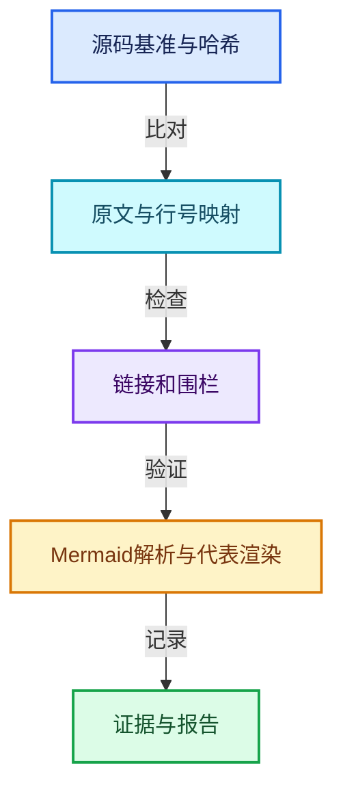
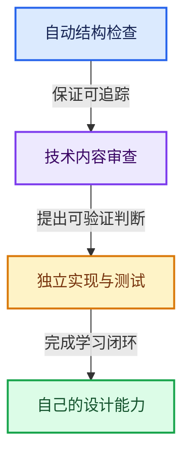

# 文档验收报告

本报告把结构与证据检查、图表解析与渲染、教学程序运行分开记录。自动检查证明其实际覆盖的事项，不据此声称所有技术解释都已被形式化证明。

基准 HEAD：`cbda6b96c26c0dee3c3b5cbb93960c4ac06a6b30`。文档日期：2026-10-14。

## 交付清单

| 方向 | 正文数量 |
|---|---|
| 01-基础容器与现代CPP | 20 |
| 02-哈希表与关联数据结构 | 10 |
| 03-内存分配与运行时类型 | 12 |
| 04-虚拟数组与索引选择 | 12 |
| 05-几何存储与拓扑映射 | 10 |
| 06-隐式共享与缓存系统 | 10 |
| 07-MultiFunction与批量执行 | 10 |
| 08-Field表达式与求值 | 12 |
| 09-LazyFunction与节点执行架构 | 12 |
| 10-引用生命周期与Closure | 8 |
| 11-Depsgraph与并行任务系统 | 8 |
| 12-空间数据结构与几何算法 | 8 |

正文合计132篇，方向导航12篇，根导航与索引6篇，另加本报告。课程文档共151篇；工具依赖内部自带说明不计入课程篇数。

## 结构、源码与链接检查

- 主讲源码文件：140个。
- 原始源码：72,467行。
- 有效源码行映射：51,187行；逐行表记录：51,187条。
- 原文摘录：1,428段，逐段比对当前源码。
- 正文总行数：199,193行；单篇范围：310—9,313行。
- 结构错误数：0。

这里的有效源码行按词法扫描排除空行与纯注释，包含声明、预处理与语法边界。覆盖检查要求每个主讲文件原始行区间恰有一份归属，每个有效行有解释记录。它验证映射与摘录完整性，不声称分析了Blender所有源码，也不把同名出现位置当作编译器证明的调用关系。

## Mermaid检查

- 解析器：Mermaid 11.12.0，Chromium真实DOM环境。
- 图表解析数量：707。
- 解析错误：0。
- 代表图渲染：89张，保存SVG与PNG。

所有正文包含至少5张彩色图，重点调用链章节增加第6张。全套统一使用flowchart，包含LR与TB布局；代表图包含每个方向及Span、FieldEvaluator、GraphExecutor、Set Position、Switch相关篇章。

代表图进行渲染检查，不能把代表图抽查描述成全部图逐张视觉审阅。完整解析记录和图片见[图表证据](./_evidence/mermaid-check.json)。

## 独立教学C++程序

- 编译器：g++ 14.2.0 (MSYS2 UCRT64, Rev2)。
- 语言：C++20。
- 参数：`-Wall -Wextra -Wpedantic -O1 -g`。
- 实际运行输出：`reference scenarios passed: 12`。
- 源文件SHA-256：`d7a8b2176a17f8b7f2334ecd22893ed2dd96fd30c008a4f7a09887103602e2bc`。

12个场景分别是：只读视图切片、SmallVector扩容与析构、两个不同失败位置的异常回滚、哈希碰撞删除、非零偏移组、拓扑前缀和、共享缓存分离、Field风格表达式、未选分支不执行、闭包捕获寿命、暴力最近邻。

这是一份独立教学程序，没有链接Blender库。没有在本轮编译Blender本体或运行其全部gtest，也没有把参考程序当成生产实现等价性证明。SmallVector与TinyMap的省略能力明确写在源码和正文中。

## 阅读与维护

逐行说明由源码结构辅助生成，并结合各篇独立的模型、设计取舍、最小反例、语法材料和重点链路解释组织。机械映射与源码哈希经过检查；细节解释仍应与对应源码和实际类型实例一起审查。

小主题没有人为填充到千行；大型依赖构建器保留更长完整讲解，源文件通过覆盖索引导航。各篇可用相邻篇章、主讲区间和源码符号定位。

源文件链接按当前junction真实目录计算，移动文档后需要重新生成。编辑器是否支持源码`#L`锚点不同，显示行号和符号仍可用于定位。

## 可复现命令

在仓库根目录运行：

```powershell
python .markdown/全面学习-codex/_tools/build_docs.py
python .markdown/全面学习-codex/_tools/check_docs.py
node .markdown/全面学习-codex/_tools/check_mermaid.cjs
python .markdown/全面学习-codex/_tools/make_report.py
```

Mermaid依赖固定在工具目录的package-lock.json，使用本机既有Chromium和Playwright；换机器时修改检查脚本的运行时路径。构建脚本会检查已记录主讲文件哈希，发现源码漂移时停止，而不静默改写基准。




