# Sort List 节点详解

> 📖 系列文档：[目录](01-列表系统架构与核心数据结构.md) | [上一篇](07-FilterList节点.md) | [下一篇](09-ClosureToList节点.md)
>
> 源码文件：[node_geo_sort_list.cc](../../source/blender/nodes/geometry/nodes/node_geo_sort_list.cc)
> 相关文件：[GEO_reorder.hh](../../source/blender/geometry/GEO_reorder.hh)、[reorder.cc](../../source/blender/geometry/intern/reorder.cc)、[list_function_eval.hh](../../source/blender/nodes/intern/list_function_eval.hh)

---

## 目录

- [Sort List 节点详解](#sort-list-节点详解)
  - [目录](#目录)
  - [1. 节点概述](#1-节点概述)
  - [2. 提交背景与设计动机](#2-提交背景与设计动机)
    - [代码重构关系](#代码重构关系)
    - [变更文件一览](#变更文件一览)
  - [3. 节点声明与 UI](#3-节点声明与-ui)
    - [3.1 node\_declare — Socket 声明](#31-node_declare--socket-声明)
    - [3.2 StructureType::Dynamic 的含义](#32-structuretypedynamic-的含义)
    - [3.3 node\_layout — UI 布局](#33-node_layout--ui-布局)
    - [3.4 node\_gather\_link\_searches — 搜索链接](#34-node_gather_link_searches--搜索链接)
  - [4. 核心执行流程](#4-核心执行流程)
    - [4.1 node\_geo\_exec 完整流程](#41-node_geo_exec-完整流程)
    - [4.2 早期退出条件](#42-早期退出条件)
  - [5. get\_varray\_or\_evaluate 模板函数详解](#5-get_varray_or_evaluate-模板函数详解)
    - [5.1 函数签名](#51-函数签名)
    - [5.2 三种模式详解](#52-三种模式详解)
    - [5.3 关键语法解释](#53-关键语法解释)
  - [6. Selection 的三种输入模式](#6-selection-的三种输入模式)
    - [6.1 为什么列表模式需要 SampleIndexFunction？](#61-为什么列表模式需要-sampleindexfunction)
    - [6.2 Selection 列表模式的完整求值流程](#62-selection-列表模式的完整求值流程)
    - [6.3 `fn::FieldOperation::from` 语法](#63-fnfieldoperationfrom-语法)
    - [6.3 单值模式为什么也要包装为字段？](#63-单值模式为什么也要包装为字段)
  - [7. SampleIndexFunction 详解](#7-sampleindexfunction-详解)
    - [7.1 类定义](#71-类定义)
    - [7.2 构造函数](#72-构造函数)
    - [7.3 call 方法详解](#73-call-方法详解)
    - [7.4 关键语法解释](#74-关键语法解释)
  - [8. sort\_indices\_by\_weights 核心排序算法](#8-sort_indices_by_weights-核心排序算法)
    - [8.1 函数签名](#81-函数签名)
    - [8.2 早期退出](#82-早期退出)
    - [8.3 两条路径总览](#83-两条路径总览)
    - [8.4 路径A：无分组（group\_id 是单值）](#84-路径a无分组group_id-是单值)
      - [路径A 数值例子](#路径a-数值例子)
    - [8.5 路径B：有分组](#85-路径b有分组)
      - [路径B 数值例子](#路径b-数值例子)
    - [8.6 处理未选中元素](#86-处理未选中元素)
      - [未选中元素处理 数值例子](#未选中元素处理-数值例子)
  - [9. grouped\_sort 分组排序](#9-grouped_sort-分组排序)
    - [9.1 完整实现](#91-完整实现)
    - [9.2 逐行解析](#92-逐行解析)
    - [9.3 OffsetIndices 详解](#93-offsetindices-详解)
    - [9.4 grouped\_sort 数值例子](#94-grouped_sort-数值例子)
    - [9.5 parallel\_sort 实现](#95-parallel_sort-实现)
  - [10. identifiers\_to\_indices 标识符转索引](#10-identifiers_to_indices-标识符转索引)
    - [10.1 完整实现](#101-完整实现)
    - [10.2 为什么需要这个函数？](#102-为什么需要这个函数)
    - [10.3 四步详解](#103-四步详解)
      - [步骤1：VectorSet 去重](#步骤1vectorset-去重)
      - [步骤2：替换为 VectorSet 索引](#步骤2替换为-vectorset-索引)
      - [步骤3：按标识符值排序](#步骤3按标识符值排序)
      - [步骤4：构建排列映射](#步骤4构建排列映射)
    - [10.4 完整数值例子](#104-完整数值例子)
    - [10.5 另一个例子（permutation 不同）](#105-另一个例子permutation-不同)
    - [10.6 invert\_permutation 实现](#106-invert_permutation-实现)
  - [11. find\_points\_by\_group\_index 分组索引](#11-find_points_by_group_index-分组索引)
    - [11.1 完整实现](#111-完整实现)
    - [11.2 build\_reverse\_offsets 实现](#112-build_reverse_offsets-实现)
      - [count\_indices 实现](#count_indices-实现)
      - [accumulate\_counts\_to\_offsets 实现](#accumulate_counts_to_offsets-实现)
    - [11.3 reverse\_indices\_in\_groups 实现](#113-reverse_indices_in_groups-实现)
    - [11.4 find\_points\_by\_group\_index 数值例子](#114-find_points_by_group_index-数值例子)
  - [12. parallel\_transform 并行变换](#12-parallel_transform-并行变换)
    - [12.1 完整实现](#121-完整实现)
    - [12.2 逐行解析](#122-逐行解析)
    - [12.3 数值例子](#123-数值例子)
  - [13. array\_utils 工具函数详解](#13-array_utils-工具函数详解)
    - [13.1 gather — 按索引收集](#131-gather--按索引收集)
    - [13.2 copy — 按掩码复制](#132-copy--按掩码复制)
    - [13.3 scatter — 按索引散布](#133-scatter--按索引散布)
    - [13.4 fill\_index\_range — 填充递增索引](#134-fill_index_range--填充递增索引)
    - [13.5 indices\_are\_range — 判断是否连续范围](#135-indices_are_range--判断是否连续范围)
  - [14. 端到端完整流程示例](#14-端到端完整流程示例)
    - [14.1 场景：部分选中 + 有分组 + 有权重](#141-场景部分选中--有分组--有权重)
      - [验证排序结果](#验证排序结果)
    - [14.2 场景：全选 + 无分组 + 有权重](#142-场景全选--无分组--有权重)
    - [14.3 场景：排序后与原序相同 → 返回 nullopt](#143-场景排序后与原序相同--返回-nullopt)
  - [15. gather 重排列表数据](#15-gather-重排列表数据)
    - [15.1 代码](#151-代码)
    - [15.2 gather 操作详解](#152-gather-操作详解)
    - [15.3 ForUninitialized 和 span\_for\_write](#153-foruninitialized-和-span_for_write)
  - [16. to\_static\_type 类型分发宏](#16-to_static_type-类型分发宏)
    - [16.1 语法](#161-语法)
    - [16.2 为什么需要列出所有类型？](#162-为什么需要列出所有类型)
    - [16.3 支持的类型列表](#163-支持的类型列表)
  - [17. 与 Sort Elements 节点的对比](#17-与-sort-elements-节点的对比)
    - [17.1 共享的排序算法](#171-共享的排序算法)
    - [17.2 差异对比](#172-差异对比)
  - [18. 关键语法与注释翻译](#18-关键语法与注释翻译)
    - [18.1 ResourceScope](#181-resourcescope)
    - [18.2 fn:: 命名空间](#182-fn-命名空间)
    - [18.3 MultiFunction 是什么](#183-multifunction-是什么)
    - [18.4 为什么抽象这么复杂](#184-为什么抽象这么复杂)
    - [18.5 为什么用 std::move](#185-为什么用-stdmove)
    - [18.6 FieldEvaluator 方法详解](#186-fieldevaluator-方法详解)
    - [18.7 std::optional 和 std::nullopt](#187-stdoptional-和-stdnullopt)
    - [18.8 std::get\_if](#188-stdget_if)
    - [18.9 UNLIKELY 宏](#189-unlikely-宏)
    - [18.10 NOD\_REGISTER\_NODE](#1810-nod_register_node)
  - [19. FilterList vs SortList：Selection 处理方式对比](#19-filterlist-vs-sortlistselection-处理方式对比)
    - [19.1 为什么处理方法不同？](#191-为什么处理方法不同)
    - [19.2 FilterList 的处理（直接使用）](#192-filterlist-的处理直接使用)
    - [19.3 SortList 的处理（统一为 Field）](#193-sortlist-的处理统一为-field)
    - [19.4 为什么 SortList 必须统一为 Field？](#194-为什么-sortlist-必须统一为-field)
    - [19.5 为什么需要 ResourceScope？](#195-为什么需要-resourcescope)


---

## 1. 节点概述

**Sort List** 节点根据权重值对列表中的元素重新排序。它支持三种控制输入：

| 输入 | 类型 | 说明 |
|------|------|------|
| **List** | 动态类型（List） | 待排序的列表 |
| **Selection** | Bool（Dynamic） | 哪些元素参与排序 |
| **Group ID** | Int（Dynamic） | 相同 Group ID 的元素在同一组内排序 |
| **Sort Weight** | Float（Dynamic） | 决定排序顺序的权重值 |

**输出**：排序后的列表（与输入类型相同）

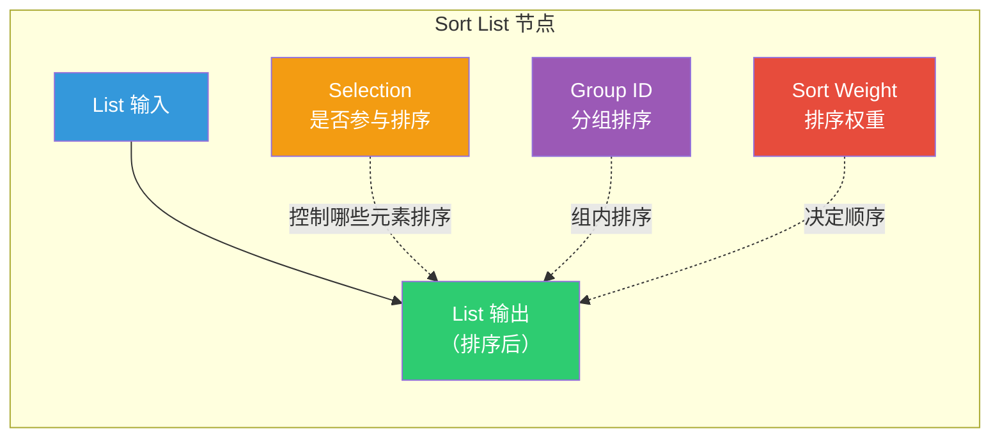

**核心特性**：
- Selection、Group ID、Sort Weight 都可以是**单值、字段或列表**
- 与 Sort Elements 节点共享排序算法（`sort_indices_by_weights`）
- SingleData 列表直接返回（所有元素相同，排序无意义）
- 使用 `to_static_type` 处理所有支持的元素类型

---

## 2. 提交背景与设计动机

**提交**：`a62bcf847a3954fcac3a24ac12bc1e22f550f347`
**作者**：Brady Johnston, Hans Goudey
**日期**：2026-06-03
**PR**：[#159014](https://projects.blender.org/blender/blender/pulls/159014)

提交信息翻译：

> **"This adds a new Sort List node for changing the ordering of items in a list."**
> 新增 Sort List 节点，用于改变列表中元素的顺序。
>
> **"It moves the interface and sorting code from Sort Elements node into the shared GEO_reorder.hh to re-use the same interface code."**
> 将 Sort Elements 节点的接口和排序代码移到共享的 `GEO_reorder.hh`，复用相同的接口代码。
>
> **"The interface is then the same as the Sort Elements but selecting a list data type instead of a domain."**
> 接口与 Sort Elements 相同，但选择列表数据类型而非域。
>
> **"Selection, Group ID and Sort Weight can all be either single values, fields or lists of values."**
> Selection、Group ID 和 Sort Weight 都可以是单值、字段或值列表。

### 代码重构关系

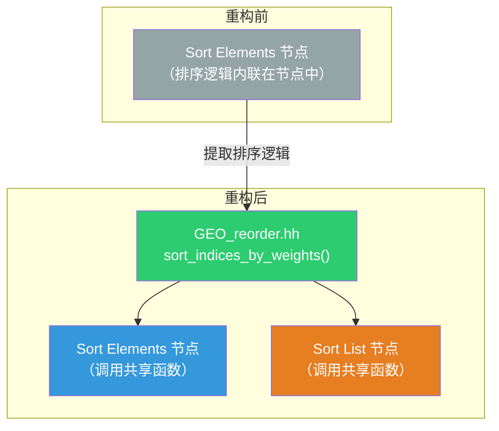

### 变更文件一览

| 文件 | 变更类型 | 说明 |
|------|---------|------|
| `node_geo_sort_list.cc` | **新增** | Sort List 节点实现（258 行） |
| `GEO_reorder.hh` | 修改 | 新增 `sort_indices_by_weights` 声明 |
| `reorder.cc` | 修改 | 新增排序算法实现（117 行） |
| `list_function_eval.cc` | 修改 | 新增 `SampleIndexFunction` |
| `list_function_eval.hh` | 修改 | 新增 `SampleIndexFunction` 声明 |
| `node_geo_sort_elements.cc` | 修改 | 删除内联排序逻辑，改用共享函数 |
| `node_geo_list_get_item.cc` | 修改 | 移除 `SampleIndexFunction`（移到 list_function_eval） |
| `node_add_menu_geometry.py` | 修改 | 添加菜单项 |
| `rna_nodetree.cc` | 修改 | 注册节点 RNA |
| `CMakeLists.txt` | 修改 | 添加新源文件 |

---

## 3. 节点声明与 UI

### 3.1 node_declare — Socket 声明

```cpp
static void node_declare(NodeDeclarationBuilder &b)
{
  const bNode *node = b.node_or_null();
  if (!node) {
    return;  // 首次声明时节点还不存在
  }

  b.use_custom_socket_order();    // 使用自定义 Socket 顺序
  b.allow_any_socket_order();     // 允许任意顺序排列
  b.add_default_layout();         // 添加默认布局

  const auto type = eNodeSocketDatatype(node->custom1);  // 从 DNA 读取数据类型

  // 列表输入/输出——类型由 custom1 决定
  b.add_input(type, "List"_ustr).structure_type(StructureType::List).hide_value();
  b.add_output(type, "List"_ustr)
      .propagate_all({0})                          // 传播匿名属性
      .structure_type(StructureType::List)
      .align_with_previous();                      // 与上一个 Socket 对齐

  // 三个控制输入——都是 Dynamic 结构类型（可以是 Single/Field/List）
  b.add_input<decl::Bool>("Selection"_ustr)
      .default_value(true)
      .hide_value()
      .structure_type(StructureType::Dynamic)      // ← 关键：Dynamic
      .description("Whether each element should participate in sorting");
  b.add_input<decl::Int>("Group ID"_ustr)
      .default_value(0)
      .hide_value()
      .structure_type(StructureType::Dynamic)
      .description("Elements with the same Group ID are sorted together");
  b.add_input<decl::Float>("Sort Weight"_ustr)
      .default_value(0.0f)
      .hide_value()
      .structure_type(StructureType::Dynamic)
      .description("A field or list of values that will determine the sorted order");
}
```

> **注释翻译**：
> - `"Whether each element should participate in sorting"` — 每个元素是否参与排序
> - `"Elements with the same Group ID are sorted together"` — 相同 Group ID 的元素在同一组内排序
> - `"A field or list of values that will determine the sorted order"` — 决定排序顺序的字段或值列表

### 3.2 StructureType::Dynamic 的含义

三个控制输入使用 `StructureType::Dynamic`，意味着它们可以接受三种输入形式：

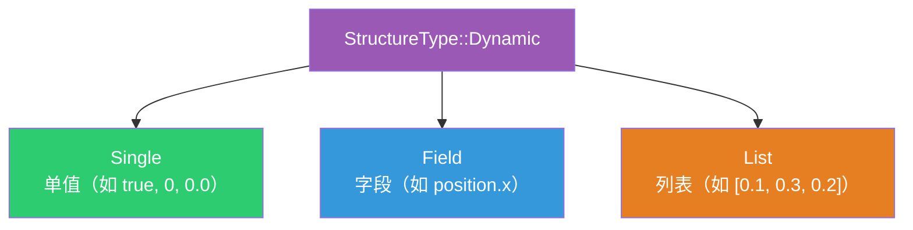

### 3.3 node_layout — UI 布局

```cpp
static void node_layout(ui::Layout &layout, bContext * /*C*/, PointerRNA *ptr)
{
  layout.prop(ptr, "socket_type", UI_ITEM_NONE, "", ICON_NONE);
}
```

在节点侧边栏显示数据类型选择器（`socket_type`），用户可以切换列表的元素类型。

### 3.4 node_gather_link_searches — 搜索链接

```cpp
static void node_gather_link_searches(GatherLinkSearchOpParams &params)
{
  const eNodeSocketDatatype socket_type = eNodeSocketDatatype(params.other_socket().type);
  if (params.in_out() == SOCK_IN) {
    // 输入端：Sort Weight 只在可以链接到 Float 时显示
    if (params.node_tree().typeinfo->validate_link(socket_type, SOCK_FLOAT)) {
      params.add_item(IFACE_("Sort Weight"), SocketSearchOp{"Sort Weight"_ustr, SOCK_FLOAT});
    }
    params.add_item(IFACE_("List"), SocketSearchOp{"List"_ustr, socket_type});
  }
  else {
    // 输出端：只显示 List
    params.add_item(IFACE_("List"), SocketSearchOp{"List"_ustr, socket_type});
  }
}
```

> **`validate_link(socket_type, SOCK_FLOAT)`** — 验证源类型能否链接到 Float。Sort Weight 是 Float 类型，只有当拖拽的 Socket 可以连接 Float 时才显示搜索结果。

---

## 4. 核心执行流程

### 4.1 node_geo_exec 完整流程

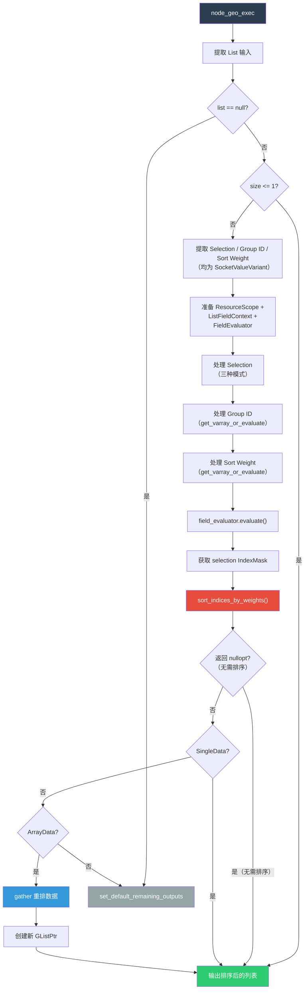

### 4.2 早期退出条件

```cpp
static void node_geo_exec(GeoNodeExecParams params)
{
  GListPtr list = params.extract_input<GListPtr>("List"_ustr);
  if (!list) {
    params.set_default_remaining_outputs();  // 空列表 → 默认输出
    return;
  }

  const int list_size = list->size();
  if (list_size <= 1) {
    params.set_output("List"_ustr, std::move(list));  // 0 或 1 个元素 → 无需排序
    return;
  }
  // ...
}
```

| 条件 | 处理 | 原因 |
|------|------|------|
| `list == null` | 默认输出 | 没有输入列表 |
| `list_size <= 1` | 直接返回原列表 | 0 或 1 个元素无需排序 |
| `sort_indices_by_weights` 返回 `nullopt` | 直接返回原列表 | 排序结果与原序相同 |
| `SingleData` | 直接返回原列表 | 所有元素相同，排序无意义 |

---

## 5. get_varray_or_evaluate 模板函数详解

### 5.1 函数签名

```cpp
template<typename T>
static void get_varray_or_evaluate(const int list_size,
                                   bke::SocketValueVariant &value,
                                   ResourceScope &scope,
                                   fn::FieldEvaluator &field_evaluator,
                                   const T &default_value,
                                   VArray<T> &r_varray)
```

> **功能**：将 `SocketValueVariant` 转换为 `VArray<T>`，统一处理三种输入模式（字段/列表/单值）。

### 5.2 三种模式详解

```cpp
if (value.is_context_dependent_field()) {
  // 模式1：上下文依赖字段 → 加入 FieldEvaluator 延迟求值
  field_evaluator.add(value.extract<fn::Field<T>>(), &r_varray);
}
else if (value.is_list()) {
  // 模式2：列表 → 转为 VArray
  auto list = value.extract<GListPtr>();
  if (list && list->size() == list_size) {
    // 列表大小匹配 → 转为 VArray
    r_varray = scope.add_value(std::move(list))->varray().typed<T>();
  }
  else {
    // 列表大小不匹配 → 用默认值填充
    r_varray = VArray<T>::from_single(default_value, list_size);
  }
}
else {
  // 模式3：单值 → 广播为 VArray
  r_varray = VArray<T>::from_single(value.extract<T>(), list_size);
}
```

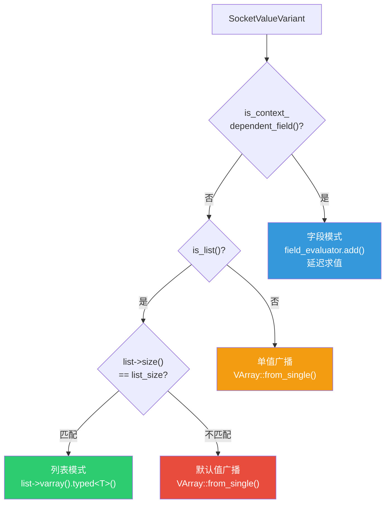

### 5.3 关键语法解释

**`r_varray = scope.add_value(std::move(list))->varray().typed<T>();`**

这一行链式调用，逐步拆解：

```cpp
// 第1步：scope.add_value(std::move(list)) 把 list 存入 scope，返回引用
// add_value 返回 T&（引用，不是指针！），指向 scope 内部存储的 GListPtr
GListPtr& list_ref = scope.add_value(std::move(list));

// 第2步：list_ref->varray()
// list_ref 是 GListPtr（shared_ptr<GList>），-> 调用 GListPtr::operator->()
// GListPtr::operator->() 返回 const GList*，然后 ->varray() 调用 GList::varray()
// GList::varray() 返回 GVArray（泛型虚拟数组）
GVArray gvarray = list_ref->varray();

// 第3步：gvarray.typed<T>() 把 GVArray 转为 VArray<T>
// 零开销 static_cast，不拷贝数据
VArray<T> varray = gvarray.typed<T>();

// 第4步：赋值给 r_varray（输出参数）
r_varray = varray;
```

**`->` 的解析**：`list_ref->varray()` 只有一个 `->`，不是两个。C++ 解析过程：
1. `list_ref` 是 `GListPtr`，有 `operator->()` 重载 → 调用它
2. `GListPtr::operator->()` 返回 `const GList*`（原始指针）
3. 用这个指针访问 `varray` 成员 → 结束

**C++ `->` 链式规则**：`a->b` 的解析——如果 `a` 有 `operator->()`，调用它得到返回值 `r`；如果 `r` 是原始指针，用 `r->b`；如果 `r` 不是指针但 `r` 的类型也有 `operator->()`，继续链式调用；如果 `r` 既不是指针也没有 `operator->()` → **编译错误**。

```cpp
// GListPtr::operator->() 的实现：
inline const GList *GListPtr::operator->() const
{
    return data_.get();  // shared_ptr::get()，返回 GList*
}
```

如果 `operator->()` 返回的不是指针且没有 `operator->()` 重载：
```cpp
struct Bad { int operator->() { return 42; } };  // 返回 int
Bad b;
b->foo();  // ❌ 编译错误！int 不是指针，也没有 operator->()
```

**`->` `.typed<T>()`** 三个操作连在一起——每一步都返回值类型，可以直接继续调用。

**为什么需要 scope？** `VArray<T>` 可能引用 `GList` 内部的数据。如果 `list` 是局部变量，函数返回后 `GVArray` 就悬空了。`scope` 延长了 `list` 的生命周期到整个求值过程结束。

```cpp
// ❌ 不存入 scope（悬空引用！）
auto list = value.extract<GListPtr>();        // list 是局部变量
r_varray = list->varray().typed<T>();         // VArray 引用 list 的数据
// list 离开作用域 → 析构 → VArray 悬空！
// 后续 field_evaluator.evaluate() 访问 VArray → UB！

// ✅ 存入 scope
r_varray = scope.add_value(std::move(list))->varray().typed<T>();
// list 存入 scope，VArray 引用 scope 中的 list → 求值时仍有效 ✅
```

**为什么其他列表节点没用这个？** 因为它们不需要保留 VArray 引用到后续求值：

| 节点        | Selection 处理                                        | 需要 scope？ | 原因                   |
| ----------- | ----------------------------------------------------- | ------------ | ---------------------- |
| FilterList  | `IndexMask::from_bools` → 生成 mask 后不再引用 VArray | ❌            | IndexMask 自己管理内存 |
| GetListItem | 直接从 GList 取数据                                   | ❌            | 不保留引用             |
| SortList    | VArray 传给 `field_evaluator`，求值时必须仍有效       | ✅            | VArray 引用 list 数据  |

FilterList 的列表模式：
```cpp
// 生成 IndexMask 后，VArray 就不需要了
IndexMask::from_bools(IndexRange(list->size()), values, memory);
// IndexMask 自己管理内存（通过 IndexMaskMemory），不引用 VArray
```

SortList 的 `get_varray_or_evaluate`：
```cpp
// VArray 要存起来，后续 field_evaluator.evaluate() 时还要用
r_varray = scope.add_value(std::move(list))->varray().typed<T>();
// r_varray 引用 list 数据 → list 必须存活 → 存入 scope
```

**`->varray().typed<T>()`**：

1. `list->varray()` — `GList` 的 `varray()` 方法返回 `GVArray`（泛型虚拟数组）
2. `.typed<T>()` — 将 `GVArray` 转为 `VArray<T>`（类型化虚拟数组），零开销 `static_cast`

---

## 6. Selection 的三种输入模式

Selection 的处理比 Group ID 和 Sort Weight 更复杂，因为它需要作为 `FieldEvaluator` 的**选择条件**（`set_selection`），而非普通输入。

```cpp
if (selection_variant.is_context_dependent_field()) {
  // 模式1：字段 → 直接设为选择条件
  field_evaluator.set_selection(selection_variant.extract<fn::Field<bool>>());
}
else if (selection_variant.is_list()) {
  // 模式2：列表 → 包装为 SampleIndexFunction 字段
  auto fn = fn::FieldOperation::from(
      std::make_shared<SampleIndexFunction>(weights_variant.extract<GListPtr>()),
      {fn::IndexFieldInput::get_field()});
  field_evaluator.set_selection(fn::Field<bool>(std::move(fn)));
}
else {
  // 模式3：单值 → 包装为常量字段
  field_evaluator.set_selection(fn::Field<bool>(selection_variant.extract<bool>()));
}
```

> **⚠️ 确认 Bug — 会导致崩溃** — 第 149 行使用 `weights_variant.extract<GListPtr>()` 而非 `selection_variant.extract<GListPtr>()`。
>
> **崩溃原因**：当 `selection_variant.is_list()` 为 true 时，代码从 `weights_variant` 提取 `GListPtr`。但 `weights_variant` 可能是单值（float）或字段，不是列表——`extract<GListPtr>()` 在非列表类型上调用导致 UB/崩溃。
>
> **崩溃路径**：
> ```
> 1. selection_variant.is_list() → true（Selection 是列表）
> 2. weights_variant.extract<GListPtr>() → weights 不是列表！
> 3. extract<GListPtr>() 在非 GListPtr 类型上调用 → UB
> 4. SampleIndexFunction 构造函数中 list_->cpp_type() → list_ 是垃圾值 → 崩溃
> ```
>
> **堆栈验证**：
> ```
> blender::nodes::SampleIndexFunction::SampleIndexFunction  ← 构造函数崩溃
> blender::nodes::node_geo_sort_list_cc::node_geo_exec       ← 调用处
> ```
> 构造函数 `list_->cpp_type()` 访问无效的 `list_` 指针 → 崩溃。
>
> **正确代码应为**：
> ```cpp
> std::make_shared<SampleIndexFunction>(selection_variant.extract<GListPtr>())
> //                                       ^^^^^^^^^^^^^^^^^
> //                                       应该用 selection_variant
> ```

### 6.1 为什么列表模式需要 SampleIndexFunction？

`FieldEvaluator::set_selection` 只接受 `Field<bool>`——一个**字段**。但用户输入的是一个**列表**。列表不是字段，不能直接传给 `set_selection`。

**解决方案**：用 `SampleIndexFunction` 把列表包装成一个字段——这个字段的行为是"给定索引 i，返回列表中第 i 个元素"。

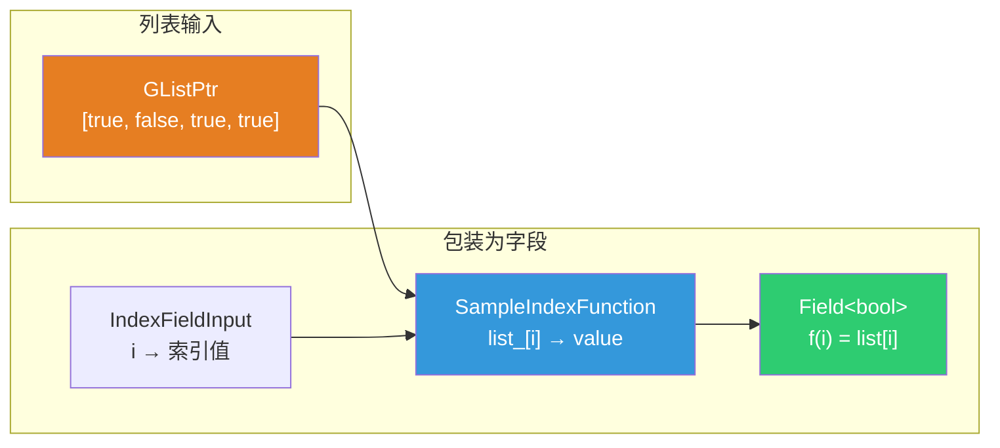

### 6.2 Selection 列表模式的完整求值流程

当 Selection 是列表 `[true, false, true, true]` 时，完整的求值流程如下：

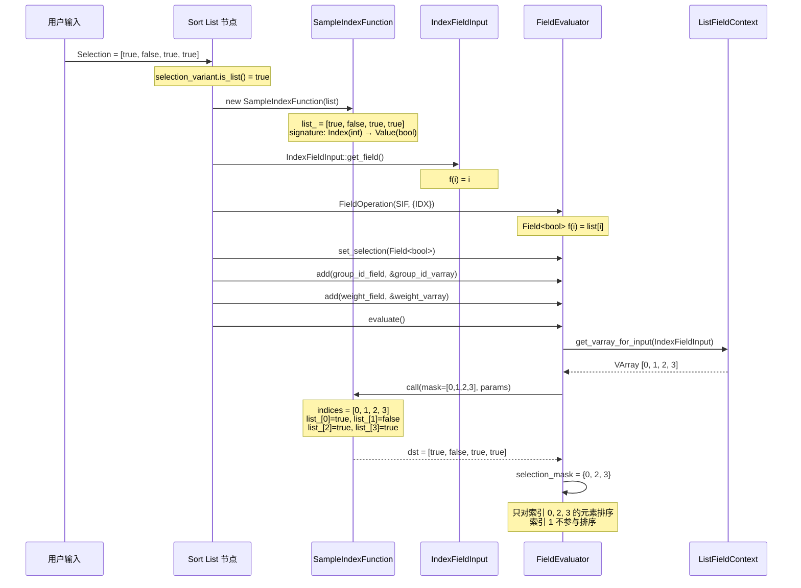

> **关键步骤**：`FieldEvaluator` 求值 Selection 字段时，`IndexFieldInput` 通过 `ListFieldContext` 获取索引 `[0, 1, 2, 3]`，`SampleIndexFunction` 用这些索引从列表中取值 `[true, false, true, true]`，`FieldEvaluator` 将非零值转为 `IndexMask {0, 2, 3}`——只有索引 0、2、3 的元素参与排序。

### 6.3 `fn::FieldOperation::from` 语法

```cpp
auto fn = fn::FieldOperation::from(
    std::make_shared<SampleIndexFunction>(weights_variant.extract<GListPtr>()),
    {fn::IndexFieldInput::get_field()});
```

> **`fn::FieldOperation::from`**：创建一个字段操作节点。参数：
> 1. **多函数**（`MultiFunction`）：`SampleIndexFunction` — "给定索引，返回列表元素"
> 2. **输入字段列表**：`{fn::IndexFieldInput::get_field()}` — 索引字段，每个位置返回自己的索引值
>
> 组合起来：`Field<bool> f(i) = SampleIndexFunction(list, IndexFieldInput(i)) = list[i]`

**`fn::IndexFieldInput::get_field()`**：返回一个字段，求值时每个位置返回自己的索引值（0, 1, 2, ...）。

### 6.3 单值模式为什么也要包装为字段？

```cpp
field_evaluator.set_selection(fn::Field<bool>(selection_variant.extract<bool>()));
```

`fn::Field<bool>(true)` 创建一个常量字段——每个位置都返回 `true`。`FieldEvaluator::set_selection` 只接受 `Field<bool>`，不接受裸 `bool`，所以必须包装。

---

## 7. SampleIndexFunction 详解

### 7.1 类定义

```cpp
// list_function_eval.hh
class SampleIndexFunction : public mf::MultiFunction {
  GListPtr list_;           // 持有列表的共享指针
  mf::Signature signature_; // 多函数签名

 public:
  SampleIndexFunction(GListPtr list);

  void call(const IndexMask &mask, mf::Params params, mf::Context /*context*/) const override;
  void hash_unique(UniqueHashBytes &hash) const override;
};
```

> **功能**：将列表包装为多函数——输入索引，输出列表中对应位置的值。这是把"列表"适配为"字段"的桥梁。

### 7.2 构造函数

```cpp
SampleIndexFunction::SampleIndexFunction(GListPtr list) : list_(std::move(list))
{
  mf::SignatureBuilder builder{"Sample Index", signature_};
  builder.single_input<int>("Index");                    // 输入：索引
  builder.single_output("Value", list_->cpp_type());     // 输出：列表元素类型
  this->set_signature(&signature_);
}
```

> **`builder.single_input<int>("Index")`** — 声明一个 `int` 类型的单值输入参数，名为 "Index"。
>
> **`builder.single_output("Value", list_->cpp_type())`** — 声明一个输出参数，类型由列表的元素类型决定。注意输出参数没有模板参数——类型通过 `CPPType` 在运行时指定。

### 7.3 call 方法详解

```cpp
void SampleIndexFunction::call(const IndexMask &mask,
                               mf::Params params,
                               mf::Context /*context*/) const
{
  const VArraySpan<int> indices = params.readonly_single_input<int>(0, "Index");
  GMutableSpan dst = params.uninitialized_single_output(1, "Value");

  // 步骤1：过滤有效索引（在列表范围内的）
  IndexMaskMemory memory;
  const IndexMask valid_indices = array_utils::indices_in_range(
      mask, indices, IndexRange(list_->size()), memory);

  // 步骤2：对无效索引填充默认值
  if (valid_indices.size() != mask.size()) {
    const IndexMask invalid_indices = valid_indices.complement(mask, memory);
    list_->cpp_type().fill_construct_indices(
        list_->cpp_type().default_value(), dst.data(), invalid_indices);
  }

  // 步骤3：根据列表数据类型读取值
  const GList::DataVariant &data = list_->data();
  if (const auto *array_data = std::get_if<nodes::GList::ArrayData>(&data)) {
    // ArrayData：从连续数组中按索引取值
    const GSpan src(list_->cpp_type(), array_data->data, list_->size());
    valid_indices.foreach_index(
        [&](const int i) { list_->cpp_type().copy_construct(src[indices[i]], dst[i]); });
  }
  else if (const auto *single_data = std::get_if<nodes::GList::SingleData>(&data)) {
    // SingleData：所有位置都是同一个值
    list_->cpp_type().fill_construct_indices(single_data->value, dst.data(), valid_indices);
  }
}
```

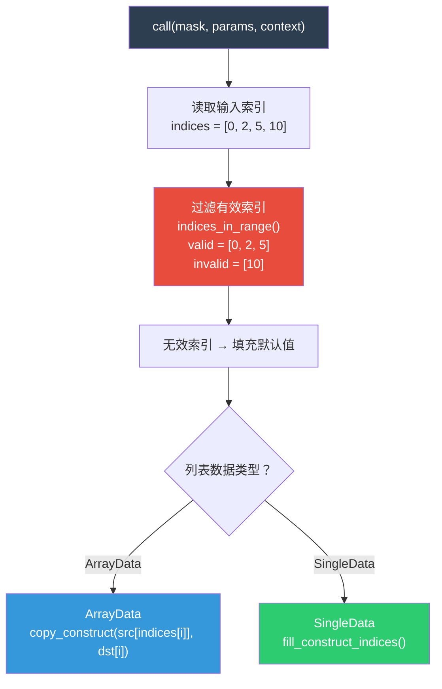

### 7.4 关键语法解释

**`VArraySpan<int> indices`**：`VArraySpan` 是 `VArray` 的视图——如果底层是 Span，直接引用；否则物化为临时数组。这里索引输入可能来自字段求值结果，`VArraySpan` 自动处理两种情况。

**`array_utils::indices_in_range`**：检查 `indices` 中哪些值在 `[0, list_size)` 范围内，返回有效的 `IndexMask`。例如 `indices = [0, 2, 5, 10]`，`list_size = 8`，则 `valid = [0, 2, 5]`，`invalid = [10]`。

**`fill_construct_indices(default_value, dst, invalid_indices)`**：在 `dst` 的 `invalid_indices` 位置用默认值构造对象。越界索引返回类型默认值（如 `float` 返回 `0.0f`）。

**`hash_unique`**：

```cpp
void SampleIndexFunction::hash_unique(UniqueHashBytes &hash) const
{
  static constexpr int8_t id = 0;
  hash.add(&id);
  hash.add(list_.get());  // 用列表指针作为哈希的一部分
}
```

> **`hash_unique`** 用于字段去重——如果两个 `SampleIndexFunction` 持有相同的列表指针，它们的哈希相同，可以合并。`list_.get()` 返回底层 `GList*` 指针。

---

## 8. sort_indices_by_weights 核心排序算法

### 8.1 函数签名

```cpp
// source/blender/geometry/intern/reorder.cc:490~543
// GEO_reorder.hh
std::optional<Array<int>> sort_indices_by_weights(int domain_size,
                                                  const IndexMask &mask,
                                                  const VArray<int> &group_id,
                                                  const VArray<float> &weight);
```

> **参数**：
> - `domain_size`：列表大小（所有元素数量，包括未选中的）
> - `mask`：参与排序的元素索引掩码（Selection 选中的元素）
> - `group_id`：每个元素的分组 ID（VArray，可能是单值或数组）
> - `weight`：每个元素的排序权重（VArray，可能是单值或数组）
>
> **返回值**：
> - `std::nullopt`：无需排序（结果与原序相同）
> - `Array<int>`：排序后的索引映射数组，`result[i]` 表示位置 `i` 应放原来位置 `result[i]` 的元素

### 8.2 早期退出

```cpp
if (group_id.is_single() && weight.is_single()) {
  return std::nullopt;  // 所有元素同一组同一权重 → 无需排序
}
if (mask.is_empty()) {
  return std::nullopt;  // 没有选中元素 → 无需排序
}
```

> **`is_single()`**：VArray 的方法，判断虚拟数组是否所有元素都是同一个值。如果 `group_id` 全是同一值（所有元素同组）且 `weight` 全是同一值（所有元素同权重），则无论怎么排结果都一样，直接返回 `nullopt`。

### 8.3 两条路径总览

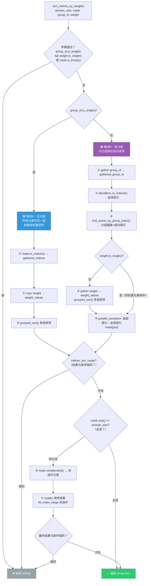

### 8.4 路径A：无分组（group_id 是单值）

```cpp
if (group_id.is_single()) {
  // ① 收集选中索引
  mask.to_indices<int>(gathered_indices);

  // ② 收集权重（仅选中位置的权重）
  Array<float> weight_values(domain_size);
  array_utils::copy(weight, mask, weight_values.as_mutable_span());

  // ③ 单组排序
  grouped_sort(Span({0, int(mask.size())}), weight_values, gathered_indices);
}
```

> **① `mask.to_indices<int>(gathered_indices)`**：将 IndexMask 转为整数数组。例如 `mask = {2, 5, 7}` → `gathered_indices = [2, 5, 7]`。
>
> **② `array_utils::copy(weight, mask, weight_values)`**：从 VArray 中按 mask 选中位置收集权重值。注意这里 `weight_values` 大小是 `domain_size`，但只有 mask 位置被写入。底层调用 `GVArray::materialize(selection, dst)`。
>
> **③ `Span({0, int(mask.size())})`**：构造一个包含两个元素的 Span：`[0, mask.size()]`，表示一个偏移区间 `[0, mask.size())`。`grouped_sort` 把所有元素当作一个组来排序。

#### 路径A 数值例子

```
domain_size = 5, mask = {0, 1, 2, 3, 4}（全选）
group_id = 单值 0（所有元素同组）
weight = [3.0, 1.0, 4.0, 1.5, 2.0]

① gathered_indices = [0, 1, 2, 3, 4]
② weight_values    = [3.0, 1.0, 4.0, 1.5, 2.0]
③ grouped_sort(Span({0, 5}), weight_values, gathered_indices)
   → 按 weight 升序排 gathered_indices:
     weight[1]=1.0 < weight[3]=1.5 < weight[4]=2.0 < weight[0]=3.0 < weight[2]=4.0
   → gathered_indices = [1, 3, 4, 0, 2]

结果: 位置0放原1号(权重1.0), 位置1放原3号(权重1.5), ...
```

### 8.5 路径B：有分组

```cpp
else {
  // ① 收集选中元素的 group_id
  Array<int> gathered_group_id(mask.size());
  array_utils::gather(group_id, mask, gathered_group_id.as_mutable_span());

  // ② 将 group_id 转为连续索引 [0, total_groups)
  const int total_groups = identifiers_to_indices(gathered_group_id);

  // ③ 按组分配索引，计算每组的偏移量
  Array<int> offsets_to_sort(total_groups + 1, 0);
  find_points_by_group_index(gathered_group_id, offsets_to_sort, gathered_indices);

  // ④ 在每组内按权重排序（如果权重不全相同）
  if (!weight.is_single()) {
    Array<float> weight_values(mask.size());
    array_utils::gather(weight, mask, weight_values.as_mutable_span());
    grouped_sort(offsets_to_sort.as_span(), weight_values, gathered_indices);
  }

  // ⑤ 将局部索引转回全局索引
  parallel_transform<int>(gathered_indices, 2048, [&](const int pos) { return mask[pos]; });
}
```

> **① `array_utils::gather(group_id, mask, ...)`**：从 VArray 中按 mask 索引收集 group_id 值。`gather` 是"按索引收集"——`dst[i] = src[mask[i]]`。
>
> **② `identifiers_to_indices`**：将任意 group_id（如 100, 50, 200）映射为连续索引（0, 1, 2），同时保持值的大小顺序。详见第 10 章。
>
> **③ `find_points_by_group_index`**：根据连续索引构建分组偏移表和组内元素索引。详见第 11 章。
>
> **④ `grouped_sort`**：在每组内按权重排序。详见第 9 章。
>
> **⑤ 将局部索引转回全局索引**：`gathered_indices` 中存的是在 mask 范围内的局部位置（0, 1, 2, ...），需要转回全局索引。例如 `mask = [2, 5, 7]`，`gathered_indices = [1, 0, 2]`，则 `mask[1]=5, mask[0]=2, mask[2]=7`，最终排序结果为 `[5, 2, 7]`。

#### 路径B 数值例子

```
domain_size = 7, mask = {0, 1, 2, 3, 4, 5, 6}（全选）
group_id = [10, 20, 10, 20, 10, 20, 10]
weight   = [3.0, 1.0, 1.5, 2.0, 0.5, 3.0, 2.5]

① gathered_group_id = [10, 20, 10, 20, 10, 20, 10]

② identifiers_to_indices:
   VectorSet 去重 → [10, 20]（插入顺序）
   替换为 VectorSet 索引 → [0, 1, 0, 1, 0, 1, 0]
   按标识符值排序 → indices = [0, 1]（10 < 20，顺序不变）
   permutation = invert_permutation([0, 1]) = [0, 1]
   最终 → [0, 1, 0, 1, 0, 1, 0]
   total_groups = 2

③ find_points_by_group_index:
   build_reverse_offsets: 组0有4个, 组1有3个 → offsets = [0, 4, 7]
   reverse_indices_in_groups:
     元素0(组0) → r_indices[0] = 0
     元素1(组1) → r_indices[4] = 1
     元素2(组0) → r_indices[1] = 2
     元素3(组1) → r_indices[5] = 3
     元素4(组0) → r_indices[2] = 4
     元素5(组1) → r_indices[6] = 5
     元素6(组0) → r_indices[3] = 6
   → gathered_indices = [0, 2, 4, 6, 1, 3, 5]
   → 组0: [0, 2, 4, 6]  组1: [1, 3, 5]

④ grouped_sort:
   weight_values = [3.0, 1.0, 1.5, 2.0, 0.5, 3.0, 2.5]
   组0 [0,2,4,6]: weight[0]=3.0, weight[2]=1.5, weight[4]=0.5, weight[6]=2.5
     → 按 weight 升序: [4, 2, 6, 0]（0.5 < 1.5 < 2.5 < 3.0）
   组1 [1,3,5]: weight[1]=1.0, weight[3]=2.0, weight[5]=3.0
     → 按 weight 升序: [1, 3, 5]（1.0 < 2.0 < 3.0）
   → gathered_indices = [4, 2, 6, 0, 1, 3, 5]

⑤ parallel_transform: mask[pos] = pos（因为全选）
   → gathered_indices = [4, 2, 6, 0, 1, 3, 5]

结果: 组0的元素(10)排在前面按权重升序, 组1的元素(20)紧接其后按权重升序
位置0→原4号(w=0.5), 位置1→原2号(w=1.5), 位置2→原6号(w=2.5), 位置3→原0号(w=3.0)
位置4→原1号(w=1.0), 位置5→原3号(w=2.0), 位置6→原5号(w=3.0)
```

### 8.6 处理未选中元素

```cpp
// 检查排序结果是否与原序相同
if (array_utils::indices_are_range(gathered_indices, IndexRange(domain_size))) {
  return std::nullopt;
}

// 全选 → 直接返回
if (mask.size() == domain_size) {
  return gathered_indices;
}

// 部分选中 → 未选中元素保持原位
IndexMaskMemory memory;
const IndexMask unselected = mask.complement(IndexRange(domain_size), memory);
Array<int> indices(domain_size);
array_utils::scatter<int>(gathered_indices, mask, indices);       // 排序结果放到选中位置
array_utils::fill_index_range<int>(unselected, indices);           // 未选中位置保持原索引

// 再次检查最终结果
if (array_utils::indices_are_range(indices, indices.index_range())) {
  return std::nullopt;
}

return indices;
```

> **`scatter`**：`gather` 的逆操作。`gather` 是"从源中按索引收集"（`dst[i] = src[indices[i]]`），`scatter` 是"按索引散布到目标"（`dst[indices[i]] = src[i]`）。
>
> **`fill_index_range`**：在 `unselected` 位置填入与索引相同的值（即 `indices[i] = i`），表示"未选中元素保持原位不动"。
>
> **两次 `indices_are_range` 检查**：第一次检查排序后的 gathered_indices 是否就是 `[0, 1, 2, ...]`（原序）；第二次检查合并未选中元素后的最终结果是否也是原序。如果都是原序就返回 `nullopt`，避免不必要的重排。

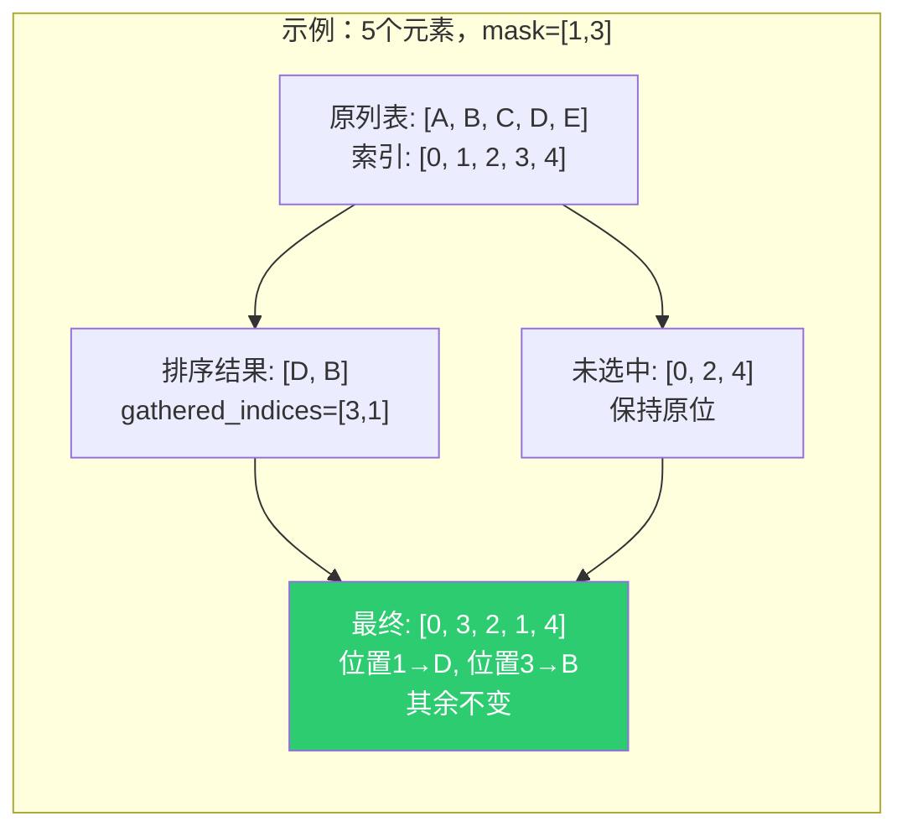

#### 未选中元素处理 数值例子

```
domain_size = 5, mask = {1, 3}（只选了位置1和3）
group_id = [0, 0, 0, 0, 0]（单值，走路径A）
weight = [_, 2.0, _, 1.0, _]（只有位置1和3的权重有意义）

路径A:
① gathered_indices = [1, 3]
② weight_values = [_, 2.0, _, 1.0, _]（domain_size=5, 只有位置1和3被写入）
③ grouped_sort → gathered_indices = [3, 1]（weight[3]=1.0 < weight[1]=2.0）

indices_are_range([3,1], [0..4]) → false（不是原序）
mask.size()=2 != domain_size=5 → 部分选中

⑥ unselected = {0, 2, 4}
⑦ scatter([3,1], mask={1,3}, indices):
     indices[1] = 3  (src[0]=3, mask[0]=1)
     indices[3] = 1  (src[1]=1, mask[1]=3)
   fill_index_range(unselected={0,2,4}, indices):
     indices[0] = 0, indices[2] = 2, indices[4] = 4

最终 indices = [0, 3, 2, 1, 4]
含义: 位置0保持原位, 位置1放原3号, 位置2保持原位, 位置3放原1号, 位置4保持原位
```

---

## 9. grouped_sort 分组排序

### 9.1 完整实现

```cpp
// source/blender/geometry/intern/reorder.cc:443~462
static void grouped_sort(const OffsetIndices<int> offsets,
                         const Span<float> weights,
                         MutableSpan<int> indices)
{
  const auto comparator = [&](const int index_a, const int index_b) {
    const float weight_a = weights[index_a];
    const float weight_b = weights[index_b];
    if (weight_a == weight_b) [[unlikely]] {
      return index_a < index_b;  // 权重相同 → 保持原序（稳定排序）
    }
    return weight_a < weight_b;  // 按权重升序
  };

  threading::parallel_for(offsets.index_range(), 250, [&](const IndexRange range) {
    for (const int group_index : range) {
      MutableSpan<int> group = indices.slice(offsets[group_index]);
      parallel_sort(group.begin(), group.end(), comparator);
    }
  });
}
```

### 9.2 逐行解析

> **`comparator`**：排序比较器。比较两个索引 `index_a` 和 `index_b` 对应的权重。注意比较的是 `weights[index_a]` 和 `weights[index_b]`，不是直接比较索引本身。
>
> **`[[unlikely]]`**：C++20 属性，告诉编译器"权重相等"这个分支很少执行，帮助 CPU 分支预测器优化。等价于旧版 `UNLIKELY()` 宏。
>
> **`return index_a < index_b`**：权重相同时，按原始索引排序，保证**稳定排序**——相同权重的元素保持输入时的相对顺序。
>
> **`threading::parallel_for(offsets.index_range(), 250, ...)`**：并行处理多个组。`250` 是 grain_size——每组至少 250 个组才值得开新线程。因为组内排序本身就是 O(n log n)，如果组很少就单线程处理。
>
> **`indices.slice(offsets[group_index])`**：从 `indices` 中切出当前组对应的切片。`offsets[group_index]` 返回一个 `IndexRange`，表示该组在 `indices` 中的范围。
>
> **`parallel_sort`**：Blender 的并行排序封装。如果编译时启用了 TBB，使用 `tbb::parallel_sort`；否则退化为 `std::sort`。

### 9.3 OffsetIndices 详解

`OffsetIndices<int>` 是 Blender 的偏移索引结构——用一组偏移量表示多个区间：

```
offsets = [0, 3, 5, 8]
         → 组0: [0, 3)  → indices[0], indices[1], indices[2]
         → 组1: [3, 5)  → indices[3], indices[4]
         → 组2: [5, 8)  → indices[5], indices[6], indices[7]
```

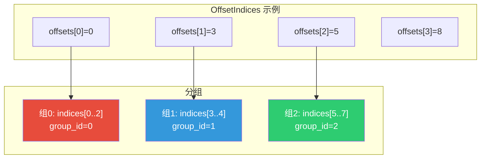

### 9.4 grouped_sort 数值例子

```
offsets = [0, 4, 7]    → 组0: [0,4), 组1: [4,7)
weights = [3.0, 1.0, 1.5, 2.0, 0.5, 3.0, 2.5]
indices = [0, 2, 4, 6, 1, 3, 5]  （组0: [0,2,4,6], 组1: [1,3,5]）

组0: indices切片 = [0, 2, 4, 6]
  比较 weights[0]=3.0, weights[2]=1.5, weights[4]=0.5, weights[6]=2.5
  → 按 weight 升序排: [4, 2, 6, 0]  (0.5 < 1.5 < 2.5 < 3.0)

组1: indices切片 = [1, 3, 5]
  比较 weights[1]=1.0, weights[3]=2.0, weights[5]=3.0
  → 按 weight 升序排: [1, 3, 5]  (1.0 < 2.0 < 3.0)

最终 indices = [4, 2, 6, 0, 1, 3, 5]
```

### 9.5 parallel_sort 实现

```cpp
// source/blender/blenlib/BLI_sort.hh
#ifdef WITH_TBB
#  include <tbb/parallel_sort.h>
namespace blender {
using tbb::parallel_sort;  // 有 TBB → 用多线程并行排序
}
#else
namespace blender {
template<typename RandomAccessIterator, typename Compare>
void parallel_sort(RandomAccessIterator begin, RandomAccessIterator end, const Compare &comp)
{
  std::sort<RandomAccessIterator, Compare>(begin, end, comp);  // 无 TBB → 退化为单线程
}
}
#endif
```

> **设计**：编译期选择。TBB 的 `parallel_sort` 在数据量大时自动多线程排序，数据量小时退化为串行。Blender 通过 `#ifdef WITH_TBB` 统一封装，让调用方无需关心底层实现。

---

## 10. identifiers_to_indices 标识符转索引

### 10.1 完整实现

```cpp
// source/blender/geometry/intern/reorder.cc:472~488
static int identifiers_to_indices(MutableSpan<int> r_identifiers_to_indices)
{
  // 步骤1：去重，建立标识符→索引的映射
  const VectorSet<int> deduplicated_identifiers(r_identifiers_to_indices);

  // 步骤2：将每个标识符替换为其在 VectorSet 中的索引
  parallel_transform(r_identifiers_to_indices, 2048, [&](const int identifier) {
    return deduplicated_identifiers.index_of(identifier);
  });

  // 步骤3：按标识符值排序，确保索引顺序与标识符值顺序一致
  Array<int> indices(deduplicated_identifiers.size());
  array_utils::fill_index_range<int>(indices);
  parallel_sort(indices.begin(), indices.end(), [&](const int index_a, const int index_b) {
    return deduplicated_identifiers[index_a] < deduplicated_identifiers[index_b];
  });

  // 步骤4：构建排列映射，将"VectorSet 顺序"转为"标识符值顺序"
  Array<int> permutation = invert_permutation(indices);
  parallel_transform(
      r_identifiers_to_indices, 4096, [&](const int index) { return permutation[index]; });

  return deduplicated_identifiers.size();
}
```

### 10.2 为什么需要这个函数？

`group_id` 可能是任意整数（如 `100, 200, 50`），但 `find_points_by_group_index` 需要连续的索引（`0, 1, 2`）。`identifiers_to_indices` 将任意标识符映射为连续索引，同时**保持标识符值的大小顺序**——值小的组排在前面。

### 10.3 四步详解

#### 步骤1：VectorSet 去重

```cpp
const VectorSet<int> deduplicated_identifiers(r_identifiers_to_indices);
```

> **`VectorSet<int>`**：Blender 的有序集合——同时提供哈希集合的 O(1) 查找和数组的顺序遍历。用输入范围初始化后，`deduplicated_identifiers` 包含所有不重复的标识符，按**首次出现的顺序**排列。
>
> 例如输入 `[100, 50, 200, 50, 100]` → `deduplicated_identifiers = [100, 50, 200]`（100 先出现，50 第二次出现，200 第三次出现）。

#### 步骤2：替换为 VectorSet 索引

```cpp
parallel_transform(r_identifiers_to_indices, 2048, [&](const int identifier) {
  return deduplicated_identifiers.index_of(identifier);
});
```

> **`index_of(identifier)`**：返回标识符在 VectorSet 中的位置索引。O(1) 哈希查找。
>
> 例如 `100 → 0`（VectorSet 第0个），`50 → 1`（第1个），`200 → 2`（第2个）。
> 输入 `[100, 50, 200, 50, 100]` → 输出 `[0, 1, 2, 1, 0]`。
>
> **问题**：此时索引顺序是"首次出现顺序"，不是"值大小顺序"。50 应该是组0（最小），100 应该是组1，200 应该是组2。

#### 步骤3：按标识符值排序

```cpp
Array<int> indices(deduplicated_identifiers.size());
array_utils::fill_index_range<int>(indices);  // indices = [0, 1, 2, ...]
parallel_sort(indices.begin(), indices.end(), [&](const int index_a, const int index_b) {
  return deduplicated_identifiers[index_a] < deduplicated_identifiers[index_b];
});
```

> **`fill_index_range`**：用 `std::iota` 填充 `[0, 1, 2, ...]`。
>
> **排序逻辑**：比较的不是 `index_a` 和 `index_b` 本身，而是 `deduplicated_identifiers[index_a]` 和 `deduplicated_identifiers[index_b]`——即比较标识符的**值**。
>
> 例如 `deduplicated_identifiers = [100, 50, 200]`：
> - `indices` 初始 = `[0, 1, 2]`
> - 比较 `deduplicated_identifiers[0]=100` vs `deduplicated_identifiers[1]=50` → 50 更小 → 1 排前面
> - 排序后 `indices = [1, 0, 2]`（表示"值从小到大：第1个值50, 第0个值100, 第2个值200"）

#### 步骤4：构建排列映射

```cpp
Array<int> permutation = invert_permutation(indices);
parallel_transform(r_identifiers_to_indices, 4096, [&](const int index) { return permutation[index]; });
```

> **`invert_permutation(indices)`**：求排列的逆。`indices = [1, 0, 2]` 表示"位置0放元素1, 位置1放元素0, 位置2放元素2"，逆排列 `permutation = [1, 0, 2]` 表示"元素0去位置1, 元素1去位置0, 元素2去位置2"。
>
> **注意**：这个例子中 `permutation == indices`，纯属巧合——`[1, 0, 2]` 恰好是对合（involution），自己就是自己的逆。更典型的例子（来自实际代码中 `{3, 5, 8}` 的场景）：
>
> ```
> indices    = [2, 0, 1]       ← 位置0放元素2, 位置1放元素0, 位置2放元素1
> permutation = [1, 2, 0]       ← 元素0→位置1, 元素1→位置2, 元素2→位置0
> ```
>
> 验证：`permutation[indices[0]] = permutation[2] = 0`，`permutation[indices[1]] = permutation[0] = 1`，`permutation[indices[2]] = permutation[1] = 2`。由此可见排列和逆排列完全不同。
>
> **为什么需要逆排列？** 步骤2 中每个元素已经有一个 VectorSet 索引（如 100→0, 50→1, 200→2），但我们需要的是"按值排序后的索引"（50→0, 100→1, 200→2）。`permutation[旧索引] = 新索引` 正好完成这个映射。
>
> 例如 `permutation = [1, 0, 2]`：
> - 旧索引0（值100）→ 新索引1
> - 旧索引1（值50）→ 新索引0
> - 旧索引2（值200）→ 新索引2
>
> 输入 `[0, 1, 2, 1, 0]` → 输出 `[1, 0, 2, 0, 1]`（50→0, 100→1, 200→2）。

#### 10.3.5 整体思路：为什么这么绕？

概念上这个函数只做了一件简单的事，用伪代码表达只需三行：

```python
unique = sorted(set(ids))                    # 去重 + 按值排序
rank   = {v: i for i, v in enumerate(unique)} # 值 → 排序序号
result = [rank[x] for x in ids]              # 替换
```

但 C++ 中 `rank` 是一个 `Map<int, int>`，对百万级数据构建哈希表有开销。所以代码用**排序下标 + 求逆排列**替代了哈希表，两次都是 O(1) 的数组查表。

**一张图总结**（以 `{5, 8, 3}` 为例）：

```
deduplicated = [ 5,  8,  3 ]    ← 位置→值（VectorSet 插入顺序）
                  ↓   ↓   ↓
临时索引:        0   1   2      ← 值→位置（index_of 查询）

排序下标:     [2, 0, 1]          ← 按值排序后的位置序列
                                   （dedup[2]=3 < dedup[0]=5 < dedup[1]=8）
求逆:         [1, 2, 0]          ← 每个位置在排序后的序号
                 ↓   ↓   ↓
最终映射:    5→1, 8→2, 3→0     ← 值→排序序号（按 group ID 数值升序）
```

核心技巧：**不排序值本身，而是排序"值的下标"，然后求逆得到"每个位置排第几"。**

### 10.4 完整数值例子

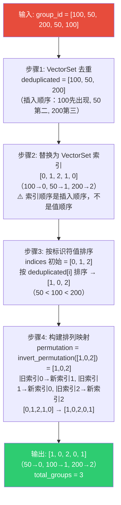

### 10.5 另一个例子（permutation 不同）

```
输入: group_id = [200, 100, 50, 100, 200]

步骤1: VectorSet 去重 → deduplicated = [200, 100, 50]
  （200 先出现, 100 第二次, 50 第三次）

步骤2: 替换为 VectorSet 索引 → [0, 1, 2, 1, 0]
  （200→0, 100→1, 50→2）

步骤3: 按值排序
  indices 初始 = [0, 1, 2]
  deduplicated[0]=200, deduplicated[1]=100, deduplicated[2]=50
  50 < 100 < 200 → indices = [2, 1, 0]

步骤4: invert_permutation([2, 1, 0]) = [2, 1, 0]
  旧索引0(值200)→新索引2, 旧索引1(值100)→新索引1, 旧索引2(值50)→新索引0
  [0, 1, 2, 1, 0] → [2, 1, 0, 1, 2]

输出: [2, 1, 0, 1, 2]  （50→0, 100→1, 200→2）
total_groups = 3
```

### 10.6 invert_permutation 实现

```cpp
// source/blender/geometry/intern/reorder.cc:97~106
static Array<int> invert_permutation(const Span<int> permutation)
{
  Array<int> data(permutation.size());
  threading::parallel_for(permutation.index_range(), 2048, [&](const IndexRange range) {
    for (const int64_t i : range) {
      data[permutation[i]] = i;
    }
  });
  return data;
}
```

> **核心逻辑**：如果 `permutation[i] = j`，则 `data[j] = i`。即把"位置→元素"的映射反转为"元素→位置"的映射。
>
> **类比**：
> - `permutation` = 座位表："座位 i 坐的是几号人" → `permutation[i] = j` 表示座位 i 坐 j 号
> - `data` = 查找表："j 号人坐在哪个座位" → `data[j] = i` 表示 j 号坐在座位 i
>
> **数值例子**：
> - `permutation = [2, 0, 1]`（座位0坐2号, 座位1坐0号, 座位2坐1号）
> - `data[2] = 0, data[0] = 1, data[1] = 2` → `data = [1, 2, 0]`（0号坐座位1, 1号坐座位2, 2号坐座位0）

---

## 11. find_points_by_group_index 分组索引

### 11.1 完整实现

```cpp
// source/blender/geometry/intern/reorder.cc:464~470
static void find_points_by_group_index(const Span<int> indices,
                                       MutableSpan<int> r_offsets,
                                       MutableSpan<int> r_indices)
{
  const OffsetIndices offsets = offset_indices::build_reverse_offsets(indices, r_offsets);
  offset_indices::reverse_indices_in_groups(indices, offsets, r_indices, false);
}
```

### 11.2 build_reverse_offsets 实现

```cpp
// source/blender/blenlib/intern/offset_indices.cc:156~161
OffsetIndices<int> build_reverse_offsets(const Span<int> indices, MutableSpan<int> offsets)
{
  BLI_assert(std::all_of(offsets.begin(), offsets.end(), [](int value) { return value == 0; }));
  array_utils::count_indices(indices, offsets);                      // 统计每组元素数量
  return offset_indices::accumulate_counts_to_offsets(offsets);      // 计数→偏移量
}
```

#### count_indices 实现

```cpp
// source/blender/blenlib/intern/array_utils.cc:95~110
void count_indices(const Span<int> indices, MutableSpan<int> counts)
{
  if (indices.size() < 8192 || BLI_system_thread_count() < 4) {
    // 数据量小或线程少 → 串行计数
    for (const int i : indices) {
      counts[i]++;
    }
  }
  else {
    // 数据量大 → 并行计数（用原子操作保证线程安全）
    threading::parallel_for(indices.index_range(), 4096, [&](const IndexRange range) {
      for (const int i : indices.slice(range)) {
        atomic_add_and_fetch_int32(&counts[i], 1);  // 原子 +1
      }
    });
  }
}
```

> **`atomic_add_and_fetch_int32`**：原子操作——先加1再返回新值。多线程同时写 `counts[i]` 不会产生数据竞争。

#### accumulate_counts_to_offsets 实现

```cpp
// source/blender/blenlib/intern/offset_indices.cc:19~35
OffsetIndices<int> accumulate_counts_to_offsets(MutableSpan<int> counts_to_offsets,
                                                const int start_offset = 0)
{
  int offset = start_offset;
  for (const int i : counts_to_offsets.index_range().drop_back(1)) {
    const int count = counts_to_offsets[i];
    BLI_assert(count >= 0);
    counts_to_offsets[i] = offset;   // 用偏移量替换计数
    offset += count;                  // 累加
  }
  counts_to_offsets.last() = offset;  // 最后一个元素是总大小
  return OffsetIndices<int>(counts_to_offsets);
}
```

> **核心**：将"每组有多少元素"转为"每组的起始偏移量"。这就是**前缀和**（prefix sum / exclusive scan）。
>
> 例如 `counts = [3, 2, 4]`（组0有3个, 组1有2个, 组2有4个）→ `offsets = [0, 3, 5, 9]`

### 11.3 reverse_indices_in_groups 实现

```cpp
// source/blender/blenlib/intern/offset_indices.cc:178~206
void reverse_indices_in_groups(const Span<int> group_indices,
                               const OffsetIndices<int> offsets,
                               MutableSpan<int> results,
                               const bool sort)
{
  if (group_indices.is_empty()) {
    return;
  }
  BLI_assert(results.size() == group_indices.size());
  BLI_assert(results.size() == offsets.total_size());
  BLI_assert(*std::max_element(group_indices.begin(), group_indices.end()) < offsets.size());
  BLI_assert(*std::min_element(group_indices.begin(), group_indices.end()) >= 0);

  Array<int> counts(offsets.size(), 0);  // 每组已放入多少个元素
  threading::parallel_for(group_indices.index_range(), 1024, [&](const IndexRange range) {
    for (const int64_t i : range) {
      const int group_index = group_indices[i];       // 元素 i 属于哪一组
      const int index_in_group = atomic_fetch_and_add_int32(&counts[group_index], 1);  // 原子递增，获取组内位置
      results[offsets[group_index][index_in_group]] = int(i);  // 写入结果
    }
  });
  if (sort) {
    sort_groups(offsets, results);  // 可选：对每组内结果排序
  }
}
```

> **核心逻辑**：遍历每个元素，根据其 `group_index` 找到它属于哪一组，然后在 `results` 中该组对应的区间内找一个位置放入。
>
> **`offsets[group_index][index_in_group]`**：`offsets[group_index]` 返回一个 `IndexRange`（如 `[3, 7)`），`[index_in_group]` 取其中的第 `index_in_group` 个位置（如 `3, 4, 5, 6`）。
>
> **`atomic_fetch_and_add_int32`**：原子操作——先返回当前值再加1。保证多线程下每个元素在组内获得不同的位置。
>
> **`sort = false`**：`find_points_by_group_index` 传入 `false`，不排序组内结果。因为后面 `grouped_sort` 会重新排序。

### 11.4 find_points_by_group_index 数值例子

```
输入: indices (gathered_group_id) = [0, 1, 0, 1, 0, 1, 0]
      （7个元素，组0有4个，组1有3个）

步骤1: build_reverse_offsets
  count_indices: counts = [4, 3]  （组0有4个元素, 组1有3个元素）
  accumulate_counts_to_offsets: offsets = [0, 4, 7]
    → 组0: [0, 4), 组1: [4, 7)

步骤2: reverse_indices_in_groups
  counts = [0, 0]  （每组已放入0个）
  遍历:
    i=0: group_index=0, index_in_group=0 → results[offsets[0][0]] = results[0] = 0, counts=[1,0]
    i=1: group_index=1, index_in_group=0 → results[offsets[1][0]] = results[4] = 1, counts=[1,1]
    i=2: group_index=0, index_in_group=1 → results[offsets[0][1]] = results[1] = 2, counts=[2,1]
    i=3: group_index=1, index_in_group=1 → results[offsets[1][1]] = results[5] = 3, counts=[2,2]
    i=4: group_index=0, index_in_group=2 → results[offsets[0][2]] = results[2] = 4, counts=[3,2]
    i=5: group_index=1, index_in_group=2 → results[offsets[1][2]] = results[6] = 5, counts=[3,3]
    i=6: group_index=0, index_in_group=3 → results[offsets[0][3]] = results[3] = 6, counts=[4,3]

  results = [0, 2, 4, 6, 1, 3, 5]
  → 组0: [0, 2, 4, 6]  组1: [1, 3, 5]
```

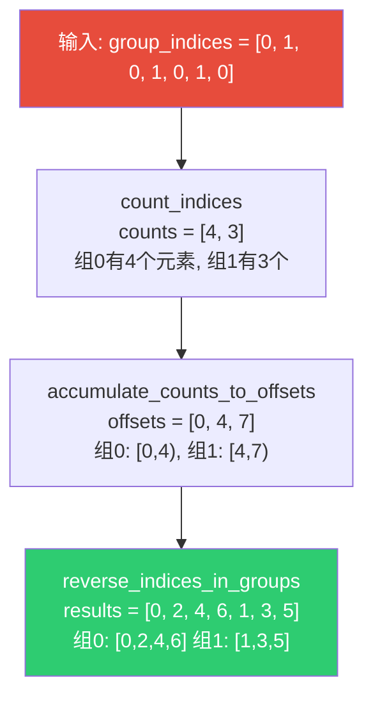

---

## 12. parallel_transform 并行变换

### 12.1 完整实现

```cpp
// source/blender/geometry/intern/reorder.cc:434~441
template<typename T, typename Func>
static void parallel_transform(MutableSpan<T> values, const int64_t grain_size, const Func &func)
{
  threading::parallel_for(values.index_range(), grain_size, [&](const IndexRange range) {
    MutableSpan<T> values_range = values.slice(range);
    std::transform(values_range.begin(), values_range.end(), values_range.begin(), func);
  });
}
```

### 12.2 逐行解析

> **`threading::parallel_for(values.index_range(), grain_size, ...)`**：将 `values` 按 `grain_size` 分块，每块一个线程处理。
>
> **`values.slice(range)`**：切出当前线程负责的子范围。
>
> **`std::transform(begin, end, begin, func)`**：STL 算法，对 `[begin, end)` 中的每个元素调用 `func`，结果写回第三个参数指向的位置。这里输入和输出是同一块内存（原地变换）。
>
> **`grain_size`**：每个线程处理的最小元素数。如果数据量小于 `grain_size`，就不会开新线程。不同调用使用不同的 grain_size：
> - `2048`：用于 `identifiers_to_indices` 的步骤2和步骤5（简单查找，计算快）
> - `4096`：用于 `identifiers_to_indices` 的步骤4（更简单的查找）
> - `2048`：用于路径B的步骤5（`mask[pos]`，简单索引查找）

### 12.3 数值例子

```
values = [0, 1, 2, 1, 0]  （步骤2的输出，VectorSet 索引）
func = [&](const int index) { return permutation[index]; }
permutation = [1, 0, 2]

parallel_transform:
  对每个元素: values[i] = permutation[values[i]]
  values[0] = permutation[0] = 1
  values[1] = permutation[1] = 0
  values[2] = permutation[2] = 2
  values[3] = permutation[1] = 0
  values[4] = permutation[0] = 1

结果: values = [1, 0, 2, 0, 1]
```

---

## 13. array_utils 工具函数详解

### 13.1 gather — 按索引收集

```cpp
// source/blender/blenlib/BLI_array_utils.hh:188~204
template<typename T>
inline void gather(const VArray<T> &src, const IndexMask &indices, MutableSpan<T> dst)
{
  threading::parallel_for(indices.index_range(), grain_size, [&](const IndexRange range) {
    src.materialize_compressed(indices.slice(range), dst.slice(range));
  });
}
```

> **功能**：`dst[i] = src[indices[i]]`——从源数组中按索引掩码收集元素。
>
> **`materialize_compressed`**：VArray 的方法，将虚拟数组中指定索引的值物化到连续内存。"compressed"表示结果紧密排列（无空洞）。
>
> **数值例子**：
> ```
> src = [A, B, C, D, E]  （VArray）
> indices = {1, 3, 4}     （IndexMask）
> dst = [B, D, E]          （结果：src[1], src[3], src[4]）
> ```

### 13.2 copy — 按掩码复制

```cpp
// source/blender/blenlib/intern/array_utils.cc:36~54
void copy(const GVArray &src, const IndexMask &selection, GMutableSpan dst)
{
  threading::parallel_for(selection.index_range(), grain_size, [&](const IndexRange range) {
    src.materialize(selection.slice(range), dst.data());
  });
}
```

> **功能**：将 VArray 中 mask 选中位置的值复制到 dst 的**对应位置**。与 `gather` 不同——`gather` 是紧凑排列，`copy` 是保持位置。
>
> **数值例子**：
> ```
> src = [A, B, C, D, E]  （VArray, domain_size=5）
> selection = {1, 3}       （IndexMask）
> dst = [_, B, _, D, _]   （只有位置1和3被写入，其他位置不变）
> ```
>
> **路径A中的使用**：`array_utils::copy(weight, mask, weight_values)` — 将选中位置的权重写入 `weight_values` 的对应位置，未选中位置保持默认值。

### 13.3 scatter — 按索引散布

```cpp
// source/blender/blenlib/BLI_array_utils.hh:155~166
template<typename T>
inline void scatter(const Span<T> src, const IndexMask &indices, MutableSpan<T> dst)
{
  indices.foreach_index_optimized<int64_t>(
      [&](const int64_t index, const int64_t pos) { dst[index] = src[pos]; });
}
```

> **功能**：`dst[indices[pos]] = src[pos]`——`gather` 的逆操作。将源数据按索引散布到目标数组的指定位置。
>
> **数值例子**：
> ```
> src = [D, B]          （排序后的结果）
> indices = {1, 3}       （IndexMask，选中位置）
> dst[1] = D, dst[3] = B  （散布到指定位置）
> dst = [_, D, _, B, _]
> ```

### 13.4 fill_index_range — 填充递增索引

```cpp
// source/blender/blenlib/BLI_array_utils.hh:406~409
template<typename T>
inline void fill_index_range(MutableSpan<T> span, const T start = 0)
{
  std::iota(span.begin(), span.end(), start);  // [start, start+1, start+2, ...]
}
```

> **`std::iota`**：STL 算法，用递增值填充范围。名字来自 APL 语言中的 ι（iota）运算符。
>
> **IndexMask 版本**（第 411~415 行）：
> ```cpp
> template<typename T>
> inline void fill_index_range(const IndexMask &mask, MutableSpan<T> span)
> {
>   mask.foreach_index_optimized<T>([&](const T index) { span[index] = index; });
> }
> ```
> 只在 mask 选中的位置写入 `span[index] = index`，表示"该位置元素保持原位"。

### 13.5 indices_are_range — 判断是否连续范围

#### 完整实现

```cpp
// source/blender/blenlib/intern/array_utils.cc:325~342
bool indices_are_range(Span<int> indices, IndexRange range)
{
  if (indices.size() != range.size()) {
    return false;
  }
  return threading::parallel_reduce(
      range.index_range(), 4096, true,
      [&](const IndexRange part, const bool is_range) {
        return is_range &&
               std::equal(indices.slice(part).begin(), indices.slice(part).end(),
                          range.slice(part).begin());
      },
      std::logical_and<>());
}
```

#### 功能

判断 `indices` 是否恰好等于 `[range.start(), range.start()+1, ..., range.start()+size-1]`。

例如 `indices = [3, 4, 5]`, `range = IndexRange(3, 3)` → `true`（恰好是 3,4,5）
`indices = [3, 5, 4]`, `range = IndexRange(3, 3)` → `false`（不是 3,4,5）

#### 逐行解析

```cpp
if (indices.size() != range.size()) {
    return false;
}
```

> **快速失败**：长度不同，内容肯定不同，直接返回。避免启动并行框架的开销。

```cpp
threading::parallel_reduce(
    range.index_range(),   // 要处理的索引范围 [0, 1, 2, ..., size-1]
    4096,                  // grain_size：每块至少 4096 个元素
    true,                  // identity：逻辑与的单位元
    [&](const IndexRange part, const bool is_range) { ... },
    std::logical_and<>()   // reduction：用逻辑与合并分块结果
);
```

> **参数说明**：
> - `range.index_range()` = `[0, size)`——对整个范围分块
> - `4096` = grain_size——数据量 < 4096 时不分块，直接串行
> - `true` = identity——逻辑与的单位元（`true && x = x`）
> - lambda = function——处理每个分块，返回该分块是否匹配
> - `logical_and<>` = reduction——合并分块结果（`a && b`）

```cpp
[&](const IndexRange part, const bool is_range) {
    return is_range &&
           std::equal(indices.slice(part).begin(), indices.slice(part).end(),
                      range.slice(part).begin());
}
```

> **`part`**：当前分块的索引范围，如 `[0, 4096)` 或 `[4096, 8192)`
>
> **`is_range`**：之前分块合并后的累积结果。如果之前已经发现 `false`，这里直接短路返回 `false`，不再调用 `std::equal`——**短路优化**。
>
> **`indices.slice(part)`**：切出当前分块对应的 indices 子数组
>
> **`range.slice(part)`**：切出当前分块对应的 range 子范围
>
> **`std::equal(...)`**：逐个比较两个数组是否完全相同

#### 执行流程图

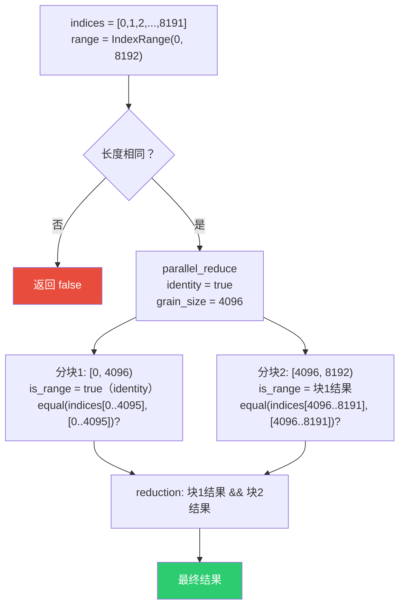

#### 数值例子

**例子1：与原序相同 → 返回 true**

```
indices = [0, 1, 2, 3, 4, 5, 6, 7]
range   = IndexRange(0, 8)  → 期望 [0,1,2,3,4,5,6,7]

长度相同(8=8) → 继续

parallel_reduce([0,8), grain_size=4, identity=true):

  块1: part=[0,4), is_range=true
    indices.slice([0,4)) = [0,1,2,3]
    range.slice([0,4))   = [0,1,2,3]
    std::equal → true
    return true && true = true

  块2: part=[4,8), is_range=true（块1的结果）
    indices.slice([4,8)) = [4,5,6,7]
    range.slice([4,8))   = [4,5,6,7]
    std::equal → true
    return true && true = true

  reduction(true, true) = true && true = true

返回 true → 排序结果与原序相同 → 上层返回 nullopt
```

**例子2：与原序不同 → 返回 false**

```
indices = [1, 3, 4, 0, 2, 5, 6, 7]
range   = IndexRange(0, 8)

长度相同(8=8) → 继续

parallel_reduce([0,8), grain_size=4, identity=true):

  块1: part=[0,4), is_range=true
    indices.slice([0,4)) = [1,3,4,0]
    range.slice([0,4))   = [0,1,2,3]
    std::equal → 1≠0 → false
    return true && false = false

  块2: part=[4,8), is_range=false（块1合并后为false）
    return false && ...（短路！不再调用 std::equal）
    直接返回 false

  reduction(false, false) = false

返回 false → 排序结果与原序不同 → 上层返回排序数组
```

**例子3：长度不同 → 快速失败**

```
indices = [0, 1, 2]
range   = IndexRange(0, 5)  → 期望 [0,1,2,3,4]

indices.size()=3 ≠ range.size()=5
→ 直接返回 false
```

#### 短路优化详解

`is_range &&` 的短路行为是关键优化：

```cpp
return is_range && std::equal(...);
//     ↑ 如果 is_range=false，std::equal 根本不会执行
```

```
100万元素的数组，第10个元素就不匹配：

不短路：100万个元素全部比较 → 浪费！
短路：  块1前10个就发现 false → 后续所有块直接跳过 → 快100倍
```

> **逻辑与的短路求值**：`false && x` 中，`x` 不会被求值。C++ 语言保证这一点。所以 `is_range && std::equal(...)` 在 `is_range` 为 `false` 时，`std::equal` 不会被调用。

#### 用途

`sort_indices_by_weights` 中两次调用 `indices_are_range`：

```cpp
// 第一次：检查排序后的 gathered_indices 是否与原序相同
if (array_utils::indices_are_range(gathered_indices, IndexRange(domain_size))) {
    return std::nullopt;  // 无需排序
}

// 第二次：检查合并未选中元素后的最终结果是否与原序相同
if (array_utils::indices_are_range(indices, indices.index_range())) {
    return std::nullopt;  // 无需排序
}
```

> 如果排序结果恰好就是 `[0, 1, 2, ...]`（原序），返回 `nullopt` 告诉调用方"不需要重排"——避免不必要的 gather 操作。

---

## 14. 端到端完整流程示例

### 14.1 场景：部分选中 + 有分组 + 有权重

```
列表: [A, B, C, D, E, F, G]  （7个元素, domain_size=7）
mask = {1, 2, 4, 5, 6}       （选中5个, 位置0和3未选中）
group_id = [_, 10, 20, _, 10, 20, 10]  （位置0和3未选中，group_id无所谓）
weight = [_, 2.0, 1.0, _, 0.5, 3.0, 2.5]
```

```mermaid
flowchart TD
    START["sort_indices_by_weights<br/>domain_size=7, mask={1,2,4,5,6}"]

    EARLY["早期退出检查<br/>group_id 非单值, mask 非空 → 继续"]

    PATH_B["路径B: 有分组"]

    B1["① gather group_id<br/>gathered_group_id = [10, 20, 10, 20, 10]<br/>（mask位置1→10, 2→20, 4→10, 5→20, 6→10）"]

    B2["② identifiers_to_indices<br/>VectorSet=[10,20] → [0,1,0,1,0]<br/>按值排序: 10<20, 顺序不变<br/>permutation=[0,1]<br/>最终: [0,1,0,1,0]<br/>total_groups=2"]

    B3["③ find_points_by_group_index<br/>counts=[3,2] → offsets=[0,3,5]<br/>reverse: 组0=[0,2,4], 组1=[1,3]<br/>gathered_indices = [0, 2, 4, 1, 3]<br/>（组0: 选中位置0,2,4 → 原位置1,4,6）<br/>（组1: 选中位置1,3 → 原位置2,5）"]

    B4["④ gather weight<br/>weight_values = [2.0, 1.0, 0.5, 3.0, 2.5]<br/>（mask位置1→2.0, 2→1.0, 4→0.5, 5→3.0, 6→2.5）<br/>grouped_sort:<br/>组0[0,2,4]: w[0]=2.0,w[2]=1.0,w[4]=0.5 → [4,2,0]<br/>组1[1,3]: w[1]=1.0,w[3]=3.0 → [1,3]<br/>gathered_indices = [4, 2, 0, 1, 3]"]

    B5["⑤ 局部→全局<br/>mask[4]=6, mask[2]=4, mask[0]=1, mask[1]=2, mask[3]=5<br/>gathered_indices = [6, 4, 1, 2, 5]"]

    CHECK1["indices_are_range([6,4,1,2,5], [0..6]) → false"]
    CHECK2["mask.size()=5 ≠ domain_size=7 → 部分选中"]

    COMPLEMENT["⑥ unselected = {0, 3}"]
    SCATTER["⑦ scatter([6,4,1,2,5], mask={1,2,4,5,6}, indices)<br/>indices[1]=6, indices[2]=4, indices[4]=1, indices[5]=2, indices[6]=5<br/>fill_index_range(unselected={0,3}, indices)<br/>indices[0]=0, indices[3]=3"]

    RESULT["最终 indices = [0, 6, 4, 3, 1, 2, 5]<br/>位置0→A(原位), 位置1→G(原6号), 位置2→E(原4号)<br/>位置3→D(原位), 位置4→B(原1号), 位置5→C(原2号), 位置6→F(原5号)"]

    START --> EARLY --> PATH_B --> B1 --> B2 --> B3 --> B4 --> B5 --> CHECK1 --> CHECK2 --> COMPLEMENT --> SCATTER --> RESULT

    style START fill:#e74c3c,color:#fff
    style RESULT fill:#2ecc71,color:#fff
```

#### 验证排序结果

```
原列表按 group_id 分组:
  组10(值0): 位置1(B,w=2.0), 位置4(E,w=0.5), 位置6(G,w=2.5)
  组20(值1): 位置2(C,w=1.0), 位置5(F,w=3.0)

组10按权重升序: E(0.5) < B(2.0) < G(2.5)
组20按权重升序: C(1.0) < F(3.0)

最终排列: [A, G, E, D, B, C, F]
  ↑       ↑组10排在前面   ↑组20紧接其后  ↑未选中保持原位
  未选中   按权重升序       按权重升序
```

### 14.2 场景：全选 + 无分组 + 有权重

```
列表: [A, B, C, D, E]  （5个元素, domain_size=5）
mask = {0, 1, 2, 3, 4}  （全选）
group_id = 单值 0
weight = [3.0, 1.0, 4.0, 1.5, 2.0]
```

```
路径A:
① gathered_indices = [0, 1, 2, 3, 4]
② weight_values = [3.0, 1.0, 4.0, 1.5, 2.0]
③ grouped_sort(Span({0, 5}), weight_values, gathered_indices)
   按 weight 升序排 gathered_indices:
   weight[1]=1.0 < weight[3]=1.5 < weight[4]=2.0 < weight[0]=3.0 < weight[2]=4.0
   → gathered_indices = [1, 3, 4, 0, 2]

indices_are_range([1,3,4,0,2], [0..4]) → false
mask.size()=5 == domain_size=5 → 全选

返回 [1, 3, 4, 0, 2]
含义: 位置0放B(w=1.0), 位置1放D(w=1.5), 位置2放E(w=2.0), 位置3放A(w=3.0), 位置4放C(w=4.0)
```

### 14.3 场景：排序后与原序相同 → 返回 nullopt

```
列表: [A, B, C]  （3个元素, domain_size=3）
mask = {0, 1, 2}  （全选）
group_id = [0, 0, 0]
weight = [1.0, 2.0, 3.0]  （已经是升序）

路径A:
① gathered_indices = [0, 1, 2]
② weight_values = [1.0, 2.0, 3.0]
③ grouped_sort → gathered_indices = [0, 1, 2]  （已经有序，排序不变）

indices_are_range([0,1,2], [0..2]) → true  （就是原序）

返回 nullopt  （无需排序，调用方可以跳过重排）
```

---

## 15. gather 重排列表数据

### 15.1 代码

```cpp
if (const auto *array_data = std::get_if<GList::ArrayData>(&list_data)) {
  // 1. 分配未初始化的数组
  GList::ArrayData sorted_array_data = GList::ArrayData::ForUninitialized(type, list_size);

  // 2. 构造源/目标 Span
  const GSpan src_span(type, array_data->data, list_size);
  GMutableSpan dst_span = sorted_array_data.span_for_write(type, list_size);

  // 3. 按排序索引 gather
  type.to_static_type<float, float2, float3, float4, int, int2, bool, int8_t,
                       short2, ColorGeometry4f, ColorGeometry4b, math::Quaternion,
                       float4x4, nodes::MenuValue, std::string, nodes::BundlePtr,
                       nodes::ClosurePtr, GeometrySet, Material *, Object *, Image *,
                       VFont *, Scene *, bSound *>([&]<typename T>() {
    array_utils::gather(src_span.typed<T>(), sorted->as_span(), dst_span.typed<T>());
  });

  // 4. 创建新列表
  GListPtr sorted_list = GList::create(type, std::move(sorted_array_data), list_size);
  params.set_output("List"_ustr, std::move(sorted_list));
  return;
}
```

### 15.2 gather 操作详解

`array_utils::gather(src, indices, dst)` 的含义：

```
src    = [A, B, C, D, E]     （原列表数据）
indices = [3, 1, 4, 0, 2]    （排序索引映射）
dst    = [D, B, E, A, C]     （结果：dst[i] = src[indices[i]]）
```

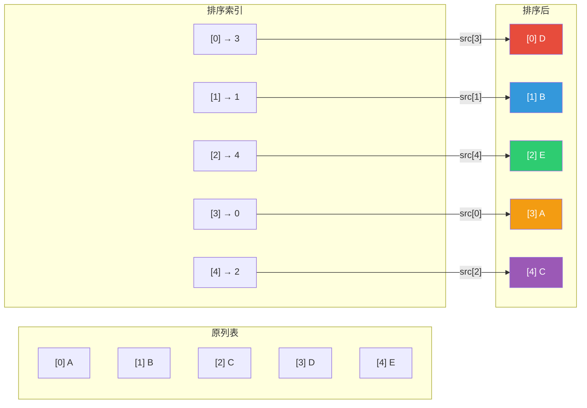

### 15.3 ForUninitialized 和 span_for_write

**`GList::ArrayData::ForUninitialized(type, list_size)`**：分配内存但不初始化——因为 `gather` 会覆盖每个位置，不需要先构造默认值。

**`sorted_array_data.span_for_write(type, list_size)`**：获取可变 Span。因为 `ArrayData::data` 是 `const void*`（隐式共享的"软锁"），`span_for_write` 检查引用计数，确认唯一所有权后返回 `GMutableSpan`。

---

## 16. to_static_type 类型分发宏

### 16.1 语法

```cpp
type.to_static_type<float, float2, float3, ..., bSound *>([&]<typename T>() {
  array_utils::gather(src_span.typed<T>(), sorted->as_span(), dst_span.typed<T>());
});
```

> **`to_static_type<T1, T2, ..., Tn>(callback)`**：运行时类型分发。根据 `type`（`CPPType` 引用）在编译期生成的类型列表中匹配，匹配成功则调用 `callback` 的对应模板实例化。
>
> **`[&]<typename T>()`**：C++20 模板 Lambda——`T` 由 `to_static_type` 用匹配到的类型替换。

### 16.2 为什么需要列出所有类型？

因为 `gather` 需要类型化的 `Span<T>` 和 `MutableSpan<T>`，而 `GSpan`/`GMutableSpan` 是类型擦除的。`to_static_type` 在编译期为每种可能的类型生成一份 `gather` 代码，运行时通过函数指针表跳转到正确的实例化。

### 16.3 支持的类型列表

| 类型 | 说明 | 大小 |
|------|------|------|
| `float` | 浮点数 | 4 |
| `float2` | 二维向量 | 8 |
| `float3` | 三维向量 | 12 |
| `float4` | 四维向量 | 16 |
| `int` | 整数 | 4 |
| `int2` | 二维整数 | 8 |
| `bool` | 布尔值 | 1 |
| `int8_t` | 8位整数 | 1 |
| `short2` | 短整数向量 | 4 |
| `ColorGeometry4f` | 浮点颜色 | 16 |
| `ColorGeometry4b` | 字节颜色 | 4 |
| `math::Quaternion` | 四元数 | 16 |
| `float4x4` | 4×4矩阵 | 64 |
| `MenuValue` | 菜单值 | 变长 |
| `std::string` | 字符串 | 32（内联） |
| `BundlePtr` | 包指针 | 8 |
| `ClosurePtr` | 闭包指针 | 8 |
| `GeometrySet` | 几何集 | >32 |
| `Material *` | 材质指针 | 8 |
| `Object *` | 对象指针 | 8 |
| `Image *` | 图像指针 | 8 |
| `VFont *` | 字体指针 | 8 |
| `Scene *` | 场景指针 | 8 |
| `bSound *` | 声音指针 | 8 |

---

## 17. 与 Sort Elements 节点的对比

### 17.1 共享的排序算法

Sort List 和 Sort Elements 共享 `sort_indices_by_weights` 函数，但使用场景不同：

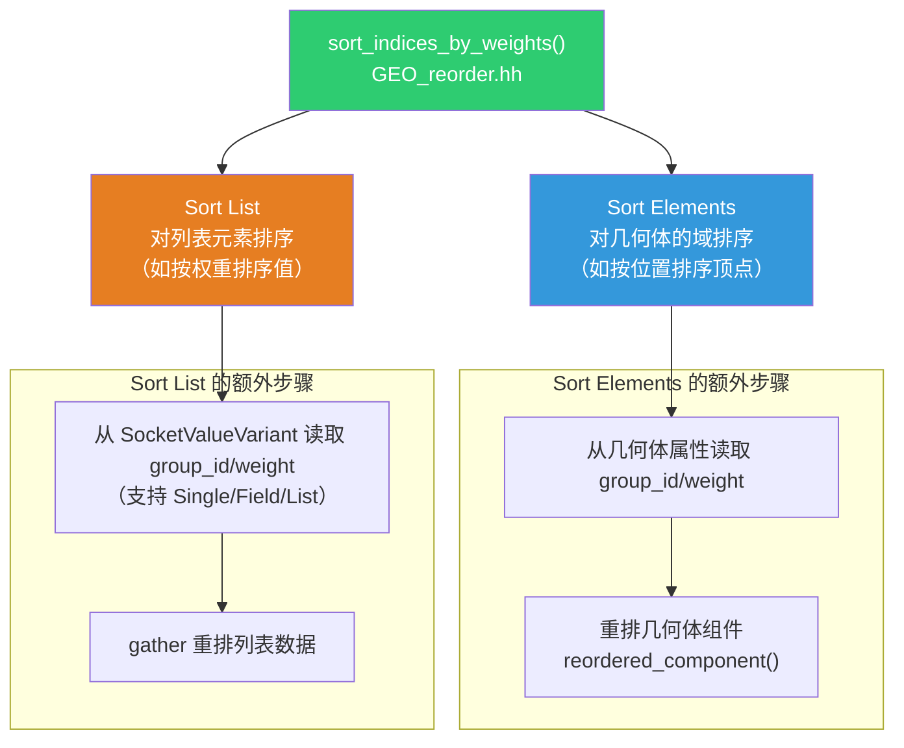

### 17.2 差异对比

| 特性 | Sort Elements | Sort List |
|------|--------------|-----------|
| 操作对象 | 几何体域（点/面/边） | 列表 |
| 输入类型 | 属性字段 | Single/Field/List |
| Selection 来源 | 域上的布尔属性 | SocketValueVariant |
| Group ID 来源 | 域上的整数属性 | SocketValueVariant |
| Sort Weight 来源 | 域上的浮点属性 | SocketValueVariant |
| 排序后处理 | 重排几何体组件 | gather 重排列表数据 |
| SampleIndexFunction | 不需要 | 需要（列表→字段适配） |

---

## 18. 关键语法与注释翻译

### 18.1 ResourceScope

```cpp
ResourceScope scope;
```

> **`ResourceScope`**：资源作用域——一个 RAII 容器，存储任意类型的对象。当 `scope` 离开作用域时，所有存储的对象自动销毁。用于延长临时对象（如从列表转换的 `VArray`）的生命周期。

> **RAII**（Resource Acquisition Is Initialization，资源获取即初始化）：C++ 核心资源管理范式——把资源（内存、文件、锁）绑定到对象的生命周期。构造时获取资源，析构时释放资源。离开作用域时编译器**自动**调用析构函数，保证资源不泄漏。
>
> ```cpp
> {
>     ResourceScope scope;        // 构造：空容器
>     scope.add_value(std::move(list));  // 存入对象
>     // ... 使用 list ...
> }  // 离开作用域 → scope 析构 → 自动销毁所有存储的对象
> ```
>
> 对比 Java/Python 的 GC：RAII 是**确定性**的——资源释放时机明确（离开作用域时），不依赖 GC 的不确定时机。

### 18.2 fn:: 命名空间

```cpp
fn::FieldEvaluator field_evaluator(field_context, list_size);
mf::MultiFunction
```

> **`fn::`** = functions 命名空间（`blender::fn`），包含字段系统（Field、FieldEvaluator、FieldOperation、MultiFunction 等）。
>
> **为什么有的节点带 `fn::` 有的不带？**
> - **带 `fn::`**：使用了 `fn` 命名空间中的类型，且当前文件没有 `using namespace blender::fn;`
> - **不带**：文件顶部有 `using namespace blender::fn;` 或在 `namespace blender::fn::...` 内部
>
> ```cpp
> // node_geo_sort_list.cc 顶部
> namespace blender::nodes {
> // 没有 using namespace fn; → 必须写 fn::
> fn::FieldEvaluator field_evaluator(...);
> }
> ```
>
> **`mf::`** = multi function 命名空间（`blender::fn::mf`），是 `fn` 的子命名空间。

### 18.3 MultiFunction 是什么

```cpp
class SampleIndexFunction : public mf::MultiFunction {
```

> **`MultiFunction`**（多函数）：Blender 的"批量计算"抽象——一次对一组数据执行相同操作。
>
> ```cpp
> // MultiFunction 的核心接口
> void call(const IndexMask &mask,    // 对哪些索引执行
>           mf::Params params,         // 输入/输出参数
>           mf::Context context) const; // 上下文
> ```
>
> **为什么叫"多函数"？** 普通函数一次处理一个值：`f(0)`, `f(1)`, `f(2)`...。MultiFunction 一次处理**一批**值：`call([0,1,2,...], inputs, outputs)`——可以批量优化（SIMD、并行）。
>
> **`SampleIndexFunction`**：把列表包装为 MultiFunction——输入索引，输出列表中对应位置的值。
>
> ```mermaid
> flowchart LR
>     subgraph 输入
>         I0["索引 0"]
>         I1["索引 1"]
>         I2["索引 2"]
>     end
>     subgraph "SampleIndexFunction.call"
>         L["GListPtr<br/>[A, B, C, D]"]
>     end
>     subgraph 输出
>         O0["list[0] = A"]
>         O1["list[1] = B"]
>         O2["list[2] = C"]
>     end
>     I0 --> L
>     I1 --> L
>     I2 --> L
>     L --> O0
>     L --> O1
>     L --> O2
> ```

### 18.4 为什么抽象这么复杂

```cpp
auto fn = fn::FieldOperation::from(
    std::make_shared<SampleIndexFunction>(selection_variant.extract<GListPtr>()),
    {fn::IndexFieldInput::get_field()});
field_evaluator.set_selection(fn::Field<bool>(std::move(fn)));
```

> **为什么这么复杂？** 因为要把"列表"塞进"字段系统"——两者接口不兼容。
>
> | 系统 | 接口 | 数据来源 |
> |------|------|----------|
> | 字段系统 | `Field<bool>` | 每个位置计算一个 bool |
> | 列表 | `GListPtr` | 按索引访问元素 |
>
> **转换链**：
>
> ```mermaid
> flowchart TD
>     L["GListPtr<br/>列表数据"] -->|"SampleIndexFunction<br/>包装为 MultiFunction"| MF["MultiFunction<br/>输入索引→输出元素"]
>     IDX["IndexFieldInput<br/>每个位置返回自己的索引"] --> FO
>     MF -->|"FieldOperation::from<br/>包装为 FieldOperation"| FO["FieldOperation<br/>字段操作节点"]
>     FO -->|"Field<bool>(...)<br/>包装为 Field"| F["Field<bool><br/>布尔字段"]
>     F -->|"set_selection<br/>传给 FieldEvaluator"| FE["FieldEvaluator<br/>字段求值器"]
> ```
>
> **类比**：就像把一个数组适配成函数——`f(i) = array[i]`。需要多层包装是因为 Blender 的字段系统设计为**延迟求值**——先构建计算图，最后一次性求值。

### 18.5 为什么用 std::move

```cpp
field_evaluator.set_selection(fn::Field<bool>(std::move(fn)));
```

> **`std::move(fn)`**：`fn` 是 `FieldOperation` 的 `shared_ptr`。`std::move` 把它转为右值，触发**移动构造**而非拷贝构造。
>
> ```cpp
> // 不用 move：拷贝 shared_ptr → 引用计数 +1（原子操作）
> field_evaluator.set_selection(fn::Field<bool>(fn));
>
> // 用 move：移动 shared_ptr → 引用计数不变（零开销）
> field_evaluator.set_selection(fn::Field<bool>(std::move(fn)));
> // fn 之后不再使用，移动是安全的
> ```
>
> `fn` 在这行之后不再使用——移动语义让所有权转移，避免不必要的引用计数操作。

### 18.6 FieldEvaluator 方法详解

```cpp
field_evaluator.add(*group_id_field, &group_id);     // 添加输入字段
field_evaluator.set_selection(selection_field);       // 设置选择
field_evaluator.evaluate();                            // 求值
const IndexMask selection = field_evaluator.get_evaluated_selection_as_mask();
field_evaluator.get_evaluated_as_mask(0);              // 获取第0个输入的mask
```

> **`field_evaluator.add(field, &output)`**：
> - 添加一个输入字段到求值器
> - `field`：要求值的字段（如 Group ID 字段）
> - `&output`：求值结果的输出指针（如 `&group_id`）
> - 返回索引（0, 1, 2...），用于后续 `get_evaluated(index)` 获取结果
>
> **`field_evaluator.set_selection(field)`**：
> - 设置选择字段——只有 `field[i] == true` 的位置才会被求值
> - 类似 SQL 的 `WHERE` 子句
> - 必须在 `evaluate()` 之前调用
>
> **`field_evaluator.evaluate()`**：
> - 执行所有添加的字段的求值
> - 一次性求值所有字段——避免多次遍历
> - 求值后才能获取结果
>
> **`get_evaluated_selection_as_mask()`**：
> - 返回 `set_selection` 设置的**选择字段**的 mask
> - 选择字段控制"哪些位置参与求值"——未选中的位置**被跳过**（性能优化）
> - 求值时已经算好 mask，直接返回 `selection_mask_`
>
> **`get_evaluated_as_mask(index)`**：
> - 返回 `add` 添加的第 `index` 个**数据字段**求值后的 mask
> - **所有位置都参与求值**，事后把 bool 结果转为 mask
> - 代码：`VArray<bool> → index_mask_from_selection()`
>
> **区别**：
>
> | | `add` + `get_evaluated_as_mask` | `set_selection` + `get_evaluated_selection_as_mask` |
> |---|---|---|
> | 字段角色 | 数据字段 | 选择字段 |
> | 求值范围 | 所有位置 | 只对选中位置 |
> | mask 获取 | 事后转换 | 求值时算好 |
>
> **FilterList 用 `add`**：只有一个 filter 字段，直接 add + 转mask 更简单
> **SortList 用 `set_selection`**：有多个字段，set_selection 跳过未选中位置的求值——性能优化

```cpp
ListFieldContext field_context;
fn::FieldEvaluator field_evaluator(field_context, list_size);
```

> **`ListFieldContext`**：列表字段上下文——告诉 `FieldEvaluator` "在列表环境下求值"。与几何体字段上下文不同，列表没有域（domain）的概念，只有大小。

### 18.7 std::optional 和 std::nullopt

```cpp
const std::optional<Array<int>> sorted = geometry::sort_indices_by_weights(...);
if (!sorted) { ... }  // 等价于 sorted == std::nullopt
```

> **`std::optional<T>`**：可能包含值也可能不包含的容器。`std::nullopt` 表示"不包含值"。`sort_indices_by_weights` 返回 `nullopt` 表示"无需排序"——排序结果与原序相同，不需要重排。

### 18.8 std::get_if

```cpp
if (std::get_if<GList::SingleData>(&list_data)) { ... }
if (const auto *array_data = std::get_if<GList::ArrayData>(&list_data)) { ... }
```

> **`std::get_if<T>(&variant)`**：检查 variant 是否持有类型 `T`。如果持有，返回指向数据的指针；否则返回 `nullptr`。与 `std::get<T>` 不同——`std::get` 在类型不匹配时抛出异常，`std::get_if` 返回 `nullptr`。

### 18.9 UNLIKELY 宏

```cpp
if (UNLIKELY(weight_a == weight_b)) {
```

> **`UNLIKELY(condition)`**：编译器提示宏，告诉分支预测器这个条件**很少为真**。CPU 流水线会优化"大概率路径"的执行。等价于 `__builtin_expect(!!(condition), 0)`。

### 18.10 NOD_REGISTER_NODE

```cpp
NOD_REGISTER_NODE(node_register)
```

> **`NOD_REGISTER_NODE`**：Blender 的节点注册宏。在全局初始化阶段调用 `node_register` 函数，将节点类型注册到 Blender 的节点类型系统中。确保节点在 Blender 启动时可用。

---

## 19. FilterList vs SortList：Selection 处理方式对比

### 19.1 为什么处理方法不同？

FilterList 和 SortList 都接收 `SocketValueVariant("Selection")`，但处理方式完全不同：

|                            | FilterList                                 | SortList                                     |
| -------------------------- | ------------------------------------------ | -------------------------------------------- |
| **Selection 的作用**       | 决定哪些元素**保留/过滤**                  | 决定哪些元素**参与排序**                     |
| **单值模式**               | 直接 `get<bool>()` → 全保留或全过滤        | 包装为 `Field<bool>` 传给 `set_selection`    |
| **字段模式**               | 单独 `FieldEvaluator` 求值 → `IndexMask`   | 和其他输入共用一个 `FieldEvaluator`          |
| **列表模式**               | 直接 `IndexMask::from_bools` → `IndexMask` | 包装为 `SampleIndexFunction` → `Field<bool>` |
| **是否需要 ResourceScope** | ❌ 不需要                                   | ✅ 需要                                       |

### 19.2 FilterList 的处理（直接使用）

```cpp
// node_geo_filter_list.cc:141~167
auto filter_value = params.extract_input<bke::SocketValueVariant>("Selection"_ustr);

if (filter_value.is_single()) {
    // 单值 → 直接判断 true/false
    if (filter_value.get<bool>()) output_lists(params, list, IndexMask(list->size()));
    else                          output_lists(params, list, {});
}
else if (filter_value.is_context_dependent_field()) {
    // 字段 → 单独创建 FieldEvaluator 求值
    fn::FieldEvaluator field_evaluator(field_context, list->size());
    field_evaluator.add(filter_value.extract<Field<bool>>());
    field_evaluator.evaluate();
    output_lists(params, list, field_evaluator.get_evaluated_as_mask(0));
}
else if (filter_value.is_list()) {
    // 列表 → 直接转 IndexMask
    const VArray<bool> values = keep_list->varray().typed<bool>();
    IndexMask::from_bools(IndexRange(list->size()), values, memory);
}
```

**特点**：每种模式独立处理，直接得到 `IndexMask`，不需要 `FieldEvaluator` 统一求值。

### 19.3 SortList 的处理（统一为 Field）

```cpp
// node_geo_sort_list.cc:144~155
if (selection_variant.is_context_dependent_field()) {
    field_evaluator.set_selection(selection_variant.extract<fn::Field<bool>>());
}
else if (selection_variant.is_list()) {
    // 列表 → 包装为 SampleIndexFunction → Field<bool>
    auto fn = fn::FieldOperation::from(
        std::make_shared<SampleIndexFunction>(...),
        {fn::IndexFieldInput::get_field()});
    field_evaluator.set_selection(fn::Field<bool>(std::move(fn)));
}
else {
    // 单值 → 包装为常量 Field<bool>
    field_evaluator.set_selection(fn::Field<bool>(selection_variant.extract<bool>()));
}
```

**特点**：所有模式都转为 `Field<bool>`，统一交给 `FieldEvaluator`。

### 19.4 为什么 SortList 必须统一为 Field？

因为 SortList 有**多个输入**需要同时求值：

```cpp
// SortList 的三个输入都交给同一个 FieldEvaluator
field_evaluator.set_selection(selection_field);  // Selection
get_varray_or_evaluate(list_size, group_id_variant, scope, field_evaluator, 0, group_id);   // Group ID
get_varray_or_evaluate(list_size, weights_variant, scope, field_evaluator, 0.0f, weights); // Sort Weight
field_evaluator.evaluate();  // 一次求值所有输入！
```

如果 Selection 单独处理（像 FilterList 那样），就需要**两次求值**——一次算 Selection，一次算 Group ID 和 Weights。统一为 Field 后只需一次。

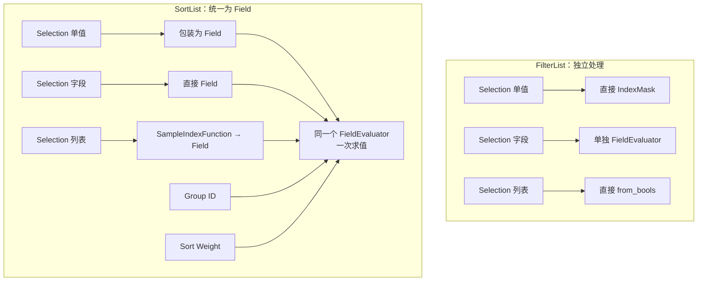

### 19.5 为什么需要 ResourceScope？

```cpp
ResourceScope scope;
```

SortList 需要延长临时对象的生命周期：

```cpp
// get_varray_or_evaluate 中：
if (value.is_list()) {
    auto list = value.extract<GListPtr>();
    if (list && list->size() == list_size) {
        r_varray = scope.add_value(std::move(list))->varray().typed<T>();
        //         ^^^^^^^^^^^^^^^^^^^^^^^^^^^^^
        //         list 存入 scope，延长生命周期到函数结束
    }
}
```

**为什么 FilterList 不需要？** FilterList 的列表模式直接用 `IndexMask::from_bools` 生成 mask，不保留 `VArray` 引用。SortList 的 `get_varray_or_evaluate` 返回 `VArray<T>`，可能引用 `GList` 内部数据——`GList` 必须存活到 `field_evaluator.evaluate()` 之后。

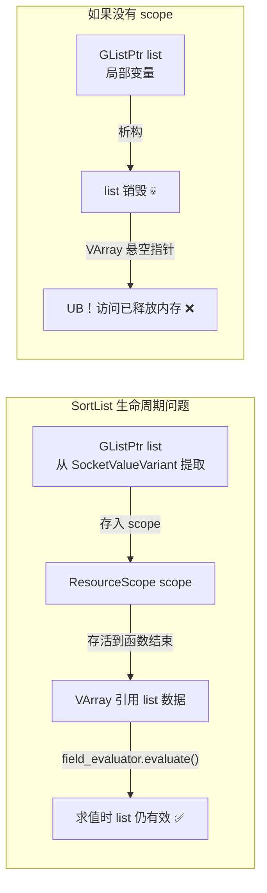

> **`ResourceScope`**：RAII 容器，存储任意类型对象。离开作用域时自动销毁所有对象。SortList 用它延长 `GListPtr` 的生命周期，确保 `VArray` 在求值期间有效。FilterList 不需要——它不保留 `VArray` 引用。

---

> 📖 系列文档：[目录](01-列表系统架构与核心数据结构.md) | [上一篇](07-FilterList节点.md) | [下一篇](09-ClosureToList节点.md)
