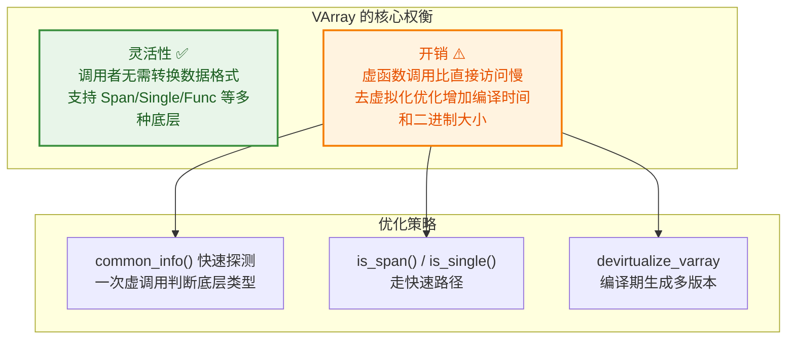
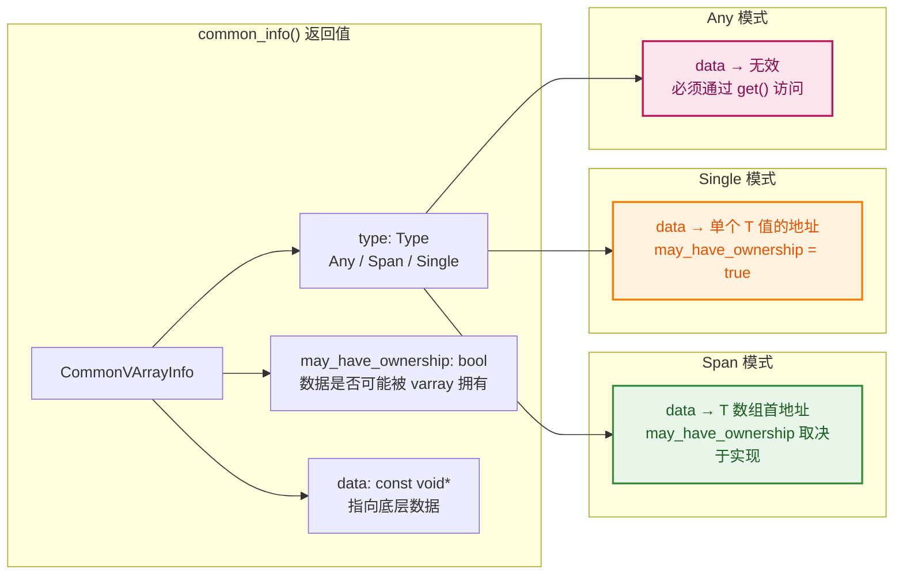
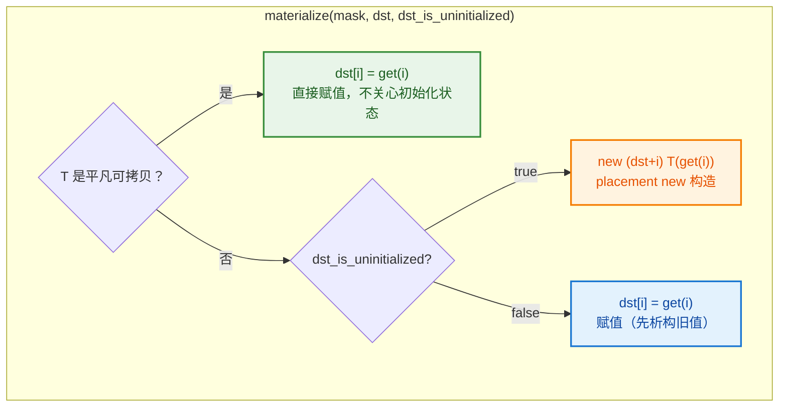
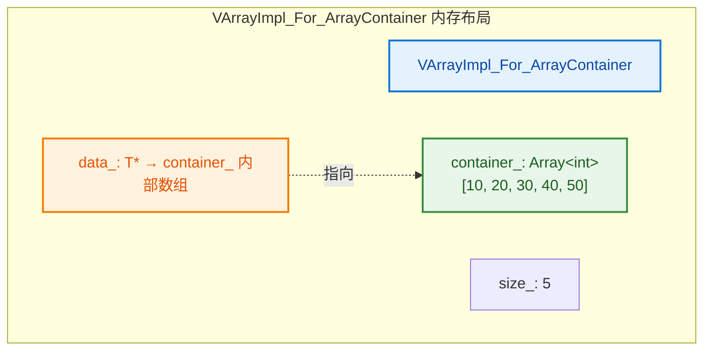
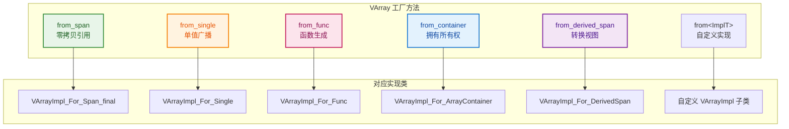
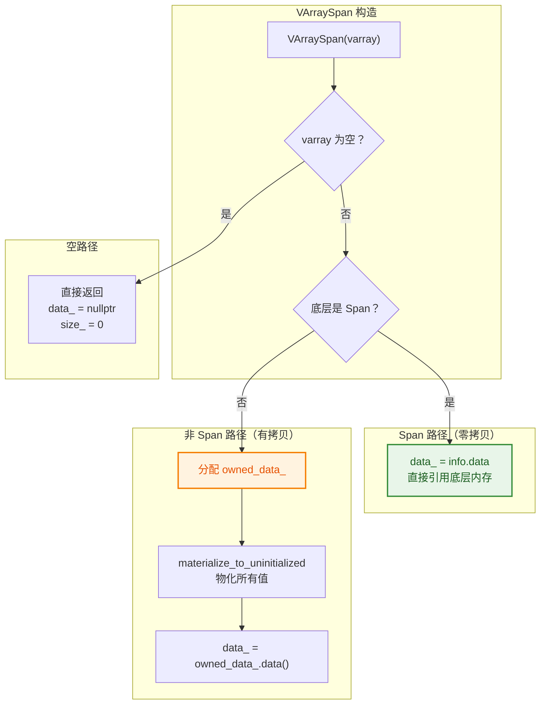
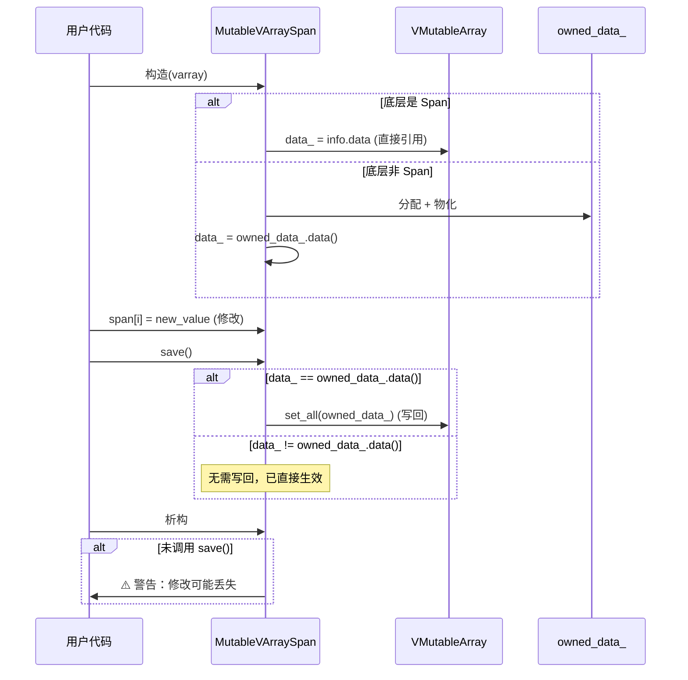
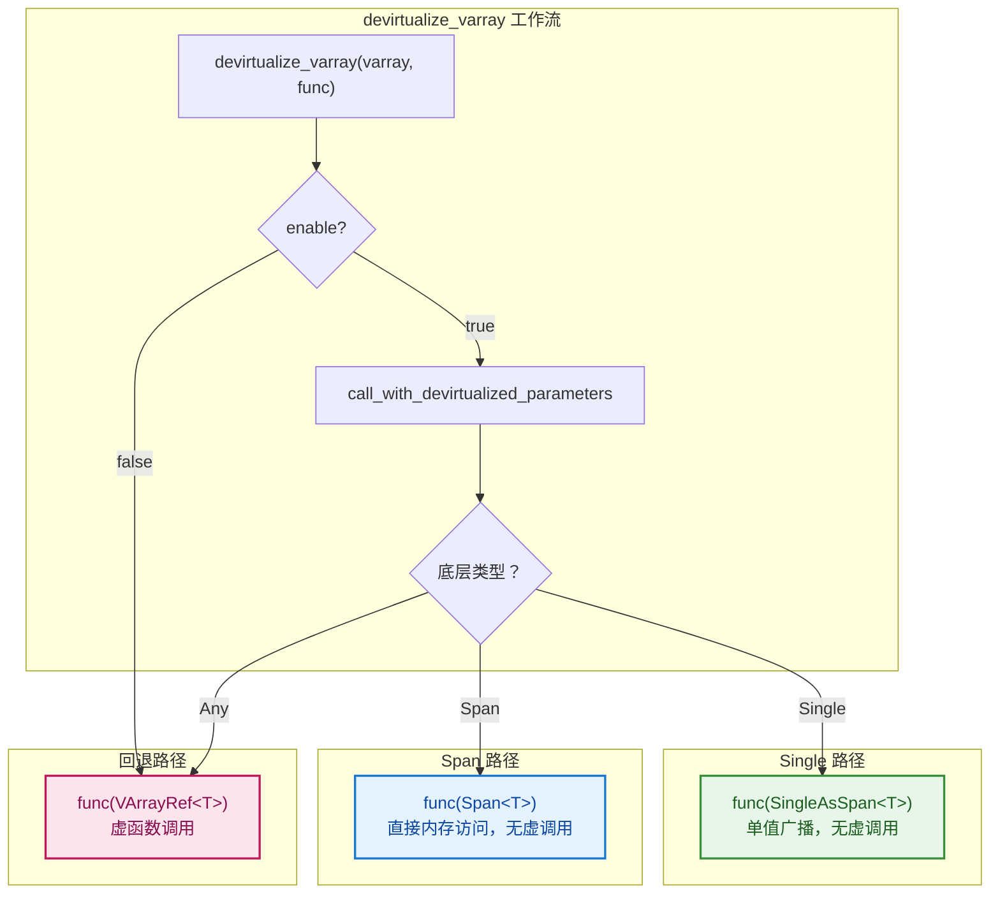
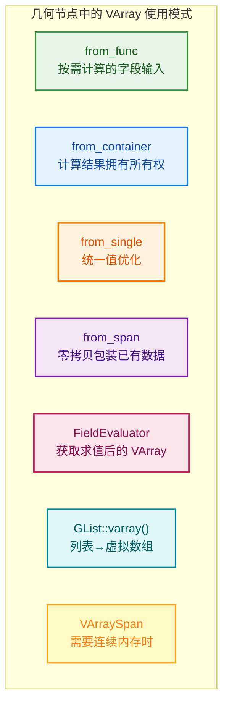

# BLI_virtual_array.hh 逐行深度解析

> 对 [BLI_virtual_array.hh](file:///e:/blender-git/blender/source/blender/blenlib/BLI_virtual_array.hh) 的逐行深度解析。
> 翻译重要注释、解释非基础语法、结合几何节点实际使用。
>
> 关联文档：[11_VArray_GVArray.md](11_VArray_GVArray.md)（概览级指南）
> 关联源码：[BLI_any_derived.hh](file:///e:/blender-git/blender/source/blender/blenlib/BLI_any_derived.hh)、[BLI_generic_virtual_array.hh](file:///e:/blender-git/blender/source/blender/blenlib/BLI_generic_virtual_array.hh)

---

## 目录

- [BLI\_virtual\_array.hh 逐行深度解析](#bli_virtual_arrayhh-逐行深度解析)
  - [目录](#目录)
  - [1. 文件头注释详解](#1-文件头注释详解)
    - [1.1 include 分析](#11-include-分析)
  - [2. CommonVArrayInfo — 快速类型探测结构体](#2-commonvarrayinfo--快速类型探测结构体)
  - [3. VArrayImpl\<T\> — 抽象基类](#3-varrayimplt--抽象基类)
    - [3.1 materialize — 按索引复制到目标数组](#31-materialize--按索引复制到目标数组)
    - [3.2 materialize\_compressed — 压缩复制](#32-materialize_compressed--压缩复制)
    - [3.3 try\_assign\_GVArray — 泛型转换钩子](#33-try_assign_gvarray--泛型转换钩子)
  - [4. VMutableArrayImpl\<T\> — 可变版基类](#4-vmutablearrayimplt--可变版基类)
  - [5. VArrayImpl\_For\_Span — 连续数组包装](#5-varrayimpl_for_span--连续数组包装)
    - [5.1 materialize 优化版](#51-materialize-优化版)
  - [6. VArrayImpl\_For\_Span\_final — 不可继承版 Span](#6-varrayimpl_for_span_final--不可继承版-span)
  - [7. VArrayImpl\_For\_ArrayContainer — 拥有容器所有权](#7-varrayimpl_for_arraycontainer--拥有容器所有权)
  - [8. VArrayImpl\_For\_Single — 单值广播](#8-varrayimpl_for_single--单值广播)
    - [8.1 materialize 优化](#81-materialize-优化)
  - [9. VArrayImpl\_For\_Func — 函数生成](#9-varrayimpl_for_func--函数生成)
    - [9.1 几何节点中的典型使用](#91-几何节点中的典型使用)
  - [10. VArrayImpl\_For\_DerivedSpan — 派生 Span（转换视图）](#10-varrayimpl_for_derivedspan--派生-span转换视图)
    - [10.1 几何节点中的使用](#101-几何节点中的使用)
  - [11. VArrayCommon\<T\> — 公共基类](#11-varraycommont--公共基类)
    - [11.1 构造函数](#111-构造函数)
    - [11.2 operator bool](#112-operator-bool)
    - [11.3 operator\[\]](#113-operator)
    - [11.4 size / first / last / is\_empty / index\_range](#114-size--first--last--is_empty--index_range)
    - [11.5 common\_info / is\_span / is\_single](#115-common_info--is_span--is_single)
    - [11.6 materialize 系列](#116-materialize-系列)
    - [11.7 try\_assign\_GVArray / get\_implementation](#117-try_assign_gvarray--get_implementation)
  - [12. varray\_tag — 构造函数消歧标签](#12-varray_tag--构造函数消歧标签)
  - [13. VArray\<T\> — 只读虚拟数组](#13-varrayt--只读虚拟数组)
    - [13.1 构造函数](#131-构造函数)
    - [13.2 工厂方法](#132-工厂方法)
  - [14. VMutableArray\<T\> — 可变虚拟数组](#14-vmutablearrayt--可变虚拟数组)
    - [14.1 工厂方法](#141-工厂方法)
    - [14.2 隐式转换为 VArray](#142-隐式转换为-varray)
    - [14.3 get\_internal\_span / set / set\_all](#143-get_internal_span--set--set_all)
    - [14.4 get\_impl — 关键的 const\_cast](#144-get_impl--关键的-const_cast)
  - [15. VArraySpan\<T\> — VArray→Span 适配器](#15-varrayspant--varrayspan-适配器)
    - [15.1 移动构造和赋值](#151-移动构造和赋值)
  - [16. MutableVArraySpan\<T\> — 可写版适配器](#16-mutablevarrayspant--可写版适配器)
    - [16.1 save() — 写回机制](#161-save--写回机制)
    - [16.2 析构警告](#162-析构警告)
  - [17. SingleAsSpan + VArrayRef — 去虚拟化辅助](#17-singleasspan--varrayref--去虚拟化辅助)
    - [17.1 SingleAsSpan](#171-singleasspan)
    - [17.2 VArrayRef](#172-varrayref)
  - [18. VArrayDevirtualizer + devirtualize\_varray — 去虚拟化优化](#18-varraydevirtualizer--devirtualize_varray--去虚拟化优化)
    - [18.1 VArrayDevirtualizer](#181-varraydevirtualizer)
    - [18.2 devirtualize\_varray](#182-devirtualize_varray)
    - [18.3 devirtualize\_varray2](#183-devirtualize_varray2)
  - [19. 几何节点实际使用案例](#19-几何节点实际使用案例)
    - [19.1 模式总览](#191-模式总览)
    - [19.2 from\_func — 按需计算](#192-from_func--按需计算)
    - [19.3 from\_container — 拥有所有权](#193-from_container--拥有所有权)
    - [19.4 from\_single — 统一值](#194-from_single--统一值)
    - [19.5 FieldEvaluator 获取 VArray](#195-fieldevaluator-获取-varray)
    - [19.6 GList::varray() — 列表→虚拟数组](#196-glistvarray--列表虚拟数组)
    - [19.7 VArraySpan — 需要连续内存](#197-varrayspan--需要连续内存)
    - [19.8 自定义 VArrayImpl — 顶点权重](#198-自定义-varrayimpl--顶点权重)
  - [附录：类型特征变量](#附录类型特征变量)

---

## 1. 文件头注释详解

```cpp
// BLI_virtual_array.hh:1~24
```

```cpp
/** \file
 * \ingroup bli
 *
 * A virtual array is a data structure that behaves similarly to an array, but its elements are
 * accessed through virtual methods. This improves the decoupling of a function from its callers,
 * because it does not have to know exactly how the data is laid out in memory, or if it is stored
 * in memory at all. It could just as well be computed on the fly.
```

> **翻译**：虚拟数组是一种行为类似数组的数据结构，但它的元素通过虚方法访问。这改善了函数与调用者之间的解耦——函数不需要知道数据在内存中具体如何布局，甚至不需要知道数据是否存储在内存中。数据完全可以是即时计算的。
>
> **"on the fly"**：字面意思是"在飞行中"，编程中意为"**即时/动态/按需**"——不需要预先存储，而是在需要时才计算。例如 `VArrayImpl_For_Func` 每次调用 `get(i)` 时才计算值，而不是提前算好存起来。类似的英语表达："compute on the fly"（即时计算）、"generate on the fly"（即时生成）。

```cpp
 * Taking a virtual array as parameter instead of a more specific non-virtual type has some
 * tradeoffs. Access to individual elements of the individual elements is slower due to function
 * call overhead. On the other hand, potential callers don't have to convert the data into the
 * specific format required for the function. This can be a costly conversion if only few of the
 * elements are accessed in the end.
```

> **翻译**：用虚拟数组作为参数而非更具体的非虚拟类型，有一些权衡。单个元素的访问更慢（因为函数调用开销）。但另一方面，调用者不需要把数据转换成函数要求的特定格式——如果最终只访问少量元素，格式转换可能代价很高。

```cpp
 * Functions taking a virtual array as input can still optimize for different data layouts. For
 * example, they can check if the array references contiguous memory internally or if it is the
 * same value for all indices. Whether it is worth optimizing for different data layouts in a
 * function has to be decided on a case by case basis. One should always do some benchmarking to
 * see if the increased compile time and binary size is worth it.
```

> **翻译**：接受虚拟数组作为输入的函数仍然可以针对不同的数据布局做优化。例如，可以检查数组内部是否引用了连续内存，或者是否所有索引返回同一个值。是否值得为不同数据布局做优化，需要逐案决定。应该做基准测试，看看增加的编译时间和二进制大小是否值得。



### 1.1 include 分析

```cpp
#include <functional>      // std::function（from_std_func 用）
#include <optional>        // std::optional（get_if_single 返回）

#include "BLI_any_derived.hh"       // AnyDerived——VArray 内部存储的核心
#include "BLI_array.hh"             // Array<T>——VArraySpan/MutableVArraySpan 的 owned_data_
#include "BLI_devirtualize_parameters.hh"  // call_with_devirtualized_parameters
#include "BLI_index_mask.hh"        // IndexMask——materialize 的参数
#include "BLI_span.hh"              // Span<T>/MutableSpan<T>
```

> **关键依赖**：`BLI_any_derived.hh` 是 VArray 的底层存储——`VArrayCommon::impl_` 的类型就是 `AnyDerived<const VArrayImpl<T>>`。AnyDerived 提供小缓冲区优化（SBO），小实现内联存储，大的用 `shared_ptr` 堆分配。

---

## 2. CommonVArrayInfo — 快速类型探测结构体

```cpp
// BLI_virtual_array.hh:47~71
```

```cpp
/**
 * Used to quickly check if a varray is a span or a single value. This struct also allows
 * retrieving multiple pieces of data with a single virtual method call.
 */
struct CommonVArrayInfo {
```

> **翻译**：用于快速检查 varray 是 span 还是单值。这个结构体还允许通过**一次虚函数调用**获取多块数据。
>
> **为什么重要？** 虚函数调用有开销。如果分别调用 `is_span()`、`get_internal_span()`，每次都是虚函数调用。`common_info()` 一次调用就返回所有信息——类型、数据指针、所有权标志。

```cpp
  enum class Type : uint8_t {
    /* Is not one of the common special types below. */
    Any,
    Span,
    Single,
  };
```

> **`: uint8_t`**：指定底层类型为 `uint8_t`，节省内存（1 字节而非默认 `int` 的 4 字节）。

| Type 值 | 含义 | data 指向 | 典型实现类 |
|---------|------|----------|-----------|
| `Any` | 通用类型（无法优化） | 无效 | `VArrayImpl_For_Func` |
| `Span` | 连续内存 | `T*` 数组首地址 | `VArrayImpl_For_Span` |
| `Single` | 所有索引同一值 | `T*` 单值地址 | `VArrayImpl_For_Single` |

```cpp
  /** True when the #data becomes a dangling pointer when the virtual array is destructed. */
  bool may_have_ownership = true;
```

> **翻译**：当虚拟数组析构时 `data` 是否会变成悬空指针。
>
> **`may_have_ownership` 的含义**：不是"是否拥有"，而是"**可能**拥有"。用于判断数据是否安全——如果 `may_have_ownership = false`，说明数据不归 varray 管，即使 varray 析构了数据仍然安全。
>
> - `VArrayImpl_For_Span`：`true`（可能拥有，取决于是否通过 `from_container` 创建）
> - `VArrayImpl_For_Span_final`：`false`（不拥有，只是引用外部数据）
> - `VArrayImpl_For_Single`：`true`（拥有单值的拷贝）
> - `VArrayImpl_For_DerivedSpan`：`true`（可能拥有底层 StructT 数组）

```cpp
  /**
   * Points either to nothing, a single value, or an array of values, depending on #type.
   * If this is a span of a mutable virtual array, it is safe to cast away const.
   */
  const void *data;
```

> **翻译**：根据 `type`，可能指向空、单个值、或值数组。如果是可变虚拟数组的 span，可以安全地 `const_cast` 去掉 const。
>
> **"cast away const" 的含义**：`data` 是 `const void*`，但如果底层是 `VMutableArrayImpl` 的 Span，数据实际是可修改的。`MutableVArraySpan::get_internal_span()` 就做了 `const_cast`。

```cpp
  CommonVArrayInfo() = default;
  CommonVArrayInfo(const Type _type, const bool _may_have_ownership, const void *_data)
      : type(_type), may_have_ownership(_may_have_ownership), data(_data)
  {
  }
};
```



---

## 3. VArrayImpl\<T\> — 抽象基类

```cpp
// BLI_virtual_array.hh:77~165
```

```cpp
/**
 * Implements the specifics of how the elements of a virtual array are accessed. It contains a
 * bunch of virtual methods that are wrapped by #VArray.
 */
template<typename T> class VArrayImpl {
```

> **翻译**：实现虚拟数组元素访问方式的具体细节。包含一组虚方法，由 `VArray` 包装对外暴露。
>
> **设计模式**：这是**桥接模式**（Bridge Pattern）——`VArray` 是接口层，`VArrayImpl` 是实现层，两者独立变化。

```cpp
 protected:
  /**
   * Number of elements in the virtual array. All virtual arrays have a size, but in some cases it
   * may make sense to set it to the max value.
   */
  int64_t size_;
```

> **翻译**：虚拟数组中的元素数量。所有虚拟数组都有大小，但在某些情况下可以设为最大值。
>
> **"set it to the max value"**：`INT64_MAX`。用于表示"无限大小"的虚拟数组——比如 `VArrayImpl_For_Single` 的单值广播，理论上可以无限延伸。但实际中很少这样做。

```cpp
 public:
  VArrayImpl(const int64_t size) : size_(size)
  {
    BLI_assert(size_ >= 0);
  }

  virtual ~VArrayImpl() = default;

  int64_t size() const
  {
    return size_;
  }
```

> **构造函数**：接受 `int64_t size`，断言非负。

> **`virtual ~VArrayImpl() = default` 详解**：
>
> **虚析构函数**（`virtual ~VArrayImpl()`）：为什么需要 `virtual`？因为 `VArrayImpl` 是基类，用户通过基类指针操作派生类对象：
> ```cpp
> VArrayImpl<int>* impl = new VArrayImpl_For_Single<int>(42, 100);
> delete impl;  // 如果析构函数不是 virtual，只调用 ~VArrayImpl()，不调用 ~VArrayImpl_For_Single()
>               // 有了 virtual，正确调用 ~VArrayImpl_For_Single() 再 ~VArrayImpl()
> ```
> 没有虚析构函数，`delete` 基类指针只会调用基类析构函数——派生类的析构逻辑被跳过，导致资源泄漏。
>
> **`= default`**：告诉编译器"自动生成默认实现"——什么都不做（基类没有需要清理的资源）。等价于写 `virtual ~VArrayImpl() {}`，但 `= default` 更明确地表达意图"我就是要默认行为"。
>
> | 写法 | 含义 |
> |------|------|
> | `~VArrayImpl() = default;` | 自动生成默认析构（什么都不做） |
> | `~VArrayImpl() {}` | 手写空析构（效果相同，但语义不同） |
> | `~VArrayImpl() = delete;` | 禁止析构（不能 delete 对象） |

> **`virtual T get(int64_t index) const = 0` 详解**：
>
> **`= 0`**：**纯虚函数**（pure virtual function）——表示这个函数**没有实现**，必须在派生类中重写。含有纯虚函数的类是**抽象类**，不能直接实例化：
> ```cpp
> VArrayImpl<int> impl(10);           // ❌ 编译错误！抽象类不能实例化
> VArrayImpl_For_Single<int> s(42, 10); // ✅ 具体类可以实例化
> ```
>
> **C++ 函数声明后缀速查**：
>
> | 后缀 | 含义 | 示例 |
> |------|------|------|
> | `= 0` | 纯虚函数（必须在派生类实现） | `virtual T get() const = 0;` |
> | `= default` | 使用编译器默认实现 | `~VArrayImpl() = default;` |
> | `= delete` | 禁止使用 | `VArrayImpl(const VArrayImpl&) = delete;` |
> | `override` | 重写基类虚函数（编译器检查） | `T get() const override;` |
> | `final` | 重写且禁止进一步重写 | `T get() const final;` |

```cpp
  /**
   * Get the element at #index. This does not return a reference, because the value may be computed
   * on the fly.
   */
  virtual T get(int64_t index) const = 0;
```

> **翻译**：获取 `index` 处的元素。不返回引用，因为值可能是即时计算的。
>
> **核心纯虚函数**——每个子类必须实现。返回 `T`（值）而非 `T&`（引用），因为 `VArrayImpl_For_Func` 每次调用都计算新值，无法返回引用。

```cpp
  virtual CommonVArrayInfo common_info() const
  {
    return {};
  }
```

> **默认实现**：返回 `CommonVArrayInfo{}`（`Type::Any`，`may_have_ownership = true`，`data = nullptr`）。不提供特殊优化的子类（如 `VArrayImpl_For_Func`）使用此默认。

### 3.1 materialize — 按索引复制到目标数组

```cpp
  /**
   * Copy values from the virtual array into the provided span. The index of the value in the
   * virtual array is the same as the index in the span.
   */
  virtual void materialize(const IndexMask &mask, T *dst, const bool dst_is_uninitialized) const
  {
    if constexpr (std::is_trivially_copyable_v<T>) {
      mask.foreach_index([&](const int64_t i) { dst[i] = this->get(i); });
    }
    else {
      if (dst_is_uninitialized) {
        mask.foreach_index([&](const int64_t i) { new (dst + i) T(this->get(i)); });
      }
      else {
        mask.foreach_index([&](const int64_t i) { dst[i] = this->get(i); });
      }
    }
  }
```

> **翻译**：将虚拟数组的值复制到提供的 span。虚拟数组中的索引和 span 中的索引相同。
>
> **三个参数**：
> - `mask`：`IndexMask`，指定要复制哪些索引（不是全部）
> - `dst`：目标内存
> - `dst_is_uninitialized`：目标内存是否未初始化
>
> **`mask.foreach_index`**：遍历 mask 中选中的索引。`IndexMask` 是一个索引集合——比如 `{2, 5, 7}` 表示只处理第 2、5、7 个元素。`foreach_index` 对每个选中索引调用 lambda。
>
> **未选中的索引呢？** 不动——`dst` 中未被 mask 选中的位置保持原样。`materialize` 只写 mask 指定的位置，其他位置不碰。
>
> ```cpp
> // 示例：mask = {2, 5, 7}，size = 10
> VArray<int> varray = ...;  // [0,1,2,3,4,5,6,7,8,9]
> int dst[10] = {-1,-1,-1,-1,-1,-1,-1,-1,-1,-1};
> varray.materialize(mask, dst, false);
> // dst = [-1,-1,2,-1,-1,5,-1,7,-1,-1]
> //        ↑     ↑     ↑     ↑
> //      不动   写入   不动   写入    只有 mask 中的索引被写入
> ```
>
> **第 116 行和第 123 行看起来一样？** 确实一样！
> ```cpp
> // 第 116 行（平凡类型分支）
> mask.foreach_index([&](const int64_t i) { dst[i] = this->get(i); });
> // 第 123 行（非平凡类型 + 已初始化分支）
> mask.foreach_index([&](const int64_t i) { dst[i] = this->get(i); });
> ```
> 代码完全相同。区别在于**上下文**：
> - 第 116 行：`T` 是平凡可拷贝类型（如 `int`、`float`），`dst[i] =` 是简单的内存拷贝
> - 第 123 行：`T` 是非平凡类型（如 `std::string`），`dst[i] =` 会调用 `T::operator=`（先析构旧值，再拷贝新值）
>
> **非平凡类型的 `dst[i] =` 到底做了什么？** 不是简单的内存拷贝，而是一个函数调用：
> ```cpp
> // dst[i] = value 实际调用的是：
> dst[i].operator=(value);
>
> // std::string::operator= 的逻辑大致是：
> string& operator=(const string& other) {
>     if (this == &other) return *this;
>     this->~string();        // ① 先释放旧值（free 旧缓冲区）
>     new (this) string(other); // ② 再拷贝新值（allocate 新缓冲区 + 复制字符）
>     return *this;
> }
> ```
> 对比平凡类型（如 `int`）：`dst[i] = value` 就是一条 `MOV` 指令，4 字节内存拷贝，完事。而 `string` 的 `dst[i] = value` 需要：释放旧缓冲区 → 分配新缓冲区 → 复制字符 → 更新长度。所以"先析构旧值再拷贝新值"——`operator=` 必须先清理旧状态（否则内存泄漏），再建立新状态。
>
> 编译器为不同类型生成不同的代码——虽然源码一样，但编译后的机器码完全不同。
>
> **`if constexpr std::is_trivially_copyable_v<T>`**：编译期分支——平凡可拷贝类型不需要关心初始化状态，直接赋值就行。非平凡类型需要区分：
> - `dst_is_uninitialized = true`：用 **placement new** 构造（`new (dst + i) T(get(i))`）
> - `dst_is_uninitialized = false`：直接赋值（`dst[i] = get(i)`），会先析构旧值再赋值
>
> **为什么区分？** 对非平凡类型（如 `std::string`），在未初始化内存上赋值是 UB——必须先构造。在已初始化内存上 placement new 会导致旧值泄漏（不析构）。



### 3.2 materialize_compressed — 压缩复制

```cpp
  /**
   * Copy values from the virtual array into the provided span. Contrary to #materialize, the index
   * in virtual array is not the same as the index in the output span. Instead, the span is filled
   * without gaps.
   */
  virtual void materialize_compressed(const IndexMask &mask,
                                      T *dst,
                                      const bool dst_is_uninitialized) const
  {
    if constexpr (std::is_trivially_copyable_v<T>) {
      mask.foreach_index([&](const int64_t i, const int64_t pos) { dst[pos] = this->get(i); });
    }
    else {
      if (dst_is_uninitialized) {
        mask.foreach_index(
            [&](const int64_t i, const int64_t pos) { new (dst + pos) T(this->get(i)); });
      }
      else {
        mask.foreach_index([&](const int64_t i, const int64_t pos) { dst[pos] = this->get(i); });
      }
    }
  }
```

> **翻译**：将值复制到 span。与 `materialize` 不同，虚拟数组中的索引和输出 span 中的索引不同——span 无间隙填充。
>
> **`materialize` vs `materialize_compressed`**：
>
> | 方法 | 索引映射 | 示例：mask = {2, 5, 7} |
> |------|---------|------------------------|
> | `materialize` | `dst[i] = get(i)` | dst[2]=get(2), dst[5]=get(5), dst[7]=get(7) |
> | `materialize_compressed` | `dst[pos] = get(i)` | dst[0]=get(2), dst[1]=get(5), dst[2]=get(7) |
>
> **`foreach_index` 的双参数版本**：`(int64_t i, int64_t pos)`——`i` 是虚拟数组中的索引，`pos` 是在 mask 中的位置（从 0 开始递增）。

### 3.3 try_assign_GVArray — 泛型转换钩子

```cpp
  /**
   * If this virtual wraps another #GVArray, this method should assign the wrapped array to the
   * provided reference. This allows losslessly converting between generic and typed virtual
   * arrays in all cases.
   * Return true when the virtual array was assigned and false when nothing was done.
   */
  virtual bool try_assign_GVArray(GVArray & /*varray*/) const
  {
    return false;
  }
```

> **翻译**：如果这个虚拟数组包装了另一个 `GVArray`，此方法应该将被包装的数组赋给提供的引用。这允许在所有情况下无损地在泛型和类型化虚拟数组之间转换。成功赋值返回 true，否则 false。
>
> **用途**：`VArrayImpl_For_GVArray<T>` 包装了一个 `GVArray`。当 `GVArray::typed<T>()` 被调用时，如果发现底层已经是 `VArrayImpl_For_GVArray<T>`，可以直接取出原始 `GVArray`，避免嵌套包装。
>
> **`/*varray*/`**：参数名被注释掉——表示这个参数在默认实现中未使用，但保留参数名作为文档。

---

## 4. VMutableArrayImpl\<T\> — 可变版基类

```cpp
// BLI_virtual_array.hh:168~202
```

```cpp
/** Similar to #VArrayImpl, but adds methods that allow modifying the referenced elements. */
template<typename T> class VMutableArrayImpl : public VArrayImpl<T> {
 public:
  using VArrayImpl<T>::VArrayImpl;
```

> **翻译**：类似 `VArrayImpl`，但增加了修改引用元素的方法。
>
> **`using VArrayImpl<T>::VArrayImpl;`**：**继承构造函数**——让 `VMutableArrayImpl` 自动拥有 `VArrayImpl` 的所有构造函数。
>
> **为什么需要这行？** C++ 派生类**不会自动继承**基类的构造函数。如果不写这行：
> ```cpp
> VArrayImpl<int> impl(10);           // ✅ 基类有 VArrayImpl(int64_t size)
> VMutableArrayImpl<int> mimpl(10);   // ❌ 编译错误！派生类没有这个构造函数
> ```
> 有了这行，编译器自动生成：
> ```cpp
> // 等价于编译器自动生成：
> VMutableArrayImpl(const int64_t size) : VArrayImpl<T>(size) {}
> ```
>
> **`VArrayImpl<T>::VArrayImpl`** 的含义：`VArrayImpl<T>` 是基类，`::VArrayImpl` 是基类的构造函数名（和类名相同）。`using` 把基类的构造函数"引入"派生类。
>
> **对比手写转发**：
> ```cpp
> // 不用 using，需要手写：
> VMutableArrayImpl(const int64_t size) : VArrayImpl<T>(size) {}
> // 如果基类有多个构造函数，每个都要手写一个
> ```

```cpp
  /**
   * Assign the provided #value to the #index.
   */
  virtual void set(int64_t index, T value) = 0;
```

> **翻译**：将 `value` 赋给 `index` 位置。纯虚函数——每个可变实现必须提供。

```cpp
  /**
   * Copy all elements from the provided span into the virtual array.
   */
  virtual void set_all(Span<T> src)
  {
    const CommonVArrayInfo info = this->common_info();
    if (info.type == CommonVArrayInfo::Type::Span) {
      initialized_copy_n(
          src.data(), this->size_, const_cast<T *>(static_cast<const T *>(info.data)));
    }
    else {
      const int64_t size = this->size_;
      for (int64_t i = 0; i < size; i++) {
        this->set(i, src[i]);
      }
    }
  }
```

> **翻译**：将 span 中的所有元素复制到虚拟数组。
>
> **优化分支**：
> - `Type::Span`：直接 `memcpy` 级别的 `initialized_copy_n`，一次调用搞定
> - 其他：逐个 `set(i, src[i])`，每次都有虚函数调用
>
> **`initialized_copy_n` 为什么包装 `std::copy_n`？**
> ```cpp
> // BLI_memory_utils.hh
> template<typename T> void initialized_copy_n(const T *src, int64_t n, T *dst) {
>     std::copy_n(src, n, dst);
> }
> template<typename T> void uninitialized_copy_n(const T *src, int64_t n, T *dst) {
>     std::uninitialized_copy_n(src, n, dst);
> }
> ```
> 三个原因：
> 1. **统一命名风格**：Blender 用 `initialized_xxx` / `uninitialized_xxx` 命名，和 `initialized_fill_n`、`uninitialized_fill_n` 一致。`std::copy_n` 没有体现"目标已初始化"的语义
> 2. **统一参数类型**：Blender 用 `int64_t`，`std` 用 `std::size_t`（可能是 32 位）。包装层做了隐式转换
> 3. **统一调用点**：将来加 SIMD 优化或调试检查，只需改一处
>
> **`const_cast<T *>(static_cast<const T *>(info.data))`**：`info.data` 是 `const void*`，先 `static_cast<const T*>` 再 `const_cast<T*>` 去掉 const。安全是因为 `common_info()` 注释说了"If this is a span of a mutable virtual array, it is safe to cast away const"。

```cpp
  virtual bool try_assign_GVMutableArray(GVMutableArray & /*varray*/) const
  {
    return false;
  }
};
```

> 与 `try_assign_GVArray` 类似，用于可变版本的反向转换。

---

## 5. VArrayImpl_For_Span — 连续数组包装

```cpp
// BLI_virtual_array.hh:204~268
```

```cpp
/**
 * A virtual array implementation that references that wraps a span. This implementation is used by
 * mutable and immutable spans to avoid code duplication.
 */
template<typename T> class VArrayImpl_For_Span : public VMutableArrayImpl<T> {
 protected:
  T *data_ = nullptr;
```

> **翻译**：引用/包装 span 的虚拟数组实现。这个实现被可变和不可变 span 共用，以避免代码重复。
>
> **设计要点**：`VArrayImpl_For_Span` 继承 `VMutableArrayImpl`（可变），不可变版本 `VArrayImpl_For_Span_final` 也继承它——只读通过不暴露 `set()` 实现（`final` 阻止外部调用）。

```cpp
 public:
  VArrayImpl_For_Span(const MutableSpan<T> data)
      : VMutableArrayImpl<T>(data.size()), data_(data.data())
  {
  }
```

> 构造函数接受 `MutableSpan<T>`（可变 span），提取指针和大小。注意：`data_` 是 `T*`（非 const），即使是只读使用也能写入——安全性由上层 `VArray` vs `VMutableArray` 保证。

```cpp
 protected:
  VArrayImpl_For_Span(const int64_t size) : VMutableArrayImpl<T>(size) {}
```

> **protected 构造函数**：只设大小，不设 `data_`。给 `VArrayImpl_For_ArrayContainer` 用——它需要先构造基类，再设置 `data_`。
>
> **为什么是 protected？** 如果是 public，外部可以创建一个 `VArrayImpl_For_Span(10)`——大小为 10 但 `data_` 是 `nullptr`，调用 `get(0)` 就会空指针崩溃。`protected` 限制只有派生类能调用——派生类保证在构造完成后设置 `data_`。
>
> ```cpp
> // VArrayImpl_For_ArrayContainer 的用法：
> VArrayImpl_For_ArrayContainer(Container container)
>     : VArrayImpl_For_Span<T>(int64_t(container.size())),  // ① 调用 protected 构造函数
>       container_(std::move(container))                     // ② 先存容器
> {
>     this->data_ = const_cast<T *>(container_.data());      // ③ 再设置 data_
> }
> ```
> 如果构造函数是 private，`VArrayImpl_For_ArrayContainer` 无法调用。如果构造函数是 public，外部可能误用。`protected` 刚好。

```cpp
  T get(const int64_t index) const final
  {
    return data_[index];
  }

  void set(const int64_t index, T value) final
  {
    data_[index] = value;
  }
```

> **`final`**：阻止派生类再重写。`VArrayImpl_For_Span_final` 不需要重写 `get/set`，只需要重写 `common_info()`。
>
> **为什么这些方法是 `protected`？** 基类 `VArrayImpl` 的 `get()` 等是 `public`，但 `VArrayImpl_For_Span` 把重写版本降为 `protected`。这**不影响虚函数派发**——C++ 中访问修饰符不影响虚表：
> ```cpp
> VArrayImpl_For_Span<int> span_impl(arr);
> span_impl.get(0);           // ❌ 编译错误！get 是 protected
>
> VArrayImpl<int>* ptr = &span_impl;
> ptr->get(0);                 // ✅ 可以！通过基类指针，走虚表派发
> ```
> 目的：防止用户直接操作实现类——应该通过 `VArray`/`VMutableArray` 接口使用。

```cpp
  CommonVArrayInfo common_info() const override
  {
    return CommonVArrayInfo(CommonVArrayInfo::Type::Span, true, data_);
  }
```

> `may_have_ownership = true`——默认假设可能拥有数据。`VArrayImpl_For_Span_final` 会重写为 `false`。

### 5.1 materialize 优化版

```cpp
  void materialize(const IndexMask &mask, T *dst, const bool dst_is_uninitialized) const override
  {
    if constexpr (std::is_trivially_copyable_v<T>) {
      index_mask::detail::copy_assign(data_, mask, dst);
    }
    else {
      if (dst_is_uninitialized) {
        mask.foreach_index([&](const int64_t i) { new (dst + i) T(data_[i]); });
      }
      else {
        mask.foreach_index([&](const int64_t i) { dst[i] = data_[i]; });
      }
    }
  }
```

> **vs 基类版本**：基类用 `this->get(i)`（虚函数调用），这里直接 `data_[i]`（直接内存访问）。对平凡类型还用了 `index_mask::detail::copy_assign`——可能是 SIMD 优化的批量复制。
>
> **为什么 `is_trivially_copyable_v` 可以用优化版？比 for 循环快很多？**
>
> 平凡可拷贝类型（`int`、`float`、`float3` 等）的拷贝等价于 `memcpy`——不需要调用构造函数/析构函数/`operator=`。编译器可以：
>
> | 优化 | 原理 | 加速比 |
> |------|------|--------|
> | **SIMD** | 一条指令拷贝 4 个 `float`（128 位 SSE）或 8 个 `float`（256 位 AVX） | 4~8x |
> | **缓存行预取** | 顺序访问时 CPU 自动预取下一缓存行 | 2~3x |
> | **循环展开** | 减少分支判断和循环计数开销 | 1.5~2x |
> | **`memcpy` 优化** | glibc 的 `memcpy` 按缓存行/页对齐优化 | 2~5x |
>
> ```cpp
> // for 循环版本（每个元素单独处理）
> for (int64_t i : mask) {
>     dst[i] = data_[i];  // 每次循环：读地址 → 读值 → 写地址 → 写值
> }
>
> // SIMD 版本（4 个 float 同时处理）
> __m128 values = _mm_load_ps(&data_[i]);  // 一次读 4 个 float
> _mm_store_ps(&dst[i], values);           // 一次写 4 个 float
> ```
>
> 非平凡类型（如 `std::string`）**不能用 SIMD**——因为拷贝 `string` 需要分配内存、复制字符、更新长度，每个对象的操作完全不同，无法批量处理。

```cpp
  void materialize_compressed(const IndexMask &mask,
                              T *dst,
                              const bool dst_is_uninitialized) const override
  {
    if constexpr (std::is_trivially_copyable_v<T>) {
      index_mask::detail::gather_assign(data_, mask, dst);
    }
    // ... 非平凡类型同基类
  }
```

> **`gather_assign`**：类似 `array_utils::gather`——从 `data_` 中按 mask 指定的索引收集元素，紧密排列到 `dst`。

---

## 6. VArrayImpl_For_Span_final — 不可继承版 Span

```cpp
// BLI_virtual_array.hh:270~295
```

```cpp
/**
 * A version of #VArrayImpl_For_Span that can not be subclassed. This allows safely overwriting the
 * #may_have_ownership method.
 */
template<typename T> class VArrayImpl_For_Span_final final : public VArrayImpl_For_Span<T> {
 public:
  using VArrayImpl_For_Span<T>::VArrayImpl_For_Span;

  VArrayImpl_For_Span_final(const Span<T> data)
      /* Cast const away, because the implementation for const and non const spans is shared. */
      : VArrayImpl_For_Span<T>({const_cast<T *>(data.data()), data.size()})
  {
  }
```

> **翻译**：`VArrayImpl_For_Span` 的不可继承版本。允许安全地覆盖 `may_have_ownership`。
>
> **为什么 `final`？** 如果可以被继承，子类可能重写 `common_info()` 改变 `may_have_ownership`，导致判断不可靠。`final` 保证 `common_info()` 的行为不会被覆盖。
>
> **`const_cast<T *>(data.data())`**：`Span<T>` 的 `data()` 返回 `const T*`，但 `VArrayImpl_For_Span` 的构造函数接受 `MutableSpan<T>`。这里 `const_cast` 去掉 const——安全，因为 `VArrayImpl_For_Span_final` 通过只读的 `VArray` 接口暴露，`set()` 虽然存在但不会被外部调用。
>
> **哪里限制了 `set()` 不会被外部调用？** 限制在 `VArray` 的接口层：
> ```cpp
> // VArray 只暴露了 get，没有 set
> template<typename T> class VArray : public VArrayCommon<T> {
>   T operator[](int64_t index) const { return impl_->get(index); }  // 只读
>   // 没有 set()！
> };
>
> // VMutableArray 才暴露 set
> template<typename T> class VMutableArray : public VArrayCommon<T> {
>   void set(int64_t index, T value) { this->get_impl()->set(index, std::move(value)); }
> };
> ```
> `VArrayImpl_For_Span_final` 确实有 `set()`（继承自 `VMutableArrayImpl`），但外部拿到的类型是 `VArray<T>`——`VArray` 的接口里根本没有 `set()`。

```cpp
 private:
  CommonVArrayInfo common_info() const final
  {
    return CommonVArrayInfo(CommonVArrayInfo::Type::Span, false, this->data_);
  }
};
```

> **`may_have_ownership = false`**——不拥有数据，只是引用外部 Span。这是与 `VArrayImpl_For_Span` 的关键区别。
>
> **`VArrayImpl_For_Span_final` vs `VArrayImpl_For_Span` 对比**：
>
> | | `VArrayImpl_For_Span` | `VArrayImpl_For_Span_final` |
> |---|---|---|
> | `final` | 否（可被继承） | 是（不可继承） |
> | `may_have_ownership` | `true`（默认，可能拥有数据） | `false`（不拥有数据） |
> | 用途 | 基类，给 `ArrayContainer` 继承 | 直接使用，包装外部 Span |
> | `common_info()` | `override`（可被重写） | `final`（不可重写） |
>
> `VArrayImpl_For_Span` 是"可继承版本"——`VArrayImpl_For_ArrayContainer` 继承它，拥有数据所有权。`VArrayImpl_For_Span_final` 是"终态版本"——不拥有数据，`final` 保证 `may_have_ownership = false` 不会被覆盖。
>
> **`private:` + `final`**：`private` 阻止外部调用，`final` 阻止子类重写（虽然已经是 `final` 类了，双重保险）。
>
> **为什么 `VArrayImpl_For_Span` 用 `protected`，而 `VArrayImpl_For_Span_final` 用 `private`？** 因为 `VArrayImpl_For_Span` 有派生类（`VArrayImpl_For_Span_final` 和 `VArrayImpl_For_ArrayContainer`），`protected` 允许派生类访问。`VArrayImpl_For_Span_final` 是 `final` 类，没有派生类，用 `private` 更严格——连 friend 之外的代码都不能直接调用。

```cpp
template<typename T>
inline constexpr bool is_trivial_extended_v<VArrayImpl_For_Span_final<T>> = true;
```

> **`is_trivial_extended_v` 特化**：标记此类为"平凡扩展"——意味着 `AnyDerived` 可以安全地用 `memcpy` 拷贝它（不需要调用拷贝构造函数）。`VArrayImpl_For_Span_final` 只有一个 `T*`，确实是平凡可拷贝的。

---

## 7. VArrayImpl_For_ArrayContainer — 拥有容器所有权

```cpp
// BLI_virtual_array.hh:297~312
```

```cpp
/**
 * A variant of `VArrayImpl_For_Span` that owns the underlying data.
 * The `Container` type has to implement a `size()` and `data()` method.
 * The `data()` method has to return a pointer to the first element in the continuous array of
 * elements.
 */
template<typename Container, typename T = typename Container::value_type>
class VArrayImpl_For_ArrayContainer : public VArrayImpl_For_Span<T> {
 private:
  Container container_;

 public:
  VArrayImpl_For_ArrayContainer(Container container)
      : VArrayImpl_For_Span<T>(int64_t(container.size())), container_(std::move(container))
  {
    this->data_ = const_cast<T *>(container_.data());
  }
};
```

> **翻译**：`VArrayImpl_For_Span` 的变体，拥有底层数据的所有权。`Container` 类型必须实现 `size()` 和 `data()` 方法。`data()` 必须返回连续数组首元素的指针。
>
> **模板参数**：
> - `Container`：容器类型（如 `Array<int>`、`Vector<float>`）
> - `T = typename Container::value_type`：从容器类型推导元素类型
>
> **`typename Container::value_type` 详解**：
>
> `Container::value_type` 是 C++ 容器的**嵌套类型约定**——所有标准容器都定义了 `value_type`：
> ```cpp
> std::vector<int>::value_type      → int
> std::vector<float3>::value_type   → float3
> Array<bool>::value_type           → bool
> std::map<K,V>::value_type         → std::pair<const K, V>
> ```
> 容器类内部用 `using` 定义：
> ```cpp
> template<typename T> class vector {
> public:
>     using value_type = T;  // 这就是 value_type 的来源
> };
> ```
>
> **`typename`**：告诉编译器 `Container::value_type` 是**类型名**（不是静态变量）。因为 `Container` 是模板参数，编译器不知道 `::value_type` 是类型还是值——`typename` 消歧。不加会编译错误。
>
> **`T = ...`（默认模板参数）**：调用时只需写 `VArrayImpl_For_ArrayContainer<Array<int>>`，不需要手动指定 `T = int`——编译器自动从 `Array<int>::value_type` 推导。
>
> **工作原理**：
> 1. 先调用 `VArrayImpl_For_Span(size)` 的 protected 构造函数（只设大小，不设 `data_`）
> 2. 用 `std::move` 把容器存入 `container_` 成员（拥有所有权）
> 3. 设置 `this->data_ = container_.data()`——指向容器内部的连续数组
>
> **为什么 `const_cast`？** `container_.data()` 对 const 容器返回 `const T*`，但 `data_` 是 `T*`。安全——容器归我们所有，不会通过 const 路径修改。



---

## 8. VArrayImpl_For_Single — 单值广播

```cpp
// BLI_virtual_array.hh:314~373
```

```cpp
/**
 * A virtual array implementation that returns the same value for every index. This class is final
 * so that it can be devirtualized by the compiler in some cases (e.g. when #devirtualize_varray is
 * used).
 */
template<typename T> class VArrayImpl_For_Single final : public VArrayImpl<T> {
 private:
  T value_;
```

> **翻译**：对所有索引返回同一值的虚拟数组实现。标记为 `final` 以便编译器在某些情况下去虚拟化（例如使用 `devirtualize_varray` 时）。
>
> **`final` 与去虚拟化的关系**：编译器知道 `final` 类不会有派生类，所以 `get()` 的虚调用可以被**去虚拟化**（devirtualization）——直接内联，不需要通过虚表。这是 C++ 编译器的重要优化。

```cpp
 public:
  VArrayImpl_For_Single(T value, const int64_t size)
      : VArrayImpl<T>(size), value_(std::move(value))
  {
  }
```

> `std::move(value)`：避免不必要的拷贝。如果 `T` 是 `std::string`，移动比拷贝快得多。

```cpp
 protected:
  T get(const int64_t /*index*/) const override
  {
    return value_;
  }
```

> **`/*index*/`**：参数名被注释掉——这个实现不使用 index，所有索引返回同一个值。保留参数名作为文档。

```cpp
  CommonVArrayInfo common_info() const override
  {
    return CommonVArrayInfo(CommonVArrayInfo::Type::Single, true, &value_);
  }
```

> `data` 指向 `&value_`——单值的地址。外部可以通过 `*static_cast<const T*>(info.data)` 直接读取值，不需要调用 `get()`。

### 8.1 materialize 优化

```cpp
  void materialize(const IndexMask &mask, T *dst, const bool dst_is_uninitialized) const override
  {
    if constexpr (std::is_trivially_copyable_v<T>) {
      index_mask::detail::fill(dst, value_, mask);
    }
    else {
      if (dst_is_uninitialized) {
        mask.foreach_index([&](const int64_t i) { new (dst + i) T(value_); });
      }
      else {
        mask.foreach_index([&](const int64_t i) { dst[i] = value_; });
      }
    }
  }
```

> **`index_mask::detail::fill`**：对 mask 中的每个索引，填充 `value_`。可能使用 SIMD 优化。
>
> **vs 基类版本**：基类用 `this->get(i)` 获取值再赋值，这里直接用 `value_`——编译器可以更好地优化（常量传播）。

```cpp
  void materialize_compressed(const IndexMask &mask,
                              T *dst,
                              const bool dst_is_uninitialized) const override
  {
    if constexpr (std::is_trivially_copyable_v<T>) {
      initialized_fill_n(dst, mask.size(), value_);
    }
    else {
      if (dst_is_uninitialized) {
        uninitialized_fill_n(dst, mask.size(), value_);
      }
      else {
        initialized_fill_n(dst, mask.size(), value_);
      }
    }
  }
```

> **`materialize_compressed` 的极致优化**：既然所有值都一样，直接 `fill` 整个目标区域——不需要逐索引遍历。`mask.size()` 是元素数量，`fill_n` 填充这么多份 `value_`。

```cpp
template<typename T>
inline constexpr bool is_trivial_extended_v<VArrayImpl_For_Single<T>> = is_trivial_extended_v<T>;
```

> **条件性平凡标记**：如果 `T` 本身是平凡扩展的，那么 `VArrayImpl_For_Single<T>` 也是。因为 `VArrayImpl_For_Single` 只多了一个 `T value_` 成员——如果 `T` 可以 `memcpy`，整个类也可以。

---

## 9. VArrayImpl_For_Func — 函数生成

```cpp
// BLI_virtual_array.hh:375~426
```

```cpp
/**
 * This class makes it easy to create a virtual array for an existing function or lambda. The
 * `GetFunc` should take a single `index` argument and return the value at that index.
 */
template<typename T, typename GetFunc> class VArrayImpl_For_Func final : public VArrayImpl<T> {
 private:
  GetFunc get_func_;
```

> **翻译**：这个类让为已有函数或 lambda 创建虚拟数组变得容易。`GetFunc` 应该接受一个 `index` 参数并返回该索引处的值。
>
> **`GetFunc` 是什么？** 调用 `from_func` 时传入的 lambda 的**编译器生成类型**：
> ```cpp
> auto lambda = [edges](const int i) { return edges[i][0]; };
> // lambda 的类型无法手写！编译器为每个 lambda 生成唯一的匿名类
> // 大致等价于：
> class __unnamed_lambda_42 {
>     Span<int2> edges;  // 捕获的变量
> public:
>     int operator()(const int i) const { return edges[i][0]; }
> };
> // GetFunc = __unnamed_lambda_42
> ```
> `decltype(get_func)` 获取这个唯一类型，作为 `VArrayImpl_For_Func<T, GetFunc>` 的第二个模板参数。
>
> **`GetFunc` 是模板参数而非 `std::function`**：性能关键！模板参数允许编译器内联 lambda 调用。`std::function` 有类型擦除开销（虚函数调用 + 可能的堆分配）。

```cpp
 public:
  VArrayImpl_For_Func(const int64_t size, GetFunc get_func)
      : VArrayImpl<T>(size), get_func_(std::move(get_func))
  {
  }
```

> `std::move(get_func)`：lambda 通常是轻量的，但可能捕获了 `vector` 等重对象，移动更安全。

```cpp
 private:
  T get(const int64_t index) const override
  {
    return get_func_(index);
  }
```

> 每次访问调用 `get_func_(index)`。如果 `get_func_` 是 lambda，编译器通常可以内联。

> **Lambda 捕获变量的开销**：`[edges]` 是**值捕获**——把 `edges` 复制到 lambda 对象内部。
> - `edges` 是 `Span<int2>`——只有 16 字节（一个指针 + 一个 size），复制成本极低
> - 调用 `get_func_(i)` 时，`edges[i][0]` 就是指针偏移 + 解引用，和直接访问数组一样快
> - 编译器通常可以**内联**整个 lambda 调用——最终生成的代码和手写循环一样
> - 如果捕获了重对象（如 `[vec = std::move(big_vector)]`），lambda 对象会很大，`VArrayImpl_For_Func` 放不进 `AnyDerived` 的内联缓冲区，退化为 `shared_ptr` 堆分配。但调用时的开销不变——仍然是一次指针偏移 + 解引用

> **注意**：`VArrayImpl_For_Func` **没有重写** `common_info()`——使用基类默认（`Type::Any`）。因为函数生成的数据没有可优化的内部结构。

### 9.1 几何节点中的典型使用

```cpp
// node_geo_input_mesh_edge_vertices.cc:29~41
static VArray<int> construct_edge_verts_gvarray(const Mesh &mesh,
                                                const VertNumber vertex,
                                                const AttrDomain domain)
{
  const Span<int2> edges = mesh.edges();
  if (domain == AttrDomain::Edge) {
    if (vertex == VertNumber::V1) {
      return VArray<int>::from_func(edges.size(), [edges](const int i) { return edges[i][0]; });
    }
    return VArray<int>::from_func(edges.size(), [edges](const int i) { return edges[i][1]; });
  }
  return {};
}
```

> **解读**：`edges[i][0]` 和 `edges[i][1]` 分别是边的两个顶点索引。用 `from_func` 创建虚拟数组——每次访问 `varray[i]` 时计算 `edges[i][0]`，不需要预分配数组。

---

## 10. VArrayImpl_For_DerivedSpan — 派生 Span（转换视图）

```cpp
// BLI_virtual_array.hh:428~502
```

```cpp
/**
 * \note This is `final` so that #may_have_ownership can be implemented reliably.
 */
template<typename StructT,
         typename ElemT,
         ElemT (*GetFunc)(const StructT &),
         void (*SetFunc)(StructT &, ElemT) = nullptr>
class VArrayImpl_For_DerivedSpan final : public VMutableArrayImpl<ElemT> {
```

> **翻译**：标记为 `final` 以便 `may_have_ownership` 能可靠实现。
>
> **`may_have_ownership` 哪里设置的？** `VArrayImpl_For_DerivedSpan` 没有重写 `common_info()`——使用基类 `VArrayImpl` 的默认实现：
> ```cpp
> // 基类默认
> CommonVArrayInfo common_info() const override {
>     return CommonVArrayInfo(CommonVArrayInfo::Type::Any, true, nullptr);
>     //                                            ↑ may_have_ownership = true
> }
> ```
> 默认 `may_have_ownership = true`——保守假设"可能拥有数据"。`final` 保证不会有子类重写 `common_info()` 返回 `false`，导致判断不可靠。
>
> **为什么叫 DerivedSpan？** "Derived" = 派生/提取——每个元素是从另一个类型"派生"出来的。不是直接存储 `ElemT`，而是从 `StructT` 中提取。
>
> **为什么需要两种类型 StructT 和 ElemT？** 因为**内存布局和逻辑视图不一致**——内存存的是 `StructT`，但外部需要 `ElemT`。如果只有一种类型，就必须把 `ElemT` 从 `StructT` 中提取出来存到新数组——浪费内存和拷贝。`DerivedSpan` 让你**零拷贝**地创建视图。
>
> **为什么是"零拷贝"？** 对比两种方式：
> ```cpp
> // 方式一：拷贝（不用 DerivedSpan）
> Span<float4x4> transforms = instances.transforms();
> Array<float3> positions(transforms.size());
> for (int i = 0; i < transforms.size(); i++) {
>     positions[i] = transforms[i].location();  // 每个位置都复制一份
> }
> VArray<float3> varray = VArray<float3>::from_container(std::move(positions));
> // 内存：[float4x4][float4x4]... + [float3][float3]...  ← 两份数据！
>
> // 方式二：零拷贝（DerivedSpan）
> VArray<float3> varray = VArray<float3>::from_derived_span<float4x4, get_transform_position>(
>     instances.transforms());
> // 内存：[float4x4][float4x4]...  ← 只有一份数据！
> // varray[i] 时才调用 GetFunc 提取，不预先存储
> ```
> `DerivedSpan` 只存一个 `float4x4*` 指针，每次 `get(i)` 时才从 `float4x4` 中提取 `float3`。没有额外的 `Array<float3>` 分配。
>
> **Blender 中的真实例子**（`instances.cc`）：
> ```cpp
> // 底层存 float4x4（4x4 变换矩阵，64 字节），对外暴露 float3（位置，12 字节）
> static float3 get_transform_position(const float4x4 &transform) {
>     return transform.location();  // 从矩阵提取位置
> }
> static void set_transform_position(float4x4 &transform, const float3 position) {
>     transform.location() = position;  // 把位置写回矩阵
> }
>
> // 只读视图
> VArray<float3> instance_position_varray(const Instances &instances) {
>     return VArray<float3>::from_derived_span<float4x4, get_transform_position>(
>         instances.transforms());  // Span<float4x4> → VArray<float3>
> }
>
> // 可写视图
> VMutableArray<float3> instance_position_varray_for_write(Instances &instances) {
>     return VMutableArray<float3>::
>         from_derived_span<float4x4, get_transform_position, set_transform_position>(transforms);
> }
> ```
>
> ```mermaid
> flowchart LR
>     subgraph "内存: Span&lt;float4x4&gt;"
>         M1["[4x4矩阵]"] --- M2["[4x4矩阵]"] --- M3["[4x4矩阵]"]
>     end
>     subgraph "视图: VArray&lt;float3&gt;"
>         V1["float3"] --- V2["float3"] --- V3["float3"]
>     end
>     M1 -- "GetFunc<br/>提取位置" --> V1
>     M2 -- "GetFunc<br/>提取位置" --> V2
>     M3 -- "GetFunc<br/>提取位置" --> V3
> ```
>
> **四个模板参数**：
>
> | 参数 | 含义 | 示例 |
> |------|------|------|
> | `StructT` | 底层存储的结构类型 | `float4x4` |
> | `ElemT` | 对外暴露的元素类型 | `float3` |
> | `GetFunc` | 从 StructT 提取 ElemT 的**函数指针** | `get_transform_position` |
> | `SetFunc` | 将 ElemT 写回 StructT 的函数指针（可选） | `set_transform_position` |
>
> **`ElemT (*GetFunc)(const StructT &)`**：这是**函数指针类型**，不是 lambda。函数指针在编译期确定，可以被内联。
>
> **为什么 `VArrayImpl_For_Func` 用类型变量，`VArrayImpl_For_DerivedSpan` 用函数指针？**
>
> | | `VArrayImpl_For_Func` | `VArrayImpl_For_DerivedSpan` |
> |---|---|---|
> | 输入 | lambda（有捕获变量，类型无法手写） | 自由函数/静态函数（无捕获，可以取函数指针） |
> | 存储方式 | `GetFunc get_func_;` 存为成员变量 | 不存储——函数指针是编译期常量 |
> | 运行时开销 | 需要存 lambda 对象 | 零开销——函数指针是模板参数，编译器直接内联 |
>
> lambda 有捕获变量，必须存为成员。函数指针是**非类型模板参数**（NTTP），编译期就确定了，不需要存成员变量。
>
> **`SetFunc = nullptr`**：默认值 `nullptr` 表示只读。如果提供 `SetFunc`，则可写。

```cpp
 private:
  StructT *data_;

 public:
  VArrayImpl_For_DerivedSpan(const MutableSpan<StructT> data)
      : VMutableArrayImpl<ElemT>(data.size()), data_(data.data())
  {
  }
```

> 底层存储的是 `StructT*`，不是 `ElemT*`。

```cpp
  template<typename OtherStructT,
           typename OtherElemT,
           OtherElemT (*OtherGetFunc)(const OtherStructT &),
           void (*OtherSetFunc)(OtherStructT &, OtherElemT)>
  friend class VArrayImpl_For_DerivedSpan;
```

> **友元声明**：允许不同模板参数的 `VArrayImpl_For_DerivedSpan` 实例互访私有成员。用于构造函数中的类型转换。
>
> **为什么重复写模板参数？** C++ 规则要求每次引用模板特化时必须写出完整参数列表，没有省略语法。三处重复各有原因：
> - **类声明**（428~431）：定义类本身，需要模板参数
> - **友元声明**（442~445）：声明另一个实例为友元，需要**不同的参数名**（`OtherStructT` 等），否则和类的模板参数同名造成混淆
> - **特化声明**（497~500）：`is_trivial_extended_v<VArrayImpl_For_DerivedSpan<...>>` 必须写出完整参数才能匹配
>
> 这是 C++ 模板的固有冗余——每个模板实例化点都需要完整参数列表。

```cpp
  ElemT get(const int64_t index) const override
  {
    return GetFunc(data_[index]);
  }

  void set(const int64_t index, ElemT value) override
  {
    SetFunc(data_[index], std::move(value));
  }
```

> `get(index)`：取 `StructT`，调用 `GetFunc` 转为 `ElemT`。
> `set(index, value)`：调用 `SetFunc` 将 `ElemT` 写回 `StructT`。
>
> **注意**：`SetFunc` 不是虚函数——它是模板参数（函数指针），编译期确定。如果 `SetFunc = nullptr`，`set()` 仍然存在（继承自 `VMutableArrayImpl`），但调用会崩溃——安全性由上层保证（只读 `VArray` 不会调用 `set`）。

```cpp
template<typename StructT,
         typename ElemT,
         ElemT (*GetFunc)(const StructT &),
         void (*SetFunc)(StructT &, ElemT)>
inline constexpr bool
    is_trivial_extended_v<VArrayImpl_For_DerivedSpan<StructT, ElemT, GetFunc, SetFunc>> = true;
```

> 标记为平凡扩展——只包含一个 `StructT*`，确实是平凡可拷贝的。
>
> **为什么 `materialize`/`materialize_compressed` 代码在基类、`For_Func`、`For_DerivedSpan` 中重复？**
>
> 三个版本的核心操作不同，不能复用：
>
> | 版本 | 核心操作 | 性能 |
> |------|---------|------|
> | 基类 `VArrayImpl` | `this->get(i)` | 虚函数调用，最慢 |
> | `VArrayImpl_For_Func` | `get_func_(i)` | lambda 调用，可内联 |
> | `VArrayImpl_For_DerivedSpan` | `GetFunc(data_[i])` | 函数指针+直接数组访问，最快 |
>
> 如果提取公共代码，就必须用虚函数调用——失去优化意义。重复是**性能优化的代价**——每个版本用自己的方式访问数据，避免虚函数开销。

### 10.1 几何节点中的使用

```cpp
// VArray::from_derived_span 的调用方式
template<typename StructT, T (*GetFunc)(const StructT &)>
static VArray from_derived_span(Span<StructT> values)
{
  MutableSpan<StructT> span{const_cast<StructT *>(values.data()), values.size()};
  return VArray::from<VArrayImpl_For_DerivedSpan<StructT, T, GetFunc>>(span);
}
```

> **`const_cast`**：`from_derived_span` 接受 `Span<StructT>`（const），但 `VArrayImpl_For_DerivedSpan` 需要 `MutableSpan`。`const_cast` 安全——因为 `SetFunc = nullptr`（默认），不会修改数据。

---

## 11. VArrayCommon\<T\> — 公共基类

```cpp
// BLI_virtual_array.hh:504~680
```

```cpp
/**
 * Utility class to reduce code duplication for methods available on #VArray and #VMutableArray.
 * Deriving #VMutableArray from #VArray would have some issues:
 * - Static methods on #VArray would also be available on #VMutableArray.
 * - It would allow assigning a #VArray to a #VMutableArray under some circumstances which is not
 *   allowed and could result in hard to find bugs.
 */
template<typename T> class VArrayCommon {
 protected:
  AnyDerived<const VArrayImpl<T>> impl_;
```

> **翻译**：工具类，减少 `VArray` 和 `VMutableArray` 共有方法的代码重复。让 `VMutableArray` 继承 `VArray` 有问题：
> 1. `VArray` 的静态方法会泄漏到 `VMutableArray`（如 `from_single` 创建只读数组，不应出现在可写类型上）
> 2. 某些情况下允许把 `VArray` 赋给 `VMutableArray`——只读数组不能当可写用，可能导致难发现的 bug
>
> **`AnyDerived<const VArrayImpl<T>> impl_`**：核心存储！`AnyDerived` 提供小缓冲区优化：
> - 小的 `VArrayImpl` 子类（如 `VArrayImpl_For_Single<int>`）内联存储（约 16 字节）
> - 大的子类（如 `VArrayImpl_For_Func` 捕获了 vector）用 `shared_ptr` 堆分配
>
> **`const VArrayImpl<T>`**：基类指针是 const——即使是 `VMutableArray`，`impl_` 也存储为 `const VArrayImpl<T>*`。`VMutableArray::get_impl()` 通过 `const_cast` + `reinterpret_cast` 转回 `VMutableArrayImpl<T>*`。

### 11.1 构造函数

```cpp
  VArrayCommon() = default;

  /**
   * Wrap an existing #VArrayImpl and don't take ownership of it. This should rarely be used in
   * practice.
   */
  VArrayCommon(const VArrayImpl<T> *impl) : impl_(impl) {}

  /**
   * Wrap an existing #VArrayImpl that is contained in a #std::shared_ptr. This takes ownership.
   */
  VArrayCommon(std::shared_ptr<const VArrayImpl<T>> impl) : impl_(std::move(impl)) {}
```

> **翻译**：
> - 裸指针构造：包装已有的 `VArrayImpl`，**不获取所有权**。实践中很少使用。
> - `shared_ptr` 构造：包装 `VArrayImpl`，**获取所有权**。
>
> **`VArrayCommon() = default`**：默认构造函数——`impl_` 初始化为空，此时 `operator bool()` 返回 `false`，`size()` 返回 0。表示"没有虚拟数组"。
>
> **`= default` 生成的默认构造函数做了什么？** 逐成员默认初始化：
> ```cpp
> VArrayCommon() = default;
> // 编译器生成的等价代码：
> VArrayCommon() : impl_() {}  // 调用 AnyDerived 的默认构造函数
>
> // AnyDerived 的默认构造函数：
> AnyDerived() : impl_(nullptr), storage_() {}
> // impl_ = nullptr（空指针），storage_ = 空 Any（没有值）
> ```
>
> **`impl_(std::move(impl))` 对 `shared_ptr` 移动**：`std::move` 作用于 `shared_ptr` 本身（不是指针指向的对象），移动后源 `shared_ptr` 变为空，目标接管引用计数——零拷贝的指针转移。如果用拷贝 `impl_(impl)`，引用计数 +1（原子操作，有开销）。
>
> **`AnyDerived` 的三种存储模式**：
> 1. 内联：`emplace<ImplT>(args...)` 直接在缓冲区构造
> 2. 裸指针：`AnyDerived(Base*)` 不拥有，不负责析构
> 3. `shared_ptr`：`AnyDerived(shared_ptr<Base>)` 共享所有权

```cpp
  template<typename ImplT, typename... Args> void emplace(Args &&...args)
  {
    impl_.template emplace<ImplT>(std::forward<Args>(args)...);
  }
```

> **`impl_.template emplace<ImplT>`**：`template` 关键字消歧——因为 `impl_` 的类型依赖模板参数 `T`，编译器不知道 `emplace` 后面的 `<` 是比较运算符还是模板参数开始。`template` 告诉编译器这是模板。

### 11.2 operator bool

```cpp
  operator bool() const
  {
    return impl_;
  }
```

> **隐式转换为 bool**：`impl_` 有 `operator bool()`，检查是否持有有效实现。空 `VArray` 返回 `false`。

### 11.3 operator[]

```cpp
  T operator[](const int64_t index) const
  {
    BLI_assert(*this);
    BLI_assert(index >= 0);
    BLI_assert(index < this->size());
    return impl_->get(index);
  }
```

> **返回 `T` 而非 `T&`**：因为值可能是即时计算的（`VArrayImpl_For_Func`），无法返回引用。
>
> **三个断言**：
> 1. `*this`：VArray 非空（`operator bool`）
> 2. `index >= 0`：索引非负
> 3. `index < size()`：索引在范围内
>
> **`impl_->get(index)` 为什么能跳转？** `impl_` 是 `AnyDerived<const VArrayImpl<T>>`，`AnyDerived` 重载了 `operator->()` 返回内部存储的 `Base*` 指针。所以 `impl_->` 等价于 `impl_.get()->`，`get()` 返回 `const VArrayImpl<T>*`，然后通过虚函数派发调用具体子类的 `get()`。
>
> **`(*this)[index]` 中的 `(*this)`**：`this` 是指向当前对象的指针，`*this` 解引用得到对象本身。`(*this)[index]` = 对自身调用 `operator[]`。等价于 `this->operator[](index)`。在 `get()` 方法中，`(*this)[index]` 复用了 `operator[]` 的逻辑（包括断言检查）。

### 11.4 size / first / last / is_empty / index_range

```cpp
  int64_t size() const
  {
    if (!impl_) { return 0; }
    return impl_->size();
  }

  T first() const { return (*this)[0]; }

  T last(const int64_t n = 0) const
  {
    return (*this)[this->size() - 1 - n];
  }

  bool is_empty() const { return this->size() == 0; }

  IndexRange index_range() const { return IndexRange(this->size()); }
```

> **`last(n)`**：`n=0` 返回最后一个元素，`n=1` 返回倒数第二个，以此类推。

### 11.5 common_info / is_span / is_single

```cpp
  CommonVArrayInfo common_info() const
  {
    BLI_assert(*this);
    return impl_->common_info();
  }

  bool is_span() const
  {
    BLI_assert(*this);
    const CommonVArrayInfo info = impl_->common_info();
    return info.type == CommonVArrayInfo::Type::Span;
  }

  Span<T> get_internal_span() const
  {
    BLI_assert(this->is_span());
    const CommonVArrayInfo info = impl_->common_info();
    return Span<T>(static_cast<const T *>(info.data), this->size());
  }

  bool is_single() const
  {
    BLI_assert(*this);
    const CommonVArrayInfo info = impl_->common_info();
    return info.type == CommonVArrayInfo::Type::Single;
  }

  T get_internal_single() const
  {
    BLI_assert(this->is_single());
    const CommonVArrayInfo info = impl_->common_info();
    return *static_cast<const T *>(info.data);
  }
```

> **注意**：`is_span()` 和 `is_single()` 各自调用了 `common_info()`——如果两个都调用，就是两次虚函数调用。优化代码应该先调用一次 `common_info()`，然后检查 `type`。

```cpp
  std::optional<T> get_if_single() const
  {
    const CommonVArrayInfo info = impl_->common_info();
    if (info.type != CommonVArrayInfo::Type::Single) {
      return std::nullopt;
    }
    return *static_cast<const T *>(info.data);
  }
```

> **`std::optional<T>`**：如果 VArray 是 Single 模式，返回单值；否则返回 `std::nullopt`。比 `is_single() + get_internal_single()` 更安全——不需要先断言。

### 11.6 materialize 系列

```cpp
  void materialize(MutableSpan<T> r_span) const
  {
    this->materialize(IndexMask(this->size()), r_span);
  }

  void materialize(const IndexMask &mask, MutableSpan<T> r_span) const
  {
    BLI_assert(mask.min_array_size() <= this->size());
    impl_->materialize(mask, r_span.data(), false);
  }

  void materialize_to_uninitialized(MutableSpan<T> r_span) const
  {
    this->materialize_to_uninitialized(IndexMask(this->size()), r_span);
  }

  void materialize_to_uninitialized(const IndexMask &mask, MutableSpan<T> r_span) const
  {
    BLI_assert(mask.min_array_size() <= this->size());
    impl_->materialize(mask, r_span.data(), true);
  }
```

> **4 个 materialize 方法**：
>
> | 方法 | mask | dst_is_uninitialized |
> |------|------|---------------------|
> | `materialize(span)` | 全部 | false（已初始化） |
> | `materialize(mask, span)` | 部分 | false |
> | `materialize_to_uninitialized(span)` | 全部 | true（未初始化） |
> | `materialize_to_uninitialized(mask, span)` | 部分 | true |

```cpp
  void materialize_compressed(const IndexMask &mask, MutableSpan<T> r_span) const
  {
    impl_->materialize_compressed(mask, r_span.data(), false);
  }

  void materialize_compressed_to_uninitialized(const IndexMask &mask, MutableSpan<T> r_span) const
  {
    impl_->materialize_compressed(mask, r_span.data(), true);
  }
```

> 压缩版本——目标索引从 0 开始紧密排列。

### 11.7 try_assign_GVArray / get_implementation

```cpp
  bool try_assign_GVArray(GVArray &varray) const
  {
    return impl_->try_assign_GVArray(varray);
  }

  const VArrayImpl<T> *get_implementation() const
  {
    return impl_.get();
  }
```

> **`get_implementation()`**：返回底层 `VArrayImpl<T>*`。用于需要直接操作实现类的场景（如 `VMutableArray::get_impl()`）。
>
> **`impl_.get()`**：`AnyDerived::get()` 方法，返回内部存储的 `Base*` 指针（即 `const VArrayImpl<T>*`）。不是虚函数调用——直接返回 `impl_` 成员指针。和 `impl_->` 不同：`->` 是运算符重载（也返回指针），`.get()` 是显式方法。

---

## 12. varray_tag — 构造函数消歧标签

```cpp
// BLI_virtual_array.hh:707~718
```

```cpp
/**
 * Various tags to disambiguate constructors of virtual arrays.
 * Generally it is easier to use `VArray::from_*` functions to construct virtual arrays, but
 * sometimes being able to use the constructor can result in better performance. For example, when
 * constructing the virtual array directly in a vector. Without the constructor one would have to
 * construct the virtual array first and then move it into the vector.
 */
namespace varray_tag {
struct span {};
struct single_ref {};
struct single {};
}  // namespace varray_tag
```

> **翻译**：各种标签，用于消除虚拟数组构造函数的歧义。通常用 `VArray::from_*` 静态方法更方便，但有时用构造函数性能更好——例如直接在 vector 中构造，避免先构造再移动。
>
> **标签模式（Tag Dispatch）**：空结构体作为构造函数参数，编译器根据类型区分重载。

| 标签 | 构造方式 | 等价静态方法 |
|------|---------|------------|
| `varray_tag::span` | `VArray(varray_tag::span{}, my_span)` | `VArray::from_span(my_span)` |
| `varray_tag::single` | `VArray(varray_tag::single{}, value, size)` | `VArray::from_single(value, size)` |
| `varray_tag::single_ref` | `VArray(varray_tag::single_ref{}, &value, size)` | 无直接等价 |

> **`single` vs `single_ref`**：`single` 拷贝值，`single_ref` 引用值（不拷贝）。

---

## 13. VArray\<T\> — 只读虚拟数组

```cpp
// BLI_virtual_array.hh:720~812
```

```cpp
/**
 * A #VArray wraps a virtual array implementation and provides easy access to its elements. It can
 * be copied and moved. While it is relatively small, it should still be passed by reference if
 * possible (other than e.g. #Span).
 */
template<typename T> class VArray : public VArrayCommon<T> {
  friend VMutableArray<T>;
```

> **翻译**：`VArray` 包装虚拟数组实现，提供便捷的元素访问。可以拷贝和移动。虽然相对较小，但仍应尽量按引用传递（与 `Span` 不同）。
>
> **为什么 VArray 要按引用传递而 Span 不用？**
> - `Span` 只有 16 字节（指针+大小），拷贝成本和引用一样——按值传递反而更快（避免间接寻址）
> - `VArray` 包含 `AnyDerived<const VArrayImpl<T>>`——内联存储约 32 字节 + `shared_ptr` 控制块。拷贝时如果内部是 `shared_ptr`，引用计数 +1（原子操作，有开销）。按引用传递避免这些开销
>
> **Span 按值为什么更快？**
> | | 按值 `Span<int> s` | 按引用 `const Span<int>& s` |
> |---|---|---|
> | 传递内容 | 16 字节（两个寄存器） | 8 字节指针（一个寄存器） |
> | 访问 `s[i]` | 直接读寄存器 | 先读指针，再间接寻址 |
> | 实际性能 | **更快**（无间接寻址） | 稍慢（多一次指针解引用） |
>
> **`friend VMutableArray<T>`**：让 `VMutableArray` 可以访问 `VArray` 的 protected 成员（如 `impl_`）。

### 13.1 构造函数

```cpp
  VArray() = default;

  VArray(const VArrayImpl<T> *impl) : VArrayCommon<T>(impl) {}

  VArray(std::shared_ptr<const VArrayImpl<T>> impl) : VArrayCommon<T>(std::move(impl)) {}

  VArray(varray_tag::span /*tag*/, Span<T> span)
  {
    this->template emplace<VArrayImpl_For_Span_final<T>>(span);
  }

  VArray(varray_tag::single /*tag*/, T value, const int64_t size)
  {
    this->template emplace<VArrayImpl_For_Single<T>>(std::move(value), size);
  }
```

> **`varray_tag::span` 构造函数**：用 `VArrayImpl_For_Span_final`（不可继承版），因为从 `Span<T>` 构造的 VArray 不拥有数据。
>
> **`this->template emplace<...>`**：`template` 消歧——`this` 的类型依赖模板参数 `T`，编译器不知道 `emplace` 后面的 `<` 是什么。

### 13.2 工厂方法

```cpp
  template<typename ImplT, typename... Args> static VArray from(Args &&...args)
  {
    static_assert(std::is_base_of_v<VArrayImpl<T>, ImplT>);
    VArray varray;
    varray.template emplace<ImplT>(std::forward<Args>(args)...);
    return varray;
  }
```

> **`from<ImplT>(args...)`**：通用工厂方法。`static_assert` 确保 `ImplT` 是 `VArrayImpl<T>` 的子类。
>
> **NRVO（Named Return Value Optimization）**：命名返回值优化——编译器让 `varray` 直接构造在调用者的栈上，无需移动。
> ```cpp
> VArray<int> create() {
>     VArray<int> varray = ...;  // 没有 NRVO：先构造 varray，再移动到返回值
>     return varray;             // 有 NRVO：varray 直接构造在调用者的返回值位置
> }                              // 没有 move，没有析构——零开销
> ```

```cpp
  static VArray from_single(T value, const int64_t size)
  {
    return VArray(varray_tag::single{}, std::move(value), size);
  }

  static VArray from_span(Span<T> values)
  {
    return VArray(varray_tag::span{}, values);
  }
```

> 便捷工厂——转发到标签构造函数。

```cpp
  template<typename GetFunc> static VArray from_func(const int64_t size, GetFunc get_func)
  {
    return VArray::from<VArrayImpl_For_Func<T, decltype(get_func)>>(size, std::move(get_func));
  }
```

> **`decltype(get_func)`**：获取 `get_func` 的精确类型（lambda 类型无法手写）。`VArrayImpl_For_Func<T, GetFunc>` 的第二个模板参数用这个推导出的类型。

```cpp
  static VArray from_std_func(const int64_t size, std::function<T(int64_t index)> get_func)
  {
    return VArray::from_func(size, get_func);
  }
```

> **`from_std_func`**：用 `std::function` 代替模板。更慢（类型擦除），但减少代码生成。用于非性能关键代码。
>
> **"减少代码生成"是什么意思？** 模板为每个不同类型生成不同的机器码——**代码膨胀**：
> ```cpp
> // from_func：每个 lambda 类型生成不同的代码
> auto f1 = [](int i) { return i * 2; };
> auto f2 = [](int i) { return i + 1; };
> VArray<int> v1 = VArray<int>::from_func(100, f1);  // 生成 VArrayImpl_For_Func<int, __lambda_1>
> VArray<int> v2 = VArray<int>::from_func(100, f2);  // 生成 VArrayImpl_For_Func<int, __lambda_2>
> // 两个完全不同的类 → 两份机器码
>
> // from_std_func：所有 callable 共用同一份代码
> std::function<int(int)> f1 = [](int i) { return i * 2; };
> std::function<int(int)> f2 = [](int i) { return i + 1; };
> VArray<int> v1 = VArray<int>::from_std_func(100, f1);  // 都用 VArrayImpl_For_Func<int, std::function<int(int)>>
> VArray<int> v2 = VArray<int>::from_std_func(100, f2);  // 同一份机器码
> ```
> `std::function` 类型擦除后类型相同，只生成一份代码。代价是运行时稍慢（虚函数调用）。

```cpp
  template<typename StructT, T (*GetFunc)(const StructT &)>
  static VArray from_derived_span(Span<StructT> values)
  {
    MutableSpan<StructT> span{const_cast<StructT *>(values.data()), values.size()};
    return VArray::from<VArrayImpl_For_DerivedSpan<StructT, T, GetFunc>>(span);
  }
```

> **`T (*GetFunc)(const StructT &)`**：函数指针作为模板参数——编译期确定，可以内联。
>
> **`const_cast`**：`Span<StructT>` 是只读的，但 `VArrayImpl_For_DerivedSpan` 需要 `MutableSpan`。安全——因为 `SetFunc = nullptr`（默认），不会修改。

```cpp
  template<typename ContainerT> static VArray from_container(ContainerT container)
  {
    return VArray::from<VArrayImpl_For_ArrayContainer<ContainerT>>(std::move(container));
  }
```

> **`from_container`**：拥有容器所有权的版本。容器被移动到 `VArrayImpl_For_ArrayContainer` 内部，VArray 析构时容器一起析构。



---

## 14. VMutableArray\<T\> — 可变虚拟数组

```cpp
// BLI_virtual_array.hh:814~900
```

> **`VMutableArrayImpl` 继承 `VArrayImpl`，但 `VMutableArray` 不继承 `VArray`**——为什么？
>
> 如果 `VMutableArray` 继承 `VArray`：
> 1. `VArray` 的静态方法（如 `from_single`）会泄漏到 `VMutableArray`——创建只读数组不应出现在可写类型上
> 2. 可能意外把 `VArray` 赋给 `VMutableArray`——只读当可写用，导致 bug
>
> Impl 层可以继承（`VMutableArrayImpl` 继承 `VArrayImpl`），因为 Impl 是内部实现，有 `protected` 保护。接口层不行——安全性要求更严格。所以两者都继承 `VArrayCommon<T>`（共享代码），但互不继承。

```cpp
template<typename T> class VMutableArray : public VArrayCommon<T> {
 public:
  VMutableArray() = default;

  VMutableArray(const VMutableArrayImpl<T> *impl) : VArrayCommon<T>(impl) {}

  VMutableArray(std::shared_ptr<const VMutableArrayImpl<T>> impl)
      : VArrayCommon<T>(std::move(impl))
  {
  }
```

> 构造函数与 `VArray` 类似，但接受 `VMutableArrayImpl<T>*`。

### 14.1 工厂方法

```cpp
  template<typename ImplT, typename... Args> static VMutableArray from(Args &&...args)
  {
    static_assert(std::is_base_of_v<VMutableArrayImpl<T>, ImplT>);
    VMutableArray varray;
    varray.template emplace<ImplT>(std::forward<Args>(args)...);
    return varray;
  }

  static VMutableArray from_span(MutableSpan<T> values)
  {
    return VMutableArray::from<VArrayImpl_For_Span_final<T>>(values);
  }

  template<typename StructT, T (*GetFunc)(const StructT &), void (*SetFunc)(StructT &, T)>
  static VMutableArray from_derived_span(MutableSpan<StructT> values)
  {
    return VMutableArray::from<VArrayImpl_For_DerivedSpan<StructT, T, GetFunc, SetFunc>>(values);
  }

  template<typename ContainerT> static VMutableArray from_container(ContainerT container)
  {
    return VMutableArray::from<VArrayImpl_For_ArrayContainer<ContainerT>>(std::move(container));
  }
```

> **与 `VArray` 的区别**：
> - `from_span` 接受 `MutableSpan<T>`（可变），不是 `Span<T>`
> - `from_derived_span` 必须提供 `SetFunc`（可写）
> - 没有 `from_single`（单值不可写——写哪个？）、`from_func`（函数不可写）

### 14.2 隐式转换为 VArray

```cpp
  /** Convert to a #VArray by copying. */
  operator VArray<T>() const &
  {
    VArray<T> varray;
    *static_cast<VArrayCommon<T> *>(&varray) = *this;
    return varray;
  }

  /** Convert to a #VArray by moving. */
  operator VArray<T>() && noexcept
  {
    VArray<T> varray;
    *static_cast<VArrayCommon<T> *>(&varray) = std::move(*this);
    return varray;
  }
```

> **两个转换运算符**：
> - `const &`：拷贝转换——`impl_` 被拷贝（`shared_ptr` 引用计数 +1）
> - `&& noexcept`：移动转换——`impl_` 被移动（零开销）
>
> **`*static_cast<VArrayCommon<T>*>(&varray) = *this` 语法拆解**：
> ```cpp
> // 1. &varray → 取 varray 的地址，类型 VArray<T>*
> // 2. static_cast<VArrayCommon<T>*>(&varray) → 转为基类指针
> // 3. *static_cast<...> → 解引用，得到 VArrayCommon<T>&
> // 4. = *this → 把 *this 赋值给基类部分
> ```
> **等价写法**——可以真的拆成两行：
> ```cpp
> VArrayCommon<T>& base_ref = varray;  // ① 引用绑定（不是赋值！零开销）
> base_ref = *this;                     // ② 唯一的赋值操作
> ```
> **① 不是赋值！** `base_ref` 是引用类型（`&`），初始化引用 = 绑定别名，不复制任何东西。之后 `base_ref` 和 `varray` 的基类部分指向同一块内存。类比 `int& ref = x;`——`ref` 只是 `x` 的别名。
>
> **为什么能直接修改基类部分？** 这是 C++ 的基本能力——对象切片赋值。`VArray<T>` 继承 `VArrayCommon<T>`，基类部分就是 `impl_` 成员。对基类引用赋值 = 只改 `impl_`，不影响 `VArray<T>` 自己的成员（它也没有额外成员）。
>
> **为什么这么做？** `VArray<T>` 和 `VMutableArray<T>` 都继承自 `VArrayCommon<T>`，但它们之间没有继承关系。不能直接 `varray = *this`（类型不同）。通过转成基类引用赋值，只拷贝 `impl_` 部分。
>
> **`const &` vs `&& noexcept` 语法详解**：
>
> `const &` 和 `&&` 不是合在一起的——它们是**两个独立的东西**叠加：
> ```cpp
> operator VArray<T>() const &     // ① const  ② &  → 两个独立的限定符
> operator VArray<T>() && noexcept // ① 无const  ② && → 两个独立的限定符
> ```
>
> **`const`** — 和普通成员函数的 const 一样，承诺不修改 `*this`：
> - `const &` 版本有 `const`——拷贝转换不修改源对象
> - `&&` 版本**没有** `const`——移动转换会修改源对象（把 `impl_` 置空）
>
> **`&` / `&&`** — **ref-qualifier**（引用限定符，C++11），控制"当 `*this` 是左值还是右值时匹配"：
> ```cpp
> struct S {
>     void f() &;    // 只有 *this 是左值时才能调用
>     void f() &&;   // 只有 *this 是右值时才能调用
> };
> S s;
> s.f();            // s 是左值 → 匹配 f() &
> S().f();          // S() 是右值 → 匹配 f() &&
> std::move(s).f(); // std::move(s) 是右值 → 匹配 f() &&
> ```
>
> **完整拆解**：
> ```cpp
> // 版本1：拷贝转换
> operator VArray<T>() const &
> //                    ↑     ↑
> //                    ①     ②
> // ① const：不修改 *this（拷贝不改变源）
> // ② &：*this 是左值时匹配
>
> // 版本2：移动转换
> operator VArray<T>() && noexcept
> //                    ↑     ↑
> // ① 无 const：会修改 *this（移动后源对象变空）
> // ② &&：*this 是右值时匹配
> ```
>
> **为什么需要 ref-qualifier？** 没有它，两个重载无法区分——都会匹配，编译器报歧义：
> ```cpp
> // 没有 ref-qualifier（错误！歧义）
> operator VArray<T>() const;   // 拷贝版本
> operator VArray<T>();         // 移动版本？和上面冲突！
> VArray<int> a = m;            // 两个都能匹配 → 歧义
> ```
>
> ```cpp
> VMutableArray<int> mutable_varray = ...;
> VArray<int> a = mutable_varray;          // mutable_varray 是左值 → 匹配 const & 版本（拷贝）
> VArray<int> b = std::move(mutable_varray); // std::move 结果是右值 → 匹配 && 版本（移动）
> ```
>
> **为什么移动版本有 `noexcept`？** 移动操作不抛异常——`std::move(*this)` 只转移 `impl_`（指针+`shared_ptr` 移动），不分配内存，不可能失败。标记 `noexcept` 让编译器做更强优化：
> - `std::vector` 扩容时，如果元素移动构造是 `noexcept`，用移动；否则用拷贝（更安全但更慢）
> - `std::swap` 对 `noexcept` 类型可以用更快的实现
>
> 拷贝版本没有 `noexcept`——`shared_ptr` 拷贝时引用计数 +1（原子操作），理论上可能失败（虽然极端罕见）。

### 14.3 get_internal_span / set / set_all

```cpp
  MutableSpan<T> get_internal_span() const
  {
    BLI_assert(this->is_span());
    const CommonVArrayInfo info = this->get_impl()->common_info();
    return MutableSpan<T>(const_cast<T *>(static_cast<const T *>(info.data)), this->size());
  }

  void set(const int64_t index, T value)
  {
    BLI_assert(index >= 0);
    BLI_assert(index < this->size());
    this->get_impl()->set(index, std::move(value));
  }

  void set_all(Span<T> src)
  {
    BLI_assert(src.size() == this->size());
    this->get_impl()->set_all(src);
  }
```

> **`const_cast`**：`info.data` 是 `const void*`，但可变虚拟数组的数据实际是可修改的。

### 14.4 get_impl — 关键的 const_cast

```cpp
 private:
  VMutableArrayImpl<T> *get_impl() const
  {
    /* This cast is valid by the invariant that a #VMutableArray->impl_ is always a
     * #VMutableArrayImpl. */
    return reinterpret_cast<VMutableArrayImpl<T> *>(
        const_cast<VArrayImpl<T> *>((this->impl_.get())));
  }
```

> **不变量**：`VMutableArray` 的 `impl_` 虽然存储为 `AnyDerived<const VArrayImpl<T>>`，但实际对象一定是 `VMutableArrayImpl<T>`（可变实现）。
>
> **双重转换**：
> 1. `this->impl_.get()` → `const VArrayImpl<T>*`（AnyDerived 返回 const 基类指针）
> 2. `const_cast<VArrayImpl<T>*>` → 去掉 const
> 3. `reinterpret_cast<VMutableArrayImpl<T>*>` → 转为派生类指针
>
> **为什么用 `reinterpret_cast` 而非 `static_cast`？** 两步 `static_cast` 完全合法：
> ```cpp
> // 两步 static_cast（也能编译通过）
> static_cast<VMutableArrayImpl<T>*>(
>     const_cast<VArrayImpl<T>*>(this->impl_.get()));
> ```
> `const_cast` 去掉 const，`static_cast` 向下转型——两步都没问题。选择 `reinterpret_cast` 是**故意**的——它比 `static_cast` 更危险，但这里正是要表达"这个转换依赖不变量，编译器无法验证，靠我们保证安全"。`static_cast` 给人虚假的安全感（编译器检查了继承关系，但不检查运行时类型），`reinterpret_cast` 明确告诉读者"这是危险的，别随便改"。
>
> **`get_impl()` 后的函数为什么有的能跳转有的不能？**
>
> | 函数 | 首次声明位置 | 能否 Ctrl 跳转 |
> |------|-------------|---------------|
> | `common_info()` | `VArrayImpl<T>`（基类） | 不能 |
> | `set()` | `VArrayImpl<T>`（基类） | 不能 |
> | `set_all()` | `VArrayImpl<T>`（基类） | 不能 |
> | `try_assign_GVMutableArray()` | `VMutableArrayImpl<T>`（派生类独有） | 能 |
>
> `set()`、`common_info()` 等在基类 `VArrayImpl<T>` 中也有声明。IDE 的 IntelliSense 在模板代码中遇到同名函数出现在继承链的多个位置时，无法确定跳到哪个声明——干脆不跳。`try_assign_GVMutableArray()` 只在 `VMutableArrayImpl<T>` 中声明，没有歧义，所以能跳。这是 IDE 在模板+继承+虚函数场景下的已知局限。

---

## 15. VArraySpan\<T\> — VArray→Span 适配器

```cpp
// BLI_virtual_array.hh:910~1003
```

```cpp
/**
 * In many cases a virtual array is a span internally. In those cases, access to individual could
 * be much more efficient than calling a virtual method. When the underlying virtual array is not a
 * span, this class allocates a new array and copies the values over.
 *
 * This should be used in those cases:
 *  - All elements in the virtual array are accessed multiple times.
 *  - In most cases, the underlying virtual array is a span, so no copy is necessary to benefit
 *    from faster access.
 *  - An API is called, that does not accept virtual arrays, but only spans.
 */
template<typename T> class VArraySpan final : public Span<T> {
```

> **翻译**：很多情况下虚拟数组内部就是 span。这时直接访问比虚方法调用高效得多。当底层不是 span 时，此类分配新数组并复制值。
>
> **适用场景**：
> 1. 虚拟数组的所有元素被多次访问
> 2. 大多数情况下底层是 span（不需要拷贝就能获得快速访问）
> 3. API 只接受 span，不接受虚拟数组

```cpp
 private:
  VArray<T> varray_;
  Array<T> owned_data_;
```

> **两个成员**：
> - `varray_`：持有原始 VArray（保持底层实现存活）
> - `owned_data_`：如果底层不是 Span，物化后的数据存这里

```cpp
  VArraySpan(VArray<T> &&varray) : Span<T>(), varray_(std::move(varray))
  {
    if (!varray_) {
      return;
    }
    this->size_ = varray_.size();
    const CommonVArrayInfo info = varray_.common_info();
    if (info.type == CommonVArrayInfo::Type::Span) {
      this->data_ = static_cast<const T *>(info.data);
    }
    else {
      owned_data_.~Array();
      new (&owned_data_) Array<T>(varray_.size(), NoInitialization{});
      varray_.materialize_to_uninitialized(owned_data_);
      this->data_ = owned_data_.data();
    }
  }
```

> **构造逻辑**：
> 1. 如果 VArray 为空，直接返回
> 2. 如果底层是 Span：直接引用 `info.data`，**零拷贝**
> 3. 否则：分配 `owned_data_`，物化所有值，**有拷贝**
>
> **`owned_data_.~Array()` + `new (&owned_data_) Array<T>(...)`**：先显式析构 `owned_data_`（默认构造的空 Array），然后 placement new 重新构造。这是因为 `VArraySpan` 继承 `Span<T>`，`Span<T>` 的默认构造函数不初始化 `data_` 和 `size_`——所以 `owned_data_` 已经被默认构造了，需要先析构再重建。
>
> **`NoInitialization{}`**：不初始化数组元素——因为 `materialize_to_uninitialized` 会用 placement new 构造每个元素，不需要先默认初始化。



### 15.1 移动构造和赋值

```cpp
  VArraySpan(VArraySpan &&other)
      : varray_(std::move(other.varray_)), owned_data_(std::move(other.owned_data_))
  {
    if (!varray_) { return; }
    this->size_ = varray_.size();
    const CommonVArrayInfo info = varray_.common_info();
    if (info.type == CommonVArrayInfo::Type::Span) {
      this->data_ = static_cast<const T *>(info.data);
    }
    else {
      this->data_ = owned_data_.data();
    }
    other.data_ = nullptr;
    other.size_ = 0;
  }
```

> **移动后需要重新设置 `data_`**：因为 `owned_data_` 移动后地址可能变了，`data_` 必须更新。Span 路径的 `data_` 不变（指向 varray 内部数据）。
>
> **`other.data_ = nullptr; other.size_ = 0;`**：清空源对象，防止悬空指针。

```cpp
  VArraySpan &operator=(VArraySpan &&other)
  {
    if (this == &other) { return *this; }
    std::destroy_at(this);
    new (this) VArraySpan(std::move(other));
    return *this;
  }
```

> **move-and-swap 模式的变体**：先析构自己（`std::destroy_at`），然后 placement new 构造新对象。比逐成员赋值更简洁，且正确处理所有情况。

---

## 16. MutableVArraySpan\<T\> — 可写版适配器

```cpp
// BLI_virtual_array.hh:1016~1114
```

```cpp
/**
 * Same as #VArraySpan, but for a mutable span.
 * The important thing to note is that when changing this span, the results might not be
 * immediately reflected in the underlying virtual array (only when the virtual array is a span
 * internally). The #save method can be used to write all changes to the underlying virtual array,
 * if necessary.
 */
template<typename T> class MutableVArraySpan final : public MutableSpan<T> {
```

> **翻译**：与 `VArraySpan` 相同，但是可变 span。重要提示：修改此 span 时，结果可能不会立即反映到底层虚拟数组中（只有底层是 span 时才会立即生效）。`save()` 方法可用于将所有修改写回底层虚拟数组。

```cpp
 private:
  VMutableArray<T> varray_;
  Array<T> owned_data_;
  bool save_has_been_called_ = false;
  bool show_not_saved_warning_ = true;
```

> **`save_has_been_called_`**：追踪是否调用了 `save()`——析构时检查，未调用则警告。
> **`show_not_saved_warning_`**：允许禁用警告（`disable_not_applied_warning()`）。

```cpp
  MutableVArraySpan(VMutableArray<T> varray, const bool copy_values_to_span = true)
      : MutableSpan<T>(), varray_(std::move(varray))
  {
    if (!varray_) { return; }

    this->size_ = varray_.size();
    const CommonVArrayInfo info = varray_.common_info();
    if (info.type == CommonVArrayInfo::Type::Span) {
      this->data_ = const_cast<T *>(static_cast<const T *>(info.data));
    }
    else {
      if (copy_values_to_span) {
        owned_data_.~Array();
        new (&owned_data_) Array<T>(varray_.size(), NoInitialization{});
        varray_.materialize_to_uninitialized(owned_data_);
      }
      else {
        owned_data_.reinitialize(varray_.size());
      }
      this->data_ = owned_data_.data();
    }
  }
```

> **`copy_values_to_span` 参数**：
> - `true`（默认）：先物化现有值到 `owned_data_`，然后可以修改
> - `false`：只分配空间，不物化——用于完全覆盖的场景（如 `fill`）
>
> **`owned_data_.reinitialize(size)`**：分配 `size` 个元素的空间，值初始化（对平凡类型零初始化，对非平凡类型默认构造）。比 `~Array() + placement new` 更简洁。

### 16.1 save() — 写回机制

```cpp
  void save()
  {
    save_has_been_called_ = true;
    if (this->data_ != owned_data_.data()) {
      return;  // 底层就是 Span，修改已直接生效
    }
    varray_.set_all(owned_data_);  // 将临时数组写回
  }
```

> **关键判断**：`this->data_ != owned_data_.data()` 意味着底层是 Span（`data_` 指向 varray 内部），修改已经直接生效，不需要写回。否则 `data_` 指向 `owned_data_`，修改在临时数组中，需要 `set_all` 写回。

### 16.2 析构警告

```cpp
  ~MutableVArraySpan()
  {
    if (varray_) {
      if (show_not_saved_warning_) {
        if (!save_has_been_called_) {
          internal::print_mutable_varray_span_warning();
        }
      }
    }
  }
```

> **忘记 `save()` 会警告**：如果 `MutableVArraySpan` 析构时没有调用 `save()`，且没有禁用警告，就打印警告。防止修改丢失。



---

## 17. SingleAsSpan + VArrayRef — 去虚拟化辅助

```cpp
// BLI_virtual_array.hh:1116~1150
```

### 17.1 SingleAsSpan

```cpp
template<typename T> class SingleAsSpan {
 private:
  T value_;
  int64_t size_;

 public:
  SingleAsSpan(T value, int64_t size) : value_(std::move(value)), size_(size)
  {
    BLI_assert(size_ >= 0);
  }

  SingleAsSpan(const VArray<T> &varray) : SingleAsSpan(varray.get_internal_single(), varray.size())
  {
  }

  const T &operator[](const int64_t index) const
  {
    BLI_assert(index >= 0);
    BLI_assert(index < size_);
    UNUSED_VARS_NDEBUG(index);
    return value_;
  }
};
```

> **用途**：将单值 VArray 包装成 Span 接口——`operator[]` 返回 `const T&`（引用！），而不是 `T`（值）。用于去虚拟化优化——当编译器知道底层是 Single 时，可以用 `SingleAsSpan` 替代 `VArray`，消除虚函数调用。
>
> **`UNUSED_VARS_NDEBUG(index)`**：在 Release 模式下（`NDEBUG` 定义），`index` 未使用，用这个宏消除"未使用变量"警告。

### 17.2 VArrayRef

```cpp
template<typename T> class VArrayRef {
 private:
  const VArray<T> &ref_;

 public:
  VArrayRef(const VArray<T> &ref) : ref_(ref) {}

  T operator[](const int64_t index) const
  {
    return ref_[index];
  }
};
```

> **轻量引用包装**：持有 `VArray<T>&`，`operator[]` 转发到 `VArray::operator[]`。用于去虚拟化的回退路径——当无法优化为 Span 或 Single 时，用 `VArrayRef` 保持虚函数调用。

---

## 18. VArrayDevirtualizer + devirtualize_varray — 去虚拟化优化

```cpp
// BLI_virtual_array.hh:1152~1219
```

### 18.1 VArrayDevirtualizer

```cpp
/** To be used with #call_with_devirtualized_parameters. */
template<typename T, bool UseSingle, bool UseSpan> struct VArrayDevirtualizer {
  const VArray<T> &varray;

  template<typename Fn> bool devirtualize(const Fn &fn) const
  {
    const CommonVArrayInfo info = this->varray.common_info();
    const int64_t size = this->varray.size();
    if constexpr (UseSingle) {
      if (info.type == CommonVArrayInfo::Type::Single) {
        return fn(SingleAsSpan<T>(*static_cast<const T *>(info.data), size));
      }
    }
    if constexpr (UseSpan) {
      if (info.type == CommonVArrayInfo::Type::Span) {
        return fn(Span<T>(static_cast<const T *>(info.data), size));
      }
    }
    return false;
  }
};
```

> **翻译**：配合 `call_with_devirtualized_parameters` 使用。
>
> **模板参数**：
> - `UseSingle`：是否尝试 Single 优化
> - `UseSpan`：是否尝试 Span 优化
>
> **`devirtualize(fn)`**：
> 1. 获取 `common_info()`
> 2. 如果是 Single 且 `UseSingle=true`：调用 `fn(SingleAsSpan<T>)`，返回 true
> 3. 如果是 Span 且 `UseSpan=true`：调用 `fn(Span<T>)`，返回 true
> 4. 否则返回 false（无法去虚拟化）
>
> **`fn` 的参数类型不确定**：可能是 `SingleAsSpan<T>`、`Span<T>` 或 `VArrayRef<T>`。`fn` 必须是泛型 lambda（`auto&&` 参数）。

### 18.2 devirtualize_varray

```cpp
/**
 * Generate multiple versions of the given function optimized for different virtual arrays.
 * One has to be careful with nesting multiple devirtualizations, because that results in an
 * exponential number of function instantiations (increasing compile time and binary size).
 *
 * Generally, this function should only be used when the virtual method call overhead to get an
 * element from a virtual array is significant.
 */
template<typename T, typename Func>
inline void devirtualize_varray(const VArray<T> &varray, const Func &func, bool enable = true)
{
  if (enable) {
    if (call_with_devirtualized_parameters(
            std::make_tuple(VArrayDevirtualizer<T, true, true>{varray}), func))
    {
      return;
    }
  }
  func(VArrayRef<T>(varray));
}
```

> **翻译**：为不同虚拟数组生成多个优化版本的函数。嵌套多个去虚拟化会导致指数级函数实例化（增加编译时间和二进制大小）。通常只在虚方法调用开销显著时使用。
>
> **去虚拟化是干什么的？** VArray 的 `operator[]` 内部是虚函数调用——每次访问都查虚表，比直接数组访问慢 5~10 倍。去虚拟化 = 运行时检查 VArray 内部类型，如果是 Span 就直接用指针，如果是 Single 就直接用值——跳过虚函数调用：
> ```cpp
> // 虚函数调用（慢）
> VArray<float> varray = ...;
> for (int i = 0; i < 100000; i++) {
>     sum += varray[i];  // 每次查虚表 → 虚函数调用
> }
>
> // 去虚拟化后（快）
> devirtualize_varray(varray, [&](auto values) {
>     for (int i = 0; i < 100000; i++) {
>         sum += values[i];  // values 可能是 Span<float>*，直接内存读取
>     }
> });
> ```
>
> **为什么传入一个函数参数？** 因为不同类型需要不同的循环体，但逻辑相同。用 lambda 把"做什么"和"怎么访问"分离——编译器为每种 `values` 类型生成一份循环代码，逻辑相同但访问方式不同。
>
> **为什么是 3 份代码？** `if constexpr` 控制的是**编译期是否包含这段代码**，不是运行时分支：
> ```cpp
> if constexpr (UseSingle) {     // 编译期：true → 代码存在；false → 代码不存在
>     if (info.type == Type::Single) {  // 运行时：检查 VArray 实际类型
>         return fn(SingleAsSpan<T>(...));  // ①
>     }
> }
> if constexpr (UseSpan) {       // 编译期：同上
>     if (info.type == Type::Span) {    // 运行时
>         return fn(Span<T>(...));          // ②
>     }
> }
> return false;
> ```
> `devirtualize_varray` 用 `VArrayDevirtualizer<T, true, true>`，两个 `if constexpr` 都为 true → 两段代码都存在。`if constexpr` 只是允许禁用某种优化，不影响实例化数量。
>
> 第 3 种（`VArrayRef` 回退）在**外面**的 `devirtualize_varray` 里：
> ```cpp
> if (call_with_devirtualized_parameters(..., func)) return;  // ①或②成功
> func(VArrayRef<T>(varray));  // ③ 回退
> ```
> **3 种类型的来源**：`fn` 被调用 3 次，每次参数类型不同（`SingleAsSpan`/`Span`/`VArrayRef`）。`fn` 是模板 lambda，C++ 模板规则：**每种不同的类型参数生成独立的代码**。`if constexpr` 不影响这个数量。
>
> **为什么指数级？** 每个 VArray 有 2 种优化路径 + 1 种回退。2 个 VArray = 3 × 3 = 9 种组合，每种组合的参数类型不同，C++ 模板无法合并：
> ```
> varray1=Single + varray2=Single → fn(SingleAsSpan, SingleAsSpan)
> varray1=Single + varray2=Span   → fn(SingleAsSpan, Span)
> varray1=Single + varray2=通用   → fn(SingleAsSpan, VArrayRef)
> ...（共 9 种）
> ```
>
> **"3 份代码"具体是什么？** 假设 lambda 是 `result[i] = values[i] * 2`，编译器生成 3 个不同函数：
> ```cpp
> // 版本1：values 是 SingleAsSpan → values[i] 直接返回同一个值
> void fn_v1(SingleAsSpan<float> values) { for (...) result[i] = values.value_ * 2; }
> // 版本2：values 是 Span → values[i] 直接指针偏移
> void fn_v2(Span<float> values) { for (...) result[i] = values.data_[i] * 2; }
> // 版本3：values 是 VArrayRef → values[i] 虚函数调用
> void fn_v3(VArrayRef<float> values) { for (...) result[i] = values.ref_.get(i) * 2; }
> ```
> 运行时只执行其中一个——取决于 VArray 的内部类型。
>
> **"9 份代码"具体是什么？** 2 个 VArray 时，编译器生成 9 个函数：
> ```cpp
> combo1(SingleAsSpan, SingleAsSpan) → v1.value_ + v2.value_           // 最快
> combo2(SingleAsSpan, Span)         → v1.value_ + v2.data_[i]
> combo3(SingleAsSpan, VArrayRef)    → v1.value_ + v2.ref_.get(i)
> combo4(Span, SingleAsSpan)         → v1.data_[i] + v2.value_
> combo5(Span, Span)                 → v1.data_[i] + v2.data_[i]       // 最常见！
> combo6(Span, VArrayRef)            → v1.data_[i] + v2.ref_.get(i)
> combo7(VArrayRef, SingleAsSpan)    → v1.ref_.get(i) + v2.value_
> combo8(VArrayRef, Span)            → v1.ref_.get(i) + v2.data_[i]
> combo9(VArrayRef, VArrayRef)       → v1.ref_.get(i) + v2.ref_.get(i) // 最慢
> ```
> 运行时只执行其中一个——取决于两个 VArray 的内部类型组合。
>
> **实际中不会到 243 个！** Blender 只提供 `devirtualize_varray`（1 个）和 `devirtualize_varray2`（2 个），没有 `devirtualize_varray5`。注释是警告"别自己嵌套写"。
>
> | VArray 数量 | 实际组合数 | 可控？ |
> |------------|----------|--------|
> | 1 | 3 | ✅ 完全可控 |
> | 2 | 9 | ✅ 可控 |
> | 3（嵌套） | 27 | ⚠️ 较多 |
> | 5（嵌套） | 243 | ❌ 不推荐 |
>
> **为什么影响编译时间和二进制大小？**
> - **编译时间**：编译器要实例化、类型检查、优化每个版本。243 个版本的优化时间远超 1 个
> - **二进制大小**：每个版本都编译进 .o 文件。代码膨胀导致指令缓存命中率下降，反而可能变慢
>
> **"嵌套"是什么意思？** 在一个 `devirtualize_varray` 的回调里再调用另一个 `devirtualize_varray`：
> ```cpp
> // 嵌套写法（能用，但编译慢）
> devirtualize_varray(varray1, [&](auto values1) {       // 3 种实例化
>     devirtualize_varray(varray2, [&](auto values2) {   // 每种再 × 3 = 9 种实例化
>         for (int64_t i = 0; i < size; i++) {
>             result[i] = values1[i] + values2[i];  // 两个都无虚函数调用！
>         }
>     });
> });
> ```
>
> **为什么不能顺序调用两次？** 顺序调用意味着分别处理两个 VArray——但你需要**同时使用**两个 VArray 的值：
> ```cpp
> // 顺序调用（不行！）
> devirtualize_varray(varray1, [&](auto values1) {
>     // values1 被优化了，但 varray2 没有优化
>     for (int64_t i = 0; i < size; i++) {
>         result[i] = values1[i] + varray2[i];  // varray2[i] 还是虚函数调用！
>     }
> });
> ```
> 你需要 `values1[i]` 和 `values2[i]` 在**同一个循环**里同时使用。顺序调用做不到——一次只优化一个。必须嵌套才能让两个 VArray 在同一作用域内都被优化。
>
> **什么时候需要同时去虚拟化两个？** 几何节点中很常见——两个属性逐元素运算：
> - 混合属性：`result[i] = factor[i] * a[i] + (1-factor[i]) * b[i]`
> - 顶点运算：`result[i] = position[i].x + position[i].y`
>
> **`devirtualize_varray2`（更好）**：
> ```cpp
> devirtualize_varray2(varray1, varray2, [&](auto values1, auto values2) {
>     for (int64_t i = 0; i < size; i++) {
>         result[i] = values1[i] + values2[i];  // 两个都无虚函数调用！
>     }
> });
> ```
> **两种写法都是 9 种组合，区别在编译速度**：
> - **嵌套**：编译器分两阶段——先实例化外层 3 种，每种再展开内层 3 种。反复解析模板，编译慢
> - **varray2**：编译器一次处理——`call_with_devirtualized_parameters` 直接生成 9 种组合，编译快
>
> **`enable` 参数**：允许运行时禁用去虚拟化——用于调试或性能测试。
>
> **工作流程**：
> 1. 尝试 `call_with_devirtualized_parameters`——为 Single 和 Span 生成特化版本
> 2. 如果成功（返回 true），直接返回
> 3. 如果失败（底层是 Any），回退到 `func(VArrayRef<T>(varray))`——虚函数调用
>
> **`std::make_tuple`**：把多个值**捆在一起**——类型可以不同：
> ```cpp
> auto t = std::make_tuple(42, 3.14, "hello");
> // t 包含 3 个值：int, double, const char*
> // 访问：std::get<0>(t) = 42, std::get<1>(t) = 3.14
> ```
> **为什么这里用 tuple？** `call_with_devirtualized_parameters` 需要处理"1 个 VArray"或"2 个 VArray"。用 tuple 统一接口——不管几个参数，都打包成一个 tuple 传进去：
> ```cpp
> // 1 个 VArray → tuple 有 1 个元素
> call_with_devirtualized_parameters(
>     std::make_tuple(VArrayDevirtualizer<float>{v1}),
>     func);
>
> // 2 个 VArray → tuple 有 2 个元素
> call_with_devirtualized_parameters(
>     std::make_tuple(VArrayDevirtualizer<float>{v1},
>                     VArrayDevirtualizer<int>{v2}),
>     func);
> ```
> `call_with_devirtualized_parameters` 内部遍历 tuple 的每个元素，对每个调用 `devirtualize()`，生成所有组合。

### 18.3 devirtualize_varray2

```cpp
template<typename T1, typename T2, typename Func>
inline void devirtualize_varray2(const VArray<T1> &varray1,
                                 const VArray<T2> &varray2,
                                 const Func &func,
                                 bool enable = true)
{
  if (enable) {
    if (call_with_devirtualized_parameters(
            std::make_tuple(VArrayDevirtualizer<T1, true, true>{varray1},
                            VArrayDevirtualizer<T2, true, true>{varray2}),
            func))
    {
      return;
    }
  }
  func(VArrayRef<T1>(varray1), VArrayRef<T2>(varray2));
}
```

> **同时去虚拟化两个 VArray**：比嵌套两个 `devirtualize_varray` 更好，因为实例化更少。
>
> **代码膨胀**：
>
> | 去虚拟化方式 | 实例化数量 |
> |------------|-----------|
> | 1 个 varray × 3 种类型 | 3 |
> | 2 个 varray × 3 种类型 | 9 |
> | 3 个 varray × 3 种类型 | 27 |
> | 嵌套 2 个 devirtualize_varray | 3 × 3 = 9（同上，但编译更慢） |



---

## 19. 几何节点实际使用案例

### 19.1 模式总览



### 19.2 from_func — 按需计算

```cpp
// node_geo_input_mesh_edge_vertices.cc:29~41
static VArray<int> construct_edge_verts_gvarray(const Mesh &mesh,
                                                const VertNumber vertex,
                                                const AttrDomain domain)
{
  const Span<int2> edges = mesh.edges();
  if (domain == AttrDomain::Edge) {
    if (vertex == VertNumber::V1) {
      return VArray<int>::from_func(edges.size(), [edges](const int i) { return edges[i][0]; });
    }
    return VArray<int>::from_func(edges.size(), [edges](const int i) { return edges[i][1]; });
  }
  return {};
}
```

> **解读**：边的顶点索引不需要单独存储——每次访问 `varray[i]` 时从 `edges[i]` 中提取。`from_func` 避免了预分配 `Array<int>`。

### 19.3 from_container — 拥有所有权

```cpp
// node_geo_accumulate_field.cc:258
g_output = VArray<T>::from_container(std::move(outputs));
```

> **解读**：`outputs` 是 `Array<T>`，计算结果需要持久化。`from_container` 将数组移动到 VArray 内部，VArray 拥有数据所有权。

### 19.4 from_single — 统一值

```cpp
// node_geo_sort_list.cc:113
r_varray = VArray<T>::from_single(default_value, list_size);
```

> **解读**：当列表为空或数据不匹配时，用默认值填充。`from_single` 只存一个值，内存 O(1)。

### 19.5 FieldEvaluator 获取 VArray

```cpp
// node_geo_accumulate_field.cc:214~221
fn::FieldEvaluator evaluator{source_context, domain_size};
evaluator.add(input_);
evaluator.add(group_index_);
evaluator.evaluate();
const GVArray g_values = evaluator.get_evaluated(0);
const VArray<int> group_indices = evaluator.get_evaluated<int>(1);
const VArray<T> values = g_values.typed<T>();
```

> **最常见的模式**：通过 `FieldEvaluator` 求值字段，结果以 `GVArray` 返回，用 `typed<T>()` 转为 `VArray<T>`。

### 19.6 GList::varray() — 列表→虚拟数组

```cpp
// geometry_nodes_list.cc:141~151
GVArray GList::varray() const
{
  if (const auto *array_data = std::get_if<ArrayData>(&data_)) {
    return GVArray::from_span(GSpan(cpp_type_, array_data->data, size_));
  }
  if (const auto *single_data = std::get_if<SingleData>(&data_)) {
    return GVArray::from_single_ref(cpp_type_, size_, single_data->value);
  }
  BLI_assert_unreachable();
  return {};
}
```

> **GList 的两种存储完美映射到 VArray 的两种优化**：
> - `ArrayData` → `GVArray::from_span`（零拷贝）
> - `SingleData` → `GVArray::from_single_ref`（零拷贝）

### 19.7 VArraySpan — 需要连续内存

```cpp
// node_geo_blur_attribute.cc:397
VArraySpan<float> neighbor_weights = evaluator.get_evaluated<float>(1);
```

> **解读**：模糊属性算法需要随机访问权重数组。如果底层已经是 Span，零拷贝；否则物化。

### 19.8 自定义 VArrayImpl — 顶点权重

```cpp
// blenkernel/intern/deform.cc:1655~1757
class VArrayImpl_For_VertexWeights final : public VMutableArrayImpl<float> {
 private:
  MDeformVert *dverts_;
  const int dvert_index_;
 public:
  float get(const int64_t index) const override { ... }
  void set(const int64_t index, const float value) override { ... }
};

VArray<float> varray_for_deform_verts(Span<MDeformVert> dverts, const int defgroup_index)
{
  return VArray<float>::from<VArrayImpl_For_VertexWeights>(dverts, defgroup_index);
}
```

> **解读**：Blender 的顶点权重存储在 `MDeformVert` 结构中（每个顶点一个变长权重列表）。`VArrayImpl_For_VertexWeights` 将这个复杂结构包装为简单的 `VArray<float>`——外部代码不需要知道 `MDeformVert` 的存在。

---

## 附录：类型特征变量

```cpp
template<typename T> static constexpr bool is_VArray_v = false;
template<typename T> static constexpr bool is_VArray_v<VArray<T>> = true;

template<typename T> static constexpr bool is_VMutableArray_v = false;
template<typename T> static constexpr bool is_VMutableArray_v<VMutableArray<T>> = true;
```

> **变量模板偏特化**：编译期判断类型是否为 `VArray<T>` 或 `VMutableArray<T>`。用于模板约束或 `if constexpr` 分支。
>
> **为什么这么写？** 这是 C++17 的"笨办法"——用变量模板偏特化实现类型判断：
> ```cpp
> // 第一步：通用版本，默认 false
> template<typename T> static constexpr bool is_VArray_v = false;
>
> // 第二步：偏特化——当 T 恰好是 VArray<某个类型> 时，返回 true
> template<typename T> static constexpr bool is_VArray_v<VArray<T>> = true;
> ```
> 编译器匹配规则：`is_VArray_v<int>` 匹配通用版本（false），`is_VArray_v<VArray<int>>` 匹配偏特化版本（true）。
>
> 这不是"弱智"——C++ 标准库的类型特征（`std::is_same_v`、`std::is_integral_v` 等）也都是这么实现的。
>
> **为什么不用 `std::is_same_v<T, VArray<T>>`？** 因为写不出来：
> ```cpp
> // ❌ T 出现了两次——如果 T=VArray<int>，右边变成 VArray<VArray<int>>？不对！
> std::is_same_v<T, VArray<T>>
>
> // ❌ 想表达"是某种 VArray"，但语法不支持占位符
> std::is_same_v<T, VArray<???>>
> ```
> 偏特化 = **模式匹配**——`is_VArray_v<VArray<T>>` 匹配"任何 `VArray<...>`"，`T` 是提取出来的内部类型：
> ```cpp
> is_VArray_v<int>           → 通用版本 → false
> is_VArray_v<VArray<int>>   → 偏特化，T=int → true
> is_VArray_v<VArray<float>> → 偏特化，T=float → true
> ```
> `std::is_same_v` 做不到这种模式匹配。
>
> **使用场景**——`if constexpr` 分支：
> ```cpp
> template<typename T>
> void process(T value) {
>     if constexpr (is_VArray_v<T>) {
>         cout << value.size();  // T 是 VArray，有 .size()
>     } else {
>         cout << value;         // T 是普通类型
>     }
> }
> ```
>
> **`static constexpr`**：`constexpr` 编译期求值，`static` 每个翻译单元一份（内联）。在头文件中定义安全——不会违反 ODR。
