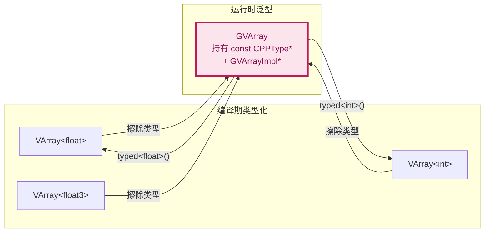
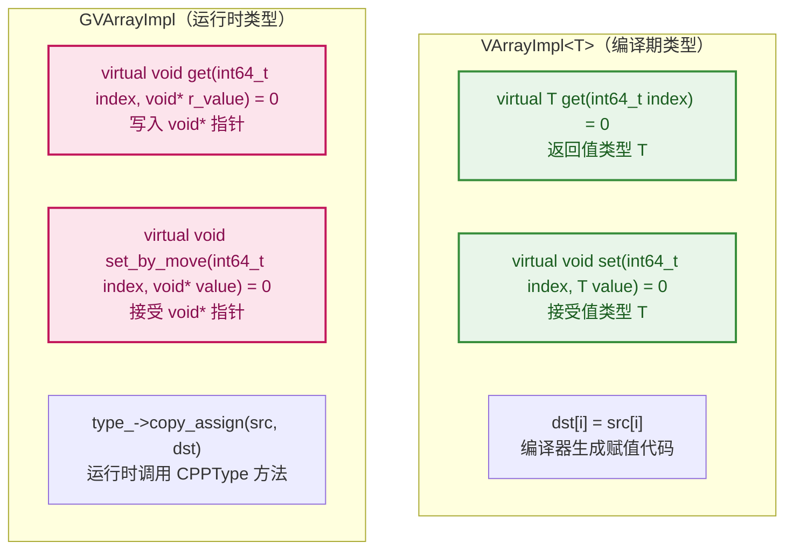
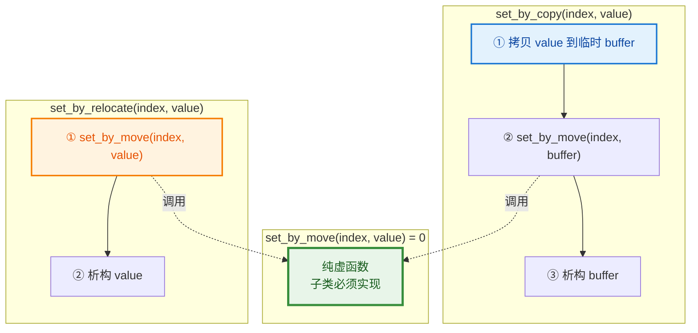
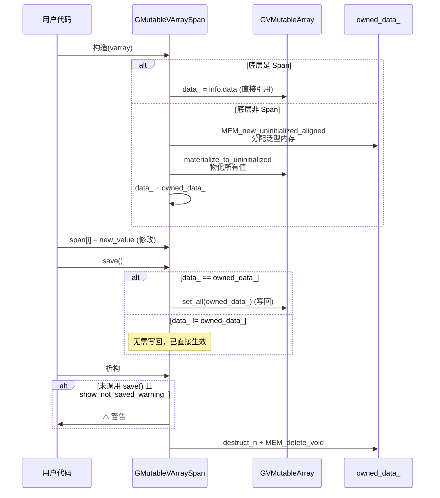
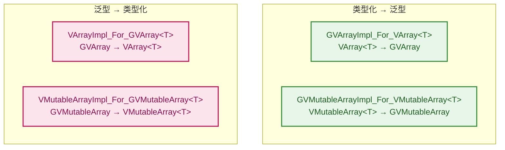
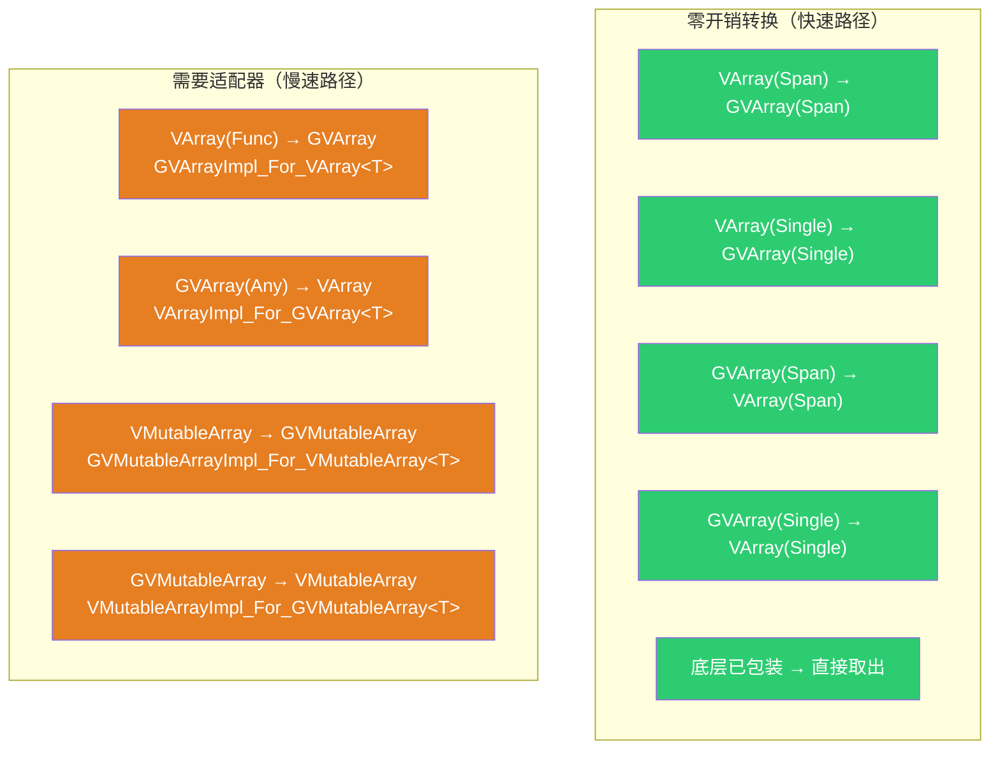
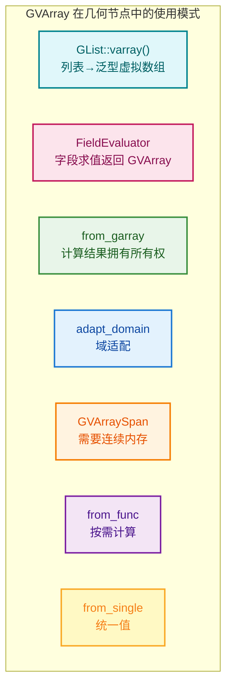
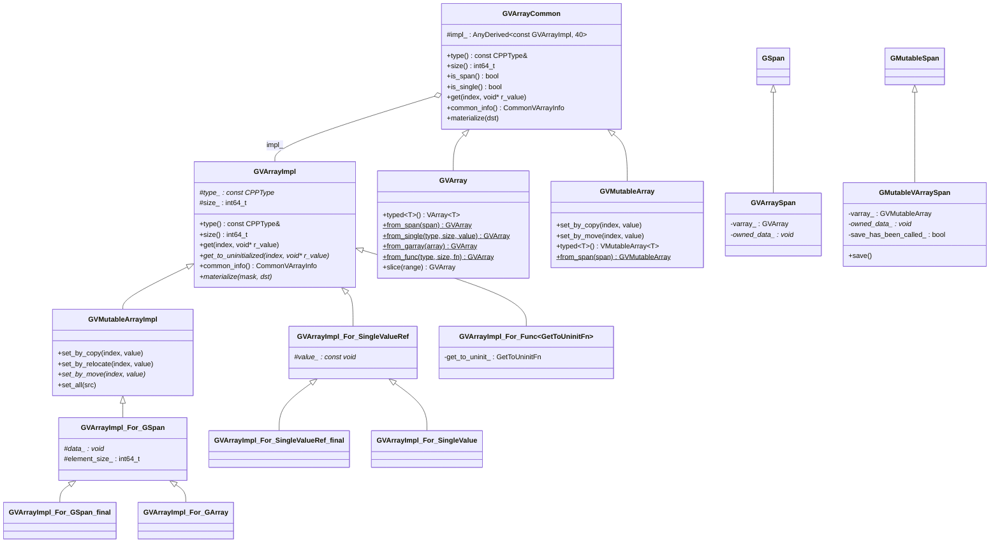

# BLI_generic_virtual_array.hh 逐行深度解析

> 对 [BLI_generic_virtual_array.hh](file:///e:/blender-git/blender/source/blender/blenlib/BLI_generic_virtual_array.hh) 的逐行深度解析。
> 翻译重要注释、解释非基础语法、结合几何节点（尤其是列表系统）的实际使用。
>
> 关联文档：[11_VArray_GVArray.md](11_VArray_GVArray.md)（概览级指南）、[11_1_VArray.md](11_1_VArray.md)（VArray 逐行解析）
> 关联源码：[BLI_virtual_array.hh](file:///e:/blender-git/blender/source/blender/blenlib/BLI_virtual_array.hh)、[BLI_generic_span.hh](file:///e:/blender-git/blender/source/blender/blenlib/BLI_generic_span.hh)、[BLI_generic_array.hh](file:///e:/blender-git/blender/source/blender/blenlib/BLI_generic_array.hh)

---

## 目录

- [BLI\_generic\_virtual\_array.hh 逐行深度解析](#bli_generic_virtual_arrayhh-逐行深度解析)
  - [目录](#目录)
  - [1. 文件头注释详解](#1-文件头注释详解)
  - [2. GVArrayImpl — 泛型抽象基类](#2-gvarrayimpl--泛型抽象基类)
    - [2.1 与 VArrayImpl\<T\> 的对比](#21-与-varrayimplt-的对比)
    - [2.2 get / get\_to\_uninitialized — void\* 接口](#22-get--get_to_uninitialized--void-接口)
    - [2.3 materialize / materialize\_compressed — 批量复制](#23-materialize--materialize_compressed--批量复制)
    - [2.4 try\_assign\_VArray — 反向转换钩子](#24-try_assign_varray--反向转换钩子)
  - [3. GVMutableArrayImpl — 泛型可变版基类](#3-gvmutablearrayimpl--泛型可变版基类)
    - [3.1 set\_by\_copy / set\_by\_move / set\_by\_relocate 三种写入方式](#31-set_by_copy--set_by_move--set_by_relocate-三种写入方式)
    - [3.2 set\_all — 批量写入](#32-set_all--批量写入)
  - [4. GVArrayAnyExtraInfo — AnyDerived 辅助](#4-gvarrayanyextrainfo--anyderived-辅助)
  - [5. GVArrayCommon — 公共基类](#5-gvarraycommon--公共基类)
    - [5.1 impl\_ 存储：AnyDerived\<const GVArrayImpl, 40\>](#51-impl_-存储anyderivedconst-gvarrayimpl-40)
    - [5.2 is\_span / is\_single / get\_internal\_span / get\_internal\_single](#52-is_span--is_single--get_internal_span--get_internal_single)
    - [5.3 materialize 系列](#53-materialize-系列)
    - [5.4 get\<T\>(index) — 类型化便捷方法](#54-gettindex--类型化便捷方法)
    - [5.5 may\_have\_ownership](#55-may_have_ownership)
  - [6. GVArray — 泛型只读虚拟数组](#6-gvarray--泛型只读虚拟数组)
    - [6.1 构造函数](#61-构造函数)
    - [6.2 工厂方法](#62-工厂方法)
    - [6.3 typed\<T\>() — 转回类型化 VArray](#63-typedt--转回类型化-varray)
    - [6.4 VArray\<T\> → GVArray 隐式转换](#64-varrayt--gvarray-隐式转换)
    - [6.5 slice — 切片](#65-slice--切片)
  - [7. GVMutableArray — 泛型可变虚拟数组](#7-gvmutablearray--泛型可变虚拟数组)
    - [7.1 隐式转换为 GVArray](#71-隐式转换为-gvarray)
    - [7.2 typed\<T\>() — 转回类型化 VMutableArray](#72-typedt--转回类型化-vmutablearray)
    - [7.3 get\_impl — 关键的 const\_cast](#73-get_impl--关键的-const_cast)
  - [8. GVArraySpan — GVArray→GSpan 适配器](#8-gvarrayspan--gvarraygspan-适配器)
    - [8.1 与 VArraySpan\<T\> 的关键区别](#81-与-varrayspant-的关键区别)
    - [8.2 析构 — 手动管理泛型内存](#82-析构--手动管理泛型内存)
  - [9. GMutableVArraySpan — 可写版适配器](#9-gmutablevarrayspan--可写版适配器)
    - [9.1 save() — 写回机制](#91-save--写回机制)
    - [9.2 析构警告](#92-析构警告)
  - [10. 类型转换适配器类](#10-类型转换适配器类)
    - [10.1 GVArrayImpl\_For\_VArray\<T\> — 类型化→泛型](#101-gvarrayimpl_for_varrayt--类型化泛型)
    - [10.2 VArrayImpl\_For\_GVArray\<T\> — 泛型→类型化](#102-varrayimpl_for_gvarrayt--泛型类型化)
    - [10.3 GVMutableArrayImpl\_For\_VMutableArray\<T\>](#103-gvmutablearrayimpl_for_vmutablearrayt)
    - [10.4 VMutableArrayImpl\_For\_GVMutableArray\<T\>](#104-vmutablearrayimpl_for_gvmutablearrayt)
    - [10.5 转换开销总结](#105-转换开销总结)
  - [11. GVArrayImpl\_For\_GSpan — 泛型 Span 包装](#11-gvarrayimpl_for_gspan--泛型-span-包装)
    - [11.1 element\_size\_ — 手动计算偏移](#111-element_size_--手动计算偏移)
    - [11.2 get / set — CPPType 的 copy\_assign / copy\_construct](#112-get--set--cpptype-的-copy_assign--copy_construct)
    - [11.3 materialize — CPPType 的批量操作](#113-materialize--cpptype-的批量操作)
    - [11.4 GVArrayImpl\_For\_GSpan\_final — 不可继承版](#114-gvarrayimpl_for_gspan_final--不可继承版)
  - [12. GVArrayImpl\_For\_SingleValueRef — 泛型单值](#12-gvarrayimpl_for_singlevalueref--泛型单值)
    - [12.1 GVArrayImpl\_For\_SingleValue — 拥有值所有权](#121-gvarrayimpl_for_singlevalue--拥有值所有权)
    - [12.2 GVArrayImpl\_For\_SmallTrivialSingleValue — 内联优化](#122-gvarrayimpl_for_smalltrivialsinglevalue--内联优化)
    - [12.3 GVArrayImpl\_For\_SingleValueRef\_final — 不可继承版](#123-gvarrayimpl_for_singlevalueref_final--不可继承版)
  - [13. GVArrayImpl\_For\_Func — 泛型函数生成](#13-gvarrayimpl_for_func--泛型函数生成)
  - [14. GVArrayDevirtualizer — 泛型去虚拟化](#14-gvarraydevirtualizer--泛型去虚拟化)
  - [15. GVArrayImpl\_For\_GArray — 拥有所有权](#15-gvarrayimpl_for_garray--拥有所有权)
  - [16. GVArrayImpl\_For\_SlicedGVArray — 切片实现](#16-gvarrayimpl_for_slicedgvarray--切片实现)
  - [17. 几何节点中的使用案例](#17-几何节点中的使用案例)
    - [17.1 模式总览](#171-模式总览)
    - [17.2 GList::varray() — 列表→泛型虚拟数组](#172-glistvarray--列表泛型虚拟数组)
    - [17.3 FieldEvaluator — 字段求值返回 GVArray](#173-fieldevaluator--字段求值返回-gvarray)
    - [17.4 from\_garray — 计算结果拥有所有权](#174-from_garray--计算结果拥有所有权)
    - [17.5 域适配 — adapt\_domain](#175-域适配--adapt_domain)
    - [17.6 GVArraySpan — 需要连续内存](#176-gvarrayspan--需要连续内存)
    - [17.7 from\_func — 按需计算](#177-from_func--按需计算)
    - [17.8 from\_single — 统一值](#178-from_single--统一值)
  - [18. 类关系总览](#18-类关系总览)
  - [19. 总结速查表](#19-总结速查表)
    - [概念速查](#概念速查)
    - [场景选择](#场景选择)
    - [VArray\<T\> vs GVArray 关键差异](#varrayt-vs-gvarray-关键差异)
    - [泛型内存操作速查](#泛型内存操作速查)

---

## 1. 文件头注释详解

```cpp
// BLI_generic_virtual_array.hh:7~12
/** \file
 * \ingroup bli
 *
 * A generic virtual array is the same as a virtual array, except for the fact that the data type
 * is only known at runtime.
 */
```

> **翻译**：泛型虚拟数组和虚拟数组相同，除了数据类型只在运行时才知道。
>
> **核心区别**：`VArray<T>` 的 `T` 在编译期确定，`GVArray` 的类型通过 `CPPType*` 在运行期确定。这是**类型擦除**（type erasure）——将编译期的类型信息推迟到运行期，使得同一份代码可以处理不同类型的数据。



**include 分析**：

```cpp
#include "BLI_generic_array.hh"       // GArray<> — 泛型动态数组
#include "BLI_generic_span.hh"        // GSpan / GMutableSpan — 泛型 Span
#include "BLI_virtual_array.hh"       // VArray<T> / VMutableArray<T> — 类型化虚拟数组
```

> 三个 include 构成了泛型虚拟数组的依赖链：`GSpan`（泛型视图）→ `GArray`（泛型容器）→ `GVArray`（泛型虚拟数组）。`VArray<T>` 的 include 是因为需要与类型化版本互转。

---

## 2. GVArrayImpl — 泛型抽象基类

```cpp
// BLI_generic_virtual_array.hh:29~54
/* A generically typed version of #VArrayImpl. */
class GVArrayImpl {
 protected:
  const CPPType *type_;
  int64_t size_;
```

> **翻译**：`VArrayImpl` 的泛型版本。
>
> **与 `VArrayImpl<T>` 的关键区别**：`VArrayImpl<T>` 用模板参数 `T` 在编译期确定类型，`GVArrayImpl` 用 `const CPPType *type_` 在运行期确定类型。这意味着 `GVArrayImpl` 的所有方法都通过 `void*` 传递值，而不是 `T`。

### 2.1 与 VArrayImpl\<T\> 的对比

| 特性 | `VArrayImpl<T>` | `GVArrayImpl` |
|------|-----------------|---------------|
| 类型信息 | 编译期 `T` | 运行时 `const CPPType*` |
| `get()` 返回 | `T`（值） | `void`（写入 `void* r_value`） |
| `set()` 接受 | `T value` | `const void* value` |
| 元素大小 | `sizeof(T)` 编译期常量 | `type_->size` 运行时变量 |
| 拷贝操作 | `dst[i] = src[i]`（编译器生成） | `type_->copy_assign(src, dst)`（运行时调用） |
| 性能 | 更快（编译器可内联） | 稍慢（运行时间接调用） |



### 2.2 get / get_to_uninitialized — void* 接口

```cpp
  virtual void get(int64_t index, void *r_value) const;
  virtual void get_to_uninitialized(int64_t index, void *r_value) const = 0;
```

> **`get(index, void* r_value)` 注释**（.cc 实现）：
> ```cpp
> void GVArrayImpl::get(const int64_t index, void *r_value) const
> {
>   type_->destruct(r_value);          // ① 先析构旧值
>   this->get_to_uninitialized(index, r_value);  // ② 再构造新值
> }
> ```
>
> **为什么 `get` 不是纯虚函数？** 因为 `get` 的实现是固定的——先析构再构造。只有 `get_to_uninitialized` 需要子类实现。`get` 的默认实现调用了 `get_to_uninitialized`，所以子类只需实现后者。
>
> **`void* r_value` 的含义**：`r_value` 指向一块**已分配但内容可能未初始化**的内存。`get_to_uninitialized` 在这块内存上**原地构造**值（placement new），`get` 则先析构旧值再构造新值。
>
> **与 `VArrayImpl<T>::get(index)` 的对比**：
> ```cpp
> // VArrayImpl<T>：返回值
> virtual T get(int64_t index) const = 0;
> // 调用：T value = varray[i];
>
> // GVArrayImpl：写入指针
> virtual void get_to_uninitialized(int64_t index, void *r_value) const = 0;
> // 调用：float value; varray.get(i, &value);
> ```
> `GVArrayImpl` 不能返回值，因为编译期不知道类型——无法写 `return ???`。只能通过 `void*` 写入。

### 2.3 materialize / materialize_compressed — 批量复制

```cpp
  virtual void materialize(const IndexMask &mask, void *dst, bool dst_is_uninitialized) const;
  virtual void materialize_compressed(const IndexMask &mask,
                                      void *dst,
                                      bool dst_is_uninitialized) const;
```

> **泛型版的 materialize**：与 `VArrayImpl<T>` 版本逻辑相同，但使用 `void*` 和 `POINTER_OFFSET` 手动计算偏移。
>
> **.cc 实现**：
> ```cpp
> void GVArrayImpl::materialize(const IndexMask &mask, void *dst, const bool dst_is_uninitialized) const
> {
>   if (dst_is_uninitialized) {
>     mask.foreach_index_optimized<int64_t>([&](const int64_t i) {
>       void *elem_dst = POINTER_OFFSET(dst, type_->size * i);  // 手动偏移
>       this->get_to_uninitialized(i, elem_dst);
>     });
>   }
>   else {
>     mask.foreach_index_optimized<int64_t>([&](const int64_t i) {
>       void *elem_dst = POINTER_OFFSET(dst, type_->size * i);
>       this->get(i, elem_dst);
>     });
>   }
> }
> ```
>
> **`POINTER_OFFSET(ptr, offset)`**：等价于 `static_cast<char*>(ptr) + offset`——按字节偏移指针。因为 `dst` 是 `void*`，不能直接 `dst + i`（`void*` 不支持指针算术），必须先转 `char*` 再偏移。
>
> **`type_->size`**：运行时获取元素大小。`VArrayImpl<T>` 用 `sizeof(T)`（编译期常量），`GVArrayImpl` 用 `type_->size`（运行时变量）。

### 2.4 try_assign_VArray — 反向转换钩子

```cpp
  virtual bool try_assign_VArray(void *varray) const;
```

> **翻译**：尝试将此泛型实现赋值给类型化的 `VArray<T>`。成功返回 true。
>
> **`void *varray` 为什么是 `void*`？** 因为 `GVArrayImpl` 不知道 `T`，无法写 `VArray<T>&`。调用者保证传入正确类型的指针：
> ```cpp
> // GVArrayCommon::try_assign_VArray<T> 的调用：
> template<typename T> bool try_assign_VArray(VArray<T> &varray) const
> {
>   BLI_assert(impl_->type().is<T>());  // 运行时类型检查
>   return impl_->try_assign_VArray(&varray);  // 传入 VArray<T>*
> }
> ```
>
> **用途**：`GVArrayImpl_For_VArray<T>` 内部持有 `VArray<T>`。当 `GVArray::typed<T>()` 被调用时，可以直接取出原始 `VArray<T>`，避免嵌套包装。

---

## 3. GVMutableArrayImpl — 泛型可变版基类

```cpp
// BLI_generic_virtual_array.hh:56~68
/* A generic version of #VMutableArrayImpl. */
class GVMutableArrayImpl : public GVArrayImpl {
 public:
  GVMutableArrayImpl(const CPPType &type, int64_t size) : GVArrayImpl(type, size) {}

  virtual void set_by_copy(int64_t index, const void *value);
  virtual void set_by_relocate(int64_t index, void *value);
  virtual void set_by_move(int64_t index, void *value) = 0;

  virtual void set_all(const void *src);
  virtual bool try_assign_VMutableArray(void *varray) const;
};
```

> **翻译**：`VMutableArrayImpl` 的泛型版本。

### 3.1 set_by_copy / set_by_move / set_by_relocate 三种写入方式

> **为什么需要三种 `set`？** 因为泛型环境下，值的传递方式影响性能和正确性：
>
> | 方法 | 语义 | 源值状态 |
> |------|------|---------|
> | `set_by_copy` | 拷贝赋值 | 源值不变 |
> | `set_by_move` | 移动赋值 | 源值可能被修改（但未析构） |
> | `set_by_relocate` | 重定位赋值 | 源值被析构 |
>
> **.cc 默认实现**：
> ```cpp
> void GVMutableArrayImpl::set_by_copy(const int64_t index, const void *value)
> {
>   BUFFER_FOR_CPP_TYPE_VALUE(*type_, buffer);  // ① 在栈上分配临时缓冲区
>   type_->copy_construct(value, buffer);        // ② 拷贝值到缓冲区
>   this->set_by_move(index, buffer);            // ③ 移动到目标
>   type_->destruct(buffer);                     // ④ 析构临时值
> }
>
> void GVMutableArrayImpl::set_by_relocate(const int64_t index, void *value)
> {
>   this->set_by_move(index, value);  // ① 先移动
>   type_->destruct(value);           // ② 再析构源值
> }
> ```
>
> **`BUFFER_FOR_CPP_TYPE_VALUE(*type_, buffer)`**：在栈上分配一块足够大的对齐内存，用于临时存储一个值。等价于 `AlignedBuffer<type_->size, type_->alignment> buffer;`。因为编译期不知道类型大小，不能用 `T buffer;`，只能手动分配。
>
> **为什么 `set_by_copy` 用"先拷贝到临时，再移动"？** 因为 `value` 和目标 `data_[index]` 可能重叠（别名问题）。先拷贝到临时缓冲区，确保源值安全，再移动到目标。
>
> **`set_by_move` 是纯虚函数**：子类必须实现。`set_by_copy` 和 `set_by_relocate` 都依赖它——这是**模板方法模式**（Template Method Pattern）。



### 3.2 set_all — 批量写入

```cpp
  virtual void set_all(const void *src);
```

> **.cc 实现**：
> ```cpp
> void GVMutableArrayImpl::set_all(const void *src)
> {
>   const CommonVArrayInfo info = this->common_info();
>   if (info.type == CommonVArrayInfo::Type::Span) {
>     type_->copy_assign_n(src, const_cast<void *>(info.data), size_);  // 批量拷贝
>   }
>   else {
>     for (int64_t i : IndexRange(size_)) {
>       this->set_by_copy(i, POINTER_OFFSET(src, type_->size * i));  // 逐个拷贝
>     }
>   }
> }
> ```
>
> **优化分支**：底层是 Span 时用 `copy_assign_n`（可能是 SIMD 优化的批量拷贝），否则逐个 `set_by_copy`。

---

## 4. GVArrayAnyExtraInfo — AnyDerived 辅助

```cpp
// BLI_generic_virtual_array.hh:76~83
namespace blenlib_detail {
struct GVArrayAnyExtraInfo {
  const GVArrayImpl *(*get_varray)(const void *buffer) =
      [](const void * /*buffer*/) -> const GVArrayImpl * { return nullptr; };

  template<typename StorageT> static constexpr GVArrayAnyExtraInfo get();
};
}  // namespace blenlib_detail
```

> **用途**：为 `AnyDerived<const GVArrayImpl, 40>` 提供从内部存储提取 `GVArrayImpl*` 的方法。
>
> **`get_varray` 函数指针**：根据存储类型（内联对象、裸指针、`shared_ptr`），用不同的方式提取 `GVArrayImpl*`。
>
> **`template<typename StorageT> static constexpr GVArrayAnyExtraInfo get()`**：编译期为每种存储类型生成对应的 `get_varray` 函数：
> ```cpp
> // 内联对象：直接转型
> if constexpr (std::is_base_of_v<GVArrayImpl, StorageT>) {
>   return {[](const void *buffer) {
>     return static_cast<const GVArrayImpl *>(static_cast<const StorageT *>(buffer));
>   }};
> }
> // 裸指针：解引用
> else if constexpr (std::is_same_v<StorageT, const GVArrayImpl *>) {
>   return {[](const void *buffer) { return *static_cast<const StorageT *>(buffer); }};
> }
> // shared_ptr：调用 get()
> else if constexpr (std::is_same_v<StorageT, std::shared_ptr<const GVArrayImpl>>) {
>   return {[](const void *buffer) { return (static_cast<const StorageT *>(buffer))->get(); }};
> }
> ```
>
> **`static constexpr`**：编译期求值——每种 `StorageT` 生成一个 `GVArrayAnyExtraInfo` 常量，没有运行时开销。

---

## 5. GVArrayCommon — 公共基类

```cpp
// BLI_generic_virtual_array.hh:91~155
/**
 * Utility class to reduce code duplication between #GVArray and #GVMutableArray.
 * It pretty much follows #VArrayCommon. Don't use this class outside of this header.
 */
class GVArrayCommon {
 protected:
  AnyDerived<const GVArrayImpl, 40> impl_;
```

> **翻译**：工具类，减少 `GVArray` 和 `GVMutableArray` 之间的代码重复。基本遵循 `VArrayCommon` 的设计。不要在此头文件之外使用。
>
> **设计原则与 `VArrayCommon<T>` 相同**：不让 `GVMutableArray` 继承 `GVArray`，避免静态方法泄漏和隐式转换风险。

### 5.1 impl\_ 存储：AnyDerived\<const GVArrayImpl, 40\>

> **`AnyDerived<const GVArrayImpl, 40>`**：小型缓冲区优化（SBO）的类型擦除容器。
>
> - **40 字节**：内联缓冲区大小。`GVArrayImpl_For_GSpan_final` 约为 32 字节（`vptr` + `type_` + `size_` + `data_` + `element_size_`），可以内联存储
> - **`const GVArrayImpl`**：基类指针是 const——即使是 `GVMutableArray`，`impl_` 也存储为 `const GVArrayImpl*`。`GVMutableArray::get_impl()` 通过 `const_cast` 转回
>
> **三种存储模式**：
>
> | 模式 | 触发条件 | 内存位置 |
> |------|---------|---------|
> | 内联（SBO） | 实现类 ≤ 40 字节 | `impl_` 内部缓冲区 |
> | 裸指针 | `GVArrayCommon(const GVArrayImpl *impl)` | 外部（不拥有） |
> | `shared_ptr` | `GVArrayCommon(shared_ptr<const GVArrayImpl>)` | 堆（共享所有权） |

### 5.2 is_span / is_single / get_internal_span / get_internal_single

```cpp
  bool is_span() const;
  GSpan get_internal_span() const;
  bool is_single() const;
  void get_internal_single(void *r_value) const;
  void get_internal_single_to_uninitialized(void *r_value) const;
```

> **与 `VArrayCommon<T>` 的对比**：
>
> | 方法 | `VArrayCommon<T>` | `GVArrayCommon` |
> |------|-------------------|-----------------|
> | `is_span()` | 返回 `bool` | 返回 `bool`（相同） |
> | `get_internal_span()` | 返回 `Span<T>` | 返回 `GSpan`（泛型 Span） |
> | `get_internal_single()` | 返回 `T` | 写入 `void* r_value` |
>
> **`get_internal_single(void *r_value)` 实现**：
> ```cpp
> void GVArrayCommon::get_internal_single(void *r_value) const
> {
>   BLI_assert(this->is_single());
>   const CommonVArrayInfo info = impl_->common_info();
>   this->type().copy_assign(info.data, r_value);  // 用 CPPType 的 copy_assign
> }
> ```
> `VArrayCommon<T>` 版本返回 `T`（`return *static_cast<const T*>(info.data)`），`GVArrayCommon` 版本写入 `void*`（`type().copy_assign`）。

### 5.3 materialize 系列

```cpp
  void materialize(void *dst) const;
  void materialize(const IndexMask &mask, void *dst) const;
  void materialize_to_uninitialized(void *dst) const;
  void materialize_to_uninitialized(const IndexMask &mask, void *dst) const;
  void materialize_compressed(const IndexMask &mask, void *dst) const;
  void materialize_compressed_to_uninitialized(const IndexMask &mask, void *dst) const;
```

> **与 `VArrayCommon<T>` 的对比**：
>
> | 方法 | `VArrayCommon<T>` | `GVArrayCommon` |
> |------|-------------------|-----------------|
> | `materialize(MutableSpan<T>)` | 接受类型化 Span | `materialize(void *dst)` 接受裸指针 |
> | `materialize(mask, MutableSpan<T>)` | 同上 | `materialize(mask, void *dst)` |
>
> **为什么用 `void*` 而非 `GSpan`？** 因为 `materialize` 的目标可能不是完整的 GSpan——可能只是部分缓冲区。`void*` 更灵活，调用者可以传入任意内存地址。

### 5.4 get\<T\>(index) — 类型化便捷方法

```cpp
  template<typename T> T get(int64_t index) const
  {
    BLI_assert(index >= 0);
    BLI_assert(index < this->size());
    BLI_assert(this->type().is<T>());  // 运行时类型检查
    T value{};                         // 默认初始化
    impl_->get(index, &value);         // 虚函数调用，写入 value
    return value;
  }
```

> **`T value{}`**：默认初始化——对 `int` 为 0，对 `float3` 为 `(0,0,0)`，对 `std::string` 为空字符串。确保 `get(index, &value)` 的 `r_value` 指向已初始化内存（`get` 会先析构再构造）。
>
> **`this->type().is<T>()`**：运行时检查 `CPPType` 是否匹配 `T`。如果类型不匹配，断言失败。

### 5.5 may_have_ownership

```cpp
  bool may_have_ownership() const;
```

> 判断虚拟数组是否可能拥有数据。用于决定是否可以安全地引用内部数据——如果 `may_have_ownership = true`，虚拟数组析构后数据可能失效。

---

## 6. GVArray — 泛型只读虚拟数组

```cpp
// BLI_generic_virtual_array.hh:157~196
/** Generic version of #VArray. */
class GVArray : public GVArrayCommon {
```

> **翻译**：`VArray` 的泛型版本。

### 6.1 构造函数

```cpp
  GVArray() = default;

  GVArray(const GVArrayImpl *impl);
  GVArray(std::shared_ptr<const GVArrayImpl> impl);

  GVArray(varray_tag::span /*tag*/, GSpan span);
  GVArray(varray_tag::single_ref /*tag*/, const CPPType &type, int64_t size, const void *value);
  GVArray(varray_tag::single /*tag*/, const CPPType &type, int64_t size, const void *value);

  template<typename T> GVArray(const VArray<T> &varray);
  template<typename T> GVArray(VArray<T> &&varray);
```

> **`varray_tag::single` 构造函数**（.cc 实现）：
> ```cpp
> GVArray::GVArray(varray_tag::single /*tag*/, const CPPType &type, int64_t size, const void *value)
> {
>   if (type.is_trivial && type.size <= 16 && type.alignment <= 8) {
>     this->emplace<GVArrayImpl_For_SmallTrivialSingleValue<16>>(type, size, value);
>   }
>   else {
>     this->emplace<GVArrayImpl_For_SingleValue>(type, size, value);
>   }
> }
> ```
>
> **优化**：对小型平凡类型（≤ 16 字节，对齐 ≤ 8），用 `GVArrayImpl_For_SmallTrivialSingleValue<16>` 内联存储单值，避免堆分配。对大型或非平凡类型，用 `GVArrayImpl_For_SingleValue` 堆分配。
>
> **`varray_tag::single` vs `varray_tag::single_ref`**：
>
> | 标签 | 实现 | 所有权 |
> |------|------|--------|
> | `single` | `GVArrayImpl_For_SingleValue` 或 `SmallTrivialSingleValue` | 拥有值（拷贝） |
> | `single_ref` | `GVArrayImpl_For_SingleValueRef_final` | 不拥有值（引用） |

### 6.2 工厂方法

```cpp
  static GVArray from_single(const CPPType &type, int64_t size, const void *value);
  static GVArray from_single_ref(const CPPType &type, int64_t size, const void *value);
  static GVArray from_single_default(const CPPType &type, int64_t size);
  static GVArray from_span(GSpan span);
  static GVArray from_garray(GArray<> array);
  static GVArray from_empty(const CPPType &type);
  template<typename GetToUninitFn>
  static GVArray from_func(const CPPType &type, int64_t size, GetToUninitFn &&get_to_uninit);
  static GVArray from_std_func(const CPPType &type, int64_t size,
                               std::function<void(int64_t, void*)> get_to_uninit);
```

> **`from_single_default`**：所有元素都是默认值。
> ```cpp
> static GVArray from_single_default(const CPPType &type, int64_t size)
> {
>   return GVArray::from_single_ref(type, size, type.default_value());
> }
> ```
> `type.default_value()` 返回该类型的默认值指针（如 `int` 的 0，`float3` 的 `(0,0,0)`）。
>
> **`from_func` vs `from_std_func`**：与 `VArray<T>` 相同的设计——模板参数版本更快（可内联），`std::function` 版本更少代码生成但更慢。
>
> **`from_func` 的签名差异**：
> ```cpp
> // VArray<T>：GetFunc 返回 T
> template<typename GetFn> static VArray<T> from_func(int64_t size, GetFn fn);
> // fn 签名：T fn(int64_t index)

> // GVArray：GetToUninitFn 写入 void*
> template<typename GetToUninitFn> static GVArray from_func(const CPPType &type, int64_t size, GetToUninitFn &&fn);
> // fn 签名：void fn(int64_t index, void *r_value)
> ```
> `GVArray::from_func` 的回调必须**写入未初始化内存**——因为编译期不知道类型，无法构造临时对象再拷贝。

### 6.3 typed\<T\>() — 转回类型化 VArray

```cpp
  template<typename T> VArray<T> typed() const
  {
    if (!*this) { return {}; }
    BLI_assert(impl_->type().is<T>());

    const CommonVArrayInfo info = this->common_info();
    // 快速路径1：Single → 直接构造 VArray::from_single
    if (info.type == CommonVArrayInfo::Type::Single) {
      return VArray<T>::from_single(*static_cast<const T *>(info.data), this->size());
    }
    // 快速路径2：Span + 无所有权 → 直接构造 VArray::from_span
    if (info.type == CommonVArrayInfo::Type::Span && !info.may_have_ownership) {
      return VArray<T>::from_span(Span<T>(static_cast<const T *>(info.data), this->size()));
    }
    // 快速路径3：底层已经是 VArray<T> → 直接取出
    VArray<T> varray;
    if (this->try_assign_VArray(varray)) { return varray; }
    // 慢速路径：需要适配器
    return VArray<T>::template from<VArrayImpl_For_GVArray<T>>(*this);
  }
```

> **三级优化策略**：
>
> ```mermaid
> flowchart TB
>     START["GVArray::typed&lt;T&gt;()"]
>     C1{"底层是 Single？"}
>     C2{"底层是 Span<br/>且无所有权？"}
>     C3{"try_assign_VArray<br/>成功？"}
>
>     S1["VArray::from_single<br/>零开销"]
>     S2["VArray::from_span<br/>零开销"]
>     S3["直接取出内部 VArray<br/>零开销"]
>     S4["VArrayImpl_For_GVArray&lt;T&gt;<br/>需要适配器"]

>     START --> C1
>     C1 -->|"是"| S1
>     C1 -->|"否"| C2
>     C2 -->|"是"| S2
>     C2 -->|"否"| C3
>     C3 -->|"是"| S3
>     C3 -->|"否"| S4

>     style S1 fill:#2ecc71,color:#fff
>     style S2 fill:#2ecc71,color:#fff
>     style S3 fill:#2ecc71,color:#fff
>     style S4 fill:#e67e22,color:#fff
> ```

### 6.4 VArray\<T\> → GVArray 隐式转换

```cpp
  template<typename T> GVArray::GVArray(VArray<T> &&varray)
  {
    if (!varray) { return; }
    const CommonVArrayInfo info = varray.common_info();
    // 快速路径1：Single → GVArray::from_single
    if (info.type == CommonVArrayInfo::Type::Single) {
      *this = GVArray::from_single(CPPType::get<T>(), varray.size(), info.data);
      return;
    }
    // 快速路径2：Span + 无所有权 → GVArray::from_span
    if (info.type == CommonVArrayInfo::Type::Span && !info.may_have_ownership) {
      *this = GVArray::from_span(GSpan(CPPType::get<T>(), info.data, varray.size()));
      return;
    }
    // 快速路径3：底层已经是 GVArray → 直接取出
    if (varray.try_assign_GVArray(*this)) { return; }
    // 慢速路径：需要适配器
    *this = GVArray::from<GVArrayImpl_For_VArray<T>>(std::move(varray));
  }
```

> **`may_have_ownership` 检查的重要性**：注释说"Need to check for ownership, because otherwise the referenced data can be destructed when #this is destructed."——必须检查所有权，否则当 `GVArray` 析构时，引用的数据可能已被释放。
>
> 如果 `VArray` 内部是 Span 且**拥有**数据（`may_have_ownership = true`），不能简单地引用 `info.data`——因为 `VArray` 析构后数据就没了。必须用适配器 `GVArrayImpl_For_VArray<T>` 保持 `VArray` 存活。

### 6.5 slice — 切片

```cpp
  GVArray slice(IndexRange slice) const;
```

> **.cc 实现**：
> ```cpp
> GVArray GVArray::slice(IndexRange slice) const
> {
>   const CommonVArrayInfo info = this->common_info();
>   // Single：切片大小不同，但值相同
>   if (info.type == CommonVArrayInfo::Type::Single) {
>     return GVArray::from_single(this->type(), slice.size(), info.data);
>   }
>   // Span + 无所有权：直接切片指针
>   if (info.type == CommonVArrayInfo::Type::Span && !info.may_have_ownership) {
>     return GVArray::from_span(GSpan(this->type(), info.data, this->size()).slice(slice));
>   }
>   // 其他：需要适配器
>   return GVArray::from<GVArrayImpl_For_SlicedGVArray>(*this, slice);
> }
> ```
>
> **三种切片策略**：
>
> | 底层类型 | 切片方式 | 开销 |
> |---------|---------|------|
> | Single | 创建新的 Single（大小不同） | 零开销 |
> | Span（无所有权） | 偏移指针 + 缩减大小 | 零开销 |
> | 其他 | `GVArrayImpl_For_SlicedGVArray` 适配器 | 每次访问加 `offset_` |

---

## 7. GVMutableArray — 泛型可变虚拟数组

```cpp
// BLI_generic_virtual_array.hh:198~233
/** Generic version of #VMutableArray. */
class GVMutableArray : public GVArrayCommon {
```

### 7.1 隐式转换为 GVArray

```cpp
  operator GVArray() const &;
  operator GVArray() && noexcept;
```

> **与 `VMutableArray<T>` 的转换完全相同**——拷贝版本（`const &`）和移动版本（`&& noexcept`）。
>
> **.cc 实现**：
> ```cpp
> GVMutableArray::operator GVArray() const &
> {
>   GVArray varray;
>   *static_cast<GVArrayCommon *>(&varray) = *this;  // 拷贝 impl_
>   return varray;
> }
>
> GVMutableArray::operator GVArray() && noexcept
> {
>   GVArray varray;
>   *static_cast<GVArrayCommon *>(&varray) = std::move(*this);  // 移动 impl_
>   return varray;
> }
> ```
>
> **`*static_cast<GVArrayCommon *>(&varray) = *this`**：通过基类引用赋值——只拷贝 `impl_` 部分。`GVArray` 和 `GVMutableArray` 都继承 `GVArrayCommon`，但互不继承。

### 7.2 typed\<T\>() — 转回类型化 VMutableArray

```cpp
  template<typename T> VMutableArray<T> typed() const
  {
    if (!*this) { return {}; }
    BLI_assert(this->type().is<T>());
    const CommonVArrayInfo info = this->common_info();
    // 快速路径：Span + 无所有权
    if (info.type == CommonVArrayInfo::Type::Span && !info.may_have_ownership) {
      return VMutableArray<T>::from_span(
          MutableSpan<T>(const_cast<T *>(static_cast<const T *>(info.data)), this->size()));
    }
    // 快速路径：底层已经是 VMutableArray<T>
    VMutableArray<T> varray;
    if (this->try_assign_VMutableArray(varray)) { return varray; }
    // 慢速路径：需要适配器
    return VMutableArray<T>::template from<VMutableArrayImpl_For_GVMutableArray<T>>(*this);
  }
```

> **注意**：`GVMutableArray::typed<T>()` 没有 Single 快速路径——因为可变虚拟数组不支持单值广播（写哪个？）。

### 7.3 get_impl — 关键的 const_cast

```cpp
  GVMutableArrayImpl *get_impl() const
  {
    return const_cast<GVMutableArrayImpl *>(
        static_cast<const GVMutableArrayImpl *>(impl_.get()));
  }
```

> **不变量**：`GVMutableArray` 的 `impl_` 存储为 `AnyDerived<const GVArrayImpl>`，但实际对象一定是 `GVMutableArrayImpl`。
>
> **双重转换**：
> 1. `impl_.get()` → `const GVArrayImpl*`
> 2. `static_cast<const GVMutableArrayImpl*>` → 向下转型
> 3. `const_cast<GVMutableArrayImpl*>` → 去掉 const
>
> **与 `VMutableArray<T>::get_impl()` 的区别**：后者用 `reinterpret_cast`，这里用 `static_cast`。两种都合法——`static_cast` 做继承关系检查，`reinterpret_cast` 不检查。选择不同可能是历史原因。

---

## 8. GVArraySpan — GVArray→GSpan 适配器

```cpp
// BLI_generic_virtual_array.hh:242~254
/* A generic version of VArraySpan. */
class GVArraySpan : public GSpan {
 private:
  GVArray varray_;
  void *owned_data_ = nullptr;
```

> **翻译**：`VArraySpan` 的泛型版本。
>
> **与 `VArraySpan<T>` 的关键区别**：`VArraySpan<T>` 用 `Array<T> owned_data_` 存储物化数据，`GVArraySpan` 用 `void *owned_data_` 手动管理泛型内存。

### 8.1 与 VArraySpan\<T\> 的关键区别

| 特性 | `VArraySpan<T>` | `GVArraySpan` |
|------|-----------------|---------------|
| 继承 | `Span<T>` | `GSpan` |
| 物化存储 | `Array<T> owned_data_` | `void *owned_data_`（手动管理） |
| 构造 | `VArraySpan(VArray<T>&&)` | `GVArraySpan(GVArray)` |
| 内存分配 | `Array<T>` 自动管理 | `MEM_new_uninitialized_aligned` 手动分配 |
| 内存释放 | `Array<T>` 析构自动释放 | 析构函数手动 `MEM_delete_void` |

> **.cc 构造实现**：
> ```cpp
> GVArraySpan::GVArraySpan(GVArray varray)
>     : GSpan(varray ? &varray.type() : nullptr), varray_(std::move(varray))
> {
>   if (!varray_) { return; }
>   size_ = varray_.size();
>   const CommonVArrayInfo info = varray_.common_info();
>   if (info.type == CommonVArrayInfo::Type::Span) {
>     data_ = info.data;  // 零拷贝：直接引用
>   }
>   else {
>     // 手动分配泛型内存
>     owned_data_ = MEM_new_uninitialized_aligned(type_->size * size_, type_->alignment, __func__);
>     varray_.materialize_to_uninitialized(IndexRange(size_), owned_data_);
>     data_ = owned_data_;
>   }
> }
> ```
>
> **`MEM_new_uninitialized_aligned(size, alignment, func)`**：分配指定大小和对齐的未初始化内存。等价于 `operator new` 但使用 Blender 的内存分配器。
>
> **为什么不用 `GArray<>`？** `GArray<>` 会值初始化元素（对平凡类型零初始化），但 `materialize_to_uninitialized` 会用 placement new 构造——双重初始化浪费性能。`MEM_new_uninitialized_aligned` 只分配不初始化，更高效。

### 8.2 析构 — 手动管理泛型内存

```cpp
  GVArraySpan::~GVArraySpan()
  {
    if (owned_data_ != nullptr) {
      type_->destruct_n(owned_data_, size_);  // 逐个析构
      MEM_delete_void(owned_data_);            // 释放内存
    }
  }
```

> **`type_->destruct_n(owned_data_, size_)`**：对每个元素调用析构函数。对平凡类型（`int`、`float`）是空操作，对非平凡类型（`std::string`）释放资源。
>
> **`MEM_delete_void(ptr)`**：释放 `MEM_new_*` 分配的内存。

---

## 9. GMutableVArraySpan — 可写版适配器

```cpp
// BLI_generic_virtual_array.hh:257~275
/* A generic version of MutableVArraySpan. */
class GMutableVArraySpan : public GMutableSpan, NonCopyable, NonMovable {
 private:
  GVMutableArray varray_;
  void *owned_data_ = nullptr;
  bool save_has_been_called_ = false;
  bool show_not_saved_warning_ = true;
```

> **`NonCopyable, NonMovable`**：禁止拷贝和移动——防止意外复制 `owned_data_` 导致双重释放。

### 9.1 save() — 写回机制

```cpp
  void GMutableVArraySpan::save()
  {
    save_has_been_called_ = true;
    if (data_ != owned_data_) {
      return;  // 底层是 Span，修改已直接生效
    }
    varray_.set_all(owned_data_);  // 将临时数组写回
  }
```

> **与 `MutableVArraySpan<T>::save()` 逻辑完全相同**——判断 `data_` 是否指向 `owned_data_`，决定是否需要写回。

### 9.2 析构警告

```cpp
  GMutableVArraySpan::~GMutableVArraySpan()
  {
    if (varray_) {
      if (show_not_saved_warning_) {
        if (!save_has_been_called_) {
          std::cout << "Warning: Call `save()` to make sure that changes persist in all cases.\n";
        }
      }
    }
    if (owned_data_ != nullptr) {
      type_->destruct_n(owned_data_, size_);
      MEM_delete_void(owned_data_);
    }
  }
```

> **直接输出到 `std::cout`**：与 `MutableVArraySpan<T>` 不同，泛型版本直接打印警告（而非调用辅助函数）。



---

## 10. 类型转换适配器类

GVArray 和 VArray\<T\> 之间的互转需要适配器。这些适配器是桥接模式的关键——在类型擦除和类型化之间架起桥梁。



### 10.1 GVArrayImpl_For_VArray\<T\> — 类型化→泛型

```cpp
// BLI_generic_virtual_array.hh:284~330
/* Used to convert a typed virtual array into a generic one. */
template<typename T> class GVArrayImpl_For_VArray : public GVArrayImpl {
 protected:
  VArray<T> varray_;

 public:
  GVArrayImpl_For_VArray(VArray<T> varray)
      : GVArrayImpl(CPPType::get<T>(), varray.size()), varray_(std::move(varray))
  {}
```

> **翻译**：用于将类型化虚拟数组转换为泛型虚拟数组。
>
> **工作原理**：持有 `VArray<T>`，将 `GVArrayImpl` 的 `void*` 接口桥接到 `VArray<T>` 的类型化接口：
>
> ```cpp
>   void get(const int64_t index, void *r_value) const override
>   {
>     *static_cast<T *>(r_value) = varray_[index];  // VArray → void*
>   }
>
>   void get_to_uninitialized(const int64_t index, void *r_value) const override
>   {
>     new (r_value) T(varray_[index]);  // placement new
>   }
> ```
>
> **`*static_cast<T*>(r_value) = varray_[index]`**：将 `void*` 转为 `T*`，然后赋值。这是类型擦除的核心——从"知道类型"到"不知道类型"的桥接。
>
> **`new (r_value) T(varray_[index])`**：placement new——在 `r_value` 指向的未初始化内存上构造 `T`。

### 10.2 VArrayImpl_For_GVArray\<T\> — 泛型→类型化

```cpp
// BLI_generic_virtual_array.hh:332~374
/* Used to convert any generic virtual array into a typed one. */
template<typename T> class VArrayImpl_For_GVArray : public VArrayImpl<T> {
 protected:
  GVArray varray_;

 public:
  VArrayImpl_For_GVArray(GVArray varray) : VArrayImpl<T>(varray.size()), varray_(std::move(varray))
  {
    BLI_assert(varray_);
    BLI_assert(varray_.type().template is<T>());
  }
```

> **翻译**：用于将泛型虚拟数组转换为类型化虚拟数组。
>
> **`varray_.type().template is<T>()`**：运行时类型检查——确保 `GVArray` 的运行时类型与编译期类型 `T` 匹配。
>
> **`template` 消歧**：因为 `varray_.type()` 的返回类型依赖模板参数 `T`，编译器不知道 `is` 后面的 `<` 是比较运算符还是模板参数开始。`template` 告诉编译器这是模板。
>
> **桥接方向相反**：
> ```cpp
>   T get(const int64_t index) const override
>   {
>     T value;
>     varray_.get(index, &value);  // void* → T
>     return value;
>   }
> ```
> 从 `GVArray` 的 `void*` 接口获取值，转为 `T` 返回。

### 10.3 GVMutableArrayImpl_For_VMutableArray\<T\>

```cpp
// BLI_generic_virtual_array.hh:377~453
/* Used to convert any typed virtual mutable array into a generic one. */
template<typename T> class GVMutableArrayImpl_For_VMutableArray : public GVMutableArrayImpl {
```

> **翻译**：用于将类型化可变虚拟数组转换为泛型可变虚拟数组。
>
> **`set` 方法的桥接**：
> ```cpp
>   void set_by_copy(const int64_t index, const void *value) override
>   {
>     const T &value_ = *static_cast<const T *>(value);
>     varray_.set(index, value_);  // void* → T → VMutableArray::set
>   }
>
>   void set_by_move(const int64_t index, void *value) override
>   {
>     T &value_ = *static_cast<T *>(value);
>     varray_.set(index, std::move(value_));  // 移动语义
>   }
>
>   void set_by_relocate(const int64_t index, void *value) override
>   {
>     T &value_ = *static_cast<T *>(value);
>     varray_.set(index, std::move(value_));
>     value_.~T();  // 析构源值
>   }
> ```
>
> **`set_by_relocate` 的三步**：移动 → 赋值 → 析构源值。与 `GVMutableArrayImpl::set_by_relocate` 的默认实现（先 move 再 destruct）一致。

### 10.4 VMutableArrayImpl_For_GVMutableArray\<T\>

```cpp
// BLI_generic_virtual_array.hh:456~509
/* Used to convert an generic mutable virtual array into a typed one. */
template<typename T> class VMutableArrayImpl_For_GVMutableArray : public VMutableArrayImpl<T> {
```

> **翻译**：用于将泛型可变虚拟数组转换为类型化可变虚拟数组。
>
> **`set` 方法的桥接**：
> ```cpp
>   void set(const int64_t index, T value) override
>   {
>     varray_.set_by_relocate(index, &value);  // T → void* → GVMutableArray::set_by_relocate
>   }
> ```
> 注意这里用 `set_by_relocate`——因为 `value` 是局部变量，函数返回后就没了，所以用重定位（移动+析构）最高效。

### 10.5 转换开销总结



---

## 11. GVArrayImpl_For_GSpan — 泛型 Span 包装

```cpp
// BLI_generic_virtual_array.hh:517~561
class GVArrayImpl_For_GSpan : public GVMutableArrayImpl {
 protected:
  void *data_ = nullptr;
  const int64_t element_size_;
```

> **与 `VArrayImpl_For_Span<T>` 的关键区别**：
>
> | 特性 | `VArrayImpl_For_Span<T>` | `GVArrayImpl_For_GSpan` |
> |------|--------------------------|------------------------|
> | 数据指针 | `T *data_` | `void *data_` |
> | 元素大小 | `sizeof(T)` 编译期常量 | `element_size_` 运行时变量 |
> | 元素访问 | `data_[index]` | `POINTER_OFFSET(data_, element_size_ * index)` |
> | 拷贝操作 | `dst[i] = src[i]` | `type_->copy_assign(src, dst)` |

### 11.1 element\_size\_ — 手动计算偏移

```cpp
  GVArrayImpl_For_GSpan(const GMutableSpan span)
      : GVMutableArrayImpl(span.type(), span.size()),
        data_(span.data()),
        element_size_(span.type().size)
  {}
```

> **`element_size_`**：缓存 `type().size`，避免每次访问都通过虚函数调用 `type_->size`。因为 `type()` 返回引用，`.size` 是直接成员访问，但缓存后更高效——特别是 `materialize` 中频繁使用。
>
> **`const int64_t element_size_`**：`const` 成员——构造后不可变。这意味着 `GVArrayImpl_For_GSpan` 不能被移动赋值（`const` 成员阻止默认移动赋值），但这个类通过 `AnyDerived` 的 SBO 管理，不需要移动赋值。

### 11.2 get / set — CPPType 的 copy\_assign / copy\_construct

```cpp
  // .cc 实现
  void GVArrayImpl_For_GSpan::get(const int64_t index, void *r_value) const
  {
    type_->copy_assign(POINTER_OFFSET(data_, element_size_ * index), r_value);
  }

  void GVArrayImpl_For_GSpan::get_to_uninitialized(const int64_t index, void *r_value) const
  {
    type_->copy_construct(POINTER_OFFSET(data_, element_size_ * index), r_value);
  }

  void GVArrayImpl_For_GSpan::set_by_copy(const int64_t index, const void *value)
  {
    type_->copy_assign(value, POINTER_OFFSET(data_, element_size_ * index));
  }

  void GVArrayImpl_For_GSpan::set_by_move(const int64_t index, void *value)
  {
    type_->move_construct(value, POINTER_OFFSET(data_, element_size_ * index));
  }
```

> **`copy_assign` vs `copy_construct`**：
> - `copy_assign`：目标已初始化，调用 `operator=`
> - `copy_construct`：目标未初始化，调用拷贝构造函数（placement new）
>
> **`POINTER_OFFSET(data_, element_size_ * index)`**：手动计算第 `index` 个元素的地址。等价于 `static_cast<char*>(data_) + element_size_ * index`。因为 `data_` 是 `void*`，不能直接 `data_[index]`。

### 11.3 materialize — CPPType 的批量操作

```cpp
  void GVArrayImpl_For_GSpan::materialize(const IndexMask &mask, void *dst, const bool dst_is_uninitialized) const
  {
    if (dst_is_uninitialized) {
      type_->copy_construct_indices(data_, dst, mask);  // 批量构造
    }
    else {
      type_->copy_assign_indices(data_, dst, mask);      // 批量赋值
    }
  }
```

> **`type_->copy_construct_indices(src, dst, mask)`**：`CPPType` 提供的批量操作——对 mask 中的每个索引，从 `src` 拷贝构造到 `dst`。可能使用 SIMD 优化。
>
> **vs `VArrayImpl_For_Span<T>` 的 materialize**：
> ```cpp
> // VArrayImpl_For_Span<T>：用 index_mask::detail::copy_assign
> index_mask::detail::copy_assign(data_, mask, dst);
>
> // GVArrayImpl_For_GSpan：用 CPPType 的 copy_assign_indices
> type_->copy_assign_indices(data_, dst, mask);
> ```
> 两者可能最终调用相同的底层实现，但入口不同——前者直接调用 `IndexMask` 的优化函数，后者通过 `CPPType` 的虚函数间接调用。

### 11.4 GVArrayImpl_For_GSpan\_final — 不可继承版

```cpp
  class GVArrayImpl_For_GSpan_final final : public GVArrayImpl_For_GSpan {
   public:
    using GVArrayImpl_For_GSpan::GVArrayImpl_For_GSpan;
   private:
    CommonVArrayInfo common_info() const override;
  };

  template<> inline constexpr bool is_trivial_extended_v<GVArrayImpl_For_GSpan_final> = true;
```

> **`common_info()` 返回 `may_have_ownership = false`**——不拥有数据，只是引用外部 Span。
>
> **`is_trivial_extended_v` 特化**：标记为"平凡扩展"——`AnyDerived` 可以安全地用 `memcpy` 拷贝它。

---

## 12. GVArrayImpl_For_SingleValueRef — 泛型单值

```cpp
// BLI_generic_virtual_array.hh:569~603
class GVArrayImpl_For_SingleValueRef : public GVArrayImpl {
 protected:
  const void *value_ = nullptr;
```

> **与 `VArrayImpl_For_Single<T>` 的关键区别**：
>
> | 特性 | `VArrayImpl_For_Single<T>` | `GVArrayImpl_For_SingleValueRef` |
> |------|---------------------------|--------------------------------|
> | 值存储 | `T value_`（拥有） | `const void *value_`（引用） |
> | `get()` | `return value_` | `type_->copy_assign(value_, r_value)` |
> | 所有权 | 拥有值 | 不拥有值 |

### 12.1 GVArrayImpl_For_SingleValue — 拥有值所有权

```cpp
// generic_virtual_array.cc:236~252
/* Same as GVArrayImpl_For_SingleValueRef, but the value is owned. */
class GVArrayImpl_For_SingleValue : public GVArrayImpl_For_SingleValueRef, NonCopyable, NonMovable {
 public:
  GVArrayImpl_For_SingleValue(const CPPType &type, const int64_t size, const void *value)
      : GVArrayImpl_For_SingleValueRef(type, size)
  {
    value_ = MEM_new_uninitialized_aligned(type.size, type.alignment, __func__);
    type.copy_construct(value, const_cast<void *>(value_));  // 拷贝值到堆
  }

  ~GVArrayImpl_For_SingleValue() override
  {
    type_->destruct(const_cast<void *>(value_));  // 析构值
    MEM_delete_void(const_cast<void *>(value_));   // 释放内存
  }
};
```

> **翻译**：与 `GVArrayImpl_For_SingleValueRef` 相同，但拥有值。
>
> **`NonCopyable, NonMovable`**：禁止拷贝和移动——因为 `value_` 指向堆分配的内存，拷贝会导致双重释放。
>
> **为什么 `value_` 是 `const void*`？** 因为基类 `GVArrayImpl_For_SingleValueRef` 定义了 `const void *value_`。`GVArrayImpl_For_SingleValue` 通过 `const_cast` 修改它——虽然不优雅，但避免了虚函数开销。

### 12.2 GVArrayImpl_For_SmallTrivialSingleValue — 内联优化

```cpp
// generic_virtual_array.cc:264~308
/**
 * Contains an inline buffer that can store a single value of a trivial type.
 * This avoids the allocation that would be done by #GVArrayImpl_For_SingleValue.
 */
template<int BufferSize> class GVArrayImpl_For_SmallTrivialSingleValue : public GVArrayImpl {
 private:
  AlignedBuffer<BufferSize, 8> buffer_;
```

> **翻译**：包含一个内联缓冲区，可以存储平凡类型的单个值。避免 `GVArrayImpl_For_SingleValue` 的堆分配。
>
> **`AlignedBuffer<BufferSize, 8>`**：大小为 `BufferSize`、对齐为 8 的栈上缓冲区。等价于 `alignas(8) char buffer[BufferSize]`。
>
> **使用条件**（在 `GVArray::GVArray(varray_tag::single, ...)` 中）：
> ```cpp
> if (type.is_trivial && type.size <= 16 && type.alignment <= 8) {
>   this->emplace<GVArrayImpl_For_SmallTrivialSingleValue<16>>(type, size, value);
> }
> ```
> 只对**小型平凡类型**（≤ 16 字节，对齐 ≤ 8）使用——如 `int`、`float`、`float3`、`float4x4` 等。`std::string` 等非平凡类型不能用。
>
> **`get_to_uninitialized` 用 `memcpy`**：
> ```cpp
>   void get_to_uninitialized(const int64_t /*index*/, void *r_value) const final
>   {
>     memcpy(r_value, &buffer_, type_->size);
>   }
> ```
> 因为是平凡类型，`memcpy` 等价于拷贝构造，但更快。

### 12.3 GVArrayImpl_For_SingleValueRef\_final — 不可继承版

```cpp
  class GVArrayImpl_For_SingleValueRef_final final : public GVArrayImpl_For_SingleValueRef {
   public:
    using GVArrayImpl_For_SingleValueRef::GVArrayImpl_For_SingleValueRef;
   private:
    CommonVArrayInfo common_info() const override;
  };

  template<> inline constexpr bool is_trivial_extended_v<GVArrayImpl_For_SingleValueRef_final> = true;
```

> **`.cc` 实现**：
> ```cpp
> CommonVArrayInfo GVArrayImpl_For_SingleValueRef_final::common_info() const
> {
>   return CommonVArrayInfo(CommonVArrayInfo::Type::Single, false, value_);
>   // may_have_ownership = false —— 不拥有值
> }
> ```
>
> **与 `GVArrayImpl_For_SingleValueRef` 的区别**：`may_have_ownership = false`——因为 `_final` 版本只是引用外部值，不拥有。

---

## 13. GVArrayImpl_For_Func — 泛型函数生成

```cpp
// BLI_generic_virtual_array.hh:610~632
template<typename GetToUninitFn> class GVArrayImpl_For_Func final : public GVArrayImpl {
 private:
  GetToUninitFn get_to_uninit_;

 public:
  GVArrayImpl_For_Func(const CPPType &type, const int64_t size, GetToUninitFn get_to_uninit)
      : GVArrayImpl(type, size), get_to_uninit_(std::move(get_to_uninit))
  {}

  void get(const int64_t index, void *r_value) const override
  {
    if (!type_->is_trivially_destructible) {
      type_->destruct(r_value);  // 非平凡类型：先析构旧值
    }
    return get_to_uninit_(index, r_value);
  }

  void get_to_uninitialized(const int64_t index, void *r_value) const override
  {
    return get_to_uninit_(index, r_value);
  }
};
```

> **与 `VArrayImpl_For_Func<T, GetFunc>` 的关键区别**：
>
> | 特性 | `VArrayImpl_For_Func<T, GetFunc>` | `GVArrayImpl_For_Func<GetToUninitFn>` |
> |------|-----------------------------------|--------------------------------------|
> | 回调签名 | `T fn(int64_t index)` | `void fn(int64_t index, void *r_value)` |
> | 回调行为 | 返回值 | 写入未初始化内存 |
> | `get()` | `return get_func_(index)` | 先析构旧值，再调用 `get_to_uninit_` |
>
> **`get()` 中的 `is_trivially_destructible` 检查**：对平凡类型（`int`、`float`），析构是空操作，可以跳过。对非平凡类型（`std::string`），必须先析构旧值再构造新值。
>
> **为什么 `VArrayImpl_For_Func` 不需要这个检查？** 因为 `VArrayImpl_For_Func::get()` 返回 `T`——调用者的 `T value = varray[i]` 会自动处理旧值的析构（通过 `operator=`）。而 `GVArrayImpl_For_Func::get()` 写入 `void*`——必须手动管理旧值的生命周期。

---

## 14. GVArrayDevirtualizer — 泛型去虚拟化

```cpp
// BLI_generic_virtual_array.hh:775~794
/** To be used with #call_with_devirtualized_parameters. */
template<typename T, bool UseSingle, bool UseSpan> struct GVArrayDevirtualizer {
  const GVArrayImpl &varray_impl;

  template<typename Fn> bool devirtualize(const Fn &fn) const
  {
    const CommonVArrayInfo info = this->varray_impl.common_info();
    const int64_t size = this->varray_impl.size();
    if constexpr (UseSingle) {
      if (info.type == CommonVArrayInfo::Type::Single) {
        return fn(SingleAsSpan<T>(*static_cast<const T *>(info.data), size));
      }
    }
    if constexpr (UseSpan) {
      if (info.type == CommonVArrayInfo::Type::Span) {
        return fn(Span<T>(static_cast<const T *>(info.data), size));
      }
    }
    return false;
  }
};
```

> **与 `VArrayDevirtualizer<T, UseSingle, UseSpan>` 的对比**：
>
> | 特性 | `VArrayDevirtualizer` | `GVArrayDevirtualizer` |
> |------|----------------------|----------------------|
> | 输入 | `const VArray<T> &varray` | `const GVArrayImpl &varray_impl` |
> | `common_info()` | `varray.common_info()` | `varray_impl.common_info()` |
> | 输出 | 相同：`SingleAsSpan<T>` / `Span<T>` | 相同 |
>
> **为什么 `GVArrayDevirtualizer` 接受 `GVArrayImpl&` 而非 `GVArray&`？** 因为 `call_with_devirtualized_parameters` 在内部已经提取了 `impl`，直接传 `impl` 避免额外的间接层。
>
> **使用场景**：当泛型代码中需要高效遍历虚拟数组时，先用 `common_info()` 检查底层类型，如果是 Span 或 Single 就走快速路径。

---

## 15. GVArrayImpl_For_GArray — 拥有所有权

```cpp
// generic_virtual_array.cc:636~645
class GVArrayImpl_For_GArray : public GVArrayImpl_For_GSpan {
 protected:
  GArray<> array_;

 public:
  GVArrayImpl_For_GArray(GArray<> array)
      : GVArrayImpl_For_GSpan(array.as_mutable_span()), array_(std::move(array))
  {}
};
```

> **与 `VArrayImpl_For_ArrayContainer<Container, T>` 的设计相同**——先构造基类（设 `data_` 指向容器内部），再移动容器到成员变量（保持数据存活）。
>
> **`GVArray::from_garray` 的调用链**：
> ```cpp
> GVArray GVArray::from_garray(GArray<> array)
> {
>   return GVArray::from<GVArrayImpl_For_GArray>(std::move(array));
> }
> ```
>
> **所有权语义**：`GArray<>` 拥有数据，移动到 `GVArrayImpl_For_GArray` 后，`GVArray` 通过 `shared_ptr` 共享 `GVArrayImpl_For_GArray`，数据在最后一个引用消失时释放。

---

## 16. GVArrayImpl_For_SlicedGVArray — 切片实现

```cpp
// generic_virtual_array.cc:478~540
class GVArrayImpl_For_SlicedGVArray : public GVArrayImpl {
 protected:
  GVArray varray_;
  int64_t offset_;
  IndexRange slice_;
```

> **当 `GVArray::slice()` 无法零开销切片时使用**——底层不是 Span 或 Single，需要适配器。
>
> **`common_info()` 的智能传播**：
> ```cpp
>   CommonVArrayInfo common_info() const override
>   {
>     const CommonVArrayInfo internal_info = varray_.common_info();
>     switch (internal_info.type) {
>       case CommonVArrayInfo::Type::Any:
>         return {};  // 无法优化
>       case CommonVArrayInfo::Type::Span:
>         // 偏移 data 指针
>         return CommonVArrayInfo(CommonVArrayInfo::Type::Span,
>                                 internal_info.may_have_ownership,
>                                 POINTER_OFFSET(internal_info.data, type_->size * offset_));
>       case CommonVArrayInfo::Type::Single:
>         return internal_info;  // Single 不受切片影响
>     }
>   }
> ```
> 即使切片后，仍然传播底层类型信息——如果底层是 Span，切片后仍然是 Span（只是指针偏移了）。这让后续的 `is_span()` 检查仍然有效。

---

## 17. 几何节点中的使用案例

### 17.1 模式总览



### 17.2 GList::varray() — 列表→泛型虚拟数组

```cpp
// geometry_nodes_list.cc:141~151
GVArray GList::varray() const
{
  if (const auto *array_data = std::get_if<ArrayData>(&data_)) {
    return GVArray::from_span(GSpan(cpp_type_, array_data->data, size_));
  }
  if (const auto *single_data = std::get_if<SingleData>(&data_)) {
    return GVArray::from_single_ref(cpp_type_, size_, single_data->value);
  }
  BLI_assert_unreachable();
  return {};
}
```

> **GList 的两种存储完美映射到 GVArray 的两种零开销构造**：
>
> ```mermaid
> flowchart LR
>     subgraph "GList 存储"
>         AD["ArrayData<br/>const void* data<br/>int64_t size"]
>         SD["SingleData<br/>const void* value"]
>     end
>
>     subgraph "GVArray 构造"
>         GVA1["GVArray::from_span<br/>Span 模式<br/>零拷贝"]
>         GVA2["GVArray::from_single_ref<br/>Single 模式<br/>零拷贝"]
>     end
>
>     subgraph "后续使用"
>         T1["typed&lt;float&gt;()<br/>→ VArray&lt;float&gt;"]
>         T2["typed&lt;int&gt;()<br/>→ VArray&lt;int&gt;"]
>     end
>
>     AD --> GVA1
>     SD --> GVA2
>     GVA1 --> T1
>     GVA1 --> T2
>     GVA2 --> T1
>
>     style GVA1 fill:#3498db,color:#fff
>     style GVA2 fill:#e67e22,color:#fff
> ```
>
> **List\<T\>::varray() 的调用链**：
> ```cpp
> // NOD_geometry_nodes_list.hh:231~234
> template<typename T> inline VArray<T> List<T>::varray() const
> {
>   return list_.varray().template typed<T>();  // GVArray → VArray<T>
> }
> ```
>
> **在 Filter List 节点中的使用**：
> ```cpp
> // node_geo_filter_list.cc:159
> const VArray<bool> values = keep_list->varray().typed<bool>();
> ```
>
> **在 Sort List 节点中的使用**：
> ```cpp
> // node_geo_sort_list.cc:110
> r_varray = scope.add_value(std::move(list))->varray().typed<T>();
> ```

### 17.3 FieldEvaluator — 字段求值返回 GVArray

```cpp
// FN_field_evaluation.hh:31
Vector<GVArray> evaluated_varrays_;  // 存储评估结果

// FN_field_evaluation.hh:140
const GVArray &get_evaluated(const int field_index) const
{
  return evaluated_varrays_[field_index];
}

// FN_field_evaluation.hh:146
template<typename T> VArray<T> get_evaluated(const int field_index) const
{
  return this->get_evaluated(field_index).typed<T>();
}
```

> **FieldEvaluator 内部全部用 GVArray 存储结果**——因为字段类型在运行期才知道。`get_evaluated(int)` 返回 `const GVArray&`，`get_evaluated<T>(int)` 返回 `VArray<T>`（通过 `typed<T>()` 转换）。
>
> **Accumulate Field 节点的典型用法**：
> ```cpp
> // node_geo_accumulate_field.cc:210~221
> fn::FieldEvaluator evaluator{source_context, domain_size};
> evaluator.add(input_);
> evaluator.add(group_index_);
> evaluator.evaluate();
> const GVArray g_values = evaluator.get_evaluated(0);       // 返回 GVArray
> const VArray<int> group_indices = evaluator.get_evaluated<int>(1);  // 返回 typed VArray
>
> g_values.type().to_static_type<int, float, float3, float4x4>([&]<typename T>() {
>     const VArray<T> values = g_values.typed<T>();  // GVArray → VArray<T>
>     // ... 类型化后的处理逻辑
> });
> ```
>
> **`to_static_type<int, float, float3, float4x4>`**：`CPPType` 的方法——根据运行时类型，编译期分支到对应的 lambda 实例化。这是泛型代码处理多种类型的标准模式。

### 17.4 from_garray — 计算结果拥有所有权

```cpp
// node_geo_blur_attribute.cc:375~428
GVArray get_varray_for_context(...) const final
{
    const int64_t domain_size = context.attributes()->domain_size(context.domain());
    GArray<> buffer_a(*type_, domain_size);  // ① 分配泛型缓冲区

    FieldEvaluator evaluator(context, domain_size);
    evaluator.add_with_destination(value_field_, buffer_a.as_mutable_span());  // ② 求值目标
    evaluator.add(weight_field_);
    evaluator.evaluate();  // ③ 求值，结果写入 buffer_a

    // ... 模糊计算 ...

    return GVArray::from_garray(std::move(buffer_a));  // ④ 零拷贝转为 GVArray
}
```

> **典型数据流**：
>
> ```mermaid
> sequenceDiagram
>     participant Node as Blur Attribute 节点
>     participant FE as FieldEvaluator
>     participant GA as GArray<>;
>     participant GVA as GVArray
>
>     Node->>GA: GArray<>(cpp_type, domain_size)
>     Node->>FE: add_with_destination(field, array.as_mutable_span())
>     Node->>FE: evaluate()
>     FE->>GA: 字段求值结果写入
>     Node->>Node: 模糊计算（修改 buffer_a / buffer_b）
>     Node->>GVA: GVArray::from_garray(std::move(array))
>     Note over GVA: 所有权转移，零拷贝
> ```

### 17.5 域适配 — adapt_domain

```cpp
// BKE_attribute.hh:681~696
GVArray adapt_domain(const GVArray &varray, const AttrDomain from, const AttrDomain to) const
{
  return fn_->adapt_domain(owner_, varray, from, to);
}
```

> **域适配的核心数据流**：

> ```mermaid
> flowchart LR
>     subgraph "源域"
>         S["GVArray<br/>Corner 域<br/>（面角属性）"]
>     end
> 
>     subgraph "适配过程"
>         A1["GArray&lt;&gt; values<br/>分配目标域大小"]
>         A2["typed&lt;T&gt;()<br/>转为 VArray&lt;T&gt;"]
>         A3["逐元素计算<br/>混合/传播"]
>         A4["from_garray<br/>转为 GVArray"]
>     end
> 
>     subgraph "目标域"
>         D["GVArray<br/>Point 域<br/>（顶点属性）"]
>     end
> 
>     S --> A1 --> A2 --> A3 --> A4 --> D
> 
>     style S fill:#e3f2fd,stroke:#1976d2,stroke-width:2px,color:#0d47a1
>     style D fill:#e8f5e9,stroke:#388e3c,stroke-width:2px,color:#1b5e20
> ```

**Corner → Point 适配实现**：
> ```cpp
> // mesh_attributes.cc:71~83
> static GVArray adapt_mesh_domain_corner_to_point(const Mesh &mesh, const GVArray &varray)
> {
>   GArray<> values(varray.type(), mesh.verts_num);  // ① 用目标域大小分配
>   attribute_math::to_static_type(varray.type(), [&]<typename T>() {
>     if constexpr (!std::is_void_v<attribute_math::DefaultMixer<T>>) {
>       adapt_mesh_domain_corner_to_point_impl<T>(
>           mesh, varray.typed<T>(),              // ② GVArray → VArray<T>
>           values.as_mutable_span().typed<T>());  // ③ GMutableSpan → MutableSpan<T>
>     }
>   });
>   return GVArray::from_garray(std::move(values));  // ④ 转为 GVArray
> }
> ```
>
> **Point → Corner 适配（from_func 模式）**：
> ```cpp
> // mesh_attributes.cc:88~100
> static GVArray adapt_mesh_domain_point_to_corner(const Mesh &mesh, const GVArray &varray)
> {
>   const Span<int> corner_verts = mesh.corner_verts();
>   GVArray new_varray;
>   attribute_math::to_static_type(varray.type(), [&]<typename T>() {
>     new_varray = VArray<T>::from_func(
>         mesh.corners_num, [corner_verts, varray = varray.typed<T>()](const int64_t corner) {
>           return varray[corner_verts[corner]];  // 角→顶点映射
>         });
>   });
>   return new_varray;
> }
> ```
>
> **两种域适配模式**：
>
> | 模式 | 适用场景 | 返回方式 |
> |------|---------|---------|
> | `GArray + from_garray` | 多对一（需要混合） | `GVArray::from_garray` |
> | `from_func` | 一对一（直接映射） | `VArray<T>::from_func` → 隐式转 `GVArray` |
>
> **CurvesGeometry::adapt_domain 的 Single 优化**：
> ```cpp
> // curves_geometry.cc:1891~1919
> GVArray CurvesGeometry::adapt_domain(const GVArray &varray, ...) const
> {
>   if (!varray) { return {}; }
>   if (from == to) { return varray; }  // 同域：直接返回
>   if (varray.is_single()) {           // Single：不需要适配
>     BUFFER_FOR_CPP_TYPE_VALUE(varray.type(), value);
>     varray.get_internal_single(value);
>     return GVArray::from_single(varray.type(), this->attributes().domain_size(to), value);
>   }
>   // ...
> }
> ```
> **Single 优化**：如果所有值都相同，域适配不需要做任何计算——新域上所有值也相同。

### 17.6 GVArraySpan — 需要连续内存

```cpp
// resample_curves.cc:104~143
static void retrieve_attribute_spans(const Span<StringRef> names,
                                     const CurvesGeometry &src_curves,
                                     CurvesGeometry &dst_curves,
                                     Vector<GVArraySpan> &src_arrays,  // ← 泛型版
                                     Vector<GMutableSpan> &dst_arrays,
                                     Vector<bke::GSpanAttributeWriter> &dst_writers)
{
    // ...
    GVArray src_attribute = *src_attributes.lookup(names[i], bke::AttrDomain::Point);
    src_arrays.append(std::move(src_attribute));  // GVArray 隐式转换为 GVArraySpan
    // ...
}
```

> **`GVArray` 隐式转换为 `GVArraySpan`**：`GVArraySpan` 有接受 `GVArray` 的构造函数，所以可以直接 `append(std::move(src_attribute))`。
>
> **为什么用 `GVArraySpan` 而非 `GVArray`？** 重采样算法需要随机访问属性值——`GVArraySpan` 保证底层是连续内存（必要时物化），可以用指针偏移高效访问。
>
> **Dual Mesh 节点中的显式构造**：
> ```cpp
> // node_geo_dual_mesh.cc:204
> const GVArraySpan src_span(*src);  // 显式从 GVArray 构造
> ```

### 17.7 from_func — 按需计算

```cpp
// mesh_attributes.cc:88~100（Point → Corner 域适配）
new_varray = VArray<T>::from_func(
    mesh.corners_num, [corner_verts, varray = varray.typed<T>()](const int64_t corner) {
      return varray[corner_verts[corner]];
    });
```

> **`varray = varray.typed<T>()`**：在 lambda 捕获中调用 `typed<T>()`——将 `GVArray` 转为 `VArray<T>` 后捕获。这样 lambda 内部可以用 `varray[corner_verts[corner]]` 而非 `varray.get(corner, &value)`。

### 17.8 from_single — 统一值

```cpp
// node_geo_tool_selection.cc:123
return GVArray::from_single(*type_, mask.min_array_size(), true_value(data_type));
```

> **Tool Selection 节点**：当没有选中项时，返回一个全 `true` 或全 `false` 的 GVArray。`from_single` 只存一个值，内存 O(1)。

---

## 18. 类关系总览



---

## 19. 总结速查表

### 概念速查

| 概念 | 一句话解释 |
|------|-----------|
| **GVArray** | `VArray<T>` 的类型擦除版，运行期才知道类型 |
| **GVArrayImpl** | `VArrayImpl<T>` 的泛型版，用 `void*` 代替 `T` |
| **GVMutableArray** | `VMutableArray<T>` 的泛型版 |
| **GVArrayCommon** | `GVArray` 和 `GVMutableArray` 的公共基类 |
| **GVArrayImpl_For_GSpan** | 泛型 Span 包装，用 `element_size_` 手动偏移 |
| **GVArrayImpl_For_SingleValueRef** | 泛型单值引用，不拥有值 |
| **GVArrayImpl_For_SingleValue** | 泛型单值拥有，堆分配 |
| **GVArrayImpl_For_SmallTrivialSingleValue** | 小型平凡类型内联优化 |
| **GVArrayImpl_For_Func** | 泛型函数生成，回调写入 `void*` |
| **GVArrayImpl_For_GArray** | 拥有 `GArray<>` 所有权 |
| **GVArrayImpl_For_SlicedGVArray** | 切片适配器 |
| **GVArraySpan** | `GVArray` → `GSpan` 适配器，手动管理泛型内存 |
| **GMutableVArraySpan** | 可写适配器，`save()` 写回机制 |
| **GVArrayDevirtualizer** | 泛型去虚拟化辅助 |
| **CPPType** | 运行时类型信息，提供 `copy_assign`/`copy_construct` 等操作 |

### 场景选择

| 场景 | 推荐类型 |
|------|----------|
| 属性系统查找（运行期才知道类型） | `GVArray` |
| 字段求值结果 | `GVArray` → `typed<T>()` |
| 列表数据作为虚拟数组 | `GList::varray()` → `GVArray` |
| 计算结果需要拥有所有权 | `GArray<>` → `GVArray::from_garray()` |
| 域适配（Corner→Point 等） | `GVArray` 输入 → `GVArray` 输出 |
| API 只接受 GSpan，但数据是 GVArray | `GVArraySpan` |
| 需要修改 GVArray 的数据 | `GMutableVArraySpan` + `save()` |
| 所有值相同 | `GVArray::from_single()` |
| 值需要按需计算 | `GVArray::from_func()` |

### VArray\<T\> vs GVArray 关键差异

| 特性 | `VArray<T>` | `GVArray` |
|------|------------|-----------|
| 元素类型 | 编译期 `T` | 运行时 `CPPType` |
| `get()` 返回 | `T`（值） | `void`（写入 `void*`） |
| `operator[]` | 返回 `T` | 无（需用 `get`） |
| `typed<T>()` | — | 转为 `VArray<T>` |
| 物化存储 | `Array<T>` | `void*`（手动管理） |
| 内存操作 | 编译器生成 | `CPPType` 运行时调用 |
| 性能 | 更快（编译器优化） | 稍慢（运行时间接） |
| 灵活性 | 编译期确定类型 | 运行期确定类型 |

### 泛型内存操作速查

| 操作 | 类型化版本 | 泛型版本 |
|------|-----------|---------|
| 拷贝赋值 | `dst[i] = src[i]` | `type_->copy_assign(src, dst)` |
| 拷贝构造 | `new (dst) T(src)` | `type_->copy_construct(src, dst)` |
| 移动构造 | `new (dst) T(std::move(src))` | `type_->move_construct(src, dst)` |
| 析构 | `dst[i].~T()` | `type_->destruct(ptr)` |
| 批量析构 | — | `type_->destruct_n(ptr, n)` |
| 元素偏移 | `&data_[i]` | `POINTER_OFFSET(data_, element_size_ * i)` |
| 临时缓冲区 | `T buffer;` | `BUFFER_FOR_CPP_TYPE_VALUE(type, buffer)` |
| 默认初始化 | `T value{};` | `type.default_construct(ptr)` |
| 内存分配 | `Array<T>(n)` | `MEM_new_uninitialized_aligned(size, align)` |
| 内存释放 | 自动（RAII） | `MEM_delete_void(ptr)` |
