# VArray / GVArray / GArray 三者关系深度解析

> 聚焦 VArray\<T\>、GVArray、GArray\<\> 三者之间的**转换关系、所有权语义、数据流**，结合几何节点（尤其是列表系统）的实际使用。
>
> 关联文档：[11_VArray_GVArray.md](11_VArray_GVArray.md)（概览指南）、[11_1_VArray.md](11_1_VArray.md)（VArray 逐行解析）、[11_2_GVArray.md](11_2_GVArray.md)（GVArray 逐行解析）
> 关联源码：[BLI_virtual_array.hh](file:///e:/blender-git/blender/source/blender/blenlib/BLI_virtual_array.hh)、[BLI_generic_virtual_array.hh](file:///e:/blender-git/blender/source/blender/blenlib/BLI_generic_virtual_array.hh)、[BLI_generic_array.hh](file:///e:/blender-git/blender/source/blender/blenlib/BLI_generic_array.hh)

---

## 目录

- [VArray / GVArray / GArray 三者关系深度解析](#varray--gvarray--garray-三者关系深度解析)
  - [目录](#目录)
  - [1. 三者定位：一句话总结](#1-三者定位一句话总结)
  - [2. 三者核心属性对比](#2-三者核心属性对比)
  - [3. 三者内存模型](#3-三者内存模型)
    - [3.1 GArray\<\> — 拥有数据的连续数组](#31-garray--拥有数据的连续数组)
    - [3.2 VArray\<T\> — 类型化虚拟数组](#32-varrayt--类型化虚拟数组)
    - [3.3 GVArray — 泛型虚拟数组](#33-gvarray--泛型虚拟数组)
  - [4. 转换关系总览图](#4-转换关系总览图)
  - [5. GArray → GVArray：from\_garray](#5-garray--gvarrayfrom_garray)
    - [5.1 转换机制](#51-转换机制)
    - [5.2 所有权转移过程](#52-所有权转移过程)
    - [5.3 为什么不直接用 GSpan？](#53-为什么不直接用-gspan)
  - [6. GVArray → VArray\<T\>：typed\<T\>()](#6-gvarray--varrayttypedt)
    - [6.1 三级优化策略](#61-三级优化策略)
    - [6.2 零开销条件详解](#62-零开销条件详解)
    - [6.3 适配器开销](#63-适配器开销)
  - [7. VArray\<T\> → GVArray：隐式转换](#7-varrayt--gvarray隐式转换)
    - [7.1 隐式转换的三级优化](#71-隐式转换的三级优化)
    - [7.2 may\_have\_ownership 的关键作用](#72-may_have_ownership-的关键作用)
  - [8. GVArray → GArray：materialize](#8-gvarray--garraymaterialize)
    - [8.1 直接 materialize 模式](#81-直接-materialize-模式)
    - [8.2 GVArraySpan 间接模式](#82-gvarrayspan-间接模式)
  - [9. GArray → GList → GVArray → VArray\<T\>：列表系统的完整链路](#9-garray--glist--gvarray--varrayt列表系统的完整链路)
    - [9.1 GList::from\_garray — GArray 变列表](#91-glistfrom_garray--garray-变列表)
    - [9.2 GList::varray — 列表变泛型虚拟数组](#92-glistvarray--列表变泛型虚拟数组)
    - [9.3 List\<T\>::varray — 列表变类型化虚拟数组](#93-listtvarray--列表变类型化虚拟数组)
    - [9.4 完整数据流：从字段求值到列表输出](#94-完整数据流从字段求值到列表输出)
  - [10. 几何节点中的六大转换模式](#10-几何节点中的六大转换模式)
    - [10.1 模式 A：GArray 作为字段求值缓冲区 → GVArray](#101-模式-agarray-作为字段求值缓冲区--gvarray)
    - [10.2 模式 B：属性查找 → GVArray → VArray\<T\>](#102-模式-b属性查找--gvarray--varrayt)
    - [10.3 模式 C：GList → GVArray → VArray\<T\>（列表读取）](#103-模式-cglist--gvarray--varrayt列表读取)
    - [10.4 模式 D：VArray\<T\> 隐式转 GVArray（字段输出）](#104-模式-dvarrayt-隐式转-gvarray字段输出)
    - [10.5 模式 E：GVArray → GArray（域适配）](#105-模式-egvarray--garray域适配)
    - [10.6 模式 F：GArray → GList（列表构造）](#106-模式-fgarray--glist列表构造)
  - [11. 转换开销速查](#11-转换开销速查)
  - [12. 奇怪/非基础语法注解](#12-奇怪非基础语法注解)
    - [`POINTER_OFFSET(ptr, offset)`](#pointer_offsetptr-offset)
    - [`BUFFER_FOR_CPP_TYPE_VALUE(type, name)`](#buffer_for_cpp_type_valuetype-name)
    - [`BLI_NO_UNIQUE_ADDRESS`](#bli_no_unique_address)
    - [`NoInitialization{}`](#noinitialization)
    - [`template` 消歧](#template-消歧)
    - [`std::get_if<Variant>`](#stdget_ifvariant)
    - [`ImplicitSharedValue<T>`](#implicitsharedvaluet)
  - [13. 总结速查表](#13-总结速查表)
    - [三者关系一句话](#三者关系一句话)
    - [几何节点中的典型数据流](#几何节点中的典型数据流)
    - [选择决策树](#选择决策树)

---

## 1. 三者定位：一句话总结

| 类型 | 一句话定位 | 核心特征 |
|------|-----------|---------|
| **GArray\<\>** | 拥有数据的**连续数组** | `void* data_` + `int64_t size_` + `const CPPType* type_`，拥有并管理内存 |
| **VArray\<T\>** | 类型化的**虚拟数组** | 编译期知道 `T`，底层可以是 Span/Single/Func，不拥有数据 |
| **GVArray** | 泛型的**虚拟数组** | 运行期才知道类型（`CPPType*`），底层可以是 Span/Single/Func，不拥有数据 |

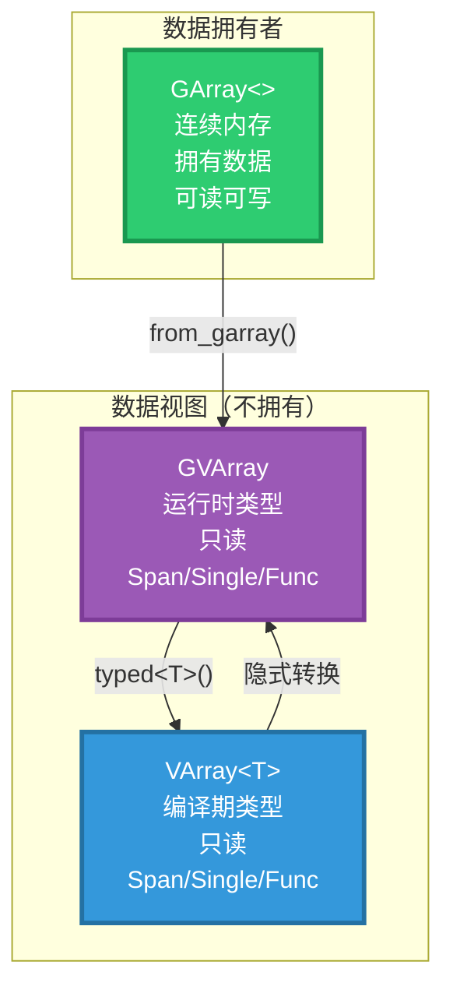

---

## 2. 三者核心属性对比

| 属性 | GArray\<\> | VArray\<T\> | GVArray |
|------|-----------|------------|---------|
| **类型信息** | `const CPPType*`（运行时） | `T`（编译期） | `const CPPType*`（运行时） |
| **数据存储** | 连续内存（`void*`） | 任意（Span/Single/Func） | 任意（Span/Single/Func） |
| **所有权** | **拥有**（分配+释放） | 不拥有（共享 impl） | 不拥有（共享 impl） |
| **可读** | ✅ | ✅ | ✅ |
| **可写** | ✅ | ❌（需 VMutableArray） | ❌（需 GVMutableArray） |
| **operator[]** | 返回 `void*`（元素地址） | 返回 `T`（值） | 无 |
| **大小可变** | ✅（`reinitialize`） | ❌ | ❌ |
| **拷贝语义** | 深拷贝（复制数据） | 浅拷贝（共享 impl） | 浅拷贝（共享 impl） |
| **移动语义** | O(1) 移动 | O(1) 移动 | O(1) 移动 |
| **隐式转 GSpan** | ✅ | — | ✅（`is_span()` 时） |
| **隐式转 GMutableSpan** | ✅ | — | — |
| **单值广播** | ❌（浪费内存） | ✅ | ✅ |
| **函数生成** | ❌ | ✅ | ✅ |
| **典型用途** | 数据缓冲区、字段求值目标 | 类型化属性读取 | 属性系统、字段求值结果 |

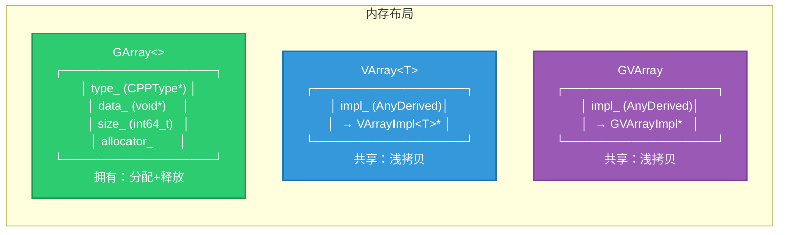

---

## 3. 三者内存模型

### 3.1 GArray\<\> — 拥有数据的连续数组

```cpp
// BLI_generic_array.hh:30~38
class GArray {
 protected:
  const CPPType *type_ = nullptr;  // 运行时类型信息
  void *data_ = nullptr;           // 指向堆分配的连续内存
  int64_t size_ = 0;               // 元素数量
  BLI_NO_UNIQUE_ADDRESS Allocator allocator_;  // 分配器
```

> **文件头注释翻译**：
> "This is a generic counterpart to #Array, used when the type is not known at runtime."
> ——这是 `Array` 的泛型对应物，用于类型在运行时才知道的情况。
>
> "`GArray` should generally only be used for passing data around in dynamic contexts."
> ——`GArray` 通常只用于在动态上下文中传递数据。
>
> "It does not support a few things that #Array supports: Small object optimization / inline buffer. Exception safety and various more specific constructors."
> ——它不支持 `Array` 的一些特性：小型对象优化/内联缓冲区、异常安全和各种更具体的构造函数。

**关键方法**：

```cpp
// 隐式转换为 GSpan（只读视图）
operator GSpan() const { return GSpan(type_, data_, size_); }

// 隐式转换为 GMutableSpan（可写视图）
operator GMutableSpan() { return GMutableSpan(type_, data_, size_); }

// 显式转换
GSpan as_span() const { return *this; }
GMutableSpan as_mutable_span() { return *this; }

// 元素访问（返回 void*，需手动偏移）
void *operator[](int64_t index) { return POINTER_OFFSET(data_, type_->size * index); }
```

> **`BLI_NO_UNIQUE_ADDRESS`**：空基类优化（EBO）——当 `Allocator` 是空类时（如 `GuardedAllocator`），不占用额外空间。等价于 C++20 的 `[[no_unique_address]]`。
>
> **`operator[]` 返回 `void*`**：因为编译期不知道元素类型，只能返回元素地址。调用者需要 `static_cast<T*>(array[i])` 来获取值。这与 `Array<T>` 的 `operator[]` 返回 `T&` 形成对比。

**析构**：

```cpp
~GArray()
{
  if (data_ != nullptr) {
    type_->destruct_n(data_, size_);  // 逐个析构元素
    this->deallocate(data_);          // 释放内存
  }
}
```

> **`type_->destruct_n(data_, size_)`**：对平凡类型（`int`、`float`）是空操作，对非平凡类型（`std::string`）释放资源。这是泛型编程的代价——必须通过 `CPPType` 运行时调用，而非编译器自动生成。

### 3.2 VArray\<T\> — 类型化虚拟数组

```cpp
// BLI_virtual_array.hh:720~724
/**
 * A #VArray wraps a virtual array implementation and provides easy access to its elements. It can
 * be copied and moved. While it is relatively small, it should still be passed by reference if
 * possible (other than e.g. #Span).
 */
template<typename T> class VArray : public VArrayCommon<T> {
```

> **注释翻译**：VArray 包装一个虚拟数组实现，提供便捷的元素访问。可以拷贝和移动。虽然相对较小，但仍然应该尽量按引用传递（与 Span 不同）。

**核心**：`VArray<T>` 不拥有数据——它只是一个"视图"，通过 `AnyDerived<VArrayImpl<T>>` 指向底层实现。底层可能是：

| 底层实现 | 含义 | 内存 |
|---------|------|------|
| `VArrayImpl_For_Span<T>` | 包装连续数组 | 引用外部内存 |
| `VArrayImpl_For_Single<T>` | 单值广播 | 拥有一个 `T` |
| `VArrayImpl_For_Func<T, Fn>` | 函数生成 | 捕获的 lambda |
| `VArrayImpl_For_ArrayContainer<Container, T>` | 拥有容器 | 拥有 `Container` |

### 3.3 GVArray — 泛型虚拟数组

```cpp
// BLI_generic_virtual_array.hh:157
/** Generic version of #VArray. */
class GVArray : public GVArrayCommon {
```

> **注释翻译**：`VArray` 的泛型版本。

**核心**：与 `VArray<T>` 结构相同，但类型通过 `const CPPType*` 在运行时确定。`impl_` 是 `AnyDerived<const GVArrayImpl, 40>`——40 字节的 SBO 缓冲区。

---

## 4. 转换关系总览图

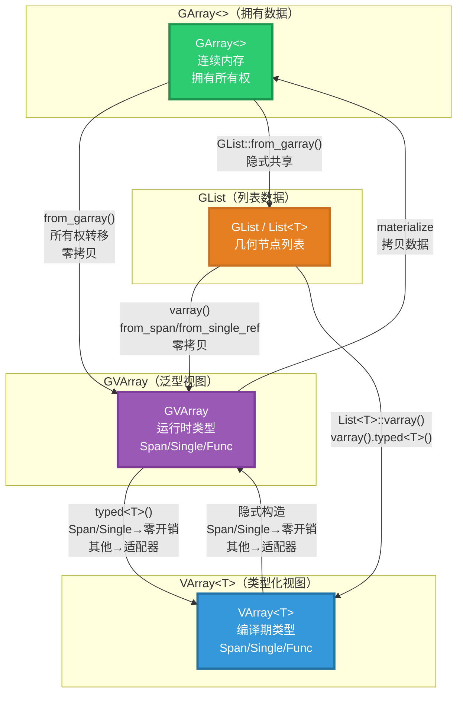

**六条核心转换路径**：

| # | 方向 | 方法 | 开销 |
|---|------|------|------|
| 1 | GArray → GVArray | `GVArray::from_garray()` | 零拷贝（所有权转移） |
| 2 | GVArray → VArray\<T\> | `typed<T>()` | 零开销（Span/Single）或适配器 |
| 3 | VArray\<T\> → GVArray | 隐式构造 | 零开销（Span/Single）或适配器 |
| 4 | GVArray → GArray | `materialize()` | 拷贝（必须） |
| 5 | GArray → GList | `GList::from_garray()` | 零拷贝（隐式共享） |
| 6 | GList → GVArray | `varray()` | 零拷贝（from_span/from_single_ref） |

---

## 5. GArray → GVArray：from_garray

### 5.1 转换机制

```cpp
// BLI_generic_virtual_array.hh:186
static GVArray from_garray(GArray<> array);

// generic_virtual_array.cc:636~650 实现
class GVArrayImpl_For_GArray : public GVArrayImpl_For_GSpan {
 protected:
  GArray<> array_;  // 持有 GArray，保持数据存活
 public:
  GVArrayImpl_For_GArray(GArray<> array)
      : GVArrayImpl_For_GSpan(array.as_mutable_span()),  // 基类设置 data_ 指针
        array_(std::move(array))                          // 移动 GArray 到成员
  {}
};

GVArray GVArray::from_garray(GArray<> array)
{
  return GVArray::from<GVArrayImpl_For_GArray>(std::move(array));
}
```

### 5.2 所有权转移过程

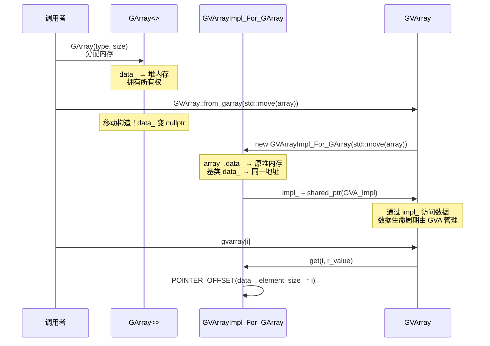

**关键步骤**：
1. `GVArrayImpl_For_GSpan(array.as_mutable_span())` — 基类用 `GArray` 的 `data_` 和 `size_` 初始化 Span 包装
2. `array_(std::move(array))` — 将 `GArray` 移动到成员变量，**保持数据存活**
3. 当 `GVArray` 析构时，`GVArrayImpl_For_GArray` 析构，`array_` 析构，释放内存

> **为什么先构造基类再移动？** 因为 `GVArrayImpl_For_GSpan` 的构造函数需要 `GMutableSpan`，而 `array.as_mutable_span()` 返回引用 `array` 内部数据的 Span。如果先 `std::move(array)`，`array` 就空了，`as_mutable_span()` 会返回空 Span。所以**必须先从 `array` 获取 Span，再移动 `array`**。

### 5.3 为什么不直接用 GSpan？

```cpp
// ❌ 错误做法
GVArray GVArray::from_garray(GArray<> array)
{
  return GVArray::from_span(array.as_span());  // 危险！
  // array 在函数结束时析构，数据被释放！
  // GVArray 内部的 Span 指向已释放的内存！
}
```

> **`from_span` 不拥有数据**——它只是引用外部内存。`from_garray` 通过 `GVArrayImpl_For_GArray` 持有 `GArray<>`，确保数据在 `GVArray` 存活期间不被释放。

---

## 6. GVArray → VArray\<T\>：typed\<T\>()

### 6.1 三级优化策略

```cpp
// BLI_generic_virtual_array.hh:913~933
template<typename T> inline VArray<T> GVArray::typed() const
{
  if (!*this) { return {}; }
  BLI_assert(impl_->type().is<T>());  // 运行时类型检查

  const CommonVArrayInfo info = this->common_info();

  // ① 快速路径：Single → 直接构造 VArray::from_single
  if (info.type == CommonVArrayInfo::Type::Single) {
    return VArray<T>::from_single(*static_cast<const T *>(info.data), this->size());
  }

  // ② 快速路径：Span + 无所有权 → 直接构造 VArray::from_span
  if (info.type == CommonVArrayInfo::Type::Span && !info.may_have_ownership) {
    return VArray<T>::from_span(Span<T>(static_cast<const T *>(info.data), this->size()));
  }

  // ③ 快速路径：底层已经是 VArray<T> → 直接取出
  VArray<T> varray;
  if (this->try_assign_VArray(varray)) { return varray; }

  // ④ 慢速路径：需要适配器
  return VArray<T>::template from<VArrayImpl_For_GVArray<T>>(*this);
}
```

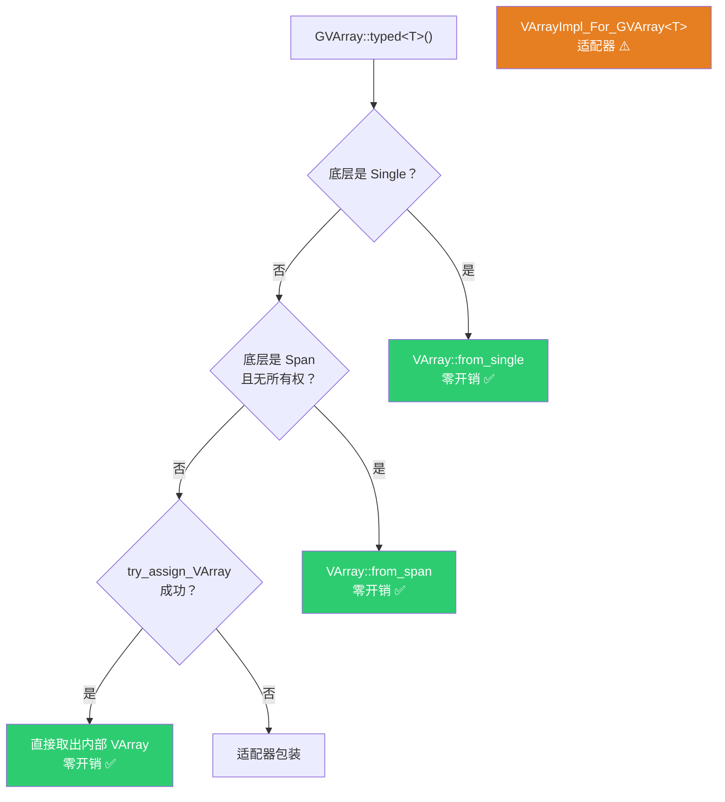

### 6.2 零开销条件详解

**条件 ① Single**：底层是单值广播——所有索引返回同一个值。

```cpp
// GVArray 内部：GVArrayImpl_For_SingleValueRef
// common_info() 返回 Type::Single, data 指向那个值

// typed<T>() 直接构造：
return VArray<T>::from_single(*static_cast<const T *>(info.data), this->size());
// 新建 VArrayImpl_For_Single<T>，拷贝一个 T 值
```

**条件 ② Span + 无所有权**：底层是连续内存，且不拥有数据（`may_have_ownership = false`）。

```cpp
// GVArray 内部：GVArrayImpl_For_GSpan_final
// common_info() 返回 Type::Span, may_have_ownership = false, data 指向内存

// typed<T>() 直接构造：
return VArray<T>::from_span(Span<T>(static_cast<const T *>(info.data), this->size()));
// 新建 VArrayImpl_For_Span_final<T>，引用同一块内存
```

> **为什么要求 `may_have_ownership = false`？** 如果 `may_have_ownership = true`，GVArray 的 impl 可能拥有数据。`VArray::from_span` 只是引用数据，不保持 impl 存活。如果 GVArray 析构了，数据就没了。`may_have_ownership = false` 表示数据是外部的，GVArray 不拥有也不负责释放，所以可以安全引用。

### 6.3 适配器开销

当快速路径都不满足时，使用 `VArrayImpl_For_GVArray<T>` 适配器：

```cpp
template<typename T> class VArrayImpl_For_GVArray : public VArrayImpl<T> {
 protected:
  GVArray varray_;  // 持有 GVArray，保持数据存活
 public:
  T get(const int64_t index) const override
  {
    T value;
    varray_.get(index, &value);  // 调用 GVArray 的虚函数
    return value;
  }
};
```

**开销**：每次 `varray[i]` 多一次虚函数调用（`GVArray::get` → `GVArrayImpl::get_to_uninitialized`）。对热循环可能显著。

---

## 7. VArray\<T\> → GVArray：隐式转换

### 7.1 隐式转换的三级优化

```cpp
// BLI_generic_virtual_array.hh:848~858
template<typename T> inline GVArray::GVArray(VArray<T> &&varray)
{
  if (!varray) { return; }
  const CommonVArrayInfo info = varray.common_info();

  // ① 快速路径：Single → GVArray::from_single
  if (info.type == CommonVArrayInfo::Type::Single) {
    *this = GVArray::from_single(CPPType::get<T>(), varray.size(), info.data);
    return;
  }

  // ② 快速路径：Span + 无所有权 → GVArray::from_span
  if (info.type == CommonVArrayInfo::Type::Span && !info.may_have_ownership) {
    *this = GVArray::from_span(GSpan(CPPType::get<T>(), info.data, varray.size()));
    return;
  }

  // ③ 快速路径：底层已经是 GVArray → 直接取出
  if (varray.try_assign_GVArray(*this)) { return; }

  // ④ 慢速路径：适配器
  *this = GVArray::from<GVArrayImpl_For_VArray<T>>(std::move(varray));
}
```

> **`try_assign_GVArray`**：如果 `VArray<T>` 内部就是从 `GVArray` 构造的（通过 `VArrayImpl_For_GVArray<T>`），可以直接取出原始 `GVArray`，避免嵌套包装。

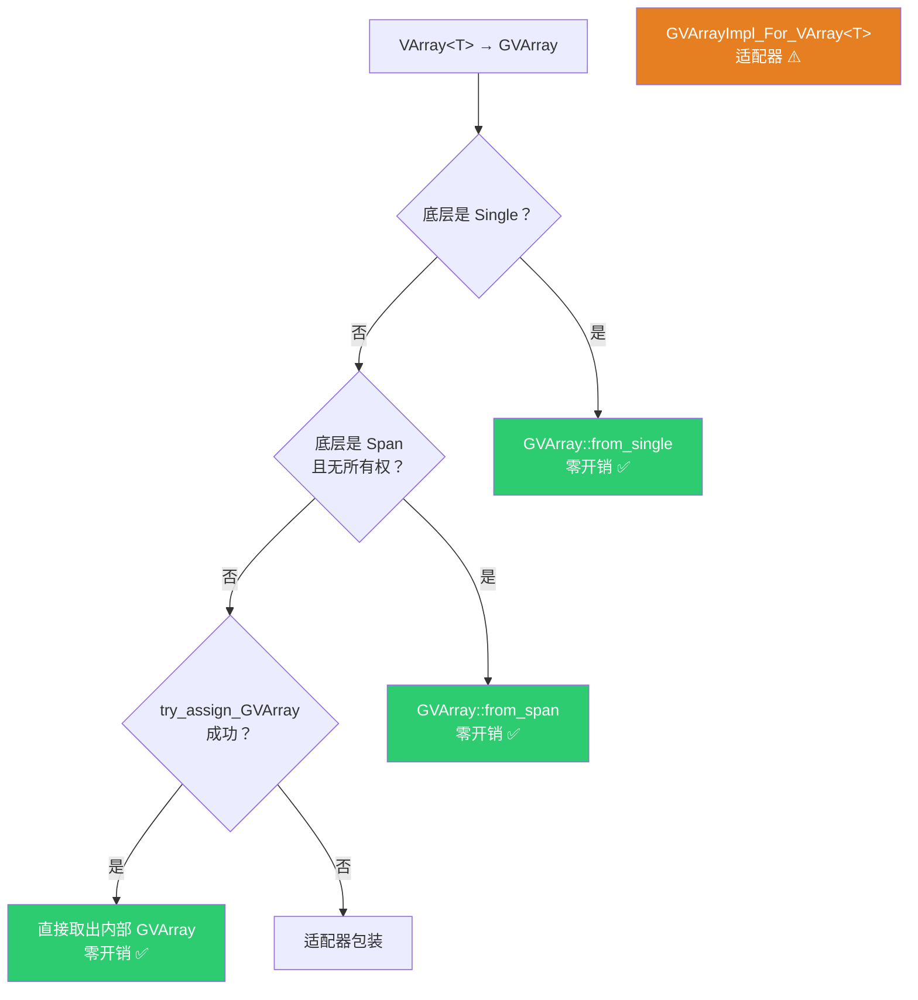

### 7.2 may_have_ownership 的关键作用

```cpp
// 注释原文：
// "Need to check for ownership, because otherwise the referenced data can be destructed when
//  #this is destructed."
```

> **翻译**：必须检查所有权，否则引用的数据可能在 `this` 析构时被销毁。

**场景分析**：

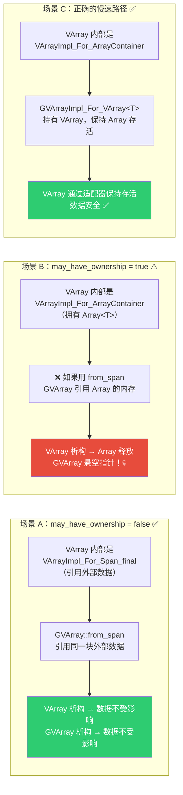

---

## 8. GVArray → GArray：materialize

GVArray 到 GArray 的转换**必须拷贝数据**——因为 GVArray 可能是 Single 或 Func，没有连续内存可以引用。

### 8.1 直接 materialize 模式

```cpp
// 典型模式：域适配中的 GArray 中转
GArray<> values(varray.type(), target_size);        // ① 分配 GArray
varray.materialize_to_uninitialized(IndexRange(target_size), values.data());  // ② 物化
return GVArray::from_garray(std::move(values));      // ③ 转回 GVArray
```

> **`materialize_to_uninitialized`**：将虚拟数组的值拷贝到未初始化的内存。比 `materialize` 更快——因为不需要先析构目标内存的旧值。

**域适配中的完整示例**（[mesh_attributes.cc](file:///e:/blender-git/blender/source/blender/blenkernel/intern/mesh_attributes.cc)）：

```cpp
static GVArray adapt_mesh_domain_corner_to_point(const Mesh &mesh, const GVArray &varray)
{
  GArray<> values(varray.type(), mesh.verts_num);  // ① 用目标域大小分配 GArray
  attribute_math::to_static_type(varray.type(), [&]<typename T>() {
    adapt_mesh_domain_corner_to_point_impl<T>(
        mesh, varray.typed<T>(),              // ② GVArray → VArray<T>
        values.as_mutable_span().typed<T>());  // ③ GArray → MutableSpan<T>
  });
  return GVArray::from_garray(std::move(values));  // ④ GArray → GVArray
}
```

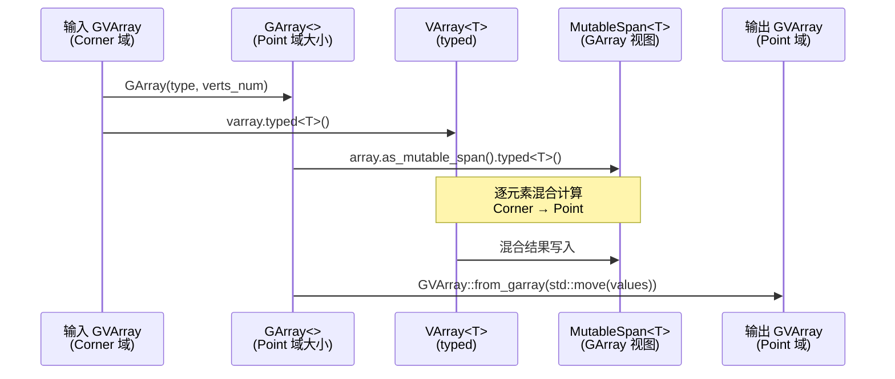

### 8.2 GVArraySpan 间接模式

当 API 需要 `GSpan` 但数据是 `GVArray` 时，`GVArraySpan` 自动处理物化：

```cpp
// BLI_generic_virtual_array.cc:318~335
GVArraySpan::GVArraySpan(GVArray varray)
    : GSpan(varray ? &varray.type() : nullptr), varray_(std::move(varray))
{
  if (!varray_) { return; }
  size_ = varray_.size();
  const CommonVArrayInfo info = varray_.common_info();
  if (info.type == CommonVArrayInfo::Type::Span) {
    data_ = info.data;  // 零拷贝：直接引用
  }
  else {
    // 物化：分配内存 + 拷贝数据
    owned_data_ = MEM_new_uninitialized_aligned(type_->size * size_, type_->alignment, __func__);
    varray_.materialize_to_uninitialized(IndexRange(size_), owned_data_);
    data_ = owned_data_;
  }
}
```

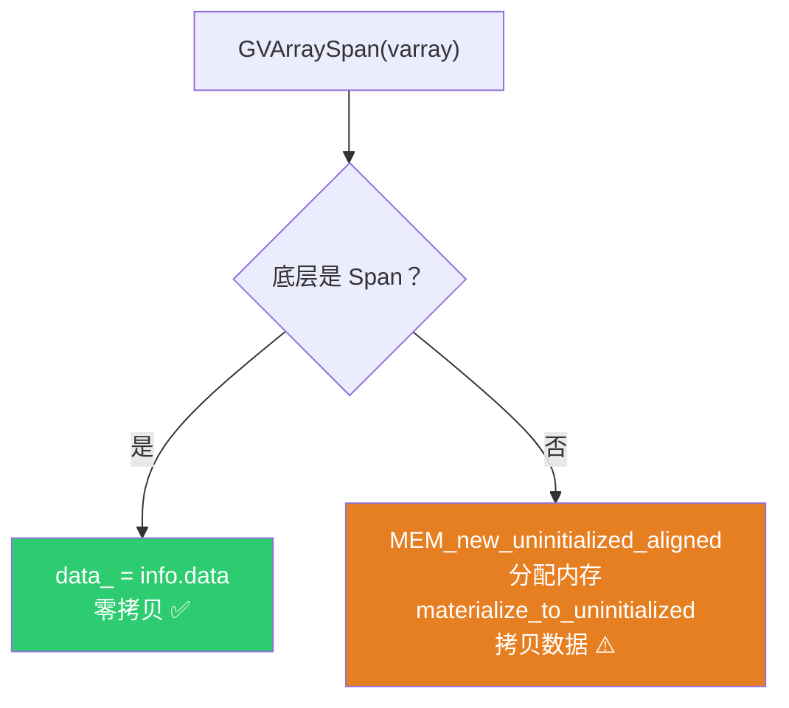

---

## 9. GArray → GList → GVArray → VArray\<T\>：列表系统的完整链路

### 9.1 GList::from_garray — GArray 变列表

```cpp
// geometry_nodes_list.cc:325~333
GListPtr GList::from_garray(GArray<> array)
{
  auto *sharable_data = new ImplicitSharedValue<GArray<>>(std::move(array));
  ArrayData array_data;
  array_data.data = sharable_data->data.data();       // 指向 GArray 内部数据
  array_data.sharing_info = ImplicitSharingPtr<>(sharable_data);  // 引用计数
  return GList::create(
      sharable_data->data.type(), std::move(array_data), sharable_data->data.size());
}
```

> **`ImplicitSharedValue<GArray<>>`**：包装 `GArray<>` 为引用计数的共享对象。多个 `GList` 可以共享同一块数据，零拷贝。
>
> **`ArrayData`**：GList 的数组存储变体，包含 `const void* data`（数据指针）和 `ImplicitSharingPtr<>`（共享信息）。

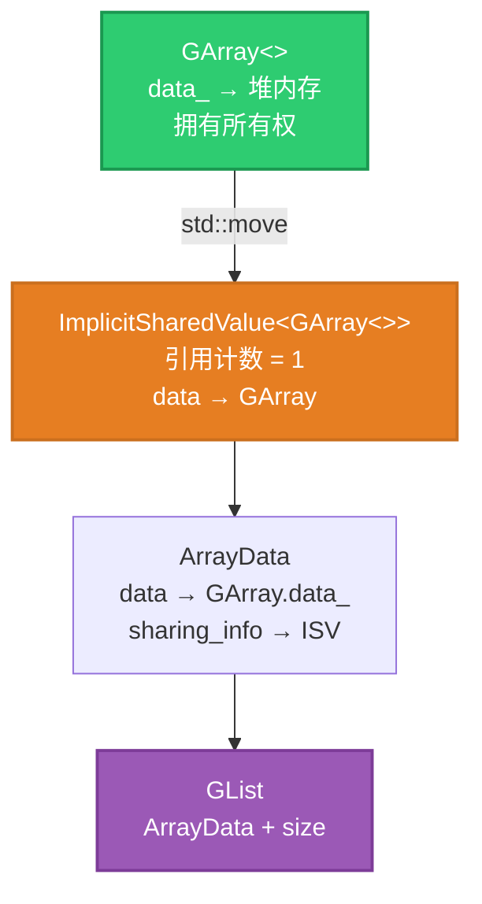

### 9.2 GList::varray — 列表变泛型虚拟数组

```cpp
// geometry_nodes_list.cc:141~151
GVArray GList::varray() const
{
  if (const auto *array_data = std::get_if<ArrayData>(&data_)) {
    return GVArray::from_span(GSpan(cpp_type_, array_data->data, size_));
  }
  if (const auto *single_data = std::get_if<SingleData>(&data_)) {
    return GVArray::from_single_ref(cpp_type_, size_, single_data->value);
  }
  BLI_assert_unreachable();
  return {};
}
```

> **GList 的两种存储完美映射到 GVArray 的两种零开销构造**：
>
> | GList 存储 | GVArray 构造 | 开销 |
> |-----------|-------------|------|
> | `ArrayData`（数组数据） | `GVArray::from_span` | 零拷贝 |
> | `SingleData`（单值数据） | `GVArray::from_single_ref` | 零拷贝 |

### 9.3 List\<T\>::varray — 列表变类型化虚拟数组

```cpp
// NOD_geometry_nodes_list.hh:231~234
template<typename T> inline VArray<T> List<T>::varray() const
{
  return list_.varray().template typed<T>();  // GList::varray() → GVArray → VArray<T>
}
```

> **`template` 消歧**：因为 `list_.varray()` 的返回类型依赖模板参数 `T`（通过 `List<T>` 的上下文），编译器不知道 `typed` 后面的 `<` 是比较运算符还是模板参数开始。`template` 告诉编译器这是模板。

### 9.4 完整数据流：从字段求值到列表输出

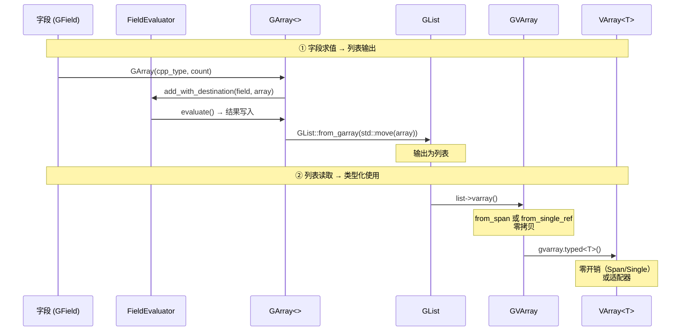

**真实代码**（[list_function_eval.cc:29~40](file:///e:/blender-git/blender/source/blender/nodes/intern/list_function_eval.cc)）：

```cpp
GListPtr evaluate_field_to_list(GField field, const int64_t count)
{
  const CPPType &cpp_type = field.cpp_type();
  GArray array(cpp_type, count);                    // ① GArray 缓冲区

  ListFieldContext context{};
  fn::FieldEvaluator evaluator{context, count};
  evaluator.add_with_destination(std::move(field), array);  // ② 字段求值目标
  evaluator.evaluate();                              // ③ 求值

  return GList::from_garray(std::move(array));      // ④ GArray → GList
}
```

---

## 10. 几何节点中的六大转换模式

### 10.1 模式 A：GArray 作为字段求值缓冲区 → GVArray

**最常见模式**：GArray 分配缓冲区 → FieldEvaluator 求值 → from_garray 转为 GVArray 返回

```cpp
// node_geo_blur_attribute.cc:375~428
GVArray get_varray_for_context(...) const final
{
    GArray<> buffer_a(*type_, domain_size);           // ① 分配 GArray
    FieldEvaluator evaluator(context, domain_size);
    evaluator.add_with_destination(value_field_, buffer_a.as_mutable_span());  // ② 求值目标
    evaluator.evaluate();                              // ③ 求值

    // ... 模糊计算 ...

    return GVArray::from_garray(std::move(buffer_a));  // ④ GArray → GVArray
}
```


### 10.2 模式 B：属性查找 → GVArray → VArray\<T\>

**属性系统标准模式**：AttributeAccessor 返回 GVArray → typed\<T\>() 转为 VArray\<T\>

```cpp
// 属性查找返回 GAttributeReader（包含 GVArray）
std::optional<GVArray> attribute = attributes.lookup("position");

// 转为类型化版本
VArray<float3> positions = attribute->typed<float3>();
```

> **`GAttributeReader`** 本质上是 `GVArray` + 元数据（domain、varying 状态）。可以隐式转换为 `GVArray`。


### 10.3 模式 C：GList → GVArray → VArray\<T\>（列表读取）

**列表节点标准模式**：GList::varray() → GVArray → typed\<T\>()

```cpp
// node_geo_filter_list.cc:159
const VArray<bool> values = keep_list->varray().typed<bool>();

// node_geo_sort_list.cc:110
r_varray = scope.add_value(std::move(list))->varray().typed<T>();
```


**Sort List 节点的完整数据流**：

```cpp
// node_geo_sort_list.cc:96~119
template<typename T>
static void get_varray_or_evaluate(const int list_size,
                                   bke::SocketValueVariant &value,
                                   ResourceScope &scope,
                                   fn::FieldEvaluator &field_evaluator,
                                   const T &default_value,
                                   VArray<T> &r_varray)
{
  if (value.is_context_dependent_field()) {
    field_evaluator.add(value.extract<fn::Field<T>>(), &r_varray);
  }
  else if (value.is_list()) {
    auto list = value.extract<GListPtr>();
    if (list && list->size() == list_size) {
      r_varray = scope.add_value(std::move(list))->varray().typed<T>();
      //                  GListPtr → GList → GVArray → VArray<T>
    }
    else {
      r_varray = VArray<T>::from_single(default_value, list_size);
    }
  }
  else {
    r_varray = VArray<T>::from_single(value.extract<T>(), list_size);
  }
}
```

### 10.4 模式 D：VArray\<T\> 隐式转 GVArray（字段输出）

**字段输入的标准模式**：`get_varray_for_context` 返回 `GVArray`，但内部构造 `VArray<T>` 后隐式转换

```cpp
// node_geo_tool_selection.cc:108~142
GVArray get_varray_for_context(...) const final
{
    // 方式 1：直接构造 GVArray
    return GVArray::from_single(*type_, mask.min_array_size(), true_value(data_type));

    // 方式 2：VArray<bool> 隐式转 GVArray
    Array<bool> selection(mask.min_array_size());
    // ... 填充 selection ...
    return VArray<bool>::from_container(std::move(selection));  // 隐式转换！

    // 方式 3：VArray<float> 隐式转 GVArray
    Array<float> selection(mask.min_array_size());
    // ... 填充 selection ...
    return VArray<float>::from_container(std::move(selection));  // 隐式转换！
}
```

> **`VArray<T>::from_container(Array<T>&&)`** → `VArray<T>` → 隐式转 `GVArray`。因为 `Array<T>` 拥有数据（`may_have_ownership = true`），隐式转换走慢速路径（`GVArrayImpl_For_VArray<T>` 适配器），确保数据存活。

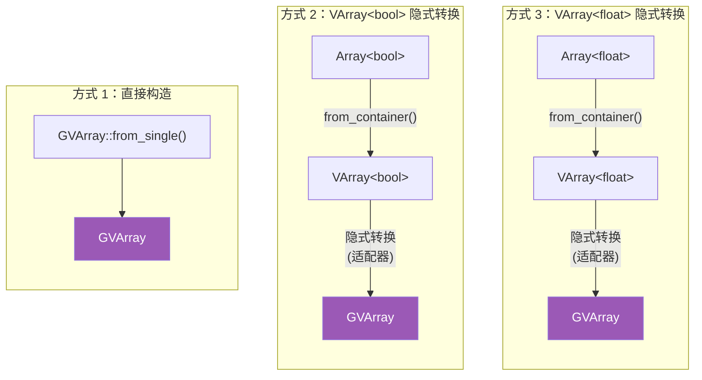

### 10.5 模式 E：GVArray → GArray（域适配）

**域适配的标准模式**：GVArray 输入 → GArray 中转计算 → GVArray 输出

```cpp
// mesh_attributes.cc:71~83
static GVArray adapt_mesh_domain_corner_to_point(const Mesh &mesh, const GVArray &varray)
{
  GArray<> values(varray.type(), mesh.verts_num);  // ① GArray 分配目标域大小
  attribute_math::to_static_type(varray.type(), [&]<typename T>() {
    adapt_mesh_domain_corner_to_point_impl<T>(
        mesh, varray.typed<T>(),              // ② GVArray → VArray<T>
        values.as_mutable_span().typed<T>());  // ③ GArray → MutableSpan<T>
  });
  return GVArray::from_garray(std::move(values));  // ④ GArray → GVArray
}
```

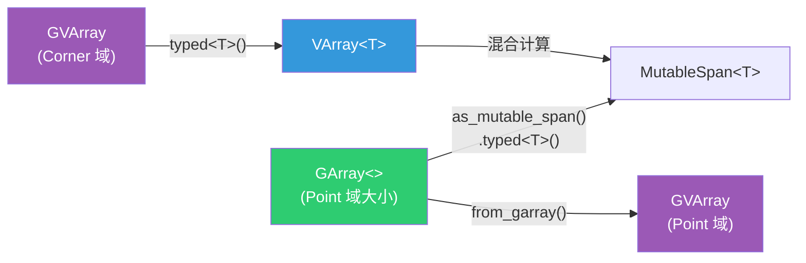

**Point → Corner 域适配（from_func 模式，无需 GArray）**：

```cpp
// mesh_attributes.cc:88~100
static GVArray adapt_mesh_domain_point_to_corner(const Mesh &mesh, const GVArray &varray)
{
  const Span<int> corner_verts = mesh.corner_verts();
  GVArray new_varray;
  attribute_math::to_static_type(varray.type(), [&]<typename T>() {
    new_varray = VArray<T>::from_func(
        mesh.corners_num, [corner_verts, varray = varray.typed<T>()](const int64_t corner) {
          return varray[corner_verts[corner]];  // 一对一映射，无需缓冲区
        });
  });
  return new_varray;  // VArray<T> 隐式转 GVArray
}
```

> **两种域适配模式的选择**：
>
> | 映射关系 | 模式 | 是否需要 GArray |
> |---------|------|----------------|
> | 多对一（需混合） | GArray + from_garray | ✅ 需要 |
> | 一对一（直接映射） | VArray::from_func | ❌ 不需要 |

### 10.6 模式 F：GArray → GList（列表构造）

**列表构造的标准模式**：GArray 计算结果 → GList::from_garray → 列表输出

```cpp
// node_geo_closure_to_list.cc:207~214
GArray<> array(type, count, NoInitialization());
threading::parallel_for(IndexRange(count), 128, [&](const IndexRange range) {
  for (const int list_i : range) {
    void *closure_result = const_cast<void *>(values[list_i].get_single_ptr_raw());
    type.move_construct(closure_result, array[list_i]);  // 移动构造到 GArray
  }
});
params.set_output(identifier, GList::from_garray(std::move(array)));  // GArray → GList
```

```cpp
// node_geo_filter_list.cc:109~111
GArray<> dst_data(list_type, mask.size());
array_utils::gather(GSpan(...), mask, dst_data);
return GList::from_garray(std::move(dst_data));  // GArray → GList
```

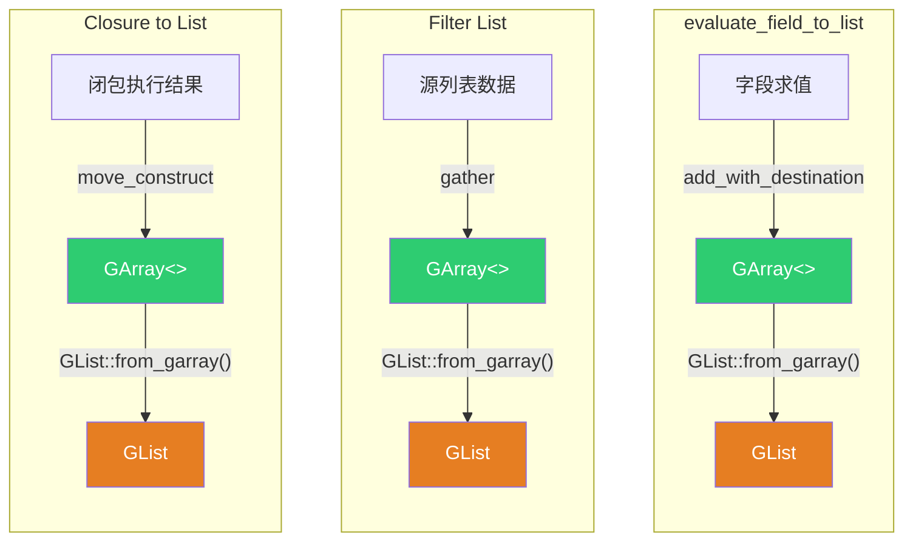

---

## 11. 转换开销速查

| 转换方向 | 方法 | 条件 | 开销 | 内存影响 |
|---------|------|------|------|---------|
| GArray → GVArray | `from_garray()` | 总是 | **零拷贝** | 所有权转移 |
| GVArray → VArray\<T\> | `typed<T>()` | 底层是 Single | **零开销** | 拷贝一个 T |
| GVArray → VArray\<T\> | `typed<T>()` | 底层是 Span + 无所有权 | **零开销** | 引用同一内存 |
| GVArray → VArray\<T\> | `typed<T>()` | 底层已包装 VArray | **零开销** | 直接取出 |
| GVArray → VArray\<T\> | `typed<T>()` | 其他 | **适配器** | 多一次虚函数 |
| VArray\<T\> → GVArray | 隐式构造 | 底层是 Single | **零开销** | 拷贝一个 T |
| VArray\<T\> → GVArray | 隐式构造 | 底层是 Span + 无所有权 | **零开销** | 引用同一内存 |
| VArray\<T\> → GVArray | 隐式构造 | 底层已包装 GVArray | **零开销** | 直接取出 |
| VArray\<T\> → GVArray | 隐式构造 | 其他 | **适配器** | 持有 VArray |
| GVArray → GArray | `materialize()` | 总是 | **拷贝** | 分配新内存 |
| GArray → GList | `GList::from_garray()` | 总是 | **零拷贝** | 隐式共享 |
| GList → GVArray | `varray()` | 总是 | **零拷贝** | 引用数据 |

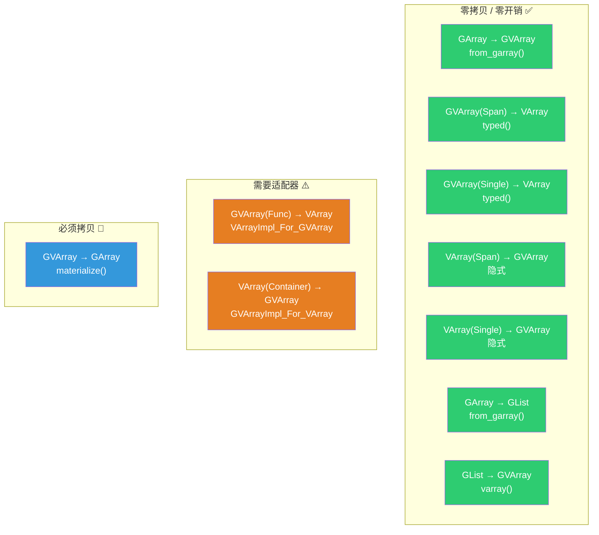

---

## 12. 奇怪/非基础语法注解

### `POINTER_OFFSET(ptr, offset)`

```cpp
// 等价于：static_cast<char*>(ptr) + offset
void *operator[](int64_t index) { return POINTER_OFFSET(data_, type_->size * index); }
```

> 因为 `void*` 不支持指针算术（`void* + n` 是未定义行为），必须先转 `char*` 再偏移。`POINTER_OFFSET` 封装了这个操作。

### `BUFFER_FOR_CPP_TYPE_VALUE(type, name)`

```cpp
// 等价于：AlignedBuffer<type.size, type.alignment> name;
BUFFER_FOR_CPP_TYPE_VALUE(*type_, buffer);
type_->copy_construct(value, buffer);
type_->destruct(buffer);
```

> 在栈上分配一块足够大的对齐内存，用于临时存储一个泛型值。因为编译期不知道类型大小，不能用 `T buffer;`。

### `BLI_NO_UNIQUE_ADDRESS`

```cpp
BLI_NO_UNIQUE_ADDRESS Allocator allocator_;
```

> 等价于 C++20 的 `[[no_unique_address]]`——当 `Allocator` 是空类时，不占用额外空间。`GuardedAllocator` 没有数据成员，使用此属性后 `sizeof(GArray<>)` 不包含 `allocator_` 的大小。

### `NoInitialization{}`

```cpp
GArray(const CPPType &type, const int64_t size, NoInitialization /*tag*/, Allocator allocator = {});
```

> 标签类型，表示"不初始化内存"。默认构造函数会调用 `type_->default_construct_n(data_, size_)` 初始化所有元素，但 `NoInitialization` 跳过这一步——当数据马上会被覆盖时（如字段求值目标），避免不必要的初始化开销。

### `template` 消歧

```cpp
return list_.varray().template typed<T>();
```

> 在依赖模板参数的表达式中，编译器不知道 `typed` 后面的 `<` 是比较运算符还是模板参数开始。`template` 关键字告诉编译器这是模板名称。

### `std::get_if<Variant>`

```cpp
if (const auto *array_data = std::get_if<ArrayData>(&data_)) { ... }
if (const auto *single_data = std::get_if<SingleData>(&data_)) { ... }
```

> `std::get_if` 返回指向变体中指定类型的指针，如果当前不是该类型则返回 `nullptr`。与 `std::get` 不同，`std::get_if` 不抛异常——适合用于类型检查+访问的组合。

### `ImplicitSharedValue<T>`

```cpp
auto *sharable_data = new ImplicitSharedValue<GArray<>>(std::move(array));
```

> Blender 的隐式共享包装器——包装任意类型为引用计数的共享对象。类似 `std::shared_ptr<T>` 但更轻量（不使用 `std::shared_ptr` 的控制块）。当引用计数降为 0 时自动析构包装的 `T`。

---

## 13. 总结速查表

### 三者关系一句话

| 关系 | 一句话 |
|------|--------|
| GArray → GVArray | "我算好了数据，交给你当虚拟数组用" |
| GVArray → VArray\<T\> | "我知道运行时类型是 T，给我类型化版本" |
| VArray\<T\> → GVArray | "我需要把类型化数据传给泛型接口" |
| GVArray → GArray | "我需要连续内存，把虚拟数组物化出来" |
| GArray → GList | "把计算结果包装成列表输出" |
| GList → GVArray | "把列表数据当虚拟数组用" |

### 几何节点中的典型数据流

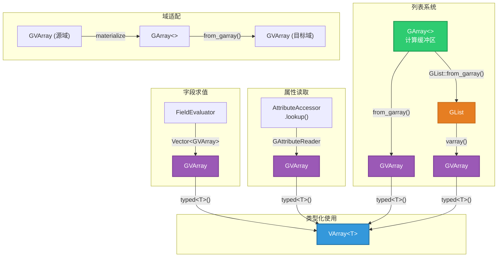

### 选择决策树

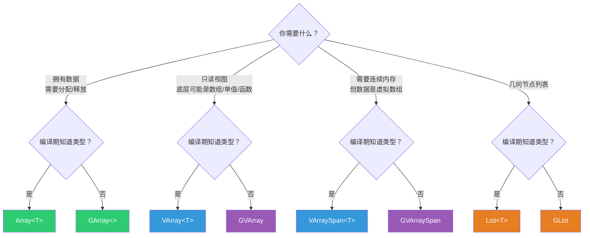
