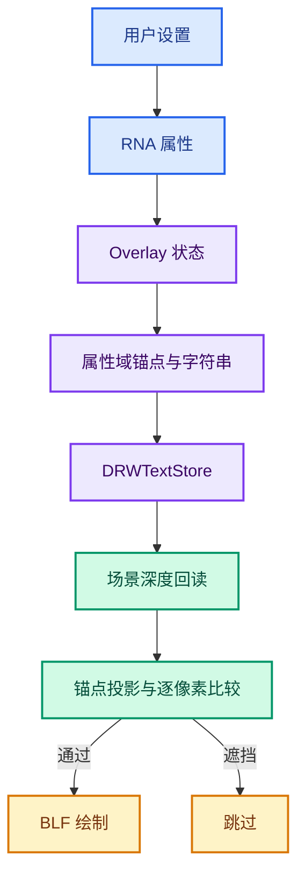
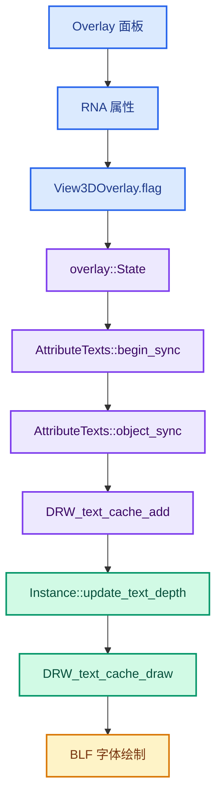
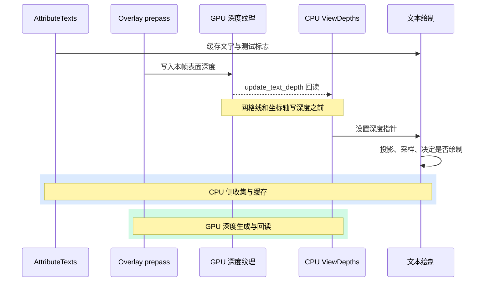

# 01 · 当前分支架构、状态与边界

> 基于 `attribute-text-depth-culling` 分支的 `eb97266f783`。
> 这是独立于 `属性文本遮挡剔除-DS` 的当前代码核对版；发生冲突时，以本目录和源码为准。
> 阅读日期：2026-09-27。

---

## 阅读地图



| 想解决的问题 | 先看 |
|---|---|
| 开关为什么出现在 Overlay 面板 | §2、§5 |
| 文字从哪里来 | §3、§6 |
| 深度什么时候从 GPU 到 CPU | §4、[02](./02-深度缓存与文本绘制.md) |
| 点云和实例为何偏移锚点 | §6、[03](./03-锚点与包围盒.md) |
| 旋转时文字为什么跳 | §7、[04](./04-误判诊断与实验复盘.md) |
| 哪些实验已被撤回 | §9 |

## 1. 快照范围

- 基准提交：`bba93a5d6df198bcdb31b7b92cdbe514945ba2ad`。
- 第一提交：`39009b48098`，深度回读、文字遮挡测试、点云半径偏移、UI 开关。
- 第二提交：`eb97266f783`，实例局部包围盒锚点偏移及格式调整。
- 相对 `origin/main`，两次提交共修改 9 个跟踪文件，约 `+319/-36` 行。
- `draw_manager_text.cc` 后续的斜率与近邻实验已经单独贮藏，不属于当前源码。
- `.markdown` 被 `.gitignore` 忽略；文档存在本地，不会自动进入 Git 提交。

> [!IMPORTANT]
> 当前分支是可编译的工作版本，不等于所有视角下的可见性都正确。
> 尤其要区分“编译通过”和“近距离轮廓稳定”。

## 2. 需求与语义

Geometry Nodes 的 Viewer 可以产生 `.viewer` 属性。
Overlay 将属性值格式化为屏幕文字。
没有遮挡判断时，后面的文字会透过模型。
深度方案利用视口本帧已经绘制的几何深度。
它在绘制每个字符串之前，比较文字锚点和该屏幕像素的场景深度。

开关的真正语义是“锚点被当前场景深度挡住时不绘制”。
它比传统的背面法线测试范围更广。
正面点也可能被另一个物体挡住。
背面法线与相机方向本身不参与最终比较式。
UI 名称 `Exclude Backfaces` 是历史命名，阅读代码时不要据此猜测算法。

### 四层职责

1. 属性层：决定有没有 `.viewer` 值。
2. 锚点层：决定用哪个三维位置代表该值。
3. 深度层：决定该位置在本帧视口是否被遮住。
4. 文字层：格式化、排版并绘制通过测试的字符串。

没有任何文字，先看属性层。
点云始终消失，先看锚点层。
所有几何类型一起跳变，先看深度层。
数字重叠或偏移，先看文字层。

## 3. 从 UI 到字符串的调用链



`space_view3d.py` 创建控件及其 `row.active` 条件。
控件激活状态不是实际绘制条件。
`DNA_view3d_types.h` 用 `(1 << 20)` 保存设置。
`rna_space.cc` 将 `viewer_text_cull_backfaces` 映射到 `overlay.flag`。
RNA 更新通知要求视图重绘。
`State::viewer_text_cull_backfaces()` 读取这个位。
`AttributeTexts::begin_sync()` 把结果存入 `occlusion_test_`。

`DRW_TEXT_CACHE_OCCLUSION_TEST` 是“需要测试”的标志，不是测试结果。
`DRW_TEXT_CACHE_GLOBALSPACE` 表示位置已经是世界坐标。
`DRWTextStore` 保存本帧的字符串及其锚点。
`DRW_text_cache_add` 默认复制临时格式化字符串到 allocator。
因此上游栈上的数字字符缓冲不会在绘制前失效。

## 4. 深度回读时间线



第一版曾把深度像素跨帧缓存，造成移动相机后的投影与旧深度不对应。
当前版缓存 CPU 缓冲的分配，但每帧刷新像素内容。
宽高改变时重新分配。
没有需要遮挡测试的文字时完全不回读，并释放已有缓存。
`Instance` 析构时释放 `ViewDepths`。

### 成本模型

- 回读数据量约为 `width × height × sizeof(float)`。
- 驱动可能需要等待 GPU 完成本帧深度写入。
- 每条文字都要投影、比较、之后才可能进入 BLF 绘制。
- 大点云在锚点调整时还要分配 `Array<float3>`。
- 关闭开关时应避免额外 GPU 回读，这是性能设计的核心约束。

## 5. 文件职责表

| 文件 | 负责什么 | 不负责什么 |
|---|---|---|
| `DNA_view3d_types.h` | 持久位定义 | GPU 回读 |
| `rna_space.cc` | 脚本属性与更新通知 | 可见性判断 |
| `space_view3d.py` | UI 布局 | 几何求交 |
| `overlay_private.hh` | State 读取 | 字体绘制 |
| `overlay_attribute_text.hh` | 属性域、锚点、值格式化 | 深度缓存所有权 |
| `overlay_instance.hh` | 缓存字段及析构 | 值类型转换 |
| `overlay_instance.cc` | 回读时机与缓存更新 | 单个值的文本格式 |
| `draw_manager_text.hh` | 通用文字 API 与标志 | 实例包围盒计算 |
| `draw_manager_text.cc` | 投影、比较与绘制 | `.viewer` 语义 |

这个分工直接决定修复位置。
仅实例文字自遮挡，先看 `overlay_attribute_text.hh`。
所有域都闪烁，先看 `draw_manager_text.cc` 与回读时机。
开关不出现，先看 DNA、RNA、UI。

## 6. 各几何域如何得到锚点

### 网格

`add_mesh_attributes_to_text_cache` 读取 `.viewer`。
`attribute.domain` 给出点、边、面、角等域。
`attributes.lookup<float3>("position", domain)` 提供对应位置。
角域还通过 `calc_corner_text_position` 排版偏移。
其余域把位置传给通用格式化函数。

### 曲线

旧 Curve 与新 Curves 对象从不同数据结构进入。
最终都调用 `add_attributes_to_text_cache`。
这条路径没有点云半径那样的专门锚点前移。

### 点云

点位置在绘制圆盘中心。
圆盘有半径，故中心常位于自己的深度之后。
当前实现按每个点自己的 `radius` 沿视线移向相机。
得到的是世界坐标，再配合单位矩阵避免二次变换。

### 实例

实例域标签最初放在实例局部原点。
原点可能在原型几何内部。
第二提交沿视线把锚点移到局部包围盒朝相机的一侧。
包围盒是长方体，不是凸包，也不是精确的可见表面。
其数学与边界情况见 [03](./03-锚点与包围盒.md)。

## 7. 精确的深度判定式

设 `a` 是锚点归一化深度，`s` 是该屏幕像素的场景深度。

```text
occluded = (s != 1.0) && (a > s + 2e-5)
```

`s == 1.0` 被当作清屏背景。
深度小的一方通常更靠近相机。
`2e-5` 是固定归一化深度容差，不是世界单位。
它未根据相机距离、深度斜率或采样覆盖自动变化。

CPU 投影的是精确三维锚点。
GPU 记录的是像素中心的最近表面。
两者并不一定对应同一个几何位置。
旋转时，锚点跨过像素边界，`a - s` 可能跨过阈值。
轮廓、共享顶点、斜面和近距离透视尤其容易触发。

`gpu_viewport.cc` 请求 `SFLOAT_32_DEPTH_UINT_8`。
这个枚举中的深度分量是 32 位浮点请求，不能将它直接写成“24 位定点已确认”。
旧参考文档里对此有不准确表述，详见 [04](./04-误判诊断与实验复盘.md) 的勘误。

## 8. 已知限制

| 限制 | 原因 | 典型表现 |
|---|---|---|
| 可见网格点偶发隐藏 | 单像素深度不等于锚点深度 | 旋转跳动 |
| 凹形实例局部透字 | 包围盒代替真实表面 | 近处标签误显 |
| 实例原点在盒外 | `contains(local_anchor)` 不成立 | 原点仍自遮挡 |
| 极端非均匀缩放的点云 | 半径缩放是近似 | 标签深度不精确 |
| 视口较大 | 每帧 GPU→CPU 回读 | 交互变慢 |
| 文字密集 | 没有文本碰撞避让 | 数字重叠 |

不能靠统一增大容差同时修好所有条目。
放宽得越多，真正处在后面的点越可能透过几何。

## 9. 已贮藏的实验

为降低网格点闪烁，曾尝试局部深度斜率、单侧斜率、近邻候选像素。
用户复测后仍认为效果不好。
这些未提交实验已单独以 `Experimental text depth slope and pixel-neighbor tolerance` 贮藏。
所以当前 `draw_manager_text.cc` 仍是固定 `2e-5` 的单像素比较。
别把 stash 中的实验描述为已合入的修复。

## 10. 推荐阅读顺序

1. UI 属性与 DNA 位。
2. `State::viewer_text_cull_backfaces()`。
3. `AttributeTexts::begin_sync()` 与 `object_sync()`。
4. `add_values_to_text_cache()` 如何设置标志。
5. `Instance::draw_v3d()` 的回读调用点。
6. `Instance::update_text_depth()` 的内存生命周期。
7. `DRW_text_cache_draw()` 的投影与比较。
8. 点云半径和实例包围盒的特殊处理。

这样先建立数据流，再看局部数学，不容易把全局问题误诊成实例问题。
