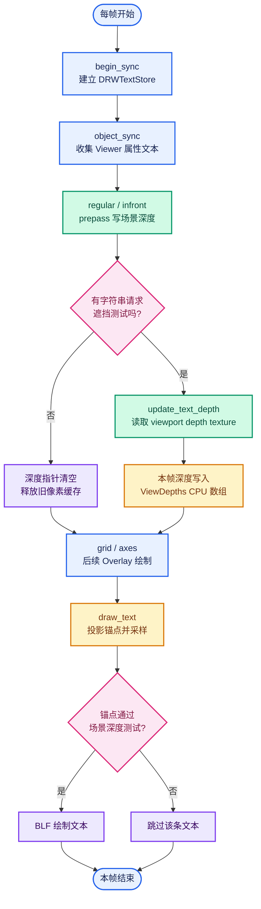
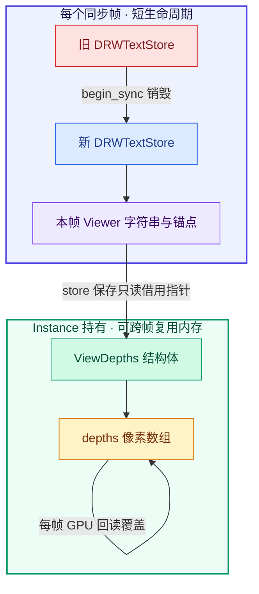
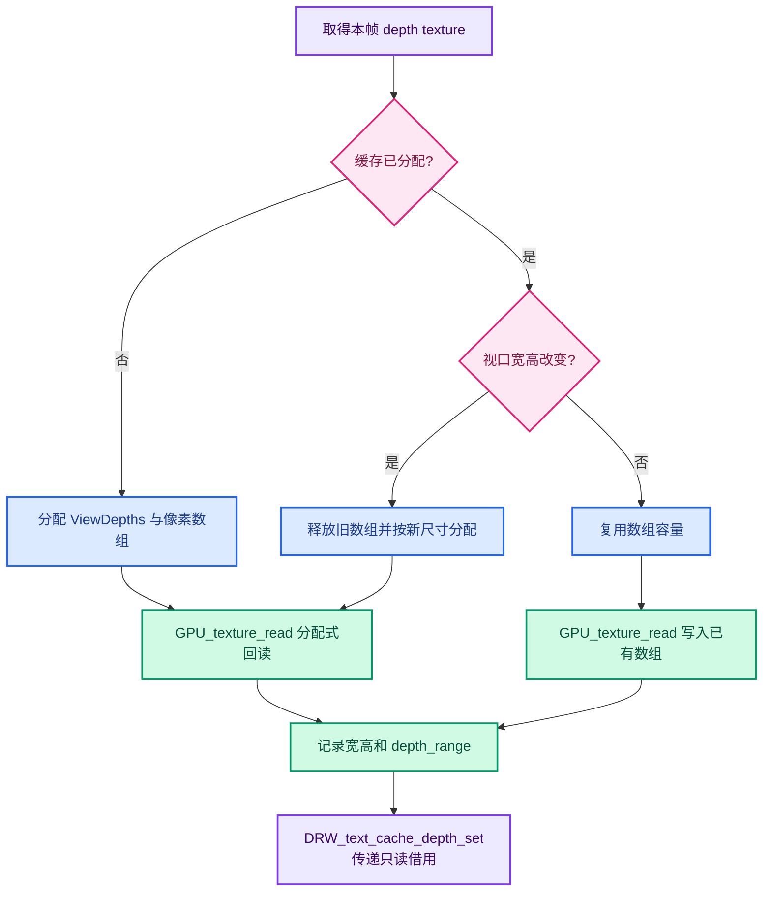
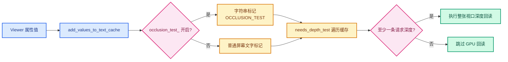

# 02 · 深度缓存与文本绘制：逐帧追踪

> 快照：`attribute-text-depth-culling`，HEAD `eb97266f783`。
> 阅读本章时，建议并排打开 `overlay_instance.cc` 与 `draw_manager_text.cc`。

---

## 0. 先看一张图



这张图表达的是当前帧顺序。
不要把 `ViewDepths` 对象仍存活误解为深度像素跨帧复用。
对象可以存活，但内容每帧必须刷新。

## 1. 对象所有权

`Instance` 持有 `text_depth_cache_`。
`DRWTextStore` 仅保存指向它的 `const ViewDepths *`。
`DRW_text_cache_depth_set` 不复制深度数组，也不取得所有权。
因此 `Instance` 必须让缓存活到 `DRW_text_cache_draw` 之后。
析构函数使用 `ED_view3d_depths_free` 释放。

### 1.1 三层内存

| 层 | 典型内容 | 生命周期 |
|---|---|
| GPU texture | 本帧视口深度 | 视口资源管理 |
| `ViewDepths` 与 `depths` 数组 | CPU 回读结果 | `Instance` 的缓存 |
| `DRWTextStore::depths` 指针 | 指向上层的只读借用 | 本帧文字绘制 |

把借用指针当成所有权会造成双重释放。
把缓存数组当作跨帧结果会造成相机移动后的旧深度错配。
把 texture 的生命周期等同于 store 也不正确。

### 1.2 为什么下一帧重新创建 store

`Instance::begin_sync()` 销毁旧 `state.dt`。
然后调用 `DRW_text_cache_create()` 创建新 store。
Viewer 的属性值和对象可随帧改变。
逐帧重建字符串避免保留旧值或旧锚点。
它不会自动刷新 `text_depth_cache_`，后者由 `update_text_depth()` 管。



图中“可复用”指内存地址与容量可以复用；GPU 像素内容仍是逐帧更新的。

## 2. `update_text_depth()` 的每个分支

### 分支 A：根本不需要测试

条件包括不显示文字、不是 3D View、没有字符串请求深度测试。
函数把 store 的深度指针置空。
若旧 CPU 缓存存在，则释放并置空。
这使默认关闭功能时不读 GPU。
注意 `text_depth_cache_width_` 与 `height_` 的旧值无需立即清零：下次分配会覆盖。

### 分支 B：尺寸变化

取得视口的 `GPUViewport`。
取得 `GPU_viewport_depth_texture(viewport)`。
用 `GPU_texture_width`、`GPU_texture_height` 读尺寸。
如果已分配的宽高与纹理不同，先释放旧缓存。
尺寸变化时旧缓冲容量不足，继续回读会越界。

### 分支 C：第一次分配

`MEM_new_zeroed<ViewDepths>` 创建结构体。
写入 `w`、`h`。
三参数 `GPU_texture_read(depth_tx, GPU_DATA_FLOAT, 0)` 返回新分配的数组。
把结果作为 `float *` 存入 `depths`。
记录 `depth_range` 和缓存尺寸。

### 分支 D：尺寸相同

四参数 `GPU_texture_read(depth_tx, GPU_DATA_FLOAT, 0, text_depth_cache_->depths)` 写入已有数组。
这是**本帧覆盖旧内容**，不是使用旧帧像素。
省的是内存重新分配，不是 GPU→CPU 数据传输。

### 分支 E：将数据提供给文字系统

`DRW_text_cache_depth_set(state.dt, text_depth_cache_)` 保存借用指针。
之后的 `draw_text()` 才能访问数组。
如果重构绘制顺序，必须重新核对这个先后关系。



## 3. 回读点的选择

`Instance::draw_v3d()` 先完成 regular 与 infront 的 prepass。
接着调用 `update_text_depth()`。
后面的 grid/axes 会写深度。
如果把回读推迟到 grid 之后，一像素细线可能正好覆盖锚点像素。
相机轻微转动时，细线会跨过采样位置，产生闪烁。

### 顺序不是装饰

```text
prepass depth
    ↓
update_text_depth()     ← 当前意图：读取几何表面
    ↓
wireframe depth copy
    ↓
grid / axes / 其他叠加层
    ↓
draw_text()
```

若未来 Overlay 重新安排 pass，必须确认：

1. 回读使用的是目标场景的正确 texture。
2. 回读前 geometry depth 已经写入。
3. 回读前没有不希望参与遮挡的一像素叠加层。
4. 回读发生在 GPU 操作同步点允许的位置。
5. 文字绘制前指针仍有效。

## 4. 文本系统如何获知要不要读深度

`AttributeTexts::add_values_to_text_cache()` 设置文字标志。
每种值类型都经过这一个格式化入口。
当 `occlusion_test_` 为真，标志包含 `DRW_TEXT_CACHE_OCCLUSION_TEST`。
`DRW_text_cache_needs_depth_test()` 遍历字符串。
只要有一个请求就返回真。

这个检查是 O(文字数)。
它避免在根本无目标时回读整张纹理。
若未来文字数极多，可以考虑在加入字符串时维护计数或布尔状态。
但增加缓存状态也会引入失同步风险。



## 5. 通用文字缓存的数据结构

### `ViewCachedString`

`vec[3]` 是三维锚点。
`sco[2]` 是经过投影后的屏幕坐标。
`xoffs`、`yoffs` 是屏幕空间排版偏移。
`flag` 控制空间、裁剪、指针和遮挡测试。
`str` 是实际字符串视图。
`shadow` 与 `align_center` 控制外观。

### `DRWTextStore`

`cache_strings` 是所有字符串的连续容器。
`string_allocator` 持有必要的字符串拷贝。
`depths` 是调用者提供的场景深度借用指针。

此结构并没有保存“文本矩形深度”。
因此当前遮挡测试只针对锚点。
一个锚点可见的长字符串可能延伸到背景或其他物体上。
这是设计定义，不一定是数组越界或投影错误。

## 6. 投影数学

```mermaid
flowchart LR
  W[世界锚点<br/>p = (x,y,z,1)] --> M[persmat × p]
  M --> C[裁剪空间<br/>c = (cx,cy,cz,cw)]
  C --> V{w 与裁剪范围<br/>有效吗?}
  V -- 否 --> X[投影失败<br/>不绘制]
  V -- 是 --> N[透视除法<br/>NDC = c.xyz / |cw|]
  N --> S[映射为屏幕像素<br/>x、y]
  N --> Z[映射为 0..1 深度<br/>anchor_depth]
  S --> P[取对应像素 scene_depth]
  Z --> Q{anchor_depth<br/>> scene_depth + ε?}
  P --> Q
  Q -- 是 --> H[被遮挡<br/>跳过文本]
  Q -- 否 --> D[可见<br/>提交 BLF 绘制]
  classDef world fill:#DBEAFE,stroke:#2563EB,color:#1E3A8A,stroke-width:2px;
  classDef math fill:#EDE9FE,stroke:#7C3AED,color:#3B0764,stroke-width:2px;
  classDef pixel fill:#FEF3C7,stroke:#D97706,color:#78350F,stroke-width:2px;
  classDef decision fill:#FCE7F3,stroke:#DB2777,color:#831843,stroke-width:2px;
  classDef visible fill:#D1FAE5,stroke:#059669,color:#064E3B,stroke-width:2px;
  classDef hidden fill:#FEE2E2,stroke:#DC2626,color:#7F1D1D,stroke-width:2px;
  class W world;
  class M,C,N,S,Z math;
  class P pixel;
  class V,Q decision;
  class D visible;
  class X,H hidden;
```

世界空间锚点写作 `p = (x,y,z,1)`。
`persmat × p` 得到齐次裁剪坐标 `c = (cx,cy,cz,cw)`。
对有效点，NDC 是 `c.xyz / |cw|`，代码沿用 View3D 投影函数的处理方式。
屏幕坐标是：

```text
fx = (width  / 2) × (1 + cx / |cw|)
fy = (height / 2) × (1 + cy / |cw|)
```

归一化深度是：

```text
anchor_depth = (cz / |cw| + 1) / 2
```

代码对零 `w`、近平面、远平面和窗口范围作检查。
此处的深度值与 CPU 读回的 GPU 深度在同一个 `[0,1]` 约定中比较。
如果未来启用反向 Z 或更改 clip-space 约定，这个公式必须重新核对。

### 屏幕采样

`int(xy[0])`、`int(xy[1])` 取得像素坐标。
读取 `depths[y * w + x]`。
这个索引假设 CPU 数组按行连续且坐标方向一致。
`x/y` 边界检查在读取前完成。
深度为 `1.0` 时，当作没有可遮挡的几何。

### 固定容差

```text
occluded = scene_depth != 1.0
        && anchor_depth > scene_depth + 2.0e-5
```

固定容差解决完全相等位置的轻微浮点差。
它不保证覆盖斜面一个像素内的深度变化。
它也没有区分自己的表面与别的物体。

## 7. 两次投影的关系

`ED_view3d_project_short_ex()` 先得到文字最终的 `short sco`。
需要遮挡测试时，`text_anchor_project_with_depth()` 再算浮点 `xy` 和深度。
两者使用相近的矩阵与窗口换算。
前者做通用裁剪与坐标转换。
后者保留深度值。

**当前事实**：确实重复计算。
**潜在风险**：两条路径以后改动不一致，或像素取整细节不一致。
**尚未证明**：每次都有 1 像素偏差。
修改时应先记录两条路径输出，而不是仅凭存在两次调用判断必然错误。

## 8. `ViewDepths` 的宽高陷阱

`GPU_texture_width/height` 返回 `int`。
`ViewDepths::w/h` 是 `unsigned short`。
普通视口远小于 65535 像素，所以常规测试看不出来。
极端宽高时发生窄化，可能影响索引和缓冲对应关系。
这是需要单独处理的类型问题。
若改结构体类型，先检查所有使用方与 ABI/序列化范围。

## 9. 文档与源码中的两个过时说法

`draw_manager_text.cc` 的注释仍说深度由 `DRW_text_cache_draw` 填充。
实际填充在 `Instance::update_text_depth()`。
`overlay_instance.hh` 的注释仍说在 `draw_text` 中惰性填充。
实际调用在 `draw_v3d` 的 prepass 之后。
这两处是**注释过时**，不能照注释推导时序。

## 10. 性能测量建议

分别记录开关关闭、开启但无 Viewer 文字、开启且文字很多三种状态。
分别在小视口和高分辨率大视口测量。
固定相机与连续旋转相机都要测。
统计 CPU 帧时间、GPU 帧时间、文字数、深度读回耗时。
若只看 FPS，无法判断瓶颈来自回读、格式化还是字体绘制。

示例记录表：

| 场景 | 视口尺寸 | 文字条数 | 关开关帧时 | 开开关帧时 | 观察 |
|---|---:|---:|---:|---:|---|
| 网格点密集 | 待填 | 待填 | 待填 | 待填 | 旋转是否跳字 |
| 大量点云 | 待填 | 待填 | 待填 | 待填 | 半径偏移成本 |
| 实例阵列 | 待填 | 待填 | 待填 | 待填 | AABB 求交成本 |

数字留空是有意的：当前源码和构建记录不能替代真实运行测量。

## 11. 排查时的一条硬规则

先定位失败是在“未进入文字缓存”“投影失败”“深度比较失败”还是“BLF 绘制后看不清”。
只有确定失败层次，下一步改动才有明确目标。
一上来增大容差会同时改变真实遮挡行为。
一上来改实例包围盒不会修复普通网格点的像素采样。
一上来优化回读也不会修复锚点选错。

下一章详解点云与实例为什么需要前移锚点，以及“沿视线移动但屏幕位置不变”的数学条件。
