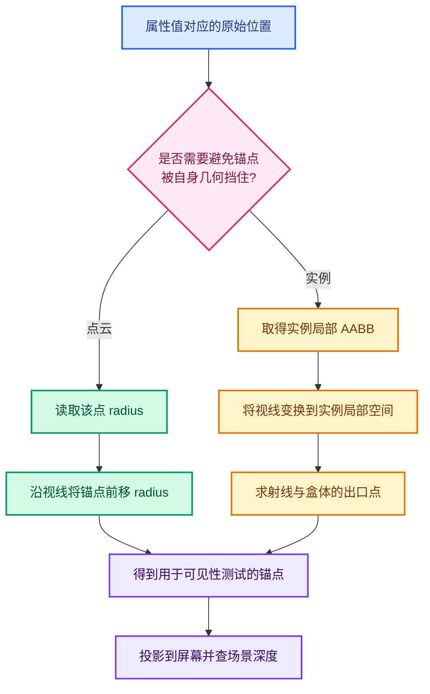
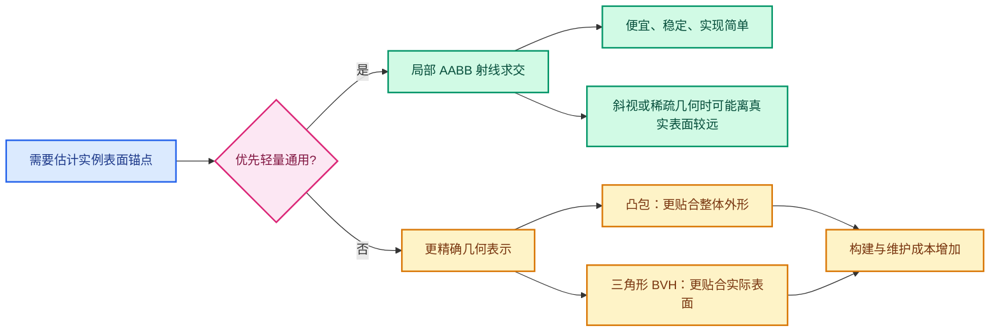

# 03 · 锚点与包围盒：点云、实例、投影不变性

> 快照：第二提交 `eb97266f783` 之后的 `overlay_attribute_text.hh`。
> 本章把“文字显示在哪里”和“拿哪个深度测试”视为同一个锚点的两个效果。

---

## 0. 最重要的区别



属性值属于一个逻辑元素。
逻辑元素的位置不一定是可见表面的位置。
点云的逻辑位置在圆盘中心。
实例的逻辑位置在局部原点。
这些点常被自身几何覆盖。
在深度方案里，锚点选错会被判断成真正遮挡。

深度缓冲只告诉我们**屏幕像素的最近深度**。
它不告诉我们前景属于哪个实例、哪个圆盘、哪个面。
为了避开自遮挡，当前代码在生成文字时修改锚点。
它没有改通用 `DRW_text_cache_draw` 的判断式。

## 1. 沿视线移动为何不改变屏幕位置

### 透视投影

设相机中心为 `C`，原锚点为 `P`。
视线上的任意点可以写成：

```text
Q(t) = C + t × (P - C),  t > 0
```

对理想针孔相机，`C`、`P`、`Q(t)` 在同一射线上。
透视除法会把它们投影到相同二维坐标。
`t` 改变的是深度，不是屏幕 x/y。
但点跨过近平面、远平面，或发生数值退化时，仍可能被裁剪。

### 正交投影

设视图方向为单位向量 `F`。

```text
Q(t) = P + t × F
```

沿正交投影方向平移，不改变垂直于 `F` 的二维分量。
因此屏幕坐标也不变。
当前代码里的 `camera_forward` 来自 `view.viewinv().z_axis()`。
在这条路径中，它被当作“朝向相机”的方向。
理解符号时应与实际矩阵和 Blender shader 中的视线约定核对。

### 为什么这不等于“深度测试位置与显示位置分离”

当前实现只保存一个位置。
它先移动这个三维位置，再把它作为文字位置加入缓存。
因为沿同一投影射线移动，屏幕上大体仍在原处。
深度比较读到的则是新位置的深度。
若未来文字系统需要真正独立的显示锚点与测试锚点，就要扩充缓存数据结构。

## 2. 点云：每个点有自己的半径

`add_pointcloud_attributes_to_text_cache` 首先取得 `.viewer`。
关闭遮挡测试时，直接使用 `pointcloud.positions()`。
开启时，读取 `pointcloud.radius()` 并创建 `Array<float3> anchors`。
数组大小等于点数。

### 2.1 世界中心

```text
center_world = object_to_world × position_local
```

其中乘法使用点变换，而不是方向变换。
平移必须生效。

### 2.2 半径缩放

```text
radius_scale = length(to_scale(object_to_world)) × 0.577350269
             ≈ sqrt(sx² + sy² + sz²) / sqrt(3)
```

`0.577350269 ≈ 1/√3`。
若三轴统一缩放为 `s`，则 `radius_scale = s`。
三轴不一致时，这是一个标量近似。
它匹配现有点云绘制所采用的尺度模型意图。
不要把它误解成对非均匀缩放椭球的精确射线半径。

### 2.3 朝向相机

透视视图中：

```text
to_camera = camera_position - center_world
direction = normalize(to_camera)
```

正交视图中使用 `state.camera_forward`。
若向量长度过小，代码回退到 `state.camera_forward`。
`1e-20` 是防止除零的数值阈值，不是可见性容差。

### 2.4 每点锚点

```text
anchor_world[i] = center_world[i]
                + direction[i] × max(radius[i], 0) × radius_scale
```

负半径被夹到零。
每个点使用自身半径，而不是所有点的最大半径。
这是此前方案修正的重要点。
若使用统一最大半径，小点文字会被抬得过高。
若半径为零，文字保持在中心。

### 2.5 为什么传单位矩阵

`anchors` 已经是世界坐标。
`add_values_to_text_cache` 内部仍会做 `transform_point(object_to_world, position)`。
所以这里传 `float4x4::identity()`。
若误传对象矩阵，会二次平移、旋转和缩放。
其症状是文字离物体越来越远，而不是单纯的深度闪烁。

### 2.6 点云反例

| 情形 | 结果或风险 |
|---|---|
| 所有点半径相同且统一缩放 | 偏移量最容易与绘制一致 |
| 每点半径不同 | 必须逐点计算 |
| 极端非均匀缩放 | 单一 `radius_scale` 只是近似 |
| 相机处于点中心 | 回退方向决定偏移方向 |
| 点在另一个物体之后 | 前移仍可能不足，应继续隐藏 |
| 点与遮挡物仅相差极小距离 | 可能因固定容差误判 |

## 3. 实例：局部 AABB 是什么

`BKE_object_boundbox_get(&object)` 提供对象数据的局部轴对齐包围盒。
它由 `bounds->min` 和 `bounds->max` 表示。
在**对象局部空间**中，它是轴对齐长方体。
对象矩阵可使它在世界空间旋转、缩放甚至斜切。
它不是凸包，也不是贴合三角形的精确外壳。

### 3.1 为什么在局部空间求交

包围盒的 min/max 属于局部坐标。
若把世界空间方向直接与局部盒比较，坐标系不一致。
当前代码先求 `world_to_object = invert(object_to_world)`。
相机方向用 `math::transform_direction` 变回局部。
方向变换不加入平移，这是正确的向量语义。

### 3.2 进入计算的前置条件

```text
bounds 存在
局部原点在 bounds 内
object_to_world 行列式绝对值大于 1e-20
局部方向长度平方大于 1e-20
射线与 AABB 相交
求得的参数大于零
透视时参数小于 1
```

任何一个条件不满足，`local_anchor` 保持 `(0,0,0)`。
这样不会使用不可靠的盒交点。
但也意味着某些实例仍会被自身遮挡。

### 3.3 原点在盒内

`bounds->contains(float3(0))` 是当前方案的关键假设。
如果对象几何整体偏离局部原点，原点可能在盒外。
这时没有简单的“从内部向相机穿出”交点。
当前代码不尝试沿任意方向寻找最近表面。
如果用户看到只有某些偏移原型失败，应优先检查这一条件。

## 4. 射线参数的完整推导

设局部原点 `O = (0,0,0)`。
设世界原点 `W = object_to_world.location()`。
透视时世界方向是：

```text
D_world = camera_position - W
```

正交时：

```text
D_world = camera_forward
```

再变换成局部方向：

```text
D_local = transform_direction(world_to_object, D_world)
R(t) = O + t × D_local
```

代码调用 `isect_ray_aabb_v3_simple`。
传入 `nullptr` 作为 `tmin` 输出。
把 `&entry_distance` 作为 `tmax` 输出。
所以变量虽然叫 `entry_distance`，实际拿到的是**向相机方向穿出盒子的参数**。
变量名会误导后续维护者。
把指针位置改成 `tmin` 会改变算法语义，不是安全的命名修正。

### 4.1 射线起点在盒内的例子

局部盒：`[-1,1]^3`。
原点：`(0,0,0)`。
局部方向：`(0,0,2)`。

```text
R(t) = (0,0,2t)
z = +1 时 tmax = 0.5
z = -1 时 tmin = -0.5
```

向相机移动应使用 `tmax = 0.5`。
得到新锚点 `(0,0,1)`。
注意方向没有归一化，`tmax` 也就不是“米数”。
这不妨碍 `O + tmax × D_local` 给出正确交点。

### 4.2 透视时 `< 1` 的真正意义

在透视路径，`D_world = camera_position - W`。
于是 `t = 1` 对应世界相机位置，假设矩阵可逆且变换一致。
`tmax < 1` 表示盒表面位于原点与相机之间。
它不是“出口在 1 米内”的经验阈值。
若相机在盒内部，出口可能在相机之后，代码拒绝这次偏移。
若未来把 `D_world` 归一化，`< 1` 的含义就会变化，必须同步修改判断。

### 4.3 正交时没有 `< 1` 限制

正交方向不由相机位置减去原点得到。
它的长度通常接近一，但参数 `1` 没有“相机位置”的意义。
代码在正交路径只要求出口参数为正。
这使所有原点在盒内且视线有效的实例都能找到前表面。

## 5. 为什么文字屏幕上仍在中心

原始世界锚点是实例局部原点变换后的 `W`。
新锚点位于从 `W` 指向相机的直线上。
透视投影时，这条线与相机中心连成同一条射线。
正交投影时，它与投影方向平行。
因此 x/y 理应不变，变化的是深度。

“不变”有数值与裁剪边界。
浮点矩阵变换可能带来极小屏幕偏差。
新锚点跨近裁剪面可能导致不显示。
若矩阵奇异、相机在盒内或对象矩阵不对应实际实例变换，就不保证结果。

## 6. AABB 与凸包的取舍



### AABB 的优点

只要 min/max 两个点。
求交成本近似常数。
对象数据常有缓存的 bounds。
对大量实例比较便宜。
可自然处理旋转后的对象：先把射线变回局部空间。

### AABB 的局限

它包住所有几何，也包住模型外的大量空空间。
对凹形、中空或细长模型尤其粗糙。
视线进入长方体时，可能尚未碰到真实表面。
这会把文字锚点放在真实模型前方。
如果另一物体位于盒入口和模型表面之间，文字可能错误显示。

### 凸包能改善什么

凸包比 AABB 更贴近模型外形。
射线进入凸包的位置通常更接近真实几何。
但凸包仍填平凹陷和孔洞。
每个原型要构建或取得凸包，还要考虑变形与缓存失效。
实例数量大时，求交也比 AABB 昂贵。

### 精确几何求交需要什么

可以沿视线求实际三角形表面的最近交点。
但必须选择当前实例的几何、处理对象变换和多层实例。
如果每个标签每帧临时建 BVH，会明显增加成本。
若缓存 BVH，则要处理拓扑变化、变形更新和生命周期。
因此“换成凸包”不是完全消除误判，也不是零代价升级。

## 7. 当前实例路径的一个核对点

`object_sync` 取 `object.object_to_world()`。
`ObjectRef` 也提供 `object_to_world()`，对 dupli/range 情形有自己的语义。
本章不能仅凭静态代码断言两者在全部预览实例场景必然一致。
若实例旋转、缩放后标签位置与实际几何错开，应记录两个矩阵并核对。
这是值得测试的潜在风险，而不是已确认的当前 bug。

## 8. 数学边界条件清单

| 条件 | 当前处理 | 还需留意 |
|---|---|---|
| 没有对象 bounds | 保持原点 | 可能自遮挡 |
| 原点不在 bounds 内 | 保持原点 | 偏移原型常见 |
| 奇异对象矩阵 | 不求逆 | 文字仍可能被挡 |
| 零方向 | 不求交 | 相机与原点重合 |
| 透视相机在盒内 | `<1` 失败时保持原点 | 可见性语义复杂 |
| 正交视图 | 沿固定视线出盒 | 要确认方向符号 |
| 负缩放 | 行列式取绝对值 | 局部盒与方向依旧要核对 |
| 非均匀缩放 | 变回局部求交 | 包围盒仍只是近似 |
| 凹面或空心模型 | AABB 可能在空气中 | 可能透字 |

## 9. 实际排查步骤

1. 确认属性确实在实例域而不是子几何的点域。
2. 确认 `preview_instance_index()` 对应期望实例。
3. 确认 `.viewer` 在实例属性上。
4. 记录对象局部 bounds 与局部原点。
5. 记录 `object_to_world`、逆矩阵和方向。
6. 记录 `tmin`、`tmax`，确认使用的是向相机方向的出口。
7. 将新锚点投影，检查屏幕 x/y 是否与原点近似相等。
8. 对照该像素的场景深度。
9. 用凹形模型验证包围盒近似的误显。
10. 用偏移原点模型验证 fallback。

不要只看最终“文字有无”。
把每一步的坐标空间和单位写清楚，才能分辨数学错误与像素采样错误。
