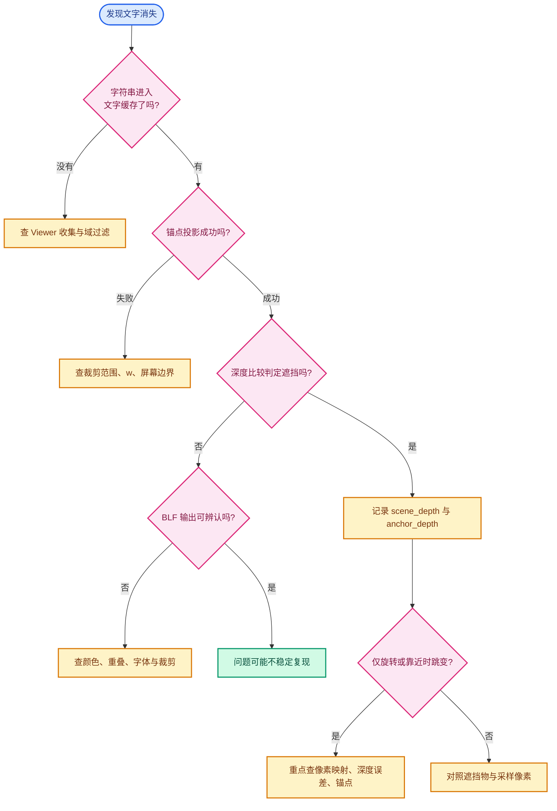
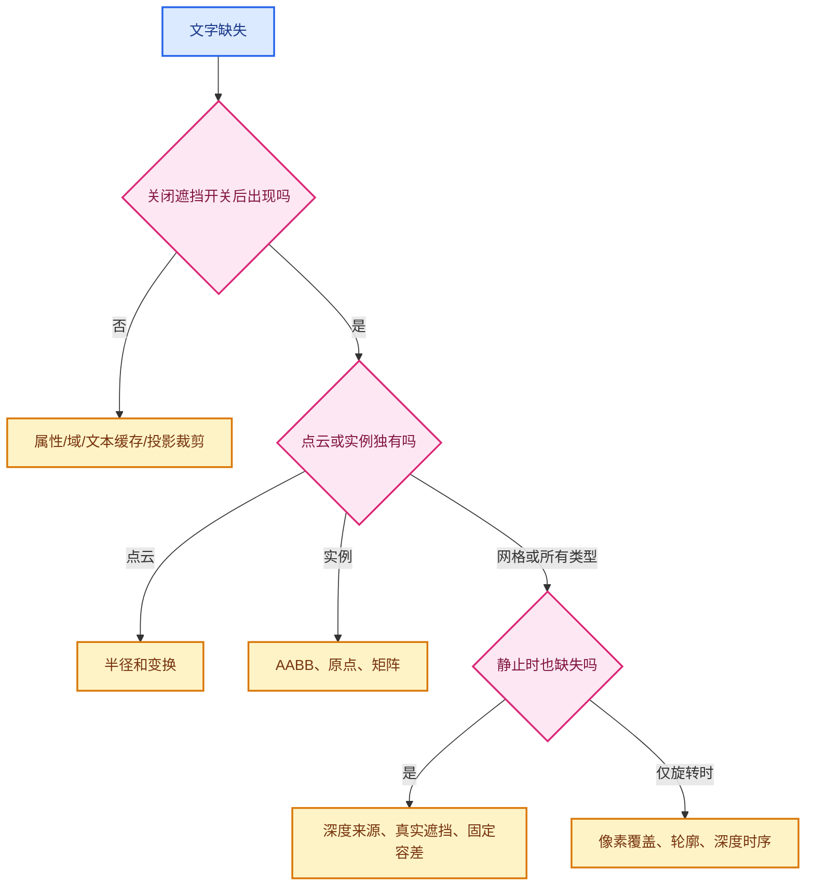

# 04 · 误判诊断与实验复盘

> 目的：把“字不见了”拆解成可测量的失败类型。
> 当前提交仍使用单像素、固定 `2e-5` 容差；后续实验已贮藏。

---

## 0. 快速判别树





先走这棵树，再决定改哪里。
不要把所有缺失都叫“深度精度不足”。
不要把所有旋转跳动都归因于旧帧缓存。

## 1. 已经遇到过的症状

### 1.1 远一点全灭，近一点全显

早期方案把 GPU 深度读回结果跨帧复用。
相机一动，新帧锚点投影对上旧帧像素。
这种状态可以产生大面积错配。
当前代码每帧刷新 `depths` 内容，因此这个根因已被移除。

验证方式不是只看 `ViewDepths *` 是否仍存在。
应看四参数 `GPU_texture_read` 是否每帧执行。
若未来优化把它移出绘制循环，需重新评估。

### 1.2 细线穿过时文字跳动

早期深度读取发生在 grid/axes 之后。
细线可写一像素深度。
锚点落到该像素时，被误判为遮挡。
当前 `update_text_depth` 位于 prepass 后、grid 之前。
这是时序修正，不是更大深度容差。

曾试过 3×3 邻域取最深深度。
用户要求撤回。
现在不能把它偷偷恢复成“最终设计”。
如果未来重新讨论邻域采样，应说明新规则的覆盖半径、接受条件及误显风险。

### 1.3 表面点随轻微旋转消失

锚点是一个连续的几何点。
深度纹理是离散像素中心的样本。
小角度旋转可令锚点从一个像素移动到相邻像素。
新像素中心可能看到另一三角形或另一物体。
固定 `2e-5` 的容差不一定覆盖几何斜率。

仅凭截图不能断言唯一根因。
可用调试记录 `xy`、像素坐标、锚点深度、场景深度和域索引。
若同一 ID 在消失帧满足 `anchor_depth > scene_depth + bias`，就是深度判断路径。
若根本没有进入比较，则应查缓存或投影裁剪。

### 1.4 点云文字始终不出现

点云圆盘表面位于中心之前。
中心锚点天然处在自身几何后面。
按每点半径向相机移动，是针对自遮挡的锚点修正。
使用所有点的最大半径会使小点偏移过多，已被否定。
使用各自半径是当前实现。

### 1.5 实例文字在中心被自身挡住

实例域文字原本在局部原点。
原点通常在实例几何内部。
第二提交将原点沿视线移至局部 AABB 前侧。
由于 AABB 不是实际表面，凹形和空心对象仍可能误显。
原点落在 AABB 外时，当前实现不会进行偏移。

## 2. 当前深度格式：一条重要勘误

参考文档有“视口通常是 24 位定点”的表述。
但本分支 `source/blender/gpu/intern/gpu_viewport.cc` 明确请求：

```text
gpu::TextureFormat::SFLOAT_32_DEPTH_UINT_8
```

这个名字表示 32 位浮点深度与 8 位 stencil 的格式请求。
因此不能把本实现的闪烁直接证明为 D24 量化步长。
真实系统仍有投影浮点误差、栅格化插值、像素中心与锚点位置不同等问题。
如果怀疑后端实际格式不同，应检查具体 GPU 后端与运行时资源，而不是从旧假设反推。

## 3. 已贮藏实验：做了什么

上一轮为缓解网格点误剔除，在 `draw_manager_text.cc` 做过以下未提交尝试：

1. 看左右、上下邻居深度变化，估计局部斜率。
2. 只有两侧连续时才按半像素深度变化放宽容差。
3. 两侧不连续时，尝试朝锚点方向的单侧邻居。
4. 原像素仍判遮挡时，寻找离锚点很近且深度接近锚点的候选像素。
5. 对候选距离和深度差加上限，以减少背景透字。

用户复测：近距离仍有消失，整体效果仍不好。
这些实验已单独贮藏。
当前源码已回到原提交的固定容差判断。
文档描述实验时应使用过去式。

### 为什么它没有形成可靠修复

表面不一定是单一平面。
共享顶点周围可有多张面，每边斜率不同。
轮廓附近邻居可能是背景或另一物体。
近距离透视使像素 footprint 对应的世界距离快速变化。
“接近锚点深度”缺乏场景尺度自适应保证。
因此局部平滑条件可能过严，漏掉真正可见的顶点。
放宽条件又可能在真实遮挡边缘误显。

## 4. 用截图定位缺失 ID

截图中的可见文本 ID 是很好的稳定标识。
选一个会跳的 ID，而不是泛称“有些点”。
记录两帧：显示帧与消失帧。
记录相机矩阵、视口宽高和 UI 开关。
如果能保存 `.blend` 或相机姿态，复现效率会显著提升。

建议逐帧打印或断点检查：

| 字段 | 意义 |
|---|---|
| Viewer 值/索引 | 对应同一个逻辑点 |
| `vos.vec` | 本帧锚点世界位置 |
| `rv3d->persmat` | 当前投影矩阵 |
| `xy` | 连续屏幕位置 |
| `x,y` | 被采样的整数像素 |
| `anchor_depth` | CPU 锚点深度 |
| `scene_depth` | GPU 回读深度 |
| `anchor_depth - scene_depth` | 超过阈值的幅度 |
| `vos.sco` | 实际文本绘制坐标或 `IS_CLIPPED` |

如果连 Viewer 值都没有进入缓存，就不应研究 depth buffer。
如果 `xy` 落在窗口外，属于投影裁剪。
如果 scene depth 为 1.0，当前代码默认不遮挡。
如果差值只在阈值附近翻转，才优先考虑容差。

## 5. 不能混淆的两类误差

### 数值误差

同一数学位置走 CPU 与 GPU 不同浮点路径。
矩阵乘法、透视除法和深度存取可产生小差值。
这类误差通常随深度范围和后端变化。

### 几何采样差异

锚点是模型顶点、边中点或面中心。
深度缓冲记的是某个像素中心的最前表面。
两个位置的世界空间距离可能不是零。
靠近轮廓或大斜率处，差值可以远超几个浮点 ULP。
简单增大数值 epsilon 不会从根本上解决位置不一致。

## 6. 可考虑的下一轮方案

| 方案 | 解决什么 | 代价和风险 | 状态 |
|---|---|---|---|
| 深度斜率容差 | 光滑表面亚像素差 | 交界处仍失败 | 已试、已贮藏 |
| 受限近邻 | 边界跨像素 | 可能透过细遮挡 | 已试、已贮藏 |
| 锚点沿视线前移 | 自身表面遮挡 | 可能越过真实前景 | 点云/实例已有特例 |
| 更精确的面片投影 | 自身表面深度 | 需确定对应面片 | 待设计 |
| GPU 可见性查询 | GPU 侧深度一致性 | 新 pass、回读/ID | 待设计 |
| BVH 精确射线 | 几何交点 | 动态实例和性能成本 | 备选 |
| 多层/对象 ID 缓冲 | 分离自身和他物 | 新资源和绘制路径 | 备选 |

“待设计”不表示已经证明能解决全部情况。
下一轮宜先用可复现 ID 采集数据，量化缺失像素的原因。

## 7. 特别需要测的视角

1. 正面大平面中心。
2. 单一三角形边缘。
3. 两个三角形的共享顶点。
4. 立方体轮廓与棱。
5. 相机近距离看高密度点。
6. 远距离看同一网格。
7. 透视视图与正交视图各一次。
8. 关闭 grid/axes 后重复。
9. 原点位于实例几何内部。
10. 原点在实例包围盒外。
11. 一个物体确实挡在 Viewer 点前面。
12. 文字开关关闭后的性能基线。

每项至少记录“应显示/应隐藏”和“实际显示/实际隐藏”。
否则修改后可能只减少闪烁，却破坏真正遮挡。

## 8. 视觉密度与遮挡不是同一问题

近距离截图中数字可能拥挤。
相互重叠会使个别 ID 难辨认。
字体绘制顺序也会让一个字符串覆盖另一个。
先用单个已知 ID 检查 `IS_CLIPPED` 标志。
若该 ID 已通过深度测试但肉眼看不见，应检查文本重叠、颜色或视口裁剪。
不要仅凭截图中的空白区域断定一定是深度剔除。

## 9. 日志原则

只针对一个目标 ID 打印，避免几万条日志影响帧时。
记录显示帧和消失帧两组值。
调试输出应写到临时分支或可撤回修改。
复现后移除调试打印，不把它留进最终提交。
若要比较 CPU 与 GPU 投影，还要保存 viewport 尺寸与相机近平面、远平面。

## 10. 给未来维护者的结论

目前已确认的是：现有单像素比较在某些近距离视角仍不稳定。
尚未确认的是每一个消失 ID 的唯一根因。
斜率与近邻实验未达到用户期望，已贮藏。
下一次修复应从可复现点的逐帧数值开始，而不是再次凭直觉增加全局容差。
