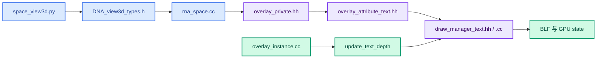
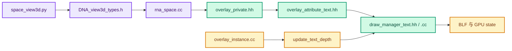

# 05 · 函数与数据结构速查

> 这是导航索引，不代替源码声明。
> 代码行号会随上游更新；优先通过函数名搜索。

---

## 1. 文件入口地图





```text
scripts/startup/bl_ui/space_view3d.py
source/blender/makesdna/DNA_view3d_types.h
source/blender/makesrna/intern/rna_space.cc
source/blender/draw/engines/overlay/overlay_private.hh
source/blender/draw/engines/overlay/overlay_attribute_text.hh
source/blender/draw/engines/overlay/overlay_instance.hh
source/blender/draw/engines/overlay/overlay_instance.cc
source/blender/draw/intern/draw_manager_text.hh
source/blender/draw/intern/draw_manager_text.cc
```

以上是两个提交涉及的 9 个跟踪文件。
`BKE_object.hh`、`BLI_math_geom_c.hh`、`ED_view3d.hh` 等属于被调用的现有 API。

## 2. 设置层

### `V3D_OVERLAY_VIEWER_TEXT_CULL_BACKFACES`

位置：`DNA_view3d_types.h`。
类型：`View3DOverlay.flag` 中的位。
值：`1 << 20`。
作用：保存用户开关状态。
局限：名称提到背面，但运行判断是深度遮挡。

### `viewer_text_cull_backfaces`

位置：`rna_space.cc`。
类型：RNA Boolean property。
绑定：`overlay.flag` 的上述位。
更新：`NC_SPACE | ND_SPACE_VIEW3D`。
动画：`PROP_ANIMATABLE` 被清除。
界面：`space_view3d.py` 中的 `Exclude Backfaces`。

### `State::viewer_text_cull_backfaces()`

位置：`overlay_private.hh`。
输入：当前 Overlay State。
输出：位测试布尔值。
调用方：`AttributeTexts::begin_sync()`。
不要把它当作每个点的可见性结果。

## 3. 属性文字收集层

### `AttributeTexts::begin_sync(Resources &, const State &)`

决定本轮是否收集属性文字。
读取开关并写入 `occlusion_test_`。
选择 pass 不收集这些显示文字。

### `AttributeTexts::object_sync(...)`

检查当前对象是否关联 Viewer 预览。
读取 `ObjectRef::preview_base_geometry()`。
如果有实例索引且实例属性包含 `.viewer`，优先走实例属性路径。
否则按对象类型转到 Mesh、PointCloud、Curve 等路径。

此函数的输入 `ObjectRef` 还提供实例相关信息。
当前实现使用 `object.object_to_world()`。
若要排查复杂 dupli，需与 `ob_ref.object_to_world()` 语义比较。

### `add_mesh_attributes_to_text_cache(...)`

读取网格 `.viewer` 与所在域。
按域读取 `position`。
角域使用 `calc_corner_text_position` 调整排版位置。
其余域直接把对应位置交给格式化入口。

### `add_pointcloud_attributes_to_text_cache(...)`

关闭遮挡时直接使用点位置。
开启时按每点半径生成世界空间锚点数组。
将数组与单位矩阵传给格式化入口。

### `add_instance_attributes_to_text_cache(...)`

把指定实例索引的单个 `.viewer` 值切成长度一的 `GVArray`。
原始位置是实例局部原点。
遮挡开启时尝试 AABB 射线出口偏移。
调用者仍通过统一格式化入口生成文本。

### `add_attributes_to_text_cache(...)`

曲线等对象的通用入口。
读取 `.viewer` 和同域 `position`。
没有曲线专用的自身半径前移。

### `add_values_to_text_cache(...)`

按运行时值类型转到静态类型分支。
组装 `DRW_TEXT_CACHE_GLOBALSPACE` 与可选遮挡标志。
格式化 bool、整数、浮点、向量、颜色、四元数、矩阵等。
可能为一个属性值加入多条文本字符串。

## 4. 通用文字 API

### `DRW_text_cache_create()` / `DRW_text_cache_destroy()`

创建与销毁 `DRWTextStore`。
当前 `Instance::begin_sync()` 每帧换新 store。
销毁后不能再访问原先的字符串或借用深度指针。

### `DRW_text_cache_add(...)`

保存字符串、三维位置、颜色、标志与二维偏移。
若没有 `DRW_TEXT_CACHE_STRING_PTR`，会复制文本到 allocator。
上游可传临时栈缓冲；缓存内部负责持久到绘制结束。

### `DRW_text_cache_needs_depth_test(DRWTextStore *)`

扫描缓存字符串。
任何一个带 `DRW_TEXT_CACHE_OCCLUSION_TEST` 即返回真。
调用方据此决定是否读回整张深度纹理。

### `DRW_text_cache_depth_set(DRWTextStore *, const ViewDepths *)`

向 store 提供借用的只读深度指针。
不复制、不释放数组。
调用方必须保证绘制前仍有效。
传 `nullptr` 取消本帧测试。

### `DRW_text_cache_draw(...)`

在 3D View 中投影每条字符串。
若有深度数据且该字符串带标志，执行像素比较。
被遮住时把 `sco[0]` 设为 `IS_CLIPPED`。
最终由 `drw_text_cache_draw_ex` 绘制未裁掉的文字。

### `text_anchor_project_with_depth(...)`

当前文件内的静态辅助函数。
把锚点投影到窗口 x/y，并输出归一化深度。
按近远平面与窗口范围检查有效性。
不是公开 API，不能从 Overlay 属性层直接调用。

## 5. 实例和视口层

### `Instance::begin_sync()`

取得相机位置和朝向。
重建本帧文字缓存。
让各 Overlay 层开始同步。

### `Instance::draw_v3d(...)`

3D View 的主要绘制编排。
在深度 prepass 后、grid 写入深度前调用 `update_text_depth()`。
之后完成其他 pass，并在后段调用 `draw_text()`。

### `Instance::update_text_depth()`

判断是否需要深度。
处理尺寸变化。
第一次分配或每帧覆盖 CPU 缓冲。
把结果指针交给 `DRWTextStore`。

### `Instance::draw_text(...)`

绑定输出 framebuffer。
将 GPU 深度测试设为 `GPU_DEPTH_NONE`。
调用通用文字绘制。
这里不进行 GPU 深度测试；前面的 CPU 检查负责决定字符串是否绘制。

## 6. 关键数据类型

### `ViewDepths`

定义在 `ED_view3d.hh`。
`w/h` 是 `unsigned short`。
`depths` 是行优先 float 像素数组。
`depth_range[2]` 是 double。
当前调用者使用 `ED_view3d_depths_free` 清理。

### `ViewCachedString`

内部缓存条目。
持有三维锚点、屏幕坐标、颜色、字符串视图与标志。
其 `sco` 是 short，超范围投影可能失败。
`IS_CLIPPED` 表示后续绘制应跳过。

### `DRWTextStore`

字符串容器加 allocator。
另有指向 `ViewDepths` 的借用指针。
没有每字符串独立的深度纹理。

### `Bounds<float3>`

`min/max` 组成局部轴对齐包围盒。
`contains(float3(0))` 判断实例原点是否在盒内。
不要把它当成实际网格表面。

### `GVArray` / `VArray`

`GVArray` 是运行时类型的虚拟数组。
`VArray<T>` 是已知值类型的虚拟数组。
实例路径先对 `GVArray` 做单元素切片。
通用格式化路径再按类型分派。

### `Array<float3>` / `Span<float3>`

点云前移时用 `Array` 拥有临时锚点内存。
格式化入口只需用 `Span` 读取。
不得让保存到文字缓存的字符串指向会提前销毁的临时文本；当前 API 会复制普通文本。

## 7. 数学与 GPU API

### `BKE_object_boundbox_get(const Object *)`

取得对象数据的局部包围盒。
不是整个场景、整个 Collection 的精确 bounds。
对象类型不同，内部计算路径也不同。

### `isect_ray_aabb_v3_simple(...)`

输入局部射线、盒 min/max。
可分别输出 `tmin`、`tmax`。
当前实例实现取 `tmax`，即原点在盒内时向相机穿出的一侧。

### `GPU_viewport_depth_texture(GPUViewport *)`

提供视口深度纹理。
需要核对其内容写入时序。

### `GPU_texture_read(texture, GPU_DATA_FLOAT, mip, dst)`

四参数形式覆盖调用者给定的 CPU 内存。
三参数形式返回新的 CPU 内存。
两者都涉及 GPU→CPU 传输。

### `ED_view3d_project_short_ex(...)`

返回绘制文本所用 short 屏幕坐标。
可检查 3D 剪裁、近裁剪、窗口边界。
深度比较另用 `text_anchor_project_with_depth` 再投影一次。

## 8. 值得再次核对的约束

1. RNA 位不能与现有位冲突。
2. 新功能关闭时不应额外回读深度。
3. `ViewDepths` 借用指针在绘制期间必须存活。
4. 缓冲尺寸要与纹理一致。
5. `s == 1.0` 的背景约定要与清屏值一致。
6. 透视与正交都要检查。
7. 点云世界坐标不应二次变换。
8. AABB 求交的 `tmax` 不能误写成 `tmin`。
9. 实例矩阵应与实际被绘制实例一致。
10. 文档和注释应反映现在的回读时机。
