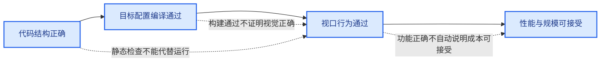
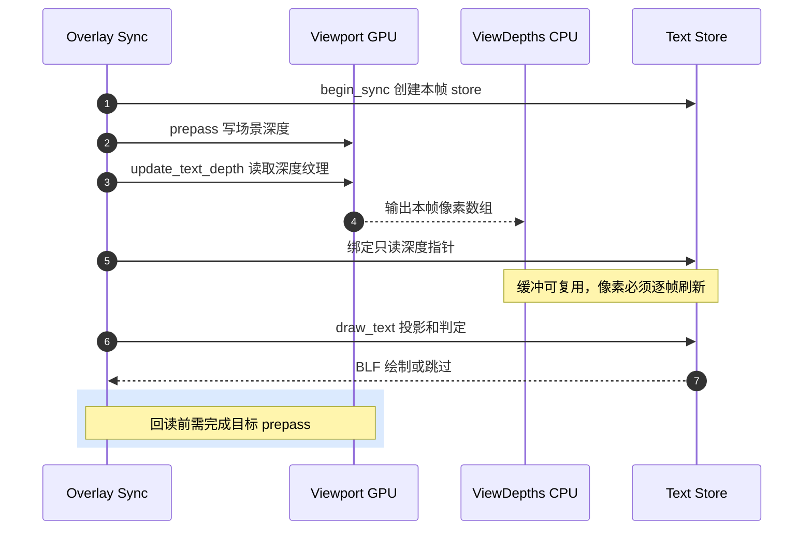

# 06 · 验证矩阵与性能评估

> 目标：每次改变遮挡算法，都能同时发现“误隐藏”和“误显示”。
> 本章是可执行检查计划，不宣称所有项目已经通过。

---

## 1. 三种不同的通过标准



### 编译正确

C++ 编译和静态库链接成功。
完整 `blender.exe` 链接成功。
Python UI 源码可解析。
这只说明实现可运行。

### 功能正确

需要显示的标签实际显示。
应被几何遮挡的标签实际隐藏。
点云、实例、曲线、网格各域的语义一致。
旋转、缩放、移动相机后结果仍稳定。

### 性能可接受

默认关闭时无显著额外成本。
开启后，CPU 帧时与 GPU 等待可接受。
大量文本不会因逐帧回读导致交互停顿。
内存不会因视口 resize 或频繁开关持续增长。

三个标准不可互相替代。
`bf_draw` 通过不等于视觉效果通过。
截图漂亮不等于大视口下交互流畅。

## 2. 先构造最小场景

### A. 单个网格平面

给点域输出连续编号。
固定相机从正面观察。
确认开关关闭时全显示。
开启时正面可见点应显示。
轻微旋转 1°、2°、5°，记录编号是否跳动。

### B. 前后两层平面

后层输出编号，前层提供可见遮挡。
先让两层相距较远。
后层标签应隐藏。
逐步缩小间距，观察固定容差何时让后层误显。
这能量化过大 epsilon 的副作用。

### C. 立方体棱与角

棱上、角上共享多个面。
旋转时 GPU 记录的最前面可能切换。
这对单像素采样最敏感。
记录具体会跳的点 ID，而不是只看整体截图。

### D. 小半径点云

给半径为 `0.01`、`0.1`、`1` 的点不同 ID。
确认每点使用自己的半径。
更改对象统一缩放，再更改非均匀缩放。
检查文字是否被自身圆盘挡住。

### E. 实例阵列

实例一个立方体并输出实例域编号。
先让原点在立方体内部。
测试透视与正交、平移与旋转。
然后把原型几何移离局部原点。
观察 `contains(local_anchor)` 不成立后的 fallback。

## 3. 几何类型测试表

| 类型 | 域/位置 | 视角 | 期望 | 实测 |
|---|---|---|---|---|
| Mesh | 点域内部 | 正面 | 显示 | 待填 |
| Mesh | 点域轮廓 | 轻微旋转 | 稳定显示或按真实遮挡变化 | 待填 |
| Mesh | 边域 | 斜面 | 只显示可见边 | 待填 |
| Mesh | 面域 | 前后重叠 | 后面隐藏 | 待填 |
| Mesh | 角域 | 多行值 | 同锚点各行一致 | 待填 |
| PointCloud | 不同 radius | 透视 | 各自不自遮挡 | 待填 |
| Curves | 点域 | 正交 | 遮挡一致 | 待填 |
| Instance | 原点盒内 | 透视 | 自身不遮挡 | 待填 |
| Instance | 原点盒内 | 正交 | 自身不遮挡 | 待填 |
| Instance | 原点盒外 | 透视 | 记录 fallback 行为 | 待填 |
| Instance | 中空原型 | 透视 | 记录 AABB 误差 | 待填 |

## 4. 相机和视口测试表

| 变量 | 取值 | 为什么要测 |
|---|---|---|
| 投影 | 透视、正交 | 射线定义不同 |
| 距离 | 近、中、远 | 像素 footprint 与深度变化不同 |
| 角度 | 正对、掠射 | 深度斜率差异 |
| 裁剪 | 常规、近平面附近 | 可能因 near clip 消失 |
| 视口尺寸 | 小、1080p、4K | 回读量与 `ViewDepths::w/h` |
| UI 缩放 | 常规、高 DPI | 文字位置与采样像素 |
| 工作模式 | Object/Edit | 深度 pass 可能不同 |
| 显示模式 | Solid、Material Preview | 深度来源可能不同 |
| Overlay grid | 开、关 | 排除一像素线干扰 |

每个失败样本应保留 `.blend`、具体点 ID、相机姿态和构建 hash。
若未保存相机姿态，下一轮很难复现“稍微一转就没了”。

## 5. 开关行为

先关闭 `show_viewer_text`。
无文字时 `DRW_text_cache_needs_depth_test` 应返回假。
再打开文字但关闭遮挡开关。
字符串应加入缓存，但不应触发深度回读。
最后打开遮挡开关。
确认读回仅在本阶段发生。

如果关闭遮挡仍读回整张深度，性能门控失效。
如果打开遮挡没有任何带标志字符串，则属性传递链可能断开。

## 6. 每帧缓存验证



在相机移动前后读取同一个像素地址并不够。
需要确认该像素值每帧由 GPU 更新。
可以在 `GPU_texture_read(..., dst)` 处断点。
记录调用帧号、纹理尺寸和相机矩阵。
相机移动后，应看到函数再次执行。

改变视口宽度和高度。
确认旧 `ViewDepths` 被释放。
确认新 `depths` 容量匹配新尺寸。
连续快速 resize 后检查崩溃与内存增长。

## 7. 实例数学验证样例

使用局部盒 `[-1,1]^3`。
实例原点 `(0,0,0)`。
相机位于世界 `+Z`。
统一缩放为 1。
期望局部锚点移到 `z=+1`。

相机改到 `-Z`。
期望局部锚点移到 `z=-1`。
绕世界 Y 旋转实例 90°。
期望世界空间前侧随实例旋转而变，但屏幕 x/y 仍在原点投影处。

原型几何从局部 `x=10` 开始。
原点在 bounds 外，期望当前实现跳过偏移。
这不是测试失败，而是记录已知 fallback。

## 8. 点云数学验证样例

统一缩放为 `s=2`。
`to_scale` 三个分量均为 2。
`length(to_scale) × 1/√3 = 2`。
半径为 `0.5` 的点应前移世界距离约 `1`。

非均匀缩放 `(1,2,3)`。
标量为 `sqrt(14/3)`，约 `2.16`。
这仅说明当前公式结果，不证明它等于真实椭球射线交点。
拍截图时把非均匀缩放写进测试记录。

## 9. 性能基线

先测 0 条 Viewer 文字。
再测 100、1000、10000 条。
分别测开关关闭与开启。
同一场景下只改一个变量。

记录：

| 量 | 如何理解 |
|---|---|
| 总帧时 | 用户感知的交互延迟 |
| GPU 回读耗时 | 同步点成本 |
| `DRW_text_cache_draw` CPU 时 | 投影与字符串循环 |
| BLF 字体绘制时 | 字体批处理/绘制成本 |
| 临时内存峰值 | 点云锚点数组等 |
| GPU texture 宽高 | 回读字节量 |

如果开启后帧时增加且与视口面积强相关，优先怀疑回读。
如果只与字符串数强相关，优先看逐条投影和 BLF。
如果实例数增加但文字数不变仍变慢，优先看包围盒与矩阵逆。

## 10. 静态检查与构建

当前项目有 Windows Ninja 构建目录：`E:/blender-git/blender_ninja_lite_debug`。
项目 build skill 指向 `rebuild.cmd -j8`。
修改少量 draw 源码时，可先构建 `bf_draw` 定位 C++ 编译问题。
但要测试新 exe，仍须完成可执行文件链接。

如果 `blender.exe` 正在运行，Windows 链接可能报 `LNK1168`。
这不是 C++ 编译错误。
未经用户授权不要结束正在运行的 Blender，因为可能有未保存工作。
得到用户授权后再结束对应路径的进程，并重跑链接。

格式化路径由项目 `AGENTS.md` 指定：

```text
E:/blender-git/blender/lib/windows_x64/llvm/bin/clang-format.exe
```

只改动含无关内容的文件时，仅格式化改动行。
`git diff --check` 用于发现空白错误。
编译成功后仍要做本章的视口测试。

## 11. 自动化测试的合理范围

可以对纯数学辅助函数做参数化测试。
例如局部盒内射线的 `tmax`、矩阵变换与正交方向。
但这类测试不能取代真实 GPU 深度、抗锯齿与 Blender 视口 pass 的验证。

截图对比也有局限。
同一像素的抗锯齿和字体绘制可能随机器变化。
建议用“具体点 ID 是否出现”和投影数值作为主判据。

## 12. 验证报告模板

```text
源码提交/工作树：
Blender 构建时间：
场景 .blend：
GPU 后端：
视口尺寸：
相机投影与距离：
Viewer 域和目标 ID：
开关关闭时：
开关开启时：
预期：
实际：
anchor_depth / scene_depth：
性能变化：
截图路径：
```

一份包含这些字段的失败报告，足以让下一轮修改有明确验证目标。
