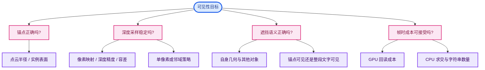
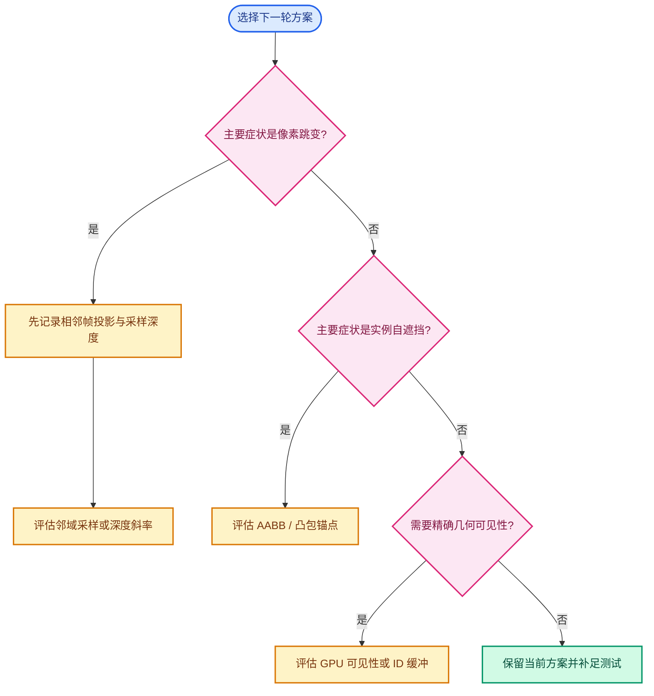

# 07 · 方案取舍与后续设计

> 本章讨论备选设计。
> 除明确标为“当前实现”的部分，其余都是方案分析，尚未写入当前分支。

---

## 1. 核心问题不是只有一个

“文字应该可见吗”包含几个不同判断：

1. 逻辑元素是否在相机前面。
2. 它投影到哪个像素。
3. 它自己的几何是否会盖住锚点。
4. 其他几何是否挡住它。
5. 文字矩形跨越多个像素时，按锚点还是整块矩形定义可见。

当前分支解决了其中一部分。
它用单张深度图处理第 4 项。
点云半径和实例 AABB 近似处理第 3 项。
它仍把第 5 项定义为“只看锚点”。

## 2. 方案 A：维持当前单像素深度

### 优点

代码路径短。
对网格、曲线、点云、实例共用一套最终判定。
不需要跨对象构造 BVH。
关闭开关时没有回读成本。

### 缺点

一个像素只有一个最近深度值。
顶点和像素中心位置不同。
轮廓变化时结果可能不稳定。
自身表面和外部遮挡无法仅凭深度区分。

### 合适场景

文字稀疏、几何相对平滑、相机移动不剧烈。
如果用户要求精确识别高密度网格点，则此方案限制会明显暴露。

## 3. 方案 B：改进深度采样

可以使用局部斜率、亚像素位置、有限邻域。
它直接针对像素中心与锚点位置不一致。
但邻域像素可能属于不同表面。
没有对象 ID 时，无法可靠知道哪个像素来自同一物体。

### 固定容差

最容易实现。
近处与远处、平面与轮廓使用同一数字，不够稳健。
容差变大时，后方点透出来。

### 斜率容差

平滑面上有理论直觉：一个像素内的深度变化与局部斜率相关。
共享顶点附近并无单一斜率。
旧实验已证明它并未充分解决用户的近距离场景。

### 邻域可见性

可以检查围绕锚点的多个像素。
但简单选最深深度会让背景像素错误地放行隐藏文字。
曾经尝试 3×3 最大值，用户要求撤回。
后续受限近邻实验也未达到预期。
若再使用这类方案，应首先明确遮挡边缘的判定规则。

## 4. 方案 C：沿视线偏移锚点

当前点云和实例已经使用它。
点云有明确的半径。
实例有可快速求交的 AABB。

网格点却没有同样明确的“向相机偏移多远”。
偏移太小仍自遮挡。
偏移太大会跨过真实前景。
靠相机距离推导一个像素世界长度并非完整答案，因为前景间隙可比该长度更小。

### 将显示位置与测试位置分离

若不希望移动文字三维锚点，可以在缓存结构中增加独立测试锚点。
显示锚点仍取原几何位置。
深度锚点取可见表面或保守外壳。
此设计表达更清楚，但要修改 `ViewCachedString` 和 `DRW_text_cache_add` API。
多行文字还要确认两种锚点如何共享。

## 5. 方案 D：针对网格点做局部几何求交

已知当前点所属网格。
从相机到该点发射射线。
用附近面片确定该点是否在自身可见表面。
可避免单像素覆盖的部分问题。

但“附近面片”如何选择不是简单索引查询。
共享顶点可能连接多张面。
它们在屏幕上的前后关系随视角变化。
对象还可能有变形、实例和非均匀缩放。
若每个点每帧都对全网格 BVH 做射线查询，大量文字时 CPU 成本可观。

一个折中是只对单像素深度判为遮挡、但差值接近阈值的点做几何二次验证。
这能减少查询数量。
仍需定义 BVH 的缓存与正确几何来源。

## 6. 方案 E：GPU 原生可见性

把每个文字锚点作为可绘制的点提交 GPU。
用当前深度缓冲测试点是否通过。
然后把可见性结果用于文字绘制。

优点是 GPU 侧深度比较与光栅化规则一致。
缺点是仍有“锚点在自身几何内部”的问题。
点云与实例的前移逻辑仍需要保留。
若要 CPU 绘制字体，还需把可见性从 GPU 回读，可能再次引入同步成本。
可考虑把文字也改走 GPU 路径，但这超出当前功能的局部改动范围。

## 7. 方案 F：对象或实例 ID 缓冲

深度只告诉我们最前表面有多近。
ID 缓冲可以告诉我们是谁占了这个像素。
如果是文字所属对象，可给自身遮挡特殊处理。
如果是另一个对象，保留真实遮挡。

但一个对象内部仍可能有前后多层几何。
对象 ID 不足以区分同一对象自己的前后表面。
实例 ID 的粒度更好，但资源与绘制路径成本更高。
透明材质、X-Ray、in-front 对象的语义也要定义。

## 8. 方案 G：场景 BVH

沿视线到锚点求最近交点。
理论上可以处理任意三角形表面。
如果 BVH 包括其他物体，也能处理跨对象遮挡。

实际成本包括：

- 实例原型复用与变换。
- 多层嵌套实例的遍历。
- 动态几何更新与缓存失效。
- 大量点/边/面文字每帧的射线数。
- 曲线、点云、体积等非三角形几何的统一处理。

旧 BVH 分支已存在，不应把它描述成“做不到”。
它只是与当前深度路线有不同成本与复杂度。
若考虑混合路线，可让深度负责一般情况，BVH 仅处理少量歧义锚点。

## 9. 实例从 AABB 升级到凸包

AABB 是长方体。
凸包更贴合外形，可减少包围盒入口过早的问题。
但凸包仍无法保留凹槽和孔洞。
构建凸包需要额外缓存、顶点集合或面集合。
变形和程序生成几何会让缓存失效问题复杂化。

对实例域文字，可以先测 AABB 错误出现的频率。
若典型原型是方块和简单凸体，升级收益可能很小。
若典型原型是中空机械件，凸包仍未必满足精确度要求。

## 10. 如何选择下一步

### 先回答三个问题

1. 用户最在意“可见点不丢”还是“被挡点绝不透出”？
2. 典型视口文字数量与视口分辨率是多少？
3. 问题主要在轮廓、近距离，还是所有距离？

不同答案会改变方案排序。
高密度顶点且要求交互帧率，不能轻易引入每点场景 BVH 射线。
严格要求遮挡无误显，就不能简单采用邻域最大深度。
多数场景只需改善实例文字，则应局限修改实例锚点，不扩展通用文本 API。

### 决策表

| 主要目标 | 优先验证 | 避免先做 |
|---|---|---|
| 减少轮廓缺字 | 记录具体 ID 的像素覆盖 | 盲目加大固定 bias |
| 减少实例自遮挡 | 检查 bounds、变换和原点 | 重写全部字体系统 |
| 控制帧时 | 测量 GPU readback | 仅凭代码行数估算 |
| 保证后方点隐藏 | 前后重叠场景回归 | 邻域最深值无约束放行 |
| 支持任意几何 | 定义每种几何的可见性语义 | 假设所有对象都是 Mesh |

## 11. 推荐的工程节奏

第一步：建立可复现 `.blend` 与目标 ID。
第二步：用日志或调试器确认失败层次。
第三步：只实现一种变化，并保留对照构建。
第四步：测试“漏显”和“透显”两组相反场景。
第五步：测不同数量文字的帧时。
第六步：记录方案的可接受边界。
第七步：再决定是否合入。

当前已贮藏的斜率/近邻实验不应未经复测直接提交。
文档应保留其失败原因，避免以后重复同样的无目标尝试。
