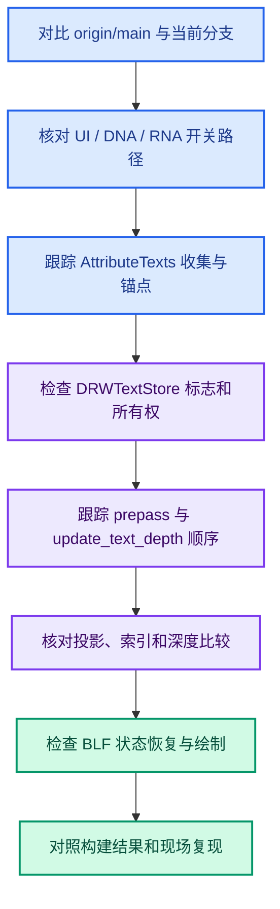

# 08 · 代码导读与安全修改点

> 逐段解释当前实现的“为什么在这里”。
> 本章不是一份可直接替换源码的补丁。

---

## 1. 从分支 diff 开始

基于 `origin/main` 对比两个提交。
不要把 stash 或 `.markdown` 目录算入代码 diff。
第一个提交建立通用深度遮挡框架。
第二个提交只针对实例锚点做特殊处理，并伴随格式调整。

阅读 diff 时先看“新增标志如何被传递”，再看“深度如何供应”。
这样可避免误以为 GPU 深度回读在每个属性值上单独调用。

## 2. `AttributeTexts::begin_sync`

`enabled_` 同时考虑是否正在 selection pass 以及属性文字开关。
`occlusion_test_` 独立读取深度遮挡开关。
这两个布尔值意义不同。
前者决定是否收集文字。
后者决定已收集文字是否带测试标志。

若后者为真而前者为假，本帧不会产生该 Overlay 的属性文字。
因此也不会因为这些属性文字触发深度回读。

## 3. `AttributeTexts::object_sync`

先检查 `enabled_`。
再检查 `preview_base_geometry()` 是否存在。
没有 Viewer 预览就提前返回。
接着取得 `object` 和对象矩阵。

若 `preview_instance_index() >= 0` 且实例属性含 `.viewer`，优先显示实例域值。
函数随后返回，不再为这个 `ObjectRef` 显示子几何值。
这种早退保证实例域文字不与子对象的点/边/面文字混合。

非实例域路径按 `object.type` 分派。
Mesh、PointCloud、旧 Curve、新 Curves 分别取自己的绘制数据。
其他对象类型没有文字路径。

### 可维护性问题

`object_to_world` 目前来自 `object.object_to_world()`。
复杂 dupli 可能由 `ObjectRef` 提供不同的实例矩阵。
如遇实例文字与实际对象位置不一致，应先记录两者，再决定是否改。
不要在没有复现的情况下把所有对象矩阵调用替换一遍。

## 4. `add_values_to_text_cache`

入口参数包括 store、值虚拟数组、位置 Span、对象矩阵和遮挡布尔值。
函数先取得主题文字颜色。
根据布尔值组合通用文字标志。
然后利用 `to_static_type` 将运行时类型映射到 C++ 模板分支。

每个值索引都按对象矩阵变到世界坐标。
随后按类型转成一个或多个字符串。
字符串被传给 `DRW_text_cache_add`。

### bool

输出 `True` 或 `False`。
不会因为布尔值为 false 就不画。

### int8 / int

输出十进制整数。
如果截图里看到连续 ID，多数来自这类值。

### float

使用 `%g` 表示法。
数值宽度随内容变化，密集时更容易重叠。

### 向量与颜色

拆为多行。
所有行共享同一个三维锚点。
所以某一行因深度被裁而另一行没被裁，通常意味着缓存或标志传递有问题。

### 四元数与矩阵

四元数输出 W/X/Y/Z。
矩阵先分解出位置、旋转、缩放。
这使一个属性值可占多行，文本框高度会变大。
当前遮挡仍仅测试锚点，不测试文本框整个范围。

## 5. `add_text_to_cache` 与 `add_lines_to_cache`

单行函数把 `align_center` 设为真。
多行函数根据 UI 字号计算行高。
`center_offset` 让多行围绕锚点排布。
`xoffs/yoffs` 是屏幕空间偏移，不参与深度投影。

这个区别在调试截图时非常重要。
数字在屏幕上的像素位置，可能不同于被测试的锚点像素。
标签的左上角不一定是深度采样点。

## 6. `DRW_text_cache_add`

创建 `ViewCachedString`。
普通字符串会被复制进 store 的 allocator。
若调用者显式设置 `DRW_TEXT_CACHE_STRING_PTR`，则按指针引用并要求生命周期正确。
属性文字目前用普通复制路径。

它保存的是三维位置，不立即投影。
相机矩阵在后续绘制阶段才被使用。
这允许同一帧先收集所有文字，再统一做深度测试。

## 7. `Instance::begin_sync`

`view.viewinv().location()` 给 `state.camera_position`。
`view.viewinv().z_axis()` 给 `state.camera_forward`。
点云与实例锚点偏移都依赖这些字段。

随后销毁旧文字 store 并创建新 store。
属性文字层在本帧 object sync 期间向新 store 加入字符串。
深度缓存对象则不是每帧都重新分配。

## 8. `Instance::draw_v3d`

这是 Overlay 的绘制编排。
深度 prepass 写入本帧场景可见性。
`update_text_depth()` 在 prepass 后执行。
它早于可能写深度的 grid/axes。
后续 `draw_text()` 才真正画字。

此顺序的设计目的有两个：

1. 回读时深度已存在。
2. 回读时一像素装饰线尚未污染深度。

修改 pass 顺序时，必须把这两个目的写在代码评审里。

## 9. `Instance::update_text_depth`

它有门控、尺寸管理、回读、指针设置四段。
门控失败时清除 store 的深度指针并释放已有缓存。
尺寸变化时重建数组。
尺寸不变时复用数组，但仍从 GPU 刷新内容。
最后把缓存借给当前 store。

该函数同步的是整个 viewport depth texture。
它不是按文字位置逐像素调用 `GPU_texture_read`。
若文字只有一个，仍可能回读整张纹理。

## 10. `DRW_text_cache_draw`

先区分 3D View 与 2D View。
3D View 使用 `rv3d->persmat` 或 `persmatob` 投影。
每条字符串先由 `ED_view3d_project_short_ex` 确定是否在有效投影范围。
随后，仅带遮挡标志且有深度数组的字符串会再次投影取得深度。

采样坐标是投影得到的连续 `xy` 转整数。
`scene_depth` 从 CPU 数组按 `y*w+x` 取得。
若它不是背景且锚点比它远超过 `2e-5`，设 `IS_CLIPPED`。

`tot` 统计未被裁掉的字符串。
若为零，可跳过后面的字体绘制。
二维 View 路径不走这套 3D 深度测试。

## 11. `drw_text_cache_draw_ex`

只绘制 `sco[0] != IS_CLIPPED` 的条目。
根据颜色决定轮廓对比度。
`align_center` 时用 BLF 测量字符串宽高，再调整二维偏移。
根据 `shadow` 开关设置字体阴影。
最后用 `BLF_draw_default` 绘制。

因此屏幕上字的位置是 `sco + xoffs/yoffs`。
深度测试仍使用 `vos.vec` 所投影的锚点。
若长文本跨过其他几何，当前实现不会逐字符遮挡。

## 12. 实例 AABB 代码逐步读法

第一步：把实例值切成一个元素。
第二步：设局部锚点为零。
第三步：只有遮挡开启才考虑偏移。
第四步：取对象数据的局部 bounds。
第五步：确认原点在盒内且矩阵可逆。
第六步：求相机方向并变回局部。
第七步：射线与盒求交，取向相机穿出的 `tmax`。
第八步：透视情况下确认交点在原点到相机之间。
第九步：把新局部锚点送入通用格式化入口。

变量 `entry_distance` 名字会误导。
当前参数位置拿到的是出口参数。
重命名时要保留 `tmax` 输出槽位。

## 13. 哪些修改容易造成回归

### 修改 `DRW_text_cache_add` 的字符串所有权

上游大量代码依赖临时格式化缓冲能被复制。
取消拷贝可能造成悬空 `StringRef`。

### 修改文字标志的枚举值

标志在多个通用文字调用方共享。
要检查是否与已有位冲突。

### 修改深度纹理读取时机

要重新评估 grid/axes、prepass 和 in-front 层。

### 修改锚点矩阵

点云数组已是世界坐标。
实例锚点仍是局部坐标。
二者不能交换传给格式化入口的矩阵。

### 增大全局 epsilon

可见点可能增加，同时被遮挡点也可能误显。
必须用前后两层几何场景一起验证。

## 14. 安全的调试插桩

选一个会消失的整数 ID。
只对该 ID 记录世界锚点、投影 xy 和场景深度。
若 ID 格式化前就不存在，转查 `.viewer` 的域与实例索引。
若投影函数失败，记录 near/far、窗口尺寸和矩阵。
若深度比较失败，记录 `anchor_depth - scene_depth`。
若比较通过但画面看不见，记录 `sco`、颜色、BLF 绘制顺序。

针对单个 ID 插桩比打印所有点更安全，也更容易关联两帧。
实验结束后移除插桩，不把日志留进提交。

## 15. 提交前复核

确认当前工作树不含已撤回的 stash 实验。
确认修改过的 C/C++ 行用项目指定的 `clang-format.exe` 格式化。
确认 `git diff --check` 没有空白错误。
确认 `bf_draw` 编译，再确认 `blender.exe` 链接。
确认典型场景的可见点、隐藏点都符合期望。
记录性能与边界行为。
