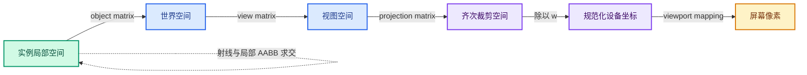
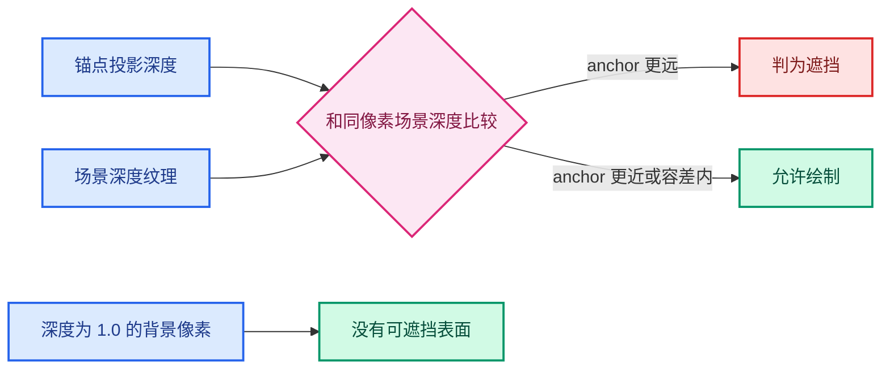

# 09 · 坐标空间与深度数学专题

> 本章专门解释容易在代码审查中混淆的“位置、方向、参数、深度”。
> 所有公式均基于当前投影约定；更改 GPU 后端或深度约定时需重新核对。

---

## 1. 四种坐标空间



### 1.1 对象局部空间

网格顶点、对象数据 bounds 通常在这里。
实例 AABB 的 `min/max` 也在这里。
局部原点是 `(0,0,0)`。
对象矩阵负责把它送到世界空间。

### 1.2 世界空间

不同对象的锚点汇合后，需要在同一空间比较与投影。
`DRW_TEXT_CACHE_GLOBALSPACE` 表示文字缓存的 `vec` 是世界坐标。
点云前移后的 `anchors` 已在世界空间。
实例前移后的 `local_anchor` 仍在局部空间，稍后才乘矩阵。

### 1.3 裁剪与 NDC 空间

投影矩阵得到齐次四元组。
除以 `w` 后得到 NDC。
近平面和远平面由裁剪坐标中的范围判断。
这里的 `z` 不是世界空间的米数。

### 1.4 屏幕像素空间

浮点 `fx/fy` 是连续像素坐标。
整数 `x/y` 是纹理采样坐标。
屏幕文字的 `xoffs/yoffs` 又是以像素为单位的排版偏移。
三者不能混为一个位置。

## 2. 点和方向为何用不同变换

一个点可写作齐次 `(x,y,z,1)`。
一个方向可写作 `(dx,dy,dz,0)`。
矩阵的平移列只影响点，不影响方向。

点云中心使用 `math::transform_point(object_to_world, position)`。
实例射线方向使用 `math::transform_direction(world_to_object, toward_camera)`。
如果方向误用点变换，会把对象平移也加入射线，求交结果不再有几何意义。

### 例子

对象平移为 `(10,0,0)`。
局部点 `(1,0,0)` 应变到世界 `(11,0,0)`。
局部方向 `(1,0,0)` 仍应指向世界 `+X`，不应变成 `(11,0,0)`。

## 3. 透视投影的同射线不变性

设相机坐标系中，投影简化为：

```text
screen_x ∝ X/Z
screen_y ∝ Y/Z
```

从相机中心把点按正比例缩放：

```text
(X,Y,Z) → (kX,kY,kZ), k > 0
```

则 `X/Z`、`Y/Z` 不变。
所以沿相机到原点的射线移动实例标签，屏幕位置不变。
只有深度值变化。

现实实现还受近远裁剪、浮点舍入和矩阵约定影响。
如果新点越过近平面，投影函数可能直接裁掉文字。

## 4. 正交投影的同方向不变性

正交投影的屏幕 x/y 只取视图平面上的两个分量。
沿视线方向移动不会改变这两个分量。
因此同样可利用锚点前移改变深度而保留屏幕位置。

注意正交“相机位置”不是透视的有限射线起点。
实例代码在正交情况下使用 `camera_forward`。
这也是它不使用透视 `<1` 参数门槛的原因。

## 5. 为什么 `t` 不是距离

射线参数化：

```text
R(t) = O + t D
```

如果 `D` 已归一化，`t` 的数值可与空间距离相同。
如果 `D` 长度为 10，那么 `t=0.5` 代表沿射线走 5 个局部长度单位。
当前实例方向没有归一化。
因此 `entry_distance` 虽然叫 distance，其数值实际上是参数。

这个参数仍可正确计算交点。
只要同一个 `D` 同时用于求交和 `O+tD`。
最危险的改法是只归一化其中一处。

## 6. 透视实例参数 `t=1`

当前世界方向是：

```text
D_world = camera_position - world_center
```

于是世界射线满足：

```text
R_world(0) = world_center
R_world(1) = camera_position
```

对象矩阵可逆时，变回局部空间保留这个参数关系。
所以 `tmax < 1` 表示盒出口位于原点与相机之间。
它不是固定世界长度阈值。
相机移动后 `D_world` 变长，`tmax` 相应缩小，但交点不变。

## 7. 深度范围与比较方向



当前代码把 NDC z 映射为：

```text
depth = 0.5 × (ndc_z + 1)
```

一般情况下近处深度更小，远处更大。
场景深度记录当前像素最前面的表面。
如果锚点深度明显大于场景深度，锚点在其后。

```text
anchor_depth > scene_depth + bias
```

这是当前判断式。
`bias` 是归一化深度单位，不是世界长度。
它在不同距离处对应的世界空间距离不相同。

## 8. 为什么近处和远处容差行为不同

透视投影的深度对距离通常非线性。
同样的世界空间深度差，靠近相机时可能产生更大的 depth 差。
越远处，有限的深度分辨能力和浮点路径差异可能更明显。
所以一个固定 `2e-5` 不能被解释为全视距相同的“表面厚度”。

这段话不等于证明当前纹理是 D24。
本分支请求的格式名是 `SFLOAT_32_DEPTH_UINT_8`。
实际数值分析应读取具体锚点和场景深度，而不是套用通用深度教材的格式假设。

## 9. 像素中心与顶点的差异

锚点投影到 `(fx,fy)`。
代码将其转到整数 `(x,y)`，读这一格的深度。
该格深度对应 GPU 样本位置，通常在像素中心附近。
如果锚点位于像素角落，它和样本点可相差近半个像素宽度与高度。

对深度变化平缓的正面面片，这个差异很小。
对斜面和轮廓，差异可能足以跨过 `2e-5`。
如果邻近像素属于不同物体，单靠平面斜率无法可靠推回锚点真实深度。

## 10. 屏幕排版与测试点不一致

一个字符串的锚点可能投影到 `(500,300)`。
文字居中后，它实际覆盖 `(480..520, 294..306)` 等像素。
当前方案只采样锚点对应的一格。
不会逐字符比较文字矩形的深度。

这是有意的定义。
若改成“任何一个字被挡就整条隐藏”，视觉行为会大变。
若改成“每个像素单独裁字”，字体渲染路径会复杂许多。

## 11. 局部 AABB 与世界 OBB

在局部空间，bounds 沿 X/Y/Z 三轴对齐，所以是 AABB。
经过对象旋转后，在世界空间它不再沿世界轴对齐。
可以把它理解为一个随对象转动的盒子。
代码选择把射线变回局部空间，是为了继续使用简单 AABB 求交。

若直接把局部 `min/max` 当世界坐标使用，旋转实例会出错。
若先求八个世界角再建立新的世界 AABB，则盒子通常变大，近似更粗糙。

## 12. 盒内穿出与盒外进入

当射线起点在盒内，`tmin` 往往为负，`tmax` 为正。
朝相机方向的前表面对应 `tmax`。
当前代码使用它。

当原点在盒外，就需要先确定射线是否朝盒子走。
`tmin` 此时可能是进入点。
但“实例文字仍居中”的语义不一定要求把盒外原点移动到盒子上。
当前实现选择跳过，不做推测。

## 13. 奇异矩阵与负缩放

若缩放某轴为零，矩阵可能不可逆。
不能安全计算 `world_to_object`。
代码用行列式绝对值门槛避免求逆。
负缩放会改变行列式符号，但取绝对值后仍可允许非奇异矩阵。

门槛 `1e-20` 只防明显退化。
接近奇异但大于门槛的矩阵仍可能数值不稳定。
可用极端缩放场景验证。

## 14. 点云的标量尺度为何是近似

统一缩放时，`sqrt(s²+s²+s²)/sqrt(3)=|s|`。
非均匀缩放时，各方向上的圆盘世界半径不同。
用一个标量只能选择某种平均尺度。
当前公式对应平方均值意义上的尺度。
它适合与现有绘制半径约定对齐，不代表精确的三维椭球表面交点。

## 15. 遮挡正确性需要两个方向

只测试可见点，会诱使开发者不断增加容差。
只测试隐藏点，会诱使开发者过度收紧容差。
两类场景必须并列记录。

| 锚点真实状态 | 程序显示 | 判定 |
|---|---|---|
| 可见 | 显示 | 正确 |
| 可见 | 隐藏 | 误剔除 |
| 被挡 | 隐藏 | 正确 |
| 被挡 | 显示 | 漏剔除 |

本功能的难点是同时减少两种错误。
局部数学更精确，不一定能替代完整场景语义。

## 16. 使用数学推导的边界

推导证明的是某个模型中的几何性质。
最终渲染还取决于材质、抗锯齿、深度 pass、in-front 模式和 GPU 后端。
因此文档同时保留公式与实际测试矩阵。
不要用一个简化公式为所有屏幕截图下结论。
