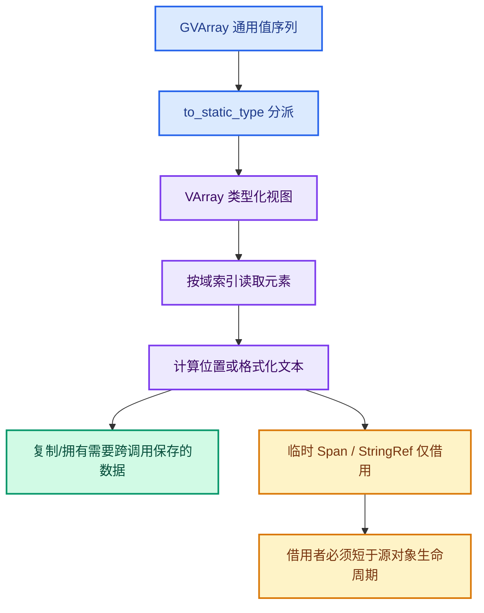

# 10 · C++ 类型、生命周期与并行上下文

> 本章说明为何这项功能看似只是深度比较，却牵涉多个 Blender 基础库类型。

---

## 1. `GVArray`：值类型运行时才知道



Viewer 的 `.viewer` 可以是布尔、整数、浮点、向量、颜色、四元数或矩阵。
属性读取入口无法在编译时固定一个 C++ 类型。
`GVArray` 提供运行时类型与按索引取值的统一视图。

实例域只需某个 `instance_index` 的值。
代码调用 `varray.slice(IndexRange(instance_index, 1))`。
切片后仍是运行时类型数组，但长度为一。
它让实例值复用通用格式化函数，不必为实例复制所有类型分支。

### 风险

切片索引必须与预览实例索引一致。
索引越界或预览源不匹配会在类型分派前出问题。
修改实例遍历时应先核对 `preview_instance_index()` 的来源。

## 2. `to_static_type` 与 `VArray<T>`

`bke::attribute_math::to_static_type(values.type(), lambda)` 把运行时类型映射到模板参数 `T`。
在 lambda 里，`values.typed<T>()` 取得 `VArray<T>`。
后续 `if constexpr` 分支只实例化对应的类型操作。

这是一种“运行时选择类型，编译时生成实现”的模式。
它的好处是格式化代码可以直接使用 `value.x`、`value.r` 等类型成员。
代价是模板分支多，编译诊断可能很长。

新增属性类型时，应检查：

1. `to_static_type` 是否会分派到它。
2. 是否有对应 `if constexpr` 分支。
3. 输出缓冲大小是否足够。
4. 单行或多行排版是否合理。
5. 所有分支是否透传遮挡标志。

## 3. `Span`：只读借用

`Span<float3>` 只提供范围与索引，不拥有元素内存。
网格位置通常由 Mesh 或临时数组持有。
点云偏移位置由本函数的 `Array<float3>` 持有。

`add_values_to_text_cache` 立即遍历位置并把最终三维值复制到 `ViewCachedString`。
因此点云临时数组在调用返回后释放是可行的。
若未来把此函数改成异步执行，就必须重新审视 `Span` 生命周期。

## 4. `Array<float3>`：点云锚点的拥有者

开启遮挡时，按点数创建临时数组。
每个点写入移动后的世界坐标。
数组大小与 `positions.size()` 一致。
它的成本与点数线性相关。

若点数非常大，临时内存峰值可见。
一种优化是按点即时格式化，不建完整数组。
但这会改变现有通用格式化入口，并可能重复类型分派。
优化前应测量，而不是凭“数组看起来大”就改结构。

## 5. `std::optional<Bounds<float3>>`

不是所有对象都能给出有效包围盒。
`BKE_object_boundbox_get` 返回 optional。
先检查 `bounds` 再访问 `bounds->min/max`。
这使空几何不需要一个虚假的零体积盒。

当前实例路径若没有 bounds，就保留原点。
这个 fallback 简单但可能仍自遮挡。
不能把 optional 空值当成“对象不可见”的证明。

## 6. `StringRef` 与文本所有权

格式化时常用 `char numstr[64]` 等栈缓冲。
`StringRef` 只是字符串视图，不拥有这段字符。
如果把该视图直接存到下一绘制阶段，栈缓冲会失效。

`DRW_text_cache_add` 默认把字符串复制进 `string_allocator`。
因此这些临时缓冲可以安全地在格式化分支结束时销毁。
如果设置 `DRW_TEXT_CACHE_STRING_PTR`，就改为引用指针。
这种路径要求调用者保证字符存活到实际绘制后。

### 不要误改

把普通字符串路径改为零拷贝，看起来可节省内存。
但上游多数调用者可能仍传栈上临时数组。
除非逐个审计生命周期，否则会引入随机乱码或崩溃。

## 7. `LinearAllocator` 的作用

本帧所有字符串的拷贝可一起管理。
随 `DRWTextStore` 销毁而释放。
不需要为每个短字符串做独立 `free`。
它配合“每帧重建 store”的设计。

缺点是本帧高峰内存通常在 store 销毁前不会单独回收某条文字。
大量高维属性值可产生许多行文字，应测峰值。

## 8. `ViewDepths` 的借用与清理


`ViewDepths` 中的 `depths` 指针指向 CPU 像素数组。
`Instance` 持有这个结构体。
`DRWTextStore` 只存 `const ViewDepths *`。
`const` 限制文字绘制侧意外修改像素，并不代表获得所有权。

`ED_view3d_depths_free` 负责释放该结构体及其内部数组。
如果用普通 `MEM_delete` 只删除外层，可能泄漏像素内存。
如果 store 和 Instance 都释放，会双重释放。

## 9. 两种 `GPU_texture_read` 重载

三参数版本分配并返回新数组。
四参数版本写入调用者给的 `dst`。
当前代码首次调用三参数版本。
后续尺寸不变时调用四参数版本。

两者的核心效果都是得到当前帧 GPU 深度。
四参数版本不意味着“无需 GPU 回读”。
省掉的是每帧 CPU 数组重新分配。

## 10. `MEM_new_zeroed` 与字段初始化

第一次创建 `ViewDepths` 时，零初始化防止未设字段含随机值。
随后显式设置 `w/h`、`depths`、`depth_range`。
尺寸记录还存在 `Instance` 自己的 `int` 字段里。

需要注意 `ViewDepths::w/h` 只有 16 位。
即使外层缓存宽高用 `int`，存入内层时仍可能窄化。
常规视口不触及 65535，但这属于数据类型事实。

## 11. `const_cast` 的上下文

`update_text_depth()` 用 `const_cast<ARegion *>(state.region)` 调用 `WM_draw_region_get_viewport`。
原因是被调接口接受非 const 指针，而 State 持有 const 指针。
这不自动意味着函数实际修改了 region。
但它降低了接口层面的 const 保证。

若要消除此转换，应先确认被调函数行为，再考虑调整接口 const 性。
不宜在无证据时仅凭语法把整个 State 改成可变指针。

## 12. 位标志的组合

文字标志是 `short` 位集合。
`DRW_TEXT_CACHE_GLOBALSPACE` 总是加入属性文字。
遮挡开启时再或入 `DRW_TEXT_CACHE_OCCLUSION_TEST`。

```text
flags = GLOBALSPACE | (enabled ? OCCLUSION_TEST : 0)
```

通用文字系统还使用 LOCALCLIP、STRING_PTR 等位。
新增位时应确认没有重叠。
如果误把遮挡标志加到所有通用文字，可能使对象名称、测量文字也跟着消失。

## 13. 角域并行计算

Mesh 角域位置需要按面访问角和邻角。
代码用 `threading::parallel_for(faces.index_range(), 512, ...)`。
各线程处理不同面。
每个角属于确定的面范围，写 `corner_positions[corner]`。

并行安全依赖于这些输出索引互不冲突。
若未来改成一个顶点汇聚多个角的结果，不能沿用无锁写入模式。
面法线 Span 等输入只读，适合并行访问。

## 14. `IndexRange` 的语义

`IndexRange(instance_index, 1)` 表示从该索引开始、长度为一。
第二个参数不是结束索引。
误写成 `IndexRange(0, instance_index)` 会取得不同的数据区间。

Mesh 的 `faces[face_index]` 也是一个角索引范围。
`face_corner_prev/next` 在该范围内定位前后角。
理解范围起点和长度，是阅读锚点生成代码的前提。

## 15. 矩阵类型的值与引用

`const float4x4 &object_to_world` 在 `object_sync` 中引用对象矩阵。
实例路径求逆时生成一个新 `float4x4 world_to_object` 值。
点云路径传 `float4x4::identity()` 作为临时值，供同步调用使用。

不要把临时 identity 的引用存进长寿命缓存。
当前通用格式化函数立即使用矩阵，不保存引用。

## 16. `std::max(radii[i], 0.0f)` 的意义

半径为负不应把锚点推入圆盘背面。
夹零提供明确的保守行为。
这不是对 NaN 的完整处理。
若数据包含非有限值，仍应由更上游的数据有效性约束处理。

## 17. 不同对象类型的数据读取

Mesh 通过 `DRW_object_get_data_for_drawing<Mesh>`。
PointCloud 也用其对应类型。
旧 Curve 取 `curve_eval` 的 wrap。
新 Curves 取 `geometry.wrap()`。

这种分派是 Blender 不同几何表示的现实差异。
把所有对象强行走 Mesh 路径会丢失曲线和点云语义。

## 18. 为什么这个功能适合分层维护

属性层知道值和域。
Overlay Instance 层知道绘制顺序和 GPU 资源。
通用文字层知道投影与 BLF。
每层只持有完成自身任务所需的信息。

若某个新方案要求在文字层访问 Mesh 的面拓扑，就要慎重考虑接口扩散。
若某个新方案要求属性层直接回读 GPU，也会破坏绘制时序分工。
先说明要跨层传递的最小信息，再改 API。
