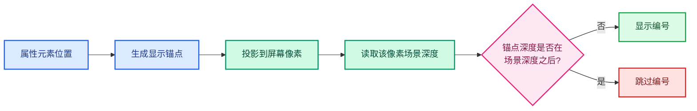
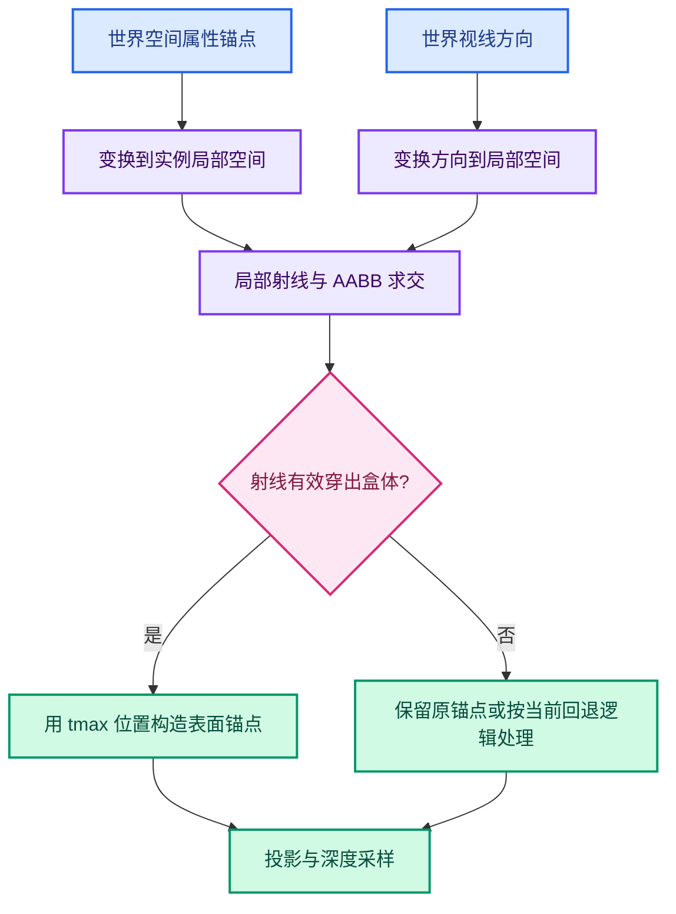

# 11 · 实例化推演与数值例题

> 以下数值用于解释代码分支，不是项目实测数据。
> 每例都明确输入、计算、结果和适用边界。

---

## 例 1：可见表面点



假设锚点深度 `a = 0.500010`。
对应像素的场景深度 `s = 0.500000`。
固定容差 `b = 0.000020`。

```text
a > s + b ?
0.500010 > 0.500020 ? false
```

文字显示。
这就是固定 bias 试图保护的“锚点恰在表面”情形。
注意 `a` 与 `s` 不完全相同，仍可放行。

## 例 2：真正被前景挡住

锚点 `a = 0.60`。
前方物体在同屏幕像素写入 `s = 0.40`。

```text
0.60 > 0.40 + 0.00002 → true
```

字符串被标为 `IS_CLIPPED`。
即使其文本矩形延伸到前景外，当前实现也整条不画。

## 例 3：像素中心造成的误剔除

锚点是立方体表面的一个顶点。
顶点投影落在 `(100.95, 80.10)`。
代码取 `x=100, y=80`。
该像素中心在 `(100.5, 80.5)` 附近。

相机旋转后，中心样本可能落在更靠前的一片面。
假设 `a=0.50010`、`s=0.50004`。

```text
0.50010 > 0.50004 + 0.00002 → true
```

文字消失。
锚点本身未必真的被挡住。
这是单像素深度与连续顶点可见性不完全等价的例子。
改大容差可放行此点，但可能同时放行相距很近的真正后方点。

## 例 4：背景像素

若采样深度 `s == 1.0`，当前代码直接认为没有遮挡。
锚点深度只要通过投影裁剪，就不会因深度测试隐藏。
这不等于文字一定可见：后续 BLF 颜色、其他 UI 覆盖仍影响视觉结果。

如果一条文字在背景处不出现，先看投影或缓存，不要只盯着深度比较式。

## 例 5：为什么旧帧缓存错误很大

帧 A 中锚点投影到像素 `(500,300)`。
帧 B 相机平移后，同一世界点投影到 `(520,300)`。
若帧 B 仍用帧 A 的深度数组，读取 `(520,300)` 对应的是旧视角下别的射线。
差值不再能解释为浮点误差。
它可能是完全不同的背景或前景。

当前代码每帧覆盖数组，所以这个具体问题已修正。
不要把所有剩余跳动继续归因于它。

## 例 6：grid 一像素线

本来几何深度为 `0.52`。
grid 线若后来写入 `0.30`，锚点深度 `0.52` 会被判遮挡。
即使线只是屏幕装饰，也会影响 CPU 深度测试。
把回读安排在 grid 之前，就取得几何深度 `0.52`。

这是绘制顺序解决问题的例子。
增加 bias 不合适，因为 `0.22` 差距太大。

## 例 7：点云自遮挡

局部点位于 `(0,0,0)`，半径为 `0.5`。
对象统一缩放 2 倍。
渲染圆盘的世界半径近似为 1。
如果直接把中心当锚点，它可能位于圆盘可见表面之后。

当前算法计算世界中心，再沿中心到相机方向前移约 1。
世界锚点仍位于同一投影射线。
文字屏幕位置大体保留，深度更接近圆盘前表面。

## 例 8：实例 AABB 穿出



局部盒 `[-1,1]^3`。
原点在盒内。
相机方向在局部空间为 `(0,0,4)`。

```text
R(t) = (0,0,4t)
盒前侧 z=1 → tmax=0.25
新锚点 = (0,0,4×0.25) = (0,0,1)
```

变量名 `entry_distance` 在此处很不准确。
它接收的是穿出参数。
如果有人把输出槽位从 `tmax` 改成 `tmin`，会得到负值并跳过偏移。

## 例 9：透视相机位于盒内部

保持盒 `[-1,1]^3`。
相机位于局部 `(0,0,0.2)`。
局部方向是 `(0,0,0.2)`。
盒前侧 `z=1` 对应 `tmax=5`。
当前透视判断要求 `tmax<1`，因此不会移动锚点。

这不是“盒出口超过一米”。
`t=1` 对应相机自身，盒表面在相机之后。
移动文字到相机背后的盒表面没有想要的效果。

## 例 10：原点在盒外

假设几何盒为 `x∈[10,12]`，其他轴 `[-1,1]`。
局部原点 `(0,0,0)` 不在盒内。
当前代码不进行 AABB 前移。
实例域文字仍在对象原点。

若文字与实际几何分离，这是坐标语义选择。
不能简单把锚点改为盒中心，因为会改变实例域文本的屏幕位置。
应先确认产品期望：标签跟原点，还是跟实例可见几何。

## 例 11：多行颜色值

`ColorGeometry4f` 可能格式化为 R/G/B/A 四行。
四个 `ViewCachedString` 具有相同 `vec`。
它们的 `yoffs` 不同。
深度比较用相同锚点，所以四行应同进同出。

视觉上，四行可能跨越模型边缘。
即使最下方一行写在另一物体上，当前方案也不会单独裁那一行。

## 例 12：近处两个物体几乎贴合

前物体深度 `s=0.50000`。
后物体标签深度 `a=0.500015`。
固定容差 `0.000020`。

```text
a > s + b ? false
```

后面的标签会显示。
这是容差的必然代价：差距小于 bias 时，判定无法同时保护表面锚点和严格区分前后层。
因此评估修改时必须有“前后贴合”反向测试。

## 例 13：文字已通过测试却看不见

假设 `s=1.0`，深度测试直接通过。
但同一区域上百个数字重叠。
较晚绘制的数字可能盖住较早绘制的数字。
肉眼只看到一片白色笔画。

此时应在 `drw_text_cache_draw_ex` 检查该 ID 是否实际进入 `BLF_draw_default`。
不能把视觉拥挤误判为深度剔除。

## 例 14：基于数值例题设计回归

每次改 bias，至少重新跑例 1、2、3、12。
每次改锚点，至少重新跑例 7、8、9、10。
每次改绘制顺序，至少重新跑例 5、6。
每次改字体排版，至少重新跑例 11、13。

这些例题让代码改动有明确的正反检查。
真正场景仍需保存 `.blend`、相机和目标 ID。
