# 12 · 术语表与常见误解

```mermaid
flowchart LR
  ANCHOR[锚点] --> PROJ[屏幕投影]
  PROJ --> PIXEL[单像素深度采样]
  PIXEL --> COMPARE[与锚点深度比较]
  COMPARE --> LABEL[决定绘制整段文字]
  AABB[AABB 包围盒] --> RAY[局部射线求交]
  RAY --> ENTRY[实例表面锚点]
  ENTRY --> ANCHOR
  classDef point fill:#DBEAFE,stroke:#2563EB,color:#1E3A8A,stroke-width:2px;
  classDef depth fill:#D1FAE5,stroke:#059669,color:#064E3B,stroke-width:2px;
  classDef bounds fill:#FEF3C7,stroke:#D97706,color:#78350F,stroke-width:2px;
  class ANCHOR,PROJ,LABEL point;
  class PIXEL,COMPARE depth;
  class AABB,RAY,ENTRY bounds;
```

> 用统一术语描述问题，能减少“那个点为什么没了”式沟通成本。

---

## AABB

Axis-Aligned Bounding Box，轴对齐包围盒。
在对象局部空间由 min/max 两点定义。
当前实例偏移沿视线取射线穿出 AABB 的位置。
它包含模型但可能包含很多空空间。

## OBB

Oriented Bounding Box，有朝向的包围盒。
局部 AABB 经对象旋转到世界空间后，看起来就是随对象转动的盒子。
当前代码通过把射线转回局部空间避免显式构造世界 OBB。

## 凸包

包含所有顶点的最小凸集合。
通常比 AABB 贴近模型，但仍填补凹槽和孔洞。
不等于精确三角形外壳。

## BVH

Bounding Volume Hierarchy，层次包围体加速结构。
适合射线与几何求交。
它能提高查询效率，但建树、更新和实例变换仍有成本。

## 锚点

代表某个属性值的三维位置。
当前遮挡测试基于锚点，而不是整个文字矩形。
点云与实例会在特定情况下前移锚点。

## 自遮挡

文字锚点被自己所属几何的可见表面盖住。
点云中心和实例原点是典型情况。
单张深度纹理没有对象身份信息，无法天然区分自遮挡与外部遮挡。

## 误剔除

本应可见的标签被隐藏。
截图中随视角轻微变化消失的点可能属于此类。
必须用具体点 ID 和三维遮挡关系确认。

## 漏剔除

本应被挡住的标签仍显示。
过大的 bias 或不受限邻域取最深值可能造成此问题。

## `.viewer`

Geometry Nodes Viewer 的属性名。
属性域和值类型决定文字数量与位置。
名字存在不代表对应对象一定进入当前 Overlay 预览路径。

## 属性域

值与几何元素的对应关系。
Mesh 可有点、边、面、角等域。
实例域的一个值对应一个实例，不对应实例里的每个顶点。

## 角域

Mesh 面角，也称 face corner。
一个顶点可在不同面拥有多个角。
角域文字位置需要排版偏移，不能简单等同点域位置。

## `ObjectRef`

Draw 系统里的对象引用上下文。
它包含对象、dupli、预览实例等信息。
复杂实例场景里，引用的变换语义值得与 `Object::object_to_world()` 对照。

## `ViewDepths`

CPU 侧的视口深度容器。
它的 `depths` 是 float 数组，`w/h` 为 unsigned short。
当前 `Instance` 持有并管理其生命周期。

## GPU depth texture

GPU 侧视口深度资源。
当前代码从 `GPU_viewport_depth_texture` 取得。
它的内容随每帧和绘制顺序变化。

## depth readback

把 GPU texture 的深度值传到 CPU 内存。
可能成为 CPU/GPU 同步点。
四参数重载复用内存，但仍要传输本帧数据。

## prepass

在后续叠加层绘制前写入几何深度的 pass。
当前文字回读安排在这之后。
别把所有 Overlay pass 都叫 prepass。

## grid / axes

视口网格和坐标轴叠加层。
可产生一像素线，并在特定 pass 写入深度。
当前回读刻意安排在其前面。

## NDC

Normalized Device Coordinates，透视除法后的标准化坐标。
当前锚点深度从 NDC z 映射到 `[0,1]`。

## 裁剪坐标

世界锚点乘投影矩阵后的齐次坐标。
近平面和远平面测试发生在此阶段。
不要把裁剪坐标 z 直接当 GPU depth 数值。

## 像素中心

GPU 深度样本对应的屏幕采样位置。
它不一定与连续投影出的几何顶点重合。
轮廓闪烁的分析必须考虑这个区别。

## depth bias

比较中容许锚点略微位于场景深度之后的量。
当前固定为 `2e-5` 归一化深度单位。
它不是米，也不是一个固定像素宽度。

## `IS_CLIPPED`

文字屏幕坐标的特殊哨兵值。
投影失败或深度判定为遮挡时可赋给 `sco[0]`。
实际 BLF 绘制循环会跳过它。

## BLF

Blender 的字体绘制接口。
遮挡决定先于 `BLF_draw_default`。
所以“看不见”也可能发生在深度判断之外的排版或颜色阶段。

## RNA

Blender 对属性和脚本 API 的描述层。
当前开关通过 RNA 暴露成布尔属性。
RNA 负责通知重绘，不负责实际遮挡算法。

## DNA

Blender 的持久数据结构定义层。
当前开关占 `View3DOverlay.flag` 的一个位。
它使视图设置能随文件保存。

## Stash

Git 暂存实验工作区修改的机制。
本分支有一个针对 `draw_manager_text.cc` 的斜率与近邻实验 stash。
它不是 HEAD 代码，也不应被文档当成已提交功能。

## `tmin` / `tmax`

射线进入与离开 AABB 的参数。
射线起点在盒内时，向前穿出通常对应正的 `tmax`。
当前 `entry_distance` 变量实际接收它。

## 透视与正交

透视投影沿相机中心发散的射线投影。
正交投影沿平行方向投影。
点云和实例锚点前移的方向选择因而不同。

## X-Ray 与 in-front

特殊视口显示模式或对象前置显示。
它们可改变几何深度的来源及用户对“遮挡”的期望。
文档没有宣称当前实现对所有组合都已验证。

## “格式名是 32 位浮点”与“精度问题”

两句话并不冲突。
格式名指出请求的纹理类型。
精度问题还包括矩阵运算、插值、像素采样和后端转换。
不能只凭格式名证明没有误差，也不能忽略格式名硬称 D24。

## “编译通过”与“体验正确”

编译只验证源码可以生成二进制。
视觉行为需要可复现视口测试。
性能需要帧时测量。
本分支的近距离文字消失问题仍属于待解决行为。
