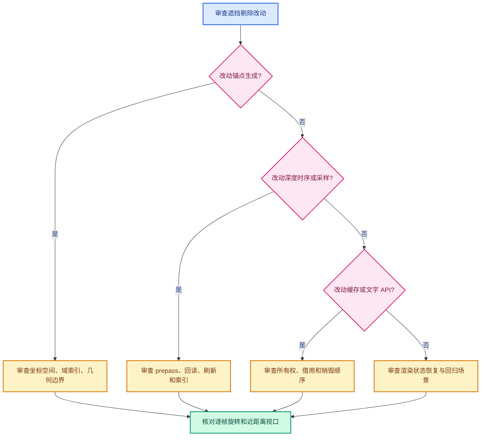

# 13 · 代码审查问答

> 用问答固定最容易被误改的决定。
> 每个回答限定在当前分支快照，不替代运行时验证。

---

## Q1：为什么不直接让 BLF 使用 GPU 深度测试？

当前文字在通用文本绘制阶段通过 BLF 画出。
它并不是以每个属性锚点为独立三维 fragment 来绘制。
直接打开 GPU 深度测试不能自动解决“整串文字何时隐藏”。
点云中心与实例原点的自遮挡也仍存在。
要走 GPU 方案，需要重新定义文字几何、深度与可见性回传。

## Q2：为什么 `draw_text()` 里设置 `GPU_DEPTH_NONE`？

因为当前方案先在 CPU 判断每个字符串锚点。
通过者按普通 Overlay 文字绘制。
若同时让字体像素再做 GPU 深度测试，可能造成字符被几何切碎。
这与“整条标签显示或隐藏”的当前语义不同。

## Q3：为什么每帧读深度，却还保留 `text_depth_cache_`？

保留的是 CPU 内存分配与宽高。
每帧调用读回覆盖其像素内容。
避免每帧重新分配完整数组。
若只在尺寸变化时读回，会重新引入相机移动错配。

## Q4：开关关闭是否还有回读成本？

设计意图是没有带遮挡标志的字符串就不回读。
`DRW_text_cache_needs_depth_test` 扫描文字缓存。
默认关闭时，应停在 `update_text_depth` 门控分支。
实际性能仍要用 profiler 验证。

## Q5：为什么点云要先变到世界坐标？

半径偏移方向依赖相机世界位置。
若在局部空间随便加一个向量，会受对象旋转、缩放影响。
代码先求世界中心，再按世界视线移动。
传单位矩阵是为了防止通用函数再次变换。

## Q6：实例为什么使用 AABB 而不是三角形表面？

AABB 可快速取得并以常数级成本求交。
精确表面需要选择实例对应几何、维护加速结构并处理动态更新。
当前实现选择轻量近似，已知在凹形、中空模型上可能误显。
是否升级应看真实场景的错误频率与帧时预算。

## Q7：`entry_distance` 为何不能直接改求 `tmin`？

射线起点在盒内部。
沿向相机方向的出口在正 `tmax`。
`tmin` 通常是相反方向的负值。
可以把变量重命名为 `exit_parameter`，但不能交换输出槽位。

## Q8：透视 `<1` 是不是“偏移不能超过 1 米”？

不是。
方向向量从实例世界原点直指相机位置。
该参数化里 `t=1` 就到相机。
判定的是盒出口是否位于原点与相机之间。

## Q9：为什么有两次投影？

第一次沿用通用 View3D 投影 API，取得 short 屏幕坐标和裁剪状态。
第二次需要保留浮点 xy 与锚点深度。
这有重复计算和未来漂移风险。
是否合并应同时保留现有裁剪语义与深度输出。

## Q10：重复投影是否已经证明导致 1 像素错误？

没有。
需要记录两次投影的实际 x/y 与取整结果。
存在两次计算只能证明维护复杂度增加。
“必然偏移 1 像素”是过度断言。

## Q11：为什么不把 `2e-5` 改成 `1e-3`？

容差变大可减少可见点误剔除。
同时也会让深度差很小的后方点透出。
这个数字是归一化深度，不是一个固定世界距离。
任何修改必须同时跑可见点和前后贴合几何测试。

## Q12：`SFLOAT_32_DEPTH_UINT_8` 是否证明完全没有精度问题？

不证明。
它说明代码请求的纹理格式。
CPU/GPU 运算、光栅化位置和像素覆盖仍有差异。
但不能据旧文档假设把本纹理说成 D24。

## Q13：为什么近距离数字很多时不好凭截图判断？

多条标签可能占据相同屏幕区域。
后绘制的文字可能覆盖前面的文字。
字体轮廓和背景颜色也影响可辨认性。
应针对一个已知 ID 检查是否进入 `BLF_draw_default`。

## Q14：为何不把斜率与近邻实验提交？

用户实际复测后仍发现近距离点消失，效果不符合目标。
实验已独立贮藏，当前分支保持已提交的基线。
这样后续可复查代码，又不会把尚未验证的行为混进当前实现。

## Q15：文档为何在 Git status 里看不到？

项目 `.gitignore` 忽略以点开头的 `.markdown` 路径。
这套文档是本地文件，正常 `git status` 不列出。
若需要版本化，应先确认项目意图，再选择明确的跟踪方式。
不要误以为 `git status` 干净就代表文档不存在。

## Q16：如何确认下一版修复确实更好？

固定一个可复现 `.blend`、相机姿态和点 ID。
记录旧版与新版在显示帧、消失帧的 `anchor_depth` 与 `scene_depth`。
再跑一个真正被挡住的反向样例。
最后测开关关闭/开启的帧时。
只有误隐藏、误显示和性能三者都有证据，才能判断取舍。
