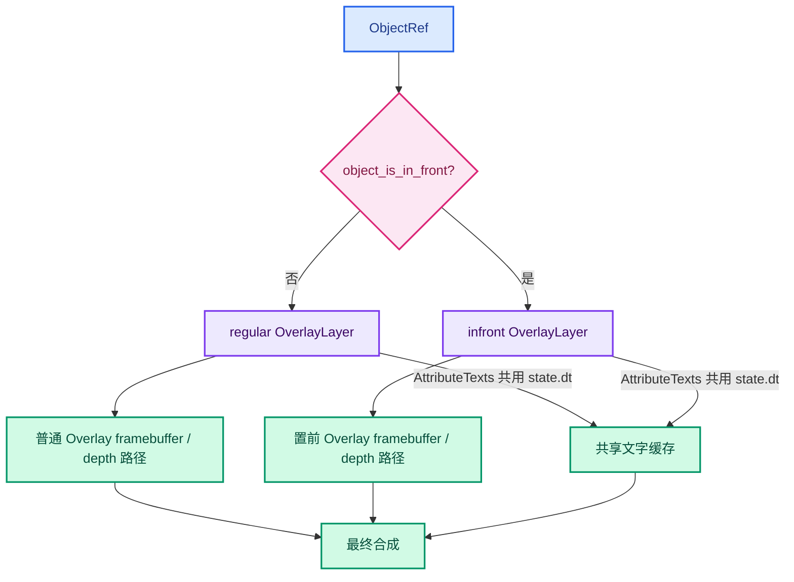
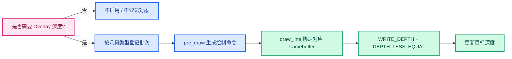
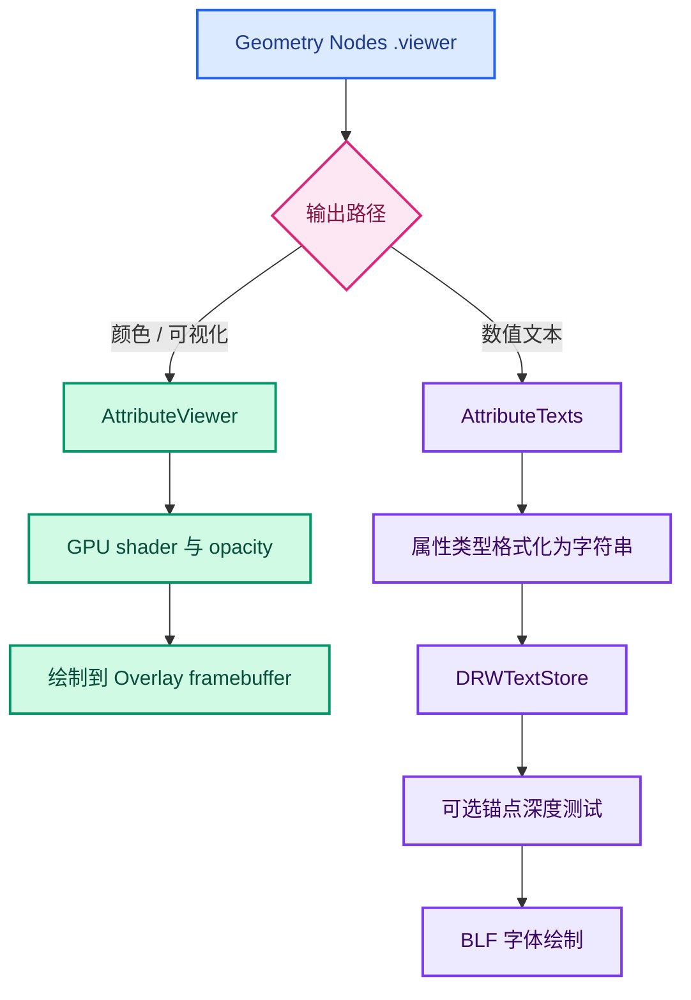
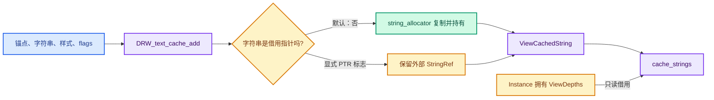
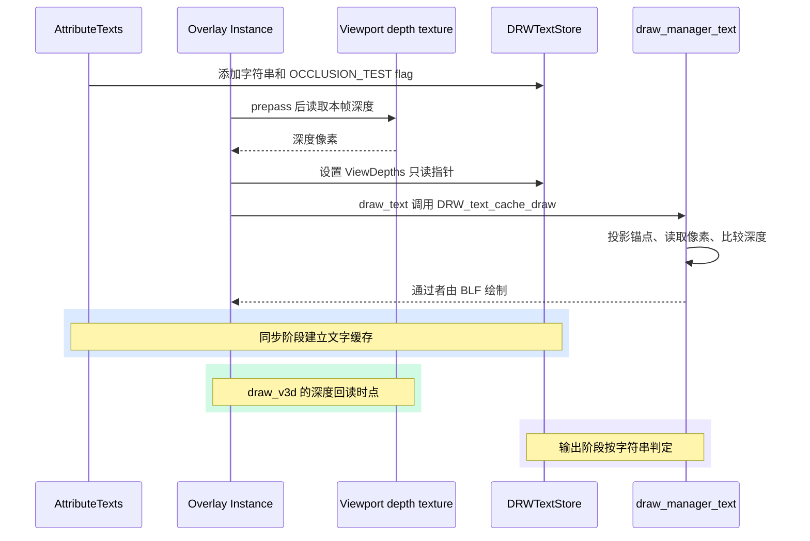
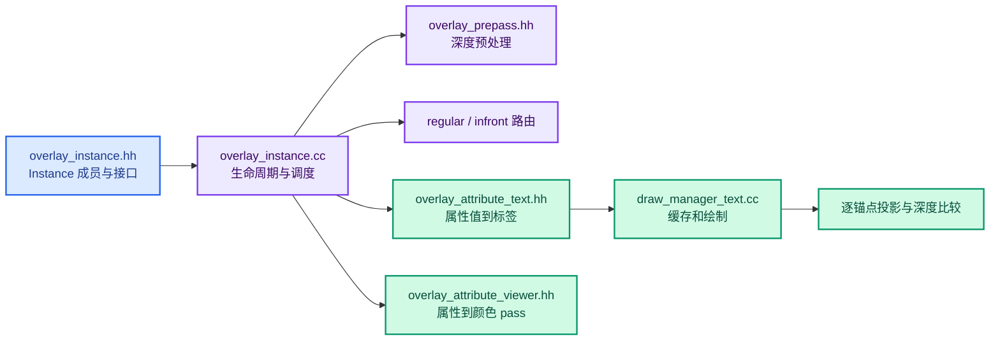
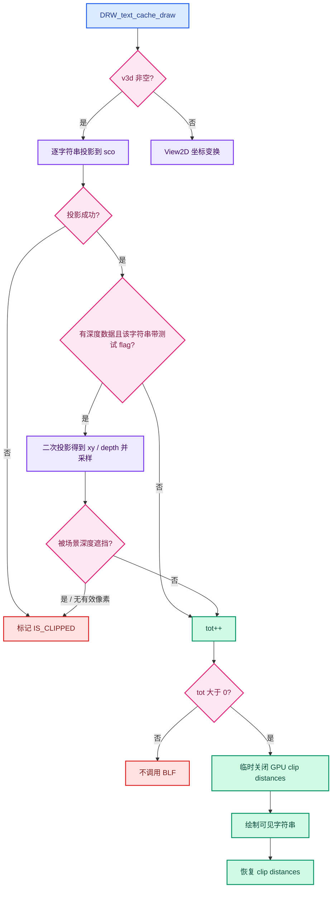

# 14 · Overlay `Instance`、prepass 与 Viewer 属性绘制

> **代码快照**：`attribute-text-depth-culling`，提交 `eb97266f783`。
> **阅读入口**：`overlay_instance.hh:57`、`overlay_instance.cc`、`overlay_attribute_text.hh:46`、`overlay_attribute_viewer.hh:26`、`draw_manager_text.cc:68-91`。
> 本章解释当前工作树中这些文件的职责与调用关系。代码行号会随 Blender 上游变更。

---

## 1. 先建立整体概念

`Instance` 是 Overlay 引擎的协调对象。它记录当前绘制所需的状态，收集场景对象的数据，调用子模块生成绘制命令，并按照 framebuffer 与 pass 的依赖顺序提交它们。

它通常不亲自生成网格、曲线或文字顶点，而是把任务分发给 `Meshes`、`Prepass`、`AttributeViewer`、`AttributeTexts`、`Grid` 等子系统。理解它，关键是跟住三个阶段：**同步收集、预处理、分 pass 绘制**。


## 2. `Instance` 声明逐项看

类定义位于 [`overlay_instance.hh`](../../source/blender/draw/engines/overlay/overlay_instance.hh) 第 57 行：

```cpp
class Instance : public DrawEngine
```

它实现 `DrawEngine` 的生命周期回调：`init()`、`begin_sync()`、`object_sync()`、`end_sync()`、`draw()`。渲染管理器在适当阶段调用这些函数，Overlay 不需要自行建立一套独立的场景循环。

### 2.1 构造顺序和核心成员

| 成员 | 职责 | 为什么放在 `Instance` |
|---|---|---|
| `selection_type_` | 标记普通 Overlay 或选择 ID 绘制 | 多个子模块需要据此选择 shader / 提交方式 |
| `clipping_enabled_` | 记录当前 View3D 是否启用裁剪 | 初始化资源和裁剪状态时使用 |
| `shapes` | 可复用形状缓存 | 各 Overlay 图元共享几何资源 |
| `resources` | GPU 资源、shader、全局 buffer 等 | 是许多子模块共同使用的底层资源 |
| `state` | 当前 scene、view、region、模式和开关的快照 | 让各模块用同一份本帧状态作判断 |
| `regular`、`infront` | 两个 `OverlayLayer`，分别收集普通与置前绘制内容 | 许多模块需要针对两类深度关系各自同步、提交 |
| `grid`、`anti_aliasing`、`xray_fade` | 跨图层或最终输出相关模块 | 不是单个对象私有的图层数据 |

成员初始化顺序按头文件中的声明顺序进行。`resources` 初始化时引用 `selection_type_` 和 `shapes`，因此它们先声明、先构造。`OverlayLayer` 也带有自己的 `selection_type_`，传给 armature、bounds、camera 等子模块。

`Instance()` 把选择类型设为 `DISABLED`；带参数的构造函数用于选择绘制路径。类注释提到，选择引擎复用 Overlay 的大部分实现，通过选择 ID 与专用 shader 绘制可选组件。

### 2.2 `OverlayLayer` 为什么成对存在

`regular` 与 `infront` 不是“场景对象的前半部分和后半部分”，而是**同一套 Overlay 子模块的两份绘制状态**。某个对象由 `object_is_in_front()` 判断应该路由到哪一份。

普通图层遵循通常的场景深度关系；置前图层通过单独的 in-front framebuffer / depth 路径绘制，让标记为 `OB_DRAW_IN_FRONT` 的对象 Overlay 显示在普通对象前面。它改变的是相应 Overlay 绘制路径的深度关系，不是把物体几何真的移动到相机附近。

不是每种数据都在视觉上被拆成两份。例如 `AttributeTexts` 两个图层实例最终都把文字写到共享的 `state.dt`；最终文字集中在输出阶段绘制。不要仅凭它是 `OverlayLayer` 成员，就推断每种输出都有独立文字缓存或独立的文字深度图。



**重要边界**：`regular/infront` 是 Overlay 模块的路由和绘制目标概念。文字遮挡检测读取的是 `update_text_depth()` 取到的 viewport depth texture；不能未经验证就把它等同于每个 Overlay framebuffer 的深度，也不能假设每个 `infront` 对象都会获得一份单独的文字遮挡结果。

### 2.3 生命周期回调

| 回调 | 主要工作 | 是否立即画到屏幕 |
|---|---|---|
| `init()` | 读取 `DRWContext`，填充 `state`，初始化资源、裁剪和显示开关 | 否 |
| `begin_sync()` | 重建本帧文字缓存，通知全局模块与两套图层开始收集 | 否 |
| `object_sync()` | 对每个 `ObjectRef` 判断模式、图层和对象类型，登记各模块数据 | 否 |
| `end_sync()` | 通知需要收尾的模块结束同步，确保 in-front 深度目标配置 | 否 |
| `draw()` | 可见性/pre-draw、资源 acquire、submission，并按空间类型分派 | 是，进入绘制流程 |

`init()` 中 `state.show_text` 对 View3D、Image Editor 等空间分别计算。选择绘制和 depth-only 绘制不会像普通 View3D Overlay 那样显示文字。`state.hide_overlays` 也会影响后续是否同步很多 Overlay 模块。

`begin_sync()` 会销毁旧的 `state.dt` 并创建新的 `DRWTextStore`。这意味着字符串和锚点按帧重新生成；深度 CPU 缓冲 `text_depth_cache_` 则由另一段生命周期管理，可以重用内存，但内容每帧回读刷新。

`object_sync()` 先评估对象处于什么模式，以及是否需要 `prepass`，随后选择 `regular` 或 `infront`。之后它依条件调用各个模块的 `object_sync()`。Viewer 颜色和 Viewer 文本虽都依赖 `.viewer`，却是两个不同模块、两种输出。

`end_sync()` 中创建 `depth_in_front` 并配置 framebuffer 是为了满足绘制目标的资源配置要求。它不等于在此处执行了场景几何的深度绘制。

## 3. `prepass` 究竟是什么

这里的 `Prepass` 是 Overlay 的**深度预处理 pass**，定义在 [`overlay_prepass.hh`](../../source/blender/draw/engines/overlay/overlay_prepass.hh) 的 `class Prepass`。它用深度 shader 绘制需要参与深度关系的几何表面，主要写 depth，不负责正常着色。注释还指出它用于选择非 overlay-only 对象。

它解决的问题是：后续 Overlay 绘制需要一个可用的几何深度时，先把有关表面深度准备好。它不是文字绘制本身，也不是每帧无条件重画整个场景深度。

### 3.1 哪些情况下需要

`Prepass::begin_sync()` 会根据空间和 Xray / selection 状态决定是否启用。`Instance::object_needs_prepass()` 再决定单个对象是否需要登记进 pass。主要情形包括：

1. 选择或 depth picking 通常需要深度；带 `OB_HIDE_SURFACE_PICK` 的对象会被排除。
2. 某些绘制模式下，paint overlay 或 in-front 对象需要补充深度关系。
3. 未启用 Xray 且渲染引擎没有可供 Overlay 使用的可靠深度时，可能需要 Overlay 自己补绘。
4. Xray 会改变一般的 prepass 启用条件；selection 是其中的特殊路径。

具体判断请看 [`object_needs_prepass()`](../../source/blender/draw/engines/overlay/overlay_instance.cc)；不能简单概括成“所有对象都做 prepass”。另外，render engine 已经提供可用深度时，Overlay 会尽量复用，避免重复绘制。

### 3.2 它登记什么、写什么

`Prepass` 内有 mesh、flat mesh、hair、curves、point cloud、Grease Pencil 等子 pass。`begin_sync()` 配置 `DRW_STATE_WRITE_DEPTH` 和 `DRW_STATE_DEPTH_LESS_EQUAL`，再按几何类型选择深度 shader。同步对象时，几何批次被登记到相应子 pass。

绘制时 `pre_draw()` 生成命令，`draw_line()` 绑定传入的 framebuffer 并提交 pass。函数名里的 `draw_line` 是 Overlay 现有 pass 组织方式的一部分；从这里的 state 可以看出它的核心目标是写深度，而不是画可见的表面颜色。



在 View3D 的 `draw_v3d()` 中，regular 和 infront 各自的 prepass 会画到对应的目标。接着 `update_text_depth()` 在 grid 和 axes 写入自己的深度之前读取 viewport depth。这个调用顺序是当前文字遮挡实现依赖的时序边界。

## 4. 两个 `.viewer` 模块不是一回事

Overlay 有 `AttributeViewer` 和 `AttributeTexts` 两个模块，它们都从 Geometry Nodes Viewer 的 `.viewer` 数据工作，但输出方式不同。

| 类 | 源码 | 输入如何显示 | 主要绘制机制 |
|---|---|---|---|
| `AttributeViewer` | [`overlay_attribute_viewer.hh`](../../source/blender/draw/engines/overlay/overlay_attribute_viewer.hh) | 按属性生成几何着色 / 颜色叠加 | GPU pass、viewer shader、opacity、深度测试 |
| `AttributeTexts` | [`overlay_attribute_text.hh`](../../source/blender/draw/engines/overlay/overlay_attribute_text.hh) | 把属性值格式化成每点、每面等位置的文字 | 将字符串写进 `DRWTextStore`，之后统一投影并由 BLF 绘制 |

可以把它们理解为“同一份 Viewer 数据的可视化颜色层”和“数值标签层”。隐藏一种输出不代表另一种输出一定关闭；它们有不同开关、pass 和同步流程。



## 5. `AttributeTexts` 的工作

声明位于 [`overlay_attribute_text.hh:46`](../../source/blender/draw/engines/overlay/overlay_attribute_text.hh)。`begin_sync()` 决定当前帧是否启用属性文字，并读取文字遮挡开关：

- 非选择绘制，并且 `state.show_attribute_viewer_text()` 为真时才启用。
- `occlusion_test_` 来自 `state.viewer_text_occlusion_culling()`。
- 这里读取的是功能开关；具体某一个锚点能否显示，要等文字系统取得深度后逐条判断。

`object_sync()` 首先要求当前 `ObjectRef` 是 Viewer 预览几何。若它指向一个实例，并且 `.viewer` 在实例域上，就取该实例的属性；否则按对象类型处理 Mesh、PointCloud、Curve 等几何。没有预览几何或没有 `.viewer` 数据时不产生文字。

不同域的锚点不完全相同：普通几何根据 attribute domain 读取对应 position；Mesh corner 域会计算角点标签位置；点云在启用遮挡测试时把中心沿朝向相机的方向移动各自半径；实例域在启用测试时尝试从局部原点向外求局部 AABB 交点。具体几何和公式见 [03 · 锚点与包围盒](./03-锚点与包围盒.md)。

所有这些分支最后都会调用 `add_values_to_text_cache()`，按运行时属性类型转为具体 `VArray<T>`，格式化值，并对每条文字调用 `DRW_text_cache_add()`。开启遮挡测试时，文字带 `DRW_TEXT_CACHE_OCCLUSION_TEST` 标志。

## 6. `AttributeViewer` 的工作

声明位于 [`overlay_attribute_viewer.hh:26`](../../source/blender/draw/engines/overlay/overlay_attribute_viewer.hh)。它把 `.viewer` 值显示在几何表面上，例如用颜色叠加在 mesh、point cloud 或 curve 上。

`begin_sync()` 初始化 GPU pass，仅当空间是 View3D、不是选择绘制且 viewer overlay 已开启时使能。状态包含颜色写入、`DEPTH_LESS_EQUAL` 和 alpha blending，并按几何类型设置 shader 子 pass。

`object_sync()` 同样检查 Viewer 预览几何和 `.viewer`。普通几何路径为支持的属性创建或取得 GPU batch / attribute buffer；实例路径取实例自己的 viewer 颜色，再以实例对象的绘制 handle 提交。`pre_draw()` 生成命令，`draw_line()` 将 pass 提交到传入的 framebuffer。

它不会把每个值转成屏幕文字，也不会在 `draw_manager_text.cc` 的文本循环里决定文字显隐。那是 `AttributeTexts` 和文字缓存的职责。

## 7. `draw_manager_text.cc:68-91`：通用文字缓存的基础

这段定义了 `DRWTextStore` 以及缓存的创建、销毁和添加接口。Overlay 属性文本只是它的一个调用方；编辑网格统计等其他文字也会使用通用文字系统。

### `DRWTextStore`

- `cache_strings`：保存一帧准备绘制的 `ViewCachedString` 列表。每项包含锚点、颜色、标志、偏移、阴影、对齐和字符串引用。
- `string_allocator`：为需要拥有的字符串副本提供生命周期与存储空间。
- `depths`：指向调用方拥有的 `ViewDepths` 的只读指针。store 不拥有深度缓冲，`DRW_text_cache_depth_set()` 只设置这个借用指针。

`DRW_text_cache_create()` 分配空 store。`DRW_text_cache_destroy()` 允许传入空指针，并释放 store 本身。

`DRW_text_cache_add()` 根据 `DRW_TEXT_CACHE_STRING_PTR` 决定是否直接引用传入字符串；默认路径把字符串复制到 store 的 allocator，避免临时栈字符串在绘制时已经失效。它随后复制锚点、颜色和绘制选项，追加到 `cache_strings`。



**两种借用不要混淆**：`StringRef` 是否复制由文字 flag 决定；`ViewDepths *` 的所有权始终在设置它的调用方一侧。`Instance` 销毁文字 store 和释放自己的深度缓存，分别管理这两种生命周期。

## 8. 文本深度测试是怎样串起来的

流程跨越三个位置：

1. `AttributeTexts` 在添加字符串时设置遮挡测试 flag。
2. `Instance::draw_v3d()` 在 prepass 后调用 `update_text_depth()`，每帧刷新深度数据并把指针设置到 store。
3. `DRW_text_cache_draw()` 投影锚点，按屏幕像素读取场景深度并决定标记该字符串为可绘制还是裁剪。

通过测试的是**锚点**。文字系统不是对每个字形或整块文本矩形进行 GPU 深度测试；因此很长的文字可能跨过几何边缘，这属于当前测试粒度的限制。



## 9. `prepass`、`regular/infront` 与文本的关系

`prepass` 准备几何深度；`regular/infront` 选择 Overlay 图层和绘制目标；`AttributeTexts` 负责缓存 Viewer 数值文字；`AttributeViewer` 负责 `.viewer` 几何颜色；`draw_manager_text` 负责通用文字布局、投影和文字遮挡判断。

这些概念配合工作，但不是同一个 pass：

| 名词 | 解决的问题 | 常见误解 |
|---|---|---|
| `Prepass` | 需要时为后续绘制 / 选择准备表面深度 | 以为所有对象每帧都无条件重绘深度 |
| `regular` | 普通深度关系的 Overlay 图层 | 以为它就是场景的“普通对象列表” |
| `infront` | 为置前对象 Overlay 使用单独路径 | 以为物体本身被移动，或文字必有独立深度图 |
| `AttributeViewer` | `.viewer` 数据的几何可视化层 | 以为它生成属性文字 |
| `AttributeTexts` | 把 `.viewer` 值变成屏幕标签 | 以为它自己读取 GPU 深度 |
| `DRWTextStore` | 暂存通用文字项目，并借用深度指针 | 以为 store 拥有 `ViewDepths` |

最容易踩错的边界是：`update_text_depth()` 当前在 `draw_v3d()` 里被主动调用，早于 `draw_text()`。`overlay_instance.hh` 的旧注释仍说深度在 `draw_text` 中惰性填充；应以 `.cc` 的真实调用顺序为准。通用 `DRWTextStore` 注释也把深度描述成由 `DRW_text_cache_draw` 填充，但实现实际上由 `DRW_text_cache_depth_set()` 接收外部指针。

## 10. 推荐阅读路径



建议先看 `Instance::draw_v3d()` 的顺序，再回头看各模块的 `begin_sync/object_sync/pre_draw/draw_line`。这样能把“在哪登记数据”“深度什么时候可用”“最终在哪个目标绘制”区分开。

## 11. 小封装、`Vector`、字符串生命周期与字段命名

本节对应 [`overlay_attribute_text.hh:275-282`](../../source/blender/draw/engines/overlay/overlay_attribute_text.hh)、[`draw_manager_text.cc:53-121`](../../source/blender/draw/intern/draw_manager_text.cc) 的实现。

### 11.1 `add_text_to_cache()` 这一层封装有必要吗？

```cpp
static void add_text_to_cache(DRWTextStore *dt,
                              const float3 &position,
                              const StringRef text,
                              const uchar4 &color,
                              const short flag)
{
  DRW_text_cache_add(dt, position, text.data(), text.size(), 0, 0, flag, color, true, true);
}
```

这层 helper 没有建立新的缓存，也没有创建一份新的文字对象。它只把 Overlay 属性文字常用的参数组合起来：

- `StringRef` 转成通用 API 接受的 `data()` + `size()`。
- 固定 `xoffs/yoffs` 为 `0`。
- 固定启用阴影 `shadow = true`。
- 固定居中 `align_center = true`。
- 将位置、颜色和 flag 原样传给通用文本 API。

所以它的主要价值是**表达默认策略并减少重复参数**。同一文件中的 `add_lines_to_cache()` 需要逐行设置不同的 `yoffs`，因此直接调用底层 API；单行属性值走 `add_text_to_cache()`。

运行时开销通常可以忽略：这是类定义内的 `static` 函数，具备内部链接，而且函数体只有一次转发。编译器在优化构建中通常会内联；即使 Debug 构建保留一次普通函数调用，也相较于字符串格式化、动态容器追加和之后的字体绘制成本很小。helper 本身不会增加堆分配。

它不是功能上必不可少的抽象。若这里只有一处调用，内联展开也同样正确；保留 helper 的理由是把“属性文字默认居中、有阴影”的决策集中命名。若把它删掉，必须记得每个调用点都传入一致的默认参数。

### 11.2 `append(vos)` 会让哪些对象活得更久？

`DRW_text_cache_add()` 先填充局部变量 `ViewCachedString vos`，然后执行：

```cpp
dt->cache_strings.append(vos);
```

`cache_strings` 是 `Vector<ViewCachedString>`，Blender 的连续动态数组。**是的，`append(vos)` 会把整个 `ViewCachedString` 结构体复制到容器拥有的元素里。**局部变量 `vos` 函数返回时会销毁，但缓存中的那份结构体继续活到 store 清理或销毁。

这次复制大致包含锚点 3 个 float、颜色 union 的 4 字节、投影坐标与偏移、flag、两个 bool，以及 `StringRef` 视图对象。64 位常见布局下总量约 48 字节，最终大小取决于对齐和 `StringRef` 定义。它不是把 `str` 指向的全部字符也深复制一遍：`StringRef` 内部只是地址和长度，默认字符复制在前面的 `string_allocator.copy_string()` 已完成。

因此要区分三笔成本：

1. 格式化字符串本身的生成。
2. 默认路径把字符复制到 `string_allocator`，每条文本一次字符数据复制；分配器可能从已有内存块切出空间，不代表每条文本都触发一次系统堆分配。
3. `append(vos)` 把固定大小结构体值复制到 Vector 末尾；Vector 偶尔扩容时还要搬移已有元素。

第三笔是真实的 O(元素数) 写入，不是零成本；但结构体很小且连续存储，通常是廉价的顺序内存复制。Vector 通过容量增长摊销扩容成本，不是每次 append 都单独分配。文字格式化、投影、字体测量与绘制也都要按标签执行。是否值得改成就地构造，应通过性能测量判断，而不能只凭“复制”一词断定它是瓶颈。

这**不等于所有被结构体引用的外部数据都自动延长生命周期**。`StringRef` 本身只是“指针 + 长度”，不是拥有字符串的 `std::string`。`append(vos)` 只复制这个视图对象里的指针和长度，不会沿指针递归复制字符。实际代码在 append 之前决定字符串字符的所有权：

```mermaid
flowchart LR
  CALL[add_text_to_cache 的 text] --> API[DRW_text_cache_add]
  API --> FLAG{STRING_PTR 是否设置?}
  FLAG -->|否：默认路径| COPY[string_allocator 复制字符]
  FLAG -->|是：显式借用| REF[StringRef 指向调用方内存]
  COPY --> VOS[ViewCachedString 按值追加到 Vector]
  REF --> VOS
  VOS --> DRAW[稍后 draw 阶段访问 str]
  COPY -.字符由 store allocator 持有.-> DRAW
  REF -.调用方必须保证 draw 前仍有效.-> DRAW
  classDef call fill:#DBEAFE,stroke:#2563EB,color:#1E3A8A,stroke-width:2px;
  classDef branch fill:#FCE7F3,stroke:#DB2777,color:#831843,stroke-width:2px;
  classDef owned fill:#D1FAE5,stroke:#059669,color:#064E3B,stroke-width:2px;
  classDef borrowed fill:#FEF3C7,stroke:#D97706,color:#78350F,stroke-width:2px;
  class CALL,API call;
  class FLAG branch;
  class COPY,VOS,DRAW owned;
  class REF borrowed;
```

当前属性文本 helper 没有传 `DRW_TEXT_CACHE_STRING_PTR`，因此走复制路径。它通常接收栈上的 `char numstr[64]`：格式化后立即调用 `add_text_to_cache()`，通用 API 把字符复制到 `string_allocator`，然后 `ViewCachedString::str` 指向这份 allocator 内存。这样局部数组离开循环体之后，文字仍可在稍后的 draw 阶段读取。

具体生命周期分成两块：

| 数据 | 如何进入 store | 是否随 `ViewCachedString` 自动拥有 | 何时失效 |
|---|---|---|---|
| `vec[3]` 锚点 | `copy_v3_v3()` 复制 3 个 float | 是，字段内联存储 | 该缓存元素销毁 |
| `col.ub[4]` 颜色 | `copy_v4_v4_uchar()` 复制 4 个字节 | 是，union 字段内联存储 | 该缓存元素销毁 |
| `str` 字符串视图 | 默认复制到 `string_allocator`，或显式 PTR 借用 | 默认复制的字符由 allocator 拥有；`StringRef` 只保存视图 | store / allocator 销毁，或借用源先失效 |
| `depths` | `DRW_text_cache_depth_set()` 设置外部指针 | 否，store 不拥有它 | 调用方释放缓存；必须晚于 draw 使用 |
| `sco[2]` | draw 前投影写入 | 是，字段内联存储 | 该缓存元素销毁或下次投影覆盖 |

还有一个容易忽略的点：`Vector` 扩容时可能搬移它拥有的 `ViewCachedString` 结构体。因此外部代码不应长期持有 `cache_strings` 元素的引用或指针。当前 API 不返回这种引用；字符串字符则默认放在独立的 `LinearAllocator` 中，不随 `Vector` 元素存储区扩容而搬动。

### 11.3 `Vector` 为什么叫“矢量”

在 Blender C++ 代码里，`Vector<T>` 指 BLI 的动态数组容器，作用类似 `std::vector<T>`，不是三维数学中的向量。此处：

- 元素类型是 `ViewCachedString`。
- `append(vos)` 在末尾添加一项。
- 元素连续存放，便于后续顺序遍历绘制。
- 容量不足时容器会增长；增长时元素存储区可能重新分配。
- 它拥有结构体元素，但不自动拥有结构体内部所有指针所指向的对象。

“Vector”这个名字确实可能与 `float3` 一类数学向量混淆。阅读上下文即可区分：模板形式 `Vector<ViewCachedString>` 是容器；`float3` 是三维坐标/向量类型。改名成 `text_items` 一类变量可以更清楚，但不会改变类型本身的容器语义。

### 11.4 `const float co[3]` 的 `co` 是什么

`co` 是 Blender 源码中常见的 coordinate 缩写。它表示传入文字锚点的三个坐标分量。该 C++ 函数参数中的 `const float co[3]` 会调整为指向常量 float 的指针；数组长度 `3` 是接口约定，类型系统不会在调用边界自动检查长度。

`DRW_text_cache_add()` 不保留这个指针，而是马上执行 `copy_v3_v3(vos.vec, co)`，所以调用方的 `co` 可以来自临时数组或 `float3` 数据，只要调用期间有效。复制完成后，store 用自己的 `vos.vec`。

`co` 本身没有说明坐标空间。空间由 flag 和后续投影路径共同确定：`DRW_TEXT_CACHE_GLOBALSPACE` 选择 `rv3d->persmat`；未设置时使用对象空间相关的 `persmatob`。所以它更精确的含义是“待投影坐标”，而不总能只凭变量名断言为世界坐标。

Blender 的 `co` / `r_co` / `co_a` 等命名习惯很普遍，优点是短且在几何代码中约定明确；缺点是脱离上下文不够自解释。若设计新接口，`position` 会更易读；审阅现有代码时则可把 `co` 读作 coordinate。

### 11.5 颜色 union：同四个字节的两种视图

```cpp
union {
  uchar ub[4];
  int pack;
} col;
```

颜色由 4 个无符号字节组成，通常对应 RGBA。`copy_v4_v4_uchar(vos.col.ub, col)` 按通道写入这四个字节。绘制循环使用 `vos.col.ub` 交给 BLF 设置颜色；`vos.col.pack` 则把同一组字节作为一个整数比较：

```cpp
if (col_pack_prev != vos.col.pack) {
  BLF_color4ubv(font_id, vos.col.ub);
  col_pack_prev = vos.col.pack;
}
```

**不是两份独立的颜色，也不能分别保留两个值。**union 的所有成员覆盖同一块内存：写 `col.ub[0..3]` 会改变 `col.pack` 所看到的 4 字节表示；写 `col.pack` 也会同时改变 `col.ub[0..3]` 所看到的字节。后一次写入覆盖前一次写入的表示。正常使用是先通过 `ub` 写 RGBA，再通过 `pack` 读取相同位模式来比较；并没有同时设置一套“字节颜色”和另一套“整数颜色”。

它让代码能用一次整数比较判断连续文字颜色是否改变，减少不必要的 `BLF_color4ubv()` 状态更新。比较依赖的是四字节完全相同，不依赖哪个字节在整数高位，因此整数的端序布局不会改变相等判断的语义。

这是一个存储重解释技巧，假设 `int` 为 4 字节；项目目标平台满足这一点。按严格标准 C++ 讨论 union 非活动成员读取时，类型重解释可能涉及语言规则和编译器约定，属于可供代码审查留意的实现细节。若要彻底回避这类问题，可直接逐字节比较，但那会改变现有写法与潜在生成代码；不能只因 union 看起来陌生就认定它造成运行时分配或额外开销。

这里“同一字节可经两种类型观察”是表示层面的说法，不表示 C++ 对任意 union 成员读写都提供无条件、可移植的双向类型转换保证。若要采用严格可移植的写法，可把 RGBA 存为 `std::array<uchar, 4>` 并按字节比较，或在设置颜色时另行生成明确的 packed key；这需要符合项目编译器支持范围和代码约定。

### 11.6 `short sco[2]`：投影后的屏幕坐标

`vec[3]` 保存三维锚点；`sco[2]` 保存投影到当前区域后的屏幕坐标。View3D 路径先用 `ED_view3d_project_short_ex()` 把锚点写进 `sco`，只有投影成功且深度测试通过，后续 BLF 才读取它。

使用 `short` 可以把每个文字项的二维屏幕坐标压缩为两个 16 位整数。大量属性标签时，这比两个 `int` 或 `float` 少占一些缓存空间，也与该投影 API 的输出类型一致。屏幕坐标最终用于像素级文字定位，整数坐标符合这里的绘制接口。

`sco[0] == IS_CLIPPED` 同时被用作不可绘制标志：投影失败、锚点不在有效深度采样范围或被判遮挡时，代码会设置这个哨兵值；`drw_text_cache_draw_ex()` 只画 `sco[0] != IS_CLIPPED` 的项目。因此 `sco` 不只是位置，也携带“这一项是否通过前置筛选”的状态。

短整数有范围限制，这是紧凑表示的代价。具体可用范围还受投影 API、区域尺寸约束与裁剪逻辑影响；若要支持超过有符号 16 位坐标范围的视口，不能只在此处把成员换成 `int`，还要检查写入函数签名、`IS_CLIPPED` 哨兵值、布局和所有调用方。

```mermaid
flowchart TB
  WORLD[vec：三维锚点] --> PROJECT[View3D 投影]
  PROJECT -->|通过| SCO[sco：short x / y]
  PROJECT -->|失败| SENTINEL[sco[0] = IS_CLIPPED]
  DEPTH[场景深度比较] -->|遮挡| SENTINEL
  DEPTH -->|通过| SCO
  SCO --> DRAW[BLF 使用 sco + xoffs / yoffs]
  SENTINEL --> SKIP[绘制循环跳过]
  COLOR[col.ub：RGBA 字节] --> PACK[col.pack：整体比较颜色是否变化]
  PACK --> BLF[仅颜色变化时更新 BLF 状态]
  COLOR --> BLF
  classDef source fill:#DBEAFE,stroke:#2563EB,color:#1E3A8A,stroke-width:2px;
  classDef project fill:#EDE9FE,stroke:#7C3AED,color:#3B0764,stroke-width:2px;
  classDef visible fill:#D1FAE5,stroke:#059669,color:#064E3B,stroke-width:2px;
  classDef skip fill:#FEE2E2,stroke:#DC2626,color:#7F1D1D,stroke-width:2px;
  classDef color fill:#FEF3C7,stroke:#D97706,color:#78350F,stroke-width:2px;
  class WORLD,DEPTH source;
  class PROJECT project;
  class SCO,DRAW visible;
  class SENTINEL,SKIP skip;
  class COLOR,PACK,BLF color;
```

### 11.7 字段与容器的速查表

| 字段 / 名称 | 读法 | 所有权 / 用途 | 典型误读 |
|---|---|---|---|
| `Vector<ViewCachedString>` | BLI 动态数组 | 拥有连续缓存项 | 数学向量 |
| `co[3]` | coordinate | 输入锚点，立即复制 | 一定是 world coordinate |
| `vec[3]` | 缓存的三维坐标 | 结构体内联拥有 | 已经是屏幕坐标 |
| `col.ub[4]` | 四通道颜色字节 | 结构体内联拥有 | 一个指针 |
| `col.pack` | 同四字节的整数视图 | 比较缓存颜色状态 | 另一份独立颜色 |
| `sco[2]` | screen coordinate | 投影后的短整数与裁剪哨兵 | 三维坐标或浮点坐标 |
| `StringRef` | 字符串视图 | 只存地址和长度 | 一定拥有字符 |
| `string_allocator` | 线性分配器 | 持有默认复制的字符 | 负责 Vector 元素 |

### 11.8 `BLI_math_vector_c.hh` 为什么列这么多函数

[`BLI_math_vector_c.hh:25-84`](../../source/blender/blenlib/BLI_math_vector_c.hh) 看起来像重复清单，因为它是一组**面向 C 风格固定数组的低层数学 API 声明**，不是只服务于这里的 `float3`。它把常见维数、元素类型和初始化/复制/转换操作都列出来：

- 维数：2、3、4 分量。
- 类型：float、double、int、short、unsigned char 等。
- 操作：清零、复制、填充常数、交换，以及 int/float、float/double、float 参数到数组等转换。
- `MINLINE`：这些函数采用 Blender 的内联策略；声明列表不是运行时分配，也不是动态派发。

历史上 Blender 有大量 C 接口和 `float[3]` 数组。保留这些函数可以给旧代码、C 文件和固定布局 API 提供统一操作。由于数组长度和元素类型在函数名中编码，名字显得冗长，但读者能直接看出是 3 个 float、4 个 uchar 等操作。

现代 C++ 代码常用 `float3`。在 `BLI_math_vector_types.hh` 中它是 `VecBase<float, 3>` 的别名。`VecBase` 支持下标和算术运算，也提供到 `T *` / `const T *` 的转换，因此它可以传给接受 C 风格数组指针的旧 API。由此这行可以同时出现数组 API 和 C++ 向量：

```cpp
copy_v3_v3(vos.vec, co);
```

`vos.vec` 是目标 `float[3]`；`co` 是 `float3`，通过 `VecBase` 的指针转换作为源数组传入。`copy_v3_v3` 做 3 个 float 的复制。类似地，`copy_v4_v4_uchar(vos.col.ub, color)` 用 4 字节拷贝函数写 union 的 RGBA 成员，`uchar4` 通过指针转换适配 C 数组参数。

头文件整体“繁琐”是因为它提供很多维数和类型组合，并不是当前一次拷贝运行了整个列表。读这段文本代码时，只需追踪实际调用的两个函数即可。用现代类型写可以更直观，例如 `vos.vec = co`；但当前写法把 `float3` 数据写入传统 C 数组字段，在 Blender 中很常见。

### 11.9 `draw_manager_text.cc:227-291`：View3D 文字绘制分支

这一段把**屏幕投影、可选的深度遮挡测试、绘制计数和 GPU 裁剪状态恢复**放在一个循环里。它不是每个字符串都无条件执行所有步骤。

#### 外层 `if (v3d)`：3D 视口还是 2D 编辑器

`v3d` 非空时进入 View3D 路径：从 `region->regiondata` 取 `RegionView3D`，用透视 / 视图矩阵把三维锚点投到屏幕，并有条件地做深度比较。`v3d == nullptr` 时，走第 292 行开始的外层 `else`：用 `View2D::cur` 计算二维变换，把缓存坐标映射到区域像素，不做场景深度遮挡判断。这里的 `else` 代表**编辑器空间路径分流**，不是“三维绘制失败”。

#### 循环中的 `if / else`：投影是否成功

第 237-244 行的 `ED_view3d_project_short_ex()` 负责通用投影和裁剪：根据 `GLOBALSPACE` 选择 `persmat` 或 `persmatob`，检查裁剪框、窗口和近裁剪面。返回 `V3D_PROJ_RET_OK` 才进入成功分支；失败就走第 273-275 行的 `else`，把 `sco[0]` 设为 `IS_CLIPPED`，稍后绘制循环跳过它。

#### 成功投影后，是否还要做遮挡测试

成功分支内部又有一个条件：

```cpp
if (use_occlusion_test && (vos.flag & DRW_TEXT_CACHE_OCCLUSION_TEST) != 0) {
  // 对这一条文字的锚点再计算浮点屏幕坐标和深度，并读取对应像素。
}
```

需要同时满足两项：文字 store 获得有效 `ViewDepths`，并且**这条字符串**带 `OCCLUSION_TEST` flag。这样同一个 store 内可以既有请求测试的文本，也有普通文字。`use_occlusion_test` 中再次检查 `v3d != nullptr` 在当前外层 `if (v3d)` 里逻辑上恒为真，是冗余防御条件，不改变结果。

遮挡分支会再次投影，是因为 `ED_view3d_project_short_ex()` 只把结果写入 `short sco[2]`，这里还需要浮点 `xy` 和 `[0,1]` 深度。`text_anchor_project_with_depth()` 失败、像素索引越界或深度比较判定遮挡时，都会先设置裁剪哨兵并 `continue`：

- 投影 / 索引失败：这一项不计入绘制数。
- `scene_depth != 1.0` 且锚点深度大于场景深度加容差：判为被挡，跳过。
- 没有有效深度缓存：跳过这段可选测试，按普通投影文字处理。
- 没有遮挡 flag：该文字也只做普通投影检查。

能走到 `tot++`，表示当前文字通过投影检查，而且如果它请求并拿到了深度测试，也没有被深度剔除。`else` 只与 `ED_view3d_project_short_ex()` 成功判断对应；遮挡分支用 `continue`，不会掉到该 `else`。

#### 为什么要 `tot`，以及裁剪距离为什么暂时关闭

循环结束后，`tot > 0` 才调用 `drw_text_cache_draw_ex()`。如果所有标签都被裁剪或遮挡，就不用切换矩阵并进入 BLF 绘制。

绘制文字前，若 View3D 启用了六个 GPU clip distances，代码临时调用 `GPU_clip_distances(0)`。几何顶点会受这些世界空间裁剪平面影响，而文字最终是屏幕空间字形；锚点已在前面的投影阶段裁剪，画字时继续启用几何裁剪平面可能把字形片段切掉。BLF 绘制后再恢复 `GPU_clip_distances(6)`，避免影响后续 GPU 绘制状态。只有启用了 View3D clipping 才会进行这对状态切换。



### 11.10 把几种复制 / 转换放在一起

```text
float3 co ──VecBase 指针转换──> const float[3] 参数
                                     │
                                     └─ copy_v3_v3 ──> vos.vec（复制 3 个 float）

uchar4 color ──VecBase 指针转换──> const uchar[4] 参数
                                          │
                                          └─ copy_v4_v4_uchar ──> vos.col.ub（复制 4 字节）

vos 局部结构体 ──Vector::append──> cache_strings 中的新 ViewCachedString（复制整个结构体）
```

上面三步是值复制 / 表示适配，没有隐藏的虚函数、反射或每字段单独堆分配。字符串字符是否复制，是另外一条由 `DRW_TEXT_CACHE_STRING_PTR` 控制的路径。

### 11.11 为什么不把 `vos` 的所有权转移给 Vector

先区分“结构体值”和“它引用的数据”。`ViewCachedString` 本身不是一个拥有完整字符串的对象：它拥有坐标、颜色、短整数和布尔字段；`StringRef` 只是非拥有视图。真正复制字符的是 `DRWTextStore::string_allocator`，真正拥有文字项数组的是 `cache_strings`。

所以对 `Vector::append(vos)` 使用 `std::move(vos)`，不会把字符串字符或 allocator 所有权转移进去。`StringRef` 的移动仍然只是移动 / 复制地址与长度；其它成员也是小型数值字段。对于这个轻量、近似可平凡复制的结构，移动通常和复制同样只是复制那些字段。

要让 Vector“接管字符串所有权”，就得改变数据模型：例如让每项持有独立 owning string，或把字符分配与元素绑定，并设计好 vector 扩容、析构和拷贝的规则。这样可能引入每字符串独立管理的成本。当前设计选择把结构体紧凑连续存放、把字符集中交给线性 allocator 管理；store 一起销毁，生命周期明确。

可以考虑的微优化是直接在 Vector 尾部构造元素，避免先填局部 `vos` 再 append 的结构体复制。但它需要一个能在容器内完整初始化所有字段的构造接口，也仍然需要写入所有字段、处理 Vector 扩容和复制默认字符串。是否值得做要用大量标签场景测量；单纯改成 `std::move` 不会实现所有权转移，也通常不会减少有效工作量。

### 11.12 `uchar` 与 `char` 的区别

`char` 是字符和文本 API 常用类型；plain `char` 是否有符号由实现决定。`unsigned char`（Blender 常用别名 `uchar`）是无符号字节，取值不会解释成负数。在 Blender 支持的常见平台上，一个 `uchar` 正好存 0 到 255。

这里 `char numstr[64]` 用来承载格式化出来的文本字节，和 `StringRef` 的 `const char *` 接口一致；`uchar col[4]` 用来承载 RGBA 通道，每个通道是 0 到 255 的颜色分量。颜色通道不应因为平台 `char` 默认有符号而出现负值，所以用 `uchar` 更准确。

在 UTF-8 场景里，`char` 缓冲中非 ASCII 字节若按有符号数参与算术，可能显示为负数；它仍然可以作为字节序列交给字符串 API。需要按字节数值处理时通常转成 `unsigned char` / `uchar`。二者都占一个 C++ byte 的存储单位，但表达语义不同：一个倾向字符数据，一个明确表示无符号数值字节。

### 11.13 `(v3d != nullptr)` 为什么看起来多余

在 `draw_manager_text.cc` 第 224 行开始，代码已经进入：

```cpp
if (v3d) {
  // View3D 分支
  const bool use_occlusion_test = ... && (v3d != nullptr);
}
```

在这个作用域中，`v3d` 必然非空，因此 `(v3d != nullptr)` 对结果没有影响，是**逻辑冗余条件**。可能是从分支外的表达式复制过来，或保留了防御性写法；无论来源如何，都不能改变该表达式的真假。编译器通常也能把它优化掉。

删除这一项不会改变行为；若做清理，保留外层分支对代码可读性更有帮助，而内层可简化为检查 `dt->depths` 和 `dt->depths->depths`。这只是代码简化建议，不是遮挡误判根因。

### 11.14 `dt->depths->depths` 为什么连续写两个 `depths`

这是两级不同对象的同名成员：

```text
dt                         DRWTextStore *
└── depths                 const ViewDepths *
    └── depths             float *，深度像素数组
```

`dt->depths != nullptr` 只说明 store 收到一个 `ViewDepths` 描述对象；并不保证该对象里的像素数组已分配。因此还要检查 `dt->depths->depths != nullptr`，之后才能计算索引并读 `depths[y * w + x]`。

`ViewDepths` 同时保存宽高、子区域偏移、深度范围和像素指针，见 [`ED_view3d.hh:91`](../../source/blender/editors/include/ED_view3d.hh)。描述对象与像素缓冲是两个层次，所以“外层非空、内层为空”在类型上是允许的状态，例如结构体已创建但尚未提供像素数据。通用文字系统可能被不同调用方使用，不能假定唯一调用路径永远会同时设置两层指针。

因此这段条件是在防止两种空指针错误：

```cpp
dt->depths == nullptr             // 没有 ViewDepths 对象
dt->depths->depths == nullptr     // 有描述对象，但没有像素数组
```

第二个表达式只有在第一个已确认非空后才安全访问；`&&` 的短路求值顺序保证了这一点。

### 11.15 为什么 `text_flags` 在 `add_values_to_text_cache()` 里统一生成

`text_flags` 由两部分组成：

```cpp
const short text_flags = DRW_TEXT_CACHE_GLOBALSPACE |
                         (occlusion_test ? DRW_TEXT_CACHE_OCCLUSION_TEST : 0);
```

- `GLOBALSPACE` 表示后续投影按世界空间坐标解释锚点。
- `OCCLUSION_TEST` 仅在这批属性文字请求遮挡判断时设置。

`add_values_to_text_cache()` 是把属性值变成一个或多行字符串的共同入口。它知道这次调用的 `occlusion_test`，也知道统一坐标空间；所以在进入 `to_static_type()` 的多种类型分支之前组合一次 flag，然后把同一个最终 flag 传给 `add_text_to_cache()` 或 `add_lines_to_cache()`。

类型分支很多：bool、整数、float 是单行；向量、颜色、四元数、矩阵会拆成多行。虽然行数不同，每条文字都必须拿到同样的坐标空间和遮挡标记。传最终 `short flag` 的好处是两个底层 helper 不需要知道 Geometry Nodes 开关或属性类型，它们只负责把给定样式和给定 flag 加入通用文字缓存。

如果把 flag 组合分别搬进两个 helper，至少要在两处维护相同规则；若 helper 还需要知道 `occlusion_test`，则要把这个 bool 继续传入 helper，再在那里重新组合。这样并不能消除参数传播，只是把组合位置下移并重复两份。

不过你指出了一个更细的简化点：`add_values_to_text_cache()` 本身是 `AttributeTexts` 的非静态成员函数，而现有所有调用要么传入成员 `occlusion_test_`，要么在 `!occlusion_test_` 分支走默认 `false`。以当前调用图来看，它完全可以直接读取成员 `occlusion_test_`，然后删除自己的 `bool occlusion_test` 参数和相应实参。这会减少多个几何域路径的显式传参，行为保持相同。当前显式参数的可能设计考虑，是让格式化 helper 对本次调用采用什么测试模式一目了然，并保留调用方覆盖默认状态的自由；它不是实现所必需的状态。

因此有三种设计层次：

1. **当前写法**：调用方把 bool 传到共同 formatter；formatter 统一生成 `text_flags`；单行/多行 helper 只接收最终 flags。明确、只有一处组合。
2. **把 bool 下传到两个小 helper**：仍然要传参数，并会重复 flag 组合，不是更好的简化。
3. **formatter 直接读 `occlusion_test_`**：可以删除 formatter 的 bool 参数和调用点实参；这是当前类结构下可行的局部简化，但会让 formatter 隐式依赖对象状态。

采用第 1 还是第 3 种是可读性与显式依赖之间的取舍。性能上两者都只是布尔值和位或，不会有可测量差别。消费者需要的仍是每条 `ViewCachedString` 上的最终 flags，因此标志不能省掉。

这不是说现在的签名是唯一正确设计。可读性优先时，可以新建 `make_text_flags(bool)` 集中组合位标志；但最终每条 `DRWTextStore` 项还是必须存这个 flag，消费者 `DRW_text_cache_draw()` 不会自动知道该批文本对应的 UI 开关。

`add_text_to_cache()` 和 `add_lines_to_cache()` 声明为 `static`，因为它们不访问 `AttributeTexts` 的成员或 `this`，所有依赖都由参数传进来。这样表达它们是类内部的辅助函数，不需要对象状态。它们仍受 `AttributeTexts` 的访问控制限制，不能被任意外部代码调用；`static` 不会创建一个全局共享的文字缓存，也不会增加动态分派。

### 11.16 `DRW_text_cache_draw()` 第 224-291 行逐行执行

本节把 [`draw_manager_text.cc:224-291`](../../source/blender/draw/intern/draw_manager_text.cc) 当作一次执行跟踪。先抓住两个核心约束：**所有缓存字符串都会先尝试 View3D 投影；只有投影成功且该字符串单独请求了遮挡测试时，才读取一个深度像素。**

#### 调用链与输入是什么

当前 Overlay 调用链大致是：

```text
Instance::draw_v3d()
  └─ Instance::draw_text(framebuffer)
       └─ DRW_text_cache_draw(state.dt, state.region, state.v3d)
            ├─ View3D：逐条投影 / 可选深度判断 / drw_text_cache_draw_ex
            └─ 非 View3D：View2D 坐标变换 / drw_text_cache_draw_ex
                 └─ BLF 测量、样式和屏幕文字绘制
```

`DRW_text_cache_draw()` 接收的不是单条文字，而是整帧 `DRWTextStore`。其中 `cache_strings` 保存要处理的文字项；每项的 `vec` 是三维锚点、`flag` 说明坐标空间和可选功能、`sco` 是这次绘制要写入的二维屏幕位置，`str` 是字符串视图。`depths` 是调用者借给文字系统的场景深度数据。

| 参数 / 字段 | 类型线索 | 这段代码里的用途 |
|---|---|---|
| `dt` | `DRWTextStore *` | 整批文本、字符串存储和深度借用指针 |
| `region` | `const ARegion *` | 区域像素宽高、`regiondata` 和二维视图范围 |
| `v3d` | `const View3D *` | 非空表示走三维视口路径，空表示二维区域路径 |
| `rv3d` | `RegionView3D *` | 当前视角的矩阵、裁剪与视图状态 |
| `vos` | `ViewCachedString &` | 循环当前项；名字是旧式缩写，类型名才是完整含义 |
| `sco` | `short[2]` | 存投影结果；`IS_CLIPPED` 哨兵表示后面不绘制 |
| `tot` | `int` | 通过投影及可选遮挡测试的项数，决定是否调用 BLF |

#### 第 224-234 行：选 3D 分支，检查深度数据

**224 行函数签名**：`DRW_text_cache_draw` 收到 store、区域、View3D 指针。函数并不拥有这些对象；它读取 store 并把投影结果写回 store 中的条目。

**226 行 `if (v3d)`**：这是 3D / 2D 的分流条件。C++ 指针可直接作布尔条件，非空为真。View3D 路径需要投影三维坐标并可能比较场景深度。

**227 行 `rv3d`**：`region->regiondata` 是区域的通用私有数据指针；在 View3D 的 WINDOW 区域，它实际指向 `RegionView3D`。`static_cast` 只把静态类型转换为已知类型，不创建新对象、不复制区域数据。外层已确认 `v3d`，调用约定也保证这是 View3D 区域。

**228 行 `tot = 0`**：初始化通过检查的字符串计数。它不等于缓存总数；被裁剪、投影失败、被遮挡的项目不会计入。

**230-233 行 `use_occlusion_test`**：三个条件用 `&&` 从左向右短路求值：

1. `dt->depths != nullptr`：store 是否拿到 `ViewDepths` 描述对象。
2. `dt->depths->depths != nullptr`：描述对象里是否真的有 float 像素数组。
3. `(v3d != nullptr)`：此时处于 `if (v3d)` 内，必然为真，是冗余条件。它可以删去而不改变语义。

头文件中 `ViewDepths` 的布局是宽、高、区域偏移、`float *depths` 和深度范围。因此外层结构指针存在，并不保证内层像素数组一定存在。检查顺序很重要：若第一项为空，短路会阻止第二项解引用空指针。

此处只是判断“全局上有没有可用深度数组”；它尚未确认某一条文字请求遮挡测试。单条请求在 246 行再检查。这使一个 store 能混放需要深度判断和不需要判断的文字。

#### 第 235-245 行：对每条文字先做通用投影

**235 行注释**“project first and test”指先投影，只有投影可用才可能做遮挡测试。

**236 行 range-for**：遍历 `dt->cache_strings` 中每个缓存项。`ViewCachedString &vos` 是引用，不会在循环中复制整条结构体。这里的 `vos` 名字是代码历史留下的简写，可以理解为“当前缓存文字项”。

**237 行 `ED_view3d_project_short_ex()`**：调用编辑器层已有的 View3D 投影 API。函数返回 `eV3DProjStatus`，成功码为 `V3D_PROJ_RET_OK`；失败码可以表示视图裁剪、窗口外、短整数溢出等。

参数从左到右：

1. `region`：取得区域宽高与 View3D 区域数据。
2. 投影矩阵：按 `GLOBALSPACE` 位选择矩阵。
3. `is_local`：`LOCALCLIP` 位转成 bool，告诉裁剪边界测试坐标是否处在局部空间。
4. `vos.vec`：要投影的 3D 锚点。
5. `vos.sco`：输出参数，成功时写入两个 short 屏幕坐标。
6. flags：要求执行 bounding-box clipping、window clipping、near-plane clipping。

```cpp
(vos.flag & DRW_TEXT_CACHE_GLOBALSPACE) ? rv3d->persmat : rv3d->persmatob
```

这是条件运算符。`flag & MASK` 是按位与，用来判断某个位是否置位；它不是逻辑与。`GLOBALSPACE` 置位时坐标已经是世界空间，用世界到裁剪空间的 `persmat`。否则它是对象/局部坐标，使用包含对象变换的 `persmatob`。

第二个参数：

```cpp
(vos.flag & DRW_TEXT_CACHE_LOCALCLIP) != 0
```

将位掩码结果明确转成 bool。裁剪边界 `clipbb` 在对象局部与世界空间的判断需要知道输入坐标系；这个参数不是深度测试开关。

最后的位或：

```cpp
V3D_PROJ_TEST_CLIP_BB | V3D_PROJ_TEST_CLIP_WIN | V3D_PROJ_TEST_CLIP_NEAR
```

`|` 合并枚举里的多个独立 bit，作为一个测试掩码传入：

- `CLIP_BB`：启用 View3D 裁剪边界检查。
- `CLIP_WIN`：剔除投影到区域窗口之外的坐标。
- `CLIP_NEAR`：剔除近裁剪平面之后不可投影的点。

底层 `ed_view3d_project__internal()` 会把齐次坐标投影到窗口坐标；`ED_view3d_project_short_ex()` 再检查 short 范围，并用 `floorf()` 写入 `sco[0]` 与 `sco[1]`。这里输出 short 是为紧凑缓存；溢出会返回失败状态。

**243-244 行的 `== V3D_PROJ_RET_OK`**：只有返回值恰好为成功码才进入大括号。投影不是布尔函数；比较枚举状态把多种失败原因归到“不应绘制”路径。

#### 246 行：这一条字符串是否需要遮挡测试

```cpp
use_occlusion_test && (vos.flag & DRW_TEXT_CACHE_OCCLUSION_TEST) != 0
```

左边要求 store 有深度数据；右边检查当前 `vos` 自己的 flag。两项都真才进入深度分支。这里**不是再次读 UI 开关**；UI 开关已在更上游决定是否给每条字符串设置这个 flag。

因此下面几种情况都不会进行单像素深度采样：

- 没提供 `ViewDepths` 或其 `depths` 数组为空；
- 当前字符串没有遮挡测试 flag；
- 该文字投影已经失败，根本没到这里。

**247 行“Re-project”**：要再次投影，是因为 237 行的通用 API 输出 `short sco`，并不返回深度；遮挡比较需要浮点像素位置和锚点深度。

#### 248-255 行：再投影，算浮点坐标和锚点深度

- `float xy[2]`：两个 float，接收投影后的屏幕 x/y 坐标。
- `float anchor_depth`：接收锚点的归一化深度，预期范围约 0 到 1。
- `persmat`：`const float (&persmat)[4][4]` 是对一个 4×4 常量 float 数组的引用；不复制 16 个矩阵元素。条件运算符选出的仍是两个矩阵之一。
- `*region`：把区域指针解引用为 `const ARegion &`，匹配 helper 的引用参数。
- `vos.vec`：同一 3D 锚点。

`text_anchor_project_with_depth()` 在齐次裁剪空间里乘矩阵，执行透视除法，得到 NDC 与 `[0,1]` 深度；如果 w 为零、越过 near/far 范围或落在区域外，返回 false。

**252-255 行失败处理**：失败时把 `sco[0]` 设为 `IS_CLIPPED`，随后 `continue` 直接跳到下一项。`continue` 不会去执行 273 行的外层 `else`；它也不会执行 271 行的 `tot++`。

#### 256-262 行：浮点屏幕坐标转深度数组索引

**256-257 行 `int x/y`**：把浮点像素坐标转换为整数像素索引。因为 helper 已要求 `x/y > 0`，普通截断与向下取整在这里效果相同；如果允许负数，二者语义则不同。

**258 行边界检查**：检查 x/y 是否在深度纹理实际宽高之内。虽然前面的投影 helper 已按 `region->winx/winy` 检查窗口范围，再检查一次可以保证不会访问 depth 数组越界。region 尺寸和底层深度纹理尺寸来自不同 API，不能不经检查就假设完全一致。

**259-260 行**：越界就标记 clipped 并 `continue`，不读取像素、不计入 `tot`。

**262 行线性索引**：

```cpp
depths[y * width + x]
```

这是行优先（row-major）二维数组展开：先跳过前面的 `y` 行，每行 `width` 个 float，再加 x。`ViewDepths::depths` 是一段连续 float 数组。这个索引依赖像素坐标方向和回读数组布局相匹配；若后端或 API 改变行方向，需要一起验证。

#### 263-269 行：深度比较决定跳过还是保留

**`scene_depth`** 是投影像素位置的场景深度；`anchor_depth` 是文本锚点自己的投影深度。标准深度下数值越大通常越远。背景清屏值是 `1.0f`，所以背景不作为遮挡物。

```cpp
scene_depth != 1.0f && anchor_depth > scene_depth + 2.0e-5f
```

- 场景像素是背景 → 不遮挡。
- 场景有几何且锚点深度比表面深，并多出容差 → 锚点在表面后方，判遮挡。
- 锚点在表面前方，或两者差在容差内 → 保留标签。

容差用于容忍锚点和光栅化表面深度的小误差；它不等于屏幕像素邻域，也不检查文字矩形。

**266-268 行**：若判为遮挡，设置 `IS_CLIPPED`，再 `continue`。这条字符串不会进入字体绘制，也不增加可见数量。

#### 270-276 行：计数和两个不同的失败路径

如果没有在深度失败分支 `continue`，且通用投影成功，则执行 271 行 `tot++`。这里包含两类条目：

1. 请求了遮挡测试并通过深度判断的标签；
2. 没有请求遮挡测试，或当前无有效深度缓存，但通过了投影的普通标签。

273 行 `else` 对应的是 237 行整体 `ED_view3d_project_short_ex(...) == V3D_PROJ_RET_OK`。只有**第一次通用投影失败**才走这里；它把条目标为 clipped。第二次带深度的投影失败、越界或被遮挡，都在成功分支内部 `continue`，不是这个 `else`。

#### 278-290 行：避免空绘制，并保护 GPU clip state

**278 行 `if (tot)`**：`tot` 非零才进入 BLF helper。所有文字都无法投影 / 被剔除时，跳过矩阵设置、颜色和字体状态修改等工作。

**280 行 `RV3D_CLIPPING_ENABLED(v3d, rv3d)`**：宏检查 View3D 和 RegionView3D 是否存在、是否打开裁剪，以及 shading 类型是否支持该裁剪路径且 clip bounding box 存在。结果保存下来，后面用同一个值决定是否恢复。

**281-283 行关闭 clip distances**：启用时调用 `GPU_clip_distances(0)`，暂时让后续屏幕文字不受几何裁剪平面影响。锚点之前已按投影条件处理；BLF 的字形是屏幕空间内容，若仍让 GPU 裁剪距离作用于它，字形可能被错误切掉。

**285 行 `drw_text_cache_draw_ex(dt, region)`**：真正逐条执行字体绘制的内部 helper。它把投影矩阵切到区域像素空间，遍历缓存项并跳过 `IS_CLIPPED`，设置颜色/阴影，必要时测量字符串以做居中，最后调用 `BLF_draw_default()`。

**287-289 行恢复 clip distances**：若之前关过，就恢复六个距离。这里不是在每个文字循环中开关，而是在这一批文字绘制前后各做一次状态切换。

### 11.17 数学关系与状态图

三维投影阶段的核心可以写成：

```text
c = P × (x, y, z, 1)                 齐次裁剪坐标
ndc_x = c.x / |c.w|                  透视除法后的横坐标
ndc_y = c.y / |c.w|                  透视除法后的纵坐标
screen_x = region_width  / 2 × (1 + ndc_x)
screen_y = region_height / 2 × (1 + ndc_y)
depth = (c.z / |c.w| + 1) / 2        归一化场景深度
```

第 237 行的编辑器投影函数负责状态码和 short 屏幕坐标；第二次投影 helper 复用相近数学，但额外保留浮点 xy 与 depth。后续取整到 x/y，再用深度纹理该像素与锚点深度比较。

```mermaid
flowchart TD
  ENTRY[缓存项 vos] --> PROJ[ED_view3d_project_short_ex]
  PROJ -->|失败| CLIP1[写 IS_CLIPPED<br/>不计数]
  PROJ -->|成功| FLAG{深度数组有效<br/>且该项有测试 flag?}
  FLAG -->|否| COUNT[tot++]
  FLAG -->|是| PROJECT2[helper 再投影<br/>得到 xy 和 anchor_depth]
  PROJECT2 -->|失败 / 越界| CLIP2[写 IS_CLIPPED<br/>continue]
  PROJECT2 -->|有效| SAMPLE[scene_depth = depths[y*w+x]]
  SAMPLE --> OCC{场景表面在锚点前方<br/>且超过容差?}
  OCC -->|是| CLIP2
  OCC -->|否| COUNT
  COUNT --> ANY{tot > 0?}
  ANY -->|否| DONE[不进入 BLF]
  ANY -->|是| DRAW[关闭需要的 GPU clipping<br/>draw_ex 后恢复]
  classDef item fill:#DBEAFE,stroke:#2563EB,color:#1E3A8A,stroke-width:2px;
  classDef decision fill:#FCE7F3,stroke:#DB2777,color:#831843,stroke-width:2px;
  classDef math fill:#EDE9FE,stroke:#7C3AED,color:#3B0764,stroke-width:2px;
  classDef sample fill:#D1FAE5,stroke:#059669,color:#064E3B,stroke-width:2px;
  classDef skip fill:#FEE2E2,stroke:#DC2626,color:#7F1D1D,stroke-width:2px;
  classDef output fill:#FEF3C7,stroke:#D97706,color:#78350F,stroke-width:2px;
  class ENTRY item;
  class FLAG,OCC,ANY decision;
  class PROJ,PROJECT2 math;
  class SAMPLE sample;
  class CLIP1,CLIP2,DONE skip;
  class COUNT,DRAW output;
```

### 11.18 变量缩写速查

| 名称 | 含义 | 注意点 |
|---|---|---|
| `dt` | DRW Text Store | 一帧的缓存容器，不是 delta-time |
| `region` | 窗口区域 | `winx/winy` 是该区域像素尺寸 |
| `v3d` | View3D 配置指针 | 非空用作 3D/2D 分流 |
| `rv3d` | RegionView3D | 当前区域的相机、矩阵和裁剪状态 |
| `tot` | total accepted items | 通过投影/可选遮挡测试的条数 |
| `vos` | 当前 ViewCachedString | 旧式缩写；每轮是对容器元素的引用 |
| `persmat` | perspective/projection 相关矩阵名 | 4×4 矩阵引用，非 3×3 透视矩阵 |
| `co` | coordinate | 输入锚点坐标数组 |
| `sco` | screen coordinate | short 屏幕像素位置，也可用哨兵标记剔除 |
| `xy` | x/y | helper 输出的浮点屏幕像素坐标 |
| `anchor_depth` | 锚点深度 | 锚点投影到深度范围后的值 |
| `scene_depth` | 场景像素深度 | 从回读数组按线性索引取得 |
| `x/y` | 像素索引 | 转整数后用于一像素采样 |
| `flag` | 位标志集合 | `&` 测试位，`|` 组合投影检查位 |

理解 224-291 行时，最重要的是别把“投影成功”“请求深度测试”“深度数据有效”“深度判遮挡”合并成同一个条件；代码把它们分层判断，因此不同文字可以在同一缓存里走不同成本路径。

### 11.19 这段逻辑是否只是为了提前算 `tot`？

不是。**`tot` 只是本次循环顺手得到的通过数量，核心工作是准备屏幕坐标并判断每个锚点是否允许绘制。**这段代码只遍历一次文字，没有先做一遍计数、再做第二遍绘制的双重预扫描。

把责任拆开看：

| 代码工作 | 是否为了 `tot` | 后面是否实际依赖 |
|---|---:|---|
| 将 `vos.vec` 投影并写入 `vos.sco` | 否 | 是，BLF 在 `drw_text_cache_draw_ex()` 里用 `sco` 定位文字 |
| 检查裁剪和 short 坐标范围 | 否 | 是，避免绘制视锥外、窗口外或无法表示的位置 |
| 对指定文字采样场景深度 | 否 | 是，决定该锚点是否被遮挡 |
| 遮挡失败时写 `IS_CLIPPED` | 否 | 是，后续绘制 helper 用哨兵跳过该项 |
| 对每个合格项执行 `tot++` | 是 | 只用于判断这一批是否至少有一项可画 |
| `if (tot)` | 是 | 避免零文字时仍设置矩阵、BLF 状态并遍历整个 store |

因此即使完全删掉 `tot`，投影、裁剪、遮挡测试和 `sco` 写入也仍然需要。可以无条件调用 `drw_text_cache_draw_ex()`，由它内部跳过所有 `IS_CLIPPED` 项；但全项都不可见时，会多做一次矩阵设置、字体初始化和空遍历。`tot` 是一个便宜的整批快速路径，不是这串逻辑存在的主要理由。

### 11.20 按这段代码的实际顺序展开

以下只聚焦用户圈出的 237–275 行。假设循环当前拿到一条 `vos`：

#### A. 第一次投影：每条 View3D 文字都会做

```cpp
ED_view3d_project_short_ex(..., vos.vec, vos.sco, clip_flags) == V3D_PROJ_RET_OK
```

它从 3D 锚点算屏幕 x/y，写进 `short sco[2]`，同时执行裁剪框、窗口和近裁剪面检查。失败意味着坐标不适合绘制；代码标为 `IS_CLIPPED`。

这一份屏幕坐标不是为了计数，而是稍后的 `drw_text_cache_draw_ex()` 直接拿来做：

```cpp
BLF_draw_default(vos.sco[0] + vos.xoffs,
                 vos.sco[1] + vos.yoffs,
                 ...);
```

所以即使关闭遮挡测试，三维文字也仍要投影一次。

#### B. 第二次投影：只有“有深度 + 该字符串有 flag”才做

进入 246 行条件后，代码调用 `text_anchor_project_with_depth()`，再次从 `vos.vec` 和同一个矩阵求投影。这次取的是浮点 `xy` 和 `anchor_depth`：

- `xy` 用来选深度纹理的一个像素；
- `anchor_depth` 用来和这个像素的 `scene_depth` 比较。

所以准确地说：普通文字一次投影；开启且有有效深度缓存的遮挡文字先做一次 short 投影，再做一次带深度的浮点投影。第二次不是在计算 `tot`，而是因为第一套 API 只返回 short 屏幕位置，不返回可供比较的深度值。

#### C. 采一个像素，然后决定保留/剔除

浮点 `xy` 转为像素索引 `x/y`，进行边界检查，然后读取：

```cpp
scene_depth = depths[y * width + x]
```

当该像素不是背景 `1.0`，并且锚点比场景表面更远、超过容差，就把屏幕坐标写成 `IS_CLIPPED` 并 `continue`。否则该文字保留。

#### D. `tot` 只是给后续 batch 绘制加一个门

`tot++` 与每条文字的投影/遮挡判定在同一个循环中发生。循环结束后：

```cpp
if (tot) {
  drw_text_cache_draw_ex(dt, region);
}
```

至少一条通过才启动整批 BLF 绘制。它没有预先扫描或预留某个“绘制点数”数组，也不控制深度测试本身。

### 11.21 哪部分可以简化？两次投影是可优化点

用户的直觉抓到了这段真正值得问的地方：对于带遮挡 flag 的文字，当前确实重复做矩阵投影。第一次 `ED_view3d_project_short_ex()` 得到 short `sco`；第二次 `text_anchor_project_with_depth()` 再乘一次矩阵，得到 float `xy` 与深度。两者还分别执行窗口范围和近裁剪检查。

第二次计算在**功能需求上**有理由：深度测试必须知道浮点采样坐标和锚点深度，而现有 short API 不提供深度。不过它不是不可避免的重复；可以考虑把两项结果合并到一个投影过程，例如：

1. 让一个 helper 同时返回浮点屏幕坐标、short `sco`、深度和状态码；
2. 或扩展 / 增加一个 View3D 投影 API，一次矩阵乘法同时产生屏幕坐标和深度；
3. 或让 depth helper 负责完整的所有投影裁剪，并只调用一次，再在成功后从同一份 float `xy` 生成 short `sco`。

真正改造时必须保留现有 API 的语义：`CLIP_BB` 与 `LOCALCLIP` 的坐标空间处理、window/near 检查、short 溢出检查、`IS_CLIPPED` 哨兵和 NDC 到 GPU 深度的映射。当前自定义 helper 本身不接收 clip flag，也不替代所有这些语义，因此不能简单删掉第一次调用、只留第二次。

可能的收益是：对每条需要遮挡测试的文字少一次矩阵乘法和一组重复裁剪判断。普通文字不受此优化影响。是否明显要看大量标签时的 CPU 时间；深度回读或 BLF 本身也可能才是主要成本。

**结论**：这段逻辑不能仅因为 `tot` 看起来像“提前算点数”就整体删除。投影和遮挡判定是逐标签绘制所需；`tot` 只是省掉完全没有可见文字时的空 batch。真正可以评估的简化是合并遮挡文字的两次投影，而这需要保持两条现有投影路径的裁剪与坐标语义一致。
