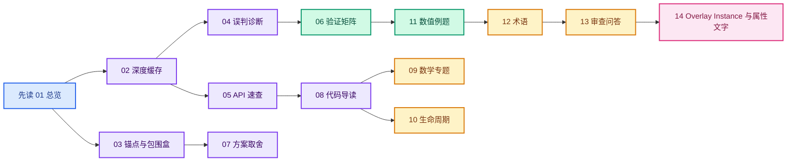

# 属性文本遮挡剔除 · CODEX 核对版

> **从零理解当前工作树，请先进入 [逐行导读](./逐行导读/00-从零开始与阅读地图.md)。**
> 该专题按调用顺序拆成十三篇概念与源码讲解，另有九份带中文注释、行号和源码上下文的代码导读。
> 下方 01—15 章保留设计过程与历史快照；遇到名称或实现差异，以逐行导读的当前工作树快照为准。

> **可视化入口**：[从设置到绘制 · 源码地图](./互动图解/从设置到绘制-源码地图.html) 与 [矩阵与深度 · 互动教材](./互动图解/矩阵与深度-互动教材.html)。两份 HTML 均可离线打开，包含可点击的执行阶段和可调参数。

> **范围**：Blender `attribute-text-depth-culling` 分支。
> **基准**：`origin/main` 的 `bba93a5d6df198bcdb31b7b92cdbe514945ba2ad`。
> **当前提交**：`39009b48098`、`eb97266f783`。
> **写作快照**：2026-09-27。
> **状态**：代码已编译，近距离网格点遮挡稳定性仍未解决。

> **后续进展**：以上为早期提交快照。透视局部平面补偿已获得用户正向复测反馈，原理、性能边界及后续整理见 [第 15 章](./15-透视文本稳定性与性能.md)。

---

## 为什么另建这个目录

`.markdown/属性文本遮挡剔除-DS` 已有大量参考文档。
本目录独立记录**当前分支的已提交行为**，并对照源码纠正不准确或过时的结论。
不会覆盖参考目录。
后续源码若改变，应把本目录当成有版本范围的快照，而不是永远正确的规范。

> [!IMPORTANT]
> 本目录与整个 `.markdown` 路径被项目 `.gitignore` 忽略。
> 它们是本地文档；若想纳入 Git，需要另作明确决定。

## 十六章导航

新增：[16 · 文本重叠筛选与批量绘制](./16-文本重叠筛选与批量绘制.md)，包含新开关、实现、性能实验与复测范围。

### 当前工作树逐行专题

| 顺序 | 阅读内容 | 读完能回答 |
|---|---|---|
| [00 · 从零开始](./逐行导读/00-从零开始与阅读地图.md) | 总图、九文件职责、提交与工作树区别 | 这项功能到底从哪里到哪里？ |
| [01 · 设置链](./逐行导读/01-设置如何传到绘制层.md) | DNA、RNA、Python UI、Overlay State | 一个按钮如何到达 C++？ |
| [02 · 属性与锚点](./逐行导读/02-属性值如何成为文字.md) | 各域、点云、实例、标志传播 | 每条文字的值和位置从哪来？ |
| [03 · 深度生命周期](./逐行导读/03-深度何时读取.md) | prepass、GPU 回读、缓存所有权 | 深度为什么在这里读取？ |
| [04 · 逐条判断](./逐行导读/04-每条文字如何判断.md) | 投影、像素索引、透视平面补偿、BLF | 一条文字为何显示或消失？ |
| [05 · 数学练习](./逐行导读/05-坐标与数学练习.md) | 坐标变换、AABB、齐次坐标、深度算例 | 能否手算关键值？ |
| [06 · 差异索引](./逐行导读/06-源码差异索引.md) | 九份注释代码与原始上下文 | 某一行代码该去哪查？ |
| [07 · 类型百科](./逐行导读/07-函数类成员变量百科.md) | 类、成员、参数、容器与生命周期 | 每个名字是谁拥有、谁使用？ |
| [08 · 调试路线](./逐行导读/08-调试路线与已知边界.md) | 观察、性能与限制 | 下一次异常该从哪查？ |
| [09 · 矩阵基础](./逐行导读/09-矩阵从零到源码.md) | 齐次坐标、矩阵组合、逆矩阵与源码 | `object_to_world` 等矩阵到底怎么用？ |
| [10 · 投影深度](./逐行导读/10-投影矩阵与深度推导.md) | 透视/正交投影、窗口深度推导 | 为什么透视深度非线性却能局部平面补偿？ |
| [11 · AABB 手算](./逐行导读/11-逆矩阵射线与AABB逐步推演.md) | 本地射线、slab 求交、`exit_t` | 实例文字怎样走到盒前表面？ |
| [12 · 完整算例](./逐行导读/12-完整手算一个文字锚点.md) | 一个锚点从对象本地一直算到屏幕与深度 | 能否独立复算整个实现？ |

### 设计过程与旧版快照

最新补充：[15 · 透视文本稳定性与性能](./15-透视文本稳定性与性能.md)，记录局部平面补偿、循环开销、透视限定及代码整理。



| 章节 | 重点 | 建议读者 |
|---|---|---|
| [01 · 架构与状态](./01-当前分支架构与状态.md) | 两个提交、九个文件、完整数据流 | 第一次接触此功能 |
| [02 · 逐帧深度缓存](./02-深度缓存与文本绘制.md) | 回读时序、所有权、投影和比较 | Overlay / Draw 维护者 |
| [03 · 锚点与包围盒](./03-锚点与包围盒.md) | 点云半径、实例 AABB、射线参数 | 数学与几何实现者 |
| [04 · 故障与实验](./04-误判诊断与实验复盘.md) | 五类症状、贮藏实验、勘误 | 正在复现闪烁的人 |
| [05 · API 速查](./05-函数与数据结构速查.md) | 函数职责、参数和生命周期 | 查接口的人 |
| [06 · 验证矩阵](./06-验证矩阵与性能评估.md) | 视口用例、构建和帧时记录 | 测试与 review |
| [07 · 方案取舍](./07-方案取舍与后续设计.md) | 深度、BVH、GPU 可见性、ID 缓冲 | 决定下一版方案的人 |
| [08 · 代码导读](./08-代码导读与安全修改点.md) | 沿调用链阅读和安全修改 | 准备改代码的人 |
| [09 · 坐标与深度数学](./09-坐标空间与深度数学专题.md) | 投影、深度、误差与像素映射 | 排查数值边界的人 |
| [10 · C++ 生命周期](./10-C++类型生命周期与并行上下文.md) | 类型、所有权、容器与并行约束 | 审查实现的人 |
| [11 · 数值例题](./11-实例化推演与数值例题.md) | 用具体数值推演实例和射线 | 验证几何计算的人 |
| [12 · 术语表](./12-术语表与常见误解.md) | 关键名词及容易混淆的结论 | 需要快速查阅的人 |
| [13 · 审查问答](./13-代码审查问答.md) | 按审查问题串起设计与风险 | 准备评审的人 |
| [14 · Overlay Instance 与属性文字](./14-Overlay实例与属性文本流水线.md) | `Instance` 生命周期、prepass、regular/infront、Viewer 与通用文字缓存 | 阅读 Overlay 调度代码的人 |

### 最短阅读路线

先读 01，建立总图。
遇到旋转时漏字，跳到 04，再按 06 复现。
要改实例域，先读 03 和 08。
准备提交前读 05 的约束与 06 的验证清单。

### 按具体问题查找

| 遇到的问题 | 先看 | 接着核对 |
|---|---|---|
| 实例文本被实例自身遮住 | 03 的 AABB 锚点 | 11 的射线例题、07 的局限 |
| 网格点编号随旋转消失 | 04 的症状记录 | 09 的投影与误差、06 的复现矩阵 |
| 远近缩放后显示异常 | 02 的缓存刷新 | 09 的深度范围与比较方向 |
| 想调整文字缓存结构 | 05 的 API | 10 的所有权与生命周期 |
| 想判断该用 BVH 还是深度 | 07 的取舍 | 04 的已观察问题 |
| 审查新提交 | 08 的调用链 | 13 的问题清单 |

阅读时先确认结论属于“当前代码”“实验观察”还是“下一版建议”。
尤其要把已贮藏的斜率和像素邻域实验，与已提交的固定容差实现区分开。
若本地分支增加提交，先更新上方的提交快照，再重新核对函数签名与调用顺序。

## 一句话理解实现

Geometry Nodes Viewer 的 `.viewer` 值被写入本帧文字缓存。
Overlay 在深度 prepass 后、grid/axes 写深度前回读视口深度。
绘制文字时，将每个锚点投影到屏幕，比较对应像素的场景深度。
点云和实例通过各自的锚点前移减少自身遮挡。

```text
Viewer 值
  → 属性域位置 / 特殊锚点
  → ViewCachedString
  → GPU depth 回读
  → 锚点深度比较
  → BLF 绘制或跳过
```

## 与参考文档的重要勘误

1. 当前视口源码请求 `SFLOAT_32_DEPTH_UINT_8`，不能断言是 D24 定点。
2. 实例代码变量名 `entry_distance` 实际接收 AABB 的 `tmax` 出口参数。
3. 透视时 `entry_distance < 1` 的 `1` 对应相机位置参数，不是“1 米”。
4. `ViewDepths` 对象可以复用，但其深度像素每帧都必须刷新。
5. 斜率与邻域实验已贮藏，当前提交仍为固定 `2e-5` 单像素比较。
6. `draw_manager_text.cc` 与 `overlay_instance.hh` 的个别注释仍描述旧回读时机，以实际调用链为准。
7. 两次投影是已确认结构；“必然偏移 1 像素”不是已确认事实。

这些更正不是对所有 GPU 后端行为的断言。
具体运行时仍需逐帧数据和视口复测。

## 当前实现的文件表

| 层 | 文件 |
|---|---|
| UI | `scripts/startup/bl_ui/space_view3d.py` |
| 持久数据 | `source/blender/makesdna/DNA_view3d_types.h` |
| RNA | `source/blender/makesrna/intern/rna_space.cc` |
| State | `source/blender/draw/engines/overlay/overlay_private.hh` |
| 属性锚点 | `source/blender/draw/engines/overlay/overlay_attribute_text.hh` |
| 深度生命周期 | `source/blender/draw/engines/overlay/overlay_instance.hh`、`.cc` |
| 通用文字 | `source/blender/draw/intern/draw_manager_text.hh`、`.cc` |

## 文档可信度约定

**已确认源码事实**：可以在本快照对应文件中直接找到。
**已观察现象**：来自用户实际截图或构建日志，但不必然指向唯一根因。
**推断**：有数学或执行路径支持，仍需复现实验。
**备选方案**：尚未实现，不应描述为当前分支行为。

阅读表格里的“待填”时，请把它理解为尚未做现场验证。
这比写一个没有证据的“已通过”更有用。

## 修改文档时的检查

1. 先记录当前 `git rev-parse HEAD`。
2. 运行 `git diff origin/main...HEAD --stat` 核对范围。
3. 逐一核对文中的函数名、参数方向和数据所有权。
4. 对数学公式说明坐标空间和单位。
5. 把用户截图观察与根因推断分开写。
6. 新实验若被撤回，更新“当前行为”而不是继续称其为修复。
7. 修改代码后同步更新验证矩阵与已知局限。

## 下一步推荐

对一个稳定复现的点 ID 记录显示帧和消失帧的投影与深度。
先确定它在哪一层失败，再设计下一版算法。
这样可以避免反复调一个全局容差，却在新的视角制造相反问题。
