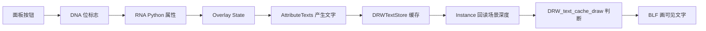

# 从零开始：先把九个文件放在一张地图上

> 阅读对象：知道 Blender 会显示属性文字，但尚不熟悉 DNA、RNA、Overlay 或深度缓冲的读者。
> 源码基准：`origin/main` 的共同祖先 `bba93a5d6df198bcdb31b7b92cdbe514945ba2ad` 与本地工作树的差异，记录于 2026-09-28。

## 本套文档怎么读

这一专题按**实际执行顺序**组织，而非按文件名排序。
先读本篇和 [01 设置如何传到绘制层](./01-设置如何传到绘制层.md)，再读 [02 属性值如何成为文字](./02-属性值如何成为文字.md)，最后读 [03 深度何时读取](./03-深度何时读取.md) 与 [04 每条文字如何判断](./04-每条文字如何判断.md)。
[05 坐标与数学练习](./05-坐标与数学练习.md) 给出算例；[06 源码差异索引](./06-源码差异索引.md) 能反查每一条修改行。
若矩阵和投影知识还不熟，先读 [09 矩阵从零到源码](./09-矩阵从零到源码.md)、[10 投影深度推导](./10-投影矩阵与深度推导.md) 和 [11 逆矩阵射线与 AABB](./11-逆矩阵射线与AABB逐步推演.md)。
喜欢边调数字边学，可以打开 [矩阵与深度互动教材](../互动图解/矩阵与深度-互动教材.html)；想先看代码全图，打开 [从设置到绘制源码地图](../互动图解/从设置到绘制-源码地图.html)。

现有 01 至 15 章保留了设计史、早期提交快照、问题复盘和 API 资料。
阅读**当前工作树**时，以本专题的代码索引为准。
早期章节里如果出现 `Exclude Backfaces`、`viewer_text_cull_backfaces` 或“只用固定容差”，那是阶段性记录；当前名称为 `Occlusion Culling` / `viewer_text_occlusion_culling`，透视视图还会尝试局部平面补偿。

## 先建立三个层次

**设置层**回答“用户打开了什么”。`DNA_view3d_types.h` 给 View3D 的 overlay 标志分配一位，`rna_space.cc` 暴露给 Python，`space_view3d.py` 把它放在面板里，`overlay_private.hh` 提供 C++ 查询函数。

**生产层**回答“每个文字的值和位置来自哪里”。`overlay_attribute_text.hh` 从 `.viewer` 属性取数，把值转换为字符串，并确定锚点世界坐标。网格点、边、面、角、点云、实例和曲线走不同的锚点路径。

**消费层**回答“屏幕上画不画”。`overlay_instance.cc` 在合适时机把视口深度读到 CPU；`draw_manager_text.cc` 把锚点投影成屏幕坐标，比较深度，再用 BLF 绘制。

## 一个具体例子

假设 Viewer 节点给网格某个点写入整数 `42`。

1. 面板的 `Occlusion Culling` 对应 `overlay.flag` 中的第 20 位。
2. `AttributeTexts::begin_sync` 把这位保存为本帧的 `occlusion_test_`。
3. `object_sync` 找到预览几何上的 `.viewer` 值与该点位置。
4. `add_values_to_text_cache` 把 `42` 格式化为字符串，连同世界坐标和遮挡测试位交给 `DRW_text_cache_add`。
5. `Instance::draw_v3d` 完成几何深度 prepass 后，调用 `update_text_depth`。
6. `DRW_text_cache_draw` 把点坐标投影为屏幕 `(x,y,z)`，读取场景对应像素的深度。
7. 判断为可见时，`drw_text_cache_draw_ex` 用 BLF 在屏幕上画出 `42`。

实例域和点云主要改变第 3、4 步的**锚点**；透视局部平面补偿改变第 6 步的比较。

## 术语从零解释

| 词 | 从零理解 | 本分支中的具体角色 |
|---|---|---|
| Geometry Nodes Viewer | 节点结果在视口中的临时预览 | `.viewer` 是文本数据来源 |
| 属性域 | 值属于点、边、面、角、实例等哪类元素 | 决定一条值应该绑定到哪个位置 |
| 锚点 | 文本所对应的三维位置 | 用来投影，也用来判断遮挡 |
| 像素深度 | 某个像素上最靠近观察者的场景表面深度 | 与锚点深度比较 |
| prepass | 正式叠加绘制之前先生成可用深度 | 深度回读时机的前提 |
| Overlay | 覆盖在场景画面上的辅助绘制系统 | 管理属性文字和深度读取 |
| DNA | Blender 保存到文件的数据结构/标志 | 新选项的底层位 |
| RNA | 让 Blender 内部属性进入 Python/UI 的描述层 | 新选项的公开名称和提示 |
| `DRWTextStore` | 本帧要画的文字条目集合 | 存锚点、颜色、内容、标志及借用的深度指针 |
| `BLF` | Blender 的字体绘制接口 | 最终把文字画到屏幕 |

## 九个文件各自负责什么

| 文件 | 新增或改动的职责 | 读前提 |
|---|---|---|
| `DNA_view3d_types.h` | `overlay.flag` 新位 | 位运算 |
| `rna_space.cc` | Python 属性与 UI 描述 | DNA 和 RNA 的关系 |
| `space_view3d.py` | 面板控件和启用条件 | Python UI 布局 |
| `overlay_private.hh` | `State` 查询函数 | C++ 成员函数 |
| `overlay_attribute_text.hh` | 文字来源、点云/实例锚点、标志传播 | 属性域、空间变换 |
| `draw_manager_text.hh` | 公共函数和标志声明 | 声明与定义 |
| `overlay_instance.hh` | 深度缓存成员与释放 | 对象生命周期 |
| `overlay_instance.cc` | 深度回读时机与刷新 | framebuffer 和 GPU 纹理 |
| `draw_manager_text.cc` | 投影、单像素比较、透视平面补偿、跳过文字 | 深度和坐标数学 |

## “提交”与“当前工作树”有什么区别

`git log` 里的三个分支提交是可复现的历史快照。
用户给出的 9 文件统计使用的是 `git diff $(git merge-base origin/main HEAD)`；这种命令把**已提交与尚未提交的修改一起**算进来。
当前树中一些文件同时有暂存修改和未暂存修改，因此只读 `git show HEAD` 或 `git diff --cached` 都无法看全功能。
本专题解释的是该命令看到的九个文件；索引每次生成时记录当前文件行号。

## 阅读代码时注意三种“位置”

一个元素至少会经过本地空间、世界空间和屏幕空间。
`object_to_world` 负责本地到世界；视图投影矩阵负责世界到裁剪/屏幕；深度数组按整数像素索引。
不要把点在三维表面上的半径、屏幕上的偏移和深度值当成同一种单位。

## 阅读时注意三种“所有权”

`AttributeTexts` 使用 `state.dt`，并不拥有整个文字缓存。
`Instance` 拥有 `text_depth_cache_`，负责分配与释放。
`DRWTextStore::depths` 是借用指针，仅在绘制时引用这份缓存。
这一关系决定了缓存为何必须在文字绘制结束前保持有效。

## 读完以后应该能回答

1. UI 选项如何变成每条文字上的 `DRW_TEXT_CACHE_OCCLUSION_TEST`？
2. 为什么深度读回要位于 prepass 后、grid 前？
3. 为什么点云和实例不能简单使用几何中心？
4. 为什么透视视图需要像素内部位置补偿？
5. 一帧中哪部分是一次性 GPU 回读，哪部分是逐条文字的 CPU 判断？
