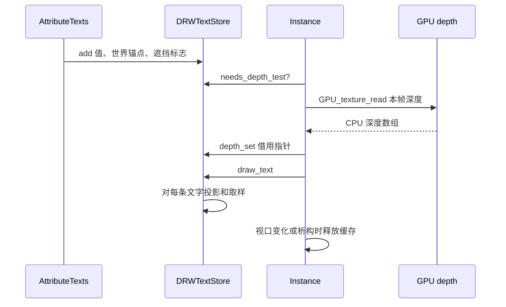

# 第三站：深度什么时候读取，谁负责这块内存

> 文件：`overlay_instance.hh`、`overlay_instance.cc`、`draw_manager_text.hh`。
> 这里最重要的概念是**时序**和**所有权**。即使比较公式完全正确，读错时间或保存了旧帧深度，也会造成随视图移动的错误。

## 1. 先看 `Instance` 是什么

Overlay 的 `Instance` 是绘制引擎在一个视图绘制周期内使用的对象。它有 `regular` 和 `infront` 等绘制层，以及 `state`、`resources`。`AttributeTexts` 属于这些 Overlay 组件之一。文字缓存 `state.dt` 随引擎实例使用。

新成员 `ViewDepths *text_depth_cache_ = nullptr` 指向 CPU 侧的视口深度副本。`nullptr` 表示尚未分配。`ViewDepths` 本身含宽、高、深度范围以及浮点数组 `depths`。`Instance` 拥有这块内存，析构时用 `ED_view3d_depths_free` 释放。

指针类型放在 `.hh`，更新逻辑在 `.cc`。这是类定义与实现的基本关系。新增 `update_text_depth()` 是私有成员，不是外部通用 API；它只供 `Instance::draw_v3d` 调用。

## 2. 绘制顺序比函数名重要

源码周围的简化顺序：

```text
regular/infront prepass.draw_line
    ↓
update_text_depth  ← 此处读场景深度
    ↓
wireframe.copy_depth 与后续 Overlay pass
    ↓
grid.draw_line（可能写细网格线深度）
    ↓
最终输出阶段 draw_text
```

如果在 grid 后读取，1 像素网格线和轴线可能正好穿过文字锚点像素，导致几何可见却误判遮挡。当前插入点在 prepass 后，又在 grid/axes 影响深度之前。

“深度回读”并非每条文字单独从 GPU 读取一个像素。`update_text_depth` 对整个视口深度纹理发起一次 CPU 回读；文字判断再从 CPU 数组取样。因此新增判定循环不等于每次循环都做 GPU 同步。

## 3. 先判断是否需要回读

`if (!state.show_text || !state.is_space_v3d() || !DRW_text_cache_needs_depth_test(state.dt))` 是短路或。任一条件满足，就无需准备深度：文字整体不显示、不是 3D 视图、或缓存里没有需要遮挡测试的文字。

该分支先用 `DRW_text_cache_depth_set(state.dt, nullptr)` 清除文字缓存里的借用指针，再释放 `Instance` 拥有的 `text_depth_cache_`，并设为 `nullptr`，最后 `return`。先清借用指针能避免后续误用已经释放的数组。

`DRW_text_cache_needs_depth_test` 在 `draw_manager_text.cc` 中遍历 `cache_strings`，遇到任意一条带 `DRW_TEXT_CACHE_OCCLUSION_TEST` 的文字立即返回 `true`。参数是 `const DRWTextStore *`，因为只读取。它的成本与检查到第一条带标志的文字位置有关；最坏遍历全部文字一次。

## 4. 取得深度纹理与尺寸

`WM_draw_region_get_viewport(const_cast<ARegion *>(state.region))` 取得当前区域的 GPUViewport。这里的 `const_cast` 是为了调用已有接口；函数没有在这段代码中直接修改区域。`GPU_viewport_depth_texture(viewport)` 得到深度纹理。`GPU_texture_width/height` 读取当前纹理的像素尺寸。

视口改变大小后，旧 CPU 数组的元素数目不匹配。代码比较 `text_depth_cache_->w/h` 与当前宽高，不同则释放并清空指针。这里直接使用 `ViewDepths` 内部尺寸，避免维护另一对可能不同步的宽高成员。

## 5. 首次分配与每帧刷新

缓存指针为空时：

1. `MEM_new_zeroed<ViewDepths>("ViewDepths")` 分配并清零描述对象。
2. 写入 `w` 和 `h`。
3. `GPU_texture_read(depth_tx, GPU_DATA_FLOAT, 0)` 从 GPU 纹理读取浮点深度，返回 CPU 缓冲指针。
4. 把该指针存入 `ViewDepths::depths`，并设置 `depth_range` 为 `[0,1]`。

缓存已经存在且尺寸相同时，使用带目标缓冲的 `GPU_texture_read(depth_tx, GPU_DATA_FLOAT, 0, text_depth_cache_->depths)`。**对象和内存可以复用，像素内容必须每帧重读**。相机一动，上一帧深度与当前锚点投影就无法对应。旧实现曾因跨帧复用深度内容出现“远灭近显”；这段刷新是关键约束。

最后 `DRW_text_cache_depth_set(state.dt, text_depth_cache_)` 只把地址交给文字缓存。它没有复制整张深度图，也没有转移所有权。

## 6. 析构时谁释放谁

`~Instance` 先调用 `DRW_text_cache_destroy(state.dt)` 销毁文字缓存；若 `text_depth_cache_` 非空，再调用 `ED_view3d_depths_free`。文字缓存的 `depths` 只是借用，不会重复释放。析构不需要在对象即将消失时再把成员指针设回空值。

`draw_manager_text.hh` 中的前向声明 `struct ViewDepths;` 让 API 能出现 `const ViewDepths *` 而无须在头文件暴露结构细节。`DRW_text_cache_depth_set` 是注入深度指针的入口；`DRW_text_cache_needs_depth_test` 是按需回读的检查入口；新枚举值 `DRW_TEXT_CACHE_OCCLUSION_TEST = (1 << 4)` 是生产者和消费者共同理解的标志。

`DRW_TEXT_CACHE_GLOBALSPACE` 与新标志作用不同：前者指定锚点坐标空间，后者要求遮挡测试。二者可以按位或一起存在。

## 7. 生命周期时间线



这里的关键不变量：`S` 使用深度指针时，`I` 仍然拥有有效 `ViewDepths`；`G` 回读时的视图与后续文字投影使用的是同一帧视图状态。

## 8. 性能如何理解

深度回读涉及 GPU 到 CPU 的数据传输/同步，通常比几个浮点运算更值得关注。新增条件保证**至少有一条文字要求遮挡**才回读。尺寸不变时复用 CPU 分配，减少每帧分配；但仍读取新帧像素。

如果想确认实际性能，应分别记录回读时间、文字数量、进入透视补偿的文字数量以及 `draw_text` 总耗时。只看到新函数有循环，并不能判断整体瓶颈。

