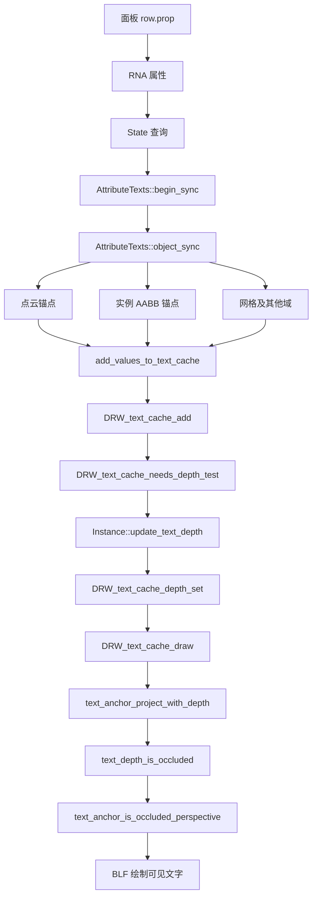

# 函数、类、成员变量百科：把参数类型和调用关系连起来

> 本篇是前六篇的查询手册。尽量从“这个名字表示什么、由谁赋值、何时有效、谁释放”四个问题解释每个关键实体。

## 1. 九个文件的模块边界

`scripts/startup/bl_ui` 属于 Python UI。`makesdna` 属于可保存的底层数据。`makesrna` 负责把内部数据描述为 Python 可用属性。`draw/engines/overlay` 是视口叠加层。`draw/intern/draw_manager_text` 是更通用的文字缓存与绘制工具。

这些模块不处于同一抽象层。通用文字模块不应知道 `.viewer` 的属性类型，也不应依赖面板名字；它只理解锚点、标志和借来的深度数组。`AttributeTexts` 了解 `.viewer` 和属性域，却不负责字体绘制。`Instance` 了解帧顺序和 GPUViewport，所以深度回读放在这里。

## 2. `State`：本帧只读绘制上下文

`State` 由 Overlay 初始化，供多个 Overlay 组件读取。与本功能直接有关的成员和方法：

| 名称 | 类型/含义 | 在哪里使用 |
|---|---|---|
| `overlay.flag` | DNA 位集合 | `viewer_text_occlusion_culling()` 读取 |
| `dt` | `DRWTextStore *` | 属性组件登记文字，Instance 注入深度 |
| `rv3d` | `const RegionView3D *` | 判定透视还是正交 |
| `region` | 区域对象指针 | 取得对应 GPUViewport |
| `camera_position` | 世界空间相机位置 | 透视点云和实例向相机偏移 |
| `camera_forward` | 世界空间统一视线方向 | 正交偏移与退化兜底 |
| `show_text` | 是否整体显示文字 | 决定是否回读深度 |
| `is_space_v3d()` | 是否为 3D 视口 | 阻止二维空间走场景深度方案 |
| `show_attribute_viewer_text()` | Viewer 属性文字总开关 | 组件 `enabled_` 的条件 |
| `viewer_text_occlusion_culling()` | 查询新选项位 | 组件 `occlusion_test_` 的值 |

这些成员不是本次全部新增，但理解它们才能看懂新增表达式。`State` 不拥有文字的最终内容，也不拥有 `Instance::text_depth_cache_`。

## 3. `AttributeTexts`：属性文字生产者

`enabled_` 来自 Overlay 基类/流程，决定组件是否工作；`occlusion_test_` 是本次新增的私有布尔成员。每次 `begin_sync` 都赋新值，避免保留上帧状态。

`object_sync(Manager&, const ObjectRef&, Resources&, const State&)` 是主要入口。这里 `Manager` 和 `Resources` 当前代码未使用，参数名用注释占位来避免未使用警告。`ObjectRef` 描述当前绘制对象及 Viewer 预览关联；`State` 提供视图、相机与文字缓存。

`add_attributes_to_text_cache` 负责通用几何属性。`add_mesh_attributes_to_text_cache` 处理网格不同域的位置。`add_pointcloud_attributes_to_text_cache` 处理圆盘半径的自身遮挡。`add_instance_attributes_to_text_cache` 处理实例原点位于自身几何内部的问题。它们最后都收敛到 `add_values_to_text_cache`。

`add_values_to_text_cache(DRWTextStore*, const GVArray&, Span<float3>, const float4x4&, bool)` 的参数依次是目标缓存、待显示的值、各值位置、将位置转成世界空间的矩阵、是否带遮挡位。`bool` 默认 `false`，保留旧调用方式；新路径显式传入 `occlusion_test_` 或 `true`。

`add_text_to_cache` 接受一行 `StringRef`；`add_lines_to_cache` 接受若干行 `Span<StringRef>`。二者新增 `short flag`，使每种值类型最终都能传到 `DRW_text_cache_add`。多行只是多个字符串条目共享一个三维锚点，并通过二维 y 偏移排列。

## 4. 属性与容器类型

| 类型 | 这里怎么理解 | 常见误区 |
|---|---|---|
| `bke::AttributeAccessor` | 按名字和域查询几何属性的读接口 | 不是属性值数组本身 |
| `bke::GAttributeReader` | 查询结果，含 `varray` 和 `domain` | 需要确认属性存在 |
| `GVArray` | 可承载不同元素类型的虚拟数组 | 不等于 `Vector<float>` |
| `VArray<T>` | 类型明确的虚拟数组视图 | 不一定拥有内存 |
| `VArraySpan<float3>` | 确保可按位置访问的 float3 视图 | 生命周期依赖持有者 |
| `Span<float3>` | 连续只读视图 | 不负责释放底层数组 |
| `Array<float3>` | 拥有内存、按点数分配的数组 | 函数离开作用域后会销毁 |
| `IndexRange` | 下标范围，如某实例的一个元素 | `IndexRange(i,1)` 不是 `[0,i]` |
| `StringRef` | 指向字符串内容的一段视图 | 原始字符缓冲要活得足够久或复制 |

`add_values_to_text_cache` 在临时 `Array` 生命周期内同步遍历值并写入缓存。因此点云临时锚点数组可以局部创建。`DRW_text_cache_add` 对生成的临时文本会复制字符串，避免悬空引用。

## 5. `Instance`：时间与资源所有者

`text_depth_cache_` 是 `ViewDepths *`，初始空。其生命周期由 `Instance` 管理：首次需要时分配；同尺寸时复用 CPU 缓冲并刷新内容；尺寸变化或无需深度时释放；`~Instance` 兜底释放。

`update_text_depth()` 不改变文字字符串，只准备场景深度并调用 `DRW_text_cache_depth_set`。`draw_v3d()` 决定调用时机：prepass 后、grid 前。`draw_text()` 之后进入通用文字绘制，消费已经准备好的深度。

`ViewDepths::w/h` 表示数组尺寸，`depths` 指向 `w*h` 个浮点深度，`depth_range[0/1]` 在本功能中设置为 0 与 1。数组下标为 `y*w+x`，访问前必须验证坐标范围。

## 6. `DRWTextStore`：临时条目与借用深度

`cache_strings` 是本轮待画条目。`string_allocator` 保持复制过的文字内容有效。新增 `const ViewDepths *depths` 只是借用：调用 `DRW_text_cache_depth_set` 时存地址，不复制深度，也不释放它。

`DRW_text_cache_needs_depth_test(const DRWTextStore *)` 从条目标志计算“本帧是否值得读回深度”。`DRW_text_cache_draw` 消费深度并标记剔除条目。`DRW_text_cache_destroy` 销毁文字缓存，不负责 `Instance::text_depth_cache_`。

`ViewCachedString::vec` 是**三维**锚点，`sco` 是投影到屏幕后的**二维**短整数坐标，`flag` 是位集合，`str` 是字符串视图。修改锚点会改变屏幕位置与比较深度；单纯修改 `xoffs/yoffs` 只改变字形摆放，不改变锚点是否被挡。

## 7. 函数调用关系

图中 `BASE → PERS` 有条件：只有透视且基础判断为遮挡才会调用透视补偿。对正交视图和初判可见文字，这一步不存在。

## 8. 最容易混淆的四组名称

`depths` 可能指整个 `ViewDepths` 结构，也可能指其中 `float *depths` 数组；阅读表达式 `dt->depths->depths[y*w+x]` 时，第一层是借来的结构，第二层才是像素数组。

`occlusion_test_` 是组件级布尔设置；`DRW_TEXT_CACHE_OCCLUSION_TEST` 是**每条文字**的标志。前者决定如何生成后者，后者让通用文字系统无需知道 Viewer UI。

`local_anchor` 在对象本地空间；`anchors[i]` 点云数组已经在世界空间；`xy` 是屏幕浮点像素坐标；`vos.sco` 是文字绘制所用的整数屏幕坐标。

`text_depth_bias` 是“锚点与表面最终比较”的容差；`text_depth_plane_tolerance` 是“邻域能否拟合平面”的容差。它们不能互换。

