# 00 - 总览与架构

> 🔗 [返回索引](./README.md) | 下一篇：[01-背景知识与原理](./01-背景知识与原理.md)

---

## 目录

- [1. 需求是什么](#1-需求是什么)
- [2. 问题分析](#2-问题分析)
- [3. 方案设计](#3-方案设计)
- [4. 改动全景](#4-改动全景)
- [5. 完整调用链](#5-完整调用链)
- [6. 数据流](#6-数据流)
- [7. 时序图](#7-时序图)
- [8. 设计决策回顾](#8-设计决策回顾)
- [9. 分层结构总结](#9-分层结构总结)

---

## 1. 需求是什么

### 1.1 先理解"属性查看器"（Attribute Viewer）

Blender 的几何节点（Geometry Nodes）系统有一个调试神器：**Viewer 节点**。你在节点树里插入一个 Viewer 节点，它就把某个属性的值"预览"出来。

预览有两种形式：

| 形式 | 效果 | 实现文件 |
|------|------|----------|
| **颜色预览** | 用属性值给几何体上色 | `overlay_attribute_viewer.hh` |
| **文本预览** | 在视口里每个元素旁显示数值文字 | `overlay_attribute_text.hh` |

开启方式：`视图叠加层（Overlay）面板 → Viewer Node → Attribute Text`

开启后，比如你有一个点云，每个点有个 `density` 属性，视口里就会在每个点旁边浮着一个 `0.37`、`0.82` 这样的文字标签。

### 1.2 痛点

**文字标签不管三七二十一全都画出来，哪怕它被几何体挡住了。**

具体场景：

- 你有一个实心球体，球面上每个顶点有个属性值 → 球**背面**的顶点标签会**透过球体**显示出来，和正面的标签叠在一起，糊成一团。
- 点云有几十万个点 → 前后重叠的点标签互相遮挡，完全没法读。
- 实例化的几何体 → 内部实例的标签穿透外壳显示。

这让 Viewer 文本预览在实际使用中经常**不可用**。

### 1.3 目标

新增一个**可选**开关：**Exclude Backfaces**（排除背面）。

开启后，位于几何体后方的属性文字不再绘制。关闭时保持原有行为。

> ⚠️ **命名注意**：开关叫 "Exclude Backfaces"（排除背面），但实现的是**遮挡剔除**（occlusion culling），两者不是一回事。详见 [01-背景知识 §2](./01-背景知识与原理.md#2-背面剔除-vs-遮挡剔除)。

---

## 2. 问题分析

### 2.1 为什么不能简单地在 shader 里做

文字是用 **BLF（Blender Font）库**绘制到屏幕上的。BLF 走的是 `BLF_draw_default()`，它最终调用 GPU 的**文字图集渲染**，传入的是**屏幕 2D 坐标**。

也就是说：

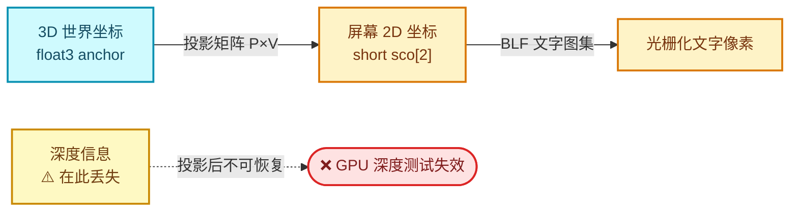

文字绘制发生在**投影之后**，此时已经没有 3D 深度信息了，GPU 的深度测试（`GPU_depth_test`）对文字也没有意义——因为文字是按像素对齐的 2D 图元，它的"深度"是画在哪里就是哪里。

> 💡 这就是为什么 `draw_text` 里明确调用了 `GPU_depth_test(GPU_DEPTH_NONE)`：
> ```cpp
> void Instance::draw_text(Framebuffer &framebuffer)
> {
>   if (state.show_text == false) { return; }
>   GPU_framebuffer_bind(framebuffer);
>   GPU_depth_test(GPU_DEPTH_NONE);   // ← 显式关闭深度测试
>   DRW_text_cache_draw(state.dt, state.region, state.v3d);
> }
> ```
> 文字绘制必须关深度测试，否则它们会被自己写入的深度互相挡住。

### 2.2 所以要自己做深度比较

既然 GPU 帮不上忙，唯一的办法是：

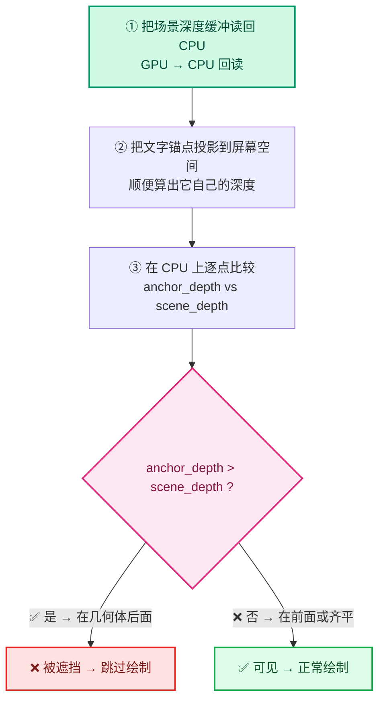

这就是整个特性的核心思路。

### 2.3 难点在哪

```mermaid
flowchart TD
  subgraph D1["难点 1 · 深度从哪来"]
    T1["需要访问视口深度纹理<br/>且必须带 GPU_TEXTURE_USAGE_HOST_READ"]
  end
  subgraph D2["难点 2 · 何时回读"]
    T2["Grid / Axes 会写入自己的一像素深度<br/>⚠️ 污染数据"]
  end
  subgraph D3["难点 3 · 深度可比性"]
    T3["回读值是 [0,1] 非线性深度<br/>锚点投影必须用完全一致的数学"]
  end
  subgraph D4["难点 4 · 精度"]
    T4["锚点通常正好贴在表面上<br/>浮点误差会导致误剔除"]
  end
  subgraph D5["难点 5 · 性能"]
    T5["全屏 GPU→CPU 回读是同步阻塞<br/>⚠️ 不能无脑每帧做"]
  end

  classDef solve fill:#DCFCE7,stroke:#16A34A,color:#14532D,stroke-width:2px;
  classDef warn fill:#FEF9C3,stroke:#CA8A04,color:#713F12,stroke-width:2px;
  classDef err fill:#FEE2E2,stroke:#DC2626,color:#7F1D1D,stroke-width:2px;

  class T1,T3 solve;
  class T2,T4 warn;
  class T5 err;

  style D1 fill:#F0FDF4,stroke:#16A34A,stroke-width:2px,color:#14532D
  style D2 fill:#FEFCE8,stroke:#CA8A04,stroke-width:2px,color:#713F12
  style D3 fill:#F0FDF4,stroke:#16A34A,stroke-width:2px,color:#14532D
  style D4 fill:#FEFCE8,stroke:#CA8A04,stroke-width:2px,color:#713F12
  style D5 fill:#FEF2F2,stroke:#DC2626,stroke-width:2px,color:#7F1D1D
```

| 难点 | 说明 | 解决方案 |
|------|------|----------|
| **深度从哪来** | 需要访问视口的深度纹理，且必须带 `GPU_TEXTURE_USAGE_HOST_READ` 标志才能回读 | 用 `GPU_viewport_depth_texture()`，该纹理已带此标志 ✅ |
| **何时回读** | Grid（网格地面）和 Axes（坐标轴）会写入自己的一像素深度，污染数据 | 卡在 prepass 后、grid 前 ✅ |
| **深度可比性** | 回读的深度是 `[0,1]` 的非线性深度，锚点投射也必须用完全一致的数学 | 复制官方投影公式 ✅ |
| **精度问题** | 锚点通常**正好贴在表面上**，深度相等，浮点误差会导致误剔除 | `+2e-5` 偏置 ⚠️ |
| **性能** | 全屏 GPU→CPU 回读是同步阻塞操作，很慢，不能无脑每帧做 | 惰性回读 ✅ |

---

## 3. 方案设计

### 3.1 核心决策：在哪一层实现

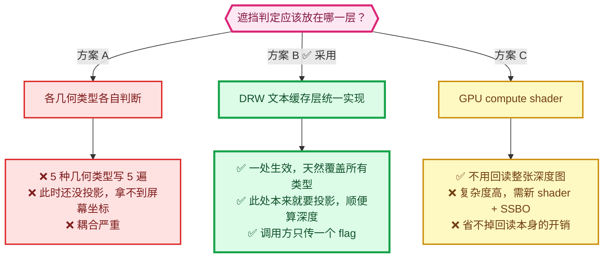

有三种候选方案：

<details>
<summary><b>方案 A：在每个几何类型的 add_xxx 函数里各自判断</b></summary>

```cpp
void add_mesh_attributes_to_text_cache(...) {
  for (each vertex) {
    if (is_occluded(position)) continue;   // ← 每个类型都要写一遍
    add_text_to_cache(...);
  }
}
void add_pointcloud_attributes_to_text_cache(...) {
  for (each point) {
    if (is_occluded(position)) continue;   // ← 重复
    ...
  }
}
// 还有 instances / curves / curve_legacy ...
```

❌ **缺点**：5 种几何类型要写 5 遍；遮挡判断需要屏幕坐标，而此时还没投影；耦合严重。

</details>

<details>
<summary><b>方案 B：在 DRW 文本缓存层统一实现</b>（实际采用）</summary>

```cpp
// draw_manager_text.cc —— 只有一处
void DRW_text_cache_draw(...) {
  for (ViewCachedString &vos : dt->cache_strings) {
    // 投影
    if (project_ok) {
      if (flagged_for_occlusion_test && is_occluded(vos)) {
        vos.sco[0] = IS_CLIPPED;   // ← 标记为裁剪，后面就不画了
        continue;
      }
    }
  }
}
```

✅ **优点**：
- **一处生效**，天然覆盖所有几何类型（mesh / pointcloud / instances / curves / legacy curves）。
- 此处**本来就要做投影**，顺便算深度，几乎零额外开销。
- 调用方只需传一个 flag，无需关心实现。

✅ **这才是正确的架构选择**，也是这个 patch 最漂亮的地方。

</details>

<details>
<summary><b>方案 C：GPU 端用计算着色器做</b></summary>

把锚点传到 GPU，用 compute shader 采样深度纹理，回读可见性位图。

✅ 优点：不用回读整张深度图。
❌ 缺点：复杂度高得多；需要新的 shader、SSBO；对只有几百个标签的场景来说过度设计。
❌ 而且锚点数量少，CPU 逐点采样并不慢——**慢的是深度图回读本身**，这个方案也省不掉。

</details>

### 3.2 为什么要把深度"前置"到 prepass 之后

这是整个 patch 里**最微妙的一个决策**，值得单独讲。

Overlay 引擎在一帧内的绘制顺序大致是：

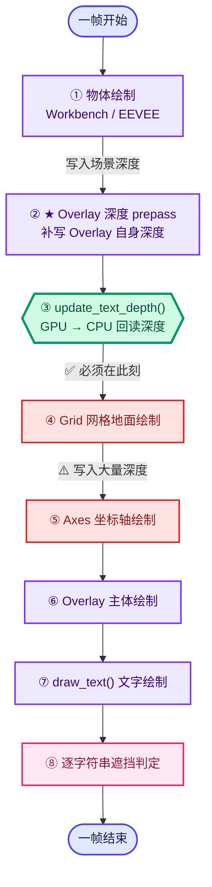

⭐ **关键窗口**：深度回读（③）必须严格卡在 **prepass 之后、Grid 之前**。

Grid 和 Axes 是**无限延伸的地面网格**和坐标轴，它们会往深度缓冲里写入大量深度值。如果不躲开它们，地面网格会把**所有位于地面下方的物体标签**全部误判为"被遮挡"：

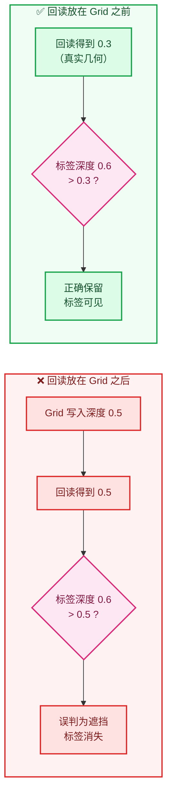

所以深度回读必须插在 **第 2 步之后、第 3 步之前**：

```cpp
/* overlay_instance.cc:937-938 */
/* Read scene depth before the grid and axes write their own one-pixel depth. */
update_text_depth();
{
  /* Copy depth at the end of the prepass to avoid splitting the main render pass. */
  regular.wireframe.copy_depth(resources.depth_target_tx);
  infront.wireframe.copy_depth(resources.depth_target_in_front_tx);
}
```

⭐ 注意这个位置选得非常精准：它正好卡在 `infront.prepass` 结束、`wireframe.copy_depth` 与 `grid.draw_line` 之间。代码里的注释也明确写明了理由。

---

## 4. 改动全景

### 4.1 文件清单

| # | 文件 | 增 | 删 | 职责 | 层次 |
|---|------|----|----|------|------|
| 1 | `makesdna/DNA_view3d_types.h` | +1 | | 定义位标志 `V3D_OVERLAY_VIEWER_TEXT_CULL_BACKFACES = (1<<20)` | 数据层 |
| 2 | `makesrna/intern/rna_space.cc` | +9 | | 暴露为 RNA 布尔属性 | 属性层 |
| 3 | `scripts/startup/bl_ui/space_view3d.py` | +8 | | Overlay 面板勾选框 | UI 层 |
| 4 | `draw/engines/overlay/overlay_private.hh` | +4 | | `State::viewer_text_cull_backfaces()` 读取封装 | 状态层 |
| 5 | `draw/intern/draw_manager_text.hh` | +19 | | 新标志 `DRW_TEXT_CACHE_OCCLUSION_TEST` + 2 个接口 | 接口层 |
| 6 | `draw/intern/draw_manager_text.cc` | +95 | | **遮挡测试核心实现** | 核心层 |
| 7 | `draw/engines/overlay/overlay_instance.hh` | +10 | | `ViewDepths*` 缓存成员 + 两行析构清理 | 生命周期 |
| 8 | `draw/engines/overlay/overlay_instance.cc` | +45 | | **每帧深度回读 + 绘制顺序** | 核心层 |
| 9 | `draw/engines/overlay/overlay_attribute_text.hh` | +137 | −22 | **锚点偏移 + 标志透传** | 逻辑层 |

### 4.2 依赖关系

```mermaid
flowchart TD
  A["DNA_view3d_types.h<br/>V3D_OVERLAY_VIEWER_TEXT_CULL_BACKFACES"]
  B["rna_space.cc<br/>viewer_text_cull_backfaces"]
  C["space_view3d.py<br/>面板勾选框"]
  E["overlay_private.hh<br/>State::viewer_text_cull_backfaces()"]
  F["draw_manager_text.hh<br/>DRW_TEXT_CACHE_OCCLUSION_TEST"]
  G["draw_manager_text.cc<br/>遮挡测试实现"]
  H["overlay_instance.cc<br/>update_text_depth()"]
  I["overlay_attribute_text.hh<br/>设置 occlusion_test_ 标志"]

  A --> B --> C
  A --> E
  F --> G
  G --> H
  E --> I
  F --> I
  I -->|"add_values_to_text_cache(..., flag)"| G
  H -->|"DRW_text_cache_depth_set"| G

  classDef ui fill:#DBEAFE,stroke:#2563EB,color:#1E3A8A,stroke-width:2px;
  classDef overlay fill:#EDE9FE,stroke:#7C3AED,color:#3B0764,stroke-width:2px;
  classDef geom fill:#CFFAFE,stroke:#0891B2,color:#164E63,stroke-width:2px;
  classDef text fill:#FEF3C7,stroke:#D97706,color:#78350F,stroke-width:2px;
  classDef depth fill:#D1FAE5,stroke:#059669,color:#064E3B,stroke-width:3px;
  classDef judge fill:#FCE7F3,stroke:#DB2777,color:#831843,stroke-width:3px;

  class A,B,C,E ui;
  class H overlay;
  class I geom;
  class F text;
  class G judge;

  linkStyle 8 stroke:#D97706,stroke-width:2px;
  linkStyle 9 stroke:#059669,stroke-width:2px;
```

⭐ **描边越粗 = 越核心**。`draw_manager_text.cc`（判定层）与 `overlay_instance.cc`（深度层）是两个关键实现文件。

### 4.3 划分成三层

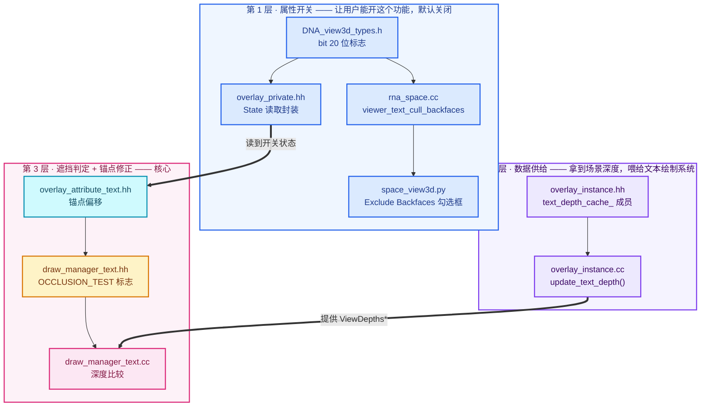

这个三层划分**正好对应应该拆成的 3 个 commit**，详见 [08-提交指南](./08-提交指南.md)。

---

## 5. 完整调用链

### 5.1 主调用链（每帧执行）

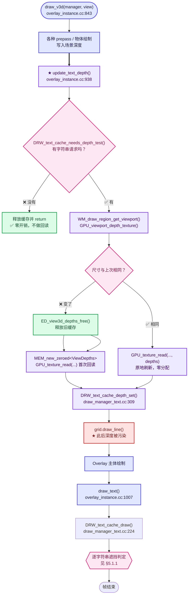

#### 5.1.1 遮挡判定内部（`DRW_text_cache_draw`）

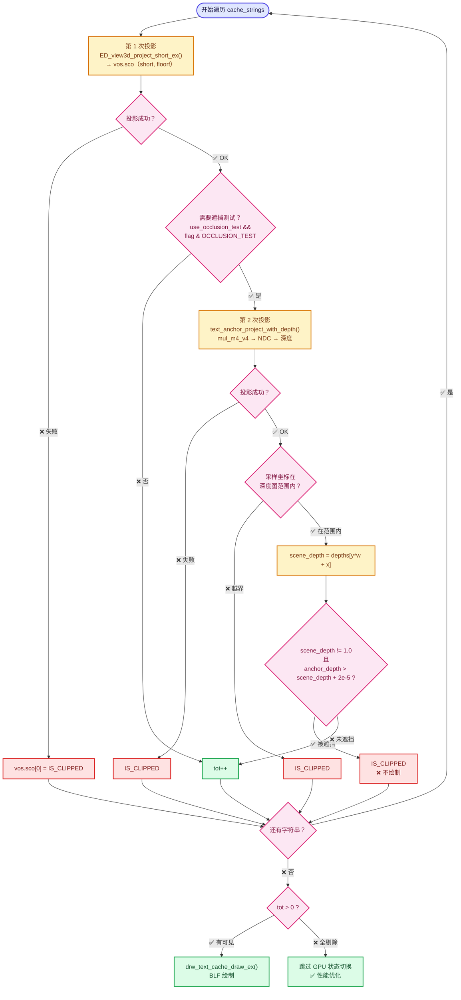

### 5.2 数据添加链（object_sync 阶段，在主绘制之前）

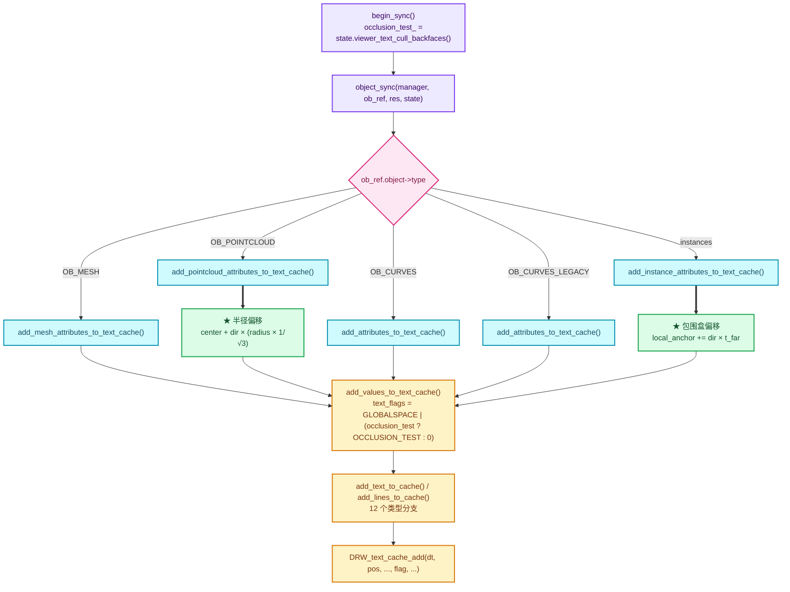

---

## 6. 数据流

### 6.1 深度数据的生命周期

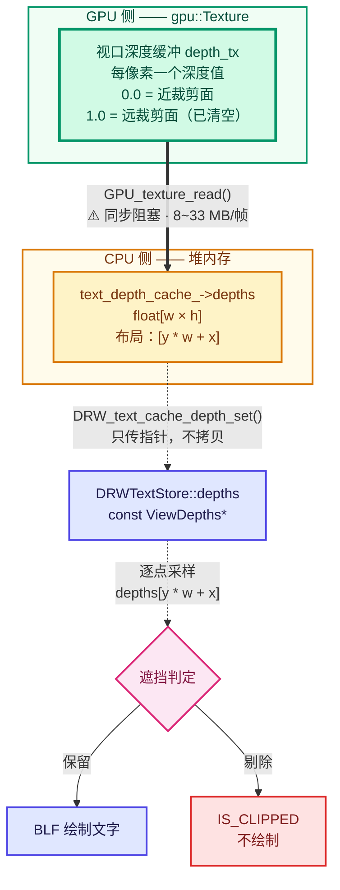

⭐ **关键点**：`DRW_text_cache_depth_set` 只存指针，**不接管所有权**。`ViewDepths` 的生命周期由 `Instance` 管理，必须活到下一次 `DRW_text_cache_draw`。

### 6.2 内存所有权

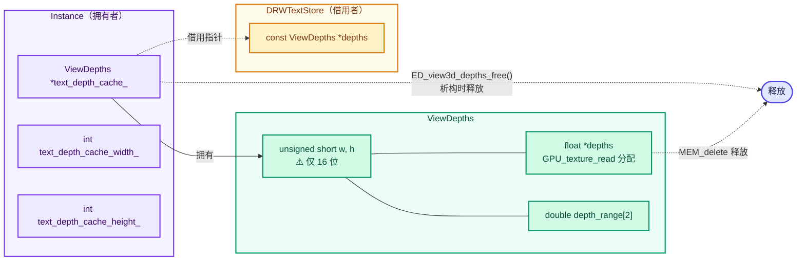

---

## 7. 时序图

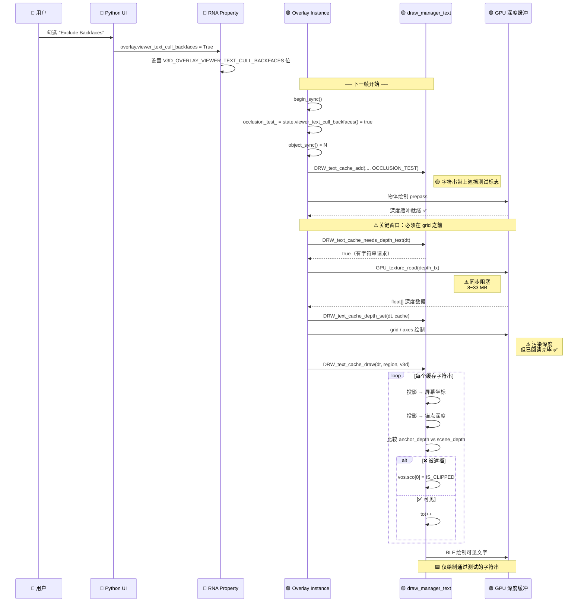

---

## 8. 设计决策回顾

| # | 决策 | 选择 | 替代方案 | 评价 |
|---|------|------|----------|------|
| 1 | 实现层次 | DRW 文本缓存层 | 各几何类型各自实现 | ✅ 正确，一处生效 |
| 2 | 开关粒度 | 存 DNA 位标志 | 独立布尔字段 | ✅ 零成本，不破坏兼容 |
| 3 | 默认值 | 关闭 | 默认开启 | ✅ 安全，不改变现有行为 |
| 4 | 深度获取 | 视口深度纹理回读 | 重新渲染深度 | ✅ 唯一现实方案 |
| 5 | 回读时机 | prepass 后 / grid 前 | 文字绘制前 | ✅ 精准避开污染 |
| 6 | 惰性回读 | 有请求才回读 | 无条件每帧回读 | ✅ 性能保护 |
| 7 | 缓存复用 | 尺寸不变则原地刷新 | 每帧重建 | ✅ 避免反复分配 |
| 8 | 通过标志传参 | `short flag` 位或 | 单独传 bool | ⚠️ 可行但接口变复杂 |
| 9 | 锚点修正位置 | 添加时（CPU） | 绘制时（GPU） | ✅ 简单，锚点数少 |
| 10 | 深度比较偏置 | `+2e-5` | 无偏置 | ✅ 必要（否则贴面标签全被剔除） |

---

## 9. 分层结构总结

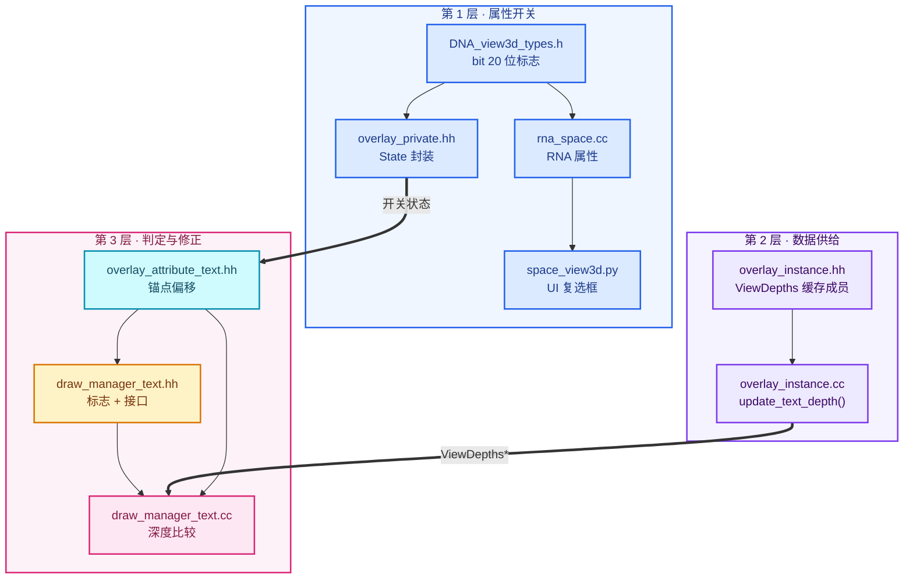

### 9.1 数据流全景（横切三次提交）

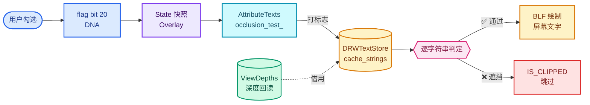

### 9.2 颜色 = 层级速记


完整配色规范见 [配色与图例约定](./配色与图例约定.md)。

---

## 下一步

- 想搞懂**原理**（深度缓冲、NDC、投影）→ [01-背景知识与原理](./01-背景知识与原理.md)
- 想直接看**问题清单** → [07-问题清单与修复](./07-问题清单与修复.md)
