# 01 - 背景知识与原理

> 🔗 [返回索引](./README.md) | 上一篇：[00-总览与架构](./00-总览与架构.md) | 下一篇：[02-属性层-DNA-RNA-UI](./02-属性层-DNA-RNA-UI.md)

本文解释实现这个特性所需要的**全部底层知识**。如果你已经很熟悉图形学，可以跳到 §7。

---

## 目录

- [1. 渲染管线回顾](#1-渲染管线回顾)
- [2. 背面剔除 vs 遮挡剔除](#2-背面剔除-vs-遮挡剔除)
- [3. 齐次坐标与投影](#3-齐次坐标与投影)
- [4. NDC 与深度值](#4-ndc-与深度值)
- [5. 深度缓冲](#5-深度缓冲)
- [6. 透视除法与 w 分量](#6-透视除法与-w-分量)
- [7. 为什么必须 CPU 回读](#7-为什么必须-cpu-回读)
- [8. 深度精度与 Z-fighting](#8-深度精度与-z-fighting)
- [9. 屏幕坐标约定](#9-屏幕坐标约定)
- [10. 射线与 AABB 求交](#10-射线与-aabb-求交)
- [11. 点云渲染原理](#11-点云渲染原理)

---

## 1. 渲染管线回顾

要理解这个特性，先要清楚一个 3D 顶点是怎么变成屏幕上的像素的。

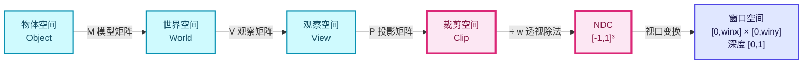

⭐ **本特性的立足点**：在「窗口空间」这一步，深度值同时存在于 **GPU 深度缓冲**（每像素一个）与 **CPU 投影计算**（每个锚点一个）两侧 —— 只有把两者放在同一坐标系下才能比较。

用矩阵表示（Blender 里的 `persmat` 就是 `P × V`）：

```
clip = persmat × vec4(world_pos, 1.0)
```

展开：

```
clip.x = ...        clip.y = ...        clip.z = ...        clip.w = ...
```

`clip` 是**齐次坐标**，第四分量 `w` 通常是观察空间的 −z（相机前方距离）。

### 1.1 Blender 中的三个关键矩阵

| 矩阵 | 位置 | 含义 |
|------|------|------|
| `rv3d->viewmat` | 观察矩阵 V | 世界空间 → 观察空间 |
| `rv3d->winmat` | 投影矩阵 P | 观察空间 → 裁剪空间 |
| `rv3d->persmat` | **P × V** | 世界空间 → 裁剪空间（**直接可用**） |
| `rv3d->persmatob` | 带物体矩阵 | 用于 `DRW_TEXT_CACHE_LOCALCLIP` |

⭐ 文本缓存系统用的就是 `persmat` / `persmatob`（见 `draw_manager_text.cc:239`）：

```cpp
ED_view3d_project_short_ex(
    region,
    (vos.flag & DRW_TEXT_CACHE_GLOBALSPACE) ? rv3d->persmat : rv3d->persmatob,
    (vos.flag & DRW_TEXT_CACHE_LOCALCLIP) != 0,
    vos.vec, vos.sco, ...);
```

---

## 2. 背面剔除 vs 遮挡剔除

**这是这个 patch 里最容易混淆的概念，而命名上确实有问题。**

### 2.1 定义对比

| 概念 | 英文 | 判定依据 | 判定时机 |
|------|------|----------|----------|
| **背面剔除** | Backface Culling | 三角形的**朝向**（法线 vs 视线） | 光栅化前，几何阶段 |
| **遮挡剔除** | Occlusion Culling | 目标点与相机之间**是否有东西挡着** | 需要深度信息 |

### 2.2 图示

假设一个球体，你要判断球面背面的一个顶点 P：

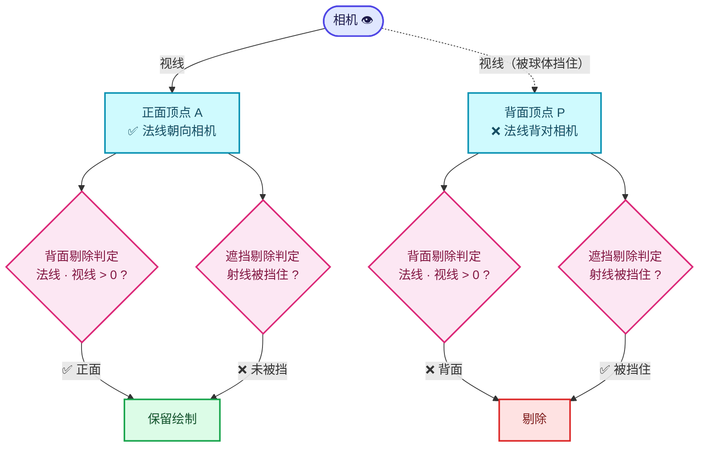

- **背面剔除**看的是 **P 处表面的法线**是否背对相机 → P 被剔除 ✅
- **遮挡剔除**看的是 **从相机到 P 的射线**是否被球体自身挡住 → P 被剔除 ✅

对**球体背面顶点**这两个答案**恰好相同**，所以作者起名叫 "Exclude Backfaces"。

### 2.3 但它们不等价

考虑这些反例：

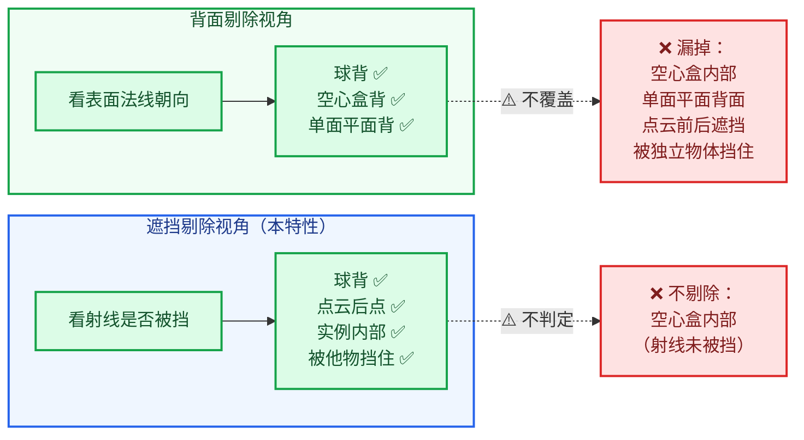

| 场景 | 背面剔除 | 遮挡剔除 |
|------|----------|----------|
| 球体背面的顶点 | 剔除 ✅ | 剔除 ✅ |
| **立方体背面中心，但立方体是空心的** | 剔除 ✅ | **不剔除** ❌（射线没被挡） |
| **开放曲面（如单面平面）背面的点** | 剔除 ✅ | **不剔除** ❌ |
| **前面有一个独立物体挡住的正面顶点** | **不剔除** ❌ | 剔除 ✅ |
| **点云：后面的点被前面的点挡住** | **不剔除** ❌ | 剔除 ✅ |
| 实例：内部实例被外壳挡住 | **不剔除** ❌ | 剔除 ✅ |

⭐ **结论**：这个特性实际上做的是**遮挡剔除**，覆盖面比"排除背面"广得多。UI 文案叫 "Exclude Backfaces" 是不准确的，RNA 的 `ui_text` 反而写对了（"Hide Viewer attribute text when the position is occluded by the mesh"）。这点在 [07-问题清单](./07-问题清单与修复.md) 有记录。

> 💡 **为什么作者会这么命名？** 因为这个特性的动机场景是"球体/闭合网格的背面标签穿透显示"，用户直觉上会理解为"排除背面"。但实现上顺带解决了点云前后遮挡、实例遮挡等问题，这是**更好的结果**。

---

## 3. 齐次坐标与投影

### 3.1 为什么需要第四维

3D 图形学用 **4D 齐次坐标**表示 3D 点。原因：

1. **统一表示平移和线性变换**：4×4 矩阵可以一次性表达旋转+缩放+平移。
2. **透视投影无法用 3×3 矩阵表达**：透视需要"除以深度"，这只能用 `w` 分量实现。

一个 3D 点 `(x, y, z)` 在齐次坐标里是 `(x, y, z, 1)`（`w=1` 表示这是个"点"而非"方向"）。

### 3.2 代码中的体现

```cpp
/* draw_manager_text.cc:193-196 */
float vec4[4];
copy_v3_v3(vec4, co);     // vec4[0..2] = co[0..2]
vec4[3] = 1.0;            // w = 1  ← 齐次化
mul_m4_v4(perspmat, vec4);  // 矩阵乘 4D 向量
```

`mul_m4_v4(M, v)` 等价于：

```
┌ m00 m01 m02 m03 ┐   ┌ x ┐   ┌ x' ┐
│ m10 m11 m12 m13 │ × │ y │ = │ y' │
│ m20 m21 m22 m23 │   │ z │   │ z' │
└ m30 m31 m32 m33 ┘   └ 1 ┘   └ w' ┘
```

矩阵乘法**自带在同一个矩阵里表达平移**，这就是为什么 `co` 要补一个 `1.0`。

> ⚠️ **对比**：如果补 `0.0`，那就是"方向向量"，平移分量（矩阵第 4 列）不参与运算。代码里的 `math::transform_direction()` 就是干这个的。

### 3.3 透视投影矩阵的形状

典型透视投影矩阵（Blender `winmat`）：

```
┌ f/aspect   0        0            0        ┐
│    0       f        0            0        │
│    0       0   -(far+near)/(far-near)  -2*far*near/(far-near) │
└    0       0       -1            0        ┘
```

注意第 4 行是 `[0, 0, -1, 0]`，所以：

```
w' = -z_view
```

**`w` 就等于观察空间里到相机的距离**（取负是因为观察空间相机看向 −z）。

这就是透视除法的精髓：**越远的点 `w` 越大，除以 `w` 后坐标越小 → 近大远小**。

---

## 4. NDC 与深度值

### 4.1 透视除法

```
ndc.x = clip.x / clip.w
ndc.y = clip.y / clip.w
ndc.z = clip.z / clip.w
```

`ndc` 在 `[-1, 1]³` 内（在裁剪空间外的会被裁剪）。

### 4.2 代码中的实现

```cpp
/* draw_manager_text.cc:197-217 */
const float w = fabsf(vec4[3]);
if (w == 0.0f) {
  return false;                       // 避免除零
}

const float scalar = 1.0f / w;
/* Behind the near plane: nothing to compare against. */
if (vec4[2] <= -w || vec4[2] >= w) {
  return false;                       // 近/远裁剪面之外
}

const float fx = (float(region.winx) / 2.0f) * (1.0f + (vec4[0] * scalar));
const float fy = (float(region.winy) / 2.0f) * (1.0f + (vec4[1] * scalar));
if (fx <= 0.0f || fy <= 0.0f || fx >= float(region.winx) || fy >= float(region.winy)) {
  return false;                       // 窗口外
}

/* Normalized device depth, mapped the same way gl_FragCoord.z is written. */
const float ndc_z = vec4[2] * scalar;
const float depth = (ndc_z + 1.0f) * 0.5f;
```

⭐ 逐步解释：

| 行 | 数学 | 说明 |
|----|------|------|
| `w = fabsf(vec4[3])` | $w = \|w'\|$ | 取绝对值，因为 `w'` 可能为负（点在相机后方） |
| `vec4[2] <= -w` | $z' \le -\|w'\|$ | 点在**近裁剪面之前**（太近） |
| `vec4[2] >= w` | $z' \ge \|w'\|$ | 点在**远裁剪面之后**（太远） |
| `fx = winx/2 * (1 + x'/w)` | $f_x = \frac{W}{2}(1 + \frac{x'}{w})$ | NDC `[-1,1]` → 窗口 `[0, W]` |
| `depth = (z'/w + 1) * 0.5` | $d = \frac{z'/w + 1}{2}$ | NDC `[-1,1]` → 深度 `[0,1]` |

### 4.3 这个 `*0.5 + 0.5` 是哪来的

OpenGL 的**默认深度范围是 `[0, 1]`**（DirectGL 风格），而 NDC 的 z 是 `[-1, 1]`。所以需要映射：

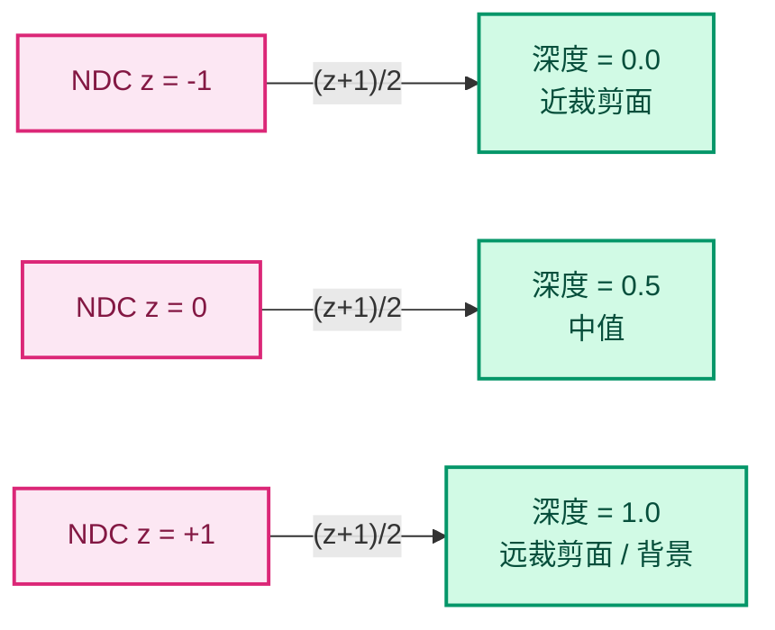

⭐ **关键**：GPU 写入深度缓冲的值就是这个公式的结果，也就是 `gl_FragCoord.z`。所以代码注释说：

> "Normalized device depth, mapped the same way gl_FragCoord.z is written."

**只有用完全相同的映射，CPU 算出的深度才能和回读的深度直接比较**。这是整个特性正确性的基石。

### 4.4 深度是非线性的 ⚠️

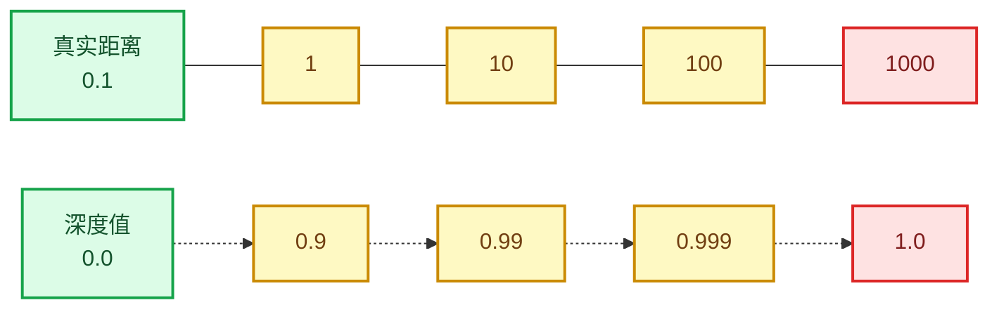

⭐ **精度集中在近裁剪面附近**。这直接解释了为什么代码里用**绝对偏置 `2.0e-5f`** 而不是相对偏置：

- 在近处，`2e-5` 的深度差对应极小的真实距离 → 保护"贴面标签"不被误剔除 ✅
- 在远处，深度值挤在 1.0 附近，`2e-5` 相对间隔已经很大 → 可能**过度保护** ⚠️

这是一个**启发式偏置**，不是物理精确的。详见 [07-问题清单](./07-问题清单与修复.md)。

---

## 5. 深度缓冲

### 5.1 什么是深度缓冲

深度缓冲（Z-Buffer / Depth Buffer）是**和颜色缓冲同尺寸的一张图**，每个像素存一个深度值，记录"目前这个像素上画过的最近的东西有多远"。

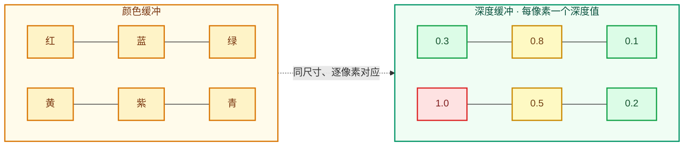

⭐ **`1.0` = 背景**（没有几何体）—— 这个约定是本特性判定的关键依据。

### 5.2 深度测试规则

默认规则 `GPU_DEPTH_LESS_EQUAL`：

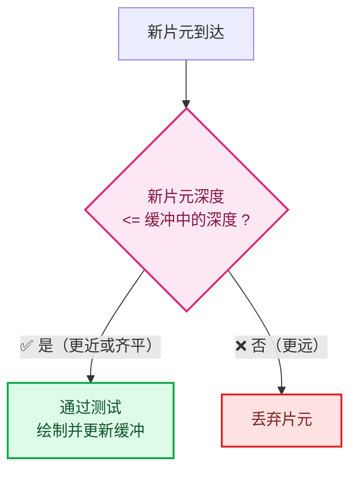

⚠️ **但文字是用 BLF 绘制的 2D 图元**，深度值是人为指定的常量，所以这把深度测试对文字**不适用**（见 §2.1）。本特性必须在 CPU 侧自己做比较。

### 5.3 清空值

深度缓冲在每帧开始时被清成 **1.0**（远裁剪面）：

```cpp
/* gpu_viewport.cc:185 */
GPU_texture_clear(viewport->depth_tx, GPU_DATA_FLOAT, &depth_clear);
```

⭐ **这非常重要**：代码里的遮挡判定依赖这个约定：

```cpp
/* draw_manager_text.cc:264-267 */
/* 1.0 is the cleared background; it never occludes. Add a small bias so anchors that
 * sit exactly on the surface (which is the common case) are kept visible. */
const bool occluded = scene_depth != 1.0f &&
                      anchor_depth > scene_depth + 2.0e-5f;
```

`scene_depth != 1.0f` 这一判断的含义是：**如果这个像素上没有几何体（背景），那它不遮挡任何东西**。

⚠️ 但这里有个理论上的漏洞：如果一个物体**恰好**在远裁剪面（深度正好 1.0），它就不会遮挡。实践中极少见，但值得知道。

---

## 6. 透视除法与 w 分量

### 6.1 为什么用 `fabsf(vec4[3])`

```cpp
const float w = fabsf(vec4[3]);
```

原始 `w'` = 观察空间 `-z`：

| 点的位置 | `z_view` | `w' = -z_view` | `fabsf(w')` |
|----------|----------|----------------|-------------|
| 相机前方 | 负 | **正** | 正 |
| 相机位置 | 0 | 0 | 0 |
| 相机后方 | 正 | **负** | 正 |

所以 `fabsf` 是为了统一处理相机后方的点。

⭐ 这也和 Blender 官方实现**完全一致**：

```cpp
/* view3d_project.cc:123 */
const float w = fabsf(vec4[3]);
```

### 6.2 为什么要检查 `vec4[2] <= -w || vec4[2] >= w`

这是近/远裁剪面检查，等价于 NDC 的 `|ndc.z| >= 1`：

```cpp
/* view3d_project.cc:129-135 —— 官方版本 */
if ((flag & V3D_PROJ_TEST_CLIP_NEAR) && (vec4[2] <= -w)) {
  return V3D_PROJ_RET_CLIP_NEAR;
}
if ((flag & V3D_PROJ_TEST_CLIP_FAR) && (vec4[2] >= w)) {
  return V3D_PROJ_RET_CLIP_FAR;
}
```

新代码把两者合并成一行，**语义等价**。

> ⚠️ 但有个差异：官方的 `ED_view3d_project_short_ex` 调用时只传了 `CLIP_BB | CLIP_WIN | CLIP_NEAR`，**没有传 `CLIP_FAR`**。而新代码的 `text_anchor_project_with_depth` **同时检查了近和远**。这导致一个不一致：一个点在远裁剪面之外时，第 1 次投影会**通过**（因为没查 FAR），但第 2 次投影会**返回 false** → 该标签被剔除。
>
> 实际上这个差异是**无害的**（远裁剪面外的标签本来就该剔除），但属于两套投影逻辑不一致的具体体现之一。

### 6.3 `scalar` 的计算差异

```cpp
/* 新代码 draw_manager_text.cc:202 */
const float scalar = 1.0f / w;

/* 官方 view3d_project.cc:137 */
const float scalar = (w != 0.0f) ? (1.0f / w) : 0.0f;
```

新代码在前面已经检查过 `w == 0.0f` 并提前返回，所以直接除是安全的。✅ 逻辑正确。

---

## 7. 为什么必须 CPU 回读

### 7.1 文字绘制的特殊性

前面提到过，文字用 BLF 绘制，走的是**2D 屏幕空间**路径：

```cpp
/* draw_manager_text.cc:170-174 */
BLF_draw_default(float(vos.sco[0] + vos.xoffs),
                 float(vos.sco[1] + vos.yoffs),
                 2.0f,                       // ← 深度值，但…
                 vos.str.data(),
                 size_t(vos.str.size()));
```

第三个参数 `2.0f` 是深度，但**在 `GPU_DEPTH_NONE` 下它不参与深度测试**，只影响深度写入（而深度写入通常也被禁用）。

⭐ 所以：**GPU 深度测试无法用于文字剔除**。文字没有"真实的 3D 深度"可言——它的深度是人为指定的常量。

### 7.2 三种可选方案的对比

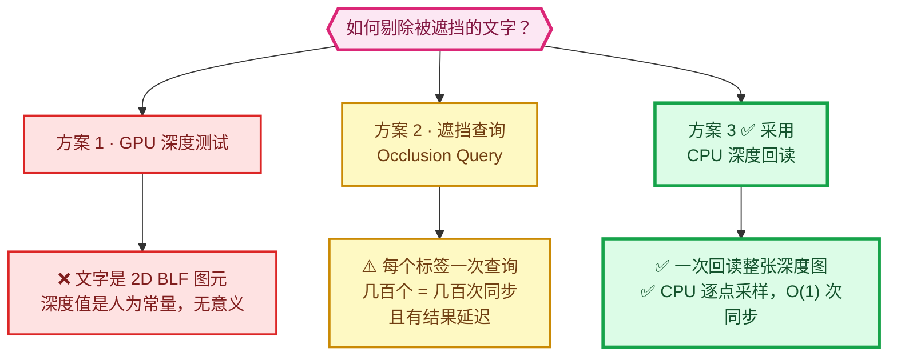

| 方案 | 可行性 | 说明 |
|------|--------|------|
| **GPU 深度测试** | ❌ | 文字是 2D 图元，深度无意义 |
| **遮挡查询（Occlusion Query）** | ⚠️ | 需要为每个标签发起一次查询，几百个标签 = 几百次查询，同步开销巨大；且查询结果有延迟 |
| **CPU 深度回读** | ✅ | 一次回读整张深度图，然后 CPU 逐点采样，O(1) 次同步 |

⭐ **结论**：对于"标签数量不多但需要逐个判断"的场景，**一次性回读 + CPU 采样是最优解**。这也是为什么 `DRW_text_cache_needs_depth_test()` 要做惰性判断——回读本身很贵，但"不该做时不做"就能规避。

### 7.3 回读的成本

`GPU_texture_read` 是一次**同步的 GPU→CPU 传输**：

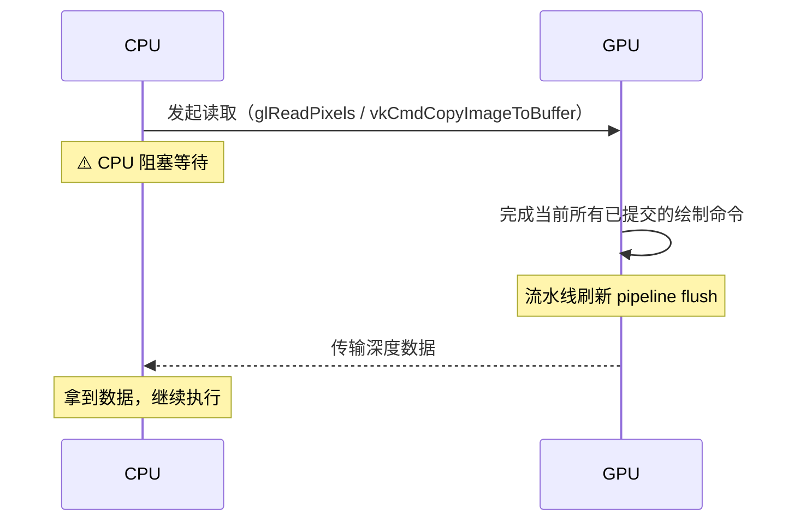

⭐ 成本 ≈ **强制 GPU 流水线刷新（pipeline flush）** + 传输时间。

| 分辨率 | 每帧传输量 | 60 FPS 带宽 |
|--------|-----------|-------------|
| 1920 × 1080 | **约 8 MB** | ~0.5 GB/s |
| 2560 × 1440 | 约 15 MB | ~0.9 GB/s |
| 3840 × 2160 | **约 33 MB** | ~2.0 GB/s |

**这就是为什么必须惰性化**：

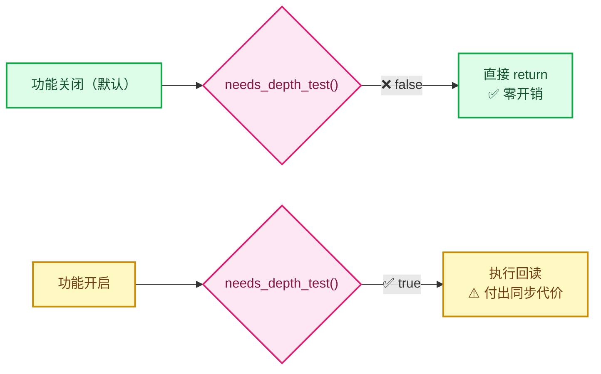

> 💡 源码里还有一条历史注释（`draw_manager_text.cc` 上方）提到 NOUVEAU 驱动下 `glReadPixels` 极慢，见 Blender issue #24339。

---

## 8. 深度精度与 Z-fighting

### 8.1 为什么会误剔除

最常见的场景：**锚点正好贴在表面上**。

```
       相机 👁
         │
         │  视线
         ↓
    ┌──────────┐  ← 表面，深度 = 0.500000
    │    ●P    │  ← 锚点 P，深度 = 0.500000（同一个位置！）
    └──────────┘
```

理论上 `anchor_depth == scene_depth`，应该**保留**。但：

1. **浮点误差**：CPU 用 `float` 重算投影，GPU 用另一种精度/顺序计算，结果可能差 1 ULP。
2. **采样点不同**：锚点投影的屏幕坐标取整后可能落在相邻像素上，而那个像素的深度是另一个表面。
3. **深度缓冲的写入精度**：通常是 24 位定点，有量化误差。

### 8.2 偏置的作用

```cpp
const bool occluded = scene_depth != 1.0f &&
                      anchor_depth > scene_depth + 2.0e-5f;
                                 //          ^^^^^^^ 偏置
```

这个 `+ 2.0e-5f` 的含义是：**只有当锚点明显比场景表面更远时，才算被遮挡**。

用不等式变形更清楚：

```
保留条件：  anchor_depth <= scene_depth + 2e-5
剔除条件：  anchor_depth  > scene_depth + 2e-5
```

### 8.3 偏置的取值分析

| 偏置值 | 效果 |
|--------|------|
| 0 | 贴面标签大量误剔除（浮点误差） |
| `2e-5` | 实践中可用，但远处的过度保护 |
| `1e-3` | 保护过强，真实的遮挡可能漏剔 |

⭐ **更好的做法**：用**相对偏置**，按深度量级缩放：

```cpp
const float bias = std::max(2.0e-5f, scene_depth * 1e-4f);
```

或者用**多像素采样**（取邻域最小值，避免单像素采到错误表面）。Blender 自己的 `ED_view3d_depth_read_cached` 就支持 `margin` 参数做邻域采样：

```cpp
/* view3d_utils.cc:1883-1896 */
if (margin) {
  /* TODO: No need to go spiral. */
  BLI_array_iter_spiral_square(vd->depths, shape, mval, depth_read_test_fn, &data);
  depth = data.r_depth;   // 取邻域最小值
}
```

> 💡 如果这个 patch 用 `ED_view3d_depth_read_cached(vd, mval, margin, &r_depth)` 而不是手写采样，就能**直接复用官方 API**，还能顺便获得 margin 支持。详见 [07-问题清单](./07-问题清单与修复.md)。

### 8.4 关于 `V3D_PROJ_TEST_CLIP_BB`

```cpp
V3D_PROJ_TEST_CLIP_BB | V3D_PROJ_TEST_CLIP_WIN | V3D_PROJ_TEST_CLIP_NEAR
```

`CLIP_BB` 会检查 `rv3d->rflag & RV3D_CLIPPING`（用户设置的**裁剪边界**，即 `N` 面板里的 Clip Start/End 和裁剪平面）：

```cpp
/* view3d_project.cc:111-118 */
if (flag & V3D_PROJ_TEST_CLIP_BB) {
  const RegionView3D *rv3d = static_cast<const RegionView3D *>(region->regiondata);
  if (rv3d->rflag & RV3D_CLIPPING) {
    if (ED_view3d_clipping_test(rv3d, co, is_local)) {
      return V3D_PROJ_RET_CLIP_BB;
    }
  }
}
```

⚠️ **注意**：`text_anchor_project_with_depth` **没有做这个检查**。这是一个小的不一致（见 [07](./07-问题清单与修复.md)），但影响很小，因为第一次投影已经检查过了。

---

## 9. 屏幕坐标约定

### 9.1 窗口空间的 y 轴方向

⭐ **这是 OpenGL 与 Vulkan/Metal 之间最容易踩的坑。**

```
OpenGL:                       Vulkan / Metal:
(0,0) 在左下角                (0,0) 在左上角
      ↑ y                          ↓ y
      │                            │
      └────→ x                     └────→ x
```

Blender 的项目函数 `ed_view3d_project__internal` 用的是：

```cpp
const float fy = (float(region->winy) / 2.0f) * (1.0f + (vec4[1] * scalar));
```

这是 **NDC y = -1 → fy = 0**，即 **(0,0) 在左下角**，符合 OpenGL 约定。

### 9.2 深度纹理的行序

另一侧的坑：`GPU_texture_read` 返回的数据，其**行序**取决于后端。

代码中的采样是：

```cpp
const float scene_depth = dt->depths->depths[y * dt->depths->w + x];
```

其中 `y` 来自投影的 `fy`（左下角原点）。

⚠️ **潜在风险**：如果后端返回的深度数据是**从上到下**的行序（某些 Vulkan 实现），那 `y` 就需要翻转，否则会**采到上下镜像的深度值**——导致遮挡判断完全错乱。

> 💡 **建议验证**：Blender 的 `view3d_depths_create` → `GPU_texture_read` 到 `ED_view3d_depth_read_cached` 的用法，说明**这套约定是被官方认可的**（`depths[y * w + x]`，`y` 来自 `region` 的窗口坐标）。所以这里大概率是对的，但值得在实际测试中确认——尤其是在 Vulkan 后端上。
>
> 参考 `view3d_utils.cc:1898`：
> ```cpp
> depth = vd->depths[y * vd->w + x];
> ```
> 完全相同的索引方式。✅ 因此**这个索引约定是与官方一致的**。

### 9.3 `region.winx` / `region.winy` vs 深度纹理尺寸

代码里有一个**值得注意的细节**：

```cpp
/* draw_manager_text.cc:210 — 用 region 的尺寸做范围检查 */
if (fx <= 0.0f || fy <= 0.0f || fx >= float(region.winx) || fy >= float(region.winy)) {
  return false;
}
```

```cpp
/* draw_manager_text.cc:259 — 用深度纹理的尺寸做索引检查 */
if (x < 0 || y < 0 || x >= dt->depths->w || y >= dt->depths->h) {
  vos.sco[0] = IS_CLIPPED;
  continue;
}
```

⭐ **两套尺寸检查都存在，这是正确的防御性编程**：

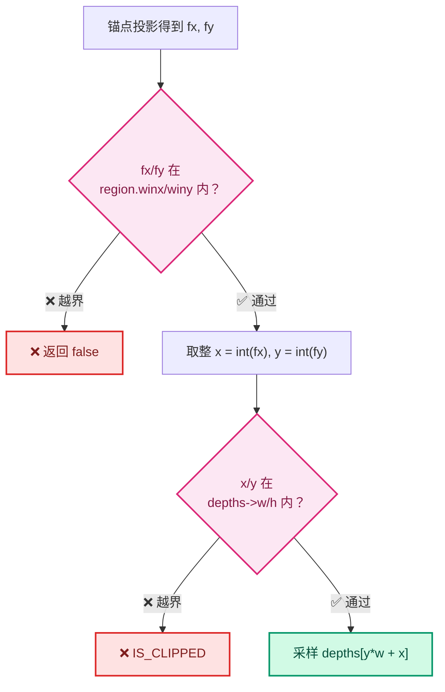

在 Retina/HiDPI 屏上，深度纹理可能是区域的 2 倍分辨率：

| | 逻辑区域 | 深度纹理（2× HiDPI） |
|---|---------|---------------------|
| 宽 | `region.winx` = 1920 | `depths->w` = 3840 |
| 高 | `region.winy` = 1080 | `depths->h` = 2160 |

所以 `fx < region.winx` **不代表** `x < depths->w`。**两次检查都必要** ✅ 这一点作者做对了。

---

## 10. 射线与 AABB 求交

用于 [05-锚点偏移数学](./05-锚点偏移数学.md) 里的实例锚点修正。

### 10.1 什么是 AABB

**AABB** = Axis-Aligned Bounding Box，轴对齐包围盒。用两个点表示：

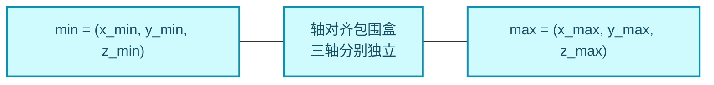

在 Blender 里是 `Bounds<float3>`：

```cpp
/* view3d_utils / BLI_bounds_types.hh:70 */
bool contains(const T &point) const;
```

### 10.2 Slab 算法（平板法）

判断射线是否与 AABB 相交的经典算法。思路：把 AABB 看成三对平行平面（"平板"），分别计算射线进入和离开每对平面的参数 `t`。

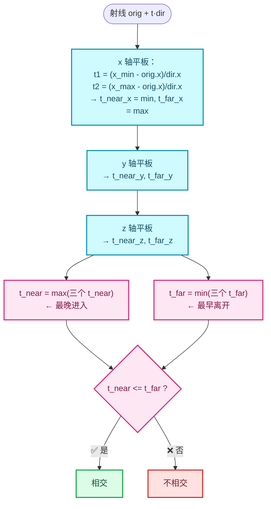

### 10.2.1 ⭐ 起点在盒内：`t_near < 0` 而 `t_far > 0`

**这是理解 [05-§6](./05-锚点偏移数学.md) 那个命名陷阱的关键。**

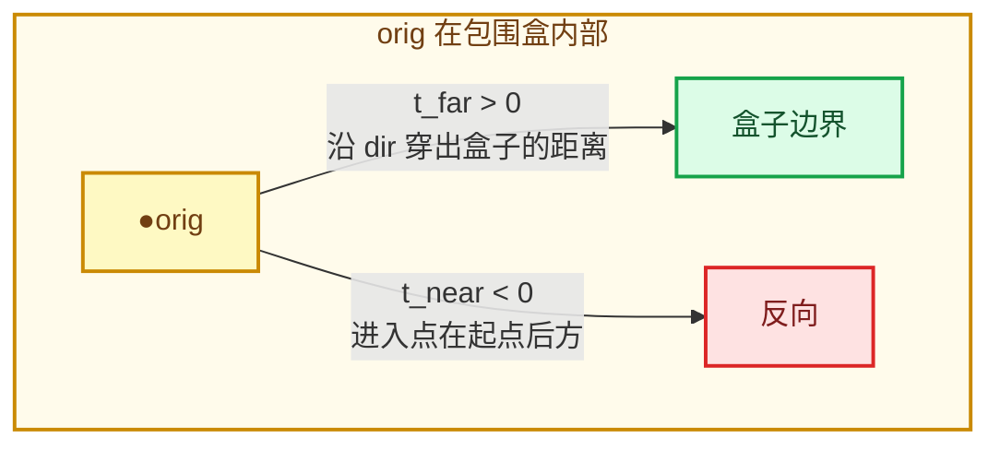

⭐ **所以当 `orig` 在盒内时，"沿 `dir` 到达盒子表面的距离"就是 `t_far`（正值），而不是 `t_near`（负值）。**

这正是实例锚点偏移使用 `tmax` 而非 `tmin` 的原因 —— 功能是正确的，只是变量命名误导（详见 [05-§6](./05-锚点偏移数学.md) 与 [07-M2](./07-问题清单与修复.md)）。

### 10.3 Blender 的实现

```cpp
/* BLI_math_geom_c.hh:906-911 —— 签名 ⭐ 记住参数顺序 */
bool isect_ray_aabb_v3_simple(const float orig[3],
                              const float dir[3],
                              const float bb_min[3],
                              const float bb_max[3],
                              float *tmin,      // ← 第 5 个：进入距离
                              float *tmax);     // ← 第 6 个：离开距离
```

实现：

```cpp
/* math_geom.cc:3279-3310 */
bool isect_ray_aabb_v3_simple(const float orig[3], const float dir[3],
                              const float bb_min[3], const float bb_max[3],
                              float *tmin, float *tmax)
{
  double t[6];
  float hit_dist[2];
  const double invdirx = (dir[0] > 1e-35f || dir[0] < -1e-35f) ? 1.0 / double(dir[0]) : DBL_MAX;
  /* ... y, z 同理 ... */
  t[0] = double(bb_min[0] - orig[0]) * invdirx;
  t[1] = double(bb_max[0] - orig[0]) * invdirx;
  /* ... */
  hit_dist[0] = float(fmax(fmax(fmin(t[0], t[1]), fmin(t[2], t[3])), fmin(t[4], t[5])));  // t_near
  hit_dist[1] = float(fmin(fmin(fmax(t[0], t[1]), fmax(t[2], t[3])), fmax(t[4], t[5])));  // t_far
  if ((hit_dist[1] < 0.0f) || (hit_dist[0] > hit_dist[1])) {
    return false;
  }
  if (tmin) { *tmin = hit_dist[0]; }   // ← 进入距离
  if (tmax) { *tmax = hit_dist[1]; }   // ← 离开距离
  return true;
}
```

### 10.4 ⚠️ 语义陷阱：射线起点在盒子内部

⭐ **这是理解 [05-§6](./05-锚点偏移数学.md) 那个命名陷阱的关键。**

当 `orig`（射线起点）**在 AABB 内部**时：

```
t_near = fmaxf(...) 会是负数！   ← 因为"进入点"在起点的后方
t_far  = fminf(...) 会是正数     ← "离开点"在起点的前方
```

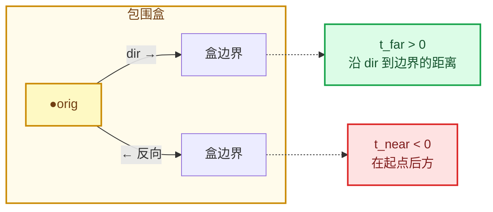

⭐ **所以"起点在内部"时，`t_near` 是负的，`t_far` 才是沿射线方向真正到达边界的距离。**

⭐⭐ **结论：实例锚点偏移代码使用 `tmax` 是【正确】的** —— 因为 `local_direction` 指向相机，沿它穿出盒子就到达了"靠近相机那一侧的表面"。

⚠️ **但变量名 `entry_distance` 是错的**（实为穿出距离），会诱导后续维护者交换参数位置，从而引入真正的 bug。详见 [05-§6](./05-锚点偏移数学.md) 与 [07-M2](./07-问题清单与修复.md)。

### 10.5 另一个陷阱：方向向量必须归一化

```cpp
/* BLI_math_geom_c.hh:903-904 */
/* \note \a direction should be normalized
 * if you intend to use the \a tmin or \a tmax distance results! */
```

⭐ 因为 `t` 是**参数**（`P = orig + t * dir`），只有当 `|dir| = 1` 时 `t` 才等于**实际距离**。

⚠️ 新代码里传的 `local_direction` 是哪来的？

```cpp
/* overlay_attribute_text.hh:255 */
const float3 local_direction = math::transform_direction(world_to_object, toward_camera);
```

`world_to_object = math::invert(object_to_world)`，如果物体有缩放，`local_direction` 的模长**不是 1**！

⭐ 这带来一个**次要但真实的精度问题**：

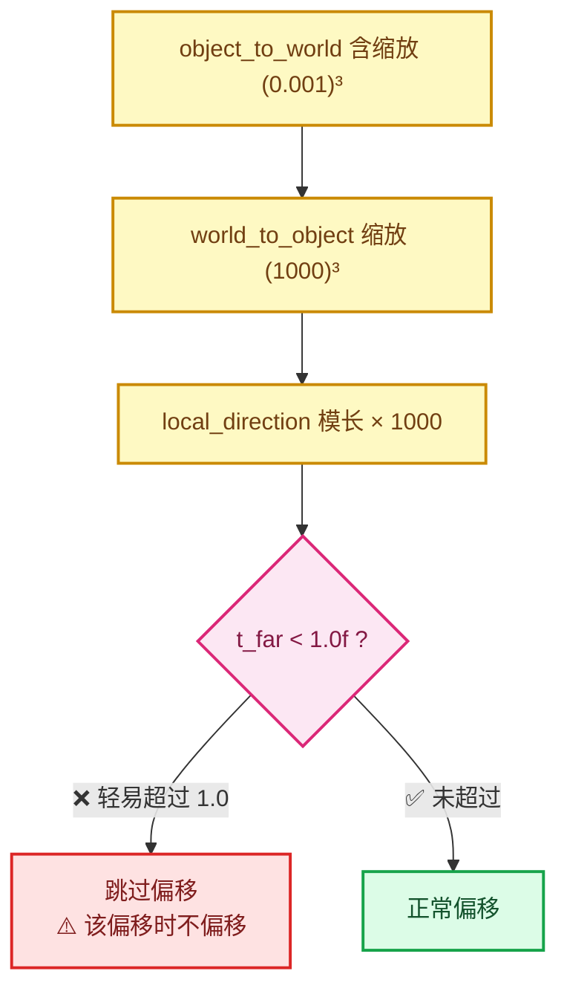

⭐ 注意：`local_anchor += local_direction * t_far` 这个乘法用的是**未归一化的方向**，所以**锚点位置的结果恰好是正确的**（参数化与模长无关）。受影响的是 `t_far < 1.0f` 这个启发式判断（见 [07-S6](./07-问题清单与修复.md)）。

但后面两个判断：

```cpp
entry_distance > 0.0f && (state.rv3d == nullptr || !state.rv3d->is_persp || entry_distance < 1.0f)
```

`entry_distance < 1.0f` 这个"不超过 1 米"的启发式判断，在非归一化方向下**含义就错了**。

---

## 11. 点云渲染原理

理解点云标签为什么要做半径偏移，需要知道点云是怎么画的。

### 11.1 点云不是 GL_POINTS

现代 Blender 的点云用**面向相机的四边形（billboard quad）**绘制，不是 `gl_PointSize` 那种正方形点。

关键代码：

```glsl
/* draw_pointcloud_lib.glsl:50-74 —— 每个点生成 7 个顶点（三角形扇） */
switch (vert_id % DRW_POINTCLOUD_STRIP_TILE_SIZE) {
  case 0: pt.shape_pos = float3(-1.0, 0.0, 0.0); break;
  case 1: pt.shape_pos = float3(0.0, -1.0, 0.0); break;
  case 2: pt.shape_pos = float3(0.0, 0.0, 1.0); break;
  case 3: pt.shape_pos = float3(1.0, 0.0, 0.0); break;
  ...
}
```

### 11.2 朝向相机的圆盘

```glsl
/* draw_pointcloud_lib.glsl:111-123 */
ShapePoint shape_point_get(const Point pt, const float3 V, ...)
{
  ShapePoint shape;
  shape.N = facing_matrix(V, up_axis) * pt.shape_pos;   // 面向相机的坐标系
  shape.P = pt.P + shape.N * pt.radius;                 // ← 沿法线方向偏移 radius
  return shape;
}
```

⭐ **`shape.P = pt.P + shape.N * pt.radius`** —— 这就是"点云渲染成一个以 `pt.P` 为中心、半径为 `radius` 的面向相机的圆盘"的含义。

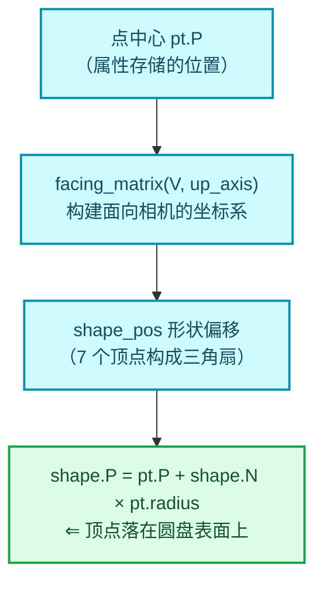

### 11.3 半径的单位换算

```glsl
/* draw_pointcloud_lib.glsl:78-83 */
Point object_to_world(Point pt, float4x4 object_to_world)
{
  pt.P = transform_point(object_to_world, pt.P);
  pt.radius *= length(to_scale(object_to_world)) * M_SQRT1_3;   // ⭐ 关键！
  return pt;
}
```

⭐ **`M_SQRT1_3 = 1/√3 ≈ 0.577350269`**：

```cpp
/* gpu_shader_math_constants.bsl.hh:14 */
#define M_SQRT1_3 0.57735026918962576450f /* 1/sqrt(3) */
```

### 11.4 为什么是 1/√3

点云的 `radius` 属性定义的是**内接立方体的半边长**，而渲染时的**球半径**是其对角因子。推导：


⭐ **所以 `1/√3` 是把"属性里存的半径"换算成"实际绘制的世界空间半径"的系数。**

⭐ **C++ 侧与 GPU 侧完全对应**：

| | GPU（GLSL） | CPU（C++） |
|---|-------------|------------|
| 缩放因子 | `length(to_scale(object_to_world))` | `math::length(math::to_scale(object_to_world))` |
| 常数 | `M_SQRT1_3` | `0.577350269f` ⚠️ 硬编码 |

⭐ **数值完全相同** ✅ 所以**数值是正确的**。问题只在于 C++ 侧**被硬编码**而不是引用 `M_SQRT1_3`。（见 [07-S2](./07-问题清单与修复.md)）

### 11.5 为什么标签需要偏移

现在图景清楚了：

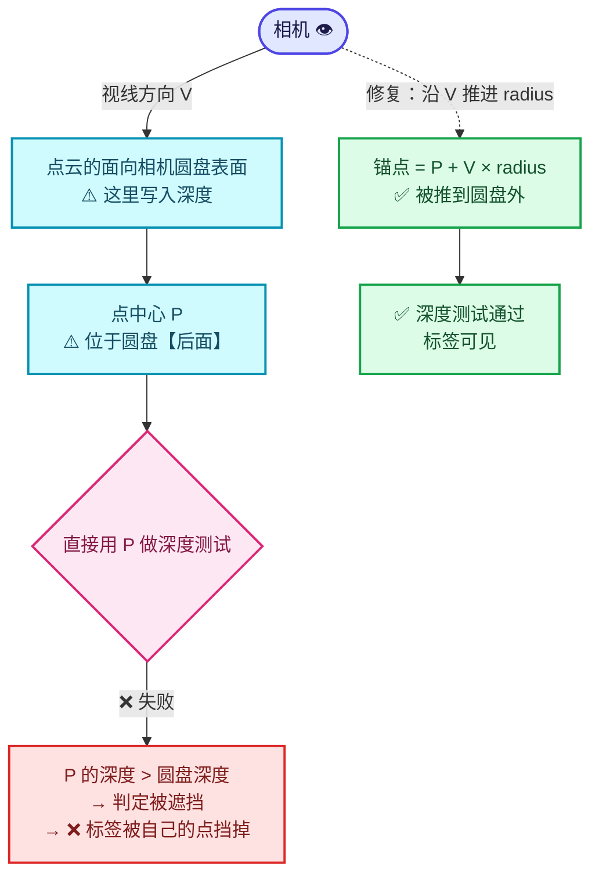

⭐ **点的中心 `P` 位于它自己的圆盘"后面"**。所以如果直接用 `P` 作为锚点做深度测试：

1. 深度图在那个像素记录的是**圆盘表面**的深度（更近）。
2. 锚点 `P` 的深度**更远**。
3. → 判定为"被遮挡" → **标签被自己的点挡掉了** ❌

**修复**：沿视线方向把锚点推到圆盘之外：

```cpp
/* overlay_attribute_text.hh:136-147 */
const float radius_scale = math::length(math::to_scale(object_to_world)) * 0.577350269f;
const bool is_perspective = state.rv3d != nullptr && state.rv3d->is_persp;
Array<float3> anchors(positions.size());
for (const int i : positions.index_range()) {
  const float3 center = math::transform_point(object_to_world, positions[i]);
  const float3 to_camera = is_perspective ? state.camera_position - center :
                                            state.camera_forward;
  const float distance = math::length(to_camera);
  const float3 direction = distance > 1.0e-20f ? to_camera / distance :
                                                 state.camera_forward;
  anchors[i] = center + direction * (std::max(radii[i], 0.0f) * radius_scale);
}
```

⭐ 这段代码的正确性分析：

| 方面 | 分析 |
|------|------|
| 方向 | **归一化**了（`to_camera / distance`）✅ 与 GLSL 的 `V` 一致 |
| 透视相机 | `camera_position - center` → 从点指向相机的方向 ✅ |
| 正交相机 | `camera_forward` → 固定方向 ✅ |
| 退化情况 | `distance ≈ 0` 时回退到 `camera_forward` ✅ 防御性编程 |
| 半径负值 | `std::max(radii[i], 0.0f)` ✅ 防止负半径反向偏移 |
| 缩放系数 | `length(to_scale(mw)) * 0.577350269f` ✅ 与 GLSL 完全对应 |

⭐ **这个偏移本质上复刻了官方 GLSL**：

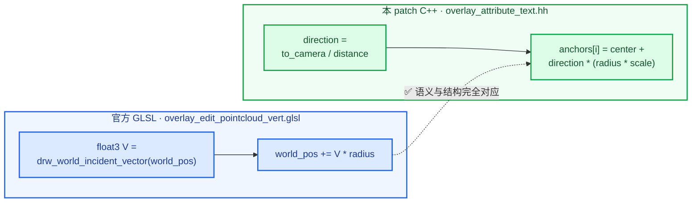

**Blender 官方的点云编辑模式就是这么做"让选择点画在点前面"的**（注释原文：`Offset the position so the selection point is always drawn in from of the point`）。作者显然是参考了这个先例。👍

---

## 小结

```mermaid
flowchart TD
  H["齐次坐标 w<br/>透视除法分母"] --> N["NDC → [0,1] 映射<br/>让 CPU 深度可与 GPU 比较"]
  N --> B["深度缓冲<br/>场景表面有多远"]
  B --> C["清空值 1.0<br/>背景不遮挡"]
  B --> P["非线性深度<br/>解释为何用绝对偏置 2e-5"]
  B --> S["同步回读<br/>解释为何必须惰性化"]
  A["Slab 算法<br/>实例锚点包围盒修正"] --> R["t_far 才是盒内穿出距离"]
  M["M_SQRT1_3<br/>半径 → 世界空间换算"] --> O["点云锚点偏移"]
  L["BLF 是 2D 图元<br/>GPU 深度测试不可用"] --> K["必须 CPU 回读 + 比较"]

  classDef depth fill:#D1FAE5,stroke:#059669,color:#064E3B,stroke-width:2px;
  classDef geom fill:#CFFAFE,stroke:#0891B2,color:#164E63,stroke-width:2px;
  classDef judge fill:#FCE7F3,stroke:#DB2777,color:#831843,stroke-width:2px;

  class H,N,B,C,P,S depth;
  class A,R,M,O geom;
  class L,K judge;
```

| 知识点 | 在本特性中的作用 |
|--------|------------------|
| 齐次坐标 `w` | 透视除法的分母，也是深度比较的基础 |
| NDC → `[0,1]` 映射 | 让 CPU 算的深度能和 GPU 回读值比较 |
| 深度缓冲 | 提供"场景表面有多远"的信息 |
| 清空值 1.0 | "背景不遮挡任何东西"的判定依据 |
| 非线性深度 | 解释为什么用绝对偏置 `2e-5` |
| 同步回读 | 解释为什么必须惰性化 |
| Slab 算法 | 实例锚点包围盒修正（注意用 `t_far`） |
| `M_SQRT1_3` | 点云半径从"属性值"到"世界半径"的换算 |
| BLF 2D 绘制 | 解释为什么不能用 GPU 深度测试 |

---

## 下一步

- 看属性层怎么接线 → [02-属性层-DNA-RNA-UI](./02-属性层-DNA-RNA-UI.md)
- 看核心实现 → [03-文本缓存遮挡测试核心](./03-文本缓存遮挡测试核心.md)
- 直接看问题 → [07-问题清单与修复](./07-问题清单与修复.md)
