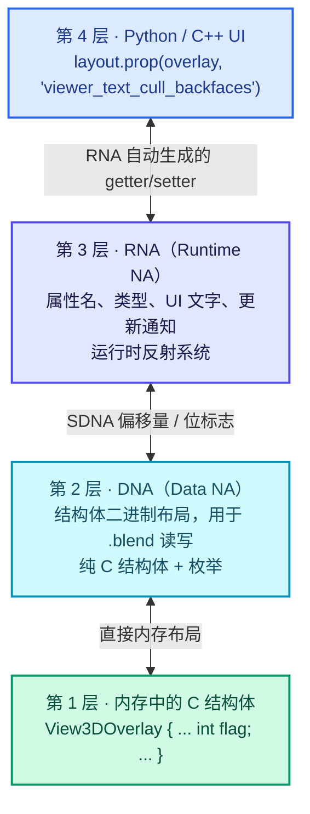
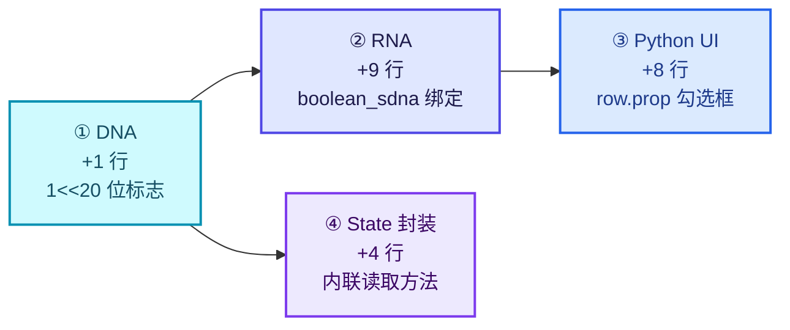
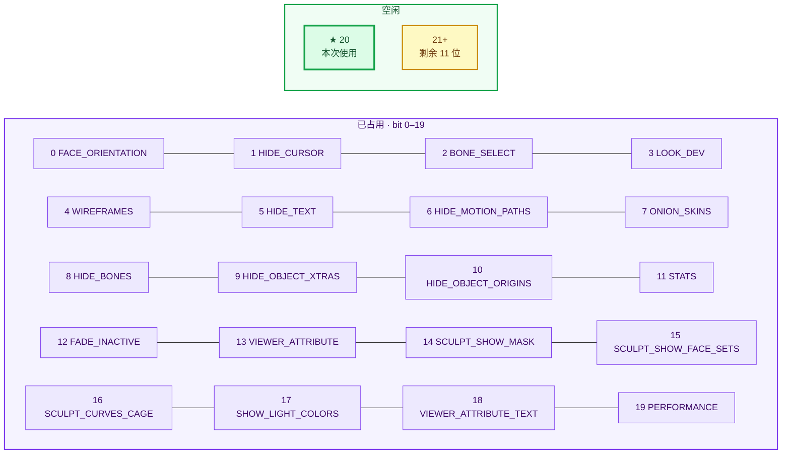
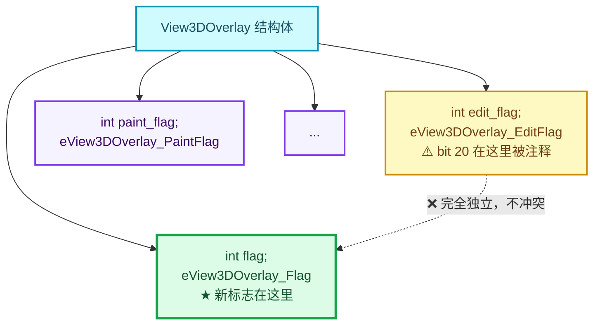
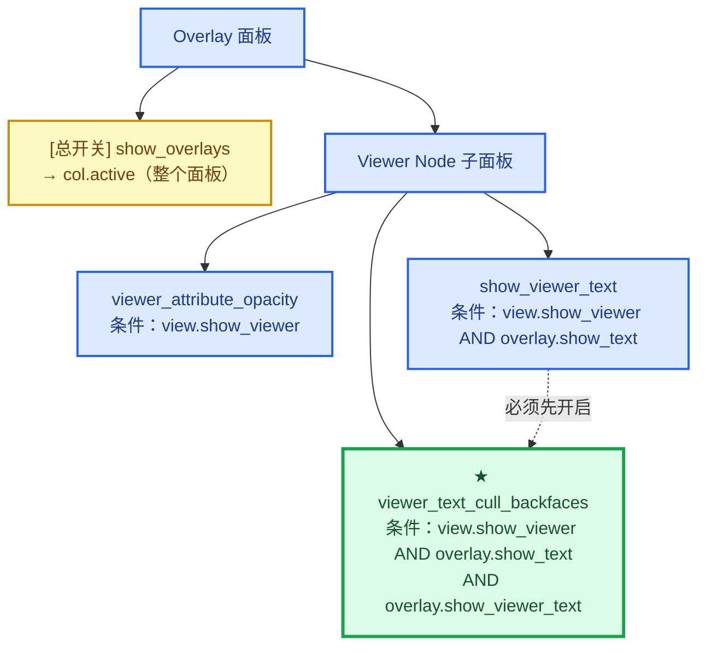
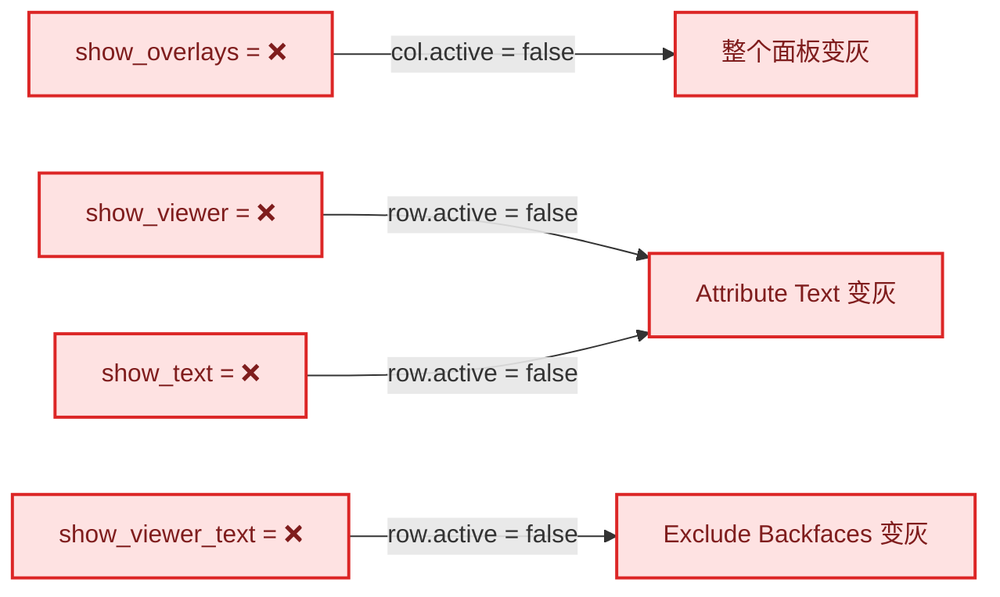
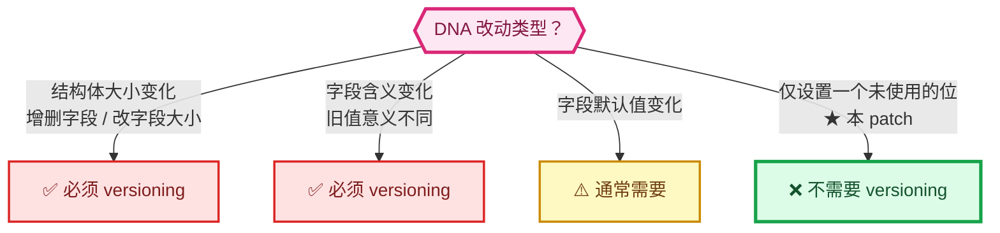
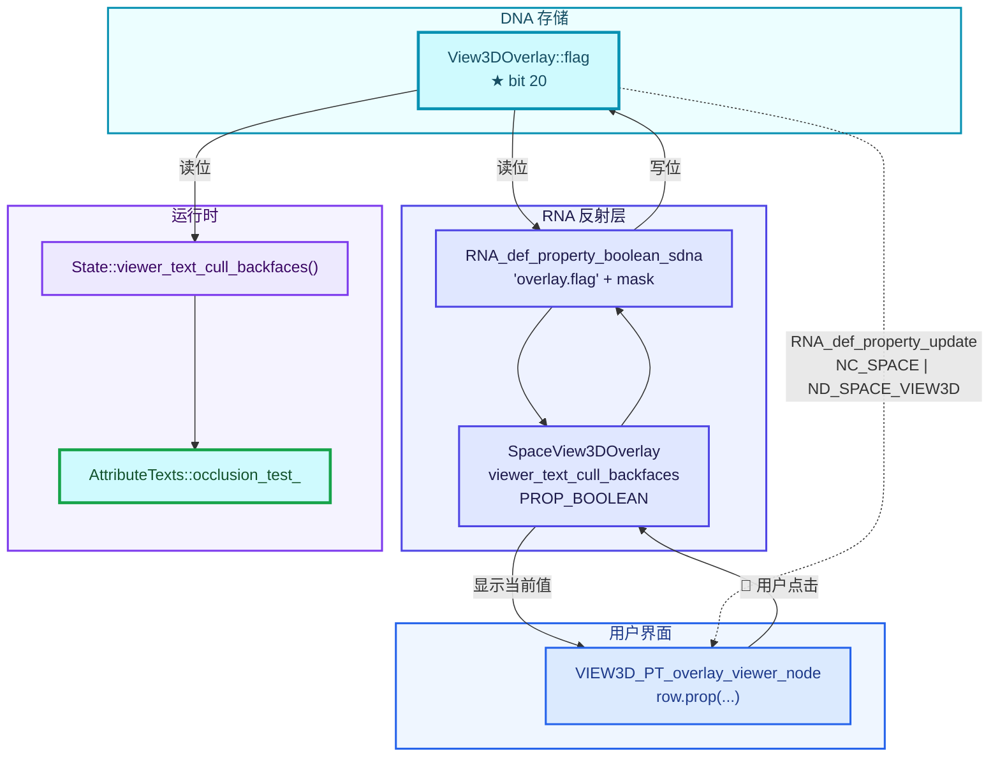
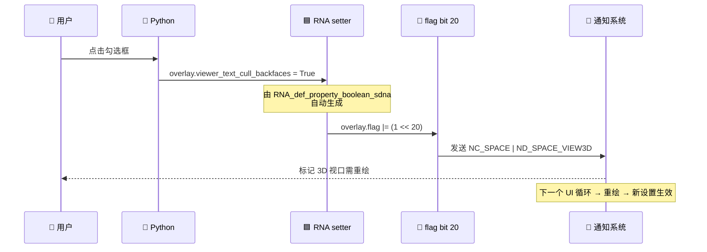
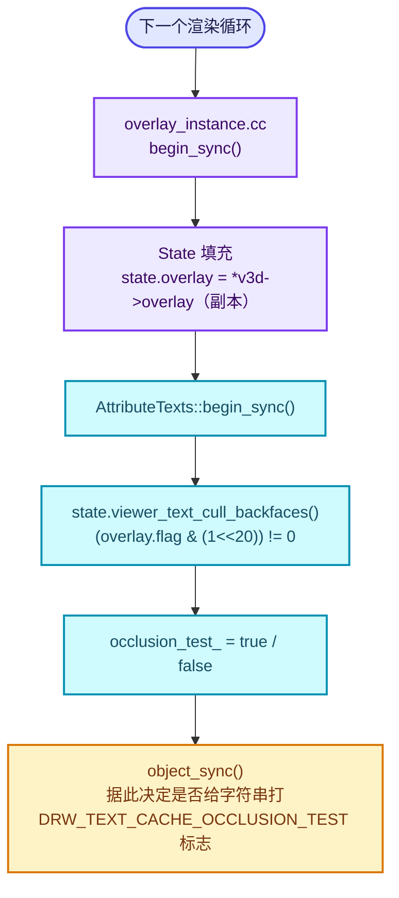

# 02 - 属性层：DNA / RNA / UI

> 🔗 [返回索引](./README.md) | 上一篇：[01-背景知识与原理](./01-背景知识与原理.md) | 下一篇：[03-文本缓存遮挡测试核心](./03-文本缓存遮挡测试核心.md)

本文讲解**如何给 Blender 添加一个新的界面开关**。这是每个 Blender 特性开发都要走的路，理解这一层能让你以后独立加任何属性。

涉及 4 个文件、22 行代码：

| 文件 | 改动 | 职责 |
|------|------|------|
| `makesdna/DNA_view3d_types.h` | +1 | 定义数据存储（位标志） |
| `makesrna/intern/rna_space.cc` | +9 | 暴露为 RNA 属性（Python 可访问） |
| `scripts/startup/bl_ui/space_view3d.py` | +8 | 界面上的勾选框 |
| `draw/engines/overlay/overlay_private.hh` | +4 | 运行时读取封装 |

---

## 目录

- [1. Blender 属性系统架构](#1-blender-属性系统架构)
- [2. DNA 层：数据定义](#2-dna-层数据定义)
- [3. RNA 层：属性绑定](#3-rna-层属性绑定)
- [4. Python UI 层](#4-python-ui-层)
- [5. State 层：运行时读取](#5-state-层运行时读取)
- [6. 为什么不需要版本升级](#6-为什么不需要版本升级)
- [7. 完整的数据流](#7-完整的数据流)
- [8. 扩展练习](#8-扩展练习)

---

## 1. Blender 属性系统架构

Blender 的属性系统是**四层结构**：



⭐ **为什么分 DNA 和 RNA**：

| | DNA | RNA |
|---|-----|-----|
| 全称 | Data NA | Runtime NA |
| 目的 | **文件格式**兼容（.blend 读写） | **运行时**统一访问接口 |
| 形式 | C 结构体定义 | 运行时注册的属性描述 |
| 面向 | 磁盘 | Python / UI / 逻辑代码 |
| 类比 | 数据库表结构 | ORM 映射 |

### 1.1 本 patch 在这四层中的落点



---

## 2. DNA 层：数据定义

### 2.1 改动内容

```cpp
/* DNA_view3d_types.h:307-311 */
enum eView3DOverlay_Flag : int {
  V3D_OVERLAY_FACE_ORIENTATION = (1 << 0),
  /* ... 省略 17 个 ... */
  V3D_OVERLAY_SHOW_LIGHT_COLORS = (1 << 17),
  V3D_OVERLAY_VIEWER_ATTRIBUTE_TEXT = (1 << 18),
  V3D_OVERLAY_PERFORMANCE = (1 << 19),
  V3D_OVERLAY_VIEWER_TEXT_CULL_BACKFACES = (1 << 20),   // ← 新增
};
ENUM_OPERATORS(eView3DOverlay_Flag)
```

只有一行。⭐ 但这一行包含了好几个知识点。

### 2.2 知识点 1：为什么用位标志而不是独立布尔字段

**替代方案对比**：

<details>
<summary><b>方案 A：加一个独立的 bool 字段</b></summary>

```cpp
typedef struct View3DOverlay {
  /* ... */
  int flag;
  char viewer_text_cull_backfaces;   // ← 新增字段
  /* ... */
} View3DOverlay;
```

❌ **缺点**：
1. **改变结构体布局** → 必须做**文件版本升级**（versioning），否则旧 .blend 读进来字段值不确定。
2. **浪费内存**：一个 bool 占 1 字节并破坏对齐（实际可能占 4–8 字节）。
3. **DNA 结构体一旦修改，所有 `.blend` 兼容性测试都要重新跑。**

</details>

<details>
<summary><b>方案 B：复用现有的 flag 位</b>（实际采用）</summary>

```cpp
V3D_OVERLAY_VIEWER_TEXT_CULL_BACKFACES = (1 << 20),
```

✅ **优点**：
1. **不改变结构体大小** → 无需版本升级。
2. **零额外内存**（`int` 有 32 位，只用了 21 位）。
3. **旧 .blend 自然兼容**：旧文件里这一位是 0 → 功能关闭 → 正是我们想要的行为 ✅

⭐ **这是 Blender 里添加"布尔开关"的标准做法。**

</details>

### 2.3 知识点 2：位不能被占用

必须确认 `1 << 20` 是**空闲**的。核对整个枚举：



✅ **确认 bit 20 未被占用**，选择正确。

⚠️ **位预算提示**：`int` 是 32 位，已用到 bit 20，**只剩 11 位可用**。将来用尽需改用 `int64_t`（会触发版本升级）或新增 `flag2` 字段。

### 2.4 ⚠️ 知识点 3：别被相邻枚举误导

⚠️ **这是很容易踩的坑**。同一个文件里紧挨着的**另一个枚举** `eView3DOverlay_EditFlag` 里，bit 20 是**被注释掉的**：

```cpp
/* DNA_view3d_types.h:344-346 */
  // V3D_OVERLAY_EDIT_CU_HANDLES = (1 << 20),    // ← 这个在另一个枚举里
  V3D_OVERLAY_EDIT_CU_NORMALS = (1 << 21),
```

⭐ **但它属于 `eView3DOverlay_EditFlag`，存在 `overlay.edit_flag` 字段里，与 `overlay.flag` 完全独立。**



✅ **不冲突**。但读代码时必须看清楚是哪个枚举、哪个字段。

### 2.5 知识点 4：`ENUM_OPERATORS`

```cpp
ENUM_OPERATORS(eView3DOverlay_Flag)
```

⭐ 这个宏（定义在 `BLI_enum_flags.hh`）为枚举类型生成**位运算符**。有了它才能写：

```cpp
/* overlay_private.hh:271-274 */
bool viewer_text_cull_backfaces() const
{
  return (this->overlay.flag & V3D_OVERLAY_VIEWER_TEXT_CULL_BACKFACES);
}
```

没有这个宏，`enum & enum` 在 C++ 里是**非法**的（会退化成 int 并产生编译警告/错误）。✅ 已有，无需改动。

### 2.6 位标志的容量上限

⚠️ 当前枚举用的是 `int`（32 位），已用到 bit 20。**只剩 11 位可用**。若将来用尽，需要：

- 改用 `int64_t`（`overlay.flag` 类型也要跟着改 → 触发版本升级）
- 或者新增一个 `flag2` 字段

⭐ 这是 Blender 代码里常见的"位预算"问题，添加新标志时应有意识。

---

## 3. RNA 层：属性绑定

### 3.1 改动内容

```cpp
/* rna_space.cc:5438-5445 */
prop = RNA_def_property(srna, "viewer_text_cull_backfaces", PROP_BOOLEAN, PROP_NONE);
RNA_def_property_boolean_sdna(
    prop, nullptr, "overlay.flag", V3D_OVERLAY_VIEWER_TEXT_CULL_BACKFACES);
RNA_def_property_clear_flag(prop, PROP_ANIMATABLE);
RNA_def_property_ui_text(prop,
                         "Exclude Backfaces",
                         "Hide Viewer attribute text when the position is occluded by the mesh");
RNA_def_property_update(prop, NC_SPACE | ND_SPACE_VIEW3D, nullptr);
```

### 3.2 逐行解析

#### 3.2.1 `RNA_def_property`

```cpp
prop = RNA_def_property(srna, "viewer_text_cull_backfaces", PROP_BOOLEAN, PROP_NONE);
```

| 参数 | 值 | 说明 |
|------|-----|------|
| `srna` | — | 所属的 RNA 结构体（这里是 `SpaceView3DOverlay`） |
| 名称 | `"viewer_text_cull_backfaces"` | **Python 里访问的名字**：`overlay.viewer_text_cull_backfaces` |
| 类型 | `PROP_BOOLEAN` | 布尔 |
| 子类型 | `PROP_NONE` | 布尔无子类型 |

⭐ **命名规范**：Blender 用 `snake_case`，且遵循"动词/形容词 + 名词"模式：

- `show_*` — 控制显示
- `use_*` — 控制启用
- `viewer_text_cull_backfaces` — 这里用了"名词词组"式

⚠️ 与相邻的 `show_viewer_text`、`show_viewer_attribute` 相比，这个命名**风格不一致**（缺 `show_`/`use_` 前缀）。不算错误，但 review 时可能被提。详见 [07-问题清单](./07-问题清单与修复.md)。

#### 3.2.2 ⭐ `RNA_def_property_boolean_sdna` —— 位标志绑定

```cpp
RNA_def_property_boolean_sdna(
    prop, nullptr, "overlay.flag", V3D_OVERLAY_VIEWER_TEXT_CULL_BACKFACES);
```

这是**最关键的一行**。它的作用是：**把这个 RNA 布尔属性直接绑定到 DNA 结构体里某个 `int` 字段的某一位**。

| 参数 | 值 | 说明 |
|------|-----|------|
| `prop` | — | 要绑定的属性 |
| `nullptr` | 长度/数组说明 | 对布尔位标志固定传 `nullptr` |
| `"overlay.flag"` | **SDNA 路径** | `RNA 结构体名.字段名` |
| `V3D_OVERLAY_VIEWER_TEXT_CULL_BACKFACES` | **位掩码** | 读写哪一位 |

⭐ **"overlay.flag" 是什么**：

```
RNA 结构体 SpaceView3DOverlay
   ↓ 内部有一个指向 View3DOverlay 的指针，字段名是 "overlay"
   ↓ View3DOverlay 里有一个 int 字段，名字是 "flag"
→ SDNA 路径 = "overlay.flag"
```

⭐ **对比"普通字段"的绑定方式**（不用位标志）：

```cpp
/* rna_space.cc:5423-5424 —— 对比：绑定到一个真实的 float 字段 */
prop = RNA_def_property(srna, "viewer_attribute_opacity", PROP_FLOAT, PROP_FACTOR);
RNA_def_property_float_sdna(prop, nullptr, "overlay.viewer_attribute_opacity");
```

注意这里 SDNA 路径是 `"overlay.viewer_attribute_opacity"` —— 指向**整个字段**，没有位掩码参数。

⭐ **所以 `boolean_sdna` 多出来的那个位掩码参数，就是"位标志"与"独立布尔字段"的唯一区别。** 这也是为什么方案 B 不需要改 DNA 结构体布局。

#### 3.2.3 `RNA_def_property_clear_flag(prop, PROP_ANIMATABLE)`

```cpp
RNA_def_property_clear_flag(prop, PROP_ANIMATABLE);
```

⭐ **含义**：这个属性**不能被动画化**（不能打关键帧 / 不能驱动）。

**为什么**：这是一个纯粹的 UI 显示偏好，给它打关键帧没有意义。相邻的 `show_viewer_text`、`show_viewer_attribute`、`viewer_attribute_opacity` **都清掉了这个标志**：

```cpp
/* rna_space.cc:5419, 5428, 5433 —— 三个相邻属性都这么做 */
RNA_def_property_clear_flag(prop, PROP_ANIMATABLE);
```

✅ **一致性正确**，遵循了局部代码风格。

> 💡 对比：`show_paint_wire`（`:5447-5450`）**没有**清 `PROP_ANIMATABLE`——说明 Blender 代码里这并不完全统一，但覆盖层显示类属性清掉它是主流做法。

#### 3.2.4 `RNA_def_property_ui_text`

```cpp
RNA_def_property_ui_text(prop,
                         "Exclude Backfaces",
                         "Hide Viewer attribute text when the position is occluded by the mesh");
```

| 参数 | 值 | 用途 |
|------|-----|------|
| `"Exclude Backfaces"` | **UI 名称** | 悬停提示的第一行（粗体） |
| 长字符串 | **描述/工具提示** | 悬停提示的正文 |

⭐ **重要**：这个 UI 名称会成为**默认的界面标签**——除非 Python 侧用 `text=` 覆盖。这里两边都写了 `"Exclude Backfaces"`，**重复了**：

```python
# space_view3d.py:7326-7330
row.prop(
    overlay,
    "viewer_text_cull_backfaces",
    text="Exclude Backfaces",   # ← 与 RNA 的 ui_text 重复
)
```

⚠️ **冗余但无害**。实际上 Python 侧可以省略 `text=`，自动使用 RNA 的名称。不过显式写出更清晰，也有利于将来单独调整。**这是可接受的风格选择。**

⭐ **术语问题**：如 [01-§2](./01-背景知识与原理.md#2-背面剔除-vs-遮挡剔除) 所分析：

- UI 名称 `"Exclude Backfaces"` → 说的是**背面**
- 描述 `"...occluded by the mesh"` → 说的是**遮挡**

**两者概念不同**。描述是准确的，名称不准确。建议统一，详见 [07](./07-问题清单与修复.md)。

#### 3.2.5 `RNA_def_property_update`

```cpp
RNA_def_property_update(prop, NC_SPACE | ND_SPACE_VIEW3D, nullptr);
```

⭐ **这行决定了"改了属性后怎么刷新界面"**。

| 参数 | 值 | 说明 |
|------|-----|------|
| `NC_SPACE` | Notify Category: Space | 通知类别：空间数据变了 |
| `ND_SPACE_VIEW3D` | Notify Data: View3D | 具体是 3D 视图 |
| `nullptr` | 更新回调 | 无需额外 C 函数 |

⭐ **通知机制工作流程**：

```
用户点勾选框
   ↓
RNA setter 写入位标志
   ↓
RNA_def_property_update 触发 → 发送通知 (NC_SPACE | ND_SPACE_VIEW3D)
   ↓
监听该通知的 UI 区域被标记为需重绘
   ↓
下一个 UI 循环 → 3D 视口重绘 → 新设置生效
```

⚠️ **注意最后一个是 `nullptr`**：不调用任何 C 回调函数。这意味着**没有触发 depsgraph 更新**——但对于"纯显示开关"来说不需要，因为：

- 没有几何数据被修改
- 只有绘制行为变化
- `ND_SPACE_VIEW3D` 足以触发重绘

✅ **正确**。且与相邻的 `show_viewer_text`（`:5436`）**完全一致**。

> 💡 如果这个属性影响了**几何求值**（比如改变生成的数据），就需要传一个真实的更新函数（如 `rna_..._update`）并可能加 `ID_RECALC_GEOMETRY`。这里不需要。

### 3.3 RNA 侧小结：完整性检查

| 检查项 | 状态 |
|--------|------|
| 属性名唯一 | ✅ 全局搜索 `viewer_text_cull_backfaces` 无冲突 |
| SDNA 路径正确 | ✅ `overlay.flag` 与同类属性一致 |
| 位掩码与 DNA 一致 | ✅ 与 `DNA_view3d_types.h:310` 完全对应 |
| 清 `PROP_ANIMATABLE` | ✅ 与相邻属性一致 |
| UI 名称 + 描述齐全 | ✅ 都有 |
| update 通知正确 | ✅ 与相邻属性一致 |
| 定义了默认值 | ⚠️ **未显式设置** —— 但位标志默认为 0，等价于"关闭" |
| 未设 range | ✅ 布尔不需要 |

⭐ **关于默认值**：代码里**没有**调用 `RNA_def_property_boolean_default()`。这是**故意的且正确的**：

- 新 .blend 文件里 `overlay.flag` 初始化为 0
- 0 意味着该位为 0 → 功能关闭 ✅
- 无需显式设置

> ⚠️ 但要注意：**旧 .blend 文件**里这一位也是 0（因为旧版本不写这一位，读取时结构体被清零）→ 功能关闭 ✅ 完美向后兼容。

---

## 4. Python UI 层

### 4.1 改动内容

```python
# space_view3d.py:7324-7330
row = col.row(align=True)
row.active = view.show_viewer and overlay.show_text and overlay.show_viewer_text
row.prop(
    overlay,
    "viewer_text_cull_backfaces",
    text="Exclude Backfaces",
)
```

### 4.2 上下文：所在的面板

```python
# space_view3d.py:7298-7330（节选）
class VIEW3D_PT_overlay_viewer_node(Panel):
    bl_space_type = 'VIEW_3D'
    # ...
    def draw(self, context):
        layout = self.layout
        view = context.space_data
        overlay = view.overlay
        display_all = overlay.show_overlays

        col = layout.column()
        col.active = display_all                    # ← 整个面板受总开关控制

        row = col.row(align=True)
        row.active = view.show_viewer
        row.prop(overlay, "show_viewer_attribute", text="")
        subrow = row.row(align=True)
        subrow.active = overlay.show_viewer_attribute
        subrow.prop(overlay, "viewer_attribute_opacity", text="Color Opacity")

        row = col.row(align=True)
        row.active = view.show_viewer and overlay.show_text
        row.prop(overlay, "show_viewer_text", text="Attribute Text")

        # ★ 新增
        row = col.row(align=True)
        row.active = view.show_viewer and overlay.show_text and overlay.show_viewer_text
        row.prop(overlay, "viewer_text_cull_backfaces", text="Exclude Backfaces")
```

⭐ **面板层级结构**：



⭐ **灰化级联示意**（`row.active` 效果）：



✅ **注意**：灰化只影响**交互**，不影响**值**。即使 `row` 是灰的，`overlay.viewer_text_cull_backfaces` 仍保持上次设置的值 —— 用户关掉再打开属性文本，选项会保持。这是**正确**的行为。

### 4.3 知识点：`row.active` 的级联逻辑

⭐ **`row.active = False` 的效果**：控件**变灰（disabled）但可见**。

这与 `row.enabled` 有什么区别？

| 属性 | 效果 |
|------|------|
| `row.active = False` | 整个 row 变灰，不可交互 |
| `row.enabled = False` | 同上（`active` 是 `enabled` 的别名之一） |
| 不创建这个 row | 控件**消失** |

⭐ **为什么用"变灰"而不是"隐藏"**：保持界面布局稳定，让用户知道"有这么个选项，但当前不可用"，并暗示需要先开启上层开关。这是 Blender UI 的标准模式。

### 4.4 ⭐ 级联逻辑分析

```python
row.active = view.show_viewer and overlay.show_text and overlay.show_viewer_text
```

三个条件：

| 条件 | 含义 | 为什么需要 |
|------|------|-----------|
| `view.show_viewer` | 视口启用了 Viewer 显示 | 没开 Viewer 就没有属性文本 |
| `overlay.show_text` | 总文本显示开关 | 关了就不显示任何文本 |
| `overlay.show_viewer_text` | 属性文本开关 | 关了就没有属性文本标签 |

⭐ **逻辑正确且完备** —— 新选项只在"真的有属性文本可显示"时才可用。

⚠️ **一个细节**：`row.active` 只影响**交互**，不影响**值的读取**。也就是说，即使这个 row 是灰的，`overlay.viewer_text_cull_backfaces` 的值仍然是它上次设置的值。这是**正确的**——用户关掉再打开属性文本，选项应该保持。

### 4.5 Python 侧的另一种写法

⭐ 课代表写法 vs 实际写法：

```python
# 实际写法（多行，清晰）
row.prop(
    overlay,
    "viewer_text_cull_backfaces",
    text="Exclude Backfaces",
)

# 也可以写成一行（与上面的 show_viewer_text 风格一致）
row.prop(overlay, "viewer_text_cull_backfaces", text="Exclude Backfaces")
```

⚠️ **风格不一致**：上面的 `show_viewer_text` 是单行，新代码是多行。虽然是 formatter（`ruff format`）根据行长自动决定的（超过 99 字符会折行吗？），但这一行其实很短：

```python
        row.prop(overlay, "viewer_text_cull_backfaces", text="Exclude Backfaces")
        # 长度 = 8 + 71 = 79 字符 < 99  → 不应该折行
```

⭐ **所以这是手写残留，格式检查（`make format`）可能会把它改回一行**。建议提交前跑一次 `make format`。详见 [08-提交指南](./08-提交指南.md)。

### 4.6 用户使用路径

```
1. 打开 3D 视口
2. 打开右侧 N 面板或使用顶部 Header 的 Overlay 下拉菜单
3. 展开 "Viewer Node" 折叠项
4. 确保 "Viewer Node" 图标开关开着（view.show_viewer）
5. 确保 Overlay 的 Text 总开关开着（overlay.show_text）
6. 勾选 "Attribute Text"（overlay.show_viewer_text）
7. ★ 现在可以勾选 "Exclude Backfaces"
```

> 💡 第 4 步的 `view.show_viewer` 在 3D 视图 Header 上，是个图标按钮，比较隐蔽，用户经常找不到。这是既有的 UX 问题，不是本 patch 引入的。

---

## 5. State 层：运行时读取

### 5.1 改动内容

```cpp
/* overlay_private.hh:268-275 */
bool viewer_text_cull_backfaces() const
{
  return (this->overlay.flag & V3D_OVERLAY_VIEWER_TEXT_CULL_BACKFACES);
}
```

放在 `struct State` 里，紧邻同类方法：

```cpp
/* overlay_private.hh:262-275（完整上下文） */
bool show_attribute_viewer_text() const
{
  return (this->overlay.flag & V3D_OVERLAY_VIEWER_ATTRIBUTE_TEXT);
}
bool viewer_text_cull_backfaces() const      // ← 新增
{
  return (this->overlay.flag & V3D_OVERLAY_VIEWER_TEXT_CULL_BACKFACES);
}
bool show_sculpt_mask() const
{
  return (this->overlay.flag & V3D_OVERLAY_SCULPT_SHOW_MASK);
}
```

### 5.2 知识点：为什么要有这个封装

⭐ **直接写 `state.overlay.flag & V3D_OVERLAY_...` 也能工作**，为什么要包一层？

| 理由 | 说明 |
|------|------|
| **可读性** | `state.viewer_text_cull_backfaces()` 比位运算直观得多 |
| **单一真相源** | 将来若改成别的存储方式，只需改这一处 |
| **一致性** | 与同文件里所有其他 overlay 标志的访问方式统一（有 30+ 个同类方法） |
| **返回值语义** | 返回 `bool`，避免调用方写出 `if (flag & MASK) != 0` 这种冗长表达 |

⭐ **注意返回值没有显式 `!= 0`**：

```cpp
return (this->overlay.flag & V3D_OVERLAY_VIEWER_TEXT_CULL_BACKFACES);
//     ^^^^^^^^^^^^^^^^^^^^^^^^^^^^^^^^^^^^^^^^^^^^^^^^^^^^^^^^^^^^^ int
```

`int` → `bool` 的隐式转换：非零 → `true`。这是 Blender 里的常见写法，**与同文件其他方法完全一致** ✅。

### 5.3 State 结构体是什么

```cpp
/* overlay_private.hh —— 概念性节选 */
struct State {
  const View3D *v3d;
  const ARegion *region;
  const View3DOverlay overlay;      // ← DNA 结构体的副本
  Object *object;
  /* ... */
  float3 camera_position;           // ← 后面锚点偏移会用到
  float3 camera_forward;            // ← 后面锚点偏移会用到
  /* ... */
  bool is_space_v3d() const;
  bool show_text() const;
  /* ... */
};
```

⭐ **`state.overlay` 是 `View3DOverlay` 的副本**。所以 `state.overlay.flag` 就是 DNA 里那个 `int flag`，与 RNA 绑定的**是同一份数据**。

⚠️ **副本的时效性**：`State` 在 `begin_sync` 时被填充，之后是快照。所以：

```
用户点勾选框 → RNA 写入 v3d->overlay.flag
             → 发送 ND_SPACE_VIEW3D 通知
             → 重绘 → 新的 State 副本 → 新值生效 ✅
```

### 5.4 在 AttributeTexts 里如何使用

```cpp
/* overlay_attribute_text.hh:47-52 */
void begin_sync(Resources &res, const State &state) final
{
  enabled_ = !res.is_selection() && state.show_attribute_viewer_text();
  occlusion_test_ = state.viewer_text_cull_backfaces();    // ← 新增
}
```

⭐ **在 `begin_sync` 里读取一次，缓存到成员 `occlusion_test_`**：

```cpp
/* overlay_attribute_text.hh:113-117 */
/* When the Overlay option is enabled, anchor positions are tested against the scene
 * depth buffer while drawing, so text hidden behind geometry is skipped. */
bool occlusion_test_ = false;
```

**为什么缓存**：`begin_sync` 每帧调用一次，`object_sync` 每个对象调用一次。缓存避免重复读位标志，也让 `object_sync` 无需访问 `state`（虽然实际签名里还是传了）。

✅ 与 `enabled_` 的处理方式一致。

---

## 6. 为什么不需要版本升级

⭐ **这是本层最重要的结论**，也是选"位标志方案"的最大收益。

### 6.1 什么情况下需要版本升级

改 DNA 结构体时，若发生以下任一情况，**必须**写 versioning 代码：



| 情况 | 需要 versioning？ |
|------|------------------|
| 结构体**大小**变化（增删字段、改字段类型大小） | ✅ **必须** |
| 字段**含义**变化（旧值在新版本里意义不同） | ✅ **必须** |
| 字段**默认值**变化 | ✅ 通常需要 |
| 仅设置一个**未使用的位** | ❌ **不需要** |

### 6.2 本 patch 的情况

```cpp
V3D_OVERLAY_VIEWER_TEXT_CULL_BACKFACES = (1 << 20),   // ← 只加枚举项
```


- ✅ `View3DOverlay` 结构体**大小完全没变**（还是那几个 `int`）
- ✅ 新增的 bit 20 在旧文件里**本来就是 0**
- ✅ 0 = 功能关闭 = 我们想要的默认值

⭐ **所以完全不需要 versioning**。`source/blender/blenloader/intern/versioning_*.cc` 一行都不用改。

### 6.3 对比：如果用了独立字段

```cpp
typedef struct View3DOverlay {
  int flag;
  char viewer_text_cull_backfaces;    // ← 新增
} View3DOverlay;
```

则必须：

1. 在 `versioning_400.cc`（或当前版本文件）里写：

```cpp
static void do_version_view3d_overlay_flag_cull(View3DOverlay *overlay)
{
  /* 新字段默认为 0，其实可以不写…… 但如果想默认开启就必须写 */
  overlay->viewer_text_cull_backfaces = 1;
}
```

2. 更新 `DNA_view3d_types.h` 的**结构体版本号**或触发 `DNA_STRUCT` 变更检测
3. 跑全量 `.blend` 兼容性测试

⚠️ 更麻烦的是：**结构体大小变化会让旧版 Blender 无法读取新版文件**（反之亦然），影响向后兼容。

⭐ **结论**：用位标志是**明显更优**的选择。✅

---

## 7. 完整的数据流



### 7.1 写入路径（用户操作）



### 7.2 读取路径（每帧渲染）



---

## 8. 扩展练习

### 8.1 练习 1：加一个"只在透视视图下剔除"的子选项

**提示**：
1. DNA 加 `V3D_OVERLAY_VIEWER_TEXT_CULL_PERSP = (1 << 21)`
2. RNA 加属性，并在 `overlay_private.hh` 加访问方法
3. Python 面板加勾选框，级联条件包含 `viewer_text_cull_backfaces`
4. 在 `overlay_attribute_text.hh` 的 `begin_sync` 里读取

### 8.2 练习 2：把开关从"位标志"改成"枚举"（三态）

如果要支持"不剔除 / 只剔背面 / 剔除所有遮挡"，位标志就不够了（只有两态）。

**方案**：用 2 个位表示一个 2-bit 枚举：

```cpp
V3D_OVERLAY_VIEWER_TEXT_CULL_SHIFT = 20,
V3D_OVERLAY_VIEWER_TEXT_CULL_MASK = (3 << 20),
```

⚠️ 这会让 RNA 侧复杂很多（需要 `RNA_def_property_enum_sdna` + 自定义 getter/setter），是位标志方案的局限性。

### 8.3 练习 3：找找还有哪些 Overlay 开关没用位标志

```bash
grep -n "RNA_def_property_boolean_sdna" source/blender/makesrna/intern/rna_space.cc
```

对比 `RNA_def_property_boolean` + 独立字段的用法，体会两种方式的取舍。

---

## 小结

| 层 | 文件 | 关键 API | 作用 |
|----|------|----------|------|
| DNA | `DNA_view3d_types.h` | 枚举位标志 | 存储（不改布局） |
| RNA | `rna_space.cc` | `RNA_def_property_boolean_sdna` | 绑定 + 反射 |
| UI | `space_view3d.py` | `row.prop()` + `row.active` | 用户交互 |
| State | `overlay_private.hh` | 内联访问方法 | 运行时读取 |

**关键要点**：

1. ⭐ **新布尔开关用位标志，不改结构体布局 → 无需 versioning**
2. ⭐ **`RNA_def_property_boolean_sdna` 的位掩码参数是位标志与独立字段的唯一区别**
3. ⭐ **`row.active` 做级联灰化，保持布局稳定**
4. ⭐ **默认关闭 = 位为 0 = 向后兼容**
5. ⚠️ **UI 名称 "Exclude Backfaces" 与实现（遮挡剔除）术语不符**

---

## 下一步

- 核心实现 → [03-文本缓存遮挡测试核心](./03-文本缓存遮挡测试核心.md)
- 问题清单 → [07-问题清单与修复](./07-问题清单与修复.md)
