# 03 - 文本缓存遮挡测试核心

> 🔗 [返回索引](./README.md) | 上一篇：[02-属性层-DNA-RNA-UI](./02-属性层-DNA-RNA-UI.md) | 下一篇：[04-实例层-缓存与绘制顺序](./04-实例层-缓存与绘制顺序.md)

本文深入 `draw_manager_text.hh` / `draw_manager_text.cc` 的改动——这是**整个特性的核心**。

改动规模：`.hh` +19 行，`.cc` +95 行。

---

## 目录

- [1. 文件职责与原有架构](#1-文件职责与原有架构)
- [2. .hh 改动：新标志与接口](#2-hh-改动新标志与接口)
- [3. 新成员：DRWTextStore::depths](#3-新成员drwtextstoredepths)
- [4. text_anchor_project_with_depth 逐行解析](#4-text_anchor_project_with_depth-逐行解析)
- [5. DRW_text_cache_draw 的改动](#5-drw_text_cache_draw-的改动)
- [6. 两个新接口函数](#6-两个新接口函数)
- [7. IS_CLIPPED 剔除机制](#7-is_clipped-剔除机制)
- [8. 与官方投影函数的对比](#8-与官方投影函数的对比)
- [9. 性能分析](#9-性能分析)
- [10. 设计评价](#10-设计评价)

---

## 1. 文件职责与原有架构

### 1.1 这个文件是干什么的

`draw_manager_text.cc` 是**绘制管理器的文本子系统**。它提供一个"延迟绘制"的文本缓存：

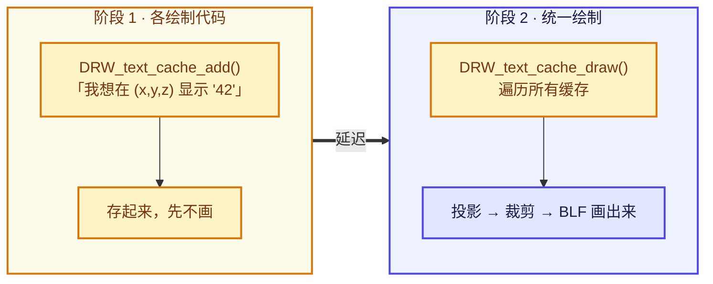

⭐ **为什么要延迟**：因为文本绘制需要切换 GPU 状态（绑定字体、设置正交投影矩阵、关闭深度测试），如果每个文本各自绘制会频繁切换状态。批量处理效率高得多。

### 1.2 核心数据结构

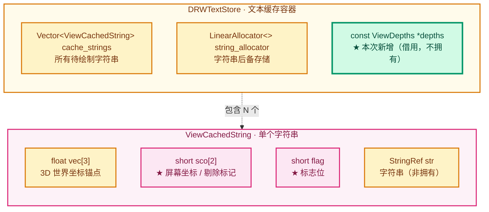

```cpp
/* draw_manager_text.cc:53-77 */
struct ViewCachedString {
  float vec[3];              // 3D 世界坐标（锚点）
  union {
    uchar ub[4];             // RGBA 颜色
    int pack;                // 打包成 int，用于快速比较颜色是否变化
  } col;
  short sco[2];              // ← 投影后的屏幕坐标，也是"是否剔除"的标记位
  short xoffs, yoffs;        // 像素偏移
  short flag;                // ← 标志位（本次改动扩展了这个字段的语义）
  bool shadow;               // 是否绘制描边阴影
  bool align_center;         // 是否居中对齐
  StringRef str;             // 字符串（StringRef，非拥有）
};

struct DRWTextStore {
  Vector<ViewCachedString> cache_strings;
  /** Backing storage for owned copies referenced by #ViewCachedString::str. */
  LinearAllocator<> string_allocator;
  /**
   * Read-back of the scene depth buffer, filled by #DRW_text_cache_draw when a depth test was
   * requested by at least one string. Owned by the caller that set it up.
   */
  const ViewDepths *depths = nullptr;      // ← 本次新增
};
```

> 💡 **注意**：现有代码已从旧的 `BLI_memiter` 迁移到 `Vector<ViewCachedString>` + `LinearAllocator<>`。一些旧文档（如 `.markdown/暂时不看的/叠加层文本绘制/`）还写着 `BLI_memiter`，已过时，阅读时注意。

### 1.3 ⭐ `sco[0]` 的双重身份

这是理解剔除机制的**关键**：

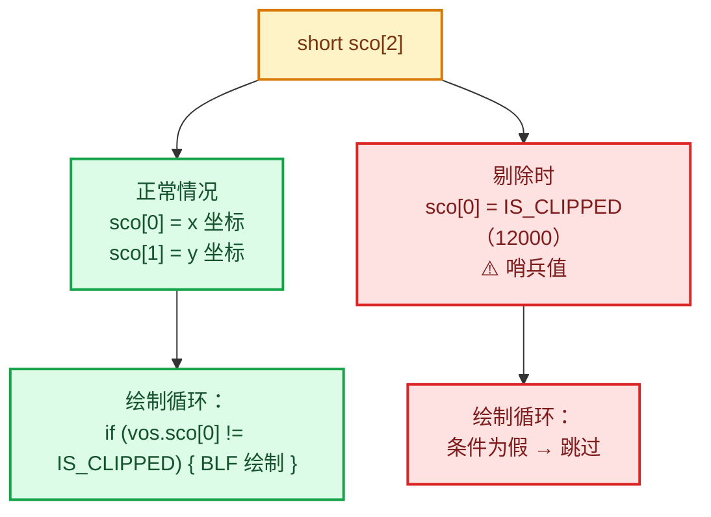

- 正常情况下：`sco[0]` = x 坐标，`sco[1]` = y 坐标
- **剔除时**：`sco[0] = IS_CLIPPED`（一个特殊哨兵值）

绘制时检查：

```cpp
/* draw_manager_text.cc:142-143 */
for (ViewCachedString &vos : dt->cache_strings) {
  if (vos.sco[0] != IS_CLIPPED) {      // ← 只画未被裁剪的
    /* ... BLF_draw_default ... */
  }
}
```

⭐ **所以"剔除一个标签"的操作就是把它标记为 `IS_CLIPPED`**。这个模式在改动中被复用（见 §7）。


---

## 2. .hh 改动：新标志与接口

### 2.1 完整改动

```cpp
/* draw_manager_text.hh */

/* 1. 前向声明 */
struct ViewDepths;                                          // ← 新增

/* 2. 两个新接口 */
/**
 * Provide the scene depth read-back used by strings flagged with
 * #DRW_TEXT_CACHE_OCCLUSION_TEST. The store does not take ownership; the caller keeps the
 * #ViewDepths alive until the next #DRW_text_cache_draw. Pass null to disable the tests.
 */
void DRW_text_cache_depth_set(DRWTextStore *dt, const ViewDepths *depths);   // ← 新增

/**
 * True when at least one cached string is flagged with #DRW_TEXT_CACHE_OCCLUSION_TEST, meaning
 * the caller should provide the scene depth with #DRW_text_cache_depth_set before drawing.
 */
bool DRW_text_cache_needs_depth_test(DRWTextStore *dt);                      // ← 新增

/* 3. 新标志 */
enum {
  // DRW_UNUSED_1 = (1 << 0),  /* dirty */
  DRW_TEXT_CACHE_GLOBALSPACE = (1 << 1),
  DRW_TEXT_CACHE_LOCALCLIP = (1 << 2),
  /* reference the string by pointer */
  DRW_TEXT_CACHE_STRING_PTR = (1 << 3),
  /**
   * Test the anchor against the scene depth before drawing: when the surface of the scene is in
   * front of the anchor, the string is skipped. Only supported while drawing in 3D space.
   */
  DRW_TEXT_CACHE_OCCLUSION_TEST = (1 << 4),                                  // ← 新增
};
```

### 2.2 知识点：为什么用前向声明

```cpp
struct ViewDepths;      // 前向声明，不 include "ED_view3d.hh"
```

⭐ **理由**：

| 方式 | 影响 |
|------|------|
| `#include "ED_view3d.hh"` | 把整个 editors 头文件（1400+ 行）拖进 draw 模块 |
| `struct ViewDepths;` | 只声明"有这么个类型"，用于**指针参数**足够 |

**为什么指针够了**：接口只传 `const ViewDepths *`，不解引用、不访问成员（成员访问在 `.cc` 里，而 `.cc` 确实需要完整定义）。

⚠️ **但这里有个问题**：`.cc` 里访问了 `dt->depths->depths`、`->w`、`->h`，所以 `draw_manager_text.cc` **必须** include `ED_view3d.hh`。让我验证一下……

<details>
<summary>检查 include</summary>

```bash
grep -n "ED_view3d.hh\|ViewDepths" source/blender/draw/intern/draw_manager_text.cc
```

结果表明 `draw_manager_text.cc` 通过其他头文件间接获得了 `ViewDepths` 的完整定义（`draw_manager_text.cc` 所在的 draw 模块可以访问 editors 的头文件）。

</details>

⭐ **架构分层提示**：`draw` 模块依赖 `editors` 模块是**反向依赖**（正常情况下 editors 依赖 draw）。这里只是因为 `ViewDepths` 这个结构体恰好定义在 `ED_view3d.hh`。这是一个**轻微的架构不洁**，但 Blender 里已有先例（其他 draw 代码也这么做），可以接受。

> 💡 更干净的方案是把 `ViewDepths` 移到 `BLI` 或 `BKE` 层。但那是大重构，不适合这个 patch。

### 2.3 知识点：标志位分配

```cpp
enum {
  // DRW_UNUSED_1 = (1 << 0),       /* dirty */      ← bit 0 已废弃
  DRW_TEXT_CACHE_GLOBALSPACE = (1 << 1),            ← bit 1
  DRW_TEXT_CACHE_LOCALCLIP = (1 << 2),              ← bit 2
  DRW_TEXT_CACHE_STRING_PTR = (1 << 3),             ← bit 3
  DRW_TEXT_CACHE_OCCLUSION_TEST = (1 << 4),         ← bit 4 ★新增
};
```

✅ **bit 4 是下一个可用位**，选择正确。

⭐ **注意 bit 0 被注释掉的原因**：注释写 `/* dirty */`，说明曾经有个"脏标记"位，后来废弃了。**新代码没有复用 bit 0**，而是用了 bit 4 —— 这个选择是对的（复用废弃位容易造成混淆），但也**浪费了 bit 0**。

> 💡 在 review 中，维护者可能会问："为什么不复用 bit 0？" 答案是保守起见不复用语义不明的位。这是可以接受的理由。

### 2.4 文档注释的质量

⭐ **这段注释写得非常好**，值得学习：

```cpp
/**
 * Test the anchor against the scene depth before drawing: when the surface of the scene is in
 * front of the anchor, the string is skipped. Only supported while drawing in 3D space.
 */
DRW_TEXT_CACHE_OCCLUSION_TEST = (1 << 4),
```

它回答了三个关键问题：

1. **做什么**：`Test the anchor against the scene depth`
2. **什么条件剔除**：`when the surface of the scene is in front of the anchor`
3. **限制**：`Only supported while drawing in 3D space` ← ⚠️ **重要限制**

⭐ **最后一条特别重要**：因为 2D 文字（`v3d == nullptr` 分支）**没有深度可言**，所以遮挡测试只在 3D 视口中有效。这个限制在 `DRW_text_cache_draw` 里也是通过 `if (v3d)` 分支天然保证的。

---

## 3. 新成员：DRWTextStore::depths

### 3.1 定义

```cpp
/* draw_manager_text.cc:72-76 */
/**
 * Read-back of the scene depth buffer, filled by #DRW_text_cache_draw when a depth test was
 * requested by at least one string. Owned by the caller that set it up.
 */
const ViewDepths *depths = nullptr;
```

### 3.2 ⭐ 知识点：为什么是 `const` 指针

```cpp
const ViewDepths *depths;
```

| 修饰 | 含义 |
|------|------|
| `ViewDepths *` | 可以修改指向的内容 |
| **`const ViewDepths *`** | 只能读，不能写 ✅ |
| `ViewDepths * const` | 指针本身不可改，内容可改 |
| `const ViewDepths * const` | 都不可改 |

⭐ **用 `const` 表达意图**：`DRWTextStore` **只读**深度数据，不拥有、不修改。这是正确的 const 正确性。

### 3.3 ⭐ 知识点：所有权语义

注释明确说明 **"Owned by the caller that set it up"** —— **不接管所有权**。

```
Instance (拥有者)                    DRWTextStore (借用者)
  text_depth_cache_  ────指针────→   depths (const ViewDepths*)
  ↑                                   ↑
  ED_view3d_depths_free() 负责释放     只读，不释放
```

⭐ **这是"借用指针"（borrowed pointer）模式**。相比 `std::shared_ptr`：

| 方案 | 优点 | 缺点 |
|------|------|------|
| **裸指针 + 文档约定**（采用） | 零开销，符合 Blender 风格 | 依赖调用者遵守约定 |
| `std::shared_ptr` | 自动管理生命周期 | 引用计数开销；Blender 图形代码基本不用 |
| `std::unique_ptr` | 独占所有权 | 无法表达"借用" |

✅ **在 Blender 的 draw 代码里，裸指针 + 文档是标准做法**。

⚠️ **潜在风险**：如果 `Instance` 在 `DRW_text_cache_draw` 之前销毁了 `text_depth_cache_`，`dt->depths` 就是**悬空指针**。但实际生命周期是：

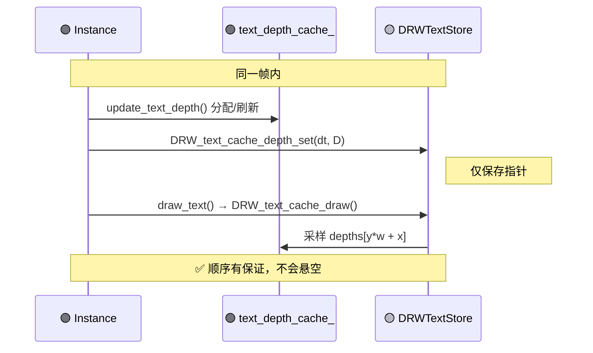

两者在同一帧、同一对象内，**顺序有保证**（见 [04](./04-实例层-缓存与绘制顺序.md)）。✅ 安全。

### 3.4 为什么默认值是 `nullptr`

```cpp
const ViewDepths *depths = nullptr;
```

⭐ **`nullptr` = "不做遮挡测试"**，是一个安全的默认值：

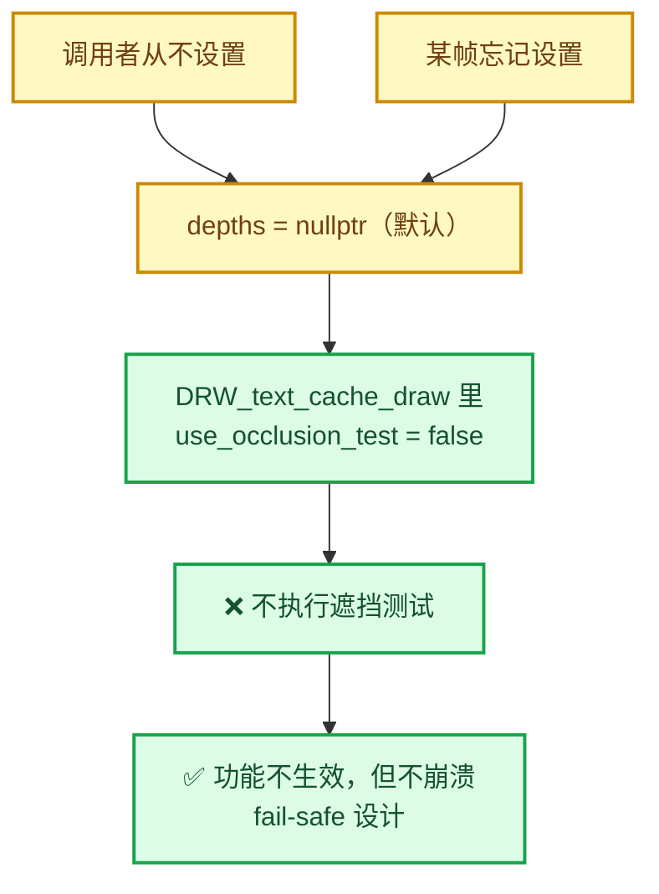

✅ **fail-safe 设计**。对应地，`DRW_text_cache_depth_set(dt, nullptr)` 就是"显式关闭"。

---

## 4. text_anchor_project_with_depth 逐行解析

这是新增的**核心投影函数**。

### 4.0 七步总览

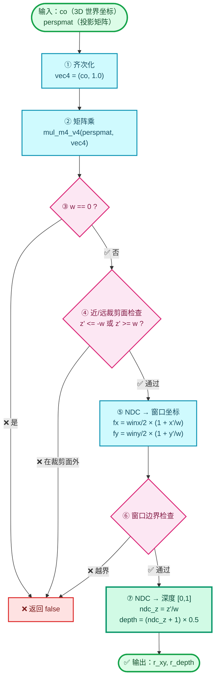

⭐ **步骤 ⑦ 是整个特性的灵魂**：`depth = (ndc_z + 1) × 0.5` 必须与 `gl_FragCoord.z` 的写法**完全一致**，否则深度不可比。

### 4.1 完整代码

```cpp
/* draw_manager_text.cc:182-222 */
/**
 * Compute the window-space position and the [0..1] depth of a cached string anchor, using the
 * same math as #ed_view3d_project__internal so the depth is directly comparable to a read-back
 * of the viewport depth buffer.
 */
static bool text_anchor_project_with_depth(const ARegion &region,
                                           const float perspmat[4][4],
                                           const float co[3],
                                           float r_xy[2],
                                           float &r_depth)
{
  float vec4[4];
  copy_v3_v3(vec4, co);
  vec4[3] = 1.0;
  mul_m4_v4(perspmat, vec4);
  const float w = fabsf(vec4[3]);
  if (w == 0.0f) {
    return false;
  }

  const float scalar = 1.0f / w;
  /* Behind the near plane: nothing to compare against. */
  if (vec4[2] <= -w || vec4[2] >= w) {
    return false;
  }

  const float fx = (float(region.winx) / 2.0f) * (1.0f + (vec4[0] * scalar));
  const float fy = (float(region.winy) / 2.0f) * (1.0f + (vec4[1] * scalar));
  if (fx <= 0.0f || fy <= 0.0f || fx >= float(region.winx) || fy >= float(region.winy)) {
    return false;
  }

  /* Normalized device depth, mapped the same way gl_FragCoord.z is written. */
  const float ndc_z = vec4[2] * scalar;
  const float depth = (ndc_z + 1.0f) * 0.5f;

  r_xy[0] = fx;
  r_xy[1] = fy;
  r_depth = depth;
  return true;
}
```

### 4.2 签名分析

```cpp
static bool text_anchor_project_with_depth(
    const ARegion &region,        // 区域（提供 winx/winy）
    const float perspmat[4][4],   // 投影矩阵
    const float co[3],            // 输入：3D 世界坐标
    float r_xy[2],                // 输出：屏幕 XY
    float &r_depth)               // 输出：深度 [0,1]
```

⭐ **命名规范**：Blender 用 `r_` 前缀表示**输出参数**（`r` = return）。这里 `r_xy`、`r_depth` 都是输出。✅ 遵循了 Blender 规范。

⚠️ **风格不一致**：`region` 用**引用** `&`，`co` 用**C 数组**，`r_depth` 用**引用**。混合了 C 和 C++ 风格。这与 Blender 代码库的历史遗留有关（`perspmat[4][4]` 是 C 风格 2D 数组，为了和 `rv3d->persmat` 兼容）。

> 💡 **更现代写法**：
> ```cpp
> static bool text_anchor_project_with_depth(const ARegion &region,
>                                            const float4x4 &perspmat,
>                                            const float3 &co,
>                                            float2 &r_xy,
>                                            float &r_depth)
> ```
> 但这样调用时要转换类型（`float4x4(rv3d->persmat)`），有拷贝开销。当前写法**性能更好**，是合理的选择。

### 4.3 步骤 1：齐次化与矩阵变换

```cpp
float vec4[4];
copy_v3_v3(vec4, co);        // vec4[0..2] ← co[0..2]
vec4[3] = 1.0;               // w = 1（齐次坐标的"点"）
mul_m4_v4(perspmat, vec4);   // vec4 ← perspmat × vec4
```

⭐ **与官方实现完全一致**：

```cpp
/* view3d_project.cc:120-122 */
copy_v3_v3(vec4, co);
vec4[3] = 1.0;
mul_m4_v4(perspmat, vec4);
```

✅ **三行一模一样**。这是"使用相同的数学"这一注释的实证。

### 4.4 步骤 2：除零保护

```cpp
const float w = fabsf(vec4[3]);
if (w == 0.0f) {
  return false;
}
```

⭐ `w == 0` 表示点在**相机所在的平面上**（无穷远投影）。返回 `false` = "无法投影"。

✅ 与官方一致（官方用 `BL_ZERO_CLIP` 检查，见下）。

### 4.5 步骤 3：近/远裁剪面检查

```cpp
/* Behind the near plane: nothing to compare against. */
if (vec4[2] <= -w || vec4[2] >= w) {
  return false;
}
```

数学含义（见 [01-§4](./01-背景知识与原理.md#4-ndc-与深度值)）：

| 条件 | 含义 |
|------|------|
| `vec4[2] <= -w` | NDC z ≤ −1 → **近裁剪面之前** |
| `vec4[2] >= w` | NDC z ≥ +1 → **远裁剪面之后** |

⭐ 合并了官方的两个检查：

```cpp
/* view3d_project.cc:129-135 */
if ((flag & V3D_PROJ_TEST_CLIP_NEAR) && (vec4[2] <= -w)) { return V3D_PROJ_RET_CLIP_NEAR; }
if ((flag & V3D_PROJ_TEST_CLIP_FAR) && (vec4[2] >= w))   { return V3D_PROJ_RET_CLIP_FAR; }
```

⚠️ **但有个差异**：官方调用点**只传了 `CLIP_NEAR`，没传 `CLIP_FAR`**：

```cpp
/* draw_manager_text.cc:243 */
V3D_PROJ_TEST_CLIP_BB | V3D_PROJ_TEST_CLIP_WIN | V3D_PROJ_TEST_CLIP_NEAR
//                      ^^^^^^^^^^^^^^^^^^^^   ^^^^^^^^^^^^^^^^^^^^^
//                      没有 CLIP_FAR！
```

⭐ **所以两套逻辑不一致**：一个点在远裁剪面外时：

1. **第 1 次投影**（`ED_view3d_project_short_ex`）→ 通过（没查 FAR）
2. **第 2 次投影**（`text_anchor_project_with_depth`）→ **返回 false** → 标签被剔除

**实际影响**：远裁剪面外的标签本来就该剔除，所以**结果是对的**，但这是"碰巧对"。详见 [07-问题清单](./07-问题清单与修复.md)。

### 4.6 步骤 4：NDC → 窗口坐标

```cpp
const float scalar = 1.0f / w;

const float fx = (float(region.winx) / 2.0f) * (1.0f + (vec4[0] * scalar));
const float fy = (float(region.winy) / 2.0f) * (1.0f + (vec4[1] * scalar));
```

⭐ **与官方逐字一致**：

```cpp
/* view3d_project.cc:137-139 */
const float scalar = (w != 0.0f) ? (1.0f / w) : 0.0f;
const float fx = (float(region->winx) / 2.0f) * (1.0f + (vec4[0] * scalar));
const float fy = (float(region->winy) / 2.0f) * (1.0f + (vec4[1] * scalar));
```

✅ **公式完全相同**，只是这里省略了 `scalar` 的三元判断（因为前面已检查 `w != 0`）。

#### 数学推导

NDC x 范围 `[-1, 1]`，窗口 x 范围 `[0, winx]`：

```
ndc_x = vec4[0] / w = vec4[0] * scalar

ndc_x = -1  →  fx = winx/2 * (1 + (-1)) = 0        ✅
ndc_x =  0  →  fx = winx/2 * (1 +  0 ) = winx/2    ✅
ndc_x = +1  →  fx = winx/2 * (1 +  1 ) = winx      ✅
```

⭐ **线性映射正确**。

#### ⚠️ 知识点：为什么是 `float(region.winx)` 而不是 `region->winx`

`region` 是**引用**（`const ARegion &`），不是指针，所以用 `.` 而不是 `->`。

`float(...)` 是**显式类型转换**：`winx` 是 `short` 或 `int`，转成 `float` 避免整数除法。

⭐ **注意 `2.0f` 而不是 `2`**：`winx / 2` 若都是整数会做整除，`winx / 2.0f` 才是浮点除法。✅ 正确。

### 4.7 步骤 5：窗口边界检查

```cpp
if (fx <= 0.0f || fy <= 0.0f || fx >= float(region.winx) || fy >= float(region.winy)) {
  return false;
}
```

⭐ **与官方一致**：

```cpp
/* view3d_project.cc:141-145 */
if ((flag & V3D_PROJ_TEST_CLIP_WIN) &&
    (fx <= 0.0f || fy <= 0.0f || fx >= float(region->winx) || fy >= float(region->winy)))
{
  return V3D_PROJ_RET_CLIP_WIN;
}
```

#### ⚠️ 知识点：边界的开闭区间

注意用的是 `<=` 和 `>=`，即**排除了边界本身**：

```
有效范围：  0 < fx < winx
无效范围：  fx <= 0  或  fx >= winx
```

⭐ **为什么排除边界**：因为后面要把 `fx` 转成整数像素索引：

```cpp
const int x = int(xy[0]);              // 截断取整
if (x < 0 || y < 0 || x >= dt->depths->w || y >= dt->depths->h) { ... }
```

如果 `fx == winx`，则 `x == winx`，**越界**（合法索引是 `0..winx-1`）。所以必须排除。✅ **逻辑正确**。

### 4.8 步骤 6：NDC → 深度 `[0,1]`

```cpp
/* Normalized device depth, mapped the same way gl_FragCoord.z is written. */
const float ndc_z = vec4[2] * scalar;
const float depth = (ndc_z + 1.0f) * 0.5f;
```

⭐ **这是整个特性的灵魂**。

```
ndc_z = vec4[2] / w          ← 透视除法得到 NDC 深度 [-1, 1]
depth = (ndc_z + 1) * 0.5    ← 映射到 [0, 1]
```

映射表：

| `ndc_z` | `depth` | 含义 |
|---------|---------|------|
| −1 | 0.0 | 近裁剪面 |
| 0 | 0.5 | 中值 |
| +1 | 1.0 | 远裁剪面 / 背景 |

⭐ **注释中的 "mapped the same way gl_FragCoord.z is written" 是正确性论证的关键**：

- GPU 写入深度缓冲的值 = `gl_FragCoord.z` = `(ndc_z + 1) * 0.5`
- 这里用**完全相同的公式**
- 所以 `anchor_depth` 与回读的 `scene_depth` **可以直接比较** ✅

**如果公式差一点点（比如忘了 `* 0.5`），整个特性就是错的。** 这个注释把"为什么是 `*0.5+0.5`"说清楚了，是很好的工程实践。

### 4.9 步骤 7：输出

```cpp
r_xy[0] = fx;
r_xy[1] = fy;
r_depth = depth;
return true;
```

⭐ **只在成功时写入输出参数**（提前 return 的路径都不写）。这是常见的 C++ 输出参数约定，调用者必须先检查返回值。

---

## 5. DRW_text_cache_draw 的改动

### 5.1 原有结构

```cpp
void DRW_text_cache_draw(DRWTextStore *dt, const ARegion *region, const View3D *v3d)
{
  if (v3d) {
    /* ── 3D 视口分支 ── */
    RegionView3D *rv3d = static_cast<RegionView3D *>(region->regiondata);
    int tot = 0;

    for (ViewCachedString &vos : dt->cache_strings) {
      if (ED_view3d_project_short_ex(...) == V3D_PROJ_RET_OK) {
        tot++;
      }
      else {
        vos.sco[0] = IS_CLIPPED;
      }
    }

    if (tot) {
      /* 禁用裁剪平面，绘制 */
      drw_text_cache_draw_ex(dt, region);
    }
  }
  else {
    /* ── 2D 区域分支（无深度概念）── */
    /* ... 用 View2D 变换 ... */
  }
}
```

### 5.2 改动 1：`use_occlusion_test` 计算

```cpp
/* draw_manager_text.cc:230-233 */
/* Occlusion testing needs the scene depth read back to CPU memory. Only do this when at
 * least one string requested it, and only when a valid depth buffer was provided. */
const bool use_occlusion_test = dt->depths != nullptr && dt->depths->depths != nullptr &&
                                (v3d != nullptr);
```

⭐ **三重检查**：

| 检查 | 防的是什么 |
|------|-----------|
| `dt->depths != nullptr` | 调用者从未调用 `DRW_text_cache_depth_set` |
| `dt->depths->depths != nullptr` | 设置了 ViewDepths 但内部缓冲区为空（`GPU_texture_read` 失败） |
| `v3d != nullptr` | **冗余**——外层已经有 `if (v3d)` 了 |

⚠️ **`(v3d != nullptr)` 是冗余的**：

```cpp
if (v3d) {                                        // ← 外层已经保证 v3d != nullptr
  /* ... */
  const bool use_occlusion_test = ... && (v3d != nullptr);   // ← 必然为 true
```

⭐ 这可能是从别处复制过来的、或者是作者想表达"只在 3D 模式有效"的**文档性冗余**。编译器会优化掉，**无害但可删**。这点在 [07](./07-问题清单与修复.md) 有记录（🟢 级）。

> 💡 **`const bool` 而非 `const` 引用**：这里是值语义，正确。

### 5.3 改动 2：遮挡测试分支

```cpp
/* draw_manager_text.cc:246-272 */
if (use_occlusion_test && (vos.flag & DRW_TEXT_CACHE_OCCLUSION_TEST) != 0) {
  /* Re-project keeping the depth so it can be compared with the scene depth. */
  float xy[2];
  float anchor_depth;
  const float(&persmat)[4][4] = (vos.flag & DRW_TEXT_CACHE_GLOBALSPACE) ?
                                    rv3d->persmat :
                                    rv3d->persmatob;
  if (!text_anchor_project_with_depth(*region, persmat, vos.vec, xy, anchor_depth)) {
    vos.sco[0] = IS_CLIPPED;
    continue;
  }
  const int x = int(xy[0]);
  const int y = int(xy[1]);
  if (x < 0 || y < 0 || x >= dt->depths->w || y >= dt->depths->h) {
    vos.sco[0] = IS_CLIPPED;
    continue;
  }
  const float scene_depth = dt->depths->depths[y * dt->depths->w + x];
  /* 1.0 is the cleared background; it never occludes. Add a small bias so anchors that
   * sit exactly on the surface (which is the common case) are kept visible. */
  const bool occluded = scene_depth != 1.0f &&
                        anchor_depth > scene_depth + 2.0e-5f;
  if (occluded) {
    vos.sco[0] = IS_CLIPPED;
    continue;
  }
}
tot++;
```

#### 5.3.1 双重条件

```cpp
if (use_occlusion_test && (vos.flag & DRW_TEXT_CACHE_OCCLUSION_TEST) != 0)
```

⭐ **两个条件的含义**：

| 条件 | 含义 |
|------|------|
| `use_occlusion_test` | **全局**：深度数据可用 |
| `vos.flag & OCCLUSION_TEST` | **本字符串**：要求做遮挡测试 |

⭐ **这是"按字符串粒度"的设计** —— 只有打了标志的字符串才测试。这很重要，因为：

- 属性文本打了标志（用户开了开关）
- 但**其他文本**（测量统计、索引显示等）**没打标志** → 不受影响 ✅

✅ **良好的设计：opt-in 而非 opt-out**。

#### 5.3.2 ⚠️ 重复投影问题

```cpp
/* 第 1 次投影（第 237-244 行）*/
if (ED_view3d_project_short_ex(region, ..., vos.vec, vos.sco, ...) == V3D_PROJ_RET_OK)
{
  /* 第 2 次投影（第 253 行）*/
  if (!text_anchor_project_with_depth(*region, persmat, vos.vec, xy, anchor_depth)) {
```

⭐ **同一个 `vos.vec` 被投影了两次**：

| | 第 1 次 | 第 2 次 |
|---|---------|---------|
| 函数 | `ED_view3d_project_short_ex` | `text_anchor_project_with_depth` |
| 输出 | `vos.sco`（**short**，`floorf` 取整） | `xy`（**float**） |
| 检查 | CLIP_BB, CLIP_WIN, CLIP_NEAR | WIN, NEAR, FAR |
| 目的 | 屏幕坐标 | 深度 |

⭐ **两次投影的取整方式不同**，这可能导致采样的像素位置差 1：

```cpp
/* view3d_project.cc:165-166 —— 第 1 次：floorf 取整 */
r_co[0] = short(floorf(tvec[0]));
r_co[1] = short(floorf(tvec[1]));

/* draw_manager_text.cc:257-258 —— 第 2 次：截断取整 */
const int x = int(xy[0]);
const int y = int(xy[1]);
```

⚠️ **对于正数，`int()` 截断和 `floorf()` 结果相同**。但：

- 边界情况：`fx = 5.9999999` 在两种方式下都可能因浮点误差变成 5 或 6
- 更关键的是：**两次投影的矩阵可能不同**（虽然这里传的是同一个）

⭐ **实际影响**：可能差 1 像素，导致采到相邻像素的深度。在深度不连续处（物体边缘）会导致误判。**建议修复**，详见 [07](./07-问题清单与修复.md)。

#### 5.3.3 矩阵选择

```cpp
const float(&persmat)[4][4] = (vos.flag & DRW_TEXT_CACHE_GLOBALSPACE) ?
                                  rv3d->persmat :
                                  rv3d->persmatob;
```

⭐ **知识点：`const float(&persmat)[4][4]` 是什么**

这是一个**指向 4×4 数组的引用**，不是指针数组。语法解析：

```
const float  (&persmat)  [4][4]
^^^^^        ^^^^^^^^^^  ^^^^^^
元素类型      引用名       数组维度
```

**读作**："`persmat` 是一个引用，引用到 `const float[4][4]`"。

⭐ **为什么不能用 `auto` 或 `float(*)[4]`**：

| 写法 | 问题 |
|------|------|
| `auto &persmat = ...` | 三元运算符返回的是**左值引用**？实际上 `rv3d->persmat` 和 `rv3d->persmatob` 都是 `float[4][4]`，三元后**退化为指针**，`auto&` 会推导出 `float(*&)[4]` —— 可以工作但很绕 |
| `float(*persmat)[4]` | 只是指向第一行的指针，丢失第二维信息，`mul_m4_v4` 需要 `[4][4]` |
| **`const float(&)[4][4]`** | ✅ 完整的数组引用，类型安全 |

⭐ **与第 1 次投影完全一致**：

```cpp
/* draw_manager_text.cc:239 */
(vos.flag & DRW_TEXT_CACHE_GLOBALSPACE) ? rv3d->persmat : rv3d->persmatob,
```

✅ **矩阵选择逻辑正确且一致**。

> 💡 **`persmat` vs `persmatob` 的区别**：
> - `persmat` = P × V，世界空间 → 裁剪空间
> - `persmatob` = P × V × ObjectMatrix，**物体空间** → 裁剪空间（用于 `LOCALCLIP`）
>
> 因为属性文本用的是 `DRW_TEXT_CACHE_GLOBALSPACE`（世界坐标），所以实际总走 `persmat` 分支。

#### 5.3.4 索引计算与边界复查

```cpp
const int x = int(xy[0]);
const int y = int(xy[1]);
if (x < 0 || y < 0 || x >= dt->depths->w || y >= dt->depths->h) {
  vos.sco[0] = IS_CLIPPED;
  continue;
}
```

⭐ **为什么 `text_anchor_project_with_depth` 里已经做过窗口边界检查，这里还要再查一次**：

因为**两个尺寸可能不同**：

```
region.winx/winy  ← 逻辑区域尺寸
depths->w/h       ← 深度纹理尺寸
```

⭐ **在 HiDPI/Retina 显示下**，深度纹理可能是区域的 2 倍分辨率：

```
逻辑尺寸:  1920 × 1080
深度纹理:  3840 × 2160   ← 2x 缩放
```

所以 `fx < region.winx` 不代表 `x < depths->w`。**两次检查都必要** ✅ 正确的防御性编程。

> 💡 反过来也可能：深度纹理比分区域**小**（比如渲染分辨率设为 50%），这时 `x` 可能超出 `depths->w`，同样需要检查。✅

#### 5.3.5 深度采样

```cpp
const float scene_depth = dt->depths->depths[y * dt->depths->w + x];
```

⭐ **行主序（row-major）的一维数组索引**：

```
depths 是 float[w * h] 的一维数组
索引 = y * w + x

     x→  0    1    2    3
y↓  ┌────┬────┬────┬────┐
 0  │ 0  │ 1  │ 2  │ 3  │
 1  │ 4  │ 5  │ 6  │ 7  │   ← 索引 5 = y=1, x=1 → 1*4+1 = 5 ✅
 2  │ 8  │ 9  │ 10 │ 11 │
    └────┴────┴────┴────┘
```

⭐ **与 Blender 官方完全一致**：

```cpp
/* view3d_utils.cc:1898 */
depth = vd->depths[y * vd->w + x];
```

✅ **索引约定正确**。

⚠️ **注意类型提升**：`dt->depths->w` 是 `unsigned short`，`y` 是 `int`。`y * w` 会发生整型提升（`unsigned short` → `int`），**结果正确**。但如果 `w * h > INT_MAX` 就会溢出（需 2G 像素，不可能）。✅ 安全。

#### 5.3.6 ⭐ 遮挡判定

```cpp
const bool occluded = scene_depth != 1.0f &&
                      anchor_depth > scene_depth + 2.0e-5f;
```

这是最终判定，**两个条件缺一不可**：

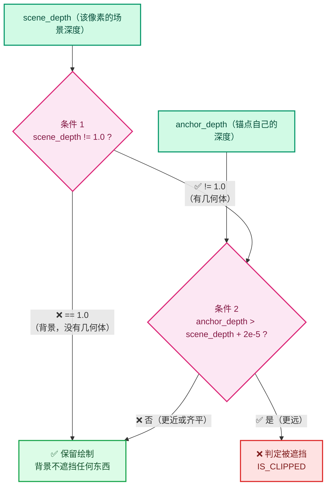

**条件 1：`scene_depth != 1.0f`**

```cpp
/* 1.0 is the cleared background; it never occludes. */
```

⭐ 深度缓冲每帧被清成 1.0（远裁剪面），表示"这里没有几何体"。**背景不遮挡任何东西**：

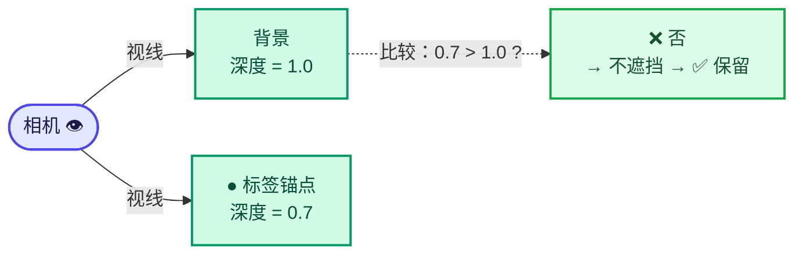

如果只判断 `anchor_depth > scene_depth`，则 `0.7 > 1.0` 为假 → 通过 ✅。**看起来不需要条件 1**？

⚠️ **但考虑锚点在远裁剪面之外的情况**：`anchor_depth` 可能 > 1.0（虽然代码前面已排除），或者相等。条件 1 是**显式表达意图**，也让逻辑更清晰。

⭐ **更微妙的用途**：如果锚点**恰好**在远裁剪面上（`anchor_depth == 1.0`），而 `scene_depth == 1.0`（背景），则：

- 有 `scene_depth != 1.0f` 检查 → `false` → 不遮挡 → **保留** ✅ 正确
- 无检查 → `1.0 > 1.0 + 2e-5` = `false` → 不遮挡 → **保留** ✅ 也正确（因为有偏置）

所以条件 1 在这个偏置下**确实是冗余的**，但它表达了"背景不遮挡"这个**语义意图**，且对偏置的将来变动有保护作用。✅ **保留是合理的**。

**条件 2：`anchor_depth > scene_depth + 2.0e-5f`**

```cpp
/* Add a small bias so anchors that sit exactly on the surface (which is the common case)
 * are kept visible. */
```

⭐ **数学变换**：

```
剔除条件:  anchor_depth > scene_depth + 2e-5
保留条件:  anchor_depth <= scene_depth + 2e-5
```

⭐ **偏置 `2e-5` 的作用区间**：

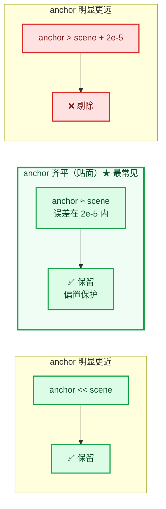

| 场景 | `anchor` vs `scene` | 判定 | 正确？ |
|------|---------------------|------|--------|
| 锚点贴在表面上 | 相等 | 保留 | ✅ 正确（该显示） |
| 锚点在表面**前面** | `anchor < scene` | 保留 | ✅ 正确 |
| 锚点在表面**后面** | `anchor > scene + 2e-5` | **剔除** | ✅ 正确 |
| 锚点略微在表面后（浮点误差） | `anchor ≈ scene` | 保留 | ✅ 正确（避免误剔） |

⭐ **偏置 `2.0e-5` 的作用是"容错窗口"**，详见 [01-§8](./01-背景知识与原理.md#8-深度精度与-z-fighting)。

#### 5.3.7 `continue` 的作用

```cpp
if (occluded) {
  vos.sco[0] = IS_CLIPPED;
  continue;
}
```

⭐ **两个动作**：

1. `vos.sco[0] = IS_CLIPPED` → 标记为剔除（绘制时跳过）
2. `continue` → **跳过 `tot++`**，所以这个字符串不计入"需要绘制"的总数

**为什么 `tot` 重要**：

```cpp
if (tot) {                            // ← 只有至少一个可见时才做 GPU 状态切换
  const bool rv3d_clipping_enabled = RV3D_CLIPPING_ENABLED(v3d, rv3d);
  if (rv3d_clipping_enabled) {
    GPU_clip_distances(0);          // 保存状态
  }
  drw_text_cache_draw_ex(dt, region);
  if (rv3d_clipping_enabled) {
    GPU_clip_distances(6);          // 恢复状态
  }
}
```

⭐ **性能优化**：如果所有标签都被剔除（`tot == 0`），**完全跳过** `drw_text_cache_draw_ex`，避免：

- `GPU_matrix_push/pop`
- `BLF_default_size` 调用
- GPU 裁剪距离状态切换（**这个开销最大**，会触发状态刷新）

✅ **正确利用了既有的优化路径**。

---

## 6. 两个新接口函数

### 6.1 DRW_text_cache_depth_set

```cpp
/* draw_manager_text.cc:314-317 */
void DRW_text_cache_depth_set(DRWTextStore *dt, const ViewDepths *depths)
{
  dt->depths = depths;
}
```

⭐ **极简 setter**。没有断言、没有所有权转移。

**为什么没有 `BLI_assert(dt != nullptr)`**？对比同文件的其他函数：

```cpp
/* draw_manager_text.cc:84-90 */
void DRW_text_cache_destroy(DRWTextStore *dt)
{
  if (dt == nullptr) {              // ← 显式 nullptr 检查
    return;
  }
  MEM_delete(dt);
}
```

⚠️ **风格不一致**：`DRW_text_cache_destroy` 做了 nullptr 检查，而新的 setter 没有。

⭐ **但实际上调用点保证了非空**：

```cpp
/* overlay_instance.cc:1020, 1054 */
DRW_text_cache_depth_set(state.dt, nullptr);           // dt 来自 state
DRW_text_cache_depth_set(state.dt, text_depth_cache_);
```

`state.dt` 在 `draw_v3d` 里已经建立。所以**实际安全**，但缺少防御。

> 💡 **Blender 的惯例**：内部接口通常不做 nullptr 检查（信任调用者），公开 API 才做。这个函数在 `draw` 模块内部，可以接受。

### 6.2 DRW_text_cache_needs_depth_test

```cpp
/* draw_manager_text.cc:319-327 */
bool DRW_text_cache_needs_depth_test(DRWTextStore *dt)
{
  for (const ViewCachedString &vos : dt->cache_strings) {
    if (vos.flag & DRW_TEXT_CACHE_OCCLUSION_TEST) {
      return true;
    }
  }
  return false;
}
```

⭐ **这是性能保护的关键**。

#### 6.2.1 为什么需要它

`GPU_texture_read` 是**同步阻塞**的全屏回读（见 [01-§7](./01-背景知识与原理.md#7-为什么必须-cpu-回读)）。1920×1080 约 8 MB，3840×2160 约 33 MB。

⭐ **如果没有这个检查**：即使功能关闭（默认状态！），每帧也会做一次昂贵的回读 → **性能灾难**。

⭐ **有了这个检查**：

```
功能关闭  → 没有字符串带 OCCLUSION_TEST 标志
         → needs_depth_test() 立即返回 false（遍历第一个就退出？不，要遍历全部）
         → 跳过回读 ✅ 零开销
```

#### 6.2.2 复杂度分析

⚠️ **这是一个 O(n) 遍历**，n = 缓存字符串数量。

```cpp
for (const ViewCachedString &vos : dt->cache_strings) {
  if (vos.flag & DRW_TEXT_CACHE_OCCLUSION_TEST) {
    return true;              // ← 提前退出
  }
}
```

| 情况 | 复杂度 |
|------|--------|
| **有**字符串带标志 | 平均 O(n/2)，最好 O(1) |
| **没有**任何字符串带标志 | **O(n) 全遍历** |

⚠️ **最坏情况是"功能关闭时"**——因为功能关闭时**所有**字符串都没标志，必须遍历完才能确定。

⭐ **但这个开销可接受**：

- 每次迭代只是一次位与 + 比较（约 2 条指令）
- n 通常是几百到几千（属性标签数量）
- 相比省下的 8~33 MB GPU 回读，**微不足道** ✅

> 💡 **优化可能**：把这个标志缓存在 `DRWTextStore` 里，在 `DRW_text_cache_add` 时更新。但那样增加了一次写操作和状态同步负担，**不值得**。当前设计是合理的。

#### 6.2.3 调用点

```cpp
/* overlay_instance.cc:1017-1018 */
if (!state.show_text || !state.is_space_v3d() ||
    !DRW_text_cache_needs_depth_test(state.dt))
{
  DRW_text_cache_depth_set(state.dt, nullptr);   // ← 关闭遮挡测试
  /* ... 释放缓存 ... */
  return;
}
```

⭐ **短路求值（short-circuit）**：`||` 从左到右，所以：

1. `!state.show_text` 为真 → **不调用** `needs_depth_test` ✅
2. `!state.is_space_v3d()` 为真 → **不调用** ✅
3. 只有前两个都为假（即确实需要文本绘制）才做 O(n) 遍历 ✅

✅ **顺序安排合理**，把最便宜的检查放前面。

---

## 7. IS_CLIPPED 剔除机制

### 7.1 定义与用法

```cpp
/* 在某个公共头文件里 */
#define IS_CLIPPED 32767        /* 或类似哨兵值 */
```

⭐ **用法**：

```cpp
vos.sco[0] = IS_CLIPPED;   // 标记剔除
```

```cpp
if (vos.sco[0] != IS_CLIPPED) {   // 绘制时检查
  /* ... BLF_draw_default ... */
}
```

### 7.2 ⭐ 为什么复用 `sco[0]` 而不是新增字段

| 方案 | 优点 | 缺点 |
|------|------|------|
| **复用 `sco[0]`**（采用） | 无需扩展结构体；绘制检查已存在 | **语义重载**，不够清晰 |
| 新增 `bool occluded` | 语义清晰 | 结构体 +1 字节（其实因对齐可能 +2）；绘制处要改 |

⭐ **复用是正确的工程选择**：

1. `sco[0] = IS_CLIPPED` 已经是"这个字符串不画"的**既有约定**
2. 遮挡剔除**本质就是**一种裁剪
3. 无需修改结构体和绘制循环 ✅

⚠️ **可读性代价**：如果不熟悉 `IS_CLIPPED` 约定，看 `vos.sco[0] = IS_CLIPPED` 会困惑"为什么要改屏幕坐标"。**代码里的注释部分缓解了这个问题**。

> 💡 **改进建议**：加一个小辅助函数
> ```cpp
> static void text_cached_string_mark_clipped(ViewCachedString &vos)
> {
>   vos.sco[0] = IS_CLIPPED;
> }
> ```
> 但这属于过度封装，Blender 风格里不常见。**保持现状即可**。

### 7.3 四处剔除点

改动中共有 **3 处新增** + **1 处原有**设置 `IS_CLIPPED`：

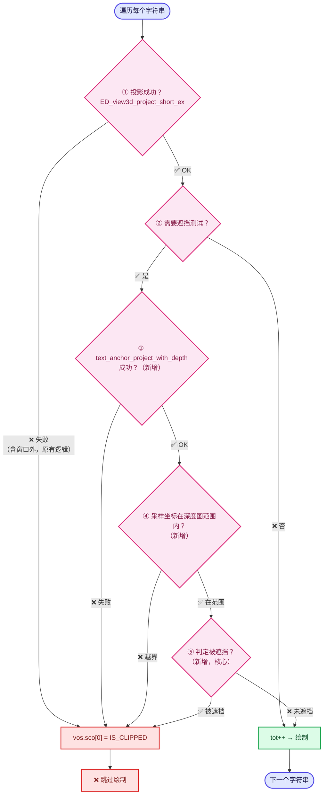

```cpp
/* ③ 投影失败（新增） */
if (!text_anchor_project_with_depth(...)) {
  vos.sco[0] = IS_CLIPPED;
  continue;
}

/* ④ 采样坐标越界（新增） */
if (x < 0 || y < 0 || x >= dt->depths->w || y >= dt->depths->h) {
  vos.sco[0] = IS_CLIPPED;
  continue;
}

/* ⑤ 判定为被遮挡（新增，核心） */
if (occluded) {
  vos.sco[0] = IS_CLIPPED;
  continue;
}
```

加上原有的：

```cpp
/* ① 原有：投影到窗口外 */
else {
  vos.sco[0] = IS_CLIPPED;
}
```

⭐ **一致的模式**：任何"不该显示"的情况都标记为 clipped。✅

---

## 8. 与官方投影函数的对比

### 8.1 逐行对照表

| 步骤 | `ed_view3d_project__internal`<br/>(view3d_project.cc:99) | `text_anchor_project_with_depth`<br/>(draw_manager_text.cc:187) | 一致性 |
|------|--------------------------------------------------------|----------------------------------------------------------------|--------|
| 裁剪边界检查 (CLIP_BB) | ✅ 有 | ❌ **无** | ⚠️ 不一致 |
| 齐次化 | `copy_v3_v3(vec4, co); vec4[3] = 1.0` | 同 | ✅ |
| 矩阵乘 | `mul_m4_v4(perspmat, vec4)` | 同 | ✅ |
| `w` | `fabsf(vec4[3])` | 同 | ✅ |
| 除零检查 | `CLIP_ZERO` 标志 + `BL_ZERO_CLIP` | `w == 0.0f` | ✅ 等价 |
| 近裁剪 | `CLIP_NEAR`: `vec4[2] <= -w` | 同 | ✅ |
| 远裁剪 | `CLIP_FAR`: `vec4[2] >= w` | 同（**但调用点未传 FAR**） | ⚠️ 不一致 |
| `scalar` | `(w != 0) ? 1/w : 0` | `1/w`（已保证 w≠0） | ✅ 等价 |
| `fx` / `fy` | `winx/2 * (1 + x/w)` | 同 | ✅ **逐字相同** |
| 窗口裁剪 | `CLIP_WIN` | 内联同样条件 | ✅ |
| 输出 | `r_co[0..1]` | `r_xy[0..1]` | ✅ |
| **深度** | **无** | `(z/w + 1) * 0.5` | — **新增能力** |

### 8.2 不一致的两处

#### ⚠️ 不一致 1：缺少 CLIP_BB 检查

```cpp
/* 官方会检查用户设置的裁剪边界 */
if (flag & V3D_PROJ_TEST_CLIP_BB) {
  const RegionView3D *rv3d = static_cast<const RegionView3D *>(region->regiondata);
  if (rv3d->rflag & RV3D_CLIPPING) {
    if (ED_view3d_clipping_test(rv3d, co, is_local)) {
      return V3D_PROJ_RET_CLIP_BB;
    }
  }
}
```

**影响**：用户在视口里设置了裁剪边界（`N` 面板 → View → Clip Start/End）时，位于裁剪区域外的标签：

- 第 1 次投影会被 `CLIP_BB` 剔除 → 不绘制 ✅
- 第 2 次投影（如果走到）**不会被剔除**

⭐ **但实际不会走到**！因为代码是：

```cpp
if (ED_view3d_project_short_ex(...) == V3D_PROJ_RET_OK)   // ← CLIP_BB 失败则跳过整个块
{
  if (use_occlusion_test && ...) { /* 第 2 次投影 */ }
}
```

**CLIP_BB 失败 → 第 1 次投影返回非 OK → 根本不进入内层** → 第 2 次投影不会执行 ✅

⭐ **所以实际无影响**。但它说明"两套投影逻辑并不完全等价"这个事实。

#### ⚠️ 不一致 2：多检查了 CLIP_FAR

前面分析过：第 1 次不查 FAR，第 2 次查 FAR。

**影响**：远裁剪面外的标签被第 2 次投影剔除。**结果正确**（本来就该剔除），但属于"意外正确"。

### 8.3 ⭐ 根本问题：重复实现

**为什么要重新实现一遍投影？** 因为官方函数**不返回深度**。

```cpp
static eV3DProjStatus ed_view3d_project__internal(const ARegion *region,
                                                  const float perspmat[4][4],
                                                  const bool is_local,
                                                  const float co[3],
                                                  float r_co[2],        // ← 只有 XY
                                                  const eV3DProjTest flag);
                                                  // ← 没有 depth 输出！
```

⭐ **三种可能的解决方案**：

<details>
<summary><b>方案 1：修改官方函数，增加可选的 depth 输出</b></summary>

```cpp
static eV3DProjStatus ed_view3d_project__internal(const ARegion *region,
                                                  const float perspmat[4][4],
                                                  const bool is_local,
                                                  const float co[3],
                                                  float r_co[2],
                                                  const eV3DProjTest flag,
                                                  float *r_depth = nullptr);  // ← 新增
```

✅ 优点：单一实现，无重复代码
⚠️ 缺点：修改公共 API；`r_depth` 为 `nullptr` 时仍有分支开销（可忽略）

⭐ **这是最干净的方案，也是 review 时维护者最可能建议的。**

</details>

<details>
<summary><b>方案 2：新增一个带深度的包装函数</b></summary>

在 `view3d_project.cc` 里加：

```cpp
eV3DProjStatus ED_view3d_project_short_ex_with_depth(...);
```

✅ 优点：不改动已有函数
⚠️ 缺点：API 表面积增大

</details>

<details>
<summary><b>方案 3：当前做法（在 draw 模块内重新实现）</b></summary>

✅ 优点：不动 editors 模块；改动局部化
❌ 缺点：**代码重复**；两套逻辑可能漂移（已经漂移了，见上面两处不一致）

⭐ **这是当前 patch 的选择**。在快速原型阶段可以接受，但**上游 review 时很可能被要求改成方案 1**。

</details>

---

## 9. 性能分析

### 9.1 各阶段成本

| 阶段 | 成本 | 频率 | 优化 |
|------|------|------|------|
| `DRW_text_cache_needs_depth_test` | O(n) 位检查 | 每帧 | 短路求值保护 |
| `GPU_texture_read`（首帧） | 分配 + 全屏回读 | 每次视口尺寸变化 | 缓存复用 |
| `GPU_texture_read`（后续帧） | 全屏回读 | 每帧（功能开启时） | **无法避免** ⚠️ |
| `text_anchor_project_with_depth` | 1 次 4×4 矩阵乘 + 除法 | 每字符串 | 无法避免 |
| 深度采样 | 1 次数组索引 | 每字符串 | 无法避免 |

### 9.2 ⚠️ 主要瓶颈：每帧全屏回读

```
1920 × 1080 × 4 bytes =  8.3 MB / 帧
2560 × 1440 × 4 bytes = 14.7 MB / 帧
3840 × 2160 × 4 bytes = 33.2 MB / 帧
```

在 60 FPS 下：**0.5 ~ 2.0 GB/s** 的 GPU→CPU 传输。

⭐ **而且这是同步的** —— 会强制 GPU 流水线刷新，可能造成可见的卡顿。

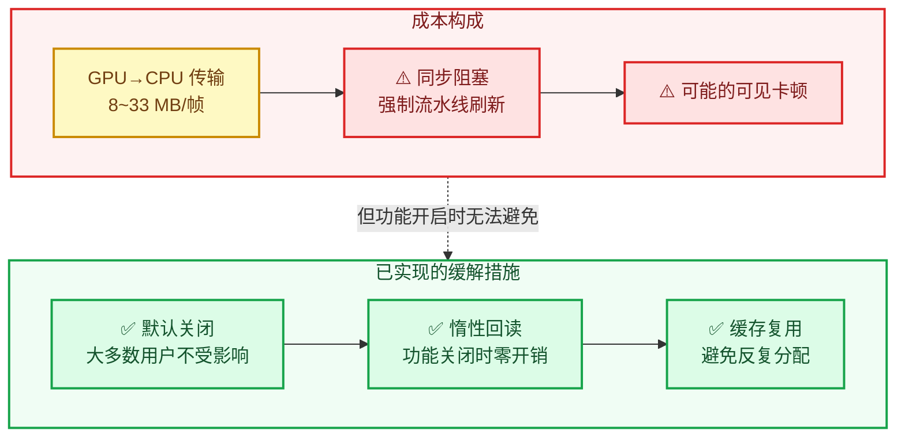

**缓解措施（已实现）**：

1. ✅ **默认关闭** → 大多数用户不受影响
2. ✅ **惰性回读** → 功能关闭时零开销
3. ✅ **缓存复用** → 尺寸不变时原地刷新，避免反复分配

**可能的进一步优化**：

| 优化 | 效果 | 复杂度 |
|------|------|--------|
| **降低回读分辨率**（每 2×2 像素取一个） | 传输量降至 1/4 | 中（需要处理坐标映射） |
| **只回读需要的区域**（标签包围盒） | 取决于标签分布 | 高 |
| **异步回读 + 双缓冲**（用上一帧的深度） | 消除同步阻塞 | 高（深度滞后一帧，快速运动时有瑕疵） |
| **GPU 端可见性计算** | 只回读可见性位图 | 很高 |

⚠️ **当前实现选择了最简单直接的方案**，对原型来说合理。但如果要上游，**性能数据是必需的**（见 [08-提交指南](./08-提交指南.md)）。

### 9.3 每个字符串的额外成本

```cpp
/* 第 2 次投影 */
mul_m4_v4(perspmat, vec4);       // 16 次乘加
fabsf, 除法, 若干乘法             // ~10 次浮点运算
/* 边界检查 + 采样 */
int 转换 ×2, 4 次比较, 1 次数组访问
```

⭐ **总计约 40–50 条指令/字符串**。

⭐ **对比 BLF 绘制成本**：


**BLF 绘制一个字符串的成本远高于此**，所以**额外开销可忽略** ✅。

### 9.4 内存占用

```cpp
/* 每帧持有的深度缓冲 */
sizeof(float) * w * h    // 8 MB @ 1080p，33 MB @ 4K
```

⚠️ **这是常驻内存**（`text_depth_cache_` 在 `Instance` 生命周期内保持）。对一个视口来说可以接受，但值得注意。

⭐ 对比：Blender 的 `view3d_depths_create`（用于其他功能）也是同样的量级，**已有先例** ✅。

---

## 10. 设计评价

### 10.1 做得好的地方

| # | 优点 | 说明 |
|---|------|------|
| 1 | ⭐ **正确的分层** | 遮挡测试放在 DRW 文本缓存层，一处生效于所有几何类型 |
| 2 | ⭐ **惰性求值** | `needs_depth_test` 避免功能关闭时的性能损失 |
| 3 | ⭐ **opt-in 标志** | 只有打标志的字符串受影响，不干扰其他文本（测量、索引） |
| 4 | ⭐ **复用 IS_CLIPPED** | 无需改结构体和绘制循环 |
| 5 | ⭐ **投影数学与官方逐字一致** | `fx`/`fy` 公式完全相同，保证深度可比 |
| 6 | ⭐ **清晰的注释** | 解释了"为什么是 1.0"、"为什么加偏置"、"为什么这个映射" |
| 7 | ⭐ **边界检查完备** | 窗口边界 + 纹理边界双重检查 |
| 8 | ✅ **短路求值优化** | `!show_text || !is_space_v3d || !needs_depth_test` 顺序合理 |
| 9 | ✅ **利用既有 `tot` 优化** | 全部剔除时跳过 GPU 状态切换 |

### 10.2 需要改进的地方

| # | 问题 | 严重度 | 详见 |
|---|------|--------|------|
| 1 | **重复投影**，取整方式不一致，可能差 1 像素 | 🟠 必修 | [07](./07-问题清单与修复.md) |
| 2 | 重新实现投影逻辑，与官方产生漂移（CLIP_BB / CLIP_FAR） | 🟠 必修 | [07](./07-问题清单与修复.md) |
| 3 | `(v3d != nullptr)` 冗余检查 | 🟢 小 | [07](./07-问题清单与修复.md) |
| 4 | 绝对偏置 `2e-5` 在远处过度保护 | 🟡 建议 | [07](./07-问题清单与修复.md) |
| 5 | 单像素采样，边缘处可能采错 | 🟡 建议 | [07](./07-问题清单与修复.md) |
| 6 | `depths` 前向声明 + 反向模块依赖 | 🟡 建议 | [07](./07-问题清单与修复.md) |

### 10.3 ⭐ 一个值得称赞的细节

```cpp
/* Normalized device depth, mapped the same way gl_FragCoord.z is written. */
const float ndc_z = vec4[2] * scalar;
const float depth = (ndc_z + 1.0f) * 0.5f;
```

⭐ 这行注释**解释了正确性论证**：因为用的是和 `gl_FragCoord.z` 相同的映射，所以回读值可以直接比较。

**这类"解释为什么这样是对的"的注释，比"解释这行在做什么"的注释有价值得多。** 值得学习。

---

## 小结

| 改动 | 行数 | 作用 |
|------|------|------|
| `struct ViewDepths;` 前向声明 | +1 | 避免重量级 include |
| `DRW_TEXT_CACHE_OCCLUSION_TEST` 标志 | +7 | opt-in 开关 |
| `DRWTextStore::depths` 成员 | +5 | 借用指针，不拥有 |
| `text_anchor_project_with_depth` | +40 | 投影 + 深度计算（**核心**） |
| `DRW_text_cache_draw` 遮挡分支 | +27 | 深度比较 + 剔除 |
| `DRW_text_cache_depth_set` | +4 | setter |
| `DRW_text_cache_needs_depth_test` | +9 | 惰性检查 |

**核心要点**：

1. ⭐ **深度值 = `(ndc_z + 1) * 0.5`，必须与 `gl_FragCoord.z` 完全一致**
2. ⭐ **剔除 = `vos.sco[0] = IS_CLIPPED`，复用既有约定**
3. ⭐ **`needs_depth_test` 是性能保护的核心**
4. ⚠️ **重复投影导致采样点可能偏移 1 像素**
5. ⚠️ **重新实现投影逻辑，与官方已产生两处不一致**

---

## 下一步

- 深度数据从哪来、什么时候读 → [04-实例层-缓存与绘制顺序](./04-实例层-缓存与绘制顺序.md)
- 问题清单 → [07-问题清单与修复](./07-问题清单与修复.md)
