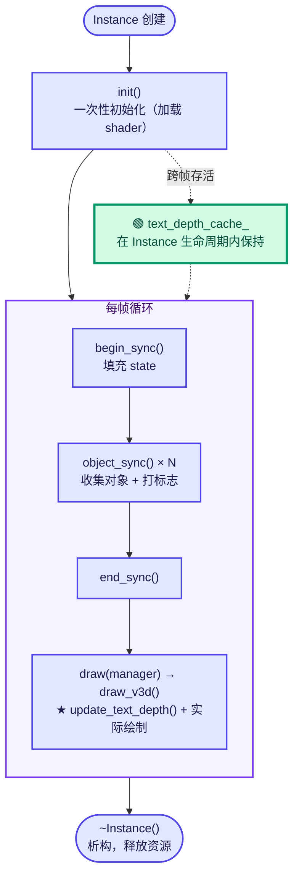
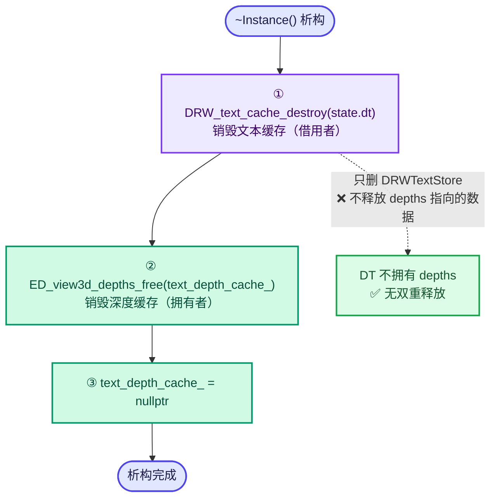
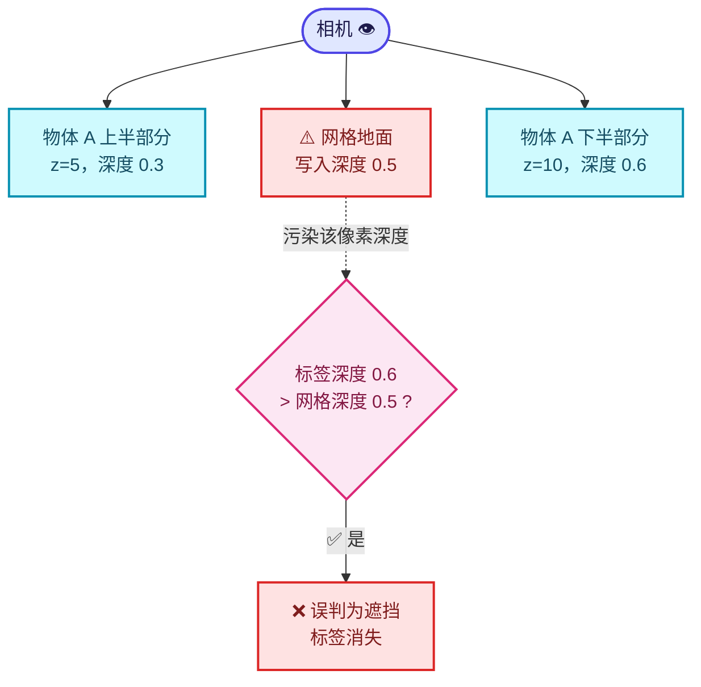
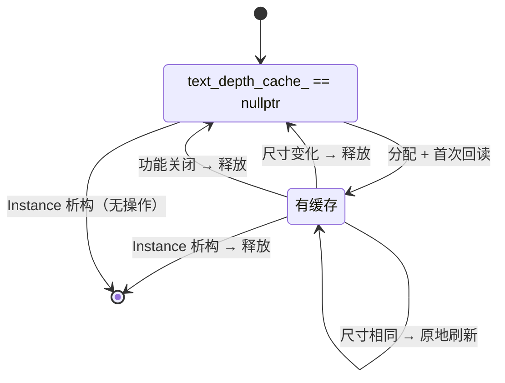

# 04 - 实例层：缓存与绘制顺序

> 🔗 [返回索引](./README.md) | 上一篇：[03-文本缓存遮挡测试核心](./03-文本缓存遮挡测试核心.md) | 下一篇：[05-锚点偏移数学](./05-锚点偏移数学.md)

本文讲解 `overlay_instance.hh` / `.cc` 的改动——**深度数据从哪来、什么时候读、生命周期怎么管**。

改动规模：`.hh` +10 行，`.cc` +45 行。

---

## 目录

- [1. Overlay Instance 是什么](#1-overlay-instance-是什么)
- [2. .hh 改动：缓存成员与析构](#2-hh-改动缓存成员与析构)
- [3. ViewDepths 结构体详解](#3-viewdepths-结构体详解)
- [4. update_text_depth 逐行解析](#4-update_text_depth-逐行解析)
- [5. 调用位置的精确分析](#5-调用位置的精确分析)
- [6. 缓存失效与复用策略](#6-缓存失效与复用策略)
- [7. GPU 回读机制深入](#7-gpu-回读机制深入)
- [8. 内存管理分析](#8-内存管理分析)
- [9. draw_text 的微小改动](#9-draw_text-的微小改动)
- [10. 设计评价](#10-设计评价)

---

## 1. Overlay Instance 是什么

### 1.1 在 Blender 绘制架构中的位置

```
DRWManager (绘制管理器)
    │
    ├─ Instance (Overlay 引擎实例)          ← 本文的主角
    │    ├─ Grid          （网格地面）
    │    ├─ AntiAliasing  （抗锯齿）
    │    ├─ XrayFade      （X 光淡出）
    │    ├─ regular / infront  （两组绘制集合）
    │    └─ state (State)  ← 保存所有配置快照
    │
    └─ 其他引擎实例 (EEVEE / Workbench / ...)
```

⭐ **`Instance` 是 Overlay 引擎的"总控"**：它负责

1. **同步阶段**（`begin_sync` / `object_sync` / `end_sync`）：收集这一帧要画什么
2. **绘制阶段**（`draw`）：按正确顺序提交 GPU 绘制命令

### 1.2 生命周期



⭐ **关键**：`text_depth_cache_` 是**跨帧存活**的成员（在 `Instance` 生命周期内），这样可以在视口尺寸不变时复用缓冲区。

### 1.3 state 的填充时机

```cpp
/* overlay_instance.cc:455-460（节选）*/
void Instance::begin_sync()
{
  /* ... */
  state.camera_position = view.viewinv().location();
  state.camera_forward = view.viewinv().z_axis();
  /* ... */
}
```

⭐ **注意**：`camera_position` / `camera_forward` 在 `begin_sync` 时确定。这两个字段在 [05-锚点偏移数学](./05-锚点偏移数学.md) 里会用到（判断视线方向）。

| 字段 | 计算 | 含义 |
|------|------|------|
| `camera_position` | `view.viewinv().location()` | 相机在**世界空间**的位置 |
| `camera_forward` | `view.viewinv().z_axis()` | 相机的前向轴（**从相机指向场景**） |

⚠️ **注意 `camera_forward` 的方向**：`viewinv` 是视图矩阵的逆（观察空间→世界空间）。`z_axis()` 取出它的第三列，即"观察空间的 +z 轴在世界空间的方向"。

在 OpenGL 约定里观察空间看向 −z，所以 `viewinv.z_axis()` 指向**相机后方**还是前方？—— 从使用上看：

```cpp
/* overlay_empty.hh:373-374 */
const float3 tmp = state.camera_position - mat.location();
const float z = -math::dot(state.camera_forward, tmp);
```

⚠️ 这里用了**负号**，说明 `camera_forward` 与"指向相机"的方向相反，即**`camera_forward` 指向场景**。

但在新的锚点偏移代码里：

```cpp
/* overlay_attribute_text.hh:142-143 */
const float3 to_camera = is_perspective ? state.camera_position - center :
                                          state.camera_forward;
```

⭐ **正交相机时用 `camera_forward` 作为"朝向相机"的方向** —— 经核实这是**正确**的（官方 GLSL 文档明确：`going towards the viewer`）。详见 [05-§7](./05-锚点偏移数学.md#7-正交相机情况分析-已验证正确)。

---

## 2. .hh 改动：缓存成员与析构

### 2.1 完整改动

```cpp
/* overlay_instance.hh:116-123 —— 析构函数 */
~Instance() override
{
  DRW_text_cache_destroy(state.dt);
  if (text_depth_cache_ != nullptr) {
    ED_view3d_depths_free(text_depth_cache_);
    text_depth_cache_ = nullptr;
  }
}
```

```cpp
/* overlay_instance.hh:141-146 —— 成员声明 */
void update_text_depth();
/* Read-back of the scene depth used for text occlusion tests. Filled lazily in `draw_text`
 * when at least one string asked for it. Freed and re-filled whenever the viewport resizes. */
ViewDepths *text_depth_cache_ = nullptr;
int text_depth_cache_width_ = 0;
int text_depth_cache_height_ = 0;
```

### 2.2 知识点 1：析构顺序



⭐ **顺序很重要吗？**

`DRW_text_cache_destroy(state.dt)` 会 `MEM_delete(dt)`，销毁 `DRWTextStore`。而 `DRWTextStore::depths` **只是一个裸指针**（借用），**不会**去释放它指向的 `ViewDepths`。

所以：

- ✅ **顺序无所谓**：两者独立
- ✅ **不会双重释放**：`dt` 不拥有 `depths`

⭐ **但顺序仍然安排得当**：先销毁"借用者"，再销毁"拥有者"，符合直觉。

### 2.3 知识点 2：为什么手动置 `nullptr`

```cpp
ED_view3d_depths_free(text_depth_cache_);
text_depth_cache_ = nullptr;      // ← 为什么要这行？
```

⭐ **在析构函数里，这行是冗余的** —— 对象马上就被销毁了，`text_depth_cache_` 不再被访问。

**但这是好的防御性习惯**：

1. **一致性**：与 `update_text_depth()` 里的写法保持一致
2. **防重复析构**：如果将来有人手动调用类似 `~Instance()` 的清理逻辑，`nullptr` 检查 + 置空能防止二次释放
3. **调试友好**：内存分析工具里能看到指针已被清空

✅ **可接受，虽然技术上冗余**。

> 💡 **Blender 里有 `BLI_FREE_SAFE` 宏**做同样的事：
> ```cpp
> #define MEM_SAFE_FREE(v) do { if (v) { MEM_freeN(v); v = nullptr; } } while(0)
> ```
> 但 `ViewDepths` 必须用 `ED_view3d_depths_free()`（因为它内部还有 `depths` 数组），所以不能直接用宏。

### 2.4 ⭐ 知识点 3：为什么要单独记录宽高

```cpp
ViewDepths *text_depth_cache_ = nullptr;
int text_depth_cache_width_ = 0;      // ← 为什么不直接用 text_depth_cache_->w ?
int text_depth_cache_height_ = 0;
```

⭐ **因为 `ViewDepths::w` 和 `h` 是 `unsigned short`**：

```cpp
/* ED_view3d.hh:91-97 */
struct ViewDepths {
  unsigned short w, h;        // ← 只有 16 位！最大 65535
  short x, y;
  float *depths;
  double depth_range[2];
};
```

⭐ **两个原因**：

1. **精度**：`unsigned short` 最大 65535，而 `int width` 可以更大。虽然实际分辨率不会超过，但**比较时需要统一类型**。
2. **语义清晰**：用 `int` 记录"我们上次读的尺寸"，与 `GPU_texture_width()` 返回的 `int` 直接比较，避免类型转换。

⚠️ **但这恰恰暴露了一个 bug**：`update_text_depth()` 里把 `int width` 直接赋给 `text_depth_cache_->w`（`unsigned short`），**存在隐式窄化**。详见 [07-问题清单](./07-问题清单与修复.md)。

⭐ **另一个理解角度**：`ViewDepths` 是**公共结构体**（被 editors 模块的 `ED_view3d_depths_free`、`ED_view3d_depth_read_cached` 使用），它的 `w/h` 用 `short` 是历史设计（为了省内存，用 `short` 足够）。而 `Instance` 内部用 `int` 记录，是**在新代码里避免这个限制**。

### 2.5 知识点 4：`ViewDepths *` 而非 `ViewDepths`

⚠️ **为什么用指针而不是值类型**：

```cpp
ViewDepths *text_depth_cache_ = nullptr;   // ✅ 指针
// ViewDepths text_depth_cache_;           // ❌ 值类型
```

**原因**：`DRW_text_cache_depth_set` 需要传 `const ViewDepths *`，而 `DRWTextStore::depths` 保存的就是**指针**。

⭐ **如果用值类型**：

```cpp
ViewDepths text_depth_cache_;   // 成员
/* ... */
DRW_text_cache_depth_set(state.dt, &text_depth_cache_);   // 取地址
```

**也能工作**！而且：
- ✅ 不需要手动 `MEM_new_zeroed` / `ED_view3d_depths_free`
- ✅ 不需要析构函数里的清理
- ✅ 不需要 nullptr 检查

❌ **但有个问题**：`ViewDepths` 是 C 结构体，成员 `text_depth_cache_.depths` 需要单独分配/释放，值类型**不会自动管理**那个内部指针。所以还是要手写清理逻辑（只是从析构变成"重新分配时先释放旧的"）。

⭐ **而且值类型无法表达"未初始化"状态**。用指针 + `nullptr` 可以明确区分：

```cpp
text_depth_cache_ == nullptr   → 还没有读过分深度
text_depth_cache_ != nullptr   → 已经读过了，可以复用
```

✅ **指针方案更好地表达了"惰性初始化"语义**。

### 2.6 知识点 5：注释中的小瑕疵

```cpp
/* Read-back of the scene depth used for text occlusion tests. Filled lazily in `draw_text`
 * when at least one string asked for it. Freed and re-filled whenever the viewport resizes. */
```

⚠️ **"Filled lazily in `draw_text`" 是不准确的**：

实际的填充位置是 `draw_v3d()` 里调用的 `update_text_depth()`：

```cpp
/* overlay_instance.cc:937-938 */
/* Read scene depth before the grid and axes write their own one-pixel depth. */
update_text_depth();
```

而 `draw_text()` 是**另一个**函数：

```cpp
/* overlay_instance.cc:1062-1069 */
void Instance::draw_text(Framebuffer &framebuffer)
{
  if (state.show_text == false) {
    return;
  }
  GPU_framebuffer_bind(framebuffer);
  GPU_depth_test(GPU_DEPTH_NONE);
  DRW_text_cache_draw(state.dt, state.region, state.v3d);
}
```

⭐ **注释说 `draw_text`，实际是 `draw_v3d`**（在 `draw_v3d` 内部调用 `update_text_depth`）。这是文档性的小错误，可能是在重构过程中留下的。见 [07](./07-问题清单与修复.md)（🟢 级）。

> 💡 **启示**：注释里的函数名很容易随重构失效。引用时最好写清楚"在 X 函数中调用"而非"在 X 中实现"。

---

## 3. ViewDepths 结构体详解

### 3.1 完整定义

```cpp
/* editors/include/ED_view3d.hh:91-97 */
struct ViewDepths {
  unsigned short w, h;
  /* only for temp use for sub-rectangles, added to `region->winx/winy`. */
  short x, y;
  float *depths;
  double depth_range[2];
};
```

| 字段 | 类型 | 含义 |
|------|------|------|
| `w`, `h` | `unsigned short` | 深度图宽高（最多 65535） |
| `x`, `y` | `short` | **仅用于子矩形**：相对区域原点的偏移 |
| `depths` | `float *` | 深度数据，`[y * w + x]` 索引 |
| `depth_range[2]` | `double` | 深度有效范围 `[near, far]`，通常 `[0.0, 1.0]` |

### 3.2 ⭐ `depth_range` 的用途

```cpp
/* overlay_instance.cc:1045-1046 */
text_depth_cache_->depth_range[0] = 0.0;
text_depth_cache_->depth_range[1] = 1.0;
```

⭐ **为什么要有这个字段**，明明总是 `[0,1]`？

看官方用法：

```cpp
/* view3d_utils.cc:1875 */
BLI_assert(1.0 <= vd->depth_range[1]);

/* view3d_utils.cc:1928 */
if ((depth > depths->depth_range[0]) && (depth < depths->depth_range[1])) {
```

⭐ **它是"这个深度值是否有效"的判据**：

- `depth == depth_range[1]` (1.0) → 背景，无效
- `depth == depth_range[0]` (0.0) → 近裁剪面，边界

**用途**：判断某个深度是"真实的几何体深度"还是"清空的背景"。

⭐ **但新代码没有用 `depth_range`**，而是硬编码：

```cpp
/* draw_manager_text.cc:264-267 */
/* 1.0 is the cleared background; it never occludes. */
const bool occluded = scene_depth != 1.0f &&
                      anchor_depth > scene_depth + 2.0e-5f;
                    // ^^^^^^^^^^^^^^^^^ 硬编码 1.0
```

⚠️ **更好的写法**：

```cpp
const bool occluded = scene_depth < dt->depths->depth_range[1] &&
                      anchor_depth > scene_depth + 2.0e-5f;
```

⭐ **为什么**：`depth_range[1]` 是"有效的最大深度"。用 `scene_depth < depth_range[1]` 比 `scene_depth != 1.0f` 更健壮：

| 场景 | `!= 1.0f` | `< depth_range[1]` |
|------|-----------|---------------------|
| 背景（深度 = 1.0） | 正确排除 ✅ | 正确排除 ✅ |
| 物体恰好在远裁剪面（深度 = 1.0） | **误判为背景** ❌ | **误判为背景** ❌ |
| 深度范围被改成 `[0, 0.99]` | **完全失效** ❌ | 正确工作 ✅ |

⭐ **当前代码设置了 `depth_range` 却不用它**，是不一致的地方。见 [07](./07-问题清单与修复.md)（🟡 级）。

### 3.3 为什么 `x`/`y` 在新代码里没用

```cpp
/* only for temp use for sub-rectangles, added to `region->winx/winy`. */
short x, y;
```

⭐ `x`/`y` 只在 `view3d_depths_rect_create()`（子矩形回读）时使用：

```cpp
/* view3d_draw.cc:2388-2390 */
r_d->x = x;
r_d->y = y;
r_d->w = w;
r_d->h = h;
```

**新代码回读的是完整视口**，所以 `x = y = 0`（`MEM_new_zeroed` 保证），**不需要使用**。

✅ **正确**。但因为用了 `MEM_new_zeroed`，`x`/`y` 自动为 0，无需显式设置。

> 💡 注意对比：`GPU_texture_read` 返回的数据是**整个纹理**，没有子矩形概念。所以新代码天然只能做全屏回读。

---

## 4. update_text_depth 逐行解析

### 4.1 完整代码

```cpp
/* overlay_instance.cc:1015-1055 */
void Instance::update_text_depth()
{
  if (!state.show_text || !state.is_space_v3d() ||
      !DRW_text_cache_needs_depth_test(state.dt))
  {
    DRW_text_cache_depth_set(state.dt, nullptr);
    if (text_depth_cache_ != nullptr) {
      ED_view3d_depths_free(text_depth_cache_);
      text_depth_cache_ = nullptr;
    }
    return;
  }
  /* Refresh from this frame after the depth prepass, before grid and axes can alter depth.
   * The read-back is deliberately skipped when no text requested occlusion testing. */
  GPUViewport *viewport = WM_draw_region_get_viewport(const_cast<ARegion *>(state.region));
  gpu::Texture *depth_tx = GPU_viewport_depth_texture(viewport);
  const int width = GPU_texture_width(depth_tx);
  const int height = GPU_texture_height(depth_tx);
  if (text_depth_cache_ != nullptr &&
      (text_depth_cache_width_ != width || text_depth_cache_height_ != height))
  {
    ED_view3d_depths_free(text_depth_cache_);
    text_depth_cache_ = nullptr;
  }
  if (text_depth_cache_ == nullptr) {
    text_depth_cache_ = MEM_new_zeroed<ViewDepths>("ViewDepths");
    text_depth_cache_->w = width;
    text_depth_cache_->h = height;
    text_depth_cache_->depths = static_cast<float *>(
        GPU_texture_read(depth_tx, GPU_DATA_FLOAT, 0));
    text_depth_cache_->depth_range[0] = 0.0;
    text_depth_cache_->depth_range[1] = 1.0;
    text_depth_cache_width_ = width;
    text_depth_cache_height_ = height;
  }
  else {
    /* Refresh the contents with this frame's depth. */
    GPU_texture_read(depth_tx, GPU_DATA_FLOAT, 0, text_depth_cache_->depths);
  }
  DRW_text_cache_depth_set(state.dt, text_depth_cache_);
}
```

### 4.2 结构总览

```
update_text_depth()
  │
  ├─ 【阶段 1】前置条件检查
  │    ├─ state.show_text ?          （总文本开关）
  │    ├─ state.is_space_v3d() ?     （是否 3D 视口）
  │    └─ needs_depth_test() ?       （有字符串请求吗）
  │    任一为假 → 【清理并返回】
  │
  ├─ 【阶段 2】获取深度纹理
  │    ├─ WM_draw_region_get_viewport()
  │    ├─ GPU_viewport_depth_texture()
  │    └─ 读取宽高
  │
  ├─ 【阶段 3】缓存失效检查
  │    尺寸变了 → 释放旧缓存
  │
  ├─ 【阶段 4】分配或刷新
  │    ├─ 无缓存 → 分配 + 首次回读
  │    └─ 有缓存 → 原地刷新
  │
  └─ 【阶段 5】注册到文本缓存
       DRW_text_cache_depth_set()
```

### 4.3 阶段 1：前置条件与清理

```cpp
if (!state.show_text || !state.is_space_v3d() ||
    !DRW_text_cache_needs_depth_test(state.dt))
{
  DRW_text_cache_depth_set(state.dt, nullptr);
  if (text_depth_cache_ != nullptr) {
    ED_view3d_depths_free(text_depth_cache_);
    text_depth_cache_ = nullptr;
  }
  return;
}
```

#### 三重条件

| 条件 | 类型 | 含义 |
|------|------|------|
| `!state.show_text` | 廉价 | 用户关闭了文本显示 |
| `!state.is_space_v3d()` | 廉价 | 当前不是 3D 视口（如 UV 编辑器） |
| `!DRW_text_cache_needs_depth_test(state.dt)` | **O(n)** | 没有字符串需要遮挡测试 |

⭐ **短路求值顺序正确**：把两个廉价检查放前面，O(n) 遍历放最后。

#### ⭐ 为什么清理时要**释放**缓存

```cpp
if (text_depth_cache_ != nullptr) {
  ED_view3d_depths_free(text_depth_cache_);
  text_depth_cache_ = nullptr;
}
```

⚠️ **这是一个值得讨论的设计**：

**当前行为**：一旦功能被关闭（或没有字符串需要测试），**立刻释放**缓存（数 MB 内存）。

**替代方案**：保留缓存，只解除关联：

```cpp
DRW_text_cache_depth_set(state.dt, nullptr);
/* 保留 text_depth_cache_，下次开启时直接复用 */
return;
```

| 方案 | 优点 | 缺点 |
|------|------|------|
| **立即释放**（当前） | 不使用时省内存 ✅ | 反复开关时反复分配 ⚠️ |
| **保留缓存** | 避免反复分配 ✅ | 关闭时仍占用 8~33 MB ⚠️ |

⭐ **当前选择"立即释放"是合理的**：

- 用户关闭功能后，**不应该继续占用几 MB 内存**
- 反复开关是罕见操作，付出一次分配成本可接受
- 符合"用完即还"的资源管理原则

✅ **但有一个副作用**：**每一帧**只要功能关闭，都会执行这个检查。当 `text_depth_cache_ == nullptr` 时，只是两次廉价判断，**无开销** ✅（因为条件里先检查了 `!= nullptr`）。

### 4.4 阶段 2：获取深度纹理

```cpp
GPUViewport *viewport = WM_draw_region_get_viewport(const_cast<ARegion *>(state.region));
gpu::Texture *depth_tx = GPU_viewport_depth_texture(viewport);
const int width = GPU_texture_width(depth_tx);
const int height = GPU_texture_height(depth_tx);
```

#### ⚠️ `const_cast<ARegion *>`

```cpp
WM_draw_region_get_viewport(const_cast<ARegion *>(state.region))
```

⭐ **为什么需要 `const_cast`**：

`state.region` 的类型是 `const ARegion *`，而 `WM_draw_region_get_viewport` 的签名要求 `ARegion *`（非 const）：

```cpp
/* WM_api.hh */
GPUViewport *WM_draw_region_get_viewport(ARegion *region);
```

⚠️ **`const_cast` 是"绕过 const 正确性"的信号**，review 时会被质疑。

**为什么会这样**：`State::region` 被声明为 `const ARegion *`（因为大多数用途只读），但获取 viewport 需要一个非 const 指针。

⭐ **更好的方案**：

<details>
<summary><b>方案 A：把 region 存成非 const</b></summary>

```cpp
struct State {
  ARegion *region;   // 去掉 const
  /* ... */
};
```

⚠️ 影响面较大（所有读 `state.region` 的地方），但语义上更诚实。

</details>

<details>
<summary><b>方案 B：提前缓存 viewport 指针</b></summary>

```cpp
/* Instance 成员 */
GPUViewport *viewport_ = nullptr;

/* draw_v3d 开头 */
viewport_ = WM_draw_region_get_viewport(state.region);
/* ... */
update_text_depth();   // 用 viewport_，无需 const_cast
```

✅ **最小改动，且消除了 const_cast**。这是推荐方案。

</details>

<details>
<summary><b>方案 C：给 update_text_depth 加参数</b></summary>

```cpp
void update_text_depth(GPUViewport *viewport);
```

✅ 也很干净，且让依赖显式化。

</details>

⭐ **当前用 `const_cast` 是"能用但不好"的折中**。见 [07-问题清单](./07-问题清单与修复.md)（🟡 级）。

#### 为什么用 `GPU_viewport_depth_texture`

```cpp
/* gpu_viewport.cc:605-608 */
gpu::Texture *GPU_viewport_depth_texture(GPUViewport *viewport)
{
  return viewport->depth_tx;
}
```

⭐ **这个纹理是"最终合成后的深度"**，包含了：

- 场景物体深度（来自 Workbench/EEVEE）
- Overlay 自己的深度 prepass

正是我们需要的"场景真实深度" ✅

### 4.5 阶段 3：缓存失效检查

```cpp
if (text_depth_cache_ != nullptr &&
    (text_depth_cache_width_ != width || text_depth_cache_height_ != height))
{
  ED_view3d_depths_free(text_depth_cache_);
  text_depth_cache_ = nullptr;
}
```

⭐ **两个条件的顺序**：

1. 先检查 `text_depth_cache_ != nullptr`（避免访问未初始化状态）
2. 再比较尺寸

✅ **顺序正确**（短路保护）。如果反过来写 `text_depth_cache_width_ != width && text_depth_cache_ != nullptr`，虽然结果一样，但逻辑上不如这个顺序清晰。

#### 什么时候尺寸会变

| 场景 | 尺寸变化 |
|------|----------|
| 用户拖拽视口边缘 | ✅ 每次拖拽都会变 |
| 切换显示分辨率（HiDPI） | ✅ |
| 渲染分辨率设置变化（50%/100%/200%） | ✅ |
| 全屏/退出全屏 | ✅ |
| 打开/关闭侧边栏（N 面板） | ✅ 视口变小 |

⭐ **视口拖拽是最频繁的场景** —— 用户拖拽时会**每帧**重新分配缓冲区。

⚠️ **性能考虑**：`ED_view3d_depths_free` + `MEM_new_zeroed` + `GPU_texture_read`（带分配）在拖拽时每帧执行 → 可能造成**拖拽卡顿**。

⭐ **优化思路**：用"容量"而非"精确尺寸"——

```cpp
/* 只在尺寸变大时重新分配，变小则复用（只读子区域） */
if (width > text_depth_cache_width_ || height > text_depth_cache_height_) {
  /* 重新分配 */
}
```

但这需要处理"读回的深度图尺寸 > 使用尺寸"的坐标映射，**增加复杂度**。当前简单方案对原型合理。

### 4.6 阶段 4：分配或刷新

#### 4.6.1 首次分配

```cpp
if (text_depth_cache_ == nullptr) {
  text_depth_cache_ = MEM_new_zeroed<ViewDepths>("ViewDepths");
  text_depth_cache_->w = width;
  text_depth_cache_->h = height;
  text_depth_cache_->depths = static_cast<float *>(
      GPU_texture_read(depth_tx, GPU_DATA_FLOAT, 0));
  text_depth_cache_->depth_range[0] = 0.0;
  text_depth_cache_->depth_range[1] = 1.0;
  text_depth_cache_width_ = width;
  text_depth_cache_height_ = height;
}
```

⭐ **与官方 `view3d_depths_create` 高度相似**：

```cpp
/* view3d_draw.cc:2405-2419 —— 官方版本 */
static ViewDepths *view3d_depths_create(ARegion *region)
{
  ViewDepths *d = MEM_new_zeroed<ViewDepths>("ViewDepths");

  GPUViewport *viewport = WM_draw_region_get_viewport(region);
  gpu::Texture *depth_tx = GPU_viewport_depth_texture(viewport);
  d->w = GPU_texture_width(depth_tx);
  d->h = GPU_texture_height(depth_tx);
  d->depths = static_cast<float *>(GPU_texture_read(depth_tx, GPU_DATA_FLOAT, 0));
  /* Assumed to be this as they are never changed. */
  d->depth_range[0] = 0.0;
  d->depth_range[1] = 1.0;

  return d;
}
```

⭐ **几乎逐行对应**！作者显然是参考了这个函数。差异：

| 差异点 | 官方 | 新代码 |
|--------|------|--------|
| 分配名 | `"ViewDepths"` | `"ViewDepths"` ✅ 相同 |
| `w`/`h` 赋值 | 直接 `int → unsigned short`（**同样有窄化**） | 同 ⚠️ |
| 额外记录宽高 | ❌ 无 | ✅ `text_depth_cache_width_` |
| 复用 | ❌ 每次新建 | ✅ 支持原地刷新 |

⭐ **重要发现**：**官方代码里也有同样的 `int → unsigned short` 窄化**！

```cpp
d->w = GPU_texture_width(depth_tx);   // int → unsigned short，隐式窄化
```

⭐ **所以这不是新引入的问题，而是沿袭既有的 Blender 风格**。这会影响这个问题的严重度评级 —— 从 🟠 降到 🟡（见 [07](./07-问题清单与修复.md)）。

> 💡 **但注意**：官方版本**没有**单独记录 `int` 宽高，所以它无法做"尺寸比较"，每次都重建。新代码为了复用缓存**必须**记录精确的 `int` 尺寸——这恰恰说明作者意识到 `unsigned short` 不够用，却**没有在赋值时做处理**，形成了"知道有问题但只解决了一半"的状态。

#### 4.6.2 ⚠️ `w`/`h` 窄化问题

```cpp
text_depth_cache_->w = width;      // int → unsigned short
text_depth_cache_->h = height;
```

⭐ **技术分析**：

| 方面 | 分析 |
|------|------|
| 编译警告 | `-Wconversion` 会警告；Blender 默认**不开**这个警告 |
| 实际风险 | 分辨率需 > 65535 才溢出，**现实不可能** |
| 一致性 | 与官方 `view3d_depths_create` 相同 ⚠️ |
| 精确性 | `text_depth_cache_width_`（`int`）保存了精确值 ✅ |

⭐ **结论**：**实际无害**，但显式 `static_cast<unsigned short>(width)` 能表达意图并消除警告。

#### 4.6.3 首次回读

```cpp
text_depth_cache_->depths = static_cast<float *>(
    GPU_texture_read(depth_tx, GPU_DATA_FLOAT, 0));
```

⭐ **用的是 3 参数版本**（自动分配）：

```cpp
/* GPU_texture.hh:1053 */
void *GPU_texture_read(gpu::Texture *texture, eGPUDataFormat data_format, int mip_level);
```

内部：

```cpp
/* gpu_texture.cc:538-552 */
void *GPU_texture_read(Texture *texture, eGPUDataFormat data_format, int mip_level)
{
  BLI_assert(texture);
  size_t size = texture->read_size_get(mip_level, data_format);
  /* AMD Pro OpenGL 驱动 bug 补丁 */
  if (texture->type_get() == GPU_TEXTURE_CUBE_ARRAY) {
    size += 8;
  }
  void *data = MEM_new_uninitialized(size, __func__);    // ← 用 MEM_new_uninitialized 分配
  GPU_texture_read(texture, data_format, mip_level, data);
  return data;
}
```

⭐ **所以 `depths` 是用 `MEM_new_uninitialized` 分配的**，必须用 **`MEM_delete`** 释放。这和 `ED_view3d_depths_free` 一致：

```cpp
/* view3d_draw.cc:2551-2557 */
void ED_view3d_depths_free(ViewDepths *depths)
{
  if (depths->depths) {
    MEM_delete(depths->depths);     // ← MEM_delete ✅
  }
  MEM_delete(depths);
}
```

✅ **释放方式正确，无内存管理 bug**。

#### 4.6.4 原地刷新

```cpp
else {
  /* Refresh the contents with this frame's depth. */
  GPU_texture_read(depth_tx, GPU_DATA_FLOAT, 0, text_depth_cache_->depths);
}
```

⭐ **用的是 4 参数版本**（写入已有缓冲）：

```cpp
/* GPU_texture.hh:1058 */
void GPU_texture_read(gpu::Texture *texture, eGPUDataFormat data_format,
                      int mip_level, void *dst);
```

**不分配新内存**，直接读到已有缓冲区 ✅ **这是缓存复用的核心**。

⚠️ **前提**：`text_depth_cache_->depths` 的大小必须 >= `GPU_texture_read_size_get()`。

⭐ **这个前提由阶段 3 保证**：尺寸变化时会释放并重建。所以走到 `else` 分支时，尺寸**必然相同** → 缓冲区大小足够 ✅

**逻辑链**：

```
阶段 3: 尺寸变了 → text_depth_cache_ = nullptr
阶段 4: text_depth_cache_ == nullptr → 走 if 分支（重新分配）
        尺寸没变 → text_depth_cache_ != nullptr → 走 else 分支（原地刷新）
```

✅ **严谨，无缓冲区溢出风险**。

### 4.7 阶段 5：注册

```cpp
DRW_text_cache_depth_set(state.dt, text_depth_cache_);
```

⭐ **把借用指针交给文本缓存**。之后 `DRW_text_cache_draw` 就能用它做遮挡测试。

### 4.8 ⚠️ 一个遗漏：没有在"不绘制文本"时清理

考虑这条路径：

```
帧 1: show_text = true,  有字符串带标志 → 回读深度，text_depth_cache_ 有效
帧 2: show_text = false              → 释放缓存 ✅ 正确
```

再看：

```
帧 1: show_text = true, 有字符串带标志 → 回读
帧 2: show_text = true, 但没有字符串带标志（用户关了 Exclude Backfaces）
     → needs_depth_test() = false → 释放缓存 ✅ 正确
```

✅ **两条路径都正确清理**。

⭐ **但再考虑**：

```
帧 1: 深度回读完成，text_depth_cache_ 有效，dt->depths 指向它
帧 2: update_text_depth() 提前返回（清理分支）
     但 state.dt->depths 被设为 nullptr ✅
```

✅ **`DRW_text_cache_depth_set(state.dt, nullptr)` 在两个分支都调用了**：

- 清理分支：`DRW_text_cache_depth_set(state.dt, nullptr)`（第 1020 行）
- 正常分支末尾：`DRW_text_cache_depth_set(state.dt, text_depth_cache_)`（第 1054 行）

⭐ **所以 `dt->depths` 永不会悬空** ✅ **这是正确的设计**。

---

## 5. 调用位置的精确分析

### 5.1 位置与上下文

```cpp
/* overlay_instance.cc:925-944（完整上下文）*/
{
  /* TODO(fclem): Split overlay and rename draw functions. */
  /* TODO(fclem): Draw on line framebuffer. */
  regular.empties.draw_images(resources.overlay_fb, manager, view);

  if (state.xray_enabled || (state.v3d && state.v3d->shading.type > OB_SOLID)) {
    /* If workbench is not enabled, the infront buffer might contain garbage. */
    GPU_framebuffer_bind(resources.overlay_line_in_front_fb);
    GPU_framebuffer_clear_depth(resources.overlay_line_in_front_fb, 1.0f);
  }

  infront.prepass.draw_line(resources.overlay_line_in_front_fb, manager, view);
}                                                              // ← prepass 结束
/* Read scene depth before the grid and axes write their own one-pixel depth. */
update_text_depth();                                           // ★ 新增：第 938 行
{
  /* Copy depth at the end of the prepass to avoid splitting the main render pass. */
  /* TODO(fclem): Better get rid of it. */
  regular.wireframe.copy_depth(resources.depth_target_tx);
  infront.wireframe.copy_depth(resources.depth_target_in_front_tx);
}
```

### 5.2 ⭐ 为什么这个位置是对的

#### 原因 1：必须在 prepass 之后

深度 prepass（`infront.prepass`）会把 Overlay 自己的几何（轮廓线、深度专用几何）写入深度缓冲。如果在这之前回读，就缺少这部分深度信息。

#### 原因 2：必须在 grid/axes 之前

```cpp
/* overlay_instance.cc:960-963 —— grid 的绘制位置 */
/* Here as it does depth+blending, and should draw after most overlay line passes.. */
if (!state.is_depth_only_drawing) {
  grid.draw_line(resources.overlay_line_fb, manager, view);
}
```

⭐ **Grid（网格地面）是一个无限延伸的平面**，它会往深度缓冲写入大量值。

**如果不躲开 Grid**：



物体 A 下半部分的标签本来应该可见（它就是这么靠前），但网格地面在它前面写入的深度会让它**被误判为遮挡** ❌。

⭐ **Axes（坐标轴）同理**，它们也是无限延伸的线段。

#### 原因 3：注释明确说明了理由

```cpp
/* Read scene depth before the grid and axes write their own one-pixel depth. */
```

⭐ **这个注释是好注释**：它解释了**为什么放在这里**，而不是"这里做了什么"。如果将来有人想移动这行，注释会提醒他原因。

> 💡 **"one-pixel depth" 的含义**：Grid 和 Axes 是**线宽 1 像素**的线条，所以只影响很细的一条深度值。但对标签来说足以造成误判。

#### ⭐ 时间窗口总结


### 5.3 与 `copy_depth` 的关系

```cpp
update_text_depth();                       // ← 新增
{
  regular.wireframe.copy_depth(resources.depth_target_tx);       // ← 既有
  infront.wireframe.copy_depth(resources.depth_target_in_front_tx);
}
```

⭐ **为什么紧挨着 `copy_depth`**：

这两件事都需要"prepass 刚结束、深度还没被污染"的**同一个时间窗口**：

| 操作 | 需要什么深度 |
|------|-------------|
| `copy_depth` | 复制深度到 `depth_target_tx` 供 wireframe 使用 |
| `update_text_depth` | 回读深度到 CPU 供文字遮挡测试 |

⭐ **放在一起是正确的，但注意顺序**：

```cpp
update_text_depth();    // 先（会触发同步回读，GPU 流水线刷新）
copy_depth(...);        // 后（GPU 端的纹理拷贝）
```

⚠️ **顺序可能影响性能**：`update_text_depth` 是**同步阻塞**的，会刷新 GPU 流水线。放在 `copy_depth` 之前意味着 `copy_depth` 要等回读完成。

⭐ **但实际上**：`GPU_texture_read` 是 `blit`/`copy` 到 CPU 可见缓冲 + `glReadPixels`，本身就需要流水线同步。把它放在 `copy_depth` **之前**意味着：

```
[prepass] → [CPU 回读，阻塞] → [copy_depth] → [grid] → ...
```

vs 放在之后：

```
[prepass] → [copy_depth] → [CPU 回读，阻塞] → [grid] → ...
```

⭐ **后者的"阻塞窗口"更靠近 grid**，前者的阻塞可能让 `copy_depth` 也延迟。**理论上把回读放在最靠近使用点**（但仍要在 grid 前）**可能更好**。

⚠️ 但这属于**微优化**，实际差异需要测量。**当前位置是可接受的**。

> 💡 更重要的是：**注释说明了为什么必须在 grid 前**，这是正确性的关键。性能上的微调空间留待后续。

---

## 6. 缓存失效与复用策略

### 6.1 状态机



### 6.2 三种路径的成本

| 路径 | 分配 | GPU 回读 | 频率 |
|------|------|----------|------|
| **无缓存 → 分配 + 回读** | ✅ 分配 | ✅ 完整回读 | 首次 / 尺寸变化 |
| **有缓存 → 原地刷新** | ❌ 无分配 | ✅ 完整回读 | **每帧（功能开启时）** |
| **功能关闭 → 释放** | — | ❌ 无回读 | 关闭时一次 |

⭐ **关键认识**：**GPU 回读无法避免**（每帧都要最新的深度），但**内存分配可以避免**。

⭐ **缓存复用省下的是"分配 + 释放"的开销**，不是回读开销。这个优化是**正确但收益有限**的：

- `MEM_new_uninitialized` + `MEM_delete` 对数 MB 的块来说会走系统分配器
- 频繁分配/释放会造成内存碎片
- ✅ **复用确实避免了这些**

### 6.3 ⚠️ 每帧回读是无法避免的吗

⭐ **理论上可以优化**：

| 方案 | 效果 |
|------|------|
| **只在视口重绘时回读** | 但视口重绘时本来就要回读 |
| **视口静止时跳过** | ⚠️ 危险：相机不动但物体动、属性值变化也需要更新 |
| **脏标记机制** | 复杂，需要追踪所有影响深度的因素 |
| **降低回读频率**（每 2 帧一次） | 会造成标签闪烁 ⚠️ |
| **降低回读分辨率** | ✅ 可行，但需要坐标映射 |

⭐ **当前方案的取舍是合理的**：功能默认关闭，开启后每帧回读。用户在开启时已经知道要付性能代价（但这应该在 UI 上提示，或至少在文档里说明）。

---

## 7. GPU 回读机制深入

### 7.1 HOST_READ 使用标志

⭐ **关键前提**：纹理必须带 `GPU_TEXTURE_USAGE_HOST_READ` 标志才能回读。

```cpp
/* gpu_texture.cc:554-562 */
void GPU_texture_read(Texture *texture, eGPUDataFormat data_format, int mip_level, void *dst)
{
  BLI_assert(texture);
  BLI_assert_msg(
      GPU_texture_usage(texture) & GPU_TEXTURE_USAGE_HOST_READ,
      "The host-read usage flag must be specified up-front. Only textures which require data "
      "reads should be flagged, allowing the backend to make certain optimizations.");
  texture->read(mip_level, data_format, dst);
}
```

⭐ **这个断言至关重要**：如果纹理没有 `HOST_READ` 标志，会**触发断言崩溃**（debug 版本）。

**视口深度纹理有这个标志吗？** 让我核对：

```cpp
/* gpu_viewport.cc:174-185 */
if (viewport->depth_tx == nullptr) {
  /* ... */
  viewport->depth_tx = GPU_texture_create_2d("dtxl_depth",
                                             /* ... */
                                             usage | GPU_TEXTURE_USAGE_HOST_READ |
                                             /* ... */);
  GPU_texture_clear(viewport->depth_tx, GPU_DATA_FLOAT, &depth_clear);
}
```

✅ **确认有 `GPU_TEXTURE_USAGE_HOST_READ`**，所以回读**不会触发断言**。

> 💡 **为什么必须"提前"指定**：注释里说"allowing the backend to make certain optimizations"。在 Vulkan/Metal 上，`HOST_READ` 会影响内存的 **memory heap 选择**（需要 host-visible 内存），必须在创建时决定，**无法事后添加**。

### 7.2 数据格式

```cpp
GPU_DATA_FLOAT
```

⭐ **深度纹理的格式与回读格式**：

| 项 | 值 |
|----|-----|
| 纹理内部格式 | `GPU_DEPTH_COMPONENT24` 或类似（24 位定点） |
| 回读格式 | `GPU_DATA_FLOAT`（转换为 32 位浮点） |
| 转换 | 24 位定点 → 归一化到 `[0,1]` → float |

⭐ **`read_size_get` 会校验格式兼容性**：

```cpp
/* gpu_texture.cc:564-575 */
size_t Texture::read_size_get(int mip, eGPUDataFormat format) const
{
  BLI_assert(!(format_flag_ & GPU_FORMAT_COMPRESSED));
  BLI_assert(mip <= mipmaps_ || mip == 0);
  BLI_assert(validate_data_format(format_, format));   // ← 校验深度格式能否读成 float
  /* ... */
}
```

✅ **深度纹理读成 `GPU_DATA_FLOAT` 是合法的**（Blender 的标准做法，官方代码也这么用）。

### 7.3 同步语义

⭐ **`GPU_texture_read` 是同步的**：

```
CPU 发起读取
    ↓
【驱动插入栅栏（fence），CPU 阻塞】
    ↓
GPU 完成所有已提交的绘制命令
    ↓
数据传输到 CPU 可见内存
    ↓
CPU 继续执行
```

⚠️ **这意味着**：在 `update_text_depth()` 返回之前，GPU 必须**完成所有之前的绘制工作**。这会：

1. **消除 CPU/GPU 并行**（本来 CPU 可以提前准备后续帧的命令）
2. **造成帧率抖动**（如果 GPU 正忙）

⭐ **这是这个特性最大的性能代价**，且**无法通过代码优化消除**（除非改用异步回读）。

### 7.4 可能的异步方案

<details>
<summary><b>双缓冲 + 异步回读（未实现）</b></summary>

```cpp
/* 概念代码 */
if (pending_read_frame_ == frame_ - 1) {
  /* 上一帧的回读已完成，使用它的数据 */
  DRW_text_cache_depth_set(state.dt, text_depth_cache_back_);
} else {
  /* 使用更早的数据（滞后）或跳过遮挡测试 */
}

/* 发起本帧的异步回读，不阻塞 */
GPU_texture_read_async(depth_tx, ..., text_depth_cache_;
```

**效果**：消除同步阻塞
**代价**：
- 深度滞后 1 帧 → 相机/物体快速运动时标签闪烁
- 需要双倍内存
- 需要 Blender GPU 层支持异步回读 API（**当前可能不支持**）

⚠️ **复杂度高，收益不确定**。对于默认关闭的功能来说**不值得**。

</details>

---

## 8. 内存管理分析

### 8.1 分配路径

```
text_depth_cache_ = MEM_new_zeroed<ViewDepths>("ViewDepths");
    │
    └─ 分配 sizeof(ViewDepths) ≈ 32 字节
       （2+2+2+2 字节 + 4 指针 + 16 双精度 = 补齐后约 32 字节）
       ✅ 全部清零（包括 depths = nullptr, x = y = 0）

text_depth_cache_->depths = GPU_texture_read(...)
    │
    └─ 通过 MEM_new_uninitialized 分配 w * h * 4 字节
       1920×1080 → 8.3 MB
       3840×2160 → 33.2 MB
```

### 8.2 释放路径

```
ED_view3d_depths_free(text_depth_cache_)
    │
    ├─ if (depths->depths) MEM_delete(depths->depths);   ← 释放 8~33 MB
    └─ MEM_delete(depths);                                ← 释放 32 字节
```

### 8.3 ⭐ 内存管理正确性核对表

| 检查项 | 状态 | 说明 |
|--------|------|------|
| 分配/释放配对 | ✅ | `MEM_new_zeroed` ↔ `MEM_delete`（在 `ED_view3d_depths_free` 内） |
| 内部指针释放 | ✅ | `depths` 用 `MEM_delete`（与 `GPU_texture_read` 的 `MEM_new_uninitialized` 配对） |
| 无泄漏（正常路径） | ✅ | 尺寸变化和功能关闭都会释放 |
| 无泄漏（析构） | ✅ | `~Instance()` 里释放 |
| 无双重释放 | ✅ | 每次释放后置 `nullptr` |
| 无悬空指针 | ✅ | `dt->depths` 在清理分支被置 `nullptr` |
| 缓冲区溢出 | ✅ | 原地刷新前检查了尺寸 |
| 未初始化读取 | ✅ | 首次分配后用 `GPU_texture_read` 填充 |

⭐ **内存管理没有发现 bug** ✅ 这是这个 patch 做得好的部分。

### 8.4 ⚠️ 一个边界情况：`GPU_texture_read` 返回 nullptr

```cpp
text_depth_cache_->depths = static_cast<float *>(
    GPU_texture_read(depth_tx, GPU_DATA_FLOAT, 0));
```

⭐ **如果这返回 `nullptr` 呢**？

理论上 `MEM_new_uninitialized` 失败会**中止程序**（Blender 的内存分配器在失败时 `abort`），所以不会返回 `nullptr`。

⭐ **而且下游有保护**：

```cpp
/* draw_manager_text.cc:232 */
const bool use_occlusion_test = dt->depths != nullptr && dt->depths->depths != nullptr && ...;
                                                              // ^^^^^^^^^^^^^^^^^^^^^^^^
                                                              // 检查了内部指针！
```

✅ **`DRW_text_cache_draw` 里检查了 `depths->depths != nullptr`**，所以即使意外为 `nullptr` 也不会崩溃（只是不做遮挡测试）。

⭐ **这是良好的防御性编程** ✅

---

## 9. draw_text 的微小改动

```cpp
/* overlay_instance.cc:1062-1069 */
void Instance::draw_text(Framebuffer &framebuffer)
{
  if (state.show_text == false) {
    return;
  }
  GPU_framebuffer_bind(framebuffer);
  GPU_depth_test(GPU_DEPTH_NONE);      // ← 这一行在新代码里...
  DRW_text_cache_draw(state.dt, state.region, state.v3d);
}
```

⭐ **diff 显示这里只删了一个空行**：

```diff
   GPU_framebuffer_bind(framebuffer);
-
   GPU_depth_test(GPU_DEPTH_NONE);
```

⚠️ **这是一个无意义的格式改动**，会让 diff 多一行。**建议还原**（见 [08-提交指南](./08-提交指南.md)）。

⭐ **`GPU_depth_test(GPU_DEPTH_NONE)` 的含义**（在 [01-§2](./01-背景知识与原理.md#21-为什么不能简单地在-shader-里做) 解释过）：

文字是 2D 图元，如果开启深度测试，它们会用 `BLF_draw_default` 里传的深度值（`2.0f`）互相遮挡。所以**必须关闭**。

⭐ **这个特性没有改变这一点**：遮挡判定完全在 CPU 侧做（通过 `IS_CLIPPED`），**不依赖 GPU 深度测试** ✅ 架构清晰。

---

## 10. 设计评价

### 10.1 做得好的地方

| # | 优点 | 说明 |
|---|------|------|
| 1 | ⭐ **调用位置精确** | prepass 后、grid 前，注释说明了理由 |
| 2 | ⭐ **三重惰性保护** | `show_text` + `is_space_v3d` + `needs_depth_test` |
| 3 | ⭐ **缓存复用** | 尺寸不变时原地刷新，避免反复分配 |
| 4 | ⭐ **尺寸变化正确处理** | 释放重建，避免缓冲区不匹配 |
| 5 | ⭐ **内存管理无 bug** | 分配释放配对、置空、析构清理都对 |
| 6 | ⭐ **`dt->depths` 永不悬空** | 两个分支都设置了（nullptr 或有效指针） |
| 7 | ✅ **与官方 `view3d_depths_create` 一致** | 参考了既有实现，风格统一 |
| 8 | ✅ **短路求值顺序合理** | 廉价检查在前，O(n) 在后 |
| 9 | ✅ **`HOST_READ` 前提已满足** | 视口深度纹理自带该标志 |

### 10.2 需要改进的地方

| # | 问题 | 严重度 | 详见 |
|---|------|--------|------|
| 1 | `const_cast<ARegion *>` 绕过 const 正确性 | 🟡 建议 | [07](./07-问题清单与修复.md) |
| 2 | `int → unsigned short` 隐式窄化（官方也有，但应显式化） | 🟡 建议 | [07](./07-问题清单与修复.md) |
| 3 | 设置了 `depth_range` 却在比较时硬编码 `1.0f` | 🟡 建议 | [07](./07-问题清单与修复.md) |
| 4 | 注释说 "Filled lazily in `draw_text`"，实际是 `draw_v3d` | 🟢 小 | [07](./07-问题清单与修复.md) |
| 5 | `draw_text` 里删了一个空行（无关格式改动） | 🟢 小 | [08](./08-提交指南.md) |
| 6 | 视口拖拽时每帧重新分配缓冲区 | 🟡 建议 | 见 §6.3 |
| 7 | 同步回读阻塞无法避免 | ⚠️ 已知限制 | 见 §7.3 |

### 10.3 ⭐ 最值得称赞的一处

```cpp
/* Read scene depth before the grid and axes write their own one-pixel depth. */
update_text_depth();
```

⭐ **找到一个"正确的调用时机"往往比写对算法更难**。这个注释记录了一个**非显然的约束**：

- 不能更早（prepass 还没完，深度不完整）
- 不能更晚（grid/axes 污染深度）

⭐ 而且作者把这个约束**写进了注释**，而不是留在一个隐蔽的实现细节里。这正是"好注释"的标准。

---

## 小结

| 改动 | 行数 | 作用 |
|------|------|------|
| 析构函数清理 | +4 | 释放 `ViewDepths` |
| `text_depth_cache_` 等三成员 | +5 | 缓存 + 尺寸记录 |
| `update_text_depth()` 声明 | +1 | — |
| `update_text_depth()` 实现 | +41 | **核心：惰性回读 + 缓存复用** |
| `update_text_depth()` 调用 | +2 | 精确的绘制时机 |

**核心要点**：

1. ⭐ **调用位置是关键**：prepass 之后、grid/axes 之前
2. ⭐ **惰性回读**：`needs_depth_test()` 保证功能关闭时零开销
3. ⭐ **缓存复用**：尺寸不变时原地刷新，避免分配
4. ⭐ **内存管理正确**：无泄漏、无双重释放、无悬空指针
5. ⚠️ **`const_cast` 和类型窄化需要改进**
6. ⚠️ **每帧同步回读是最大性能代价，无法通过代码消除**

---

## 下一步

- 锚点数学与 AABB 求交 → [05-锚点偏移数学](./05-锚点偏移数学.md)
- 问题清单 → [07-问题清单与修复](./07-问题清单与修复.md)
