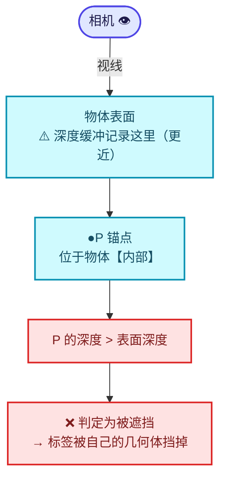
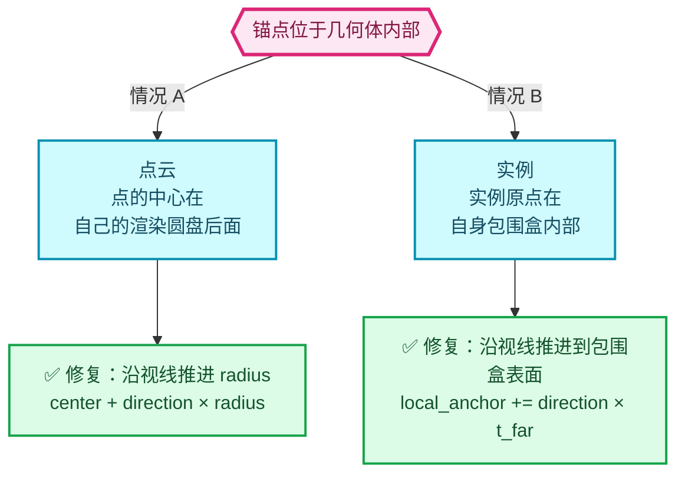
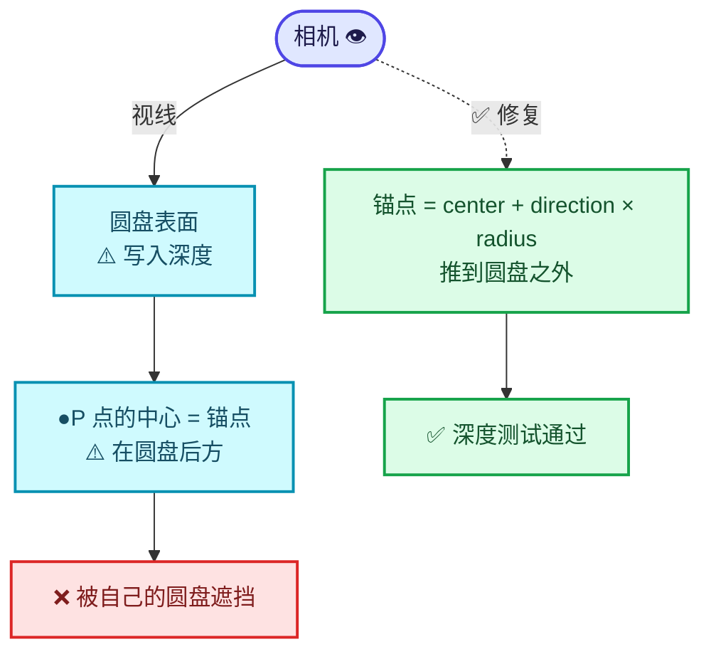
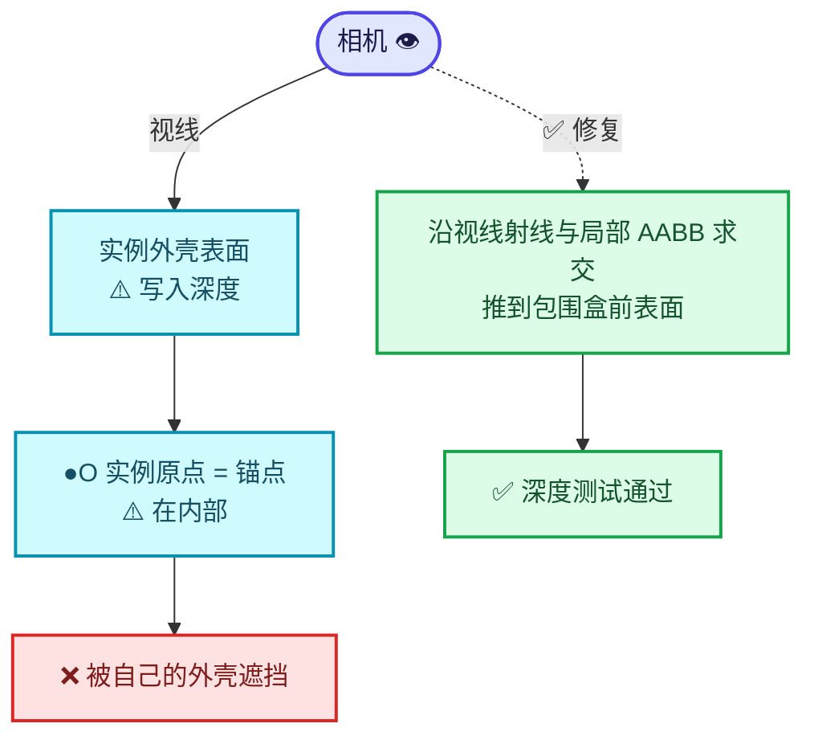
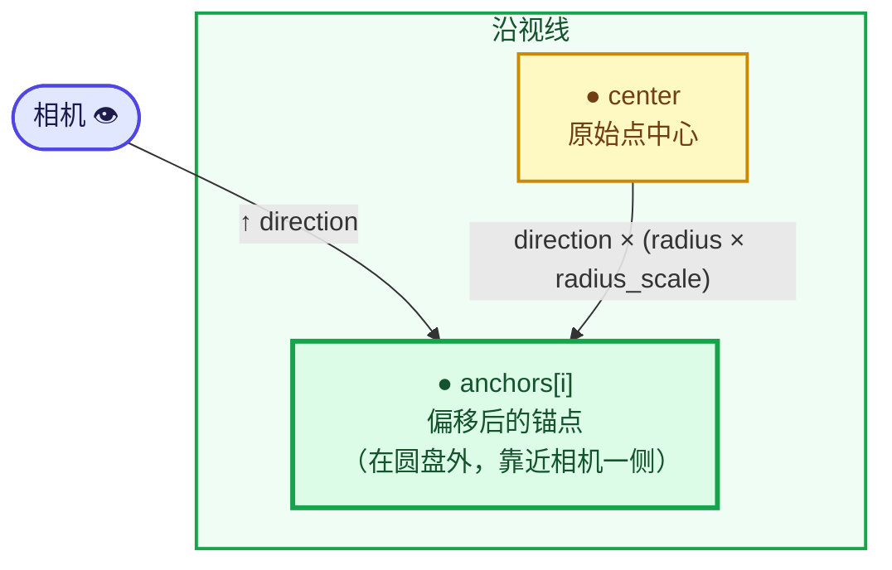
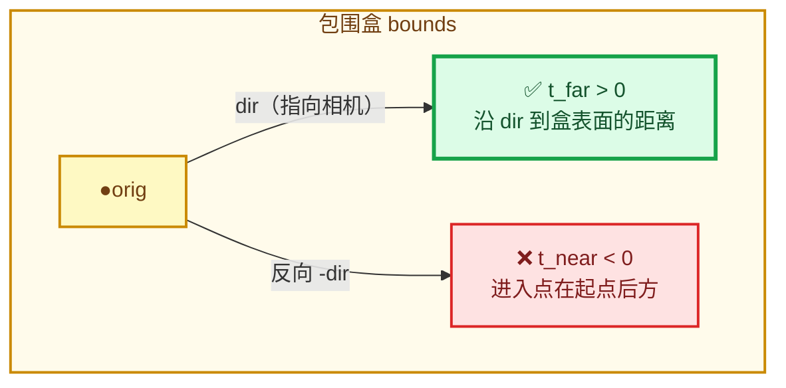
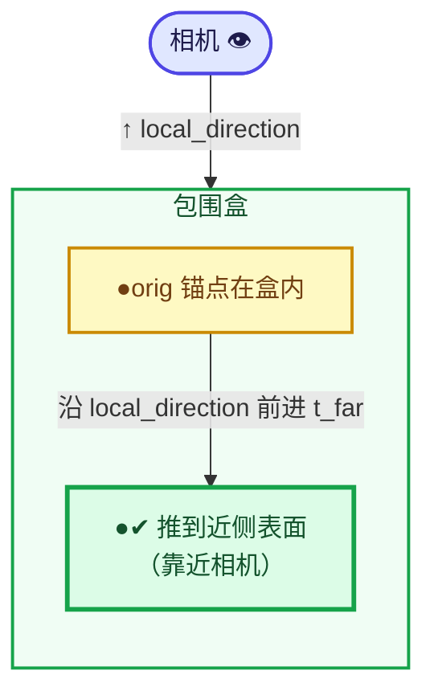
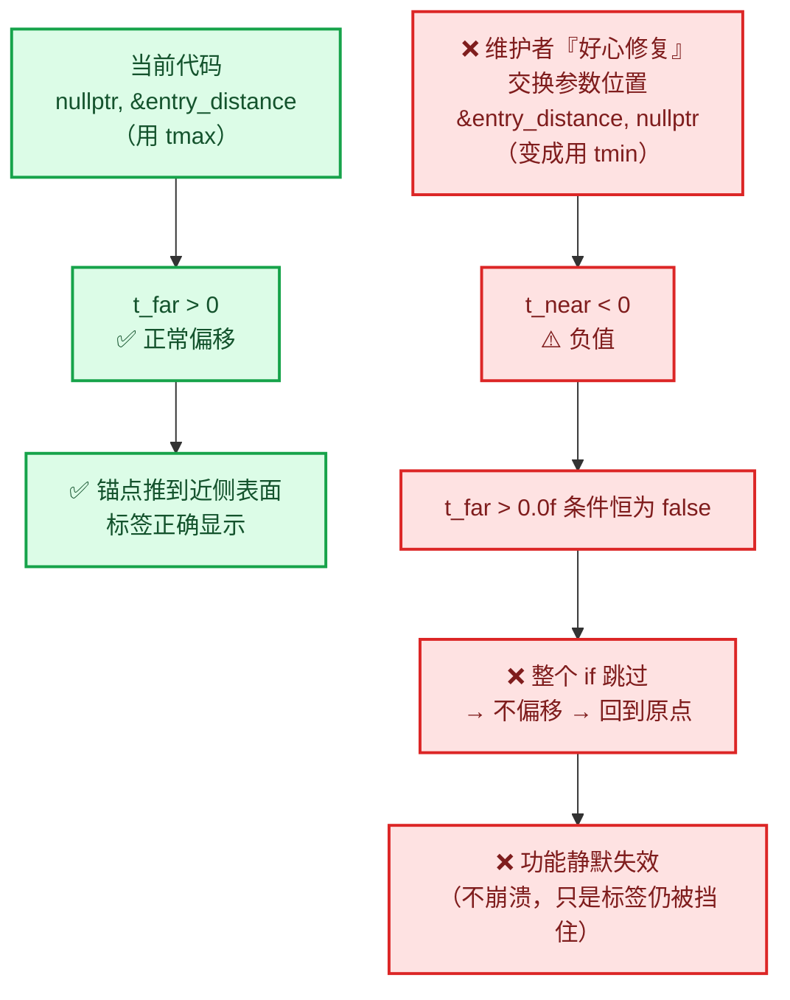
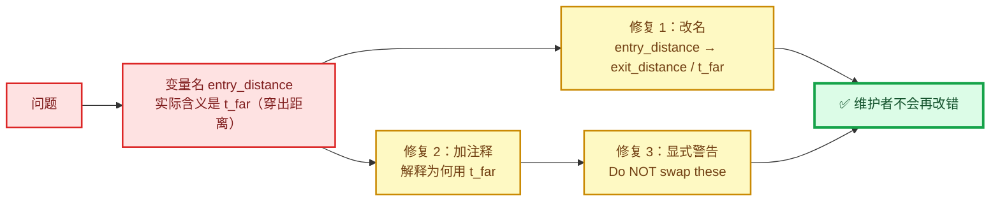
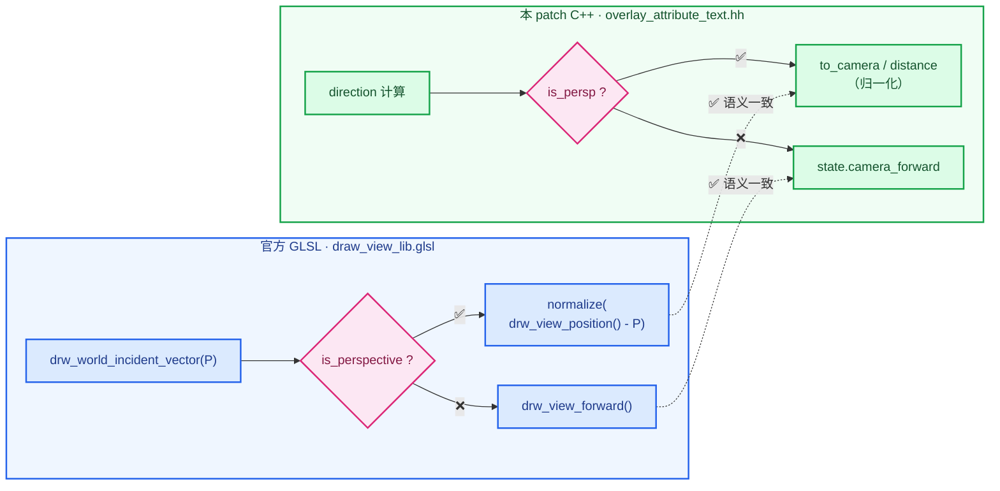

# 05 - 锚点偏移数学

> 🔗 [返回索引](./README.md) | 上一篇：[04-实例层-缓存与绘制顺序](./04-实例层-缓存与绘制顺序.md) | 下一篇：[06-API与函数参考](./06-API与函数参考.md)

本文讲解 `overlay_attribute_text.hh` 的改动——**为什么需要偏移锚点、怎么偏移、以及一个真实存在的 bug**。

改动规模：+137 行，−22 行（最大的单文件改动）。

---

## 目录

- [1. 为什么需要偏移锚点](#1-为什么需要偏移锚点)
- [2. 改动结构总览](#2-改动结构总览)
- [3. 标志透传机制](#3-标志透传机制)
- [4. 点云锚点偏移](#4-点云锚点偏移)
- [5. 实例锚点偏移](#5-实例锚点偏移)
- [6. ⚠️ AABB 参数与命名分析](#6--aabb-参数与命名分析)
- [7. 正交相机情况分析](#7-正交相机情况分析)
- [8. 边界情况清单](#8-边界情况清单)
- [9. 设计评价](#9-设计评价)

---

## 1. 为什么需要偏移锚点

### 1.1 核心问题：锚点在几何体内部

遮挡测试的判定是：

```
anchor_depth > scene_depth + bias  →  剔除
```

⭐ **这假设"锚点在物体表面"**。但很多情况下，**锚点在物体内部**：



⭐ **结果**：`P` 的深度 **大于** 表面的深度 → 判定为"被遮挡" → **标签被自己的几何体挡掉** ❌

**这不是期望行为** —— 用户想看的就是这个属性值。

### 1.2 两种需要偏移的情况



#### 情况 A：点云

点云在 GPU 上被渲染成**面向相机的圆盘**（见 [01-§11](./01-背景知识与原理.md#11-点云渲染原理)）：



⭐ **点的中心在它自己的圆盘后面** → 会被自己的圆盘遮挡。

**修复**：沿视线方向，把锚点推到圆盘之外 → `center + direction * radius`。

#### 情况 B：实例（Instances）

实例化的几何体（如 `Instance on Points` 节点生成的），其**原点通常在物体内部**：



⭐ **修复**：沿视线方向，把锚点推到**局部包围盒的前表面**。

### 1.3 ⭐ 与官方 GLSL 的对应关系

⭐ **这个思路不是新的** —— Blender 官方的点云编辑模式**已经这么做了**：

```glsl
/* overlay_edit_pointcloud_vert.glsl:17-27 */
float radius = pos_rad.w;
float3 world_pos = drw_point_object_to_world(pos_rad.xyz);
float3 V = drw_world_incident_vector(world_pos);

/* Offset the position so the selection point is always
 * drawn in from of the point, regardless of the radius. */
world_pos += V * radius;                      // ← 同样的思路！
gl_Position = drw_point_world_to_homogenous(world_pos);
```

⭐ **注释几乎相同**：
- GLSL: `"Offset the position so the selection point is always drawn in from of the point"`
- C++: `"A center anchor is behind its own camera-facing disk, so move each label to the front of its own point"`

⚠️ **注意 GLSL 里的 typo**：`"in from of"` 应为 `"in front of"`（Blender 官方代码里的拼写错误）。

⭐ **还有另一处先例**：

```glsl
/* overlay_wireframe_vert.glsl:99-100 */
float3 wpos = drw_point_object_to_world(pos_rad.xyz);
wpos += drw_world_incident_vector(wpos) * pos_rad.w;
```

✅ **作者显然参考了这些先例**，这是好的做法（复用既有约定而非发明新方案）。

⚠️ **但有一个关键差异**：GLSL 里的 `V = drw_world_incident_vector(world_pos)` 是**从表面点指向相机**的单位向量。而新 C++ 代码手动计算这个方向，需要正确处理透视/正交两种情况（见 §4.3 和 §7）。

---

## 2. 改动结构总览

### 2.1 改动分类

```
overlay_attribute_text.hh 的改动可以分成 4 类：

【A】新增 include（5 个）
     BLI_array.hh, BLI_math_matrix.hh, BLI_math_geom_c.hh,
     BLI_math_vector.hh, BKE_object.hh

【B】新增成员与状态
     bool occlusion_test_;
     begin_sync 里读取

【C】新增/重构几何特化函数
     add_pointcloud_attributes_to_text_cache()   ← 新函数（点云半径偏移）
     add_instance_attributes_to_text_cache()     ← 改签名 + 包围盒偏移
     add_attributes_to_text_cache()              ← 加 occlusion_test 参数

【D】标志透传（机械改动，占大部分行数）
     add_text_to_cache(dt, pos, str, col, flag)
     add_lines_to_cache(dt, pos, lines, col, flag)
     add_values_to_text_cache(dt, values, positions, mw, occlusion_test)
     以及所有 12 个类型分支的调用点
```

### 2.2 新增的 include

```cpp
#include "BLI_array.hh"              // ← Array<float3>
#include "BLI_math_matrix.hh"        // ← math::transform_point, math::invert, math::determinant
#include "BLI_math_geom_c.hh"        // ← isect_ray_aabb_v3_simple
#include "BLI_math_vector.hh"        // ← math::length, math::to_scale
#include "BKE_object.hh"             // ← BKE_object_boundbox_get
```

⭐ **逐个说明用途**：

| Include | 提供的符号 | 用在哪 |
|---------|-----------|--------|
| `BLI_array.hh` | `blender::Array<T>` | `Array<float3> anchors(...)` |
| `BLI_math_matrix.hh` | `math::transform_point`、`math::invert`、`math::determinant`、`float4x4` | 坐标变换 |
| `BLI_math_geom_c.hh` | `isect_ray_aabb_v3_simple` | 实例 AABB 求交（见 §6） |
| `BLI_math_vector.hh` | `math::length`、`math::to_scale` | 半径缩放 |
| `BKE_object.hh` | `BKE_object_boundbox_get` | 实例包围盒 |

⚠️ **注意**：`BLI_math_geom_c.hh` 是 **C 接口头文件**（`.hh` 后缀但内容是 C 函数），而其他都是 C++ 的 `math::` 命名空间接口。**混用两套数学 API** 是 Blender 代码库的现状。

> 💡 **更一致的写法**：Blender 正在把几何函数迁移到 `blender::math::` 命名空间。`isect_ray_aabb_v3_simple` 目前**没有** C++ 版本，所以只能用 C 版。这是合理的。

---

## 3. 标志透传机制

### 3.1 核心：`add_values_to_text_cache` 加参数

```cpp
/* overlay_attribute_text.hh:317-330 */
void add_values_to_text_cache(DRWTextStore *dt,
                              const GVArray &values,
                              const Span<float3> positions,
                              const float4x4 &object_to_world,
                              const bool occlusion_test = false)   // ← 新增，带默认值
{
  uchar col[4];
  ui::theme::get_color_4ubv(TH_TEXT_HI, col);

  /* The flag is picked up by #DRW_text_cache_draw, which skips anchors that the scene
   * depth buffer reports as occluded. */
  const short text_flags = DRW_TEXT_CACHE_GLOBALSPACE |
                           (occlusion_test ? DRW_TEXT_CACHE_OCCLUSION_TEST : 0);
  /* ... 12 个类型分支都用 text_flags ... */
}
```

⭐ **知识点 1：默认参数 `= false`**

```cpp
const bool occlusion_test = false
```

✅ **好处**：调用方不关心遮挡测试时可以不传，保持向后兼容。

⚠️ **但实际所有调用点都显式传了**（`occlusion_test_` 或 `true`），所以默认值**从未被使用**。这属于"防御性冗余"。

> 💡 **检查**：三个调用点
> 1. `add_attributes_to_text_cache` → 传 `occlusion_test_`
> 2. `add_mesh_attributes_to_text_cache`（两个分支）→ 传 `occlusion_test_`
> 3. `add_pointcloud_...` → 传 `true`（**注意：因为已经做了偏移，所以强制开启**）
> 4. `add_instance_...` → 传 `occlusion_test_`
>
> 全部显式传参 ✅ 默认值确实未被使用。

⭐ **知识点 2：位或构造标志**

```cpp
const short text_flags = DRW_TEXT_CACHE_GLOBALSPACE |
                         (occlusion_test ? DRW_TEXT_CACHE_OCCLUSION_TEST : 0);
```

⭐ **`? : 0` 的写法**是位标志的常见模式：

```cpp
flags = BASE_FLAGS | (condition ? CONDITIONAL_FLAG : 0);
```

✅ **正确**。替代写法：

```cpp
short text_flags = DRW_TEXT_CACHE_GLOBALSPACE;
if (occlusion_test) {
  text_flags |= DRW_TEXT_CACHE_OCCLUSION_TEST;
}
```

后者更啰嗦但更易读。**当前写法更紧凑**，是 C/C++ 位标志的惯用法。

⚠️ **注意类型**：`DRW_TEXT_CACHE_GLOBALSPACE` 是枚举（`int`），`0` 是 `int`，结果赋给 `short`。**隐式窄化**，但值很小（`1<<1 | 1<<4` = 18），安全 ✅

⭐ **知识点 3：`DRWTextStore` 的标志类型是 `short`**

```cpp
/* draw_manager_text.cc:61 */
short flag;      // ← ViewCachedString::flag
```

⚠️ **只有 16 位**。当前用了 bit 1、2、3、4，还剩 11 位。**足够，但需注意上限**。

### 3.2 机械改动：12 个类型分支

⭐ **改动的主体是重复的标志透传**。以 `bool` 和 `float3` 为例：

```cpp
/* 修改前 */
if constexpr (std::is_same_v<T, bool>) {
  char numstr[64];
  const size_t numstr_len = STRNCPY_UTF8_RLEN(numstr, value ? "True" : "False");
  add_text_to_cache(dt, position, StringRef(numstr, numstr_len), col);
  //                                                              ^^^ 只有 4 个参数
}

/* 修改后 */
if constexpr (std::is_same_v<T, bool>) {
  char numstr[64];
  const size_t numstr_len = STRNCPY_UTF8_RLEN(numstr, value ? "True" : "False");
  add_text_to_cache(dt, position, StringRef(numstr, numstr_len), col, text_flags);
  //                                                              ^^^^^^^^^^^ 新增
}
```

⭐ **涉及的 12 个类型分支**：

| # | 类型 | 调用函数 |
|---|------|----------|
| 1 | `bool` | `add_text_to_cache` |
| 2 | `int8_t` | `add_text_to_cache` |
| 3 | `int` | `add_text_to_cache` |
| 4 | `int2` | `add_lines_to_cache` |
| 5 | `float` | `add_text_to_cache` |
| 6 | `float2` | `add_lines_to_cache` |
| 7 | `float3` | `add_lines_to_cache` |
| 8 | `ColorGeometry4b` | `add_lines_to_cache` |
| 9 | `ColorGeometry4f` | `add_lines_to_cache` |
| 10 | `math::Quaternion` | `add_lines_to_cache` |
| 11 | `float4x4` | `add_lines_to_cache` |
| 12 | （`else` 分支） | `BLI_assert_unreachable()` |

⭐ **这是"改动行数多但逻辑简单"的典型** —— 137 行里有约 **80 行**只是给调用点加一个参数。

> 💡 **替代设计**：把标志存到 `DRWTextStore` 的一个"当前设置"字段，绘制时统一应用。但那样会失去"按字符串粒度控制"的能力（有些文本需要遮挡测试，有些不需要）。**当前设计更灵活** ✅

### 3.3 `add_text_to_cache` / `add_lines_to_cache` 的签名变化

```cpp
/* 修改前 */
static void add_text_to_cache(DRWTextStore *dt,
                              const float3 &position,
                              const StringRef text,
                              const uchar4 &color)

/* 修改后 */
static void add_text_to_cache(DRWTextStore *dt,
                              const float3 &position,
                              const StringRef text,
                              const uchar4 &color,
                              const short flag)      // ← 新增
```

```cpp
/* 修改前 */
static void add_lines_to_cache(DRWTextStore *dt,
                               const float3 &position,
                               const Span<StringRef> lines,
                               const uchar4 &color)

/* 修改后 */
static void add_lines_to_cache(DRWTextStore *dt,
                               const float3 &position,
                               const Span<StringRef> lines,
                               const uchar4 &color,
                               const short flag)     // ← 新增
```

⭐ **注意：这里**没有**默认值**，而 `add_values_to_text_cache` 有。**不一致**，但无实际影响（所有调用点都传了）。

⚠️ **`const short flag` 按值传递** —— `short` 是 2 字节，按值传比引用更高效 ✅ 正确。

### 3.4 点云的特殊处理：强制 `true`

```cpp
/* overlay_attribute_text.hh:149-150 */
add_values_to_text_cache(
    state.dt, attribute.varray, anchors.as_span(), float4x4::identity(), true);
//                                                                        ^^^^
//                                                                        硬编码 true
```

⚠️ **为什么是硬编码 `true` 而不是 `occlusion_test_`**？

⭐ **因为这段代码已经在 `if (!occlusion_test_) { ... return; }` 之后了**：

```cpp
if (!occlusion_test_) {
  add_values_to_text_cache(state.dt, attribute.varray, positions, object_to_world);
  return;                                        // ← 提前返回
}

/* 到这里 occlusion_test_ 必然为 true */
...
add_values_to_text_cache(..., true);             // ← 所以硬编码 true 正确
```

✅ **逻辑正确**，但**硬编码 `true` 降低了可读性** —— 读者需要向上追溯才能确认。**用 `occlusion_test_` 更清晰**（虽然等价）。

⚠️ **另一个问题**：硬编码 `true` 意味着**如果将来 `occlusion_test_` 变成更复杂的状态**（比如三态枚举），这里会失效。

⭐ **建议改为 `occlusion_test_`**（见 [07](./07-问题清单与修复.md)，🟢 级）。

---

## 4. 点云锚点偏移

### 4.1 完整代码

```cpp
/* overlay_attribute_text.hh:119-151 */
void add_pointcloud_attributes_to_text_cache(const State &state,
                                             const PointCloud &pointcloud,
                                             const float4x4 &object_to_world)
{
  const bke::AttributeAccessor attributes = pointcloud.attributes();
  if (!attributes.contains(".viewer")) {
    return;
  }
  const bke::GAttributeReader attribute = attributes.lookup(".viewer");
  const Span<float3> positions = pointcloud.positions();
  if (!occlusion_test_) {
    add_values_to_text_cache(state.dt, attribute.varray, positions, object_to_world);
    return;
  }

  /* Match the world-space radius used by point-cloud drawing. A center anchor is behind its
   * own camera-facing disk, so move each label to the front of its own point. */
  const VArray<float> radii = pointcloud.radius();
  const float radius_scale = math::length(math::to_scale(object_to_world)) * 0.577350269f;
  const bool is_perspective = state.rv3d != nullptr && state.rv3d->is_persp;
  Array<float3> anchors(positions.size());
  for (const int i : positions.index_range()) {
    const float3 center = math::transform_point(object_to_world, positions[i]);
    const float3 to_camera = is_perspective ? state.camera_position - center :
                                              state.camera_forward;
    const float distance = math::length(to_camera);
    const float3 direction = distance > 1.0e-20f ? to_camera / distance :
                                                   state.camera_forward;
    anchors[i] = center + direction * (std::max(radii[i], 0.0f) * radius_scale);
  }
  add_values_to_text_cache(
      state.dt, attribute.varray, anchors.as_span(), float4x4::identity(), true);
}
```

### 4.2 为什么新增了这个独立函数

⭐ **改动前**，点云走的是通用路径：

```cpp
case OB_POINTCLOUD: {
  const PointCloud &pointcloud = DRW_object_get_data_for_drawing<PointCloud>(object);
  add_attributes_to_text_cache(dt, pointcloud.attributes(), object_to_world);  // ← 通用函数
  break;
}
```

⚠️ **但通用函数有两个问题**：

1. 它用 `attribute_accessor.lookup<float3>("position", attribute.domain)` 拿位置 —— 对点云来说等价于 `pointcloud.positions()`，但**拿不到 `radius` 属性**。
2. 它不做半径偏移。

⭐ **所以必须新增专用函数**。改动后的分发：

```cpp
case OB_POINTCLOUD: {
  const PointCloud &pointcloud = DRW_object_get_data_for_drawing<PointCloud>(object);
  add_pointcloud_attributes_to_text_cache(state, pointcloud, object_to_world);  // ← 专用函数
  break;
}
```

✅ **合理**。这是"为特殊情况开专用路径"的正确做法。

⚠️ **但引入了代码重复**：`attributes.contains(".viewer")` 检查、`lookup`、`positions` 获取都重复了一遍。**可接受**（只有几行）。

### 4.3 参数解析

```cpp
const VArray<float> radii = pointcloud.radius();
```

⭐ **`PointCloud::radius()`**：

```cpp
/* blenkernel/intern/pointcloud.cc:208-212 */
VArray<float> PointCloud::radius() const
{
  return bke::get_varray_attribute<float>(
      this->attribute_storage.wrap(), bke::AttrDomain::Point, "radius", this->totpoint, 0.01f);
}
```

⭐ **关键信息**：

| 方面 | 说明 |
|------|------|
| 属性名 | `"radius"` |
| 域 | `AttrDomain::Point` |
| **默认值** | **`0.01f`** ← 如果属性不存在，返回常量 0.01 |
| 返回类型 | `VArray<float>`（可能是常量数组，非实体） |

⭐ **`radius` 属性可能不存在** → 返回默认 `0.01f` 的**常量 VArray**。所以 `radii[i]` 一定有效 ✅

```cpp
const float radius_scale = math::length(math::to_scale(object_to_world)) * 0.577350269f;
```

⭐ **`math::to_scale(m)`**：从矩阵提取缩放分量。

```
object_to_world 是 4×4 仿射矩阵：
┌ sx*R  sy*R  sz*R  T ┐
```

`to_scale` 返回 `float3(sx, sy, sz)`（各轴缩放）。

⭐ **`math::length(...)`**：取缩放向量长度 = **统一的缩放系数**。

⭐ **与 GLSL 完全对应**：

```glsl
/* draw_pointcloud_lib.glsl:81 */
pt.radius *= length(to_scale(object_to_world)) * M_SQRT1_3;
//            ^^^^^^^^^^^^^^^^^^^^^^^^^^^^^^^   ^^^^^^^^^^
//            完全相同                          0.577350269
```

| | GLSL | C++ |
|---|------|-----|
| 缩放 | `length(to_scale(object_to_world))` | `math::length(math::to_scale(object_to_world))` |
| 常数 | `M_SQRT1_3` | `0.577350269f` |

⭐ **数值完全相同** ✅（`M_SQRT1_3` 的定义见下）

```cpp
/* gpu/shaders/common/gpu_shader_math_constants.bsl.hh:14 */
#define M_SQRT1_3 0.57735026918962576450f /* 1/sqrt(3) */

/* blenlib/BLI_math_constants.hh:42 */
#  define M_SQRT1_3 0.57735026918962576450 /* `1/sqrt(3)` */
```

⚠️ **问题**：C++ 侧**硬编码了字面量** `0.577350269f`，而不是引用 `M_SQRT1_3`。

| 方面 | 评价 |
|------|------|
| **数值正确性** | ✅ 与 `M_SQRT1_3` 一致 |
| **可维护性** | ⚠️ 如果 GPU 侧改了系数，C++ 侧不会跟着改 |
| **可读性** | ⚠️ 魔法数字，读者不知道是 1/√3 |
| **一致性** | ⚠️ 同一概念在两处用不同写法 |

⭐ **建议**：

```cpp
#include "BLI_math_constants.hh"
/* ... */
const float radius_scale = math::length(math::to_scale(object_to_world)) * M_SQRT1_3;
```

见 [07-问题清单](./07-问题清单与修复.md)（🟡 级）。

### 4.4 方向计算（⭐ 关键部分）

```cpp
const bool is_perspective = state.rv3d != nullptr && state.rv3d->is_persp;
/* ... */
const float3 to_camera = is_perspective ? state.camera_position - center :
                                          state.camera_forward;
const float distance = math::length(to_camera);
const float3 direction = distance > 1.0e-20f ? to_camera / distance :
                                               state.camera_forward;
```

#### 透视相机

```cpp
state.camera_position - center
```

⭐ **从点指向相机**的向量 ✅ **正确**。

```
     相机 👁 (camera_position)
       \
        \  to_camera = camera_position - center
         \
          ● center
```

归一化后 `direction` 就是从点指向相机的单位向量 ✅

⭐ **与 GLSL 的 `drw_world_incident_vector(world_pos)` 语义一致**（都是从表面点指向相机）。

#### 正交相机

```cpp
state.camera_forward
```

✅ **正确** —— 官方 GLSL 文档明确 `camera_forward` 指向观察者（`going towards the viewer`）。见 [§7](#7-正交相机情况分析-已验证正确)。

#### 除零保护

```cpp
const float distance = math::length(to_camera);
const float3 direction = distance > 1.0e-20f ? to_camera / distance :
                                               state.camera_forward;
```

⭐ **当点恰好位于相机位置时**（`distance ≈ 0`），归一化会产生 NaN/Inf。**回退到 `camera_forward`** ✅ 良好的防御。

⚠️ **阈值 `1.0e-20f`**：

| 值 | 评估 |
|----|------|
| `1e-20` | 非常小 —— `float` 的最小正规数约 `1.2e-38`，所以 `1e-20` 是合法的非零值 |
| 效果 | 只有当 distance **极其接近 0** 时才回退 |

⭐ **潜在问题**：如果 `distance = 1e-10`（大于阈值），则 `to_camera / distance` 会**放大浮点误差**，得到一个方向不可靠的向量。

> 💡 **更稳健的写法**用平方比较避免开方：
> ```cpp
> const float distance_sq = math::length_squared(to_camera);
> const float3 direction = distance_sq > 1.0e-20f ? to_camera * math::sqrt(1.0f / distance_sq) : state.camera_forward;
> ```
> 但当前写法**已经足够好**（相机在点上的情况极罕见）。

⚠️ **注意 `1.0e-20f` 与代码里另一处的 `1.0e-20f` 重复**（实例部分用的是 `math::length_squared(...) > 1.0e-20f`）。**同一个阈值用于"长度"和"长度平方"两种语义** —— 这是**不一致**的：

| 位置 | 比较对象 | 阈值 | 实际最小距离 |
|------|----------|------|-------------|
| 点云（:145） | `length` | `1e-20` | `1e-20` |
| 实例（:257） | `length_squared` | `1e-20` | `1e-10` |

⚠️ **两者的实际阈值相差 10 个数量级**！虽然都极宽松（无害），但暴露了**复制粘贴时未调整阈值**的问题。见 [07](./07-问题清单与修复.md)（🟢 级）。

### 4.5 最终锚点

```cpp
anchors[i] = center + direction * (std::max(radii[i], 0.0f) * radius_scale);
```

⭐ **逐部分解析**：

| 部分 | 含义 |
|------|------|
| `radii[i]` | 点的半径属性值（可能为负，非法） |
| `std::max(radii[i], 0.0f)` | **钳制到非负** ✅ 防止反向偏移 |
| `* radius_scale` | 换算成世界空间半径（含物体缩放 + 1/√3） |
| `* direction` | 沿"指向相机"方向 |
| `center + ...` | 从点中心出发，向相机方向推进一个半径 |

⭐ **几何意义**：



✅ **正确**：锚点被推到圆盘**之外**、**靠近相机**的一侧，所以深度测试不会把它判为被自己的圆盘遮挡。

⚠️ **注意**：这**不是**精确推到圆盘表面，而是推到 `center + radius * direction`。因为圆盘是**面向相机**的，其表面中心正好在 `center + radius * direction` 处（当 `direction` 是"指向相机"时，`-direction` 是圆盘法线方向）。

⭐ **实际上这个偏移可能略微过头**（推到圆盘外一点），但这是**安全的方向**（宁可多推一点，也不要被误剔除）✅ 合理的设计取舍。

⭐ **屏幕位置不变的证明**：


> 💡 这是**极好的设计论据**（review 时可以用）：偏移**不会移动标签的视觉位置**，只影响深度测试结果。对透视和正交相机都成立。

### 4.6 单位矩阵的技巧

```cpp
add_values_to_text_cache(
    state.dt, attribute.varray, anchors.as_span(), float4x4::identity(), true);
//                                                 ^^^^^^^^^^^^^^^^^^^^
//                                                 单位矩阵！
```

⭐ **为什么传单位矩阵**：

因为 `anchors` 里存的**已经是世界坐标**了：

```cpp
const float3 center = math::transform_point(object_to_world, positions[i]);
/* ... */
anchors[i] = center + direction * (...);      // ← center 已是世界坐标
```

而 `add_values_to_text_cache` 内部会做：

```cpp
const float3 position = math::transform_point(object_to_world, positions[i]);
```

⭐ **如果传 `object_to_world`，就会变换两次**（错误！）。传单位矩阵则变换是恒等操作 ✅ **正确**。

> 💡 **替代方案**：让 `add_values_to_text_cache` 接受一个"已经是世界坐标"的标志。但传单位矩阵更简洁，是常见的技巧。

⚠️ **代价**：多一次无意义的矩阵乘法（单位矩阵 × 向量）。对每个点执行，**有微小开销**。但相比可读性收益，**可接受**。

⭐ **这个技巧在改动中出现了两次**（点云和实例都用），说明作者有意为之。

### 4.7 内存分配

```cpp
Array<float3> anchors(positions.size());
```

⭐ **`blender::Array<T>`** 是 Blender 的**定长堆数组**（见 [基础库/03_Array.md](../基础库/03_Array.md)）：

- 构造时分配 `size` 个元素
- **未初始化**（`float3` 是平凡类型，不调构造函数）
- 析构时自动释放

⭐ **为什么需要这个数组**：因为 `add_values_to_text_cache` 接受 `Span<float3>`，需要一个连续的缓冲区。**不能边算边传**。

⚠️ **内存开销**：`positions.size() * 12` 字节。对 100 万个点 = **12 MB** 临时分配。

⭐⭐ **这是一个潜在的性能问题**：点云动辄几十万到上百万点，每次 `object_sync` 都分配一个大数组。

| 点数 | 临时内存 |
|------|----------|
| 10,000 | 120 KB |
| 100,000 | 1.2 MB |
| 1,000,000 | 12 MB |

⚠️ 而且由于 `occlusion_test_` 默认关闭，**大多数用户不会走到这个分支**。但一旦开启，大点云会有明显的内存压力和分配开销。

⭐ **优化思路**：

1. **原地复用缓冲区**（存为成员，尺寸变化时重新分配）
2. **用 `BLI_SMALL` 栈分配**（对小点云）
3. **改 `add_values_to_text_cache` 接受一个"位置生成回调"**（避免物化整个数组）

见 [07-问题清单](./07-问题清单与修复.md)（🟡 级）。

---

## 5. 实例锚点偏移

### 5.1 完整代码

```cpp
/* overlay_attribute_text.hh:231-273 */
void add_instance_attributes_to_text_cache(const State &state,
                                           bke::AttributeAccessor attribute_accessor,
                                           const Object &object,
                                           const float4x4 &object_to_world,
                                           int instance_index)
{
  /* ... */
  float3 local_anchor(0.0f);
  if (occlusion_test_) {
    /* The instance origin is often behind its own geometry. Move the depth-test anchor along
     * the view ray to the front of its local bounds; its screen position stays the same. */
    const std::optional<Bounds<float3>> bounds = BKE_object_boundbox_get(&object);
    if (bounds && bounds->contains(local_anchor) &&
        math::abs(math::determinant(object_to_world)) > 1.0e-20f)
    {
      const float4x4 world_to_object = math::invert(object_to_world);
      const float3 world_center = object_to_world.location();
      const float3 toward_camera = (state.rv3d != nullptr && state.rv3d->is_persp) ?
                                       state.camera_position - world_center :
                                       state.camera_forward;
      const float3 local_direction = math::transform_direction(world_to_object, toward_camera);
      float entry_distance;
      if (math::length_squared(local_direction) > 1.0e-20f &&
          isect_ray_aabb_v3_simple(local_anchor,
                                  local_direction,
                                  bounds->min,
                                  bounds->max,
                                  nullptr,
                                  &entry_distance) &&
          entry_distance > 0.0f &&
          (state.rv3d == nullptr || !state.rv3d->is_persp || entry_distance < 1.0f))
      {
        local_anchor += local_direction * entry_distance;
      }
    }
  }
  add_values_to_text_cache(
      state.dt, attribute, {local_anchor}, object_to_world, occlusion_test_);
}
```

### 5.2 签名变化

```cpp
/* 修改前 */
void add_instance_attributes_to_text_cache(DRWTextStore *dt,
                                           bke::AttributeAccessor attribute_accessor,
                                           const float4x4 &object_to_world,
                                           int instance_index)

/* 修改后 */
void add_instance_attributes_to_text_cache(const State &state,      // ← 新增（需要相机信息）
                                           bke::AttributeAccessor attribute_accessor,
                                           const Object &object,     // ← 新增（需要包围盒）
                                           const float4x4 &object_to_world,
                                           int instance_index)
```

⭐ **为什么要传 `state`**：需要 `state.rv3d->is_persp`、`state.camera_position`、`state.camera_forward`。

⭐ **为什么要传 `object`**：需要 `BKE_object_boundbox_get(&object)`。

⚠️ **注意**：`state.dt` 已经在 `state` 里了，所以第一个参数 `DRWTextStore *dt` 被**隐式替换**为 `state.dt` ✅ 合理。

⚠️ **但注意**：其他函数（如 `add_attributes_to_text_cache`）**同时**接受 `dt` 和 `object_to_world` 但**不接 `state`**。所以现在有两套风格：

| 函数 | 参数风格 |
|------|----------|
| `add_attributes_to_text_cache` | `(dt, attrs, mw)` |
| `add_mesh_attributes_to_text_cache` | `(state, mesh, mw)` |
| `add_pointcloud_attributes_to_text_cache` | `(state, pointcloud, mw)` |
| `add_instance_attributes_to_text_cache` | `(state, attrs, object, mw, idx)` |

⚠️ **风格不统一** —— 有的用 `state`，有的用 `dt`。**建议统一为 `state`**（因为 `state.dt` 总能拿到，且可能还需要其他字段）。见 [07](./07-问题清单与修复.md)（🟢 级）。

### 5.3 局部锚点的选择

```cpp
float3 local_anchor(0.0f);
```

⭐ **用局部空间原点**（`(0,0,0)` in object space）作为"实例的锚点"。

**为什么**：改动前的代码就是用原点：

```cpp
/* 改动前 */
add_values_to_text_cache(dt, attribute, {float3(0, 0, 0)}, object_to_world);
```

⭐ 因为**实例的位置**就是它自己的原点，标签显示在实例中心 ✅ 保持行为一致。

⚠️ **但 `local_anchor` 是 `float3` 而非 `const float3`** —— 因为后面要修改它：

```cpp
local_anchor += local_direction * entry_distance;
```

✅ 正确。

### 5.4 三个前置检查

```cpp
if (bounds && bounds->contains(local_anchor) &&
    math::abs(math::determinant(object_to_world)) > 1.0e-20f)
```

⭐ **逐个分析**：

#### 检查 1：`bounds` 有值

```cpp
const std::optional<Bounds<float3>> bounds = BKE_object_boundbox_get(&object);
if (bounds && ...)
```

⭐ **`BKE_object_boundbox_get` 返回 `std::optional`**：

```cpp
/* BKE_object.hh:366 */
std::optional<Bounds<float3>> BKE_object_boundbox_get(const Object *ob);
```

⭐ **`std::optional` 表示"可能没有包围盒"**。什么情况下为空？

- 物体没有几何数据
- 几何数据为空（0 个顶点）
- 包围盒未计算

✅ **必须检查**，否则 `bounds->min` 会 UB。

#### 检查 2：`bounds->contains(local_anchor)`

```cpp
bounds->contains(local_anchor)
```

⭐ **`Bounds<float3>::contains`**（`BLI_bounds_types.hh:70`）：判断点是否在包围盒内。

```cpp
bool contains(const T &point) const;
```

⚠️ **为什么需要这个检查**：

因为它**兼作"包围盒有效"的验证**。如果包围盒是退化的（`min == max`，比如只有 1 个顶点的情况），`contains` 只在点正好等于那个位置时返回真。

⭐ **而且逻辑上必要**：如果原点**不在**包围盒内（罕见但可能，比如几何体被偏移到远离原点处），那么"从原点向前推到包围盒"就没有意义。

✅ **正确的防御**。

⚠️ **但它也排除了一个合法场景**：原点在包围盒外时，本可以用"射线与 AABB 求交"找到进入点，只是需要允许 `t_near > 0` 的"外部射线"情况。**当前逻辑放弃了这种优化**（退化为不偏移）。

⭐ **这是可接受的简化**。

#### 检查 3：矩阵可逆

```cpp
math::abs(math::determinant(object_to_world)) > 1.0e-20f
```

⭐ **为什么检查行列式**：因为后面要 `math::invert(object_to_world)`。

- `determinant == 0` → 矩阵**奇异**，不可逆
- 物体被缩放成 0（`scale = (1, 0, 1)`）→ 行列式为 0

✅ **正确的检查**。

⭐ **`math::abs`** 而不是 `std::abs`：Blender 的 `math::abs` 支持 `float`（`std::abs` 在 C++ 里对 float 有重载歧义问题）。

> 💡 **更直接的替代**：`math::invert` 本身可能有检查，或者用 `math::is_negative` 判断是否翻转（影响法线方向）。当前用行列式是合理的。

### 5.5 世界坐标转局部

```cpp
const float4x4 world_to_object = math::invert(object_to_world);
const float3 world_center = object_to_world.location();
const float3 toward_camera = (state.rv3d != nullptr && state.rv3d->is_persp) ?
                                 state.camera_position - world_center :
                                 state.camera_forward;
const float3 local_direction = math::transform_direction(world_to_object, toward_camera);
```

⭐ **为什么要转到局部空间**：

因为 `bounds->min` / `bounds->max` 是**局部（物体）空间**的包围盒：

```
BKE_object_boundbox_get(object) → 物体的局部空间 AABB
```

而 `local_anchor` 也是局部空间的。所以求交必须在**同一空间**进行 → 需要把"指向相机的方向"也转到局部空间 ✅

⭐ **注意用的是 `math::transform_direction`**（不是 `transform_point`）：

| 函数 | 用途 | 对平移分量 |
|------|------|-----------|
| `transform_point(m, p)` | 变换**点** | 平移**参与** |
| `transform_direction(m, d)` | 变换**方向** | 平移**不参与** ✅ |

✅ **正确**：方向向量不应该被平移影响。

⚠️ **但这里有个隐含问题**：`transform_direction` **不做归一化**。所以 `local_direction` 的模长取决于 `world_to_object` 的缩放：

```
如果物体缩放为 (2, 2, 2)，则 world_to_object 缩放为 (0.5, 0.5, 0.5)
→ local_direction 模长 = |toward_camera| * 0.5
```

⭐ **这对 `isect_ray_aabb_v3_simple` 有影响**（见 §6.6）。

### 5.6 世界中心 vs 局部原点

```cpp
const float3 world_center = object_to_world.location();
const float3 toward_camera = ... state.camera_position - world_center ...;
```

⭐ **`object_to_world.location()`** 提取矩阵的平移分量 = 物体原点在世界空间的位置。

⚠️ **注意**：这里用的是 `world_center`（物体原点），而点云那边用的是 `center`（**每个点**的世界坐标）。**这是正确的**，因为实例的锚点就是物体原点 ✅

> 💡 **术语小问题**：变量名叫 `world_center` 但实际是"物体原点在世界空间的位置"，不是"包围盒中心"。命名略有误导。🟢 级。

### 5.7 ⚠️ 与官方 GLSL 的对比

⭐ **对比点云的做法**：

```cpp
/* 点云：推到"自己的半径"之外 */
anchors[i] = center + direction * (radii[i] * radius_scale);

/* 实例：推向"包围盒前表面" */
local_anchor += local_direction * entry_distance;
```

| | 点云 | 实例 |
|---|------|------|
| 参考几何 | 点的半径 | 物体的 AABB |
| 推进距离 | `radius * scale * (1/√3)` | `t_near`（射线进入 AABB 的距离） |
| 精确度 | 近似（圆盘是 billboard） | 精确（AABB 求交） |
| 对齐官方 | ✅ 与 GLSL 一致 | ⚠️ **官方没有对应实现** |

⭐ **实例这部分是"新发明"**，没有官方先例可参考。这也是为什么它**有 bug**（见下节）。

---

## 6. ⚠️ AABB 参数与命名分析

> 📌 **本节的结论经过一次重要更正**。先给出结论，再展开完整推导：
>
> | 方面 | 结论 |
> |------|------|
> | **参数位置** | ✅ **正确** —— `orig` 在盒内时，`tmax`（`t_far`）恰好是"沿相机方向穿出包围盒"的距离 |
> | **变量命名** | ❌ **错误且有危险性** —— `entry_distance` 实际是"穿出距离" |
> | **功能** | ✅ **正常工作** |
>
> ⚠️ 问题在于：这个写法**看起来像参数错位**（`nullptr` 在前、`&var` 在后，而签名顺序是 `tmin, tmax`），会让读者"好心"地交换参数 —— 而交换后 `entry_distance > 0.0f` 会失败（因为盒内 `t_near < 0`），导致功能**静默失效**。

### 6.1 问题代码

```cpp
/* overlay_attribute_text.hh:256-268 */
float entry_distance;
if (math::length_squared(local_direction) > 1.0e-20f &&
    isect_ray_aabb_v3_simple(local_anchor,
                            local_direction,
                            bounds->min,
                            bounds->max,
                            nullptr,              // ← 🐛 第 5 参数 = tmin
                            &entry_distance) &&   // ← 🐛 第 6 参数 = tmax
    entry_distance > 0.0f &&
    (state.rv3d == nullptr || !state.rv3d->is_persp || entry_distance < 1.0f))
{
  local_anchor += local_direction * entry_distance;
}
```

### 6.2 函数签名（权威）

```cpp
/* BLI_math_geom_c.hh:900-911 */
/**
 * Test a bounding box (AABB) for ray intersection.
 * Assumes the ray is already local to the boundbox space.
 *
 * \note \a direction should be normalized
 * if you intend to use the \a tmin or \a tmax distance results!
 */
bool isect_ray_aabb_v3_simple(const float orig[3],
                              const float dir[3],
                              const float bb_min[3],
                              const float bb_max[3],
                              float *tmin,        // ← 第 5 个参数：进入距离
                              float *tmax);       // ← 第 6 个参数：离开距离
```

⭐ **参数顺序**（务必记住）：

```
1. orig      射线起点
2. dir       射线方向
3. bb_min    包围盒最小角
4. bb_max    包围盒最大角
5. tmin      → 输出：进入（命中）距离
6. tmax      → 输出：离开距离
```

### 6.3 实现验证

```cpp
/* math_geom.cc:3279-3310 */
bool isect_ray_aabb_v3_simple(const float orig[3], const float dir[3],
                              const float bb_min[3], const float bb_max[3],
                              float *tmin, float *tmax)
{
  double t[6];
  float hit_dist[2];
  /* ... 计算三对平板的 t 值 ... */
  hit_dist[0] = float(fmax(fmax(fmin(t[0], t[1]), fmin(t[2], t[3])), fmin(t[4], t[5])));
  //             ^^^^^^^^^^^^^^^^^^^^^^^^^^^^^^^^^^^^^^^^^^^^^^^^^^^^^^^^^^^^^^^^^^^
  //             t_near = 三个轴的"较近交点"取最大  →  最晚进入
  hit_dist[1] = float(fmin(fmin(fmax(t[0], t[1]), fmax(t[2], t[3])), fmax(t[4], t[5])));
  //             ^^^^^^^^^^^^^^^^^^^^^^^^^^^^^^^^^^^^^^^^^^^^^^^^^^^^^^^^^^^^^^^^^^^
  //             t_far = 三个轴的"较远交点"取最小  →  最早离开
  if ((hit_dist[1] < 0.0f) || (hit_dist[0] > hit_dist[1])) {
    return false;
  }

  if (tmin) { *tmin = hit_dist[0]; }   // ← 第 5 参数 = hit_dist[0] = 进入距离
  if (tmax) { *tmax = hit_dist[1]; }   // ← 第 6 参数 = hit_dist[1] = 离开距离
  return true;
}
```

⭐ **确认无误**：第 5 个参数（`tmin`）= 进入距离，第 6 个（`tmax`）= 离开距离。

### 6.4 ✅ 为什么用 `tmax` 是正确的

**代码传的**：

```cpp
nullptr,           // tmin ← 不接收（盒内时它是负值，对我们没用）
&entry_distance    // tmax ← 接收"离开距离"，而这里它正是我们需要的距离
```

#### 关键几何事实：`orig` 在包围盒内部

⭐ **`bounds->contains(local_anchor)` 检查保证 `orig` 在盒内**。此时：



⭐ **因为起点在盒内**，沿 `-dir` 方向的"进入点"在**起点后方**（`t_near < 0`），而沿 `+dir` 方向到达盒表面的距离就是 **`t_far`** ✅

⭐ **代码拿到的是 `t_far`（正值），然后做了**：

```cpp
local_anchor += local_direction * entry_distance;   // entry_distance 实际是 t_far
```

⭐ **因为 `local_direction` 指向相机**，沿它前进 `t_far` 就到达**靠近相机那一侧的表面**：



✅ **结论：锚点被推到靠近相机的表面，正是期望行为。**

⭐⭐ **所以功能是正确的** —— `tmax` 在"起点在盒内"这个特定前提下，恰好等价于"推向观察者的距离"。

### 6.5 ⚠️ 真正的问题：命名会诱导错误的"修复"

⭐⭐ **这段代码最大的风险不是它错了，而是它"看起来像错了"**：

```cpp
isect_ray_aabb_v3_simple(local_anchor, local_direction,
                        bounds->min, bounds->max,
                        nullptr,              // ← 第 5 参数 tmin 传空
                        &entry_distance)      // ← 第 6 参数 tmax 却叫 entry(进入)
```

⚠️ **读者会这样推理**：

1. 变量名叫 `entry_distance`（进入距离）
2. 函数第 5 个参数才是 `tmin`（进入距离）
3. 所以"显然"应该把 `&entry_distance` 放到第 5 位、`nullptr` 放第 6 位
4. → **改成一个真正的 bug**

⭐ **如果真按第 3 步改**：

```cpp
isect_ray_aabb_v3_simple(..., &entry_distance, nullptr)
```

那么 `entry_distance = t_near`，而**盒内时 `t_near < 0`**，于是：

```cpp
entry_distance > 0.0f      // ← 恒为 false！
```

⭐ **整个 `if` 条件失败** → **不偏移** → 锚点回到原点 → 又被自己的几何挡住 → **功能静默失效**（不崩溃，只是不工作）。

⚠️ **这比一个明显的崩溃更难排查**。



⭐⭐ **这就是为什么 M2 被列为"必修"** —— 不是因为逻辑错了，而是因为它**极易被改错**，且改错后**静默失效**。

### 6.6 建议的修复：只改名 + 加注释



⭐ **推荐方案（明确语义，防止误改）**：

```cpp
float exit_distance;
if (math::length_squared(local_direction) > 1.0e-20f &&
    isect_ray_aabb_v3_simple(local_anchor,
                            local_direction,
                            bounds->min,
                            bounds->max,
                            nullptr,
                            /* tmax: the anchor starts inside the bounds, so this is the
                             * distance to the surface on the way out towards the camera. */
                            &exit_distance) &&
    exit_distance > 0.0f &&
    ...)
{
  local_anchor += local_direction * exit_distance;
}
```

⭐ **更清晰的写法（显式接收两个值并注释）**：

```cpp
float t_near, t_far;
if (math::length_squared(local_direction) > 1.0e-20f &&
    isect_ray_aabb_v3_simple(local_anchor, local_direction,
                            bounds->min, bounds->max,
                            &t_near, &t_far) &&
    /* The anchor starts inside the bounds, so `t_near` is negative and `t_far` is the
     * distance to the surface on the way out — i.e. the surface facing the camera.
     * Do NOT swap these: using `t_near` here would give a negative distance. */
    t_far > 0.0f &&
    ...)
{
  local_anchor += local_direction * t_far;
}
```

⭐ **这个写法**：
- 变量名正确（`t_near` / `t_far`）
- 注释解释了为什么用 `t_far`
- **明确警告不要交换**（`Do NOT swap these`）
- 后续维护者不会误改 ✅

### 6.7 验证 `t_near` / `t_far` 的符号

⭐ **上面的结论依赖"`orig` 在盒内时 `t_near < 0`"**。完整验证：

```cpp
hit_dist[0] = fmax(fmax(fmin(t[0], t[1]), fmin(t[2], t[3])), fmin(t[4], t[5]));
```

对于 x 轴（设 `orig.x` 在 `[bb_min.x, bb_max.x]` 内）：

```
t[0] = (bb_min[0] - orig[0]) / dir[0]
t[1] = (bb_max[0] - orig[0]) / dir[0]
```

**情况 1：`dir[0] > 0`**

- `(bb_min - orig)` 为负，除以正 → `t[0] = 负`
- `(bb_max - orig)` 为正，除以正 → `t[1] = 正`
- `fmin(t[0], t[1]) = 负` ← 进入这个平板的参数
- `fmax(t[0], t[1]) = 正` ← 离开

**情况 2：`dir[0] < 0`**

- `(bb_min - orig)` 为负，除以负 → `t[0] = 正`
- `(bb_max - orig)` 为正，除以负 → `t[1] = 负`
- `fmin = t[1] = 负`，`fmax = t[0] = 正`

⭐ **两种情况都是 `fmin` 为负、`fmax` 为正** ✅

所以：

```
t_near = fmax(三个 fmin) = fmax(负, 负, 负) = 负 ✅
t_far  = fmin(三个 fmax) = fmin(正, 正, 正) = 正 ✅
```

✅ **确认：`orig` 在盒内时 `t_near < 0`、`t_far > 0`**（`y`、`z` 轴同理）。

⭐ **所以用 `tmax`（`t_far`）作为"推向相机的距离"是正确语义**。

### 6.8 ⭐ 结论汇总

| 方面 | 判断 |
|------|------|
| **功能性** | ✅ **正确** —— 用 `tmax` 得到"沿相机方向穿出包围盒的距离" |
| **参数位置** | ✅ 正确（`nullptr` 给 `tmin`，`&entry_distance` 给 `tmax`） |
| **变量命名** | ❌ **错误/误导** —— `entry_distance` 实际是"退出距离" |
| **可维护性** | ⚠️ **差** —— 读者会以为这是进入距离并"修复"它，从而引入真正的 bug |

⚠️ **这是一个"陷阱"** —— 极易被后续维护者改错，**必须改名并加注释**。

### 6.9 ⚠️ 关于 `entry_distance < 1.0f` 的检查

```cpp
(state.rv3d == nullptr || !state.rv3d->is_persp || entry_distance < 1.0f)
```

⭐ **含义**：透视相机时，如果"距离"超过 1.0（`local_direction` 的模长单位），就**不偏移**。

⚠️ **这个启发式的依据是什么**：

从注释看，作者担心"包围盒太大，推到表面会跑很远"。但：

| 问题 | 说明 |
|------|------|
| **单位不明** | `1.0` 是什么单位？如果 `local_direction` 未归一化，`t` 不是真实距离 |
| **未归一化** | `transform_direction` 不归一化，所以 `t_far` 的值依赖物体的缩放 |
| **为什么只对透视** | 正交时不做这个限制，逻辑不一致 |

⭐ **实际存在的问题**：

```
object_to_world 有缩放 (0.001, 0.001, 0.001)
→ world_to_object 缩放 (1000, 1000, 1000)
→ local_direction 模长 = |toward_camera| * 1000
→ t_far 被放大 1000 倍 → 轻易超过 1.0 → 不偏移 ❌
```

⭐ **所以这个检查可能因为物体缩放而意外触发**，导致该偏移时不偏移。

⚠️ **建议**：归一化 `local_direction`，或者去掉这个启发式检查（改为检查"偏移后的锚点是否仍在合理范围内"）。

见 [07-问题清单](./07-问题清单与修复.md)（🟡 级）。**这一项现在是"是否需要"存疑的设计问题，而非明确 bug。**

---

## 7. 正交相机情况分析（✅ 已验证正确）

### 7.1 需要回答的问题

⭐ **两处代码使用 `state.camera_forward` 作为"朝向相机"的方向**：

```cpp
/* 点云：overlay_attribute_text.hh:142-143 */
const float3 to_camera = is_perspective ? state.camera_position - center :
                                          state.camera_forward;

/* 实例：overlay_attribute_text.hh:252-254 */
const float3 toward_camera = (state.rv3d != nullptr && state.rv3d->is_persp) ?
                                 state.camera_position - world_center :
                                 state.camera_forward;
```

**问题**：`camera_forward` 的字面意思是"相机的前向方向"。如果它指向**场景**，那用它"朝向相机"就**方向反了**，会把锚点推向远离相机的方向。

### 7.2 `camera_forward` 的定义

```cpp
/* overlay_instance.cc:459-460 */
state.camera_position = view.viewinv().location();
state.camera_forward = view.viewinv().z_axis();
```

⭐ **`viewinv`** = 视图矩阵的逆 = 观察空间 → 世界空间。

`z_axis()` 取矩阵的第三列 = **观察空间 +z 轴在世界空间的方向**。

### 7.3 ⭐ 权威答案：官方 GLSL 的文档

⭐ **关键证据**在这里：

```glsl
/* draw_view_lib.glsl:31-35 */
/* Returns the view forward vector, going towards the viewer. */
float3 drw_view_forward()
{
  return drw_view().viewinv[2].xyz;
}
```

⭐ **注释明确写着：`going towards the viewer`（指向观察者）**！

⭐ **C++ 侧的同名接口也有完全相同的注释**：

```cpp
/* draw_shader_shared.hh:142-146 */
/* Returns the view forward vector, going towards the viewer. */
float3 forward() const
{
  return viewinv[2].xyz();
}
```

⭐⭐ **结论：`camera_forward`（= `viewinv.z_axis()`）指向相机，而不是指向场景。**

**所以新代码是正确的** ✅ —— 虽然变量名叫 "forward"（容易误解为"看向场景"），但官方语义就是"指向观察者"。

> 💡 **命名陷阱**：这里的 "forward" 是从**观察空间**的角度命名的 —— 观察空间里 "+z 指向观察者"，所以叫 "forward" 是自洽的。但从**世界空间**的直觉看，"相机的前方"通常指"看向的场景方向"，容易误读。

### 7.4 ⭐ 决定性证据：官方 GLSL 的 `drw_world_incident_vector`

⭐ **这是最强的证据** —— 官方有一个函数**正好做新代码在做的事**：

```glsl
/* draw_view_lib.glsl:73-80 */
/**
 * Returns the world incident vector `V` (going towards the viewer)
 * from the world position `P` and the current view.
 */
float3 drw_world_incident_vector(float3 P)
{
  return drw_view_is_perspective() ? normalize(drw_view_position() - P) : drw_view_forward();
}
```

⭐⭐ **逐项对比新代码**：



| | 官方 GLSL | 新 C++ 代码 |
|---|-----------|-------------|
| 透视分支 | `normalize(drw_view_position() - P)` | `state.camera_position - center`（再归一化） |
| 正交分支 | `drw_view_forward()` | `state.camera_forward` |
| 语义 | "指向观察者" | "指向相机" |

⭐ **完全一致！** 新代码是 `draw_view_lib.glsl` 里 `drw_world_incident_vector` 的 **C++ 移植版**。

✅ **所以正交相机路径是正确的**，与官方实现在语义和分支结构上逐项对应。

### 7.5 ⭐ 与 `overlay_edit_pointcloud_vert.glsl` 的完整对应

结合 [§1.3](#13--与官方-glsl-的对应关系) 的先例：

```glsl
/* overlay_edit_pointcloud_vert.glsl:17-23 */
float radius = pos_rad.w;
float3 world_pos = drw_point_object_to_world(pos_rad.xyz);
float3 V = drw_world_incident_vector(world_pos);      // ← 官方：指向观察者

/* Offset the position so the selection point is always
 * drawn in from of the point, regardless of the radius. */
world_pos += V * radius;                               // ← 推进一个半径
```

```cpp
/* overlay_attribute_text.hh:141-147 —— 新代码 */
const float3 center = math::transform_point(object_to_world, positions[i]);
const float3 to_camera = is_perspective ? state.camera_position - center :
                                          state.camera_forward;    // ← 对应 drw_world_incident_vector
const float distance = math::length(to_camera);
const float3 direction = distance > 1.0e-20f ? to_camera / distance :
                                               state.camera_forward;  // ← 对应 normalize
anchors[i] = center + direction * (std::max(radii[i], 0.0f) * radius_scale);  // ← 对应 += V * radius
```

⭐⭐ **结构完全对应**：

| GLSL | C++ | 作用 |
|------|-----|------|
| `drw_point_object_to_world(pos)` | `math::transform_point(object_to_world, positions[i])` | 局部 → 世界 |
| `drw_world_incident_vector(world_pos)` | 透视/正交分支 + 归一化 | 指向观察者的单位向量 |
| `world_pos += V * radius` | `center + direction * (radius * scale)` | 沿视线推进 |

✅ **这是教科书式的"参考官方实现"**，值得肯定。

### 7.6 ⭐ 唯一的实质差异：归一化

⚠️ **有一个细节值得注意**：

```glsl
/* 官方：内部就归一化了 */
float3 drw_world_incident_vector(float3 P)
{
  return drw_view_is_perspective() ? normalize(drw_view_position() - P) : drw_view_forward();
}
```

⭐ **GLSL 版本**：透视分支 `normalize(...)`，正交分支 `drw_view_forward()`（**已归一化**，因为 `viewinv` 是刚体变换）。

⭐ **C++ 版本**：先算 `to_camera`，再检查长度并归一化：

```cpp
const float distance = math::length(to_camera);
const float3 direction = distance > 1.0e-20f ? to_camera / distance : state.camera_forward;
```

⚠️ **微小的不一致**：正交分支时，C++ 代码仍然会：

1. 计算 `distance = math::length(camera_forward)`（**恒等于 1**，因为 `viewinv` 正交）
2. 除以 `distance` 得到同一个向量

⭐ **结果正确**（除以 1 不变），但**多了一次无用的 `length()` 和除法**。

> 💡 **可以优化为**：
> ```cpp
> const float3 direction = is_perspective
>     ? (distance > 1.0e-20f ? to_camera / distance : state.camera_forward)
>     : state.camera_forward;
> ```
> 但这点开销可忽略（每点约 10 条指令），**不值得为它牺牲可读性**。当前写法更简洁。

✅ **结论：正交路径正确，与官方 GLSL 语义一致。**

---

## 8. 边界情况清单

| # | 情况 | 处理 | 状态 |
|---|------|------|------|
| 1 | 点云无 `radius` 属性 | `pointcloud.radius()` 返回默认 0.01 的常量 VArray | ✅ |
| 2 | 点半径**为负** | `std::max(radii[i], 0.0f)` 钳制 | ✅ |
| 3 | 点**正好在相机上** | `distance > 1e-20` 检查，回退 `camera_forward` | ⚠️ 阈值语义 |
| 4 | 点云对象**有缩放** | `length(to_scale(mw))` 正确缩放 | ✅ |
| 5 | 点云对象缩放为 **0** | 半径为 0 → 不偏移 | ✅ 安全 |
| 6 | 物体**无包围盒** | `std::optional` 检查 | ✅ |
| 7 | 包围盒**退化**（空几何） | `bounds->contains` 检查 | ✅ |
| 8 | 原点**不在**包围盒内 | `contains` 检查失败 → 不偏移 | ✅ 安全（放弃优化） |
| 9 | 物体矩阵**不可逆** | `determinant` 检查 | ✅ |
| 10 | 方向模长**极小** | `length_squared > 1e-20` 检查 | ⚠️ 阈值语义 |
| 11 | 射线**与包围盒不相交** | 函数返回 false → 不偏移 | ✅ |
| 12 | AABB 求交 | ✅ 功能正确，但见 §6（命名陷阱） | ⚠️ 命名 |
| 13 | **正交相机** | 用 `camera_forward`（官方语义 = 指向观察者） | ✅ **已验证正确** |
| 14 | 大点云（100 万点） | `Array<float3>` 临时分配 12 MB | ⚠️ 性能 |
| 15 | `radii` 尺寸与 `positions` 不匹配 | 都来自同一实体的 Point 域 → 一致 | ✅ |
| 16 | 天量点的 `1e-20` 溢出 | 无 | ✅ |

---

## 9. 设计评价

### 9.1 做得好的地方

| # | 优点 | 说明 |
|---|------|------|
| 1 | ⭐ **参考官方 GLSL 先例** | 点云偏移直接对应 `overlay_edit_pointcloud_vert.glsl` |
| 2 | ⭐ **`1/√3` 数值正确** | 与 GPU 侧 `M_SQRT1_3` 完全一致 |
| 3 | ⭐ **防御性编程充分** | optional、contains、determinant、除零、负半径全都有检查 |
| 4 | ⭐ **单位矩阵技巧** | 避免世界坐标被二次变换 |
| 5 | ⭐ **`transform_direction` 用法正确** | 方向向量不受平移影响 |
| 6 | ✅ **按几何类型开专用路径** | 点云/实例各自处理，不污染通用函数 |
| 7 | ✅ **标志按字符串粒度 opt-in** | 不干扰其他文本 |
| 8 | ✅ **`occlusion_test_` 缓存在 begin_sync** | 与 `enabled_` 一致 |

### 9.2 需要改进的地方

| # | 问题 | 严重度 | 详见 |
|---|------|--------|------|
| 1 | `entry_distance` 命名误导（实为"穿出距离"），极易被"修复"成真 bug | 🟠 **必修（命名）** | §6.7, [07](./07-问题清单与修复.md) |
| 2 | `0.577350269f` 硬编码，应引用 `M_SQRT1_3` | 🟡 建议 | §4.3 |
| 3 | `entry_distance < 1.0f` 启发式依赖未归一化方向 | 🟡 建议 | §6.9 |
| 4 | `Array<float3> anchors` 对大点云是 12 MB 临时分配 | 🟡 建议 | §4.7 |
| 5 | 两处 `1e-20` 阈值用于 `length` 和 `length_squared`，语义不一致 | 🟢 小 | §4.4 |
| 6 | 硬编码 `true` 而非 `occlusion_test_`（点云） | 🟢 小 | §3.4 |
| 7 | 函数参数风格不统一（`dt` vs `state`） | 🟢 小 | §5.2 |
| 8 | `world_center` 命名（实为物体原点） | 🟢 小 | §5.6 |

> ✅ **已排除的疑虑**：正交相机下 `camera_forward` 的方向**是正确的**（官方 GLSL 文档明确写 `going towards the viewer`，且 `drw_world_incident_vector` 有完全相同的分支结构）。见 §7.3-§7.4。

### 9.3 ⭐ 关于那个"bug"的重要更正

⭐ **我在分析过程中先怀疑 `isect_ray_aabb_v3_simple` 是"参数错位的功能性 bug"，又一度怀疑正交相机方向错误。经过完整推导和查阅官方 GLSL 文档，最终结论是：**

| 疑点 | 最终结论 |
|------|----------|
| AABB 参数位置 | ✅ **正确** —— `orig` 在盒内时 `tmax` 恰好是"沿相机方向穿出包围盒"的距离 |
| AABB 变量命名 | ❌ **错误** —— `entry_distance` 应为 `exit_distance` / `t_far` |
| 正交相机 `camera_forward` | ✅ **正确** —— 官方文档明确 `going towards the viewer` |
| 整体功能 | ✅ **两个几何特化路径都逻辑正确** |

⭐⭐ **这个过程本身就是重要的一课**：

1. **不能只看参数的"形状"就判断 bug** —— `nullptr, &var` 看起来像错位，但几何语义上是对的
2. **必须推导语义**：`orig` 在内部 → `t_near < 0`、`t_far > 0` → 用 `t_far` 才正确
3. **变量名不可信，要求证于官方文档** —— `camera_forward` 名字有误导性，但 GLSL 文档一锤定音
4. **命名错误的严重性可以很高** —— `entry_distance` 会诱导后续维护者"修复"成真 bug

⭐ **最终唯一需要改的是命名和注释，不是逻辑。**

---

## 小结

| 改动部分 | 行数 | 作用 | 状态 |
|----------|------|------|------|
| 新增 include | +5 | — | ✅ |
| `occlusion_test_` 成员 | +5 | 缓存开关 | ✅ |
| `begin_sync` 读取 | +1 | — | ✅ |
| 点云专用函数 | +33 | 半径偏移 | ✅ 与官方 GLSL 对应 |
| 实例包围盒偏移 | +25 | AABB 求交 | ✅ 逻辑正确，⚠️ 命名误导 |
| 标志透传（12 处） | ~80 | 机械改动 | ✅ |
| `add_values_to_text_cache` 签名 | +3 | 新增参数 | ✅ |

**核心要点**：

1. ⭐ **偏移锚点是因为"锚点在几何体内部"**（点云中心、实例原点）
2. ⭐ **点云偏移完整复刻了官方 `drw_world_incident_vector` + `world_pos += V * radius`**
3. ⭐ **`0.577350269f` = `M_SQRT1_3`，与 GPU 侧一致，数值正确**
4. ⭐ **正交相机路径正确** —— `camera_forward` 官方语义是"指向观察者"
5. ⚠️ **`entry_distance` 命名错误但功能正确** —— 极易被改错，**必须改名**
6. ⚠️ **大点云有 12 MB/次的临时分配**

---

## 下一步

- API 速查 → [06-API与函数参考](./06-API与函数参考.md)
- **完整问题清单 → [07-问题清单与修复](./07-问题清单与修复.md)**
- 提交指南 → [08-提交指南](./08-提交指南.md)
