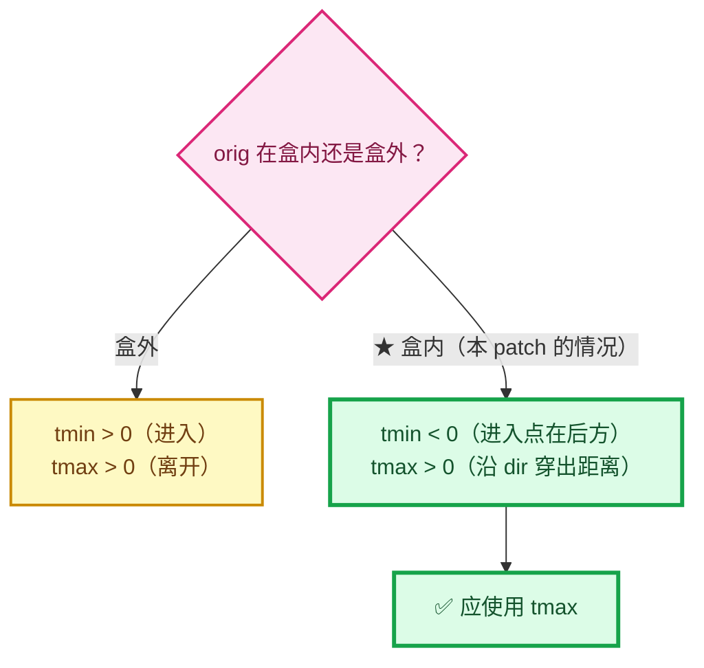
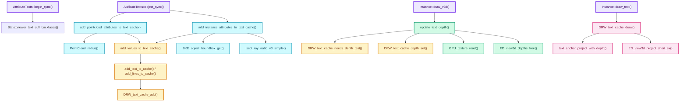

# 06 - API 与函数参考

> 🔗 [返回索引](./README.md) | 上一篇：[05-锚点偏移数学](./05-锚点偏移数学.md) | 下一篇：[07-问题清单与修复](./07-问题清单与修复.md)

本文件是**参考手册**，把改动涉及的所有函数、结构体、常量汇总成速查表。

---

## 目录

- [1. 本 patch 新增的接口](#1-本-patch-新增的接口)
- [2. 文本缓存 API](#2-文本缓存-api)
- [3. 数据结构](#3-数据结构)
- [4. 常量与枚举](#4-常量与枚举)
- [5. 投影与深度 API](#5-投影与深度-api)
- [6. GPU 回读 API](#6-gpu-回读-api)
- [7. 数学与几何 API](#7-数学与几何-api)
- [8. RNA / DNA API](#8-rna--dna-api)
- [9. 内存管理 API](#9-内存管理-api)
- [10. 调用点索引](#10-调用点索引)

---

## 1. 本 patch 新增的接口

### 1.0 总览

```mermaid
flowchart TD
  subgraph API["新增公开接口 · draw_manager_text.hh"]
    S1["DRW_text_cache_depth_set(dt, depths)<br/>提供深度数据（借用）"]
    S2["DRW_text_cache_needs_depth_test(dt)<br/>惰性检查：有请求吗？"]
  end

  subgraph INTERNAL["新增内部函数"]
    I1["text_anchor_project_with_depth()<br/>static · 投影 + 深度"]
    I2["Instance::update_text_depth()<br/>private · 回读深度"]
    I3["add_pointcloud_attributes_to_text_cache()<br/>private · 点云专用"]
  end

  subgraph MODIFIED["修改签名的既有函数"]
    M1["add_instance_attributes_to_text_cache()<br/>+state, +object"]
    M2["add_values_to_text_cache()<br/>+occlusion_test"]
    M3["add_text_to_cache() / add_lines_to_cache()<br/>+flag"]
  end

  OV["🟣 overlay_instance.cc"] -->|"调用"| S2
  OV -->|"调用"| S1
  OV -->|"实现"| I2
  DM["🟡 draw_manager_text.cc"] -->|"实现"| S1
  DM -->|"实现"| S2
  DM -->|"调用"| I1
  AT["🩵 overlay_attribute_text.hh"] -->|"实现"| I3
  AT -->|"调用"| M2

  classDef api fill:#E0E7FF,stroke:#4F46E5,color:#1E1B4B,stroke-width:3px;
  classDef internal fill:#FCE7F3,stroke:#DB2777,color:#831843,stroke-width:2px;
  classDef mod fill:#FEF3C7,stroke:#D97706,color:#78350F,stroke-width:2px;
  classDef overlay fill:#EDE9FE,stroke:#7C3AED,color:#3B0764,stroke-width:2px;
  classDef text fill:#FEF3C7,stroke:#D97706,color:#78350F,stroke-width:2px;
  classDef geom fill:#CFFAFE,stroke:#0891B2,color:#164E63,stroke-width:2px;

  class S1,S2 api;
  class I1,I2,I3 internal;
  class M1,M2,M3 mod;
  class OV overlay;
  class DM text;
  class AT geom;
```



### 1.1 `DRW_text_cache_depth_set`

```cpp
/**
 * Provide the scene depth read-back used by strings flagged with
 * #DRW_TEXT_CACHE_OCCLUSION_TEST. The store does not take ownership; the caller keeps the
 * #ViewDepths alive until the next #DRW_text_cache_draw. Pass null to disable the tests.
 */
void DRW_text_cache_depth_set(DRWTextStore *dt, const ViewDepths *depths);
```

| 项 | 值 |
|----|-----|
| 位置 | `draw/intern/draw_manager_text.cc:314-317` |
| 声明 | `draw/intern/draw_manager_text.hh:46` |
| 参数 | `dt` 文本缓存；`depths` 深度数据（**借用**，不接管所有权） |
| 返回 | 无 |
| 调用点 | `overlay_instance.cc:1020`（传 `nullptr`）、`:1054`（传缓存） |
| 实现 | `dt->depths = depths;` 单行赋值 |

⭐ **所有权契约**：调用者必须保证 `depths` 活到下一次 `DRW_text_cache_draw`。

### 1.2 `DRW_text_cache_needs_depth_test`

```cpp
/**
 * True when at least one cached string is flagged with #DRW_TEXT_CACHE_OCCLUSION_TEST, meaning
 * the caller should provide the scene depth with #DRW_text_cache_depth_set before drawing.
 */
bool DRW_text_cache_needs_depth_test(DRWTextStore *dt);
```

| 项 | 值 |
|----|-----|
| 位置 | `draw_manager_text.cc:319-327` |
| 声明 | `draw_manager_text.hh:50` |
| 参数 | `dt` 文本缓存 |
| 返回 | `true` = 有字符串请求遮挡测试 |
| 复杂度 | **O(n)**，最坏（无标志时）全遍历 |
| 调用点 | `overlay_instance.cc:1018` |
| 作用 | ⭐ **性能保护**：无请求时跳过昂贵的 GPU 回读 |

⚠️ **注意**：它**不检查** `dt == nullptr`。调用者需保证非空。

### 1.3 `text_anchor_project_with_depth`（内部）

```cpp
/**
 * Compute the window-space position and the [0..1] depth of a cached string anchor, using the
 * same math as #ed_view3d_project__internal so the depth is directly comparable to a read-back
 * of the viewport depth buffer.
 */
static bool text_anchor_project_with_depth(const ARegion &region,
                                           const float perspmat[4][4],
                                           const float co[3],
                                           float r_xy[2],
                                           float &r_depth);
```

| 项 | 值 |
|----|-----|
| 位置 | `draw_manager_text.cc:187-222` |
| 可见性 | `static`（文件内） |
| 参数 | `region` 区域；`perspmat` 投影矩阵；`co` 3D 世界坐标 |
| 输出 | `r_xy` 屏幕 XY；`r_depth` 深度 `[0,1]` |
| 返回 | `false` = 无法投影（应剔除） |

**返回 `false` 的条件**：

| 条件 | 原因 |
|------|------|
| `w == 0.0f` | 点在相机平面上 |
| `vec4[2] <= -w` | 在近裁剪面之前 |
| `vec4[2] >= w` | 在远裁剪面之后 |
| `fx/fy` 越界 | 窗口外 |

### 1.4 `Instance::update_text_depth`（私有）

```cpp
void update_text_depth();
```

| 项 | 值 |
|----|-----|
| 位置 | `overlay/overlay_instance.cc:1015-1055` |
| 声明 | `overlay/overlay_instance.hh:141` |
| 参数 | 无（用 `state`、成员） |
| 返回 | 无（副作用：设置 `text_depth_cache_` 与 `dt->depths`） |
| 调用点 | `overlay_instance.cc:938`（**在 grid 之前**） |

### 1.5 `AttributeTexts::add_pointcloud_attributes_to_text_cache`（私有）

```cpp
void add_pointcloud_attributes_to_text_cache(const State &state,
                                             const PointCloud &pointcloud,
                                             const float4x4 &object_to_world);
```

| 项 | 值 |
|----|-----|
| 位置 | `overlay/overlay_attribute_text.hh:119-151` |
| 调用点 | `overlay_attribute_text.hh:90`（`case OB_POINTCLOUD`） |
| 作用 | 点云专用的锚点半径偏移 + 文本缓存添加 |

---

## 2. 文本缓存 API

### 2.1 `DRW_text_cache_add`

```cpp
void DRW_text_cache_add(DRWTextStore *dt,
                        const float co[3],
                        const char *str,
                        int str_len,
                        short xoffs,
                        short yoffs,
                        short flag,
                        const uchar col[4],
                        const bool shadow,
                        const bool align_center);
```

| 参数 | 说明 |
|------|------|
| `co` | 3D 世界坐标锚点 |
| `str` / `str_len` | 字符串与长度 |
| `xoffs` / `yoffs` | 像素偏移 |
| `flag` | ⭐ **标志位（本次改动扩展）** |
| `col` | RGBA 颜色 |
| `shadow` | 是否描边 |
| `align_center` | 是否居中 |

**标志位影响的行为**：

| 标志 | 效果 |
|------|------|
| `GLOBALSPACE` | 用 `persmat`（世界空间）投影 |
| `LOCALCLIP` | 用 `persmatob`，并启用局部裁剪测试 |
| `STRING_PTR` | `str` 是外部指针（不拷贝） |
| **`OCCLUSION_TEST`** | ⭐ **新增**：绘制前做深度遮挡测试 |

### 2.2 `DRW_text_cache_draw`

```cpp
void DRW_text_cache_draw(DRWTextStore *dt, const ARegion *region, const View3D *v3d);
```

| 参数 | 说明 |
|------|------|
| `dt` | 文本缓存 |
| `region` | 区域（提供 `winx`/`winy`） |
| `v3d` | **`nullptr` = 2D 模式（无遮挡测试）** |

⭐ **两个分支**：

```cpp
if (v3d) {
  /* 3D：投影 + 深度遮挡测试 */
}
else {
  /* 2D：用 View2D 变换，无深度概念 */
}
```

### 2.3 `DRW_text_cache_create` / `_destroy`

```cpp
DRWTextStore *DRW_text_cache_create();
void DRW_text_cache_destroy(DRWTextStore *dt);
```

| 项 | 值 |
|----|-----|
| 实现 | `MEM_new<DRWTextStore>` / `MEM_delete` |
| 调用点 | `create` 由 `Instance` 初始化；`destroy` 在 `~Instance()` |

---

## 3. 数据结构

### 3.1 `DRWTextStore`

```cpp
struct DRWTextStore {
  Vector<ViewCachedString> cache_strings;
  LinearAllocator<> string_allocator;
  const ViewDepths *depths = nullptr;      /* ⭐ 新增 */
};
```

| 成员 | 类型 | 说明 |
|------|------|------|
| `cache_strings` | `Vector<ViewCachedString>` | 所有待绘制字符串 |
| `string_allocator` | `LinearAllocator<>` | 字符串后备存储 |
| **`depths`** | **`const ViewDepths *`** | ⭐ 深度数据（借用，不拥有） |

### 3.2 `ViewCachedString`

```cpp
struct ViewCachedString {
  float vec[3];
  union { uchar ub[4]; int pack; } col;
  short sco[2];              /* ⭐ 剔除标记：sco[0] = IS_CLIPPED */
  short xoffs, yoffs;
  short flag;                /* ⭐ 标志位 */
  bool shadow;
  bool align_center;
  StringRef str;
};
```

⚠️ **`sco[0]` 的双重身份**：正常是 x 坐标，剔除时是 `IS_CLIPPED`。

### 3.3 `ViewDepths`

```cpp
struct ViewDepths {
  unsigned short w, h;       /* ⚠️ 16 位，最大 65535 */
  short x, y;                /* 仅子矩形使用 */
  float *depths;             /* [y * w + x] 索引 */
  double depth_range[2];     /* 通常 [0.0, 1.0] */
};
```

| 成员 | 说明 |
|------|------|
| `w`/`h` | 深度图尺寸。⚠️ `unsigned short`，赋值时窄化 |
| `x`/`y` | 子矩形偏移（全屏回读时为 0） |
| `depths` | 深度数组，`GPU_texture_read` 分配，`MEM_delete` 释放 |
| `depth_range` | 有效深度范围。⚠️ 设置了两端，但比较时硬编码 `1.0f` |

### 3.4 `Bounds<float3>`

```cpp
template<typename T> struct Bounds {
  T min;
  T max;
  bool contains(const T &point) const;
};
```

| 成员/方法 | 说明 |
|-----------|------|
| `min` / `max` | 轴对齐包围盒的两个角 |
| `contains(p)` | 点是否在盒内（**含边界**） |

### 3.5 `State`（Overlay）

```cpp
struct State {
  const View3D *v3d;
  const ARegion *region;      /* ⚠️ const → 获取 viewport 需 const_cast */
  const View3DOverlay overlay;
  DRWTextStore *dt;
  const RegionView3D *rv3d;
  float3 camera_position;     /* 相机世界位置 */
  float3 camera_forward;      /* ⭐ 指向观察者（官方语义） */
  /* ... */

  bool show_text() const;
  bool is_space_v3d() const;
  bool show_attribute_viewer_text() const;
  bool viewer_text_cull_backfaces() const;   /* ⭐ 新增 */
};
```

---

## 4. 常量与枚举

### 4.1 `eView3DOverlay_Flag`（DNA）

```cpp
enum eView3DOverlay_Flag : int {
  V3D_OVERLAY_FACE_ORIENTATION      = (1 << 0),
  /* ... */
  V3D_OVERLAY_VIEWER_ATTRIBUTE_TEXT = (1 << 18),
  V3D_OVERLAY_PERFORMANCE           = (1 << 19),
  V3D_OVERLAY_VIEWER_TEXT_CULL_BACKFACES = (1 << 20),   /* ⭐ 新增 */
};
```

⚠️ **不要与同文件的 `eView3DOverlay_EditFlag` 混淆** —— 后者是独立字段 `overlay.edit_flag`。

### 4.2 文本缓存标志

```cpp
enum {
  /* DRW_UNUSED_1 = (1 << 0), */          /* 已废弃 */
  DRW_TEXT_CACHE_GLOBALSPACE    = (1 << 1),
  DRW_TEXT_CACHE_LOCALCLIP      = (1 << 2),
  DRW_TEXT_CACHE_STRING_PTR     = (1 << 3),
  DRW_TEXT_CACHE_OCCLUSION_TEST = (1 << 4),   /* ⭐ 新增 */
};
```

⚠️ **存储在 `short` 里（16 位）**，还剩 11 位可用。

### 4.3 `IS_CLIPPED`

```cpp
/* editors/include/ED_view3d.hh:269 */
#define IS_CLIPPED 12000
```

⭐ **哨兵值 12000**：超出正常屏幕坐标范围，用作"该字符串不应绘制"的标记。

⚠️ **潜在冲突**：如果窗口宽度 > 12000 像素，可能误判。**实际不可能**（8K 是 7680）。

### 4.4 `eV3DProjTest`

```cpp
enum eV3DProjTest {
  V3D_PROJ_TEST_NOP      = 0,
  V3D_PROJ_TEST_CLIP_BB  = (1 << 0),   /* 用户裁剪边界 */
  V3D_PROJ_TEST_CLIP_WIN = (1 << 1),   /* 窗口边界 */
  V3D_PROJ_TEST_CLIP_NEAR= (1 << 2),   /* 近裁剪面 */
  V3D_PROJ_TEST_CLIP_FAR = (1 << 3),   /* 远裁剪面 */
  V3D_PROJ_TEST_CLIP_ZERO= (1 << 4),   /* w ≈ 0 */
  /* ... */
};
```

⚠️ **文本缓存调用只传 `BB | WIN | NEAR`**，**没有 `FAR`**。

### 4.5 `eV3DProjStatus`

```cpp
enum eV3DProjStatus {
  V3D_PROJ_RET_OK = 0,
  V3D_PROJ_RET_CLIP_NEAR,
  V3D_PROJ_RET_CLIP_FAR,
  V3D_PROJ_RET_CLIP_WIN,
  V3D_PROJ_RET_CLIP_BB,
  V3D_PROJ_RET_CLIP_ZERO,
  V3D_PROJ_RET_OVERFLOW,
};
```

⭐ 只有 `V3D_PROJ_RET_OK` 表示成功。

### 4.6 相关数学常量

```cpp
/* BLI_math_constants.hh:42 */
#define M_SQRT1_3 0.57735026918962576450 /* 1/sqrt(3) */

/* gpu_shader_math_constants.bsl.hh:14 */
#define M_SQRT1_3 0.57735026918962576450f
```

⚠️ **新代码硬编码了 `0.577350269f` 而非引用 `M_SQRT1_3`**（数值相同）。

### 4.7 代码中的魔法数字

| 值 | 位置 | 含义 | 评价 |
|----|------|------|------|
| `2.0e-5f` | `draw_manager_text.cc:267` | 深度比较偏置 | ⚠️ 应注释推导 |
| `0.577350269f` | `overlay_attribute_text.hh:137` | `M_SQRT1_3` | ⚠️ 应引用宏 |
| `1.0e-20f` | `:145` | 长度阈值 | ⚠️ 与下一个语义不一致 |
| `1.0e-20f` | `:257` | **长度平方**阈值 | ⚠️ 实际阈值差 10 个数量级 |
| `1.0f` | `:265` | `t` 上限启发式 | ⚠️ 依赖未归一化方向 |
| `2.0f` | `draw_manager_text.cc:172` | BLF 深度参数 | ✅ 既有 |

---

## 5. 投影与深度 API

### 5.1 `ED_view3d_project_short_ex`

```cpp
eV3DProjStatus ED_view3d_project_short_ex(const ARegion *region,
                                          float perspmat[4][4],
                                          const bool is_local,
                                          const float co[3],
                                          short r_co[2],
                                          const eV3DProjTest flag);
```

| 项 | 值 |
|----|-----|
| 位置 | `view3d_project.cc:153-173` |
| 输出 | `short r_co[2]`，用 **`floorf` 取整** |
| 溢出保护 | 超出 ±32700 返回 `V3D_PROJ_RET_OVERFLOW` |

⭐ **调用点**：`draw_manager_text.cc:237-244`（第 1 次投影）。

### 5.2 `ed_view3d_project__internal`（内部）

```cpp
static eV3DProjStatus ed_view3d_project__internal(const ARegion *region,
                                                  const float perspmat[4][4],
                                                  const bool is_local,
                                                  const float co[3],
                                                  float r_co[2],
                                                  const eV3DProjTest flag);
```

| 项 | 值 |
|----|-----|
| 位置 | `view3d_project.cc:99-151` |
| 输出 | `float r_co[2]`（**无深度输出** ← 这就是新代码要重新实现的原因） |

⭐ **新代码与之的差异**见 [03-§8](./03-文本缓存遮挡测试核心.md#8-与官方投影函数的对比)。

### 5.3 `ED_view3d_depths_free`

```cpp
void ED_view3d_depths_free(ViewDepths *depths);
```

| 项 | 值 |
|----|-----|
| 位置 | `view3d_draw.cc:2551-2557` |
| 实现 | `if (depths->depths) MEM_delete(depths->depths); MEM_delete(depths);` |
| 调用点 | `~Instance()`、`update_text_depth()` ×2 |

⚠️ **不检查 `depths == nullptr`** —— 调用者必须先判断。

### 5.4 `view3d_depths_create`（内部，参考实现）

```cpp
static ViewDepths *view3d_depths_create(ARegion *region);
```

| 项 | 值 |
|----|-----|
| 位置 | `view3d_draw.cc:2405-2419` |
| 作用 | ⭐ **新代码 `update_text_depth` 的参考模板** |

### 5.5 `ED_view3d_depth_read_cached`

```cpp
bool ED_view3d_depth_read_cached(const ViewDepths *vd,
                                 const int mval[2],
                                 int margin,
                                 float *r_depth);
```

| 项 | 值 |
|----|-----|
| 位置 | `view3d_utils.cc:1864-1907` |
| 作用 | ⭐ **官方的深度采样函数**（支持 margin 邻域采样） |
| 返回 | `true` = 采到有效深度（非背景） |

⭐⭐ **重要**：新代码**没有用这个函数**，而是手动采样：

```cpp
/* draw_manager_text.cc:263 */
const float scene_depth = dt->depths->depths[y * dt->depths->w + x];
```

⭐ **而 `ED_view3d_depth_read_cached` 已经提供了**：
1. 边界检查
2. `margin` 邻域采样（取最小深度，避免边缘误判）✅
3. `depth_range` 检查（判断是否背景）

⚠️ **改用它可以消除重复实现并获得 margin 支持**。见 [07](./07-问题清单与修复.md)。

### 5.6 `ED_view3d_depth_read_cached_normal`

```cpp
bool ED_view3d_depth_read_cached_normal(const ARegion *region,
                                        const ViewDepths *depths,
                                        const int mval[2],
                                        float r_normal[3]);
```

| 项 | 值 |
|----|-----|
| 位置 | `view3d_utils.cc:1909+` |
| 作用 | 由深度图重建法线（采样邻域 9 像素） |

✅ **证明"邻域采样"是官方认可的模式**。

---

## 6. GPU 回读 API

### 6.1 `GPU_texture_read`（分配版）

```cpp
/**
 * Read the content of a mip_level from a texture and returns a copy of its data.
 * Use #MEM_delete to free the data.
 *
 * \warning the texture must have been created using GPU_TEXTURE_USAGE_HOST_READ.
 */
void *GPU_texture_read(gpu::Texture *texture, eGPUDataFormat data_format, int mip_level);
```

| 项 | 值 |
|----|-----|
| 位置 | `gpu/intern/gpu_texture.cc:538-552` |
| 分配 | `MEM_new_uninitialized(size, __func__)` |
| 释放 | **`MEM_delete`**（文档明确） |
| 调用点 | `update_text_depth()` 首次分配 |

⚠️ **同步阻塞**：会强制 GPU 流水线刷新。

### 6.2 `GPU_texture_read`（写入版）

```cpp
/**
 * Read the content of a mip_level from a texture into user-provided memory buffer dst.
 */
void GPU_texture_read(gpu::Texture *texture, eGPUDataFormat data_format,
                      int mip_level, void *dst);
```

| 项 | 值 |
|----|-----|
| 位置 | `gpu_texture.cc:554-562` |
| 断言 | `GPU_texture_usage(texture) & GPU_TEXTURE_USAGE_HOST_READ` |
| 调用点 | `update_text_depth()` 原地刷新（**缓存复用核心**） |

⭐ **缓冲区必须足够大**（由尺寸检查保证）。

### 6.3 `GPU_texture_read_size_get`

```cpp
size_t GPU_texture_read_size_get(const gpu::Texture *texture,
                                 eGPUDataFormat data_format, int mip_level);
```

新代码**未使用**（依赖尺寸检查而非字节数比较）。

### 6.4 `GPU_viewport_depth_texture`

```cpp
gpu::Texture *GPU_viewport_depth_texture(GPUViewport *viewport);
```

| 项 | 值 |
|----|-----|
| 位置 | `gpu_viewport.cc:605-608` |
| 返回 | `viewport->depth_tx` |
| 调用点 | `update_text_depth():1030` |

⭐ **该纹理带 `GPU_TEXTURE_USAGE_HOST_READ`**（`gpu_viewport.cc:181` 创建时指定）✅ 所以回读不会触发断言。

### 6.5 `GPU_texture_width` / `GPU_texture_height`

```cpp
int GPU_texture_width(const gpu::Texture *texture);
int GPU_texture_height(const gpu::Texture *texture);
```

⭐ 返回 `int`，赋给 `ViewDepths::w`（`unsigned short`）时**窄化**。

### 6.6 `GPU_TEXTURE_USAGE_HOST_READ`

```cpp
enum eGPUTextureUsage {
  GPU_TEXTURE_USAGE_HOST_READ = (1 << 4),
  /* ... */
};
```

⭐ **必须在创建纹理时指定**，无法事后添加（影响内存堆选择）。

---

## 7. 数学与几何 API

### 7.1 `isect_ray_aabb_v3_simple`

```cpp
/**
 * Test a bounding box (AABB) for ray intersection.
 * Assumes the ray is already local to the boundbox space.
 *
 * \note direction should be normalized
 * if you intend to use the tmin or tmax distance results!
 */
bool isect_ray_aabb_v3_simple(const float orig[3],
                              const float dir[3],
                              const float bb_min[3],
                              const float bb_max[3],
                              float *tmin,      /* ⭐ 第 5 个：进入距离 */
                              float *tmax);     /* ⭐ 第 6 个：离开距离 */
```

| 项 | 值 |
|----|-----|
| 声明 | `BLI_math_geom_c.hh:906-911` |
| 实现 | `math_geom.cc:3279-3310` |
| 调用点 | `overlay_attribute_text.hh:258-263` |

⭐⭐ **关键语义**（详见 [05-§6](./05-锚点偏移数学.md#6--aabb-参数与命名分析)）：



| `orig` 位置 | `tmin` | `tmax` |
|-------------|--------|--------|
| 盒外 | 正值（进入） | 正值（离开） |
| **盒内** | **负值** | **正值（穿出距离）** |

⚠️ **未归一化的 `dir` 会使 `t` 不等于真实距离**。

### 7.2 `BKE_object_boundbox_get`

```cpp
std::optional<Bounds<float3>> BKE_object_boundbox_get(const Object *ob);
```

| 项 | 值 |
|----|-----|
| 位置 | `blenkernel/BKE_object.hh:366` |
| 返回 | 局部空间包围盒；**`std::nullopt` 表示没有** |
| 调用点 | `overlay_attribute_text.hh:246` |

⚠️ **可能返回空**（无几何、空几何）→ 必须检查。

### 7.3 `Bounds<T>::contains`

```cpp
bool contains(const T &point) const;
```

| 项 | 值 |
|----|-----|
| 位置 | `BLI_bounds_types.hh:70` |
| 调用点 | `overlay_attribute_text.hh:247` |

---

## 8. RNA / DNA API

### 8.1 `RNA_def_property`

```cpp
PropertyRNA *RNA_def_property(StructOrAliasRNA *srna,
                              const char *identifier,
                              PropertyType type,
                              PropertySubType subtype);
```

| 项 | 值 |
|----|-----|
| 调用点 | `rna_space.cc:5438` |

### 8.2 `RNA_def_property_boolean_sdna`

```cpp
void RNA_def_property_boolean_sdna(PropertyRNA *prop,
                                   const char *dna_prefix,
                                   const char *dna_name,
                                   int bit);
```

| 参数 | 值（本 patch） | 含义 |
|------|---------------|------|
| `prop` | — | 属性 |
| `dna_prefix` | `nullptr` | 无前缀 |
| `dna_name` | `"overlay.flag"` | **SDNA 路径** |
| `bit` | `V3D_OVERLAY_VIEWER_TEXT_CULL_BACKFACES` | 位掩码 |

⭐ **这是"位标志 ↔ RNA 布尔属性"的绑定方式**。

### 8.3 其他 RNA 调用

| 函数 | 调用点 | 作用 |
|------|--------|------|
| `RNA_def_property_clear_flag(prop, PROP_ANIMATABLE)` | `:5441` | 禁止动画化 |
| `RNA_def_property_ui_text(prop, name, desc)` | `:5442-5444` | UI 名称 + 提示 |
| `RNA_def_property_update(prop, NC_SPACE \| ND_SPACE_VIEW3D, nullptr)` | `:5445` | 变更通知 |

### 8.4 `ENUM_OPERATORS`

```cpp
ENUM_OPERATORS(eView3DOverlay_Flag)
```

⭐ 为枚学生成位运算符（`&`、`|` 等），使 `flag & MASK` 合法。

### 8.5 Python 侧

```python
row = col.row(align=True)
row.active = view.show_viewer and overlay.show_text and overlay.show_viewer_text
row.prop(overlay, "viewer_text_cull_backfaces", text="Exclude Backfaces")
```

| 方法/属性 | 作用 |
|-----------|------|
| `col.row(align=True)` | 新建一行，控件对齐 |
| `row.active` | 灰化（不可交互但可见） |
| `row.prop(data, name, text=)` | 创建属性控件 |

---

## 9. 内存管理 API

| 宏/函数 | 用途 | 配对 |
|---------|------|------|
| `MEM_new_zeroed<T>(name)` | 分配并清零 | `MEM_delete` |
| `MEM_new_uninitialized(size, name)` | 分配不清零 | `MEM_delete` |
| `MEM_delete(ptr)` | 释放（调用析构） | `MEM_new*` |
| `MEM_delete_void(ptr)` | 释放 void* | — |

⭐ **`GPU_texture_read` 用 `MEM_new_uninitialized` 分配 → 必须用 `MEM_delete` 释放**（`ED_view3d_depths_free` 正是这么做的 ✅）。

---

## 10. 调用点索引

### 10.0 完整调用关系图



### 10.1 新增调用链

| 调用者 | 被调用 | 位置 |
|--------|--------|------|
| `AttributeTexts::begin_sync` | `State::viewer_text_cull_backfaces()` | `overlay_attribute_text.hh:51` |
| `AttributeTexts::object_sync` | `add_pointcloud_attributes_to_text_cache` | `:90` |
| `AttributeTexts::object_sync` | `add_instance_attributes_to_text_cache` | `:76` |
| `add_pointcloud_...` | `PointCloud::radius()` | `:136` |
| `add_pointcloud_...` | `add_values_to_text_cache(..., true)` | `:149` |
| `add_instance_...` | `BKE_object_boundbox_get` | `:246` |
| `add_instance_...` | `isect_ray_aabb_v3_simple` | `:258` |
| `add_values_to_text_cache` | `add_text_to_cache(..., text_flags)` | 12 处 |
| `add_text_to_cache` | `DRW_text_cache_add` | `:281` |
| `Instance::draw_v3d` | `update_text_depth()` | `overlay_instance.cc:938` |
| `update_text_depth` | `DRW_text_cache_needs_depth_test` | `:1018` |
| `update_text_depth` | `DRW_text_cache_depth_set` | `:1020`, `:1054` |
| `update_text_depth` | `GPU_texture_read` | `:1043`, `:1052` |
| `update_text_depth` | `ED_view3d_depths_free` | `:1022`, `:1036` |
| `Instance::~Instance` | `ED_view3d_depths_free` | `overlay_instance.hh:120` |
| `Instance::draw_text` | `DRW_text_cache_draw` | `overlay_instance.cc:1068` |
| `DRW_text_cache_draw` | `text_anchor_project_with_depth` | `draw_manager_text.cc:253` |

### 10.2 相关的既有调用点（未改动但相关）

| 调用者 | 被调用 | 位置 |
|--------|--------|------|
| `DRW_text_cache_draw` | `ED_view3d_project_short_ex` | `draw_manager_text.cc:237` |
| `DRW_text_cache_draw` | `drw_text_cache_draw_ex` | `:287`, `:310` |
| `drw_text_cache_draw_ex` | `BLF_draw_default` | `:170` |
| `Instance::draw_text` | `GPU_depth_test(GPU_DEPTH_NONE)` | `overlay_instance.cc:1067` |
| `Instance::begin_sync` | `view.viewinv()` | `:459-460` |

---

## 11. 头文件依赖

### 11.1 新增 include

```cpp
/* overlay_attribute_text.hh */
#include "BLI_array.hh"              /* Array<T> */
#include "BLI_math_matrix.hh"        /* math::transform_point, invert, determinant */
#include "BLI_math_geom_c.hh"        /* isect_ray_aabb_v3_simple */
#include "BLI_math_vector.hh"        /* math::length, to_scale */
#include "BKE_object.hh"             /* BKE_object_boundbox_get */

/* draw_manager_text.hh */
struct ViewDepths;                   /* 前向声明 */
```

### 11.2 依赖方向问题

⚠️ `draw_manager_text.cc` 需要 `ViewDepths` 的**完整定义**（访问 `w`/`h`/`depths`），而该结构体定义在 **`editors/include/ED_view3d.hh`**。

⭐ 这意味着 **`draw` 模块反向依赖 `editors` 模块**（正常是反过来的）。**Blender 里已有先例**，可接受，但不理想。

---

## 速查总结

| 类别 | 新增 | 修改 |
|------|------|------|
| 函数 | `DRW_text_cache_depth_set`<br/>`DRW_text_cache_needs_depth_test`<br/>`text_anchor_project_with_depth`<br/>`Instance::update_text_depth`<br/>`add_pointcloud_attributes_to_text_cache` | `add_instance_attributes_to_text_cache`（签名）<br/>`add_values_to_text_cache`（签名）<br/>`add_text_to_cache`（签名）<br/>`add_lines_to_cache`（签名）<br/>`DRW_text_cache_draw`（逻辑）<br/>`Instance::~Instance`（清理） |
| 结构体 | — | `DRWTextStore`（+`depths`）<br/>`AttributeTexts`（+`occlusion_test_`）<br/>`Instance`（+3 成员） |
| 枚举 | `DRW_TEXT_CACHE_OCCLUSION_TEST`<br/>`V3D_OVERLAY_VIEWER_TEXT_CULL_BACKFACES` | — |
| RNA | `viewer_text_cull_backfaces` | — |
| Python UI | `Exclude Backfaces` 勾选框 | — |

---

## 下一步

- **问题清单与修复代码 → [07-问题清单与修复](./07-问题清单与修复.md)**
- 提交指南 → [08-提交指南](./08-提交指南.md)
