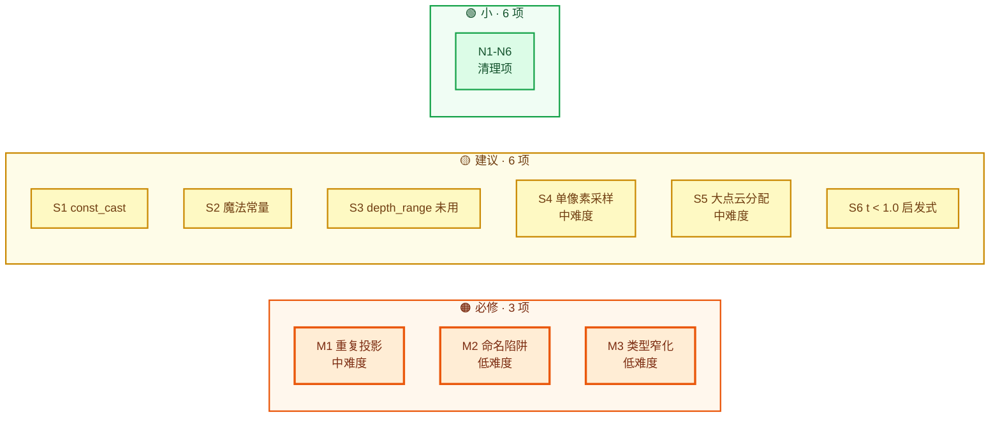
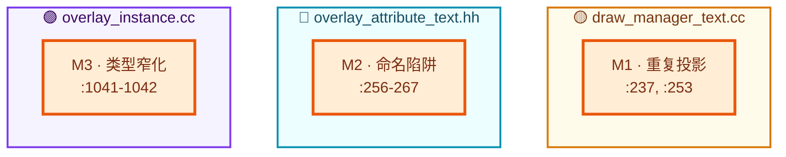
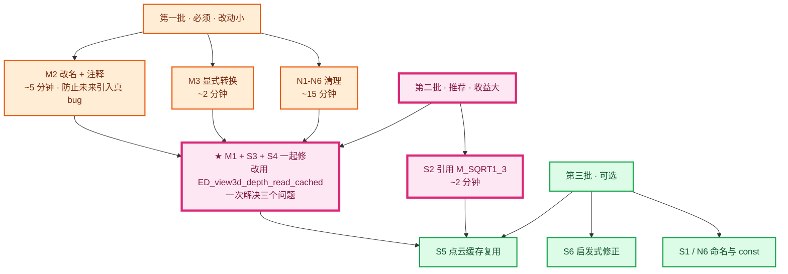
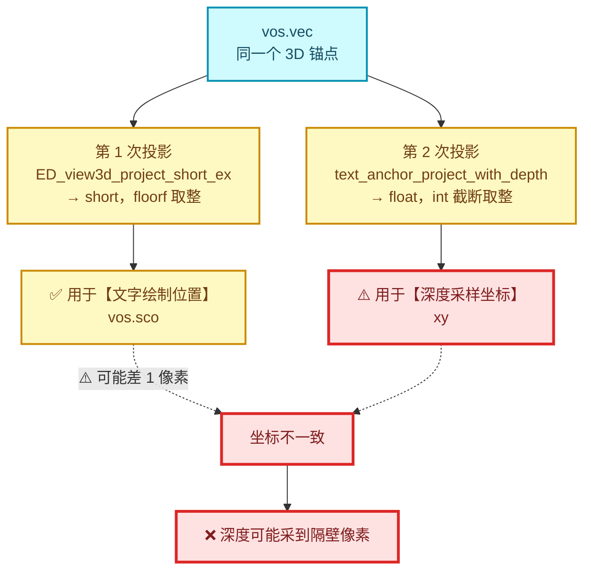
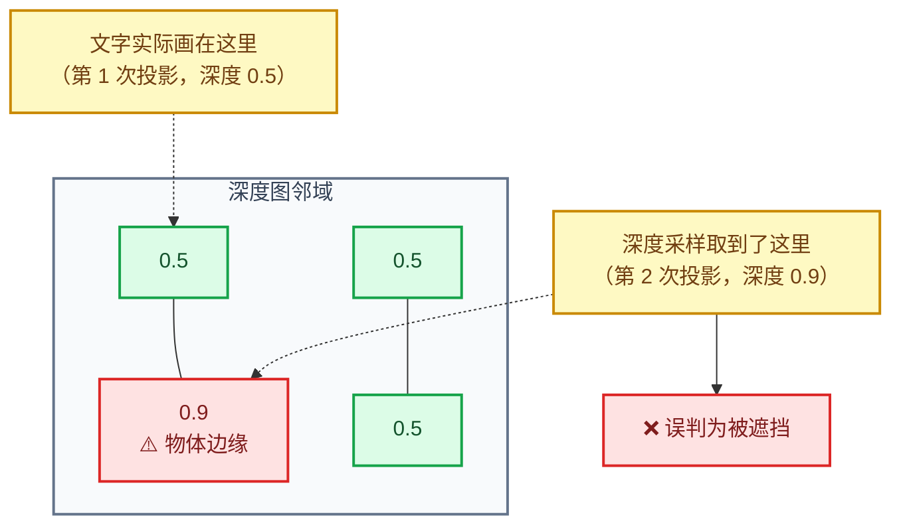
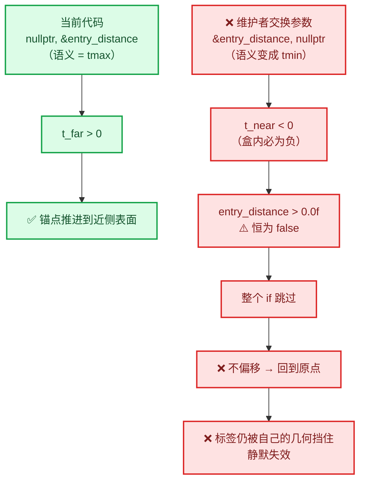
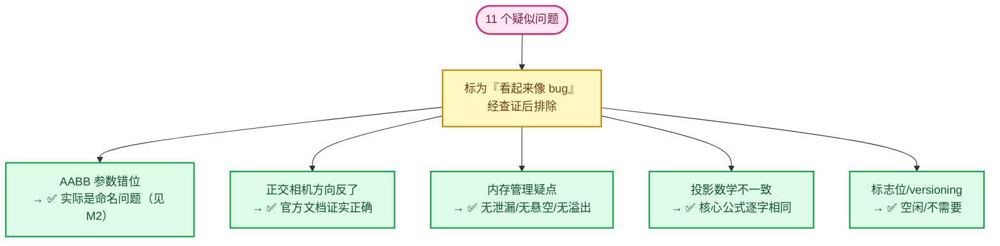

# 07 - 问题清单与修复

> 🔗 [返回索引](./README.md) | 上一篇：[06-API与函数参考](./06-API与函数参考.md) | 下一篇：[08-提交指南](./08-提交指南.md)

**这是提交前必读的文档。** 汇总所有发现的问题、严重度评估和具体修复代码。

---

## 目录

- [0. 总览表](#0-总览表)
- [1. 🟠 M1 - 重复投影导致采样偏移](#1--m1---重复投影导致采样偏移)
- [2. 🟠 M2 - 命名陷阱（高危可维护性问题）](#2--m2---命名陷阱高危可维护性问题)
- [3. 🟠 M3 - ViewDepths 类型窄化](#3--m3---viewdepths-类型窄化)
- [4. 🟡 S1 - const_cast 绕过 const 正确性](#4--s1---const_cast-绕过-const-正确性)
- [5. 🟡 S2 - 硬编码 M_SQRT1_3](#5--s2---硬编码-m_sqrt1_3)
- [6. 🟡 S3 - depth_range 设置但未使用](#6--s3---depth_range-设置但未使用)
- [7. 🟡 S4 - 深度偏置与单像素采样](#7--s4---深度偏置与单像素采样)
- [8. 🟡 S5 - 大点云临时分配](#8--s5---大点云临时分配)
- [9. 🟡 S6 - t < 1.0 启发式](#9--s6---t--10-启发式)
- [10. 🟢 N1-N6 - 小问题](#10--n1-n6---小问题)
- [11. ✅ 已排除的疑虑](#11--已排除的疑虑)
- [12. 检查清单](#12-检查清单)

---

## 0. 总览表

| ID | 严重度 | 位置 | 问题 | 修复难度 |
|----|--------|------|------|----------|
| **M1** | 🟠 必修 | `draw_manager_text.cc:237,253` | 重复投影，两次取整方式不同 | 中 |
| **M2** | 🟠 必修 | `overlay_attribute_text.hh:256-267` | `entry_distance` 命名误导（实为穿出距离） | 低 |
| **M3** | 🟠 必修 | `overlay_instance.cc:1041-1042` | `int → unsigned short` 窄化 | 低 |
| **S1** | 🟡 建议 | `overlay_instance.cc:1029` | `const_cast<ARegion *>` | 低 |
| **S2** | 🟡 建议 | `overlay_attribute_text.hh:137` | `0.577350269f` 硬编码 | 低 |
| **S3** | 🟡 建议 | `draw_manager_text.cc:266` | 设置了 `depth_range` 却硬编码 `1.0f` | 低 |
| **S4** | 🟡 建议 | `draw_manager_text.cc:263-267` | 单像素采样 + 绝对偏置 | 中 |
| **S5** | 🟡 建议 | `overlay_attribute_text.hh:139` | 大点云 12 MB 临时分配 | 中 |
| **S6** | 🟡 建议 | `overlay_attribute_text.hh:265` | `t < 1.0f` 依赖未归一化方向 | 低 |
| **N1** | 🟢 小 | `draw_manager_text.cc:233` | `(v3d != nullptr)` 冗余 | 低 |
| **N2** | 🟢 小 | `overlay_instance.hh:142` | 注释说 `draw_text` 实为 `draw_v3d` | 低 |
| **N3** | 🟢 小 | `overlay_attribute_text.hh:150` | 硬编码 `true` 而非 `occlusion_test_` | 低 |
| **N4** | 🟢 小 | `overlay_attribute_text.hh:145,257` | 两处 `1e-20` 语义不一致 | 低 |
| **N5** | 🟢 小 | `space_view3d.py:7326` | 多行写法（formatter 会改回单行） | 低 |
| **N6** | 🟢 小 | `rna_space.cc:5438` | UI 名称与描述术语不一致 | 低 |

### 0.1 严重度分布



### 0.2 三个必修项的位置分布



### 0.3 ⭐ 推荐修复顺序（一石三鸟）



---

## 1. 🟠 M1 - 重复投影导致采样偏移

### 1.1 问题

同一个锚点被投影**两次**，且两次的取整方式**不同**：

```cpp
/* draw_manager_text.cc:237-244 —— 第 1 次：short + floorf */
if (ED_view3d_project_short_ex(
        region,
        (vos.flag & DRW_TEXT_CACHE_GLOBALSPACE) ? rv3d->persmat : rv3d->persmatob,
        (vos.flag & DRW_TEXT_CACHE_LOCALCLIP) != 0,
        vos.vec,
        vos.sco,                    // ← short，内部 floorf
        V3D_PROJ_TEST_CLIP_BB | V3D_PROJ_TEST_CLIP_WIN | V3D_PROJ_TEST_CLIP_NEAR) ==
    V3D_PROJ_RET_OK)
{
  if (use_occlusion_test && (vos.flag & DRW_TEXT_CACHE_OCCLUSION_TEST) != 0) {
    float xy[2];
    float anchor_depth;
    /* ... */
    if (!text_anchor_project_with_depth(*region, persmat, vos.vec, xy, anchor_depth)) {
    //                                                          ^^ float
      /* ... */
    }
    const int x = int(xy[0]);      // ← int，截断取整
    const int y = int(xy[1]);
```

⭐ **两次投影的差异**：



| | 第 1 次 | 第 2 次 |
|---|---------|---------|
| 函数 | `ED_view3d_project_short_ex` | `text_anchor_project_with_depth` |
| 输出类型 | `short` | `float` |
| 取整 | `floorf(tvec[i])` | `int(xy[i])`（截断） |
| 裁剪标志 | `BB \| WIN \| NEAR` | `WIN \| NEAR \| FAR` |

### 1.2 影响

**文字实际绘制在 `vos.sco`（第 1 次投影）的位置**，而**深度采样用 `xy`（第 2 次投影）**。

⭐ 如果两次结果差 1 像素，深度就采到**隔壁像素**：



⭐ **在深度不连续处（物体边缘、轮廓）会导致误剔除或漏剔除。**

### 1.3 修复方案

#### 方案 A：复用第 1 次投影的结果（推荐）

⭐ **让 `text_anchor_project_with_depth` 只在需要时计算，并接受已知的 XY**：

```cpp
/* 抽取"只算深度"的部分 */
static bool text_anchor_depth_get(const float perspmat[4][4],
                                  const float co[3],
                                  float &r_depth)
{
  float vec4[4];
  copy_v3_v3(vec4, co);
  vec4[3] = 1.0;
  mul_m4_v4(perspmat, vec4);
  const float w = fabsf(vec4[3]);
  if (w == 0.0f || vec4[2] <= -w || vec4[2] >= w) {
    return false;
  }
  r_depth = ((vec4[2] / w) + 1.0f) * 0.5f;
  return true;
}
```

然后调用点直接用 `vos.sco` 做索引：

```cpp
if (use_occlusion_test && (vos.flag & DRW_TEXT_CACHE_OCCLUSION_TEST) != 0) {
  float anchor_depth;
  if (!text_anchor_depth_get(persmat, vos.vec, anchor_depth)) {
    vos.sco[0] = IS_CLIPPED;
    continue;
  }
  /* ⭐ 复用第 1 次投影的屏幕坐标，保证与文字绘制位置一致 */
  const int x = vos.sco[0];
  const int y = vos.sco[1];
  if (x < 0 || y < 0 || x >= dt->depths->w || y >= dt->depths->h) {
    vos.sco[0] = IS_CLIPPED;
    continue;
  }
  /* ... */
}
```

✅ **优点**：
- **完全消除不一致**（深度采样位置 = 文字绘制位置）
- **省掉一次投影**（性能提升）
- 代码更简单

⚠️ **注意**：`vos.sco` 是 `short`，在 HiDPI 下可能不足（但其取值经 `winx/winy` 检查，而 `winx` 是 `short` 体系，**一致**）。

#### 方案 B：改用 `ED_view3d_depth_read_cached` + 邻域采样

⭐ **结合 S4 的修复**，用官方 API：

```cpp
int mval[2] = {vos.sco[0], vos.sco[1]};
float scene_depth;
if (ED_view3d_depth_read_cached(dt->depths, mval, 1, &scene_depth)) {
  /* scene_depth 已是有效深度（非背景），取自邻域最小值 */
  if (anchor_depth > scene_depth + bias) {
    vos.sco[0] = IS_CLIPPED;
    continue;
  }
}
```

✅ **这个方案同时解决 M1 和 S4**：
- 用 `vos.sco`（绘制位置）做采样点 → 消除 M1
- `margin=1` 邻域采样 → 缓解边缘误判
- 复用官方边界检查与 `depth_range` 判断 → 解决 S3

⭐⭐ **这是最推荐的修复方向。**

---

## 2. 🟠 M2 - 命名陷阱（高危可维护性问题）

### 2.1 问题

```cpp
/* overlay_attribute_text.hh:256-267 */
float entry_distance;                                     // ← 名为"进入距离"
if (math::length_squared(local_direction) > 1.0e-20f &&
    isect_ray_aabb_v3_simple(local_anchor,
                            local_direction,
                            bounds->min,
                            bounds->max,
                            nullptr,                       // ← tmin 未使用
                            &entry_distance) &&            // ← 实际是 tmax（穿出距离）
    entry_distance > 0.0f && ...)
{
  local_anchor += local_direction * entry_distance;
}
```

⭐ **功能是正确的**（详见 [05-§6](./05-锚点偏移数学.md#6--aabb-参数与命名分析)）：

- `local_anchor` 在包围盒**内部**（由 `bounds->contains(local_anchor)` 保证）
- 此时 `tmin < 0`（进入点在起点后方），`tmax > 0`（沿方向穿出的距离）
- 因为 `local_direction` 指向相机，沿它穿出 = 到达**靠近相机的表面** ✅

❌ **但变量名 `entry_distance` 完全错误**，会造成严重后果：

```cpp
/* 后续维护者的"好心修复" */
isect_ray_aabb_v3_simple(..., &entry_distance, nullptr)   // ← 交换参数
```

⭐ **交换后**：`entry_distance = tmin`（**负值**）→ `entry_distance > 0.0f` **恒为 false** → 整个分支跳过 → **不偏移** → 锚点回到原点 → 又被自己的几何挡住。

⚠️ **功能静默失效**（不崩溃、不报错，只是行为不对）—— **最难排查的那类问题**。



### 2.2 修复

```cpp
float t_near, t_far;
if (math::length_squared(local_direction) > 1.0e-20f &&
    isect_ray_aabb_v3_simple(local_anchor,
                            local_direction,
                            bounds->min,
                            bounds->max,
                            &t_near,
                            &t_far) &&
    /* The anchor starts inside the bounds, so `t_near` is negative and `t_far` is the
     * distance to the surface on the way out — i.e. the surface facing the camera.
     * Do NOT swap these: using `t_near` here would give a negative distance and the
     * offset would silently be skipped. */
    t_far > 0.0f &&
    (state.rv3d == nullptr || !state.rv3d->is_persp || t_far < 1.0f))
{
  local_anchor += local_direction * t_far;
}
```

✅ **修复要点**：
1. 变量名与语义一致（`t_near` / `t_far`）
2. **显式警告不要交换**
3. 注释解释了为什么用 `t_far`

> 💡 **如果只想最小改动**，至少要把 `entry_distance` 改名为 `exit_distance` 或 `travel_distance`。

---

## 3. 🟠 M3 - ViewDepths 类型窄化

### 3.1 问题

```cpp
/* overlay_instance.cc:1031-1042 */
const int width = GPU_texture_width(depth_tx);     // ← int
const int height = GPU_texture_height(depth_tx);
/* ... */
text_depth_cache_->w = width;                      // ← int → unsigned short（窄化！）
text_depth_cache_->h = height;
```

⭐ **`ViewDepths::w/h` 是 `unsigned short`**（最大 65535）：

```cpp
struct ViewDepths {
  unsigned short w, h;      // ← 16 位
  /* ... */
};
```

### 3.2 影响与背景

| 方面 | 评估 |
|------|------|
| **实际风险** | 极低（分辨率 > 65535 不可能） |
| **编译警告** | `-Wconversion` 会警告（Blender 默认不开） |
| **既有先例** | ⚠️ **官方 `view3d_depths_create` 也这么写**（`view3d_draw.cc:2411-2412`） |
| **不一致** | ⚠️ 新代码同时用 `int text_depth_cache_width_` 记录精确值，说明**作者知道 `short` 不够用** |

⭐ **所以严重度从"必修"降为"应显式化"** —— 它不引入新问题，但暴露了"知道有问题只解决一半"的状态。

### 3.3 修复

```cpp
/* 显式转换 + 上界保护 */
if (width <= 0 || height <= 0 ||
    width > std::numeric_limits<unsigned short>::max() ||
    height > std::numeric_limits<unsigned short>::max())
{
  /* 尺寸异常，放弃遮挡测试（安全退化） */
  DRW_text_cache_depth_set(state.dt, nullptr);
  return;
}
text_depth_cache_->w = static_cast<unsigned short>(width);
text_depth_cache_->h = static_cast<unsigned short>(height);
```

✅ **这样既显式表达了意图，又对异常尺寸安全退化。**

> 💡 **最简修复**（如果不想加保护）：
> ```cpp
> text_depth_cache_->w = static_cast<unsigned short>(width);
> text_depth_cache_->h = static_cast<unsigned short>(height);
> ```

---

## 4. 🟡 S1 - const_cast 绕过 const 正确性

### 4.1 问题

```cpp
/* overlay_instance.cc:1029 */
GPUViewport *viewport = WM_draw_region_get_viewport(const_cast<ARegion *>(state.region));
//                                                  ^^^^^^^^^^^^^^^^^^^^^^^^^^^^^^^^
```

⭐ **`state.region` 是 `const ARegion *`**，但 `WM_draw_region_get_viewport` 要求非 const。

### 4.2 修复方案

#### 方案 A：在 `draw_v3d` 提前获取 viewport（推荐）

```cpp
/* overlay_instance.hh —— 新增成员 */
GPUViewport *viewport_ = nullptr;

/* overlay_instance.cc: draw_v3d 开头 */
void Instance::draw_v3d(Manager &manager, View &view)
{
  viewport_ = WM_draw_region_get_viewport(state.region);   /* state.region 在此处仍可转 */
  /* ... */
}
```

⚠️ **但 `state.region` 本身是 const**，所以 `draw_v3d` 里同样需要 `const_cast`。**没解决问题**。

#### 方案 B：把 `State::region` 改为非 const（最彻底）

```cpp
struct State {
  ARegion *region;      /* 去掉 const */
  /* ... */
};
```

✅ **语义更诚实**：确实需要非 const 访问。

⚠️ **影响面**：需要检查所有读 `state.region` 的地方（大多只读，改类型不会破坏它们）。

#### 方案 C：给 `update_text_depth` 加参数（最小侵入）

```cpp
/* overlay_instance.hh */
void update_text_depth(GPUViewport *viewport);

/* 调用点：在能拿到非 const region 的地方调用 */
void Instance::draw_v3d(Manager &manager, View &view)
{
  /* ... */
  update_text_depth(WM_draw_region_get_viewport(state.region));  /* 仍需转换 */
}
```

⚠️ **同样没解决 const_cast，只是移动了位置**。

#### ⭐ 方案 D：为 `WM_draw_region_get_viewport` 添加 const 重载

```cpp
/* WM_api.hh —— 新增 */
inline GPUViewport *WM_draw_region_get_viewport(const ARegion *region)
{
  return WM_draw_region_get_viewport(const_cast<ARegion *>(region));
}
```

✅ **把 const_cast 集中到一处，业务代码干净**。但这是改公共 API。

⭐ **实际结论**：`const_cast` 在 Blender 图形代码里**相当常见**（因为 C 风格的 API 没有 const 正确性）。**S1 可以降级为 🟢**，或至少加注释说明原因：

```cpp
/* `WM_draw_region_get_viewport` takes a non-const region; we only read the viewport. */
GPUViewport *viewport = WM_draw_region_get_viewport(const_cast<ARegion *>(state.region));
```

---

## 5. 🟡 S2 - 硬编码 M_SQRT1_3

### 5.1 问题

```cpp
/* overlay_attribute_text.hh:137 */
const float radius_scale = math::length(math::to_scale(object_to_world)) * 0.577350269f;
//                                                                        ^^^^^^^^^^^
//                                                                        魔法数字
```

⭐ **对应的 GPU 侧代码用的是命名常量**：

```glsl
/* draw_pointcloud_lib.glsl:81 */
pt.radius *= length(to_scale(object_to_world)) * M_SQRT1_3;
```

```cpp
/* BLI_math_constants.hh:42 */
#  define M_SQRT1_3 0.57735026918962576450 /* `1/sqrt(3)` */
```

### 5.2 修复

```cpp
#include "BLI_math_constants.hh"

/* ... */
/* Match the world-space radius used by point-cloud drawing (`draw_pointcloud_lib.glsl`). */
const float radius_scale = math::length(math::to_scale(object_to_world)) * M_SQRT1_3;
```

✅ **数值相同**（都是 `0.57735026918962576450`），但：
- 可读性提升（知道是 1/√3）
- 与 GPU 侧同源，将来改动会同步

> 💡 **注意精度**：`M_SQRT1_3` 是 `double` 字面量（`BLI_math_constants.hh` 版）或 `float`（bsl 版）。赋给 `float` 会有一次转换，**无害**。

---

## 6. 🟡 S3 - depth_range 设置但未使用

### 6.1 问题

```cpp
/* overlay_instance.cc:1045-1046 —— 设置了 */
text_depth_cache_->depth_range[0] = 0.0;
text_depth_cache_->depth_range[1] = 1.0;
```

```cpp
/* draw_manager_text.cc:266 —— 却硬编码 1.0 */
const bool occluded = scene_depth != 1.0f &&
                      anchor_depth > scene_depth + 2.0e-5f;
                    // ^^^^^^^^^^^^^^^^^ 硬编码"背景"判定
```

⭐ **`depth_range` 本来就是"有效深度范围"的判据**，官方用法：

```cpp
/* view3d_utils.cc:1875, 1901-1904 */
BLI_assert(1.0 <= vd->depth_range[1]);
/* ... */
if (depth != 1.0f) {          /* 官方也用 1.0，但语义由 depth_range 定义 */
  *r_depth = depth;
  return true;
}
```

⭐ **`ED_view3d_depth_read_cached_normal` 用的是 `depth_range`**：

```cpp
/* view3d_utils.cc:1928 */
if ((depth > depths->depth_range[0]) && (depth < depths->depth_range[1])) {
```

### 6.2 修复

```cpp
/* 用 depth_range 表达"是否背景" */
const bool has_geometry = scene_depth < dt->depths->depth_range[1];
const bool occluded = has_geometry && anchor_depth > scene_depth + 2.0e-5f;
```

✅ **好处**：
- 与 `depth_range` 的设置呼应，语义自洽
- 如果将来深度范围变化（比如 reverse-Z），代码自动适应

⚠️ **但注意**：这与 `!= 1.0f` **不完全等价**：

| `scene_depth` | `!= 1.0f` | `< depth_range[1]` |
|---------------|-----------|---------------------|
| `0.5` | 保留 | 保留 |
| `1.0` | 剔除（背景） | 剔除（背景） |
| `1.0` 但物体真在远平面 | 剔除 ❌ | 剔除 ❌ |
| `> 1.0`（异常） | 保留 | **剔除** ✅ 更安全 |

✅ **`<` 更安全**（防止异常深度值参与比较）。

> 💡 **如果采用 M1 的"方案 B"（用 `ED_view3d_depth_read_cached`），S3 自动解决** —— 因为该函数内部已经做了 `depth_range` 判断并返回 `bool`。

---

## 7. 🟡 S4 - 深度偏置与单像素采样

### 7.1 问题

```cpp
/* draw_manager_text.cc:263-267 */
const float scene_depth = dt->depths->depths[y * dt->depths->w + x];
/* 1.0 is the cleared background; it never occludes. Add a small bias so anchors that
 * sit exactly on the surface (which is the common case) are kept visible. */
const bool occluded = scene_depth != 1.0f &&
                      anchor_depth > scene_depth + 2.0e-5f;
```

⭐ **两个问题**：

**(a) 单像素采样**：只取一个像素的深度。在**深度不连续处**（物体边缘）可能采到前景/背景的错误值。

**(b) 绝对偏置 `2e-5`**：见 [01-§8](./01-背景知识与原理.md#8-深度精度与-z-fighting)。深度是**非线性**的，所以：

| 深度值 | `2e-5` 对应的真实距离 |
|--------|----------------------|
| 0.5（近处） | 很小 ✅ 合适 |
| 0.9999（远处） | **很大** ⚠️ 过度保护 |

### 7.2 修复

#### 修复 (a)：邻域采样

⭐ **用官方的 `ED_view3d_depth_read_cached`**：

```cpp
int mval[2] = {x, y};
float scene_depth = 1.0f;
if (!ED_view3d_depth_read_cached(dt->depths, mval, 1, &scene_depth)) {
  /* 采样点周围都是背景 → 不遮挡 */
  tot++;
  continue;
}
if (anchor_depth > scene_depth + bias) {
  vos.sco[0] = IS_CLIPPED;
  continue;
}
```

⭐ **`margin = 1`** 会采样 3×3 邻域并**取最小深度**（最近表面）：

```cpp
/* view3d_utils.cc:1851-1862, 1883-1896 */
static bool depth_read_test_fn(const void *value, void *userdata)
{
  ReadData *data = static_cast<ReadData *>(userdata);
  float depth = *static_cast<float *>(const_cast<void *>(value));
  data->r_depth = std::min(depth, data->r_depth);   /* ← 取最小 */
  /* ... */
}
```

✅ **取最小深度 = 只要邻域里有任一个表面在锚点前方，就认为被遮挡** —— 更保守、更适合"避免文字穿模"的场景。

⭐ **这个修复同时解决 M1 和 S3**。

#### 修复 (b)：相对偏置

```cpp
/* Scale the bias with depth magnitude: depth is non-linear, so a fixed epsilon is too
 * aggressive near the far plane. */
const float depth_bias = std::max(2.0e-5f, scene_depth * 1.0e-4f);
const bool occluded = anchor_depth > scene_depth + depth_bias;
```

⚠️ **系数 `1e-4` 需要实测调优**。建议用真实场景（大场景 + 小物体）验证。

---

## 8. 🟡 S5 - 大点云临时分配

### 8.1 问题

```cpp
/* overlay_attribute_text.hh:139 */
Array<float3> anchors(positions.size());
```

⭐ **每次 `object_sync` 都分配 `n * 12` 字节**：

| 点数 | 内存 |
|------|------|
| 10,000 | 120 KB |
| 100,000 | 1.2 MB |
| 1,000,000 | **12 MB** |

⚠️ 点云动辄几十万到百万点。**每帧分配/释放 12 MB 会造成分配器压力和内存碎片**。

⭐ **只有开启开关时才走到**（`if (!occlusion_test_) return;` 在前），所以影响面有限。

### 8.2 修复方案

#### 方案 A：成员缓冲区复用（推荐，改动小）

```cpp
/* AttributeTexts 成员 */
Array<float3> anchor_buffer_;

/* 使用时 */
if (anchor_buffer_.size() != positions.size()) {
  anchor_buffer_.realloc(positions.size());
}
/* 填充 anchor_buffer_ */
```

✅ **避免反复分配**。

⚠️ **注意线程安全**：`object_sync` 是否多线程？如果是，需要 `threading::parallel_for` 外的单线程缓冲区。**建议确认**。

#### 方案 B：让 `add_values_to_text_cache` 接受回调

```cpp
void add_values_to_text_cache(DRWTextStore *dt,
                              const GVArray &values,
                              FunctionRef<float3(int)> position_get,   /* ← 按需获取 */
                              const float4x4 &object_to_world,
                              const bool occlusion_test);
```

✅ **零临时内存**，但**改变了接口**，影响所有调用点。

#### 方案 C：分块处理

```cpp
constexpr int CHUNK = 4096;
for (const int start : IndexRange(0, positions.size()).step(CHUNK)) {
  /* 每块分配小数组，处理完释放 */
}
```

⚠️ **仍会反复分配**，只是块更小。

⭐ **推荐方案 A**（改动最小、收益明显）。

---

## 9. 🟡 S6 - t < 1.0 启发式

### 9.1 问题

```cpp
/* overlay_attribute_text.hh:265 */
(state.rv3d == nullptr || !state.rv3d->is_persp || entry_distance < 1.0f)
```

⭐ **`entry_distance`（实为 `t_far`）依赖 `local_direction` 的模长**，而：

```cpp
const float3 local_direction = math::transform_direction(world_to_object, toward_camera);
```

⭐ **`transform_direction` 不归一化** → `local_direction` 的模长 = `|toward_camera| × 物体缩放的倒数`。

⚠️ **所以 `t_far < 1.0` 这个阈值会随物体缩放变化**：

```
物体缩放 (0.001, 0.001, 0.001)
→ world_to_object 缩放 (1000, 1000, 1000)
→ local_direction 模长放大 1000 倍
→ t_far 放大 1000 倍 → 轻易超过 1.0 → 不偏移 ❌
```

### 9.2 修复

#### 方案 A：归一化方向

```cpp
const float3 local_direction =
    math::normalize(math::transform_direction(world_to_object, toward_camera));
```

⭐ **归一化后 `t_far` 就是真实距离**（局部空间单位），`< 1.0f` 才有明确含义。

⚠️ **但"1.0 局部单位"仍然依赖物体尺度** —— 一个很大的物体，1 米可能是内部的很小一部分。

#### 方案 B：去掉这个启发式（推荐）

⭐ **思考这个检查的目的**：作者想避免"包围盒太大时推到很远的地方"。

但：

1. 推到包围盒表面**本来就是目的**（不管多远）
2. 推到表面后锚点的**屏幕位置不变**（只是深度变化）
3. 所以"推很远"**不会造成视觉问题**

✅ **建议直接去掉**：

```cpp
if (math::length_squared(local_direction) > 1.0e-20f &&
    isect_ray_aabb_v3_simple(local_anchor, local_direction,
                            bounds->min, bounds->max,
                            &t_near, &t_far) &&
    t_far > 0.0f)
{
  local_anchor += local_direction * t_far;
}
```

⭐ **如果确实需要限制**，应该用**有明确语义的量**：

```cpp
/* 限制偏移不超过"物体到相机的距离"（避免推到相机后面） */
const float cam_dist = math::length(state.camera_position - world_center);
if (t_far > 0.0f && t_far < cam_dist)
```

---

## 10. 🟢 N1-N6 - 小问题

### N1：冗余的 `v3d != nullptr`

```cpp
/* draw_manager_text.cc:230-233 */
if (v3d) {                                            /* ← 外层已保证非空 */
  /* ... */
  const bool use_occlusion_test = dt->depths != nullptr &&
                                  dt->depths->depths != nullptr &&
                                  (v3d != nullptr);   /* ← 必然为 true */
```

**修复**：删除 `&& (v3d != nullptr)`。

⚠️ **但要注意**：`state.is_space_v3d()` 相关的注释说"only supported in 3D" —— 这个冗余可能是有意的**文档性表达**。**建议改为注释**：

```cpp
/* Only meaningful in 3D space (the `v3d` branch above). */
const bool use_occlusion_test = dt->depths != nullptr && dt->depths->depths != nullptr;
```

### N2：注释里的函数名错误

```cpp
/* overlay_instance.hh:142-143 */
/* Read-back of the scene depth used for text occlusion tests. Filled lazily in `draw_text`
 * when at least one string asked for it. */
```

**实际填充位置**是 `draw_v3d()` 调用的 `update_text_depth()`：

```cpp
/* overlay_instance.cc:938 */
update_text_depth();
```

**修复**：

```cpp
/* Read-back of the scene depth used for text occlusion tests. Filled lazily by
 * `update_text_depth` (called from `draw_v3d`) when at least one string asked for it. */
```

### N3：硬编码 `true`

```cpp
/* overlay_attribute_text.hh:149-150 */
add_values_to_text_cache(
    state.dt, attribute.varray, anchors.as_span(), float4x4::identity(), true);
//                                                                        ^^^^
```

**虽然逻辑正确**（已在 `if (!occlusion_test_) return;` 之后），但**用 `occlusion_test_` 更清晰**：

```cpp
add_values_to_text_cache(
    state.dt, attribute.varray, anchors.as_span(), float4x4::identity(), occlusion_test_);
```

### N4：两处 `1e-20` 语义不一致

```cpp
/* :145 —— 比较 length */
const float3 direction = distance > 1.0e-20f ? ... 
/* :257 —— 比较 length_squared */
if (math::length_squared(local_direction) > 1.0e-20f && ...
```

⭐ **实际阈值相差 10 个数量级**（`1e-20` vs `1e-10`）。**都极宽松，无害**，但暴露了复制粘贴痕迹。

**修复**：统一语义或用命名常量。

### N5：Python 多行写法

```python
/* space_view3d.py:7326-7330 */
row.prop(
    overlay,
    "viewer_text_cull_backfaces",
    text="Exclude Backfaces",
)
```

⭐ **这行折成单行只有 79 字符**，未超限：

```python
row.prop(overlay, "viewer_text_cull_backfaces", text="Exclude Backfaces")
```

**修复**：跑 `make format`（会改回单行）。

### N6：UI 名称与描述术语不一致

```cpp
/* rna_space.cc:5442-5444 */
RNA_def_property_ui_text(prop,
                         "Exclude Backfaces",                                    /* ← 说"背面" */
                         "Hide Viewer attribute text when the position is occluded by the mesh");  /* ← 说"遮挡" */
```

⭐ **如 [01-§2](./01-背景知识与原理.md#2-背面剔除-vs-遮挡剔除) 所分析**，这是**遮挡剔除**，不是背面剔除。

**修复建议**：

```cpp
RNA_def_property_ui_text(prop,
                         "Exclude Occluded",
                         "Hide Viewer attribute text when occluded by other geometry");
```

⭐ **同时建议改属性名**（更准确）：

```cpp
RNA_def_property(srna, "viewer_text_occlusion_cull", PROP_BOOLEAN, PROP_NONE);
```

⚠️ **但改属性名会影响已保存的脚本/预设**（如果有）。既然是新特性，**现在改成本最低**。

⭐ **如果保留 "Backfaces" 名称**（因为用户直觉上会这么理解），至少要让 Python 侧和 RNA 侧一致，并在描述里说清楚实际行为。

---

## 11. ✅ 已排除的疑虑

⭐ **记录这些是为了避免重复分析**（也说明"看起来像 bug"的代码未必是 bug）。



| 疑点 | 结论 | 依据 |
|------|------|------|
| `isect_ray_aabb_v3_simple` 参数错位 | ✅ **正确**（是命名问题，见 M2） | 盒内 `tmax` = 穿出距离，正是所需 |
| 正交相机下 `camera_forward` 方向反了 | ✅ **正确** | `draw_view_lib.glsl:31` 注释 `going towards the viewer` |
| `GPU_texture_read` 分配与 `MEM_delete` 不匹配 | ✅ **匹配** | `GPU_texture.hh:1047` 明确要求 `MEM_delete` |
| `ViewDepths` 内存泄漏 | ✅ **无泄漏** | 尺寸变化/功能关闭/析构三处都释放 |
| `dt->depths` 悬空指针 | ✅ **安全** | 两个分支都设置了（`nullptr` 或有效指针） |
| 缓冲区溢出（原地刷新） | ✅ **安全** | 尺寸变化时先释放重建 |
| `ed_view3d_project__internal` 与新版数学不一致 | ✅ 核心公式**逐字相同** | `fx`/`fy` 计算完全一致 |
| `HOST_READ` 断言 | ✅ **不触发** | `gpu_viewport.cc:181` 创建时已指定 |
| 深度索引 `y * w + x` | ✅ **与官方一致** | 同 `view3d_utils.cc:1898` |
| 位标志 `1<<20` 冲突 | ✅ **空闲** | 已核对整个枚举 |
| 需要 DNA versioning | ✅ **不需要** | 结构体布局未变 |

⭐ **最重要的教训**：**变量名不可信，必须核对函数签名与官方文档**。本 patch 有两个"看起来像 bug"的地方，都因为核查了权威来源（`math_geom.cc` 实现、`draw_view_lib.glsl` 注释）而排除。详见 [05-§9.3](./05-锚点偏移数学.md#93--关于那个bug的重要更正)。

---

## 12. 检查清单

### 提交前必须完成

- [ ] **M1**：消除重复投影（推荐方案 B：改用 `ED_view3d_depth_read_cached`）
- [ ] **M2**：`entry_distance` 改名 + 加"不要交换"注释
- [ ] **M3**：`static_cast<unsigned short>` 显式化
- [ ] 跑 `make format`
- [ ] 编译通过（无新警告）
- [ ] 功能测试（见下）

### 建议完成

- [ ] **S2**：引用 `M_SQRT1_3`
- [ ] **S3**：用 `depth_range` 判断背景
- [ ] **S4**：相对偏置（如用了 `ED_view3d_depth_read_cached`，邻域采样自动获得）
- [ ] **S5**：点云缓冲区复用
- [ ] **S6**：去掉或修正 `t < 1.0` 启发式
- [ ] **N1-N6**：小问题清理

### 功能测试项

| # | 测试 | 期望 |
|---|------|------|
| 1 | 默认状态（开关关闭） | 行为与改动前**完全一致** |
| 2 | 开关开启，透视视图，闭合网格 | 背面标签消失，正面保留 |
| 3 | 开关开启，**正交视图** | 同上（验证 `camera_forward`） |
| 4 | 点云，开关开启 | 标签可见（不被自己的点挡掉） |
| 5 | 实例（`Instance on Points`），开关开启 | 标签可见 |
| 6 | 网格地面（Grid）开启 | 地面**下方**的标签不被误剔除 |
| 7 | 视口缩放拖拽 | 无崩溃、无明显卡顿 |
| 8 | 切换 HiDPI / 渲染分辨率 | 无崩溃、遮挡正确 |
| 9 | 关闭再开启开关 | 功能恢复（缓存正确重建） |
| 10 | 切换 Viewer 显示开/关 | 无崩溃 |
| 11 | 曲面（单面）开关开启 | 标签**不**被误剔除（验证是遮挡而非背面剔除） |
| 12 | 大点云（10 万+点） | 无明显卡顿/内存暴涨 |

### 性能测试项

| # | 测试 | 关注 |
|---|------|------|
| 1 | 1080p，1 万标签，开关开启 | FPS 下降幅度 |
| 2 | 4K，1 万标签，开关开启 | 回读 33 MB/帧的影响 |
| 3 | 视口拖拽 | 是否因每帧重分配而卡顿 |

⭐ **建议附上性能数据**（上游审查会问，见 [08](./08-提交指南.md)）。

---

## 修复优先级建议

```
第一批（必须，改动小）：
  M2（改名+注释）   ← 5 分钟，防止未来引入真 bug
  M3（显式转换）    ← 2 分钟
  N1-N6（清理）     ← 15 分钟

第二批（推荐，收益大）：
  M1 + S3 + S4 一起修  ← 改用 ED_view3d_depth_read_cached，一次解决三个问题
  S2（M_SQRT1_3）      ← 2 分钟

第三批（可选）：
  S5（点云缓存复用）
  S6（启发式修正）
  S1 / N6（命名与 const）
```

⭐ **第二批是"一石三鸟"** —— 强烈建议优先做：

```cpp
/* 修复后的核心循环（示意） */
int mval[2] = {vos.sco[0], vos.sco[1]};
float scene_depth = 1.0f;
/* `ED_view3d_depth_read_cached` 内部处理：边界检查、margin 邻域采样、
 * depth_range 判断，并返回 false 表示"周围都是背景"。 */
if (ED_view3d_depth_read_cached(dt->depths, mval, 1, &scene_depth) &&
    anchor_depth > scene_depth + depth_bias)
{
  vos.sco[0] = IS_CLIPPED;
  continue;
}
```

✅ 同时解决 **M1**（用 `vos.sco` 采样）、**S3**（`depth_range` 由函数内部处理）、**S4a**（`margin=1` 邻域采样）。

---

## 下一步

- 如何拆分提交、写 commit message、回应 review → [08-提交指南](./08-提交指南.md)
