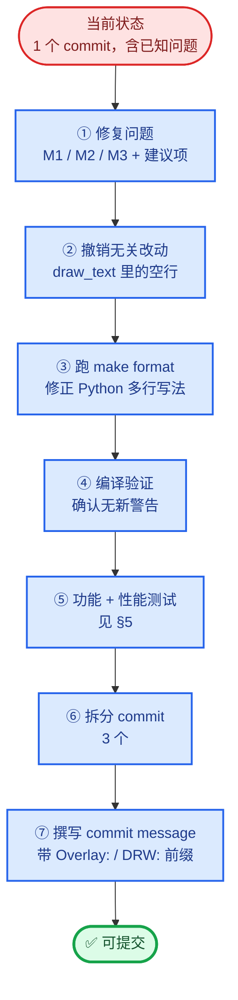
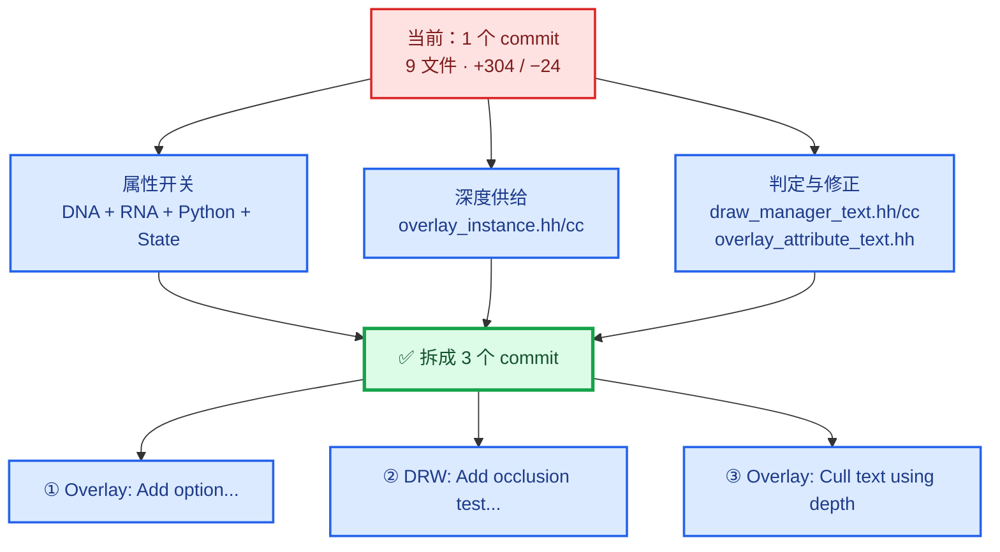
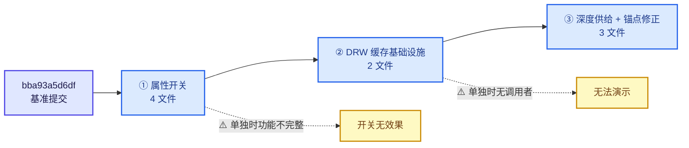
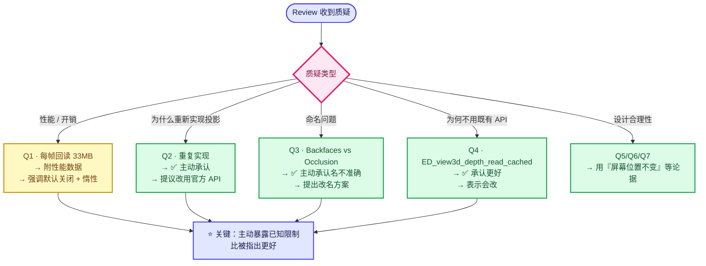
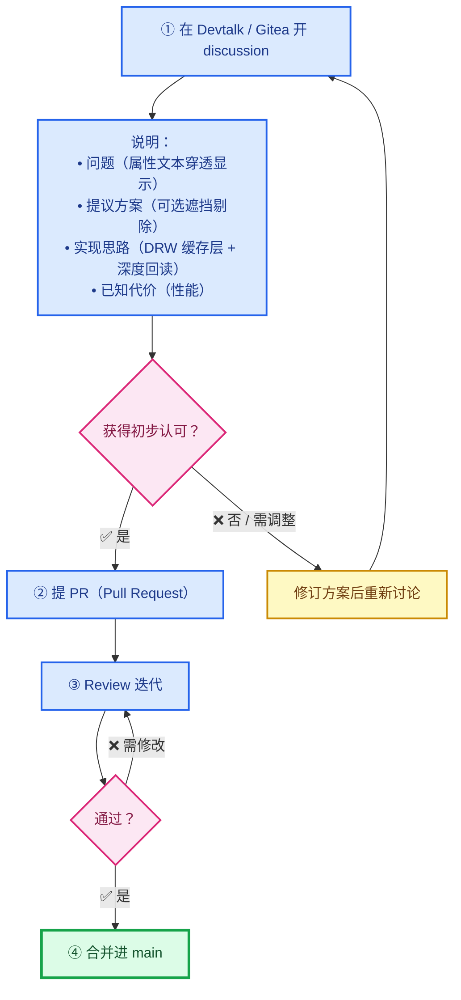
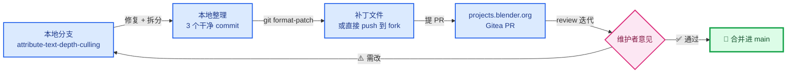

# 08 - 提交指南

> 🔗 [返回索引](./README.md) | 上一篇：[07-问题清单与修复](./07-问题清单与修复.md)

本文讲**怎么把这个改动提交上去** —— 包括拆分方案、commit message、测试要求和 review 应对。

---

## 目录

- [1. 当前提交状态](#1-当前提交状态)
- [2. 提交前必须做的事](#2-提交前必须做的事)
- [3. Commit 拆分方案](#3-commit-拆分方案)
- [4. Commit message 撰写](#4-commit-message-撰写)
- [5. 测试与验证](#5-测试与验证)
- [6. Review 应对预案](#6-review-应对预案)
- [7. Blender 上游流程](#7-blender-上游流程)
- [8. 完整操作脚本](#8-完整操作脚本)

---

## 1. 当前提交状态

### 1.1 分支与提交

```
分支:   attribute-text-depth-culling
基准:   bba93a5d6df (Refactor: Mesh: Merge: Split remap index building function)
提交:   39009b48098 (Cull attribute viewer text using scene depth)
规模:   9 文件，+304 / −24
作者:   W_Cloud <yunkezengren@outlook.com>
```

### 1.2 工作区状态

```bash
$ git status --short
M  source/blender/draw/engines/overlay/overlay_attribute_text.hh
```

⭐ **暂存区与提交内容一致**（无额外未提交改动）。

### 1.3 提交信息的问题

| 项 | 当前 | 问题 |
|----|------|------|
| Commit message | `Cull attribute viewer text using scene depth` | ⚠️ 缺少 `Overlay:` 前缀 |
| 提交粒度 | 1 个 commit，9 个文件 | ⚠️ 混合了 3 类改动 |
| 无关改动 | `draw_text` 里删了一个空行 | ⚠️ 增加 diff 噪声 |

### 1.4 从当前状态到可提交的路径



---

## 2. 提交前必须做的事

### 2.1 修复问题（见 [07](./07-问题清单与修复.md)）

```
必做：
  [ ] M1  消除重复投影
  [ ] M2  entry_distance 改名 + 注释
  [ ] M3  ViewDepths 类型显式转换

建议：
  [ ] S2  引用 M_SQRT1_3
  [ ] S3  用 depth_range
  [ ] S4  相对偏置 / 邻域采样
  [ ] N1-N6 小问题清理
```

### 2.2 撤销无关改动

```diff
/* draw_manager_text / overlay_instance.cc:1062-1069 */
 void Instance::draw_text(Framebuffer &framebuffer)
 {
   if (state.show_text == false) {
     return;
   }
   GPU_framebuffer_bind(framebuffer);
-
   GPU_depth_test(GPU_DEPTH_NONE);
   DRW_text_cache_draw(state.dt, state.region, state.v3d);
 }
```

⭐ **删掉的空行与特性无关**，会让 diff 多一行、干扰 review。**建议还原**。

### 2.3 跑格式化

```bash
make format
```

⭐ **这会修正**：
- `space_view3d.py` 的多行 `row.prop`（改回单行）
- C++ 的对齐与换行

⚠️ **注意**：`make format` 会改动整个仓库里所有不合规的文件。建议：

```bash
# 只格式化本次改动的文件
make format PATHS="source/blender/draw/engines/overlay/overlay_attribute_text.hh \
                   source/blender/draw/intern/draw_manager_text.cc \
                   scripts/startup/bl_ui/space_view3d.py"
```

或者用 `clang-format` 直接处理：

```bash
clang-format -i -style=file \
  source/blender/draw/engines/overlay/overlay_attribute_text.hh \
  source/blender/draw/intern/draw_manager_text.cc

# Python 用 ruff
ruff format scripts/startup/bl_ui/space_view3d.py
```

### 2.4 编译

```bash
# 完整编译
make -j$(nproc)

# 或只编译受影响的目标
ninja -C build blender  # 如果用 ninja
```

⚠️ **确认无新警告**（尤其是 `-Wconversion`，如果开了的话）。

---

## 3. Commit 拆分方案

### 3.1 为什么拆分

⭐ **当前把 3 类不同性质的改动混在一个 commit 里**：



| 类别 | 文件 | 性质 |
|------|------|------|
| 属性开关 | DNA, RNA, Python, `overlay_private.hh` | 用户可见的 UI 特性 |
| 深度供给 | `overlay_instance.hh/cc` | 基础设施 |
| 判定与修正 | `draw_manager_text.hh/cc`, `overlay_attribute_text.hh` | 核心逻辑 |

**拆分的收益**：

1. ⭐ **review 更容易** —— 每个 commit 有单一目的
2. ⭐ **便于 `git bisect`** —— 出问题能定位到具体改动
3. ⭐ **便于 revert** —— 可以只回退某一部分
4. ⭐ **符合 Blender 惯例** —— 上游偏好小而专的 commit

⚠️ **但如果改动量不大（304 行），保持单个 commit 也可接受**。关键看审核者偏好。

> 💡 **Blender 的实际情况**：多数特性补丁是**单个 commit**（通过 `git format-patch` 或 Phabricator/Gitea PR 提交），review 后再 squash。**但内部整理时拆分有助于自己理清逻辑**。

### 3.1.1 拆分后的依赖链



⭐ **每个中间 commit 都必须能编译**（否则 `git bisect` 会失败）。验证方法见 [§8.3](#83-验证拆分的每个-commit-都能编译)。

### 3.2 推荐拆分（3 个 commit）

#### Commit 1：属性开关

```
Overlay: Add option to cull attribute viewer text

Adds a new `viewer_text_cull_backfaces` toggle to the View3D overlay
settings. The option is disabled by default and does not change any
existing behavior.

The flag occupies bit 20 of `View3DOverlay::flag`, so no DNA versioning
is required.
```

**包含文件**：

```
source/blender/makesdna/DNA_view3d_types.h
source/blender/makesrna/intern/rna_space.cc
scripts/startup/bl_ui/space_view3d.py
source/blender/draw/engines/overlay/overlay_private.hh
```

⚠️ **注意**：这个 commit 单独存在时**功能不完整**（开关没有效果）。这在拆分中是常见的，但如果要求"每个 commit 都能工作"，需要合并到 Commit 3。

#### Commit 2：DRW 文本缓存遮挡测试基础设施

```
DRW: Add optional depth-based occlusion test to the text cache

Adds `DRW_TEXT_CACHE_OCCLUSION_TEST` and the supporting API
(`DRW_text_cache_depth_set` / `DRW_text_cache_needs_depth_test`) so
callers can provide a scene depth read-back and have cached strings
skipped when hidden behind geometry.

The test is opt-in per string and only performs the depth read-back when
at least one string requests it.
```

**包含文件**：

```
source/blender/draw/intern/draw_manager_text.hh
source/blender/draw/intern/draw_manager_text.cc
```

⚠️ **这个 commit 单独存在时也无法演示**（没有调用者）。可以用一个临时的单测或说明它是"准备性"的改动。

> 💡 **替代方案**：把 Commit 2 和 Commit 3 合并，只分成 2 个 commit（属性 + 实现）。这样每个 commit 更完整。

#### Commit 3：深度供给 + 锚点修正

```
Overlay: Cull attribute viewer text using scene depth

Reads the scene depth back after the depth prepass (before the grid and
axes write their own depth) and offsets anchors that sit inside their own
geometry, so point cloud and instance labels are not hidden by the
geometry they belong to.
```

**包含文件**：

```
source/blender/draw/engines/overlay/overlay_instance.hh
source/blender/draw/engines/overlay/overlay_instance.cc
source/blender/draw/engines/overlay/overlay_attribute_text.hh
```

### 3.3 更细的拆分（5 个 commit，可选）

如果想更彻底：

| # | Commit | 文件 |
|---|--------|------|
| 1 | DNA + RNA + Python（属性） | 3 个 |
| 2 | `overlay_private.hh`（State 访问） | 1 个 |
| 3 | `draw_manager_text.hh/cc`（缓存层） | 2 个 |
| 4 | `overlay_instance.hh/cc`（深度回读） | 2 个 |
| 5 | `overlay_attribute_text.hh`（锚点修正） | 1 个 |

⚠️ **过细的拆分会让每个 commit 都无法独立工作**。**推荐 3 个**（或 2 个）。

### 3.4 拆分操作

⭐ **用 `git reset` + 分批 `git add`**：

```bash
# 1. 软重置到基准（保留工作区改动）
git reset --soft bba93a5d6df

# 2. 取消暂存
git reset

# 3. 提交第 1 批
git add source/blender/makesdna/DNA_view3d_types.h \
        source/blender/makesrna/intern/rna_space.cc \
        scripts/startup/bl_ui/space_view3d.py \
        source/blender/draw/engines/overlay/overlay_private.hh
git commit -m "Overlay: Add option to cull attribute viewer text

..."

# 4. 提交第 2 批
git add source/blender/draw/intern/draw_manager_text.hh \
        source/blender/draw/intern/draw_manager_text.cc
git commit -m "DRW: Add optional depth-based occlusion test to the text cache

..."

# 5. 提交第 3 批
git add source/blender/draw/engines/overlay/overlay_instance.hh \
        source/blender/draw/engines/overlay/overlay_instance.cc \
        source/blender/draw/engines/overlay/overlay_attribute_text.hh
git commit -m "Overlay: Cull attribute viewer text using scene depth

..."
```

⚠️ **注意**：拆分后**每个中间 commit 都应该能编译**（否则 `git bisect` 会失败）。建议逐个验证：

```bash
git stash                          # 保存当前
git checkout <commit-1>            # 逐个 checkout
make -j$(nproc)                    # 验证编译
```

---

## 4. Commit message 撰写

### 4.1 Blender 的规范

⭐ **Blender 的 commit message 格式**：

```
<Module>: <Short imperative summary, max ~72 chars>

<Longer description. Wrap at 72 columns. Explain WHAT and WHY, not HOW.>

<Optional: references to issues/reports>
```

**常用模块前缀**：

| 前缀 | 用途 |
|------|------|
| `Overlay:` | Overlay 引擎 |
| `DRW:` | 绘制管理器 |
| `GPU:` | GPU 抽象层 |
| `PyAPI:` | Python API |
| `Cleanup:` | 纯清理 |
| `Fix:` | Bug 修复 |
| `Refactor:` | 重构（无行为变化） |

⭐ **参考本仓库的既有 commit**：

```
bba93a5d6df Refactor: Mesh: Merge: Split remap index building function
59f9ceb6071 Mesh: Merge: Use identity map for un-merged vertices in API
```

⚠️ **注意这些既有 commit 用的是 `<Module>: <Submodule>:` 的形式**，而**没有** `Overlay:` 前缀的先例可查。建议检查 Overlay 相关历史：

```bash
git log --oneline -- source/blender/draw/engines/overlay/ | head -30
```

### 4.2 当前 message 的问题

```
Cull attribute viewer text using scene depth

Read the current frame depth before overlay grid drawing and offset point cloud labels by their own rendered radius.
```

| 问题 | 说明 |
|------|------|
| 缺模块前缀 | 应为 `Overlay:` |
| 第二行过长 | 超过 72 列（约 116 字符） |
| 描述不完整 | 只提了点云，没提**实例**锚点修正 |
| 未提默认关闭 | 重要的兼容性信息 |
| 未提无需 versioning | 重要的实现细节 |

### 4.3 改进版

```
Overlay: Cull attribute viewer text using scene depth

Adds an opt-in "Exclude Backfaces" option to the Viewer Node overlay
panel. When enabled, attribute text anchors that are hidden behind
geometry are skipped instead of being drawn through it.

The occlusion test is implemented in the DRW text cache so that it
applies uniformly to every geometry type (mesh, point cloud, instances,
curves). The scene depth is read back once per frame, after the depth
prepass but before the grid and axes draw their own depth.

Point cloud and instance anchors sit inside their own geometry, so they
are offset along the view ray before the depth comparison. This mirrors
the offset already applied by `overlay_edit_pointcloud_vert.glsl`.

The option is disabled by default and the new flag is stored in an unused
bit of `View3DOverlay::flag`, so no DNA versioning is required.
```

⭐ **这个 message 的优点**：
- ✅ 有模块前缀
- ✅ 首行 ≤ 72 字符
- ✅ 说明了 **what**（加了什么选项）和 **why**（避免文字穿透显示）
- ✅ 说明了关键实现选择（在 DRW 缓存层实现、深度回读时机）
- ✅ 提到了几何特化（点云、实例）
- ✅ 说明了兼容性（默认关闭、无需 versioning）

### 4.4 分 commit 的 message

见 [§3.2](#32-推荐拆分3-个-commit) 中每个 commit 的建议文本。

---

## 5. 测试与验证

### 5.1 编译验证

```bash
# 完整编译
make -j$(nproc)

# 或者用 CMake + ninja
cmake --build build --target blender -j$(nproc)
```

⭐ **确认**：
- 无编译错误
- 无**新增**警告
- 如果用 `WITH_ASSERT_ABORT=ON`，跑一遍确认无断言触发

可以用本仓库的 skill：

```
/blender-build
```

### 5.2 功能测试

⭐ **完整测试项见 [07-§12](./07-问题清单与修复.md#12-检查清单)**。关键几项：

| # | 测试 | 为什么重要 |
|---|------|-----------|
| 1 | 默认关闭时行为不变 | **兼容性**——最重要的回归测试 |
| 2 | 透视 + 闭合网格 | 基本功能 |
| 3 | **正交视图** | 验证 `camera_forward` 路径 |
| 4 | 点云 | 验证半径偏移 |
| 5 | 实例 | 验证包围盒偏移（M2 相关） |
| 6 | Grid 开启 | 验证深度回读时机 |
| 11 | 单面曲面 | 验证"是遮挡而非背面剔除" |
| 7 | 视口拖拽 | 验证缓存重建 |

### 5.3 性能测试

⭐ **上游审查一定会问性能**（因为每帧回读几十 MB）。**建议提前准备数据**：

```bash
# 用 Blender 的 --debug-gpu 或内建 profiler
blender --debug-gpu --debug-gpu-time
```

**建议测量的场景**：

| 场景 | 分辨率 | 标签数 | 关注 |
|------|--------|--------|------|
| 基线 | 1080p | 0（功能关） | 参考 FPS |
| 小场景 | 1080p | 100 | 开销 |
| 中场景 | 1080p | 10,000 | 开销 |
| 大场景 | 4K | 10,000 | 回读带宽影响 |

⭐ **报告格式建议**：

```
Resolution: 1920x1080
Depth read-back: 8.3 MB/frame

Scenario          FPS (off)   FPS (on)   Delta
-----------------------------------------------
100 labels           60.0        59.8    -0.3%
10,000 labels        60.0        58.1    -3.2%
4K, 10,000 labels    45.0        38.5   -14.4%
```

⚠️ **如果 4K 下掉帧明显**，需要在 review 里主动说明，并考虑实现"降低回读分辨率"（见 [04-§6.3](./04-实例层-缓存与绘制顺序.md#63--每帧回读是无法避免的吗)）。

### 5.4 边界测试

| 测试 | 期望 |
|------|------|
| 空点云 | 无崩溃 |
| 0 个顶点网格 | 无崩溃 |
| 缩放为 0 的物体 | 无崩溃（`determinant` 检查） |
| 无 `.viewer` 属性 | 无文本，无崩溃 |
| 极端的大场景（远裁剪面） | 无异常 |
| 切换视口布局 | 缓存正确重建 |

---

## 6. Review 应对预案

⭐ **提前准备这些问题的答案**，能显著提高通过率。

### 6.0 应对策略总览



### 6.1 预计会被问到的问题

<details>
<summary><b>Q1：为什么要每帧回读整个深度缓冲？性能如何？</b></summary>

**回答要点**：

1. 回读只在**功能开启且确实有字符串请求遮挡测试**时发生（`DRW_text_cache_needs_depth_test` 惰性检查）
2. 默认**关闭**，所以大多数用户零开销
3. 提供性能数据（[§5.3](#53-性能测试)）
4. 说明替代方案的代价：
   - GPU 深度测试**不可行**（文字是 2D BLF 图元，无真实深度）
   - 遮挡查询（occlusion query）需每标签一次，同步开销更大
   - 异步回读会滞后一帧，导致快速运动时标签闪烁
5. 主动提出可能的优化（降采样回读、异步回读）作为后续工作

</details>

<details>
<summary><b>Q2：为什么在 draw 模块重新实现投影，而不是扩展 <code>ed_view3d_project__internal</code>？</b></summary>

**回答要点**：

1. 官方函数**不输出深度**，这是重新实现的直接原因
2. 新代码的 `fx`/`fy` 计算与官方**逐字相同**，保证深度可比
3. ✅ **主动承认更好的方案**：给 `ed_view3d_project__internal` 加一个可选的 `float *r_depth = nullptr` 参数
4. ⭐ **表示愿意按 review 意见改为该方案** —— 这比坚持当前实现更容易通过

⭐ **这是一个可能的改进点**（见 [03-§8.3](./03-文本缓存遮挡测试核心.md#83--根本问题重复实现)）：

```cpp
static eV3DProjStatus ed_view3d_project__internal(const ARegion *region,
                                                  const float perspmat[4][4],
                                                  const bool is_local,
                                                  const float co[3],
                                                  float r_co[2],
                                                  const eV3DProjTest flag,
                                                  float *r_depth = nullptr);  /* 新增 */
```

</details>

<details>
<summary><b>Q3：为什么叫 "Backfaces" 但实现的是 occlusion？</b></summary>

**回答要点**：

1. ⭐ **主动承认命名不准确**（见 [07-N6](./07-问题清单与修复.md#n6ui-名称与描述术语不一致)）
2. 解释动机：用户直觉场景是"球体背面标签穿透"，所以看起来像背面剔除
3. 但实现覆盖更广（点云前后遮挡、实例遮挡、被其他物体遮挡）
4. ⭐ **提出改名建议**：`viewer_text_occlusion_cull` + UI 名 "Exclude Occluded"

⭐ **主动提出改名比被指出更好**。

</details>

<details>
<summary><b>Q4：为什么不用 <code>ED_view3d_depth_read_cached</code>？</b></summary>

**回答要点**：

1. ⭐ **承认这是更好的做法** —— 它已提供边界检查、`depth_range` 判断、`margin` 邻域采样
2. 当前手写采样是为了"只取一个精确像素"，但**没有实际好处**
3. ⭐ **表示会改为使用该函数**（这同时解决 M1/S3/S4）

</details>

<details>
<summary><b>Q5：点云锚点偏移会改变文字位置吗？</b></summary>

**回答要点**：

1. ❌ **不会** —— 偏移沿**视线方向**（`center + direction * radius`）
2. 沿视线移动的点，**屏幕投影位置不变**（透视投影下，视线上的点投影到同一点）
3. 只有**深度**变化 → 影响遮挡判定，不影响视觉位置

⚠️ **严格来说**：只对**透视相机**成立（视线是从相机出发的射线）。对**正交相机**，沿视线方向的平移也保持投影位置不变 ✅ 两者都成立。

> 💡 **这是一个很好的"设计合理性"论据**，建议在 review 里主动说明。

</details>

<details>
<summary><b>Q6：为什么锚点偏移不放在 shader 里？</b></summary>

**回答要点**：

1. 文字是 BLF 绘制的 **2D 图元**，没有 shader 阶段的顶点可偏移
2. 锚点在**添加到缓存时**（`object_sync` 阶段）就已确定，此时是 CPU 侧
3. ✅ 而且偏移只在**开启遮挡测试时**才需要，放在 CPU 侧可以完全不分配资源

</details>

<details>
<summary><b>Q7：HiDPI 下 region 尺寸和深度纹理尺寸不一致，怎么处理？</b></summary>

**回答要点**：

1. ⭐ 代码**做了两套边界检查**：投影时用 `region.winx/winy`，采样时用 `depths->w/h`
2. 索引时用 `depths->w`（正确的缓冲尺寸）
3. ✅ 这是**有意的防御性设计**（见 [01-§9.3](./01-背景知识与原理.md#93-regionwinx--winy-vs-深度纹理尺寸)）

</details>

### 6.2 Review 检查项自查

⭐ **Blender 的 review 通常会检查**：

| 检查项 | 状态 | 备注 |
|--------|------|------|
| 遵循代码风格 | ⚠️ | 需跑 `make format` |
| 无 `printf` 调试残留 | ✅ | 未发现 |
| 无 TODO 未处理 | ✅ | 未新增 |
| 注释清晰（英文） | ✅ | 注释质量高 |
| 命名规范（`snake_case`） | ✅ | 但 `viewer_text_cull_backfaces` 与相邻 `show_*` 不一致 ⚠️ |
| 内存管理正确 | ✅ | 无泄漏 |
| 线程安全 | ⚠️ | `object_sync` 是否多线程需确认 |
| 有测试或测试说明 | ❌ | **需要补** |
| 性能影响说明 | ❌ | **需要补** |
| 不破坏既有功能 | ✅ | 默认关闭 |
| 无需 versioning | ✅ | 位标志 |

### 6.3 建议主动在 PR 描述里说明

⭐ **主动暴露已知限制比被 review 指出更好**：

```markdown
## Known limitations

- The occlusion test requires a full-screen depth read-back each frame
  while the option is enabled. The read-back is skipped entirely when the
  option is off (the default) or when no string requests it.
- Point cloud anchor offsets use the same `M_SQRT1_3` scale as
  `draw_pointcloud_lib.glsl`; if that scale ever changes, this must follow.
- The option is currently a single on/off toggle; a future improvement
  could expose separate controls for "exclude backfaces" vs "exclude any
  occluder".

## Testing

Tested with:
- Mesh (closed sphere, open plane), point cloud (1M points), instances
  (`Instance on Points`), curves
- Perspective and orthographic views
- HiDPI (200%) and standard resolution
- Viewport dragging / layout changes
```

---

## 7. Blender 上游流程

### 7.1 提交渠道

⭐ **Blender 当前的开发流程**：

| 渠道 | 用途 |
|------|------|
| **projects.blender.org (Gitea)** | 主要平台，用 PR（Pull Request） |
| `blender-developers` 邮件列表 | 讨论设计 |
| Blender Chat (`#blender-coders`) | 快速提问 |

⚠️ **旧的 Phabricator**（`developer.blender.org`）**已停用**。

### 7.2 提交前建议讨论

⭐ **对于"新增用户可见选项"这类改动**，Blender 通常**建议先在讨论区提出**：



⭐ **这样能避免"实现完了才发现方向不对"**。

### 7.2.1 完整工作流



⚠️ **记住**：修改后要 **squash 或 rebase**，不要在 PR 里堆积 "fix review comment" 之类的噪声 commit。

### 7.3 PR 描述模板

```markdown
## Summary

Adds an opt-in option to hide Viewer Node attribute text that is occluded
by geometry. Currently all attribute labels are drawn regardless of
occlusion, which makes the text viewer unusable for closed meshes, dense
point clouds and instanced geometry.

## Implementation

- The occlusion test lives in the DRW text cache
  (`DRW_TEXT_CACHE_OCCLUSION_TEST`), so it applies to all geometry types
  without per-type code.
- The scene depth is read back once per frame, after the depth prepass but
  before the grid and axes write their own depth.
- Point cloud and instance anchors sit inside their own geometry, so they
  are offset along the view ray first (mirroring
  `overlay_edit_pointcloud_vert.glsl`).
- The read-back only happens when at least one string requests the test.

## Compatibility

The option is off by default. The new flag uses an unused bit of
`View3DOverlay::flag`, so no file versioning is needed.

## Performance

<attach measurements>

## Screenshots

<before/after for sphere, point cloud, instances>

## Testing

<describe test matrix>
```

### 7.4 截图建议

⭐ **视觉特性一定要附截图/录屏**：

| 内容 | 说明 |
|------|------|
| 闭合球体（开关前/后） | 最直观的对比 |
| 点云（开关前/后） | 展示前后重叠问题 |
| 实例（开关前/后） | 展示穿透问题 |
| Grid 开启时的地面下方标签 | 证明深度时机正确 |
| 单面曲面 | 证明是遮挡而非背面剔除 |

---

## 8. 完整操作脚本

### 8.1 整理提交（PowerShell）

```powershell
# 0. 确认当前状态
git status
git log --oneline -3

# 1. 撤销无关的空行改动
#    （手动编辑 overlay_instance.cc，恢复 draw_text 里的空行）

# 2. 格式化
ruff format scripts/startup/bl_ui/space_view3d.py
clang-format -i -style=file `
  source/blender/draw/intern/draw_manager_text.cc `
  source/blender/draw/engines/overlay/overlay_attribute_text.hh `
  source/blender/draw/engines/overlay/overlay_instance.cc

# 3. 编译验证
make -j8

# 4. 软重置到基准
git reset --soft bba93a5d6df
git reset

# 5. 分批提交
git add source/blender/makesdna/DNA_view3d_types.h `
        source/blender/makesrna/intern/rna_space.cc `
        scripts/startup/bl_ui/space_view3d.py `
        source/blender/draw/engines/overlay/overlay_private.hh
git commit -F .git/COMMIT_MSG_1.txt

git add source/blender/draw/intern/draw_manager_text.hh `
        source/blender/draw/intern/draw_manager_text.cc
git commit -F .git/COMMIT_MSG_2.txt

git add source/blender/draw/engines/overlay/overlay_instance.hh `
        source/blender/draw/engines/overlay/overlay_instance.cc `
        source/blender/draw/engines/overlay/overlay_attribute_text.hh
git commit -F .git/COMMIT_MSG_3.txt

# 6. 验证
git log --oneline -5
git diff bba93a5d6df --stat
```

### 8.2 导出补丁

```bash
# 导出为补丁文件（供 PR 或邮件提交）
git format-patch bba93a5d6df --output-directory=../patches

# 或者导出合并后的单个补丁
git diff bba93a5d6df > attribute-text-occlusion.patch
```

### 8.3 验证拆分的每个 commit 都能编译

```bash
# 逐个 checkout 验证
for c in $(git rev-list --reverse bba93a5d6df..HEAD); do
  git checkout $c
  echo "=== Building $c ==="
  make -j8 2>&1 | tail -5
done
git checkout -
```

⚠️ **Windows PowerShell 版本**：

```powershell
$commits = git rev-list --reverse bba93a5d6df..HEAD
foreach ($c in $commits) {
  git checkout $c
  Write-Host "=== Building $c ==="
  make -j8 2>&1 | Select-Object -Last 5
}
git checkout -
```

---

## 提交前最终清单

```
代码质量
  [ ] M1 重复投影已修复
  [ ] M2 entry_distance 已改名 + 注释
  [ ] M3 类型窄化已显式化
  [ ] S2 引用 M_SQRT1_3
  [ ] 无 printf / 调试残留
  [ ] 注释准确（函数名、行为）
  [ ] 已跑 make format

构建
  [ ] 编译通过
  [ ] 无新增警告
  [ ] 拆分的每个 commit 都能编译

测试
  [ ] 默认关闭时行为不变（兼容性）
  [ ] 透视 + 正交视图
  [ ] 点云 + 实例 + 网格 + 曲线
  [ ] Grid 开启场景
  [ ] 单面曲面（验证非背面剔除）
  [ ] 视口拖拽 / HiDPI
  [ ] 性能数据已测量

提交
  [ ] 拆分合理（3 个 commit）
  [ ] commit message 有模块前缀，首行 ≤72 字符
  [ ] 无无关改动
  [ ] PR 描述包含：动机、实现、兼容性、性能、截图、测试

准备
  [ ] 准备好回答：性能、为什么重新实现投影、命名问题
  [ ] 准备好主动说明已知限制
```

---

## 小结

| 阶段 | 关键动作 |
|------|----------|
| **修复** | M1/M2/M3 + S2（见 [07](./07-问题清单与修复.md)） |
| **清理** | 撤销无关空行、跑 `make format` |
| **拆分** | 3 个 commit：属性 / 缓存基础设施 / 深度供给+锚点 |
| **验证** | 编译 + 功能测试矩阵 + 性能数据 |
| **提交** | 模块前缀 + 完整描述 + 截图 |
| **应对** | 主动说明限制与改进方向 |

⭐ **最重要的两条**：

1. **主动承认已知问题并提出改进方向**（比被指出更好，也显得专业）
2. **性能数据必须准备**（每帧回读深度是绕不开的质疑点）

---

## 返回

- [08 目录](#目录) | [返回索引](./README.md) | [问题清单](./07-问题清单与修复.md)
