# 09 - Instance 类完全解析

> 🔗 [返回索引](./README.md) | 上一篇：[08-提交指南](./08-提交指南.md) | 参考：[配色与图例约定](./配色与图例约定.md)

本文逐行解析 **Overlay 引擎的核心类 `Instance`**：

- `source/blender/draw/engines/overlay/overlay_instance.hh`（172 行）
- `source/blender/draw/engines/overlay/overlay_instance.cc`（1250 行）

这个类是理解**整个 Overlay 引擎如何工作**的钥匙，也是本 patch（属性文本遮挡剔除）的宿主。

---

## 目录

- [1. 这个类是什么](#1-这个类是什么)
- [2. 继承体系与引擎契约](#2-继承体系与引擎契约)
- [3. 头文件逐段解析](#3-头文件逐段解析)
- [4. 五个引擎虚函数](#4-五个引擎虚函数)
- [5. init：一次性初始化](#5-init一次性初始化)
- [6. begin_sync / object_sync / end_sync](#6-begin_sync--object_sync--end_sync)
- [7. draw：分发到三种空间](#7-draw分发到三种空间)
- [8. draw_v3d：最复杂的函数](#8-draw_v3d最复杂的函数)
- [9. update_text_depth 与 draw_text](#9-update_text_depth-与-draw_text)
- [10. 一堆谓词函数](#10-一堆谓词函数)
- [11. 与本 patch 的关系](#11-与本-patch-的关系)
- [12. 设计模式总结](#12-设计模式总结)

---

## 1. 这个类是什么

```cpp
/* overlay_instance.hh:57 */
class Instance : public DrawEngine {
```

⭐ **一句话**：`Instance` 是 **Overlay（叠加层）绘制引擎的实例**。它负责把网格线、坐标轴、轮廓、骨骼、属性文字等**辅助显示**画到 3D 视口/UV 编辑器/节点编辑器上。

### 1.1 "Overlay" 是什么

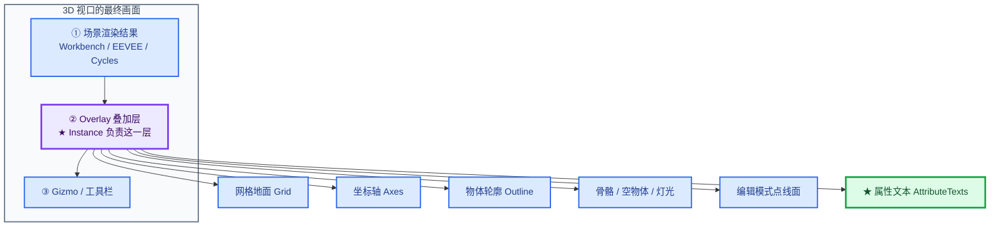

### 1.2 为什么叫 `Instance`

⭐ Blender 的绘制引擎采用**两段式设计**：

| 概念 | 类 | 职责 | 生命周期 |
|------|-----|------|----------|
| **Engine** | `DrawEngine::Pointer` 的子类 | 工厂，创建实例 | 全程一个 |
| **Instance** | `DrawEngine` 的子类 | 实际干活 | 按需创建/销毁 |


⭐ **两个构造函数对应两种用途**：

```cpp
/* overlay_instance.hh:114-115 */
Instance() : selection_type_(select::SelectionType::DISABLED) {};
Instance(const SelectionType selection_type) : selection_type_(selection_type) {};
```

| 构造 | 用途 |
|------|------|
| `Instance()` | **普通 Overlay**（`DISABLED` = 不做选择渲染） |
| `Instance(selection_type)` | **选择引擎**（复用 Overlay 代码做选择 ID 渲染） |

> 💡 类注释说明了这个复用设计：
> ```cpp
> /**
>  * Selection engine reuse most of the Overlay engine by creating selection IDs for each
>  * selectable component and using a special shaders for drawing.
>  */
> ```
> —— 选择引擎（框选/点选）**复用** Overlay 的绝大部分代码，只是 shader 不同、ID 不同。

---

## 2. 继承体系与引擎契约

### 2.1 基类 `DrawEngine`

```cpp
/* draw/intern/DRW_render.hh:71-97 */
struct DrawEngine {
  static constexpr int GPU_INFO_SIZE = 512;
  char info[GPU_INFO_SIZE] = {'\0'};
  bool used = false;

  virtual ~DrawEngine() = default;

  virtual StringRefNull name_get() = 0;

  /** True if the render engine takes the render border into account. */
  virtual bool uses_render_border() const { return false; }

  /* Functions called for viewport. */
  /** Init engine. Run first and for every redraw. */
  virtual void init() = 0;
  /** Scene synchronization. Command buffers building. */
  virtual void begin_sync() = 0;
  virtual void object_sync(draw::ObjectRef &ob_ref, draw::Manager &manager) = 0;
  virtual void end_sync() = 0;
  /** Command Submission. */
  virtual void draw(draw::Manager &manager) = 0;
};
```

⭐ **`Instance` 必须实现的 5 个纯虚函数**：

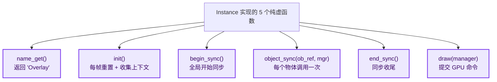

### 2.2 ⭐ 关键设计：同步/提交分离

这是现代图形 API（Vulkan/Metal）的核心模式：

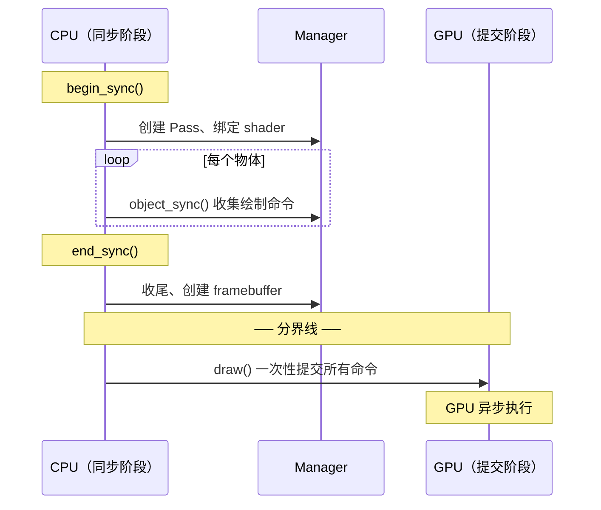

⭐ **为什么分离**：

| 阶段 | 特点 | 内容 |
|------|------|------|
| **同步** | CPU 密集，可多线程 | 世界矩阵计算、剔除、构建命令缓冲 |
| **提交** | GPU 密集 | 实际光栅化 |

**分离后 CPU 可以并行构建命令，GPU 顺序执行**，大幅提升吞吐。

> 💡 `object_sync` 的签名里有 `Manager &manager` —— 它收集的是**命令**，不是立即绘制。

---

## 3. 头文件逐段解析

### 3.1 巨大的 include 列表（1-49 行）

```cpp
#include "overlay_private.hh"
#include "overlay_antialiasing.hh"
#include "overlay_armature.hh"
/* ... 共 38 个 overlay_*.hh ... */
```

⭐ **每个 include 对应一个"绘制组件"**：

| 头文件 | 组件 | 画什么 |
|--------|------|--------|
| `overlay_grid.hh` | `Grid` | 网格地面 |
| `overlay_axes.hh` | `Axes` | 坐标轴 |
| `overlay_outline.hh` | `Outline` | 物体轮廓 |
| `overlay_wireframe.hh` | `Wireframe` | 线框 |
| `overlay_attribute_text.hh` | `AttributeTexts` | ⭐ **本 patch 的宿主** |
| `overlay_prepass.hh` | `Prepass` | 深度预pass |
| ... | ... | ... |

⚠️ **这是"上帝头文件"的反模式** —— `overlay_instance.hh` include 了所有组件头文件，导致**任何组件改动都会触发大量重编译**。

> 💡 **可以改进**：用前向声明 + 在 `.cc` 里 include。但改动量大，且 Blender 用 unity build 缓解了编译时间问题。

### 3.2 成员变量分组（58-112 行）

```cpp
class Instance : public DrawEngine {
  const SelectionType selection_type_;   // ① 不可变配置
  bool clipping_enabled_;                // ② 每帧状态

 public:
  ShapeCache shapes;                     // ③ 共享形状缓存

  /** Global types. */
  Resources resources = {selection_type_, shapes};   // ④ 全局资源
  State state;                                       // ⑤ 全局状态快照

  /** Overlay types. */
  Background background;      // ⑥ 单例型组件
  ImagePrepass image_prepass;
  Origins origins = {selection_type_};
  Outline outline;
  MotionPath motion_paths;
  Cursor cursor;

  struct OverlayLayer {       // ⑦ 分组型组件
    /* 30 个组件成员 */
  } regular{selection_type_}, infront{selection_type_};   // ← 两份！

  Grid grid;                  // ⑧ 后置组件
  AntiAliasing anti_aliasing;
  XrayFade xray_fade;
```

⭐ **逐个理解**：

#### ① `selection_type_` —— 编译期不可变

```cpp
const SelectionType selection_type_;
```

✅ **`const` 成员**：构造后不可变。区分"这是普通 Overlay 还是选择引擎"。

⭐ **注意 `= {selection_type_}` 的大量使用**：许多组件需要知道自己的用途（选择渲染 vs 普通显示），所以在**成员初始化时**就传进去。

#### ④ `Resources` —— 全局 GPU 资源

```cpp
Resources resources = {selection_type_, shapes};
```

包含所有 framebuffer、texture、shader、UBO。**生命周期贯穿整个引擎**。

#### ⑤ `State` —— 每帧的状态快照

```cpp
State state;
```

⭐ **这是最重要的成员之一**。它在 `init()` 里被填充，之后是**只读快照**：


**为什么要快照**：`DRWContext` 是全局可变状态，直接读容易出错；快照后语义清晰、调试友好。

#### ⑦ ⭐ `OverlayLayer` —— 为什么要两份

```cpp
} regular{selection_type_}, infront{selection_type_};
```

⭐ **这是 Overlay 引擎最独特的设计**：

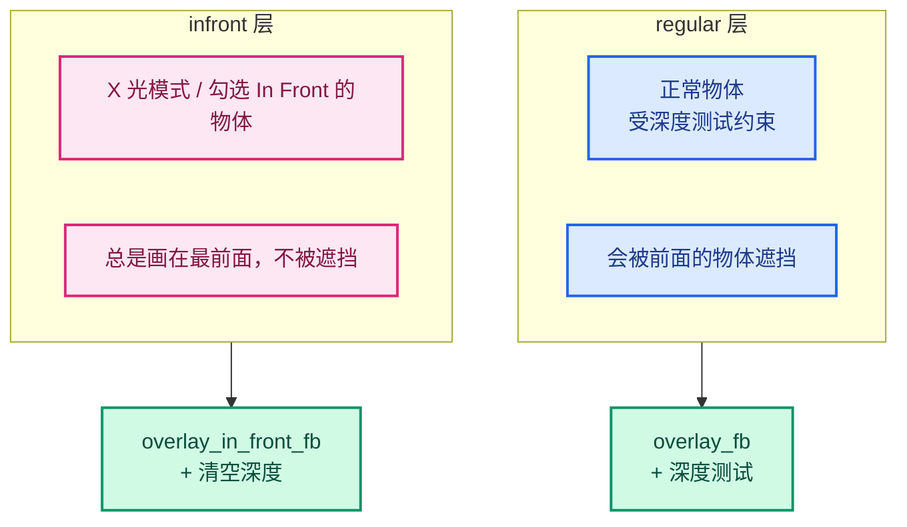

⭐ **每个物体在 `object_sync` 里被分配到其中一层**：

```cpp
/* overlay_instance.cc:525 */
OverlayLayer &layer = object_is_in_front(ob_ref.object, state) ? infront : regular;
```

⚠️ **代价**：30 个组件 × 2 份 = 60 个对象实例。但这是**用空间换清晰度**的合理取舍。

### 3.3 析构函数（116-123 行）

```cpp
~Instance() override
{
  DRW_text_cache_destroy(state.dt);
  if (text_depth_cache_ != nullptr) {
    ED_view3d_depths_free(text_depth_cache_);
    text_depth_cache_ = nullptr;
  }
}
```

⭐ **后两行是本 patch 新增的**（详见 [04-§2](./04-实例层-缓存与绘制顺序.md#2-hh-改动缓存成员与析构)）。

⚠️ **注意 `state.dt` 的销毁时机**：`state.dt` 在 `begin_sync()` 里被销毁并重建：

```cpp
/* overlay_instance.cc:462-463 */
DRW_text_cache_destroy(state.dt);
state.dt = DRW_text_cache_create();
```

⭐ **所以 `~Instance()` 里销毁的是"最后一帧留下的"那个 `dt`**。这是必要的清理，否则每帧重建会导致**最后一帧的泄漏**。

### 3.4 私有成员（136-169 行）

```cpp
 private:
  /* 谓词函数 —— 判断物体状态 */
  bool object_is_selected(const ObjectRef &ob_ref);
  bool object_is_edit_mode(const Object *object);
  bool object_is_paint_mode(const Object *object);
  bool object_is_particle_edit_mode(const ObjectRef &ob_ref);
  bool object_is_sculpt_mode(const ObjectRef &ob_ref);
  bool object_is_sculpt_mode(const Object *object);      // ← 重载
  bool object_is_edit_paint_mode(...);
  bool object_is_in_front(const Object *object, const State &state);
  bool object_needs_prepass(const ObjectRef &ob_ref, bool in_paint_mode);
  bool object_is_rendered_transparent(const Object *object, const State &state);

  /* ★ 本 patch 新增 */
  void update_text_depth();
  ViewDepths *text_depth_cache_ = nullptr;
  int text_depth_cache_width_ = 0;
  int text_depth_cache_height_ = 0;

  /* 绘制分发 */
  void draw_node(Manager &manager, View &view);
  void draw_v2d(Manager &manager, View &view);
  void draw_v3d(Manager &manager, View &view);
  void draw_text(Framebuffer &framebuffer);

  void ensure_weight_ramp_texture();
```

⭐ **`object_is_sculpt_mode` 有两个重载**：

| 重载 | 参数 | 用途 |
|------|------|------|
| `(const ObjectRef &)` | 对象引用 | 支持 Geometry Nodes 预览网格 |
| `(const Object *)` | 裸对象 | 简单判断 |

⭐ **为什么要两个**：`ObjectRef` 携带了**预览几何**信息（Viewer 节点预览），支持它需要更多逻辑（见 `:1079-1097`）。

---

## 4. 五个引擎虚函数

### 4.1 全景

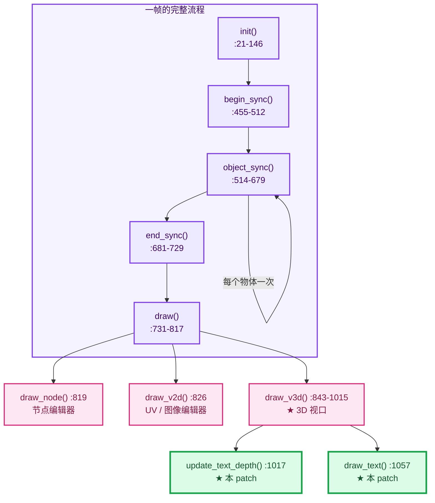

### 4.2 `name_get`

```cpp
/* overlay_instance.hh:125-128 */
StringRefNull name_get() final
{
  return "Overlay";
}
```

✅ **`final`**：不允许子类覆写（`Instance` 就是终态）。返回 `StringRefNull`（非拥有、保证 null 结尾的字符串引用）。

---

## 5. init：一次性初始化

> 位置：`overlay_instance.cc:21-146`

⭐ **命名有误导性**：基类注释说 "Run first and for every redraw"，所以 `init()` **每帧都跑**，不是只跑一次。

### 5.1 阶段划分

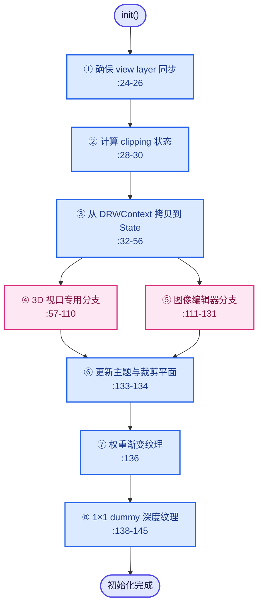

### 5.2 ⭐ 关键：`show_text` 的初始化

```cpp
/* overlay_instance.cc:49 */
state.show_text = false;          // ← 先默认关闭

/* :93-94 —— 3D 视口里重新计算 */
state.show_text = !resources.is_selection() && !state.is_depth_only_drawing &&
                  (ctx->v3d->overlay.flag & V3D_OVERLAY_HIDE_TEXT) == 0;

/* :119 —— 图像编辑器里 */
state.show_text = !state.hide_overlays;
```

⭐ **`state.show_text` 是本 patch 的开关之一**（见 [04-§4.3](./04-实例层-缓存与绘制顺序.md#43-阶段-1前置条件与清理)）—— `update_text_depth()` 的第一道短路就是 `!state.show_text`。

### 5.3 ⭐ `is_render_depth_available` —— 为什么需要深度预pass

```cpp
/* overlay_instance.cc:73-87 */
const bool viewport_uses_workbench = state.v3d->shading.type <= OB_SOLID ||
                                     BKE_scene_uses_blender_workbench(state.scene);
const bool viewport_uses_eevee = STREQ(...);
const bool use_resolution_scaling = BKE_render_preview_pixel_size(&state.scene->r) != 1;
/* Only workbench ensures the depth buffer is matching overlays.
 * Force depth prepass for other render engines.
 * EEVEE is an exception (if not using mixed resolution) to avoid a significant overhead. */
state.is_render_depth_available = viewport_uses_workbench ||
                                  (viewport_uses_eevee && !use_resolution_scaling);
```

⭐ **这是一个重要的正确性决策**：

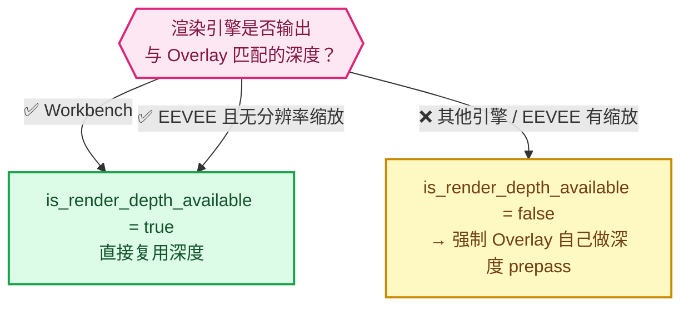

⚠️ **这与本 patch 直接相关**：如果 `is_render_depth_available == false`，Overlay 会做自己的深度 prepass（`:923`, `:935`）。而 `update_text_depth()` 卡在 prepass **之后**，所以两种情况下深度都是完整的 ✅

### 5.4 `hide_overlays` 的处理

```cpp
/* overlay_instance.cc:89-105 */
if (!state.hide_overlays) {
  state.overlay = state.v3d->overlay;      // ← 拷贝用户设置
  state.v3d_flag = state.v3d->flag;
  state.v3d_gridflag = state.v3d->gridflag;
  state.show_text = ...;
}
else {
  _DNA_internal_memzero(&state.overlay, sizeof(state.overlay));   // ← 全部清零
  state.v3d_flag = 0;
  state.v3d_gridflag = 0;
  state.overlay.flag = V3D_OVERLAY_HIDE_TEXT | V3D_OVERLAY_HIDE_MOTION_PATHS |
                       V3D_OVERLAY_HIDE_BONES | V3D_OVERLAY_HIDE_OBJECT_XTRAS |
                       V3D_OVERLAY_HIDE_OBJECT_ORIGINS;
  /* 但保留两个字段 */
  state.overlay.wireframe_threshold = state.v3d->overlay.wireframe_threshold;
  state.overlay.wireframe_opacity = state.v3d->overlay.wireframe_opacity;
}
```

⭐ **这是本 patch 的 DNA 位标志被读取的最终来源**：

```cpp
/* overlay_private.hh:271-274 */
bool viewer_text_cull_backfaces() const
{
  return (this->overlay.flag & V3D_OVERLAY_VIEWER_TEXT_CULL_BACKFACES);
}
                                              // ↑ 读的就是这里拷贝的 state.overlay.flag
```

⭐ **`hide_overlays` 分支的行为**：把 `overlay.flag` **全部置位**（除少数例外）→ 隐藏所有 Overlay 元素。

⚠️ **注意**：这里**没有**设置 `V3D_OVERLAY_VIEWER_TEXT_CULL_BACKFACES` 位。但由于 `state.show_text` 已经是 `false`（`:49` 的默认值没被覆盖），`update_text_depth()` 会短路返回，**功能自然关闭** ✅ 逻辑正确。

---

## 6. begin_sync / object_sync / end_sync

### 6.1 `begin_sync`（455-512）

```cpp
void Instance::begin_sync()
{
  /* TODO(fclem): Against design. Should not sync depending on view. */
  View &view = View::default_get();
  state.camera_position = view.viewinv().location();      // ← ★ 本 patch 用到
  state.camera_forward = view.viewinv().z_axis();         // ← ★ 本 patch 用到

  DRW_text_cache_destroy(state.dt);        // ← 销毁上一帧的文本缓存
  state.dt = DRW_text_cache_create();      // ← 创建新的

  resources.begin_sync(state.clipping_plane_count);

  /* 单例组件 */
  background.begin_sync(resources, state);
  cursor.begin_sync(resources, state);
  image_prepass.begin_sync(resources, state);
  motion_paths.begin_sync(resources, state);
  origins.begin_sync(resources, state);
  outline.begin_sync(resources, state);

  /* 两层各自的所有组件 */
  auto begin_sync_layer = [&](OverlayLayer &layer) {
    layer.armatures.begin_sync(resources, state);
    layer.attribute_viewer.begin_sync(resources, state);
    layer.attribute_texts.begin_sync(resources, state);   // ← ★ 本 patch
    /* ... 27 个 ... */
  };
  begin_sync_layer(regular);
  begin_sync_layer(infront);

  grid.begin_sync(resources, state);
  anti_aliasing.begin_sync(resources, state);
  xray_fade.begin_sync(resources, state);
}
```

⭐⭐ **两个关键点**：

**(1) `camera_position` / `camera_forward` 的填充**

```cpp
state.camera_position = view.viewinv().location();
state.camera_forward = view.viewinv().z_axis();
```

⭐ 这两个字段是 [05-§4.4](./05-锚点偏移数学.md#44-方向计算-关键部分) 点云锚点偏移的关键输入：

```cpp
/* overlay_attribute_text.hh:142-146 */
const float3 to_camera = is_perspective ? state.camera_position - center :
                                          state.camera_forward;
```

⚠️ **注释 `TODO(fclem): Against design. Should not sync depending on view.`** —— 说明作者认为"同步阶段依赖视图"是设计缺陷。但对本 patch 而言，这个字段必须在这里填充。

**(2) `state.dt` 的每帧重建**

```cpp
DRW_text_cache_destroy(state.dt);      // 释放旧的
state.dt = DRW_text_cache_create();    // 建新的
```

⭐ **为什么每帧重建**：因为文本是**每帧动态生成**的（属性值会变、物体位置会变）。重建比清空更简单直接。

⚠️ **但注意**：重建 `dt` 意味着 `dt->depths` 指针也归零（`nullptr` 默认值）。**所以每帧都要重新 `DRW_text_cache_depth_set`** —— 这正是 `update_text_depth()` 每帧都要跑的原因 ✅

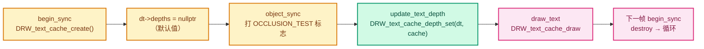

### 6.2 `object_sync`（514-679）

⭐ **每个物体调用一次**，是最"忙"的函数。

#### 结构

```cpp
void Instance::object_sync(ObjectRef &ob_ref, Manager &manager)
{
  /* ① 计算一堆布尔谓词 */
  const bool in_object_mode = ...;
  const bool in_edit_mode = ob_ref.object->mode == OB_MODE_EDIT;
  const bool in_paint_mode = object_is_paint_mode(ob_ref.object);
  const bool in_sculpt_mode = object_is_sculpt_mode(ob_ref);
  const bool in_particle_edit_mode = object_is_particle_edit_mode(ob_ref);
  const bool in_edit_paint_mode = object_is_edit_paint_mode(...);
  const bool needs_prepass = object_needs_prepass(ob_ref, in_paint_mode);

  /* ② ★ 决定进入哪一层 */
  OverlayLayer &layer = object_is_in_front(ob_ref.object, state) ? infront : regular;

  /* ③ 按模式分发 */
  layer.mode_transfer.object_sync(...);
  if (needs_prepass) { layer.prepass.object_sync(...); }
  if (in_particle_edit_mode) { ... }
  if (!state.hide_overlays && state.is_space_image()) { /* UV */ }
  if (in_paint_mode && !state.hide_overlays) { /* 绘制模式 */ }
  if (in_sculpt_mode) { /* 雕刻模式 */ }
  if (in_edit_mode && !state.hide_overlays) { /* 编辑模式 */ }
  if (state.is_wireframe_mode || !state.hide_overlays) { layer.wireframe... }

  /* ④ 普通显示（隐藏时不跑） */
  if (!state.hide_overlays) {
    switch (ob_ref.object->type) { /* 按类型 */ }
    /* 无差别的组件 */
    layer.attribute_viewer.object_sync(...);
    layer.attribute_texts.object_sync(...);        // ← ★ 本 patch
    /* ... */
    if (object_is_selected(ob_ref) && !in_edit_paint_mode) {
      outline.object_sync(...);
    }
  }
}
```

⭐ **分发维度**：

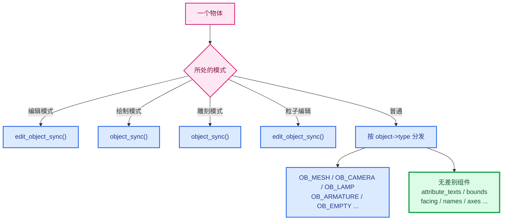

⭐ **`attribute_texts.object_sync` 在"无差别"分组** —— 即**任何物体类型**都会调用它，由它内部再判断类型：

```cpp
/* overlay_attribute_text.hh —— object_sync 内部 */
switch (ob_ref.object->type) {
  case OB_MESH: ...
  case OB_POINTCLOUD: ...
  case OB_CURVES: ...
  case OB_CURVES_LEGACY: ...
  /* instances 单独处理 */
}
```

✅ 这就是"一处生效于所有几何类型"的由来。

### 6.3 `end_sync`（681-729）

```cpp
void Instance::end_sync()
{
  origins.end_sync(resources, state);
  resources.end_sync();

  auto end_sync_layer = [&](OverlayLayer &layer) {
    layer.armatures.end_sync(resources, state);
    /* ... 14 个 ... */
  };
  end_sync_layer(regular);
  end_sync_layer(infront);

  /* WORKAROUND: This prevents bad frame-buffer config inside workbench when xray is enabled.
   * Better find a solution to this chicken-egg problem. */
  {
    const DRWContext *draw_ctx = DRW_context_get();
    /* HACK we allocate the in front depth here to avoid the overhead when if is not needed. */
    DefaultFramebufferList *dfbl = draw_ctx->viewport_framebuffer_list_get();
    DefaultTextureList *dtxl = draw_ctx->viewport_texture_list_get();

    if (dtxl->depth_in_front == nullptr) {
      int2 size = int2(draw_ctx->viewport_size_get());
      dtxl->depth_in_front = GPU_texture_create_2d("txl.depth_in_front", ...);
    }
    GPU_framebuffer_ensure_config(&dfbl->in_front_fb, {...});
  }
}
```

⭐ **只有 14 个组件需要 `end_sync`**（而 `begin_sync` 有 30 个）—— 因为只有需要"合并多个物体数据"的组件才需要收尾。

⚠️ **`WORKAROUND` / `HACK` 注释**：作者明确标注这是权宜之计（xray 模式下的 framebuffer 配置顺序问题）。

---

## 7. draw：分发到三种空间

> 位置：`overlay_instance.cc:731-817`

```cpp
void Instance::draw(Manager &manager)
{
  View &view = View::default_get();

  /* ① GPU 调试作用域 */
  static gpu::DebugScope select_scope = {"Selection"};
  static gpu::DebugScope draw_scope = {"Overlay"};
  static gpu::DebugScope depth_scope = {"DepthOnly"};
  if (state.is_depth_only_drawing) { depth_scope.begin_capture(); }
  else if (resources.is_selection()) { select_scope.begin_capture(); }
  else { draw_scope.begin_capture(); }

  state.ndc_offset_factor = state.offset_data_get().polygon_offset_factor(view.winmat());

  resources.pre_draw();

  outline.flat_objects_pass_sync(manager, view, resources, state);
  GreasePencil::compute_depth_planes(manager, view, resources, state);

  /* ② Pre-Draw: 提前跑所有 compute，避免频繁的 GPU 上下文切换 */
  {
    manager.ensure_visibility(view);
    auto pre_draw = [&](OverlayLayer &layer) { /* 11 个组件的 pre_draw */ };
    pre_draw(regular);
    pre_draw(infront);
    outline.pre_draw(manager, view);
  }

  resources.acquire(DRW_context_get(), this->state);
  DRW_submission_start();

  /* ③ ★ 按空间类型分发 */
  switch (state.space_type) {
    case SPACE_NODE:   draw_node(manager, view); break;
    case SPACE_IMAGE:  draw_v2d(manager, view);  break;
    case SPACE_VIEW3D: draw_v3d(manager, view);  break;
    default: BLI_assert_unreachable();
  }

  DRW_submission_end();
  resources.release();
  resources.read_result();

  /* ④ 结束调试作用域 */
  if (state.is_depth_only_drawing) { depth_scope.end_capture(); }
  else if (resources.is_selection()) { select_scope.end_capture(); }
  else { draw_scope.end_capture(); }
}
```

### 7.1 ⭐ 三种空间的分发

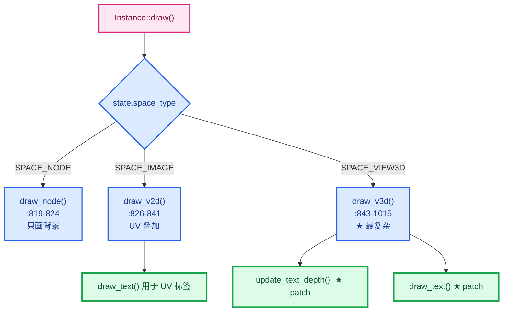

⭐ **`draw_text` 在 `draw_v2d` 和 `draw_v3d` 里都被调用**：

```cpp
/* :838 —— 2D 分支 */
draw_text(resources.overlay_output_color_only_fb);

/* :1009 —— 3D 分支 */
draw_text(resources.overlay_output_color_only_fb);
```

⚠️ **但 `update_text_depth()` 只在 `draw_v3d` 里调用**：

```cpp
/* :938-939 —— 只在 draw_v3d 里 */
update_text_depth();
```

⭐ **这是正确的**，因为：
- 2D 分支（UV 编辑器）**没有 3D 深度概念**（`state.v3d == nullptr`）
- `DRW_text_cache_draw` 的 2D 分支天然不做遮挡测试

✅ **设计自洽**。

### 7.2 ⭐ Pre-Draw 批处理

```cpp
/* Pre-Draw: Run the compute steps of all passes up-front
 * to avoid constant GPU compute/raster context switching. */
{
  manager.ensure_visibility(view);
  auto pre_draw = [&](OverlayLayer &layer) {
    layer.attribute_viewer.pre_draw(manager, view);
    layer.cameras.pre_draw(manager, view);
    layer.empties.pre_draw(manager, view);
    layer.facing.pre_draw(manager, view);
    layer.fade.pre_draw(manager, view);
    layer.lattices.pre_draw(manager, view);
    layer.light_probes.pre_draw(manager, view);
    layer.particles.pre_draw(manager, view);
    layer.pointclouds.pre_draw(manager, view);
    layer.prepass.pre_draw(manager, view);
    layer.wireframe.pre_draw(manager, view);
  };
  pre_draw(regular);
  pre_draw(infront);
  outline.pre_draw(manager, view);
}
```

⭐ **为什么要把所有 compute 提前**：

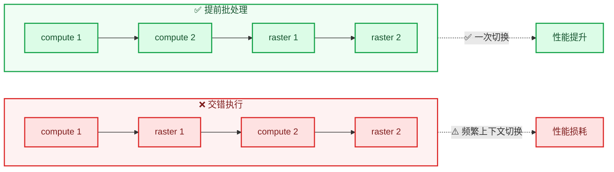

⭐ **GPU 的 compute 和 raster 是不同队列**，来回切换开销大。**批处理是标准优化**。

### 7.3 `DRW_submission_start/end`

```cpp
resources.acquire(DRW_context_get(), this->state);
DRW_submission_start();
/* ... 所有绘制命令 ... */
DRW_submission_end();
resources.release();
```

⭐ **这是 Vulkan 风格的"命令缓冲录制"边界**：

```
DRW_submission_start()  →  开始录制
   …所有 draw_xxx 调用…     只是往缓冲里塞命令，GPU 还没动
DRW_submission_end()    →  结束录制并提交
```

---

## 8. draw_v3d：最复杂的函数

> 位置：`overlay_instance.cc:843-1015`（**173 行**）

### 8.1 四个 lambda 分组

```cpp
/* :847-855 —— 普通绘制 */
auto draw = [&](OverlayLayer &layer, Framebuffer &framebuffer) {
  // layer.facing.draw(...);   // 被注释掉了
  layer.fade.draw(framebuffer, manager, view);
  layer.mode_transfer.draw(framebuffer, manager, view);
  layer.text.draw(framebuffer, manager, view);
  layer.paints.draw(framebuffer, manager, view);
  layer.particles.draw(framebuffer, manager, view);
};

/* :857-880 —— 线条绘制（20 个组件） */
auto draw_line = [&](OverlayLayer &layer, Framebuffer &framebuffer) {
  layer.bounds.draw_line(...);
  layer.wireframe.draw_line(...);
  /* ... */
};

/* :882-884 —— 仅线条 */
auto draw_line_only = [&](OverlayLayer &layer, Framebuffer &framebuffer) {
  layer.meshes.draw_line_only(framebuffer, manager, view);
};

/* :886-890 —— 仅颜色 */
auto draw_color_only = [&](OverlayLayer &layer, Framebuffer &framebuffer) {
  layer.light_probes.draw_color_only(framebuffer, manager, view);
  layer.curves.draw_color_only(framebuffer, manager, view);
  layer.grease_pencil.draw_color_only(framebuffer, manager, view);
};
```

⭐ **为什么分组**：不同组件写入不同的 framebuffer（`overlay_fb` / `overlay_line_fb` / `overlay_color_only_fb`），需要按 **framebuffer** 分批以减少绑定切换。

### 8.2 ⭐ 完整的绘制顺序（含本 patch）

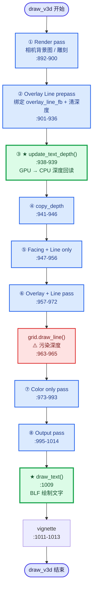

⭐⭐ **本 patch 的两个调用点在这个流程中的位置极为关键**：

| 调用 | 行号 | 时机 | 为什么 |
|------|------|------|--------|
| `update_text_depth()` | 938 | **prepass 之后、grid 之前** | grid 会污染深度；prepass 之前深度不完整 |
| `draw_text()` | 1009 | Output pass 里 | 文字是最后叠加的 2D 元素 |

⚠️ **注意 `cp`（`copy_depth`）在 `update_text_depth()` 之后**：

```cpp
/* :938-946 */
update_text_depth();                    // ← 先（同步阻塞，刷新 GPU 流水线）
{
  regular.wireframe.copy_depth(resources.depth_target_tx);       // ← 后
  infront.wireframe.copy_depth(resources.depth_target_in_front_tx);
}
```

⭐ **这是 [04-§5.3](./04-实例层-缓存与绘制顺序.md#53-与-copy_depth-的关系) 讨论的顺序问题**。两者都需要"prepass 后、governed 前"的同一个时间窗口。

### 8.3 grid 绘制位置的注释

```cpp
/* :962 */
/* Here as it does depth+blending, and should draw after most overlay line passes.. */
if (!state.is_depth_only_drawing) {
  grid.draw_line(resources.overlay_line_fb, manager, view);
}
```

⭐ **Grid 在 `draw_line(regular, ...)` 之后** —— 因为网格要做深度+混合，必须在大多数线条之后。

⚠️ **这正是 `update_text_depth()` 必须放在它之前的根本原因**（详见 [00-§3.2](./00-总览与架构.md#32-为什么要把深度前置到-prepass-之后)）。

### 8.4 两处被注释的代码

```cpp
/* :849 —— draw lambda 里 */
// layer.facing.draw(framebuffer, manager, view);

/* :877-878 —— draw_line lambda 里 */
/* NOTE: Temporarily moved after grid drawing (See #136764). */
// layer.meshes.draw_line(framebuffer, manager, view);
```

⭐ **这些都是"因为渲染顺序问题临时挪走"的组件**，注释里带了 issue 编号（`#136764`、`#130751`），便于将来恢复。

---

## 9. update_text_depth 与 draw_text

这两个函数是 **本 patch 新增/修改的核心**。详细解析见 [04-§4](./04-实例层-缓存与绘制顺序.md#4-update_text_depth-逐行解析)，这里只做定位。

### 9.1 `update_text_depth`（1017-1055）

```cpp
void Instance::update_text_depth()
{
  /* ① 三重短路 */
  if (!state.show_text || !state.is_space_v3d() || !DRW_text_cache_needs_depth_test(state.dt)) {
    DRW_text_cache_depth_set(state.dt, nullptr);
    if (text_depth_cache_ != nullptr) {
      ED_view3d_depths_free(text_depth_cache_);
      text_depth_cache_ = nullptr;
    }
    return;
  }
  /* ② 获取深度纹理 */
  GPUViewport *viewport = WM_draw_region_get_viewport(const_cast<ARegion *>(state.region));
  gpu::Texture *depth_tx = GPU_viewport_depth_texture(viewport);
  const int width = GPU_texture_width(depth_tx);
  const int height = GPU_texture_height(depth_tx);
  /* ③ 尺寸变化 → 释放重建 */
  if (text_depth_cache_ != nullptr &&
      (text_depth_cache_width_ != width || text_depth_cache_height_ != height)) {
    ED_view3d_depths_free(text_depth_cache_);
    text_depth_cache_ = nullptr;
  }
  /* ④ 分配 or 原地刷新 */
  if (text_depth_cache_ == nullptr) {
    text_depth_cache_ = MEM_new_zeroed<ViewDepths>("ViewDepths");
    text_depth_cache_->w = width;
    text_depth_cache_->h = height;
    text_depth_cache_->depths = static_cast<float *>(GPU_texture_read(depth_tx, GPU_DATA_FLOAT, 0));
    text_depth_cache_->depth_range[0] = 0.0;
    text_depth_cache_->depth_range[1] = 1.0;
    text_depth_cache_width_ = width;
    text_depth_cache_height_ = height;
  }
  else {
    GPU_texture_read(depth_tx, GPU_DATA_FLOAT, 0, text_depth_cache_->depths);
  }
  /* ⑤ 注册到文本缓存 */
  DRW_text_cache_depth_set(state.dt, text_depth_cache_);
}
```

### 9.2 `draw_text`（1057-1066）

```cpp
void Instance::draw_text(Framebuffer &framebuffer)
{
  if (state.show_text == false) {
    return;
  }
  GPU_framebuffer_bind(framebuffer);
  GPU_depth_test(GPU_DEPTH_NONE);        // ← 必须关闭深度测试
  DRW_text_cache_draw(state.dt, state.region, state.v3d);
}
```

⭐ **`GPU_depth_test(GPU_DEPTH_NONE)` 的原因**：文字是 2D BLF 图元，若开启深度测试会互相遮挡（详见 [01-§2.1](./01-背景知识与原理.md#21-为什么不能简单地在-shader-里做)）。遮挡判定完全在 CPU 侧完成。

⚠️ **本 patch 在这里删了一个空行**（见 [08-§2.2](./08-提交指南.md#22-撤销无关改动)），是无关改动，建议还原。

---

## 10. 一堆谓词函数

> 位置：`overlay_instance.cc:1068-1248`

这些函数都是**判断物体处于什么状态**，供 `object_sync` 分发使用。

### 10.1 分类总览

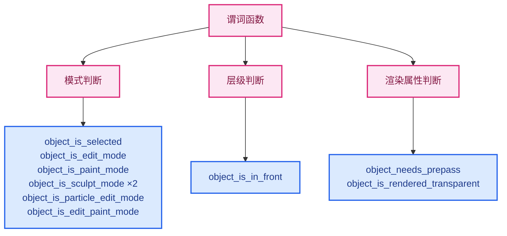

### 10.2 ⭐ `object_is_in_front`（1160-1169）—— 决定进哪一层

```cpp
bool Instance::object_is_in_front(const Object *object, const State &state)
{
  switch (object->type) {
    case OB_ARMATURE:
      return (object->dtx & OB_DRAW_IN_FRONT) ||
             (state.do_pose_xray && Armatures::is_pose_mode(object, state));
    default:
      return state.use_in_front && (object->dtx & OB_DRAW_IN_FRONT);
  }
}
```

⭐ **这是 `regular` / `infront` 分流的唯一判据**：

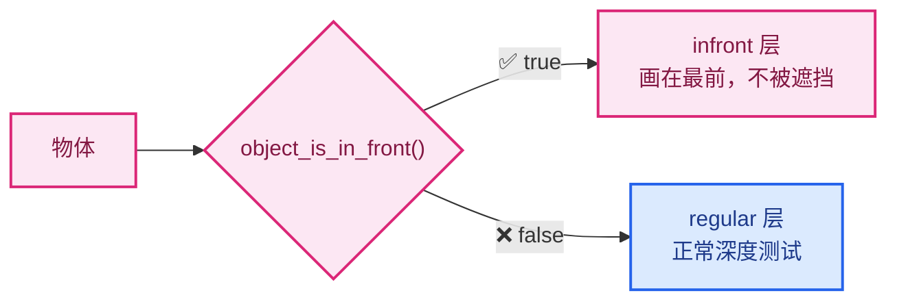

⚠️ **注意骨骼的特殊处理**：`state.do_pose_xray && Armatures::is_pose_mode(...)` —— 姿态模式下骨骼自动进 infront 层。

### 10.3 ⭐ `object_is_rendered_transparent`（1207-1248）

```cpp
bool Instance::object_is_rendered_transparent(const Object *object, const State &state)
{
  if (state.v3d == nullptr) { return false; }
  if (!state.is_solid()) { return true; }            // 非 Solid 模式 → 透明
  if (ELEM(object->dt, OB_WIRE, OB_BOUNDBOX)) { return true; }

  const View3DShading &shading = state.v3d->shading;
  if (shading.type == OB_WIRE) { return true; }
  if (shading.type > OB_SOLID) { return false; }     // Material/Render → 不透明

  if (shading.color_type == V3D_SHADING_OBJECT_COLOR) {
    return object->color[3] < 1.0f;                  // alpha < 1
  }
  if (shading.color_type == V3D_SHADING_MATERIAL_COLOR) {
    if (object->type == OB_MESH) {
      const int materials_num = BKE_object_material_used_with_fallback_eval(*object);
      for (int i = 0; i < materials_num; i++) {
        Material *mat = BKE_object_material_get_eval(const_cast<Object *>(object), i + 1);
        if (mat && mat->a < 1.0f) { return true; }
      }
    }
  }
  return false;
}
```

⭐ **用途**（头文件注释说得很清楚）：

```cpp
/* Returns true if the object is rendered transparent by the render engine.
 * Overlays should not rely on the correct depth being available (and do a depth pre-pass). */
```

⭐ **透明度判定树**：

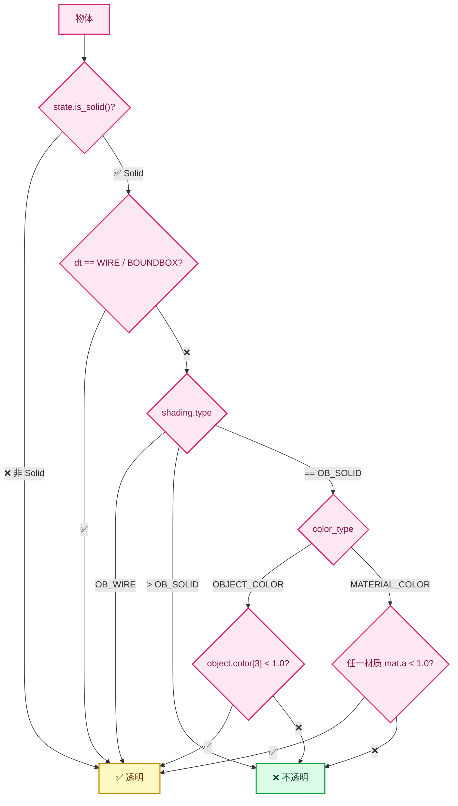

⭐ **为什么这很重要**：如果物体是透明的，**渲染引擎输出的深度可能不包含它**。所以 `object_needs_prepass` 会强制为它做深度预pass：

```cpp
/* :1188-1195 */
if (in_paint_mode) {
  /* Allow paint overlays to draw with depth equal test. */
  if (object_is_rendered_transparent(ob_ref.object, state) ||
      object_is_in_front(ob_ref.object, state)) {
    return true;      // ← 需要 prepass
  }
}
```

---

## 11. 与本 patch 的关系

### 11.1 本 patch 在 `Instance` 里的全部改动

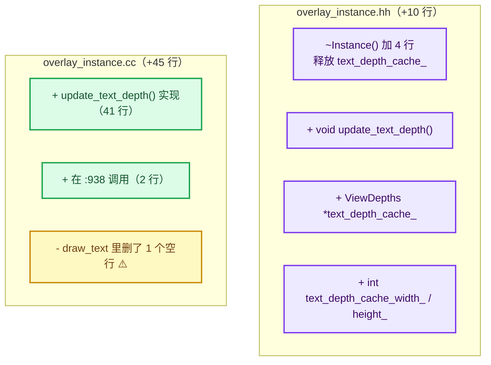

### 11.2 数据流经 `Instance` 的完整路径

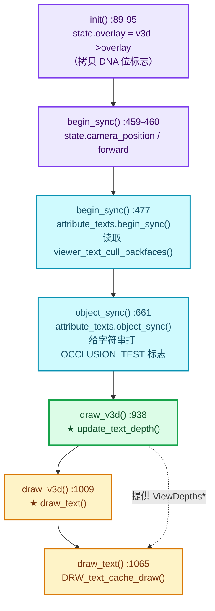

### 11.3 一句话总结

⭐ **`Instance` 在本 patch 里的角色是"深度数据的提供者"**：

| 层 | 职责 | 所在 |
|----|------|------|
| 属性开关 | 读取用户的勾选状态 | `init()` → `State` |
| 锚点与标志 | 决定哪些文字需要遮挡测试 | `object_sync()` → `AttributeTexts` |
| **深度供给** | **回读深度并交给文本缓存** | **`draw_v3d()` → `update_text_depth()`** |
| 判定与绘制 | 比较深度、剔除、绘制 | `draw_text()` → `DRW_text_cache_draw()` |

---

## 12. 设计模式总结

### 12.1 用到的模式

| 模式 | 体现 | 收益 |
|------|------|------|
| **工厂模式** | `DrawEngine::Pointer::create_instance()` | 引擎与实例解耦 |
| **模板方法** | 5 个虚函数定义帧结构 | 统一生命周期 |
| **组合模式** | `OverlayLayer` 聚合 30 个组件 | 层次清晰 |
| **策略模式** | `SelectionType` 区分选择/显示 | 代码复用 |
| **命令模式** | `Manager` 收集命令，`draw()` 提交 | CPU/GPU 并行 |
| **快照模式** | `State` 冻结每帧配置 | 语义清晰 |

### 12.2 代码质量问题

| # | 问题 | 严重度 | 说明 |
|---|------|--------|------|
| 1 | **上帝头文件** | 🟡 | 38 个 include，改一个组件触发大量重编译 |
| 2 | **`regular` / `infront` 代码重复** | 🟡 | 每个操作都要写两遍（用 lambda 缓解） |
| 3 | **`init()` 命名误导** | 🟢 | 实际每帧调用，非一次性 |
| 4 | **`WORKAROUND` / `HACK` 注释** | 🟢 | 已知技术债，作者已标注 |
| 5 | **大量 `TODO(fclem)`** | 🟢 | 表明作者知道更好的设计 |
| 6 | **`const_cast<ARegion*>`** | 🟡 | 本 patch 引入（见 [07-S1](./07-问题清单与修复.md#4--s1---const_cast-绕过-const-正确性)） |

### 12.3 ⭐ 值得学习的设计

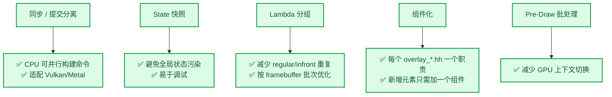

---

## 小结

| 函数 | 行数 | 职责 |
|------|------|------|
| `init()` | 126 | 填充 `State`，每帧重置 |
| `begin_sync()` | 58 | 全局开始，创建 `dt`，填 `camera_*` |
| `object_sync()` | 166 | 按模式/类型分发到组件 |
| `end_sync()` | 49 | 收尾 + framebuffer workaround |
| `draw()` | 87 | 按空间类型分发 |
| `draw_v3d()` | 173 | **最复杂**：8 个绘制阶段 |
| **`update_text_depth()`** | **39** | ⭐ **本 patch：深度回读** |
| **`draw_text()`** | **10** | ⭐ **本 patch 相关：文字绘制** |

**核心要点**：

1. ⭐ **`Instance` 是 Overlay 引擎的实例**，实现 5 个引擎虚函数
2. ⭐ **`regular` / `infront` 双层的设计**，用空间换清晰度
3. ⭐ **`State` 是每帧快照**，所有组件读它，不直接读全局 `DRWContext`
4. ⭐ **`state.dt` 每帧重建** → 所以 `depth_set` 也必须每帧调用
5. ⭐ **`update_text_depth()` 的位置（`:938`）是本 patch 最关键的决策**
6. ⚠️ **`draw_text` 里删的空行是无关改动，建议还原**

---

## 相关文档

- 深度回读的完整解析 → [04-实例层-缓存与绘制顺序](./04-实例层-缓存与绘制顺序.md)
- `State` 的字段定义 → [overlay_private.hh](file:///E:/blender-git/blender/source/blender/draw/engines/overlay/overlay_private.hh)
- 绘制顺序为什么重要 → [00-§3.2](./00-总览与架构.md#32-为什么要把深度前置到-prepass-之后)
- API 速查 → [06-API与函数参考](./06-API与函数参考.md)
