# 10 - Prepass 与双层绘制机制

> 🔗 [返回索引](./README.md) | 上一篇：[09-Instance类完全解析](./09-Instance类完全解析.md) | 参考：[配色与图例约定](./配色与图例约定.md)

本文解答三个紧密相关的问题：

1. **prepass 是什么？为什么需要它？**
2. **`regular` / `infront` 双层是怎么划分的？**
3. **`AttributeTexts` 与 `AttributeViewer` 这两个"属性显示"组件有什么区别？**
4. **`DRWTextStore` 的数据结构（`draw_manager_text.cc:68~91`）**

---

## 目录

- [1. Prepass 深度预pass](#1-prepass-深度预pass)
- [2. regular / infront 双层机制](#2-regular--infront-双层机制)
- [3. AttributeTexts vs AttributeViewer](#3-attributetexts-vs-attributeviewer)
- [4. DRWTextStore 数据结构详解](#4-drwtextstore-数据结构详解)
- [5. 三者的协作关系](#5-三者的协作关系)

---

## 1. Prepass 深度预pass

### 1.1 什么是 prepass

```cpp
/* overlay_prepass.hh:57-61 */
/**
 * A depth pass that write surface depth when it is needed.
 * It is also used for selecting non overlay-only objects.
 */
class Prepass : Overlay {
```

⭐ **一句话**：prepass 是**只写深度、不写颜色**的一遍渲染，目的是**为后续的 Overlay 绘制准备好正确的深度缓冲**。


### 1.2 ⭐ 为什么需要 prepass

**核心问题**：Overlay 的绘制**依赖场景深度**，但场景深度**不一定可用**。

```cpp
/* overlay_instance.cc:79-87 */
/* Only workbench ensures the depth buffer is matching overlays.
 * Force depth prepass for other render engines.
 * EEVEE is an exception (if not using mixed resolution) to avoid a significant overhead. */
state.is_render_depth_available = viewport_uses_workbench ||
                                  (viewport_uses_eevee && !use_resolution_scaling);
/* For depth only drawing, no other render engine is expected. Except for Grease Pencil which
 * outputs valid depth. Otherwise depth is cleared and is valid. */
state.is_render_depth_available |= state.is_depth_only_drawing;
```

⭐ **三种情况**：

| 渲染引擎 | 深度可用？ | 原因 |
|----------|-----------|------|
| **Workbench** | ✅ 可用 | 深度缓冲与 Overlay 完全匹配 |
| **EEVEE**（无分辨率缩放） | ✅ 可用 | 深度匹配，为避免开销不复用 |
| **EEVEE**（有分辨率缩放） | ❌ **不可用** | 渲染分辨率 ≠ 视口分辨率，深度对不上 |
| **Cycles** | ❌ **不可用** | 渲染结果与视口深度无关 |
| 深度专用绘制 | ✅ 可用 | 深度就是目的 |

⭐ **当深度不可用时**，Overlay 必须自己算：

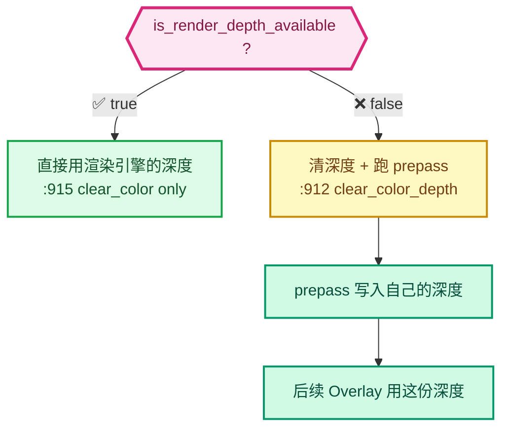

### 1.3 Prepass 的 GPU 状态

```cpp
/* overlay_prepass.hh:95-96 */
ps_.state_set(DRW_STATE_WRITE_DEPTH | DRW_STATE_DEPTH_LESS_EQUAL | backface_cull_state,
              state.clipping_plane_count);
```

⭐ **逐项解析**：

| 状态 | 含义 |
|------|------|
| `DRW_STATE_WRITE_DEPTH` | **写入深度缓冲** |
| `DRW_STATE_DEPTH_LESS_EQUAL` | 深度测试：更近或相等则通过 |
| `backface_cull_state` | 可选背面剔除 |
| ⚠️ **没有 `DRW_STATE_WRITE_COLOR`** | **不写颜色** ← 这就是 prepass！ |

⭐ **对比 `AttributeViewer` 的状态**：

```cpp
/* overlay_attribute_viewer.hh:46-47 */
ps_.state_set(DRW_STATE_WRITE_COLOR | DRW_STATE_DEPTH_LESS_EQUAL | DRW_STATE_BLEND_ALPHA,
              state.clipping_plane_count);
```

| | Prepass | AttributeViewer |
|---|---------|-----------------|
| `WRITE_DEPTH` | ✅ | ❌ |
| `WRITE_COLOR` | ❌ | ✅ |
| `BLEND_ALPHA` | ❌ | ✅ |
| **目的** | **准备深度** | **上色** |

✅ **这就是"预pass"与"正式绘制"的本质区别**。

### 1.4 Prepass 的几何类型

```cpp
/* overlay_prepass.hh:98-128 */
{
  auto &sub = ps_.sub("Mesh");
  sub.shader_set(res.is_selection() ? res.shaders->depth_mesh_conservative.get() :
                                      res.shaders->depth_mesh.get());
  mesh_ps_ = &sub;
}
/* ... MeshFlat / Hair / Curves / PointCloud / GreasePencil ... */
```

⭐ **六种几何各自有专用 shader**：

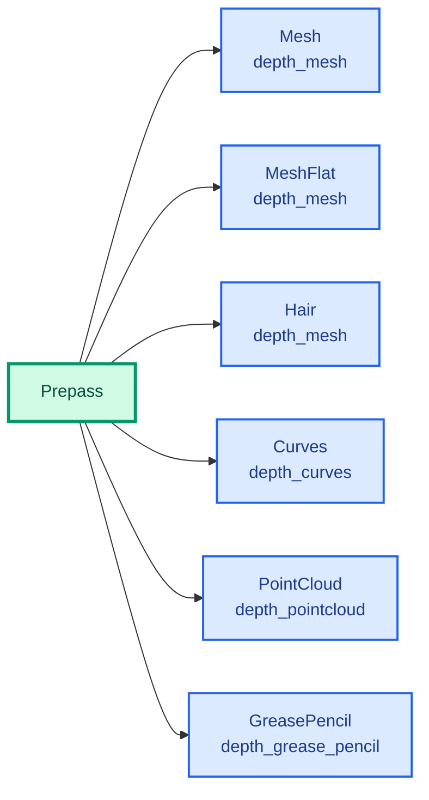

⚠️ **选择引擎用 `depth_mesh_conservative`** —— 保守光栅化，确保选择时不会漏掉细小三角形。

### 1.5 Prepass 的启用条件

```cpp
/* overlay_prepass.hh:76 */
enabled_ = state.is_space_v3d() && (!state.xray_enabled || res.is_selection());
```

⭐ **X 光模式下不需要 prepass**（因为 X 光本来就是"透视显示"，不依赖深度）。但**选择引擎例外**（选择仍需要准确深度）。

### 1.6 ⭐ Prepass 与文字遮挡的关系

**这是本 patch 的关键依赖**：

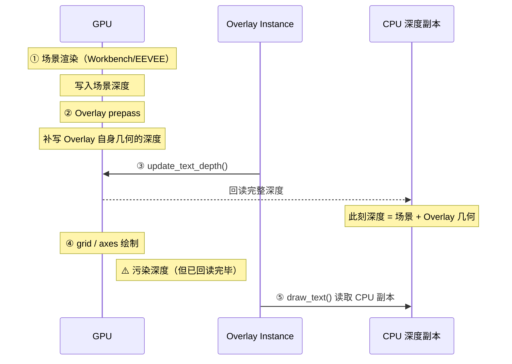

⭐ **为什么必须在 prepass 之后回读**：prepass 之前，Overlay 自己的几何（如轮廓线、深度专用几何）还没写入深度。如果在这之前回读，深度信息**不完整**。

⭐ **为什么必须在 grid 之前回读**：grid 会写入大量深度污染数据（详见 [00-§3.2](./00-总览与架构.md#32-为什么要把深度前置到-prepass-之后)）。

---

## 2. regular / infront 双层机制

### 2.1 定义

```cpp
/* overlay_instance.hh:76-108 */
struct OverlayLayer {
  const SelectionType selection_type_;
  Armatures armatures = {selection_type_};
  AttributeViewer attribute_viewer;
  AttributeTexts attribute_texts;
  Axes axes = {selection_type_};
  /* ... 共 30 个组件 ... */
  Wireframe wireframe;
} regular{selection_type_}, infront{selection_type_};   // ← 两份实例！
```

⭐⭐ **`regular` 和 `infront` 是同一个 `OverlayLayer` 结构体的两个实例**，各自持有 30 个组件对象。

### 2.2 ⭐ 核心概念：什么叫"显示在前面"

| 层 | 含义 | 深度行为 |
|----|------|----------|
| **`regular`** | **普通深度关系下的 Overlay** | 受深度测试约束，会被前面的物体遮挡 |
| **`infront`** | **使用"显示在前面"路径的 Overlay** | 忽略深度，画在最前面 |

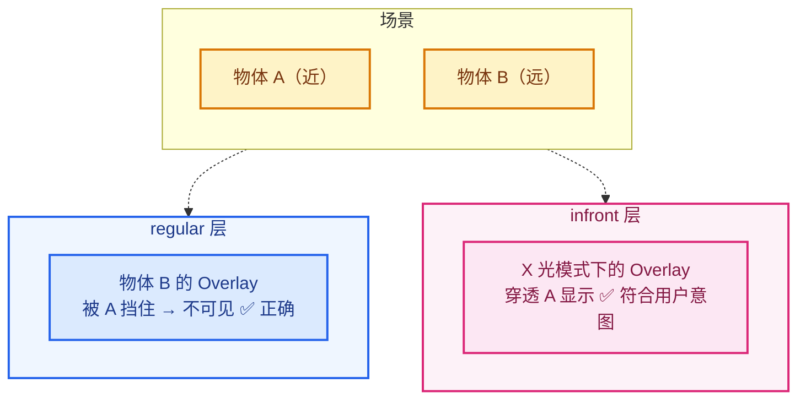

### 2.3 ⭐ 划分判据：`object_is_in_front`

```cpp
/* overlay_instance.cc:1160-1169 */
bool Instance::object_is_in_front(const Object *object, const State &state)
{
  switch (object->type) {
    case OB_ARMATURE:
      return (object->dtx & OB_DRAW_IN_FRONT) ||
             (state.do_pose_xray && Armatures::is_pose_mode(object, state));
    default:
      return state.use_in_front && (object->dtx & OB_DRAW_IN_FRONT);
  }
}
```

```cpp
/* overlay_instance.cc:525 —— 唯一的调用点 */
OverlayLayer &layer = object_is_in_front(ob_ref.object, state) ? infront : regular;
```

⭐ **判定逻辑**：

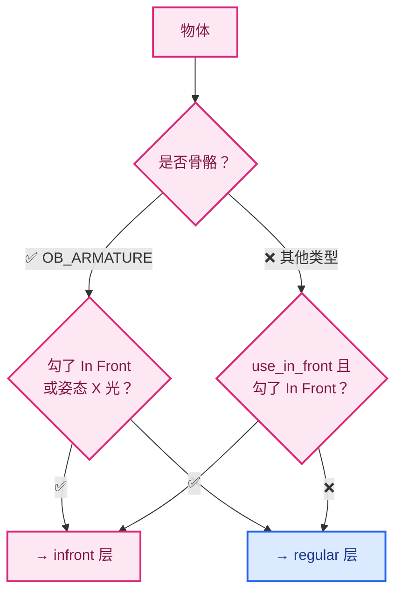

⭐ **`OB_DRAW_IN_FRONT` 是哪来的**：这是物体级别的标记（`object->dtx` 位），用户在 `N` 面板 → Object → Viewport Display 里勾选 "In Front" 时设置。

### 2.4 ⭐ 两个 framebuffer

```cpp
/* overlay_instance.cc:923, :935 —— prepass */
regular.prepass.draw_line(resources.overlay_line_fb, manager, view);
infront.prepass.draw_line(resources.overlay_line_in_front_fb, manager, view);

/* overlay_instance.cc:959-971 —— 主体绘制 */
draw(regular, resources.overlay_fb);
draw_line(regular, resources.overlay_line_fb);
/* ... grid ... */
draw(infront, resources.overlay_in_front_fb);
draw_line(infront, resources.overlay_line_in_front_fb);
```

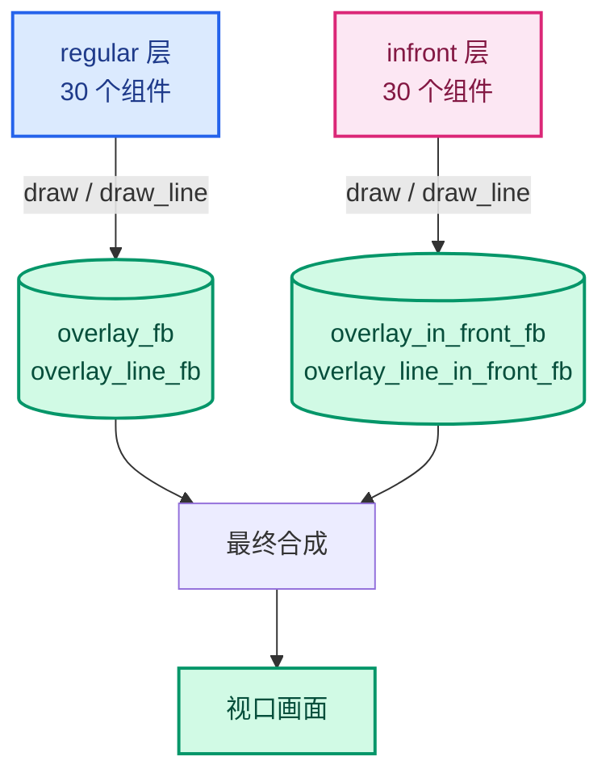

⭐ **`infront` 的 framebuffer 会先清空深度**：

```cpp
/* overlay_instance.cc:929-933 */
if (state.xray_enabled || (state.v3d && state.v3d->shading.type > OB_SOLID)) {
  /* If workbench is not enabled, the infront buffer might contain garbage. */
  GPU_framebuffer_bind(resources.overlay_line_in_front_fb);
  GPU_framebuffer_clear_depth(resources.overlay_line_in_front_fb, 1.0f);
}
```

⭐ **清成 1.0（最远）意味着**：任何东西都能通过深度测试 → **画在最前面** ✅ 这就是"显示在前面"的实现方式。

### 2.5 为什么用两份而不是运行时判断

**替代方案**：一份组件，绘制时判断"要不要忽略深度"。

| 方案 | 优点 | 缺点 |
|------|------|------|
| **两份实例**（采用） | 命令缓冲天然分离；无运行时分支 | 60 个对象实例 |
| 运行时判断 | 省内存 | 每个组件都要处理两种状态；渲染顺序难保证 |

⭐ **关键原因：渲染顺序**。


⭐ **用两个 Pass/层，天然保证"infront 全部画完之后再画"**，不需要在每个组件里做顺序判断。

### 2.6 双层与文字遮挡的交互

⚠️ **注意一个细节**：`update_text_depth()` **只有一个**，不分层：

```cpp
/* overlay_instance.cc:938 —— 单个调用 */
update_text_depth();
```

⭐ **但文字缓存 `state.dt` 也是单个的**（不是每层一个）：

```cpp
/* overlay_instance.cc:462-463 */
DRW_text_cache_destroy(state.dt);
state.dt = DRW_text_cache_create();      // ← 每帧只创建一个
```

⚠️ **这意味着 `AttributeTexts` 的 `regular` 和 `infront` 两份实例共享同一个文本缓存**。但由于只有带 `OCCLUSION_TEST` 标志的字符串会被遮挡测试，且标志由 `occlusion_test_` 决定（两层都一样），**行为是一致的** ✅

---

## 3. AttributeTexts vs AttributeViewer

⭐ **这两个类都叫"属性显示"，都处理 `.viewer` 属性，但显示方式完全不同**。

### 3.1 对比总览

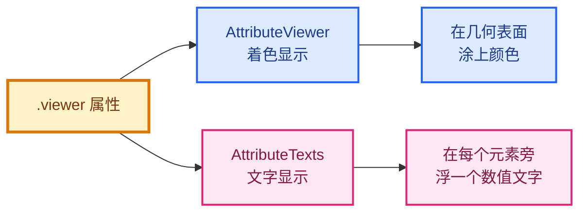

| 方面 | `AttributeViewer` | `AttributeTexts` |
|------|-------------------|------------------|
| **显示形式** | 顶点/面**着色** | 屏幕**文字** |
| **文件** | `overlay_attribute_viewer.hh`（255 行） | `overlay_attribute_text.hh`（497 行） |
| **绘制机制** | GPU Pass（`PassMain ps_`） | CPU 文本缓存（`DRWTextStore`） |
| **深度测试** | ✅ GPU 深度测试 | ❌ 无（CPU 侧遮挡判定） |
| **UI 开关** | `show_viewer_attribute` | `show_viewer_text` |
| **透明度控制** | `viewer_attribute_opacity` | — |
| **本 patch 改动** | ❌ **未改动** | ✅ **主要改动对象** |

### 3.2 ⭐ 关键差异：绘制机制

#### AttributeViewer —— GPU 绘制

```cpp
/* overlay_attribute_viewer.hh:28 */
PassMain ps_ = {"attribute_viewer_ps_"};
```

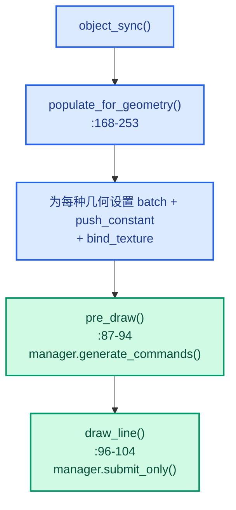

⭐ **它是标准的 GPU Pass 绘制**：

```cpp
/* overlay_attribute_viewer.hh:46-47 */
ps_.state_set(DRW_STATE_WRITE_COLOR | DRW_STATE_DEPTH_LESS_EQUAL | DRW_STATE_BLEND_ALPHA, ...);
```

⭐ **有 `DRW_STATE_DEPTH_LESS_EQUAL`** —— 所以**着色显示天然有正确的深度遮挡**（背面的颜色被前面的几何挡住）✅ 不需要额外处理。

#### AttributeTexts —— CPU 文本缓存

```cpp
/* overlay_attribute_text.hh:69 */
DRWTextStore *dt = state.dt;
```

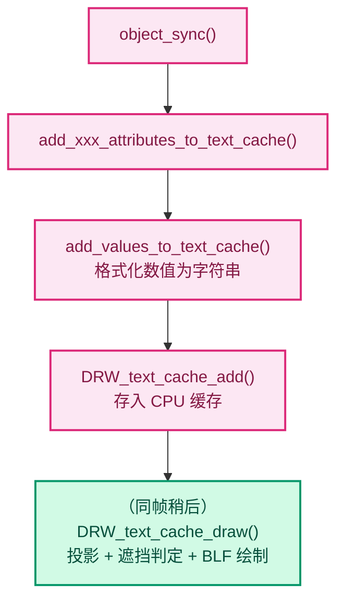

⭐ **它走的是完全不同的路径**：CPU 缓存 → 稍后统一绘制。**因为文字是 2D 图元，没有 GPU 深度可言** —— 这就是本 patch 必须做 CPU 侧遮挡判定的根本原因（详见 [01-§2.1](./01-背景知识与原理.md#21-为什么不能简单地在-shader-里做)）。

### 3.3 ⭐ 为什么 AttributeViewer 不需要本 patch

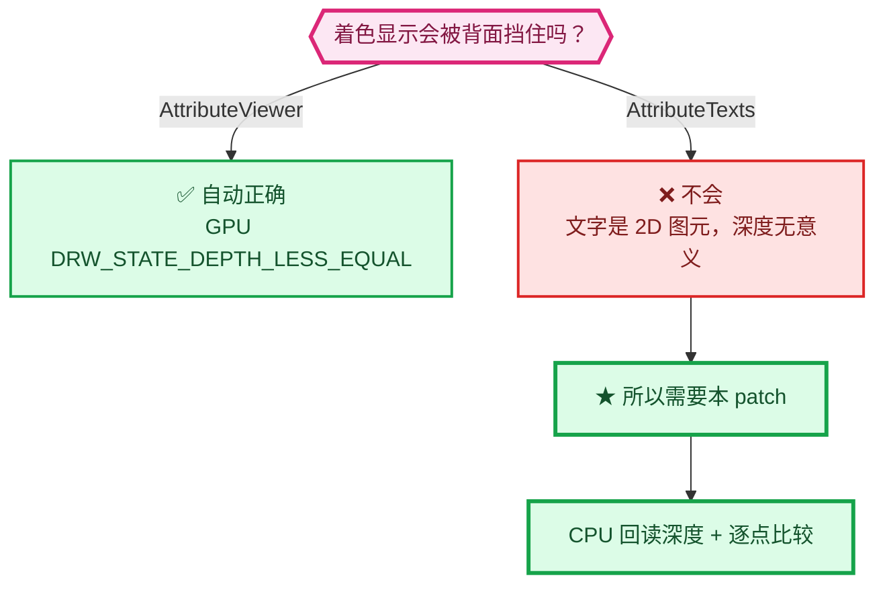

⭐ **一句话总结**：`AttributeViewer` 用 GPU 画颜色，**深度测试免费获得**；`AttributeTexts` 用 CPU 画文字，**必须自己实现深度测试**。

### 3.4 AttributeTexts 独有的复杂度

| 特性 | AttributeViewer | AttributeTexts | 说明 |
|------|-----------------|----------------|------|
| 类型过滤 | ✅ `attribute_type_supports_viewer_overlay()` | ❌ 所有类型都显示 | Viewer 无法着色 Quaternion/Float4x4 |
| Corner 域处理 | ❌ | ✅ `calc_corner_text_position()` | 文字需要避免重叠 |
| 点云半径偏移 | ❌ | ✅ 本 patch 新增 | 锚点在圆盘后方 |
| 实例包围盒偏移 | ❌ | ✅ 本 patch 新增 | 锚点在实例内部 |
| 类型格式化 | ❌ | ✅ 12 个类型分支 | `%d` / `%g` / `X: %g` 等 |

⭐ **类型过滤的差异**：

```cpp
/* overlay_attribute_viewer.hh:163-166 */
static bool attribute_type_supports_viewer_overlay(const bke::AttrType data_type)
{
  return !ELEM(data_type, bke::AttrType::Quaternion, bke::AttrType::Float4x4);
}
```

⭐ **为什么 Viewer 不支持 Quaternion/Float4x4**：因为**颜色无法表示四元数或矩阵**。

⚠️ **但文字可以** —— `AttributeTexts` 会把它们格式化：

```cpp
/* overlay_attribute_text.hh —— float4x4 分支 */
decompose 为 Location / Rotation / Scale 三行文字
```

✅ **这是文字显示的独特优势**：能表达任意数据类型。

### 3.5 两者的 UI 层级关系

```python
# space_view3d.py:7313-7330
row = col.row(align=True)
row.active = view.show_viewer
row.prop(overlay, "show_viewer_attribute", text="")
subrow = row.row(align=True)
subrow.active = overlay.show_viewer_attribute
subrow.prop(overlay, "viewer_attribute_opacity", text="Color Opacity")   # ← AttributeViewer

row = col.row(align=True)
row.active = view.show_viewer and overlay.show_text
row.prop(overlay, "show_viewer_text", text="Attribute Text")             # ← AttributeTexts

row = col.row(align=True)                                                 # ← ★ 本 patch
row.active = view.show_viewer and overlay.show_text and overlay.show_viewer_text
row.prop(overlay, "viewer_text_cull_backfaces", text="Exclude Backfaces")
```

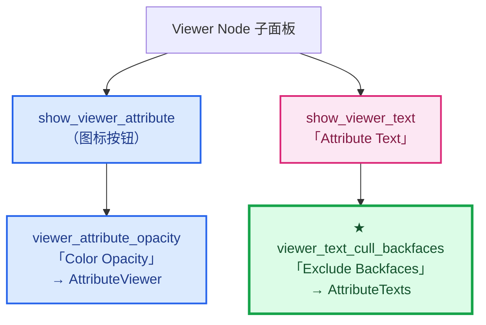

⭐ **注意层级不同**：
- `viewer_attribute_opacity` 依赖 `show_viewer_attribute`（同一个开关下）
- `viewer_text_cull_backfaces` 依赖 `show_viewer_text`（多一层）

---

## 4. DRWTextStore 数据结构详解

> 位置：`draw_manager_text.cc:53-91`

### 4.1 完整代码

```cpp
/* draw_manager_text.cc:53-66 */
struct ViewCachedString {
  float vec[3];
  union {
    uchar ub[4];
    int pack;
  } col;
  short sco[2];
  short xoffs, yoffs;
  short flag;
  bool shadow;
  bool align_center;

  StringRef str;
};

/* draw_manager_text.cc:68-77 */
struct DRWTextStore {
  Vector<ViewCachedString> cache_strings;
  /** Backing storage for owned copies referenced by #ViewCachedString::str. */
  LinearAllocator<> string_allocator;
  /**
   * Read-back of the scene depth buffer, filled by #DRW_text_cache_draw when a depth test was
   * requested by at least one string. Owned by the caller that set it up.
   */
  const ViewDepths *depths = nullptr;
};

/* draw_manager_text.cc:79-90 */
DRWTextStore *DRW_text_cache_create()
{
  return MEM_new<DRWTextStore>(__func__);
}

void DRW_text_cache_destroy(DRWTextStore *dt)
{
  if (dt == nullptr) {
    return;
  }
  MEM_delete(dt);
}
```

### 4.2 ⭐ 内部字符串分布图

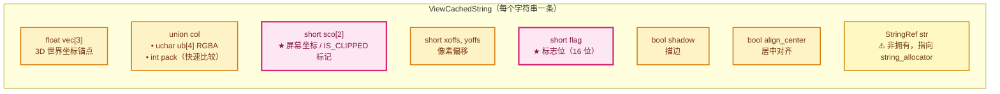

### 4.3 ⭐ `union col` 的技巧

```cpp
union {
  uchar ub[4];      // RGBA 四字节
  int pack;         // 打包成一个 int
} col;
```

⭐ **为什么既是数组又是 int**：

```cpp
/* draw_manager_text.cc:144-149 —— 用途 */
for (ViewCachedString &vos : dt->cache_strings) {
  if (vos.sco[0] != IS_CLIPPED) {
    if (col_pack_prev != vos.col.pack) {      // ← 一次 int 比较代替四次 uchar 比较
      BLF_color4ubv(font_id, vos.col.ub);     // ← 需要时用 uchar[4]
      const uchar lightness = srgb_to_grayscale_byte(vos.col.ub);
      outline_is_dark = lightness > 96;
      col_pack_prev = vos.col.pack;
    }
```

⭐ **优化原理**：


⚠️ **注意**：这是**颜色批处理优化**，假设字符串按颜色分组存放（同一物体的文字通常同色）。

### 4.4 ⭐ `StringRef str` + `LinearAllocator` 的所有权模式

```cpp
StringRef str;                    // ← 只存引用（指针 + 长度）
LinearAllocator<> string_allocator;   // ← 实际文本存储在这里
```

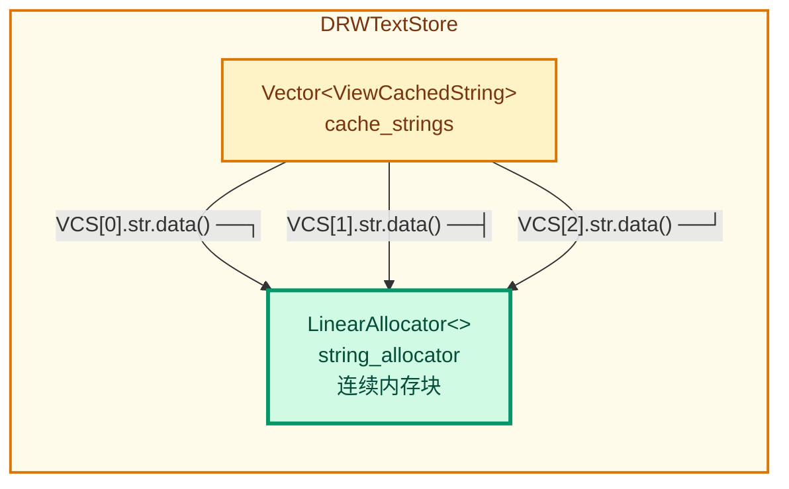

⭐ **`LinearAllocator` 是什么**：

| 特性 | 说明 |
|------|------|
| **线性分配** | 只在末尾追加，不做释放 |
| **O(1) 分配** | 只移动一个指针 |
| **批量释放** | 析构时一次性全部释放 |
| **无碎片** | 连续内存 |

⭐ **为什么适合文本缓存**：

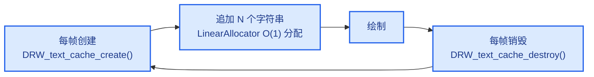

⭐ **生命周期是"整批创建 → 整批销毁"**，没有单独释放的需求 → **线性分配器是完美匹配** ✅

⚠️ **对比 `std::string`**：每个字符串单独 `new`/`delete` 会有大量小分配和碎片。`LinearAllocator` 避免了这些。

### 4.5 ⭐ `DRWTextStore::depths` —— 本 patch 新增

```cpp
/**
 * Read-back of the scene depth buffer, filled by #DRW_text_cache_draw when a depth test was
 * requested by at least one string. Owned by the caller that set it up.
 */
const ViewDepths *depths = nullptr;
```

⭐ **三个关键点**：

| 特征 | 含义 |
|------|------|
| **`const ViewDepths *`** | 只读，不修改 |
| **借用（不拥有）** | 注释明确 `Owned by the caller` |
| **默认 `nullptr`** | fail-safe：未设置则不测试 |

⭐ **所有权关系图**：

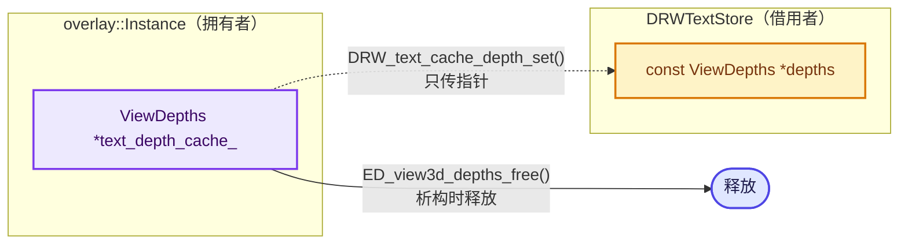

⚠️ **为什么必须是借用而不是拥有**：

```
Instance 生命周期 ────────────────────────────────────┐
  每帧: begin_sync → 创建 dt → ... → 销毁 dt          │
  text_depth_cache_ 跨帧存活（尺寸不变时复用）          │
                                                       │
  dt 只活一帧，但 depths 要活到"下一次 draw"            │
  → 所有权必须在 Instance 手上                         │
```

### 4.6 ⭐ create / destroy 的细节

```cpp
DRWTextStore *DRW_text_cache_create()
{
  return MEM_new<DRWTextStore>(__func__);
}

void DRW_text_cache_destroy(DRWTextStore *dt)
{
  if (dt == nullptr) {
    return;                     // ← 显式 nullptr 检查
  }
  MEM_delete(dt);
}
```

**create**：
- 用 `MEM_new<DRWTextStore>`（**会调用构造函数**）
- 所以 `cache_strings`、`string_allocator` 被正确初始化，`depths = nullptr`（成员默认值）✅

**destroy**：
- **显式 `nullptr` 检查** —— 防御性编程
- 用 `MEM_delete`（**会调用析构函数**）→ 自动释放 `Vector` 和 `LinearAllocator` ✅
- ⚠️ **不会释放 `depths` 指向的数据**（借用，非拥有）✅ 正确

⭐ **与 `~Instance()` 的配对**：

```cpp
/* overlay_instance.hh:116-123 */
~Instance() override
{
  DRW_text_cache_destroy(state.dt);         // ← 释放文本缓存
  if (text_depth_cache_ != nullptr) {
    ED_view3d_depths_free(text_depth_cache_);   // ← 释放深度数据
    text_depth_cache_ = nullptr;
  }
}
```

✅ **两者独立，无双重释放**（详见 [04-§2.2](./04-实例层-缓存与绘制顺序.md#22-知识点-1析构顺序)）。

### 4.7 ⚠️ 历史的 `BLI_memiter` 已废弃

```cpp
/* 旧版本（已过时） */
struct DRWTextStore {
  BLI_memiter *cache_strings;
};
```

⭐ **新版结构**：

| | 旧（`BLI_memiter`） | 新（`Vector` + `LinearAllocator`） |
|---|---------------------|-----------------------------------|
| 字符串存储 | 手动管理 | `LinearAllocator` |
| 遍历 | 迭代器回调 | 范围 for（`Vector`） |
| 类型安全 | ❌ void* | ✅ `ViewCachedString` |
| 调试友好 | ❌ | ✅ |

> 💡 **注意**：一些旧文档（如 `.markdown/暂时不看的/叠加层文本绘制/`）还写着 `BLI_memiter`，**已过时**，阅读时注意。

---

## 5. 三者的协作关系

### 5.1 完整生命周期

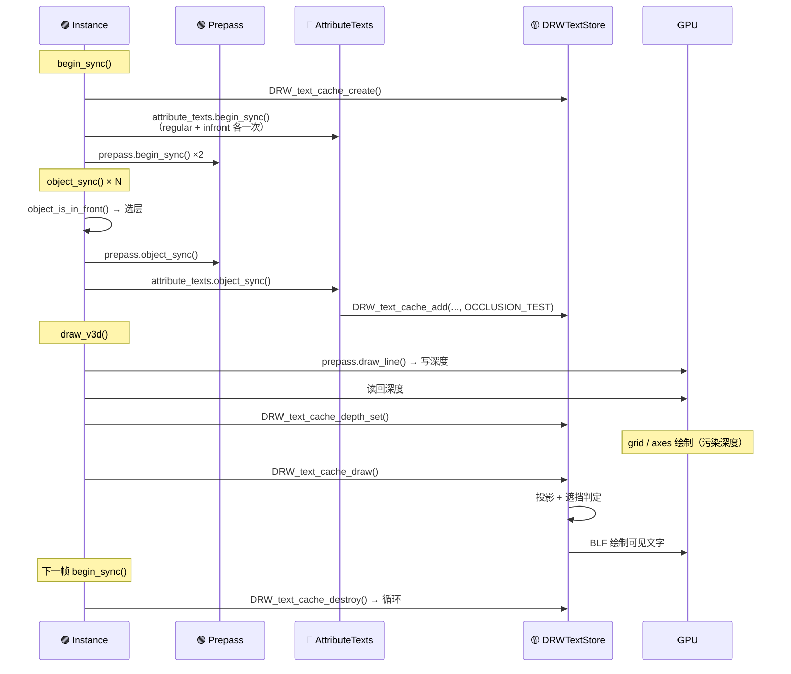

### 5.2 职责划分

| 组件 | 职责 | 深度角色 |
|------|------|----------|
| **`Prepass`** | 写深度 | ⭐ **深度生产者** |
| **`AttributeViewer`** | GPU 着色 | 深度消费者（GPU 自动） |
| **`AttributeTexts`** | CPU 文字 | 深度消费者（CPU 手动） |
| **`DRWTextStore`** | 文本缓存 | 深度持有者（借用） |
| **`regular` / `infront`** | 组织方式 | 决定画到哪个 framebuffer |

### 5.3 ⭐ 一句话总结三者

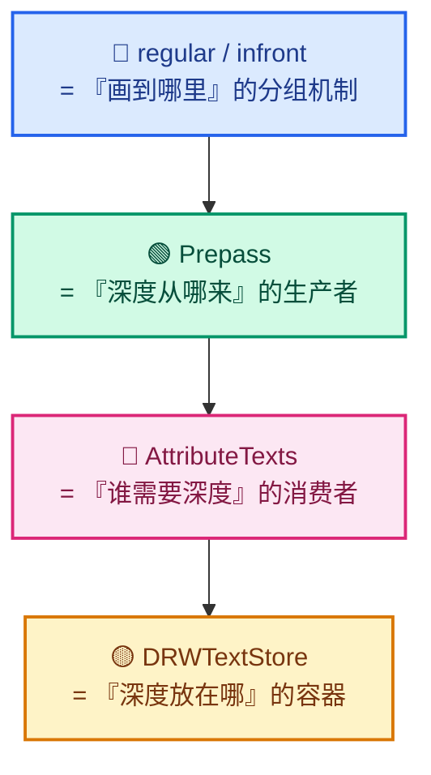

---

## 小结

### Prepass

1. ⭐ **只写深度不写颜色**（缺 `DRW_STATE_WRITE_COLOR`）
2. ⭐ **深度不可用时才跑**（`is_render_depth_available == false`）
3. ⭐ **本 patch 的 `update_text_depth()` 必须卡在 prepass 之后**

### regular / infront

1. ⭐ **同一 `OverlayLayer` 结构体的两个实例**（各 30 个组件）
2. ⭐ **`object_is_in_front()` 是唯一判据**（`OB_DRAW_IN_FRONT` 位）
3. ⭐ **infront 的 framebuffer 先清深度为 1.0** → 画在最前面
4. ⭐ **两份实例保证渲染顺序**（infront 全部最后画）

### AttributeTexts vs AttributeViewer

| | AttributeViewer | AttributeTexts |
|---|-----------------|----------------|
| 形式 | 表面着色 | 屏幕文字 |
| 机制 | GPU Pass | CPU 文本缓存 |
| 深度 | ✅ 免费获得 | ❌ **必须自己实现** |
| 本 patch | 未改动 | **主要改动** |

⭐ **一句话**：Viewer 用 GPU 画颜色，**深度测试免费**；Texts 用 CPU 画文字，**必须自己做 CPU 侧深度判定** —— 这就是本 patch 存在的全部理由。

### DRWTextStore

1. ⭐ **`Vector<ViewCachedString>` + `LinearAllocator`**（旧版 `BLI_memiter` 已废弃）
2. ⭐ **`StringRef` + `LinearAllocator` 的所有权模式**（引用 + 集中存储）
3. ⭐ **`union { uchar ub[4]; int pack; }` 的颜色批处理优化**
4. ⭐ **`depths` 是借用指针**，所有权在 `Instance`

---

## 相关文档

- `Instance` 完整解析 → [09-Instance类完全解析](./09-Instance类完全解析.md)
- 深度回读细节 → [04-实例层-缓存与绘制顺序](./04-实例层-缓存与绘制顺序.md)
- 文本缓存核心 → [03-文本缓存遮挡测试核心](./03-文本缓存遮挡测试核心.md)
- 绘制顺序为什么重要 → [00-§3.2](./00-总览与架构.md#32-为什么要把深度前置到-prepass-之后)
