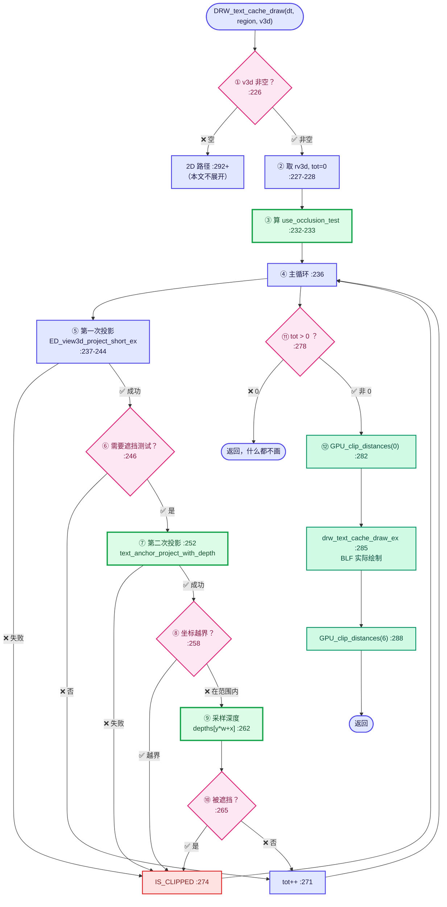
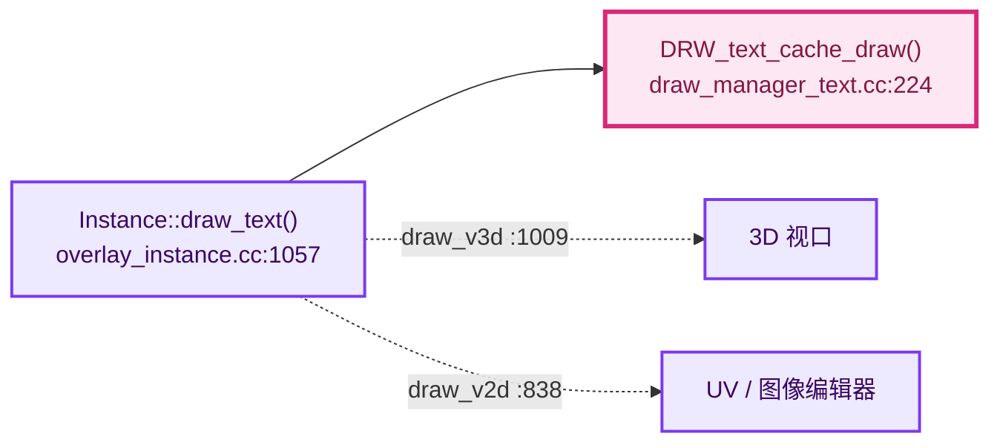
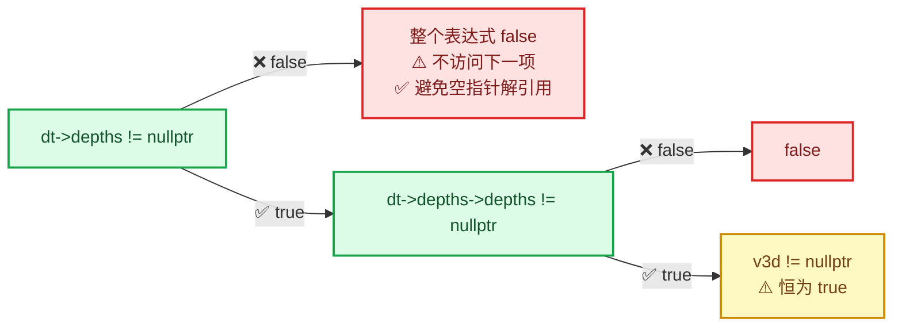
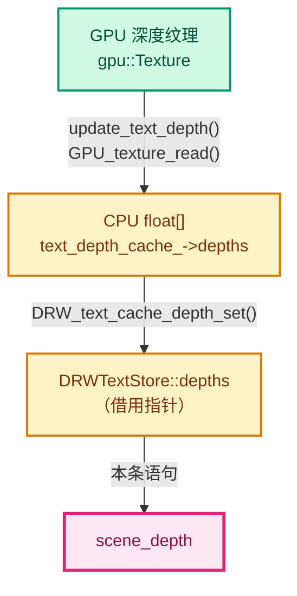
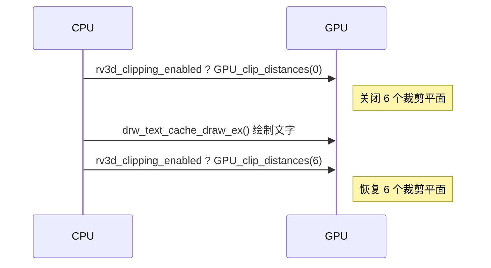

# 11 - DRW_text_cache_draw 逐行完全解析

> 🔗 [返回索引](./README.md) | 上一篇：[10-Prepass与双层绘制](./10-Prepass与双层绘制.md) | 参考：[配色与图例约定](./配色与图例约定.md)

本文**逐行、逐符号、逐函数**解析 `draw_manager_text.cc:224~291` —— 这是本 patch 的核心执行路径。

覆盖内容：每一行的作用、每个变量名的缩写来源、每个被调用函数的完整调用链、涉及的数学与图形学知识。

---

## 目录

- [0. 全景总览](#0-全景总览)
- [1. 函数签名与参数](#1-函数签名与参数)
- [2. 第 226-228 行：进入 3D 分支](#2-第-226-228-行进入-3d-分支)
- [3. 第 230-233 行：use_occlusion_test](#3-第-230-233-行use_occlusion_test)
- [4. 第 236 行：主循环](#4-第-236-行主循环)
- [5. 第 237-244 行：第一次投影](#5-第-237-244-行第一次投影)
- [6. 第 246 行：遮挡测试门禁](#6-第-246-行遮挡测试门禁)
- [7. 第 248-255 行：第二次投影](#7-第-248-255-行第二次投影)
- [8. 第 256-261 行：索引与边界](#8-第-256-261-行索引与边界)
- [9. 第 262 行：深度采样](#9-第-262-行深度采样)
- [10. 第 263-269 行：遮挡判定](#10-第-263-269-行遮挡判定)
- [11. 第 271-275 行：计数与失败分支](#11-第-271-275-行计数与失败分支)
- [12. 第 278-290 行：条件绘制](#12-第-278-290-行条件绘制)
- [13. 完整调用栈树](#13-完整调用栈树)
- [14. 数学知识汇总](#14-数学知识汇总)
- [15. 命名缩写表](#15-命名缩写表)

---

## 0. 全景总览



⭐ **绿色 = 本 patch 新增**，红色 = 剔除路径，青色 = GPU 操作。

---

## 1. 函数签名与参数

```cpp
/* draw_manager_text.cc:224 */
void DRW_text_cache_draw(DRWTextStore *dt, const ARegion *region, const View3D *v3d)
```

### 命名解析

| 名字 | 全称 | 含义 |
|------|------|------|
| `DRW_` | **D**raw **R**ender **W**rapper 前缀 | Blender 绘制系统命名空间 |
| `text_cache` | text cache | 文本缓存 |
| `draw` | draw | 绘制 |
| `dt` | **D**raw **T**ext (store) | 文本缓存容器 |
| `region` | ARegion | UI 区域（含 `winx`/`winy` 尺寸） |
| `v3d` | **V**ie**w**3**D** | 3D 视图数据；**为 `nullptr` 表示 2D 模式** |

### 三个参数的角色

| 参数 | 类型 | 提供什么 | 本 patch 用到 |
|------|------|----------|--------------|
| `dt` | `DRWTextStore *` | 待绘制字符串 + 深度数据 | ✅ `dt->cache_strings`、`dt->depths` |
| `region` | `const ARegion *` | 窗口尺寸 + `regiondata` | ✅ `region->regiondata`、`region->winx/winy` |
| `v3d` | `const View3D *` | 3D 视图标志（切换 2D/3D 路径） | ✅ 判空 |

### 调用链（谁调用它）



```cpp
/* overlay_instance.cc:1057-1066 —— 唯一的调用点 */
void Instance::draw_text(Framebuffer &framebuffer)
{
  if (state.show_text == false) {
    return;
  }
  GPU_framebuffer_bind(framebuffer);
  GPU_depth_test(GPU_DEPTH_NONE);        // ← 关键：关闭 GPU 深度测试
  DRW_text_cache_draw(state.dt, state.region, state.v3d);
}
```

⭐ **注意 `GPU_depth_test(GPU_DEPTH_NONE)`** —— GPU 深度测试被关闭，所以**遮挡判定必须完全在 CPU 完成**，这正是本函数存在的意义。

---

## 2. 第 226-228 行：进入 3D 分支

```cpp
226:  if (v3d) {
227:    RegionView3D *rv3d = static_cast<RegionView3D *>(region->regiondata);
228:    int tot = 0;
```

### 第 226 行：`if (v3d)`

⭐ **这是整个函数的分水岭**：

| 分支 | 条件 | 处理方式 |
|------|------|----------|
| **3D** | `v3d != nullptr` | `persmat` 投影 + 齐次除法 + 深度遮挡测试 |
| **2D** | `v3d == nullptr` | `View2D` 变换，**无深度概念** |

⚠️ **2D 分支（`:292+`）里没有 `IS_CLIPPED`、没有 `tot`、没有深度** —— 因为 UV 编辑器里"深度"没有意义。

### 第 227 行：`static_cast` 与 `regiondata`

```cpp
RegionView3D *rv3d = static_cast<RegionView3D *>(region->regiondata);
```

⭐ **逐层解析**：

```
region                              → const ARegion *
region->regiondata                  → void *        （类型擦除的通用指针）
static_cast<RegionView3D *>(...)    → RegionView3D *
```

| 概念 | 说明 |
|------|------|
| `ARegion` | 通用 UI 区域结构（`DNA_screen_types.h`） |
| `ARegion::regiondata` | `void *`（`DNA_screen_types.h:863`）—— **"这个区域属于哪个空间"** |
| `RegionView3D` | 3D 视图专用数据（`DNA_view3d_types.h:464`） |

⭐ **为什么是 `void *` + 转型**：`ARegion` 要服务所有空间类型（3D 视图、UV 编辑器、节点编辑器……），各自有不同的 `regiondata`。C 风格的"类型擦除 + 手动转型"。

`rv3d` = **R**egion**V**iew3**D**。

### 第 228 行：`int tot = 0`

| 缩写 | 全称 | 含义 |
|------|------|------|
| `tot` | **tot**al | 计数器：**实际会被绘制的字符串数量** |

⭐ **注意它不是"总数"，而是"通过所有检查的数量"** —— 名字略有误导。

它在三处被修改：

```cpp
tot++;                      // :271 —— 通过全部检查
/* 其他路径都 continue 或走 else，不碰 tot */
if (tot) { ... }            // :278 —— 只要有 1 个就绘制
```

---

## 3. 第 230-233 行：use_occlusion_test

```cpp
230:    /* Occlusion testing needs the scene depth read back to CPU memory. Only do this when at
231:     * least one string requested it, and only when a valid depth buffer was provided. */
232:    const bool use_occlusion_test = dt->depths != nullptr && dt->depths->depths != nullptr &&
233:                                    (v3d != nullptr);
```

### 命名解析

| 名字 | 含义 |
|------|------|
| `use_occlusion_test` | 是否启用遮挡测试 |
| `occlusion` | 遮挡（图形学术语） |
| `dt->depths` | **第 1 层**：`const ViewDepths *`（指针成员） |
| `dt->depths->depths` | **第 2 层**：`float *`（数据数组） |

### 三层结构（同名不同物）

```
dt                    → DRWTextStore *        （函数参数）
  └─ depths           → const ViewDepths *    （DRWTextStore 成员，借用指针）
       └─ depths      → float *               （ViewDepths 成员，数据数组）
```

| 结构体 | 字段 | 类型 | 定义位置 |
|--------|------|------|----------|
| `DRWTextStore` | `depths` | `const ViewDepths *` | `draw_manager_text.cc:76` |
| `ViewDepths` | `depths` | `float *` | `ED_view3d.hh:95` |

### 短路求值（short-circuit）顺序



⭐ **顺序至关重要**：如果先查 `dt->depths->depths`，当 `dt->depths == nullptr` 时会**直接崩溃**。短路求值保证了安全。

### 三项检查的作用

| 检查 | 防止什么 | 必要性 |
|------|---------|--------|
| `dt->depths != nullptr` | 调用者从未 `DRW_text_cache_depth_set` | ✅ 必要 |
| `dt->depths->depths != nullptr` | `ViewDepths` 存在但内部缓冲为空 | ✅ 必要 |
| `(v3d != nullptr)` | 无（外层已保证） | ❌ **冗余**（见 [07-N1](./07-问题清单与修复.md)） |

⚠️ **第 3 项被编译器优化掉**，零运行时开销，但影响可读性。

### 与上一层的关系

```cpp
/* overlay_instance.cc:1017-1020 —— 谁设置了 dt->depths */
void Instance::update_text_depth()
{
  if (!state.show_text || !state.is_space_v3d() || !DRW_text_cache_needs_depth_test(state.dt)) {
    DRW_text_cache_depth_set(state.dt, nullptr);      // ← 关闭时设为 null
    /* ... */
    return;
  }
  /* ... */
  DRW_text_cache_depth_set(state.dt, text_depth_cache_);   // ← 开启时设有效指针
}
```

⭐ **所以 `use_occlusion_test` 实际反映的是"上游是否成功提供了深度"**。

---

## 4. 第 236 行：主循环

```cpp
235:    /* project first and test */
236:    for (ViewCachedString &vos : dt->cache_strings) {
```

### 命名解析

| 名字 | 全称 | 含义 |
|------|------|------|
| `vos` | **V**iew-cached **O**bject **S**tring? | 历史命名，实际是"缓存的视图字符串"。**含义已模糊** |
| `cache_strings` | cached strings | `Vector<ViewCachedString>` |

⚠️ **`vos` 是历史遗留缩写**，可能源自"View cOached String"或早期某个类型名。**现代读者只需知道它是"一条待绘制文本"**。

### 为什么用引用 `&`

```cpp
for (ViewCachedString &vos : dt->cache_strings) {
```

| 写法 | 后果 |
|------|------|
| `ViewCachedString vos`（值） | 拷贝 48 字节，**且修改不生效** ❌ |
| **`ViewCachedString &vos`** | **零拷贝 + 可修改** ✅ |

⭐ **必须用引用**，因为循环里要写 `vos.sco[0] = IS_CLIPPED`（剔除标记），而 `sco` 是 `ViewCachedString` 的成员。

### `dt->cache_strings` 的容器

```cpp
/* draw_manager_text.cc:69 */
Vector<ViewCachedString> cache_strings;
```

`blender::Vector<T>` 是 **动态数组（可增长）**，不是 `std::vector`：

| 特性 | `blender::Vector` | `std::vector` |
|------|------------------|---------------|
| 增长策略 | 1.5× 或 2× | 2× |
| 小对象优化 | 无 | 无 |
| 与 `Span` 互操作 | ✅ 自然转换 | ❌ |
| 边界检查 | `[]` 无，`.at()` 有 | 同 |

⭐ **范围 for 会调用 `begin()`/`end()`**，而 `Vector` 的迭代器就是 `T *`（连续内存），所以循环是**顺序遍历一块连续内存** —— 缓存友好。

---

## 5. 第 237-244 行：第一次投影

```cpp
237:      if (ED_view3d_project_short_ex(
238:              region,
239:              (vos.flag & DRW_TEXT_CACHE_GLOBALSPACE) ? rv3d->persmat : rv3d->persmatob,
240:              (vos.flag & DRW_TEXT_CACHE_LOCALCLIP) != 0,
241:              vos.vec,
242:              vos.sco,
243:              V3D_PROJ_TEST_CLIP_BB | V3D_PROJ_TEST_CLIP_WIN | V3D_PROJ_TEST_CLIP_NEAR) ==
244:          V3D_PROJ_RET_OK)
```

### 5.1 函数名解析

| 部分 | 含义 |
|------|------|
| `ED_` | **Ed**itors 模块前缀 |
| `view3d_` | 3D 视图 |
| `project` | 投影 |
| `_short` | 输出类型是 **`short`** |
| `_ex` | **ex**tended（扩展版，多带 `flag` 参数） |

⭐ **同族函数对比**：

| 函数 | 输出类型 |
|------|---------|
| `ED_view3d_project_short_ex` | `short[2]` |
| `ED_view3d_project_int_ex` | `int[2]` |
| `ED_view3d_project_float_ex` | `float[2]` |

**为什么这里用 `short`**：因为 `ViewCachedString::sco` 就是 `short[2]`，且屏幕坐标不可能超过 ±32767。

### 5.2 第 239 行：矩阵选择

```cpp
(vos.flag & DRW_TEXT_CACHE_GLOBALSPACE) ? rv3d->persmat : rv3d->persmatob
```

#### 标志位解析

```cpp
/* draw_manager_text.hh —— 标志定义 */
enum {
  /* DRW_UNUSED_1 = (1 << 0), */
  DRW_TEXT_CACHE_GLOBALSPACE = (1 << 1),    // ← 用世界坐标
  DRW_TEXT_CACHE_LOCALCLIP   = (1 << 2),    // ← 用物体局部裁剪
  DRW_TEXT_CACHE_STRING_PTR  = (1 << 3),    // ← 字符串是外部指针
  DRW_TEXT_CACHE_OCCLUSION_TEST = (1 << 4), // ← 本 patch 新增
};
```

| 标志 | 含义 |
|------|------|
| `GLOBALSPACE` | 锚点坐标 `vos.vec` 是**世界空间** |
| （未设） | 锚点坐标是**物体空间** |

#### 两个矩阵的区别

| 矩阵 | 定义（`DNA_view3d_types.h`） | 数学含义 |
|------|---------------------------|---------|
| `rv3d->persmat`（`:474`） | *Viewmat\*winmat* | **P × V**，世界空间 → 裁剪空间 |
| `rv3d->persmatob`（`:482`） | *viewmat/persmat multiplied with object matrix* | **P × V × M**，物体空间 → 裁剪空间 |

⭐ **`persmat` 的命名**：

```
persmat = PERSpective MATrix  （透视矩阵）
        = winmat × viewmat     （投影 × 观察）
```

⚠️ **注意注释说 "Viewmat\*winmat"，但数学上必须是 `winmat * viewmat`**（先观察变换再投影）。这是 Blender 注释的表述习惯问题（"viewmat 之后再 winmat"），**实际存储顺序是矩阵乘法意义的 `winmat * viewmat`**。

⭐ **数学推导**：

```
世界坐标 p_world
  → 观察空间：  p_view  = V × p_world
  → 裁剪空间：  p_clip  = P × p_view = P × V × p_world = persmat × p_world

物体坐标 p_obj
  → 世界空间：  p_world = M × p_obj      （M = object_to_world）
  → 裁剪空间：  p_clip  = persmat × M × p_obj = persmatob × p_obj
```

#### `persmatob` 的 "ob" 后缀

`ob` = **ob**ject（物体）。`persmatob` = "带物体矩阵的 persmat"。

### 5.3 第 240 行：`LOCALCLIP`

```cpp
(vos.flag & DRW_TEXT_CACHE_LOCALCLIP) != 0,
```

⭐ **这个参数是 `is_local`**，传给 `ed_view3d_project__internal`：

```cpp
/* view3d_project.cc:99-104 */
static eV3DProjStatus ed_view3d_project__internal(const ARegion *region,
                                                  const float perspmat[4][4],
                                                  const bool is_local,   // ← 这里
                                                  const float co[3],
                                                  float r_co[2],
                                                  const eV3DProjTest flag)
```

**用途**：决定用哪套裁剪平面：

```cpp
/* view3d_project.cc:111-118 */
if (flag & V3D_PROJ_TEST_CLIP_BB) {
  const RegionView3D *rv3d = static_cast<const RegionView3D *>(region->regiondata);
  if (rv3d->rflag & RV3D_CLIPPING) {
    if (ED_view3d_clipping_test(rv3d, co, is_local)) {   // ← is_local 决定用
      return V3D_PROJ_RET_CLIP_BB;                        //   rv3d->clip 还是 clip_local
    }
  }
}
```

| `is_local` | 用哪套裁剪平面 | 定义位置 |
|-----------|--------------|---------|
| `false` | `rv3d->clip[6][4]`（世界空间） | `:485` |
| `true` | `rv3d->clip_local[6][4]`（物体空间） | `:490` |

### 5.4 第 241-242 行：输入输出

```cpp
vos.vec,      // in:  float[3]  3D 世界坐标锚点
vos.sco,      // out: short[2]  屏幕坐标
```

| 名字 | 全称 | 含义 |
|------|------|------|
| `vec` | **vec**tor | 3D 位置 |
| `sco` | **s**creen **co**ordinate | 屏幕坐标 |

⚠️ **`sco` 还兼任"剔除标记"**：

```cpp
short sco[2];    // 正常：x, y
                 // 剔除：sco[0] = IS_CLIPPED (12000)
```

### 5.5 第 243 行：裁剪标志

```cpp
V3D_PROJ_TEST_CLIP_BB | V3D_PROJ_TEST_CLIP_WIN | V3D_PROJ_TEST_CLIP_NEAR
```

#### 三个标志的定义（`ED_view3d.hh:294-300`）

```cpp
enum eV3DProjTest {
  V3D_PROJ_TEST_NOP       = 0,
  V3D_PROJ_TEST_CLIP_BB   = (1 << 0),   // 位 0
  V3D_PROJ_TEST_CLIP_WIN  = (1 << 1),   // 位 1
  V3D_PROJ_TEST_CLIP_NEAR = (1 << 2),   // 位 2
  V3D_PROJ_TEST_CLIP_FAR  = (1 << 3),   // 位 3
  V3D_PROJ_TEST_CLIP_ZERO = (1 << 4),   // 位 4
  V3D_PROJ_TEST_CLIP_CONTENT = (1 << 5),// 位 5
};
```

#### 按位或的结果

```
CLIP_BB   = 0b000001
CLIP_WIN  = 0b000010
CLIP_NEAR = 0b000100
───────────────────── OR
            0b000111  = 7
```

⭐ **这正是宏 `V3D_PROJ_TEST_CLIP_DEFAULT`**：

```cpp
/* ED_view3d.hh:325-326 */
#define V3D_PROJ_TEST_CLIP_DEFAULT \
  (V3D_PROJ_TEST_CLIP_BB | V3D_PROJ_TEST_CLIP_WIN | V3D_PROJ_TEST_CLIP_NEAR)
```

⚠️ **代码没直接用这个宏，而是展开了**。可以改成 `V3D_PROJ_TEST_CLIP_DEFAULT`（更清晰），但这属于风格问题。

#### 三个裁剪的含义

| 标志 | 检查什么 | 触发返回 |
|------|---------|---------|
| `CLIP_BB` | 用户裁剪边界（`N` 面板的裁剪平面） | `V3D_PROJ_RET_CLIP_BB` |
| `CLIP_WIN` | 投影后是否落在 `[0,winx] × [0,winy]` 内 | `V3D_PROJ_RET_CLIP_WIN` |
| `CLIP_NEAR` | 是否在近裁剪面之前 | `V3D_PROJ_RET_CLIP_NEAR` |

⚠️ **未传 `CLIP_FAR` 和 `CLIP_ZERO`** —— 这是重要细节（见 [03-§8.2](./03-文本缓存遮挡测试核心.md)）：

- 不查 `FAR`：远裁剪面外的点**不会被剔除**
- 不查 `ZERO`：`w ≈ 0` 的点（在相机平面上）**可能产生数值误差**

⭐ **但第二次投影（`text_anchor_project_with_depth`）会查 `FAR`** —— 两套逻辑不一致（见 [07-M1](./07-问题清单与修复.md)）。

### 5.6 第 244 行：返回值比较

```cpp
== V3D_PROJ_RET_OK
```

#### `eV3DProjStatus` 完整枚举（`ED_view3d.hh:272-291`）

```cpp
enum eV3DProjStatus {
  V3D_PROJ_RET_OK           = 0,   // 成功
  V3D_PROJ_RET_CLIP_NEAR    = 1,   // 近裁剪面之前
  V3D_PROJ_RET_CLIP_FAR     = 2,   // 远裁剪面之后
  V3D_PROJ_RET_CLIP_ZERO    = 3,   // 坐标太接近视点，数值不可靠
  V3D_PROJ_RET_CLIP_BB      = 4,   // 用户裁剪边界外
  V3D_PROJ_RET_CLIP_WIN     = 5,   // 窗口外
  V3D_PROJ_RET_OVERFLOW     = 6,   // 超出 short 范围
};
```

| 缩写 | 含义 |
|------|------|
| `RET` | **ret**urn |
| `OK` | 成功 |
| `CLIP` | 被裁剪 |
| `BB` | **B**ounding **B**ox |
| `WIN` | **win**dow |
| `ZERO` | `w ≈ 0` |

⭐ **`V3D_PROJ_RET_OK == 0`**，所以某些代码会简写成 `if (!ED_view3d_project_...)`。这里用了显式比较，**更清晰** ✅

---

## 6. 第 246 行：遮挡测试门禁

```cpp
246:        if (use_occlusion_test && (vos.flag & DRW_TEXT_CACHE_OCCLUSION_TEST) != 0) {
```

### 双重条件

| 条件 | 作用域 | 含义 |
|------|--------|------|
| `use_occlusion_test` | **全局** | 深度数据可用吗？ |
| `vos.flag & OCCLUSION_TEST` | **单条字符串** | 这条需要测试吗？ |

⭐ **这是"opt-in"设计** —— 只有打了标志的字符串才测试，其他文本（测量统计、索引显示）**不受影响**。

### 标志位的位运算

```
DRW_TEXT_CACHE_OCCLUSION_TEST = (1 << 4) = 0b10000 = 16

vos.flag = 0b10010（GLOBALSPACE | OCCLUSION_TEST）
        & 0b10000
        ─────────
          0b10000 = 16 ≠ 0  → true ✅
```

⚠️ **`!= 0` 是必需的**：位与的结果是**掩码值本身**（16），不是布尔 `1`。

| 写法 | 正确性 |
|------|--------|
| `if (vos.flag & MASK)` | ✅ 可行（非零即真） |
| **`if ((vos.flag & MASK) != 0)`** | ✅ **更明确**（当前写法） |

### 谁设置了这些标志

```cpp
/* overlay_attribute_text.hh:319-320 —— 标志的来源 */
const short text_flags = DRW_TEXT_CACHE_GLOBALSPACE |
                         (occlusion_test ? DRW_TEXT_CACHE_OCCLUSION_TEST : 0);
```

⭐ `occlusion_test` 来自 `AttributeTexts::occlusion_test_`，而它由用户开关决定：

```cpp
/* overlay_attribute_text.hh:48-52 */
void begin_sync(Resources &res, const State &state) final
{
  enabled_ = !res.is_selection() && state.show_attribute_viewer_text();
  occlusion_test_ = state.viewer_text_cull_backfaces();   // ← ★ 读取用户勾选
}
```

**完整链**：DNA 位标志 → RNA 属性 → Python 勾选框 → `State` → `occlusion_test_` → `text_flags` → `vos.flag`

---

## 7. 第 248-255 行：第二次投影

```cpp
247:          /* Re-project keeping the depth so it can be compared with the scene depth. */
248:          float xy[2];
249:          float anchor_depth;
250:          const float (&persmat)[4][4] = (vos.flag & DRW_TEXT_CACHE_GLOBALSPACE) ? rv3d->persmat :
251:                                                                                   rv3d->persmatob;
252:          if (!text_anchor_project_with_depth(*region, persmat, vos.vec, xy, anchor_depth)) {
253:            vos.sco[0] = IS_CLIPPED;
254:            continue;
255:          }
```

### 7.1 第 248-249 行：两个前向声明式变量

```cpp
float xy[2];          // 输出：屏幕坐标（float 精度）
float anchor_depth;   // 输出：深度 [0,1]
```

| 名字 | 含义 |
|------|------|
| `xy` | 屏幕 XY（**未初始化**，等函数填） |
| `anchor_depth` | **anchor**（锚点）的深度 |

⚠️ **`xy` 没有初值** —— 如果函数返回 `false` 它仍是垃圾值。但代码立刻 `continue`，**不会用到** ✅

### 7.2 第 250-251 行：`const float (&persmat)[4][4]` 语法

⭐⭐ **这是 C++ 里最令人困惑的声明之一**，需要逐步拆解。

#### 语法解析

```cpp
const float (&persmat)[4][4]
^^^^^^^^^^^ ^^^^^^^^^ ^^^^^^
   ①          ②        ③
```

| 部分 | 含义 |
|------|------|
| ① `const float` | 元素类型：不可变的 `float` |
| ② `(&persmat)` | **引用**（不是指针！）名为 `persmat` |
| ③ `[4][4]` | 引用到的是一个 `4×4` 数组 |

⭐ **读作**："`persmat` 是一个引用，引用到 `const float[4][4]`"。

#### 为什么必须写成这样

| 写法 | 问题 |
|------|------|
| `auto &persmat = ...` | ❌ 三元运算符两边是 `float[4][4]`，会**退化成指针** `float(*)[4]`，`auto&` 推导出 `float(*&)[4]` —— 能用但语义混乱 |
| `float (*persmat)[4]` | ❌ 只是"指向 4 个 float 的指针"，丢失第二维信息，无法传给需要 `[4][4]` 的函数 |
| `float persmat[4][4] = ...` | ❌ **数组不能拷贝初始化**（C++ 里数组不可赋值） |
| **`const float (&persmat)[4][4]`** | ✅ **引用到整个数组，类型完整** |

#### 为什么需要"引用"而不是拷贝

```cpp
text_anchor_project_with_depth(*region, persmat, ...)
                                     ^^^^^^^ 函数参数是 const float perspmat[4][4]
                                             （数组参数实际退化为 const float (*)[4]）
```

⭐ **如果按值拷贝**：`float[4][4]` = **64 字节**，每次循环都拷一次 → **浪费**。
⭐ **用引用**：只传地址，**零拷贝** ✅

#### 三元运算符的类型陷阱

```cpp
(vos.flag & DRW_TEXT_CACHE_GLOBALSPACE) ? rv3d->persmat : rv3d->persmatob
```

⚠️ **`rv3d->persmat` 和 `rv3d->persmatob` 都是 `float[4][4]`（数组）**。

C++ 的三元运算符对数组会做**数组到指针的退化**（array-to-pointer decay），结果类型是 `float(*)[4]` —— **左值**（lvalue），所以可以用引用绑定。

⭐ **声明里加 `const`** 是为了让 `persmat` 不可修改（`text_anchor_project_with_depth` 也只读）。

### 7.3 第 252 行：调用解析

```cpp
if (!text_anchor_project_with_depth(*region, persmat, vos.vec, xy, anchor_depth)) {
```

| 实参 | 形参 | 传递方式 |
|------|------|---------|
| `*region` | `const ARegion &region` | 引用（`region` 是指针，`*` 解引用） |
| `persmat` | `const float perspmat[4][4]` | 数组退化为指针 |
| `vos.vec` | `const float co[3]` | 数组退化为指针 |
| `xy` | `float r_xy[2]` | **输出参数**（数组退化） |
| `anchor_depth` | `float &r_depth` | **输出参数**（引用） |

⭐ **`r_` 前缀 = return** —— Blender 用 `r_` 标记输出参数。

⭐ **返回值取反 `!`**：函数返回 `true` 表示**成功**，所以 `!func(...)` 表示**失败**。

### 7.4 `text_anchor_project_with_depth` 内部（`:187-222`）

```cpp
static bool text_anchor_project_with_depth(const ARegion &region,
                                           const float perspmat[4][4],
                                           const float co[3],
                                           float r_xy[2],
                                           float &r_depth)
{
  float vec4[4];
  copy_v3_v3(vec4, co);          // ① vec4[0..2] = co[0..2]
  vec4[3] = 1.0;                 // ② 齐次化：w = 1
  mul_m4_v4(perspmat, vec4);     // ③ vec4 ← perspmat × vec4
  const float w = fabsf(vec4[3]);   // ④ 取 |w|
  if (w == 0.0f) {
    return false;                // ⑤ 除零保护
  }

  const float scalar = 1.0f / w;
  /* Behind the near plane: nothing to compare against. */
  if (vec4[2] <= -w || vec4[2] >= w) {
    return false;                // ⑥ 近/远裁剪面检查
  }

  const float fx = (float(region.winx) / 2.0f) * (1.0f + (vec4[0] * scalar));
  const float fy = (float(region.winy) / 2.0f) * (1.0f + (vec4[1] * scalar));
  if (fx <= 0.0f || fy <= 0.0f || fx >= float(region.winx) || fy >= float(region.winy)) {
    return false;                // ⑦ 窗口边界检查
  }

  /* Normalized device depth, mapped the same way gl_FragCoord.z is written. */
  const float ndc_z = vec4[2] * scalar;
  const float depth = (ndc_z + 1.0f) * 0.5f;   // ⑧ NDC → [0,1]

  r_xy[0] = fx;
  r_xy[1] = fy;
  r_depth = depth;
  return true;
}
```

#### 涉及的数学

**① 齐次坐标（Homogeneous Coordinates）**

3D 点 `(x,y,z)` 用 4D 表示 `(x,y,z,1)`：

| `w` 值 | 含义 |
|--------|------|
| `w = 1` | **点**（受平移影响） |
| `w = 0` | **方向向量**（不受平移影响） |

**② 矩阵乘 4D 向量 `mul_m4_v4`**

```
┌ m00 m01 m02 m03 ┐   ┌ x ┐   ┌ x' ┐
│ m10 m11 m12 m13 │ × │ y │ = │ y' │
│ m20 m21 m22 m23 │   │ z │   │ z' │
└ m30 m31 m32 m33 ┘   └ 1 ┘   └ w' ┘
```

展开后：
```
x' = m00·x + m01·y + m02·z + m03
y' = m10·x + m11·y + m12·z + m13
z' = m20·x + m21·y + m22·z + m23
w' = m30·x + m31·y + m32·z + m33
```

⭐ **矩阵第 4 列（`m03/m13/m23/m33`）就是平移分量** —— 用 `w=1` 才能把它加进来。

**③ 透视除法与 `fabsf`**

```cpp
const float w = fabsf(vec4[3]);
```

透视投影矩阵的第 4 行通常是 `[0, 0, -1, 0]`，所以：

```
w' = -z_view     （z_view = 观察空间 z，相机看向 -z）
```

| 点的位置 | `z_view` | `w' = -z_view` | `fabsf(w')` |
|---------|----------|---------------|-------------|
| 相机前方 | 负 | **正** | 正 |
| 相机位置 | 0 | 0 | 0 |
| 相机后方 | 正 | **负** | 正 |

⭐ **`fabsf` 统一处理"相机后方"的点**。

⚠️ **与官方实现一致**：

```cpp
/* view3d_project.cc:123 */
const float w = fabsf(vec4[3]);
```

**④ 裁剪面检查**

```cpp
if (vec4[2] <= -w || vec4[2] >= w) {
```

数学含义：

| 条件 | 推导 | 含义 |
|------|------|------|
| `z' <= -w` | 同除 `w`：`z'/w <= -1` | NDC z ≤ −1 → **近裁剪面之前** |
| `z' >= w` | 同除 `w`：`z'/w >= +1` | NDC z ≥ +1 → **远裁剪面之后** |

⭐ **NDC 范围是 `[-1, 1]³`**，超出即被裁剪。

**⑤ NDC → 窗口坐标**

```cpp
const float fx = (float(region.winx) / 2.0f) * (1.0f + (vec4[0] * scalar));
const float fy = (float(region.winy) / 2.0f) * (1.0f + (vec4[1] * scalar));
```

数学公式：

$$f_x = \frac{W}{2}\left(1 + \frac{x'}{w}\right), \qquad f_y = \frac{W_y}{2}\left(1 + \frac{y'}{w}\right)$$

代入验证：

| NDC x | 计算 | 结果 |
|-------|------|------|
| `-1` | `W/2 × (1 + (-1))` | `0` （左边缘） |
| `0` | `W/2 × (1 + 0)` | `W/2` （中心） |
| `+1` | `W/2 × (1 + 1)` | `W` （右边缘） |

✅ 线性映射正确。

⭐ **与官方逐字相同**：

```cpp
/* view3d_project.cc:138-139 */
const float fx = (float(region->winx) / 2.0f) * (1.0f + (vec4[0] * scalar));
const float fy = (float(region->winy) / 2.0f) * (1.0f + (vec4[1] * scalar));
```

**⑥ NDC z → 深度 `[0,1]`** ⭐⭐ **本 patch 的灵魂**

```cpp
const float ndc_z = vec4[2] * scalar;
const float depth = (ndc_z + 1.0f) * 0.5f;
```

OpenGL 的默认深度范围是 `[0,1]`，而 NDC z 是 `[-1,1]`，所以需要映射：

```
NDC z = -1  →  depth = 0.0   近裁剪面
NDC z =  0  →  depth = 0.5   中值
NDC z = +1  →  depth = 1.0   远裁剪面
```

⭐⭐ **注释点明了正确性论证**：

> `Normalized device depth, mapped the same way gl_FragCoord.z is written.`

GPU 写入深度缓冲的值 = `gl_FragCoord.z` = `(ndc_z + 1) × 0.5`。

**只有用完全相同的映射，CPU 算出的深度才能与回读的深度直接比较** —— 这是整个特性的基石。

⚠️ **深度是非线性的**：透视投影下精度集中在近裁剪面附近。这解释了为什么后面用**绝对偏置 `2e-5`**。

### 7.5 第 253-254 行：失败处理

```cpp
vos.sco[0] = IS_CLIPPED;
continue;
```

| 名字 | 值 | 含义 |
|------|-----|------|
| `IS_CLIPPED` | **12000**（`ED_view3d.hh:269`） | 哨兵值 |

⭐ **为什么是 12000**：屏幕坐标不可能达到这个值（8K 才 7680），所以安全地作为"不绘制"标记。

⚠️ **复用 `sco[0]` 而不是新增字段**（见 [03-§7.2](./03-文本缓存遮挡测试核心.md)）：

```cpp
/* 绘制时的检查（draw_manager_text.cc:143） */
if (vos.sco[0] != IS_CLIPPED) { /* 才画 */ }
```

**"剔除" = 把 x 坐标写成 12000** → 绘制循环自动跳过 ✅ 无需改结构体。

### 7.6 ⚠️ 重复投影问题

⭐ **同一个 `vos.vec` 被投影了两次**：

| | 第 1 次（`:237`） | 第 2 次（`:252`） |
|---|---|---|
| 函数 | `ED_view3d_project_short_ex` | `text_anchor_project_with_depth` |
| 输出 | `vos.sco`（`short`） | `xy`（`float`） |
| 取整 | `floorf` | `int()` 截断 |
| 裁剪 | `BB \| WIN \| NEAR` | `WIN \| NEAR \| FAR` |

⚠️ **两次取整方式不同 → 可能差 1 像素 → 深度采到隔壁像素** —— 这就是 [07-M1](./07-问题清单与修复.md)。

---

## 8. 第 256-261 行：索引与边界

```cpp
256:          const int x = int(xy[0]);
257:          const int y = int(xy[1]);
258:          if (x < 0 || y < 0 || x >= dt->depths->w || y >= dt->depths->h) {
259:            vos.sco[0] = IS_CLIPPED;
260:            continue;
261:          }
```

### 8.1 第 256-257 行：`float` → `int` 转换

```cpp
const int x = int(xy[0]);
const int y = int(xy[1]);
```

⚠️ **`int(xy[0])` 是"截断取整"（truncation toward zero），不是 `floorf`**：

| 浮点值 | `int()` 截断 | `floorf()` |
|--------|-------------|-----------|
| `5.7` | `5` | `5` |
| `5.2` | `5` | `5` |
| `-5.7` | **`-5`** | **`-6`** ← 差异！ |
| `-5.2` | **`-5`** | **`-6`** ← 差异！ |

⭐ **对负数结果不同**！但这里不会出问题，因为紧跟的边界检查要求 `x >= 0` ✅

⚠️ **但和第 1 次投影的 `floorf` 不一致**（见 7.6）。

### 8.2 第 258 行：为什么需要第二次边界检查

```cpp
if (x < 0 || y < 0 || x >= dt->depths->w || y >= dt->depths->h) {
```

⭐ **`text_anchor_project_with_depth` 里已经检查过窗口边界了**，为什么还要再查？

**因为两个尺寸可能不同**：

| | 来源 | 类型 |
|---|------|------|
| 窗口尺寸 | `region->winx` / `region->winy` | `short`/`int` |
| **深度纹理尺寸** | `dt->depths->w` / `dt->depths->h` | `unsigned short` |

⭐ **HiDPI 场景下的差异**：

```
逻辑区域:  1920 × 1080    （region->winx/winy）
深度纹理:  3840 × 2160    （depths->w/h，2× 缩放）
```

所以 `fx < region.winx` **不代表** `x < depths->w`。

⚠️ **反向也可能**：渲染分辨率设为 50% 时，深度纹理**小于**区域尺寸。

✅ **两次检查都必要** —— 正确的防御性编程。

### 8.3 索引公式预览

```cpp
dt->depths->depths[y * dt->depths->w + x]
```

⭐ **行主序（row-major）的一维索引**：

```
索引 = y × w + x

     x→   0     1     2     3
y↓  ┌─────┬─────┬─────┬─────┐
 0  │  0  │  1  │  2  │  3  │
 1  │  4  │  5  │  6  │  7  │   索引 5 → y=1, x=1 → 1×4+1 = 5 ✅
 2  │  8  │  9  │ 10  │ 11  │
    └─────┴─────┴─────┴─────┘
```

⭐ **与官方一致**：

```cpp
/* view3d_utils.cc:1898 */
depth = vd->depths[y * vd->w + x];
```

⚠️ **类型提升**：`w` 是 `unsigned short`，`y` 是 `int`。`y * w` 会整型提升为 `int`，**结果正确**。溢出门槛是 `w*h > INT_MAX`（需 20 亿像素，不可能）✅

---

## 9. 第 262 行：深度采样

```cpp
262:          const float scene_depth = dt->depths->depths[y * dt->depths->w + x];
```

### 命名解析

| 名字 | 含义 |
|------|------|
| `scene_depth` | **场景**在该像素的深度 |

⭐ **"scene" 的含义**：这是**场景几何**的深度（来自渲染引擎或 prepass），**不是**文字自己的深度。

### 数据来源



| 值的范围 | 含义 |
|---------|------|
| `0.0` | 近裁剪面 |
| `0.0 < d < 1.0` | 有几何体 |
| **`1.0`** | **背景（已清空）** ← 关键约定 |

---

## 10. 第 263-269 行：遮挡判定

```cpp
263:          /* 1.0 is the cleared background; it never occludes. Add a small bias so anchors that
264:           * sit exactly on the surface (which is the common case) are kept visible. */
265:          const bool occluded = scene_depth != 1.0f && anchor_depth > scene_depth + 2.0e-5f;
266:          if (occluded) {
267:            vos.sco[0] = IS_CLIPPED;
268:            continue;
269:          }
```

### 10.1 条件 1：`scene_depth != 1.0f`

⭐ **深度缓冲每帧被清成 1.0**：

```cpp
/* gpu_viewport.cc:185 */
GPU_texture_clear(viewport->depth_tx, GPU_DATA_FLOAT, &depth_clear);
```

| 值 | 含义 |
|----|------|
| `1.0` | **该像素没有几何体**（背景） |
| `≠ 1.0` | 该像素有几何体 |

⭐ **语义**："背景不遮挡任何东西" —— 如果标签背后是天空/虚空，当然不该被剔除。

### 10.2 条件 2：`anchor_depth > scene_depth + 2.0e-5f`

#### 不等式变换

```
剔除：anchor_depth >  scene_depth + 2e-5
保留：anchor_depth <= scene_depth + 2e-5
```

#### 为什么需要偏置

**问题**：锚点通常**正好贴在表面上**（浮点误差范围内相等）。

```
相机 👁
  │
  │ 视线
  ↓
┌──────────┐  ← 表面：scene_depth = 0.500000
│    ●P    │  ← 锚点：anchor_depth = 0.500000（同一位置）
└──────────┘
```

⭐ **误差来源**：

| 来源 | 说明 |
|------|------|
| 浮点精度 | CPU `float` 与 GPU 计算路径不同 |
| 深度量化 | 深度缓冲通常 24 位定点 |
| **投影路径不同** | 两次投影的取整差异（[07-M1](./07-问题清单与修复.md)） |

如果没有偏置，`0.5000001 > 0.5` 会被判为"被遮挡" → **贴面标签全被误剔除** ❌

#### 偏置取值分析

| 偏置 | 效果 |
|------|------|
| `0` | 贴面标签大量误剔除 |
| **`2e-5`**（当前） | 实践中可用；远处过度保护 |
| `1e-3` | 保护过强，真实遮挡漏剔 |

⭐ **`2.0e-5f` 的科学计数法**：

```
2.0e-5f = 2.0 × 10⁻⁵ = 0.00002
```

⚠️ **深度是非线性的**（见 §7.4 ⑥），所以固定偏置在**近处合适、远处过大**。更好的做法是相对偏置：

```cpp
const float bias = std::max(2.0e-5f, scene_depth * 1.0e-4f);
```

### 10.3 真值表

| `scene_depth` | `anchor_depth` | 条件 1 | 条件 2 | `occluded` | 正确？ |
|---------------|----------------|--------|--------|-----------|--------|
| `1.0`（背景） | 任意 | ❌ | 短路不求值 | `false` | ✅ 保留 |
| `0.5` | `0.4`（更近） | ✅ | `0.4 > 0.5` ❌ | `false` | ✅ 保留 |
| `0.5` | `0.5`（贴面） | ✅ | `0.5 > 0.50002` ❌ | `false` | ✅ 保留（偏置生效） |
| `0.5` | `0.7`（更远） | ✅ | `0.7 > 0.50002` ✅ | **`true`** | ✅ 剔除 |

⭐ **短路求值**：条件 1 为假时**不求值条件 2**，省一次比较。

### 10.4 剔除动作

```cpp
vos.sco[0] = IS_CLIPPED;
continue;                     // ← 跳过 tot++
```

| 动作 | 效果 |
|------|------|
| `sco[0] = IS_CLIPPED` | 绘制循环会跳过它 |
| `continue` | **不执行 `tot++`** |

⭐ **两个动作缺一不可** —— 否则 `tot` 会计入不可见的字符串（虽然绘制时仍会跳过，但若全部被剔除，`tot > 0` 会导致不必要的 GPU 状态切换）。

---

## 11. 第 271-275 行：计数与失败分支

```cpp
270:        }
271:        tot++;
272:      }
273:      else {
274:        vos.sco[0] = IS_CLIPPED;
275:      }
276:    }
```

### 11.1 第 271 行：`tot++`

⭐ **只有"投影成功 + 通过所有遮挡检查"才计数**。

```
到达 tot++ 的路径：
  ① 投影成功 且 不需要遮挡测试          → tot++
  ② 投影成功 且 需要测试 且 三项检查全过 → tot++

不到达的路径：
  ③ 投影失败                            → else，IS_CLIPPED
  ④ 投影成功 但 遮挡测试三项检查任一失败 → continue，IS_CLIPPED
```

### 11.2 第 273-275 行：`else` 分支

```cpp
else {
  vos.sco[0] = IS_CLIPPED;
}
```

⚠️ **注意这里没有 `continue`** —— 因为 `else` 已经是 `if` 的最后分支，循环体会自然结束。

⭐ **触发条件**：`ED_view3d_project_short_ex` 返回值 ≠ `V3D_PROJ_RET_OK`：

| 返回值 | 触发条件 |
|--------|---------|
| `CLIP_BB` | 用户裁剪边界外 |
| `CLIP_WIN` | 投影落在窗口外 |
| `CLIP_NEAR` | 近裁剪面之前 |
| `OVERFLOW` | 屏幕坐标超出 ±32700 |

---

## 12. 第 278-290 行：条件绘制

```cpp
278:    if (tot) {
279:      /* Disable clipping for text */
280:      const bool rv3d_clipping_enabled = RV3D_CLIPPING_ENABLED(v3d, rv3d);
281:      if (rv3d_clipping_enabled) {
282:        GPU_clip_distances(0);
283:      }
284:
285:      drw_text_cache_draw_ex(dt, region);
286:
287:      if (rv3d_clipping_enabled) {
288:        GPU_clip_distances(6);
289:      }
290:    }
```

### 12.1 第 278 行：`if (tot)`

⭐ **性能优化**：如果**所有**字符串都被剔除（`tot == 0`），**完全跳过** `drw_text_cache_draw_ex`。

省下的开销：

| 操作 | 位置 | 成本 |
|------|------|------|
| `GPU_matrix_projection_get` | `drw_text_cache_draw_ex:129` | 中 |
| `wmOrtho2_region_pixelspace` | `:130` | 中 |
| `GPU_matrix_push/pop` | `:132, :178` | 中 |
| `BLF_default_size` / `BLF_set_default` | `:135-136` | 中 |
| **`GPU_clip_distances` ×2** | `:282, :288` | **⚠️ 高** |

⭐⭐ **这是本 patch 顺带获得的优化** —— 遮挡剔除开启后，若视口里标签大多不可见，性能反而**更好**。

### 12.2 第 280 行：`RV3D_CLIPPING_ENABLED` 宏展开

```cpp
/* DNA_view3d_types.h:181-183 */
#define RV3D_CLIPPING_ENABLED(v3d, rv3d) \
  ((rv3d) && (v3d) && ((rv3d)->rflag & RV3D_CLIPPING) && \
   ELEM((v3d)->shading.type, OB_WIRE, OB_SOLID) && (rv3d)->clipbb)
```

| 条件 | 含义 |
|------|------|
| `(rv3d)` | rv3d 非空 |
| `(v3d)` | v3d 非空 |
| `(rv3d)->rflag & RV3D_CLIPPING` | 用户开启了裁剪 |
| `ELEM((v3d)->shading.type, OB_WIRE, OB_SOLID)` | 着色模式是 Wire 或 Solid |
| `(rv3d)->clipbb` | 裁剪包围盒存在 |

⭐ **`ELEM(a, b, c)` 是 Blender 宏**：

```c
#define ELEM(a, b, c) ((a) == (b) || (a) == (c))
```

即 `a` 等于 `b` 或 `c` 之一。

### 12.3 第 282/288 行：`GPU_clip_distances`

```cpp
/* gpu_state.cc:116-119 */
void GPU_clip_distances(int distances_enabled)
{
  SET_IMMUTABLE_STATE(clip_distances, distances_enabled);
}
```

⭐ **含义**：设置启用多少个**用户裁剪平面**（GPU 硬件支持的 `gl_ClipDistance`）。

| 参数 | 含义 |
|------|------|
| `0` | 关闭所有裁剪平面 |
| `6` | 启用 6 个（Blender 支持的上限） |

⭐ **为什么文字要关闭裁剪**：文字是**屏幕空间 2D 图元**，不应受 3D 裁剪平面影响。



⚠️ **为什么用 `if` 包起来**：如果本来就没开裁剪，调 `(0)` 再 `(6)` 会**白白改变状态**，可能触发不必要的 GPU 状态刷新 ✅ 这个 `if` 是有意义的优化。

### 12.4 第 285 行：`drw_text_cache_draw_ex`

```cpp
static void drw_text_cache_draw_ex(DRWTextStore *dt, const ARegion *region)
```

⭐ **`_ex` = extended**：与基础版的区别是它**假设 `sco` 已经算好**，只做绘制。

对照 `DRW_text_cache_draw`：

| 函数 | 职责 |
|------|------|
| `DRW_text_cache_draw` | 投影 + 裁剪 + 遮挡测试 + **调用** `_ex` |
| `drw_text_cache_draw_ex` | **纯绘制**（BLF） |

⚠️ **命名历史遗留**：现在 `_ex` 反倒成了"内部实现"，且是 `static`。命名已失去区分意义。

**内部流程**（`:124-180`）：

```
① 保存原投影矩阵     :128-129
② 设置正交像素空间   :130  wmOrtho2_region_pixelspace
③ 重置模型矩阵       :132-133
④ 设置字号/字体      :135-136
⑤ 遍历所有字符串     :142
   ├─ 跳过 IS_CLIPPED :143
   ├─ 颜色变化时设置  :144-149   ← col.pack 优化
   ├─ 居中对齐        :151-157
   ├─ 阴影开关        :160-169
   └─ BLF_draw_default :170-174  ← 真正绘制
⑥ 恢复矩阵           :178-179
```

⭐ **`col.pack` 优化**（`:144`）：

```cpp
if (col_pack_prev != vos.col.pack) {      // ← 一次 int 比较
  BLF_color4ubv(font_id, vos.col.ub);     // ← 状态切换（昂贵）
  col_pack_prev = vos.col.pack;
}
```

**连续同色字符串只设置一次颜色状态** ✅

---

## 13. 完整调用栈树

```
DRW_text_cache_draw(dt, region, v3d)                    [draw_manager_text.cc:224]
│
├─ static_cast<RegionView3D*>(region->regiondata)       [:227]
│
├─ ED_view3d_project_short_ex(...)                      [:237]  ← 第 1 次投影
│   └─ ed_view3d_project__internal(...)                 [view3d_project.cc:99]
│       ├─ ED_view3d_clipping_test(...)                 [:114]  ← CLIP_BB
│       │   └─ 用 rv3d->clip / clip_local 测 6 个平面
│       ├─ copy_v3_v3(vec4, co)                         [:120]
│       ├─ vec4[3] = 1.0                                [:121]
│       ├─ mul_m4_v4(perspmat, vec4)                    [:122]
│       ├─ fabsf(vec4[3])                               [:123]
│       └─ fx/fy 计算                                    [:138-139]
│   └─ short(floorf(tvec[i]))                           [:165-166]  ← 取整
│
├─ text_anchor_project_with_depth(...)                  [:252]  ← 第 2 次投影
│   ├─ copy_v3_v3 / vec4[3]=1.0 / mul_m4_v4             [:194-196]
│   ├─ fabsf / 除零检查                                  [:197-200]
│   ├─ 近远裁剪面检查                                     [:204]
│   ├─ fx/fy 计算                                        [:208-209]
│   ├─ 窗口边界检查                                       [:210]
│   └─ depth = (ndc_z + 1) * 0.5                        [:215-216]  ★ 核心
│
├─ dt->depths->depths[y * w + x]                        [:262]  ← 深度采样
│
├─ RV3D_CLIPPING_ENABLED(v3d, rv3d)                     [:280]
│   └─ 宏展开 5 个条件
│
├─ GPU_clip_distances(0)                                [:282]
│   └─ SET_IMMUTABLE_STATE(clip_distances, 0)           [gpu_state.cc:118]
│       └─ StateManager 状态缓存
│
├─ drw_text_cache_draw_ex(dt, region)                   [:285]
│   ├─ GPU_matrix_projection_get                        [:129]
│   ├─ wmOrtho2_region_pixelspace                       [:130]
│   ├─ GPU_matrix_push / identity_set                   [:132-133]
│   ├─ BLF_default_size / BLF_set_default               [:135-136]
│   ├─ BLF_color4ubv                                    [:145]   ← 颜色状态
│   ├─ srgb_to_grayscale_byte                           [:146]   ← 灰度判断
│   ├─ BLF_width_and_height                             [:154]   ← 居中测量
│   ├─ BLF_enable/disable(BLF_SHADOW)                   [:161, :168]
│   ├─ BLF_shadow / BLF_shadow_offset                   [:162-165]
│   ├─ BLF_draw_default                                 [:170]   ★ 真绘制
│   ├─ GPU_matrix_pop                                   [:178]
│   └─ GPU_matrix_projection_set                        [:179]
│
└─ GPU_clip_distances(6)                                [:288]
```

---

## 14. 数学知识汇总

| 知识点 | 出现在 | 说明 |
|--------|--------|------|
| **齐次坐标** | `:195 vec4[3]=1.0` | 4D 表示 3D 点，让平移可用矩阵表达 |
| **矩阵乘 4D 向量** | `:196 mul_m4_v4` | 16 次乘加 |
| **透视投影矩阵** | `persmat` | 第 4 行 `[0,0,-1,0]` → `w' = -z_view` |
| **透视除法** | `:202 scalar = 1/w` | 远小近大 |
| **NDC** | `[-1,1]³` | 归一化设备坐标 |
| **NDC → 窗口** | `:208-209` | `W/2 × (1 + x/w)` |
| **NDC → 深度** | `:215-216` | `(z/w + 1) × 0.5` |
| **深度非线性** | `2e-5` 偏置 | 精度集中近裁剪面 |
| **行主序索引** | `:262` | `y × w + x` |
| **位掩码** | 多处 | `flag & MASK != 0` |
| **科学计数法** | `2.0e-5f` | `2 × 10⁻⁵` |

---

## 15. 命名缩写表

| 缩写 | 全称 | 含义 |
|------|------|------|
| `dt` | Draw Text (store) | 文本缓存 |
| `vos` | （历史遗留） | 一条缓存字符串 |
| `sco` | **s**creen **co**ordinate | 屏幕坐标 |
| `vec` | vector | 3D 位置 |
| `rv3d` | **R**egion**V**iew3**D** | 3D 视图区域数据 |
| `v3d` | **V**iew**3D** | 3D 视图 |
| `persmat` | **pers**pective **mat**rix | P × V |
| `persmatob` | persmat + **ob**ject | P × V × M |
| `winmat` | **win**dow **mat**rix | 投影矩阵 P |
| `viewmat` | **view** **mat**rix | 观察矩阵 V |
| `ndc` | **n**ormalized **d**evice **c**oordinates | 归一化设备坐标 |
| `tot` | total | 计数器 |
| `xy` | — | 屏幕 XY |
| `r_` 前缀 | **r**eturn | 输出参数 |
| `BB` | **B**ounding **B**ox | 包围盒 |
| `WIN` | window | 窗口 |
| `loc` / `local` | — | 局部（物体）空间 |
| `ex` | extended | 扩展版 |
| `CLIP` | clipping | 裁剪 |

---

## 小结

### 执行顺序（四阶段）

| 阶段 | 行号 | 内容 |
|------|------|------|
| **① 准备** | 226-233 | 判断 2D/3D、取 `rv3d`、算 `use_occlusion_test` |
| **② 逐串处理** | 236-276 | 投影 → （可选）遮挡测试 → 计数或标记 `IS_CLIPPED` |
| **③ 条件绘制** | 278-290 | `tot > 0` 才绘制，含裁剪状态开关 |
| **④ 2D 分支** | 292+ | `v3d == nullptr` 时的另一套逻辑 |

### 三类"剔除"路径

| 路径 | 行号 | 原因 |
|------|------|------|
| 投影失败 | 274 | `CLIP_BB` / `CLIP_WIN` / `CLIP_NEAR` / `OVERFLOW` |
| 深度投影失败 | 253 | 除零 / 裁剪面外 / 窗口外 |
| **被遮挡** | 267 | `anchor_depth > scene_depth + 2e-5` |

### 三个关键设计

1. ⭐ **`IS_CLIPPED` 复用 `sco[0]`** —— 无需改结构体和绘制循环
2. ⭐ **`tot` 计数器** —— 全部剔除时跳过整个 GPU 绘制流程
3. ⭐ **深度映射必须与 `gl_FragCoord.z` 一致** —— 否则比较无意义

### 两个待改进点

| 问题 | 位置 | 严重度 |
|------|------|--------|
| 重复投影 + 取整不一致 | `:237` vs `:252` | 🟠 M1 |
| `(v3d != nullptr)` 冗余 | `:233` | 🟢 N1 |

---

## 相关文档

- 文本缓存核心 → [03-文本缓存遮挡测试核心](./03-文本缓存遮挡测试核心.md)
- 深度回读 → [04-实例层-缓存与绘制顺序](./04-实例层-缓存与绘制顺序.md)
- 问题清单 → [07-问题清单与修复](./07-问题清单与修复.md)
- 背景知识（NDC/深度） → [01-背景知识与原理](./01-背景知识与原理.md)
