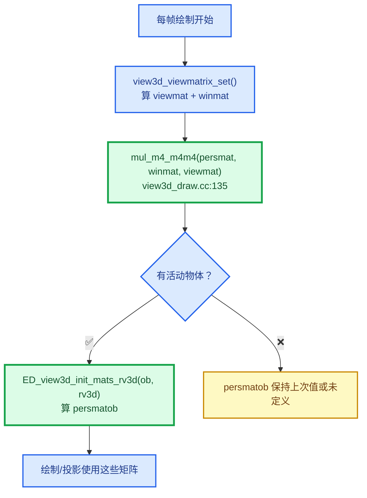
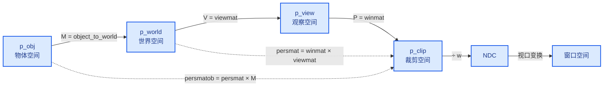

# 12 - 投影矩阵与 view3d_project 完全解析

> 🔗 [返回索引](./README.md) | 上一篇：[11-DRW_text_cache_draw逐行解析](./11-DRW_text_cache_draw逐行解析.md) | 参考：[配色与图例约定](./配色与图例约定.md)

本文彻底讲清两件事：

1. **矩阵链的每一步**（`viewmat` / `winmat` / `persmat` / `persmatob` 到底怎么乘出来的）
2. **`view3d_project.cc:99~173` 的逐行执行**（含完整数值推演）

---

## 目录

- [1. 先建立直觉：坐标系与矩阵](#1-先建立直觉坐标系与矩阵)
- [2. 四个矩阵的定义与真实构造代码](#2-四个矩阵的定义与真实构造代码)
- [3. 矩阵链的完整推导](#3-矩阵链的完整推导)
- [4. 为什么乘法顺序是反的](#4-为什么乘法顺序是反的)
- [5. 透视投影矩阵的具体元素](#5-透视投影矩阵的具体元素)
- [6. ed_view3d_project__internal 逐行解析](#6-ed_view3d_project__internal-逐行解析)
- [7. ED_view3d_project_short_ex 解析](#7-ed_view3d_project_short_ex-解析)
- [8. 完整数值推演（手算全过程）](#8-完整数值推演手算全过程)
- [9. 三种输出类型的对比](#9-三种输出类型的对比)
- [10. 常见误解澄清](#10-常见误解澄清)

---

## 1. 先建立直觉：坐标系与矩阵

### 1.1 五个坐标空间

```
┌──────────────┐
│  物体空间     │  Object / Local    原点在物体自身中心
│  p_obj       │
└──────┬───────┘
       │ M = object_to_world
       ▼
┌──────────────┐
│  世界空间     │  World             Blender 的全局坐标系
│  p_world     │
└──────┬───────┘
       │ V = viewmat
       ▼
┌──────────────┐
│  观察空间     │  View / Camera     相机在原点，看向 -Z
│  p_view      │
└──────┬───────┘
       │ P = winmat
       ▼
┌──────────────┐
│  裁剪空间     │  Clip              齐次坐标，还没除 w
│  p_clip      │
└──────┬───────┘
       │ ÷ w（透视除法）
       ▼
┌──────────────┐
│  NDC         │  Normalized Device  [-1,1]³
│  p_ndc       │
└──────┬───────┘
       │ 视口变换
       ▼
┌──────────────┐
│  窗口空间     │  Window            [0,winx] × [0,winy]
│  p_window    │
└──────────────┘
```

### 1.2 矩阵是"坐标系变换"

⭐ **关键心智模型**：一个矩阵 `M` 描述的是"**目标坐标系相对于源坐标系**"。

```
p_target = M × p_source
```

例：`viewmat` 把世界坐标变成观察坐标：

```
p_view = viewmat × p_world
```

⭐ **所以 `viewmat` 内部其实编码了"相机在世界空间的位姿的逆"** —— 因为它是把世界"拉回"到相机视角。

### 1.3 命名对照表

| 名字 | 含义 | 类型 | 定义位置 |
|------|------|------|---------|
| `M` / `object_to_world` | 物体 → 世界 | `float4x4` | `Object::object_to_world()` |
| `V` / `viewmat` | 世界 → 观察 | `float[4][4]` | `DNA_view3d_types.h:470` |
| `V⁻¹` / `viewinv` | 观察 → 世界 | `float[4][4]` | `:472` |
| `P` / `winmat` | 观察 → 裁剪 | `float[4][4]` | `:468` |
| `P·V` / `persmat` | 世界 → 裁剪 | `float[4][4]` | `:474` |
| `P·V·M` / `persmatob` | 物体 → 裁剪 | `float[4][4]` | `:482` |

---

## 2. 四个矩阵的定义与真实构造代码

### 2.1 DNA 结构体定义

```cpp
/* DNA_view3d_types.h:464-482 */
struct RegionView3D {
  DNA_DEFINE_CXX_METHODS(RegionView3D)

  /** GL_PROJECTION matrix. */
  float winmat[4][4] = {};
  /** GL_MODELVIEW matrix. */
  float viewmat[4][4] = {};
  /** Inverse of viewmat. */
  float viewinv[4][4] = {};
  /** Viewmat*winmat. */
  float persmat[4][4] = {};
  /** Inverse of persmat. */
  float persinv[4][4] = {};

  /* ... */

  /** viewmat/persmat multiplied with object matrix, while drawing and selection. */
  float viewmatob[4][4] = {};
  float persmatob[4][4] = {};
```

### 2.2 ⭐ `persmat` 的真实构造（权威证据）

⭐⭐ **这是本文最重要的一行**：

```cpp
/* view3d_draw.cc:134-137 */
/* update utility matrices */
mul_m4_m4m4(rv3d->persmat, rv3d->winmat, rv3d->viewmat);
invert_m4_m4(rv3d->persinv, rv3d->persmat);
invert_m4_m4(rv3d->viewinv, rv3d->viewmat);
```

⭐ **`mul_m4_m4m4(r, a, b)` 的语义是 `r = a × b`**。

所以：

$$\boxed{\texttt{persmat} = \texttt{winmat} \times \texttt{viewmat} = P \times V}$$

⚠️ **注意 DNA 注释写的是 `Viewmat*winmat`** —— 这是**误导性的注释**！

| 来源 | 写法 | 正确性 |
|------|------|--------|
| DNA 注释（`:474`） | `Viewmat*winmat` | ❌ **顺序反了** |
| 实际代码（`view3d_draw.cc:135`） | `mul_m4_m4m4(persmat, winmat, viewmat)` | ✅ **P × V** |

⭐ **为什么注释会写反**：作者可能想表达"由 viewmat 和 winmat 两个矩阵构成"，用文字顺序描述了**概念顺序**（先 view 后 win），但矩阵乘法**必须反过来写**（见 §4）。

### 2.3 `persmatob` 的真实构造

```cpp
/* space_view3d.cc:128-136 */
void ED_view3d_init_mats_rv3d(const Object *ob, RegionView3D *rv3d)
{
  /* local viewmat and persmat, to calculate projections */
  mul_m4_m4m4(rv3d->viewmatob, rv3d->viewmat, ob->object_to_world().ptr());
  mul_m4_m4m4(rv3d->persmatob, rv3d->persmat, ob->object_to_world().ptr());

  /* initializes object space clipping, speeds up clip tests */
  ED_view3d_clipping_local(rv3d, ob->object_to_world().ptr());
}
```

所以：

$$\boxed{\texttt{persmatob} = \texttt{persmat} \times M = P \times V \times M}$$

⭐ **命名解析**：

| 名字 | 拆解 | 含义 |
|------|------|------|
| `persmat` | **pers**pective **mat**rix | 透视矩阵（P×V） |
| `persmatob` | persmat + **ob**ject | 再乘上物体矩阵 |
| `viewmatob` | viewmat + object | V × M |

⭐ **`ptr()` 的作用**：`object_to_world()` 返回 `float4x4`（C++ 包装类），`.ptr()` 取出裸的 `float(*)[4]` 以传给 C 风格的 `mul_m4_m4m4`。

### 2.4 ⭐ 构造时机



⚠️ **`persmatob` 依赖"当前物体"** —— 所以它是**逐物体变化的**，而 `persmat` 每帧只算一次。

⭐ **这正是为什么属性文本用 `GLOBALSPACE`（走 `persmat`）**：文本缓存是跨物体收集的，不能用逐物体的 `persmatob`。

---

## 3. 矩阵链的完整推导

### 3.1 从物体坐标到裁剪空间

**逐步变换**：

```
第 1 步：物体 → 世界
  p_world = M × p_obj

第 2 步：世界 → 观察
  p_view = V × p_world
         = V × (M × p_obj)

第 3 步：观察 → 裁剪
  p_clip = P × p_view
         = P × (V × (M × p_obj))
```

⭐ **矩阵乘法满足结合律**（associative）：

$$P \times (V \times (M \times p)) = (P \times V \times M) \times p$$

**所以可以把三个矩阵先乘成一个**：

$$p_{clip} = \underbrace{(P \times V \times M)}_{\text{persmatob}} \times p_{obj}$$

### 3.2 两条路径的对比

```
路径 A：世界坐标输入（is_local = false）
────────────────────────────────────────
  p_world  ──persmat = P×V──►  p_clip

  persmat 已由 view3d_draw.cc:135 算好

路径 B：物体坐标输入（is_local = true）
────────────────────────────────────────
  p_obj    ──persmatob = P×V×M──►  p_clip

  persmatob 已由 space_view3d.cc:132 算好
```

### 3.3 为什么要预先乘好

⭐ **性能**：如果不预乘，每次投影要算 2 次矩阵乘法（4×4 矩阵乘 4×4 矩阵 = 64 次乘加）。

| 方案 | 每次投影成本 |
|------|-------------|
| 预乘 `persmat` | **1 次** 矩阵×向量（16 次乘加） |
| 不预乘 | 3 次矩阵×向量，或 2 次矩阵×矩阵 + 1 次矩阵×向量 |

⭐ **一次投影只花 16 次乘加**，对每帧数千个锚点来说很关键。

---

## 4. 为什么乘法顺序是反的

⭐ **这是最容易困惑的地方**，用一个具体例子讲清。

### 4.1 矩阵乘法的语义

**约定**：矩阵 `M` 作用于**列向量** `v`，写作 `M × v`。

```
p' = M × p
```

**含义**：`M` 把 `p` 从"源坐标系"变换到"目标坐标系"。

### 4.2 复合变换的顺序

假设先做 `A`，再做 `B`：

```
第 1 步： p₁ = A × p₀
第 2 步： p₂ = B × p₁
             = B × (A × p₀)
             = (B × A) × p₀        ← 结合律
```

⭐ **所以"先 A 后 B" 对应矩阵 `B × A`** —— **书写顺序与执行顺序相反**！

### 4.3 应用到本项目

```
执行顺序（概念上）：
  ① 物体 → 世界    用 M
  ② 世界 → 观察    用 V
  ③ 观察 → 裁剪    用 P

组合矩阵（书写上）：
  persmatob = P × V × M
              ↑   ↑   ↑
              |   |   └─ 第 1 个执行
              |   └───── 第 2 个执行
              └───────── 第 3 个执行
```

⭐ **从右往左读 = 执行顺序**。

### 4.4 用代码验证

```cpp
/* space_view3d.cc:132 —— persmatob = persmat × M */
mul_m4_m4m4(rv3d->persmatob, rv3d->persmat, ob->object_to_world().ptr());
//                          ↑ 左边（后执行）  ↑ 右边（先执行）
```

```cpp
/* view3d_draw.cc:135 —— persmat = winmat × viewmat */
mul_m4_m4m4(rv3d->persmat, rv3d->winmat, rv3d->viewmat);
//                         ↑ 后执行        ↑ 先执行
```

✅ **两处都符合"从右往左执行"的规则**。

### 4.5 一图记住

```
          书写顺序：从左到右
          ────────────────────►
   persmatob = P  ×  V  ×  M
               ③     ②     ①
          ◄────────────────────
          执行顺序：从右到左
```

---

## 5. 透视投影矩阵的具体元素

### 5.1 `winmat` 的标准形式

Blender 的透视投影矩阵（简化形式）：

```
        ┌  f/aspect    0         0              0           ┐
winmat =│     0        f         0              0           │
        │     0        0    -(far+near)/(far-near)  -2·far·near/(far-near) │
        └     0        0        -1              0           ┘

其中 f = 1 / tan(fov/2)
```

⭐ **注意第 4 行是 `[0, 0, -1, 0]`** —— 这是透视投影的**关键**。

### 5.2 第 4 行的作用

```
w' = [0, 0, -1, 0] · [x_view, y_view, z_view, 1]ᵀ
   = -z_view
```

⭐ **`w'` 等于观察空间 z 的相反数**。

在 OpenGL 约定里，相机看向 **−Z**，所以：

| 点的位置 | `z_view` | `w' = -z_view` |
|---------|----------|---------------|
| 相机前方 3 米 | `-3` | **`+3`** |
| 相机位置 | `0` | `0` |
| 相机后方 | `+2` | `-2` |

⭐⭐ **所以 `w'` 就是"点到相机的距离"**（相机前方时为正）。

### 5.3 透视除法的物理意义

```
ndc_x = x' / w' = x' / (距离)
```

⭐ **越远的点 `w'` 越大，`ndc_x` 越小** → **近大远小**。

### 5.4 正交投影的差异

正交投影矩阵的第 4 行是 `[0, 0, 0, 1]`：

```
w' = 1     （恒定）
```

⭐ **所以正交投影不做透视除法**（除以 1 无变化）→ 远近同大小。

⚠️ **这就是为什么 `text_anchor_project_with_depth` 里要 `fabsf(w)`**：透视时 `w'` 可能为负（点在相机后方），取绝对值统一处理。

---

## 6. ed_view3d_project__internal 逐行解析

> 位置：`view3d_project.cc:94-151`

```cpp
/**
 * `perspmat` is typically either:
 * - 'rv3d->perspmat',  is_local == false.
 * - 'rv3d->persmatob', is_local == true.
 */
static eV3DProjStatus ed_view3d_project__internal(const ARegion *region,
                                                  const float perspmat[4][4],
                                                  const bool is_local, /* normally hidden */
                                                  const float co[3],
                                                  float r_co[2],
                                                  const eV3DProjTest flag)
```

### 6.1 文档注释的解析

```cpp
/**
 * `perspmat` is typically either:
 * - 'rv3d->perspmat',  is_local == false.
 * - 'rv3d->persmatob', is_local == true.
 */
```

⭐ **注释里有个 typo**：写的是 `rv3d->perspmat`（多了个 `p`），实际字段名是 `rv3d->persmat`。

⭐ **但注释传达了关键信息**：`perspmat` 与 `is_local` 是**配套的**：

| `perspmat` 实参 | `is_local` 实参 | 含义 |
|----------------|----------------|------|
| `rv3d->persmat` | `false` | 输入是世界坐标 |
| `rv3d->persmatob` | `true` | 输入是物体坐标 |

✅ **这验证了 §3.2 的两条路径**。

### 6.2 函数名解析

| 片段 | 含义 |
|------|------|
| `ed_view3d_project` | 3D 视图投影 |
| `__internal` | **双下划线 = 内部函数**（Blender 约定） |
| `static` | 文件内可见 |

⭐ **双下划线前缀是 Blender 的"私有"标记** —— 表示"不要在别的文件调用"。

### 6.3 第 106 行：局部变量

```cpp
float vec4[4];
```

⭐ **为什么是 4 个分量**：齐次坐标需要第 4 维（`w`）。

### 6.4 第 109 行：标志合法性断言

```cpp
/* check for bad flags */
BLI_assert((flag & V3D_PROJ_TEST_ALL) == flag);
```

⭐ **`BLI_assert` 只在 Debug 构建生效**（Release 下被编译掉）。

**逻辑**：`flag` 不能包含 `V3D_PROJ_TEST_ALL` 之外的位。

```cpp
/* ED_view3d.hh:327-329 */
#define V3D_PROJ_TEST_ALL \
  (V3D_PROJ_TEST_CLIP_DEFAULT | V3D_PROJ_TEST_CLIP_FAR | V3D_PROJ_TEST_CLIP_ZERO | \
   V3D_PROJ_TEST_CLIP_CONTENT)
```

| 检查 | 含义 |
|------|------|
| `flag & ALL` | 取出 `flag` 中**合法**的位 |
| `== flag` | 如果相等，说明**没有非法位** ✅ |

**示例**：

```
flag = 0b000111（合法）
ALL  = 0b111111

0b000111 & 0b111111 = 0b000111
0b000111 == 0b000111  →  ✅ 通过

flag = 0b1000111（第 6 位非法）
0b1000111 & 0b111111 = 0b000111
0b000111 == 0b1000111  →  ❌ 断言失败
```

### 6.5 第 111-118 行：裁剪边界检查（CLIP_BB）

```cpp
if (flag & V3D_PROJ_TEST_CLIP_BB) {
  const RegionView3D *rv3d = static_cast<const RegionView3D *>(region->regiondata);
  if (rv3d->rflag & RV3D_CLIPPING) {
    if (ED_view3d_clipping_test(rv3d, co, is_local)) {
      return V3D_PROJ_RET_CLIP_BB;
    }
  }
}
```

#### 逐行

| 行 | 作用 |
|---|------|
| 111 | 只有传了 `CLIP_BB` 标志才检查 |
| 112 | 从 `region->regiondata` 取出 `rv3d`（**第二次转型**，调用方已取过一次） |
| 113 | `rflag` 含 `RV3D_CLIPPING` 位？（用户是否开启了裁剪） |
| 114 | 真正测 6 个裁剪平面 |
| 115 | 被裁剪 → 返回 |

#### `ED_view3d_clipping_test` 的实现

```cpp
/* view3d_draw.cc:2262-2265 */
bool ED_view3d_clipping_test(const RegionView3D *rv3d, const float co[3], const bool is_local)
{
  return view3d_clipping_test(co, is_local ? rv3d->clip_local : rv3d->clip);
}
```

⭐ **这就是 `is_local` 的用途**：

| `is_local` | 用哪套裁剪平面 | DNA 位置 |
|-----------|--------------|---------|
| `false` | `rv3d->clip[6][4]` | `:485` |
| `true` | `rv3d->clip_local[6][4]` | `:490` |

⭐ **`clip_local` 的意义**（DNA 注释 `:486-490`）：

> *Clip in object space, means we can test for clipping in edit-mode without first going into world-space.*

**在编辑模式下用物体空间裁剪，省去转世界空间的开销**。

#### `view3d_clipping_test` 内部（`:2240-2260`）

```cpp
static bool view3d_clipping_test(const float co[3], const float clip[6][4])
{
  if (plane_point_side_v3(clip[0], co) > 0.0f &&
      plane_point_side_v3(clip[1], co) > 0.0f &&
      /* ... clip[2] 到 clip[5] ... */)
  {
    return false;    /* 在所有平面内侧 → 不被裁剪 */
  }
  return true;       /* 至少在一个平面外侧 → 被裁剪 */
}
```

⭐ **6 个裁剪平面**（`clip[6][4]`）：

| 索引 | 平面 | 来源 |
|------|------|------|
| 0-3 | 前后左右 | 用户设置的裁剪边界 |
| 4-5 | 额外的两个 | 特殊用途（如局部视图） |

⭐ **数学**：`plane_point_side_v3(plane, co) = dot(plane.xyz, co) + plane.w`

| 结果 | 含义 |
|------|------|
| `> 0` | 点在平面**正侧**（内侧） |
| `<= 0` | 点在平面**负侧**（外侧，被裁） |

### 6.6 第 120-122 行：齐次化与矩阵乘

```cpp
copy_v3_v3(vec4, co);        // ①
vec4[3] = 1.0;               // ②
mul_m4_v4(perspmat, vec4);   // ③
```

#### 第 ① 行

```cpp
copy_v3_v3(vec4, co);
```

`copy_v3_v3(dst, src)` 拷贝 3 个 float：

```
vec4[0] = co[0]
vec4[1] = co[1]
vec4[2] = co[2]
vec4[3] = ?        ← 未定义！
```

#### 第 ② 行：为什么要 `vec4[3] = 1.0`

⭐ **齐次坐标的核心**：

| `w` 值 | 表示 | 受平移影响？ |
|--------|------|-------------|
| **`1`** | **点** | ✅ 是 |
| `0` | **方向向量** | ❌ 否 |

**为什么**：矩阵的第 4 列是平移分量：

```
x' = m00·x + m01·y + m02·z + m03·w
                                ^^^^^^
                          w=1 时平移才生效
                          w=0 时平移被忽略
```

⭐ **所以 `vec4[3] = 1.0` 是"声明这是个点，不是方向"**。

#### 第 ③ 行：`mul_m4_v4` 展开

```cpp
mul_m4_v4(perspmat, vec4);
```

等价于（**原地修改** `vec4`）：

```
vec4[0] = m00·v0 + m01·v1 + m02·v2 + m03·v3
vec4[1] = m10·v0 + m11·v1 + m12·v2 + m13·v3
vec4[2] = m20·v0 + m21·v1 + m22·v2 + m23·v3
vec4[3] = m30·v0 + m31·v1 + m32·v2 + m33·v3
```

⭐ **注意**：`vec4` 既是输入也是输出 —— 但**没有冲突**，因为计算 `vec4[1]` 时需要的是**原始** `v0..v3`。

⚠️ **实际实现会用临时变量**（或编译器优化），否则会出错。看 Blender 的实现：

```cpp
/* BLI_math_matrix_c.hh 概念上 */
MINLINE void mul_m4_v4(const float M[4][4], float r[4])
{
  float t[4];           /* ← 临时数组 */
  t[0] = M[0][0]*r[0] + M[0][1]*r[1] + M[0][2]*r[2] + M[0][3]*r[3];
  /* ... t[1] t[2] t[3] ... */
  copy_v4_v4(r, t);     /* ← 最后拷回 */
}
```

⭐ **所以 `vec4[3] = 1.0` 必须在 `mul_m4_v4` 之前设置**，且 `mul_m4_v4` 之后 `vec4` 已被覆盖为 `(x', y', z', w')`。

### 6.7 第 123 行：取 `|w|`

```cpp
const float w = fabsf(vec4[3]);
```

⭐ **`fabsf` = float absolute value**（`f` 后缀表示 float 版本）。

**为什么取绝对值**：

| 点的位置 | `z_view` | `w' = -z_view` | `fabsf(w')` |
|---------|----------|---------------|-------------|
| 相机前方 | 负 | **正** | 正 |
| 相机位置 | 0 | 0 | 0 |
| 相机后方 | 正 | **负** | **正**（转正） |

⭐ **统一处理相机后方的点** —— 后续的 `vec4[2] <= -w` 等比较都假设 `w > 0`。

### 6.8 第 125-127 行：除零检查（CLIP_ZERO）

```cpp
if ((flag & V3D_PROJ_TEST_CLIP_ZERO) && (w <= float(BL_ZERO_CLIP))) {
  return V3D_PROJ_RET_CLIP_ZERO;
}
```

```cpp
/* view3d_project.cc:27 */
#define BL_ZERO_CLIP 0.001
```

| 项 | 值 |
|---|-----|
| `BL_ZERO_CLIP` | `0.001` |
| 触发条件 | `w <= 0.001` |
| 含义 | 点**极其接近相机**，投影数值不可靠 |

⭐ **注释解释了原因**（`ED_view3d.hh:278-284`）：

> *Set when the coordinate is so close to the view-point that the projection isn't usable. Where there is potential numeric error in the resulting 2D value.*

⚠️ **本次调用（`draw_manager_text.cc:304`）没传 `CLIP_ZERO`** → 这个检查被跳过。

### 6.9 第 129-131 行：近裁剪面（CLIP_NEAR）

```cpp
if ((flag & V3D_PROJ_TEST_CLIP_NEAR) && (vec4[2] <= -w)) {
  return V3D_PROJ_RET_CLIP_NEAR;
}
```

#### 数学推导

```
vec4[2] <= -w
```

两边除以 `w`（`w > 0`，不等号方向不变）：

```
vec4[2] / w <= -1
```

而 `vec4[2] / w = ndc_z`，所以：

```
ndc_z <= -1
```

⭐ **NDC z 的范围是 `[-1, 1]`，`<= -1` 意味着在近裁剪面之前**。

#### 与近裁剪面的关系

```
观察空间：
  相机在 0，看向 -Z
  近裁剪面在 z_view = -near

  一个点在 z_view = -0.05（比 near 更近）
    → w' = 0.05
    → 需要知道 z' 才能比较

投影矩阵第 3 行：z' = m20·x + m21·y + m22·z + m23
  对透视：m22 = -(far+near)/(far-near)，m23 = -2·far·near/(far-near)
```

⭐ **不用手算** —— 用 `vec4[2] <= -w` 这个形式就等价于 `ndc_z <= -1`，**无需知道矩阵元素**。

### 6.10 第 133-135 行：远裁剪面（CLIP_FAR）

```cpp
if ((flag & V3D_PROJ_TEST_CLIP_FAR) && (vec4[2] >= w)) {
  return V3D_PROJ_RET_CLIP_FAR;
}
```

同理：

```
vec4[2] >= w    ⟺    ndc_z >= +1
```

⚠️ **本次调用也没传 `CLIP_FAR`** → 跳过。

### 6.11 第 137 行：`scalar` 的三元保护

```cpp
const float scalar = (w != 0.0f) ? (1.0f / w) : 0.0f;
```

⭐ **为什么需要三元**：虽然前面有 `CLIP_ZERO` 检查，但**那个检查可能没传标志**！

| 情况 | `w` | `scalar` |
|------|-----|---------|
| 正常 | `3.0` | `0.333...` |
| `w == 0` 且传了 CLIP_ZERO | — | 提前返回，到不了这行 |
| **`w == 0` 且没传 CLIP_ZERO** | `0` | **`0.0f`（保护）** |

⭐⭐ **所以这个三元是"双保险"** —— 防止 `w == 0` 时产生 `inf`。

### 6.12 第 138-139 行：NDC → 窗口坐标

```cpp
const float fx = (float(region->winx) / 2.0f) * (1.0f + (vec4[0] * scalar));
const float fy = (float(region->winy) / 2.0f) * (1.0f + (vec4[1] * scalar));
```

#### 数学公式

$$f_x = \frac{W}{2} \cdot \left(1 + \frac{x'}{w}\right) = \frac{W}{2} \cdot (1 + ndc_x)$$

其中 `W = region->winx`。

#### 逐步验算（设 W = 1920）

| `ndc_x` | `vec4[0] * scalar` | `1 + ...` | `fx = 960 × ...` | 位置 |
|---------|-------------------|-----------|------------------|------|
| `-1.0` | `-1.0` | `0.0` | **`0`** | 左边缘 |
| `-0.5` | `-0.5` | `0.5` | `480` | 左 1/4 |
| `0.0` | `0.0` | `1.0` | **`960`** | 正中 |
| `+0.5` | `+0.5` | `1.5` | `1440` | 右 3/4 |
| `+1.0` | `+1.0` | `2.0` | **`1920`** | 右边缘 |

✅ **线性映射正确**：NDC `[-1,1]` → 窗口 `[0, W]`。

#### ⚠️ 注意 `float(...)` 转换

```cpp
(float(region->winx) / 2.0f)
```

`winx` 是 `short` 或 `int`。如果不转 `float`：

```cpp
region->winx / 2      → 整数除法！1921/2 = 960（截断）
region->winx / 2.0f   → 浮点除法  1921/2 = 960.5
```

⭐ **`2.0f` 后缀也很关键** —— 否则 `1920 / 2` 是整除。

#### 与 `ED_view3d_project_float_v2_m4` 的对比

⭐ **同文件里有个等价但写法不同的实现**（`:44-45`）：

```cpp
co_region[0] = float(region->winx / 2.0f) + (region->winx / 2.0f) * vec4[0] / vec4[3];
```

展开：

$$f_x = \frac{W}{2} + \frac{W}{2} \cdot \frac{x'}{w}$$

**与 `(W/2) × (1 + x'/w)` 数学等价** ✅ 只是代数形式不同。

⚠️ **但有个细微差异**：这个版本里 `float(region->winx / 2.0f)` 是"先算 `winx / 2.0f` 再转 float"，而 `ed_view3d_project__internal` 是"先转 float 再除以 2.0f"。**实际结果相同**。

### 6.13 第 141-145 行：窗口边界检查（CLIP_WIN）

```cpp
if ((flag & V3D_PROJ_TEST_CLIP_WIN) &&
    (fx <= 0.0f || fy <= 0.0f || fx >= float(region->winx) || fy >= float(region->winy)))
{
  return V3D_PROJ_RET_CLIP_WIN;
}
```

#### 边界是"开区间"

```
有效范围：  0 < fx < winx      （不含端点）
```

| 值 | 判定 |
|---|------|
| `fx = 0` | ❌ 无效（`<= 0`） |
| `fx = 0.5` | ✅ 有效 |
| `fx = winx - 0.5` | ✅ 有效 |
| `fx = winx` | ❌ 无效（`>= winx`） |

⭐ **为什么排除端点**：因为后面要转成整数索引，合法索引是 `0 .. winx-1`。若 `fx == winx`，转成 `int` 后是 `winx` → **数组越界**。

#### 为什么用 `float(region->winx)` 而不是 `region->winx`

```cpp
fx >= float(region->winx)
```

`fx` 是 `float`，`winx` 是 `short`/`int`。**不转的话会触发整型提升，可能产生警告**。显式转换更清晰。

### 6.14 第 147-150 行：写输出并返回

```cpp
r_co[0] = fx;
r_co[1] = fy;

return V3D_PROJ_RET_OK;
```

⭐ **只在成功路径写输出** —— 提前 return 的路径都不写。所以**调用方必须先检查返回值**。

⚠️ **`r_co` 是 `float[2]`**（不是 `short`）—— 转换发生在 `ED_view3d_project_short_ex` 里（见 §7）。

---

## 7. ED_view3d_project_short_ex 解析

> 位置：`view3d_project.cc:153-173`

```cpp
eV3DProjStatus ED_view3d_project_short_ex(const ARegion *region,
                                          float perspmat[4][4],
                                          const bool is_local,
                                          const float co[3],
                                          short r_co[2],
                                          const eV3DProjTest flag)
{
  float tvec[2];
  eV3DProjStatus ret = ed_view3d_project__internal(region, perspmat, is_local, co, tvec, flag);
  if (ret == V3D_PROJ_RET_OK) {
    if ((tvec[0] > -32700.0f && tvec[0] < 32700.0f) &&
        (tvec[1] > -32700.0f && tvec[1] < 32700.0f))
    {
      r_co[0] = short(floorf(tvec[0]));
      r_co[1] = short(floorf(tvec[1]));
    }
    else {
      ret = V3D_PROJ_RET_OVERFLOW;
    }
  }
  return ret;
}
```

### 7.1 这是"薄包装层"

```
ED_view3d_project_short_ex          ← 本函数（类型转换 + 溢出检查）
    ↓ 调用
ed_view3d_project__internal         ← 真正的数学（输出 float）
```

⭐ **同族函数都是这样**：

| 函数 | 输出类型 | 差异 |
|------|---------|------|
| `ED_view3d_project_short_ex` | `short[2]` | `floorf` + ±32700 检查 |
| `ED_view3d_project_int_ex` | `int[2]` | 类似 |
| `ED_view3d_project_float_ex` | `float[2]` | **无转换**（直接用 `tvec`） |

### 7.2 第 160 行：临时缓冲

```cpp
float tvec[2];
```

| 名字 | 含义 |
|------|------|
| `tvec` | **t**emporary **vec**tor（临时向量） |

⭐ **因为 `ed_view3d_project__internal` 输出 `float[2]`，而本函数要输出 `short[2]`** —— 需要一个中间缓冲。

### 7.3 第 163 行：溢出预检查

```cpp
if ((tvec[0] > -32700.0f && tvec[0] < 32700.0f) &&
    (tvec[1] > -32700.0f && tvec[1] < 32700.0f))
```

⭐ **为什么是 `32700` 而不是 `32767`**：

| 值 | 说明 |
|---|------|
| `32767` | `short` 的实际上限（`SHRT_MAX`） |
| **`32700`** | 代码用的**保守值**（留 67 的余量） |

⚠️ **为什么留余量**：`floorf` 之后还要转换，且可能有浮点误差。留点余量更安全。

⚠️ **注意这是"预检查"** —— 在 `floorf` **之前**检查。

### 7.4 第 165-166 行：`floorf` + `short` 转换

```cpp
r_co[0] = short(floorf(tvec[0]));
```

#### `floorf` = 向下取整

| 输入 | `floorf` | `(int)` 截断 | `roundf` 四舍五入 |
|------|---------|-------------|------------------|
| `5.7` | `5` | `5` | `6` |
| `5.2` | `5` | `5` | `5` |
| `5.0` | `5` | `5` | `5` |
| `-5.2` | **`-6`** | `-5` | `-5` |
| `-5.7` | **`-6`** | `-5` | `-6` |

⭐ **为什么用 `floorf` 而不是截断**：

**关键原因：与 GPU 光栅化规则一致。**

GPU 把像素 `(i, j)` 的覆盖范围定义为 `[i, i+1) × [j, j+1)`：

```
      x=5.0        x=6.0
       │            │
       ├────────────┤
       像素 5 的覆盖范围
       ↑
   x=5.7 落在这个像素 → floorf(5.7) = 5 ✅ 正确
```

⭐ **如果用截断，负数会不一致**：

```
x = -5.2
  floorf(-5.2) = -6    ← 落在像素 -6 的范围内 [-6, -5)
  (int)(-5.2)  = -5    ← 错误！-5.2 不在 [-5, -4) 里
```

✅ **`floorf` 是正确的"坐标 → 像素索引"映射**。

### 7.5 第 168-170 行：溢出处理

```cpp
else {
  ret = V3D_PROJ_RET_OVERFLOW;
}
```

⭐ **注意：这里没有写 `r_co`** —— 输出参数保持**未初始化**！

⚠️ **调用方必须检查返回值**：

```cpp
/* draw_manager_text.cc:298-305 */
if (ED_view3d_project_short_ex(...) == V3D_PROJ_RET_OK) {
  /* 只有成功时才用 vos.sco */
}
else {
  vos.sco[0] = IS_CLIPPED;    /* ← 失败时不读它，直接标记 */
}
```

✅ **当前代码正确处理了**。

---

## 8. 完整数值推演（手算全过程）

⭐ **这次每一步都给出具体数字**。

### 8.1 场景设定

| 项 | 值 |
|---|---|
| 视口尺寸 | `1920 × 1080` |
| 相机位置 | 世界原点 `(0, 0, 0)` |
| 相机朝向 | 看向 **−Z**，up 为 **+Y** |
| 相机类型 | 透视 |
| 视野（FOV） | 90°（为了算 `f` 简单） |
| 近裁剪面 | `near = 0.1` |
| 远裁剪面 | `far = 100.0` |
| **锚点世界坐标** | `co = (1.0, 0.5, -3.0)` |

### 8.2 第 0 步：确认相机看向 −Z

⭐ 锚点 `z = -3.0` 表示它在相机**前方 3 米**（因为相机看向 −Z）。

```
      相机 👁 (0,0,0)
        │
        │  看向 -Z
        ▼
   ─────┼─────────────────► -Z
        │
        │  3 米
        ▼
       ● 锚点 (1.0, 0.5, -3.0)
```

### 8.3 第 1 步：构造 `viewmat`

⭐ **因为相机在原点、朝向 −Z、up 为 +Y，所以观察矩阵就是单位矩阵**：

```
        ┌ 1  0  0  0 ┐
viewmat =│ 0  1  0  0 │
        │ 0  0  1  0 │
        └ 0  0  0  1 ┘
```

**验证**：观察空间坐标 = 世界坐标：

```
p_view = viewmat × p_world = p_world = (1.0, 0.5, -3.0, 1.0)
```

⭐ **这简化了推演，但不失一般性**（真实相机会有旋转，`viewmat` 就是那个旋转的逆）。

### 8.4 第 2 步：构造 `winmat`（透视投影矩阵）

#### 计算 `f`

$$f = \frac{1}{\tan(\text{fov}/2)} = \frac{1}{\tan(45°)} = \frac{1}{1} = 1.0$$

#### 计算 aspect

$$\text{aspect} = \frac{W}{H} = \frac{1920}{1080} = 1.7778$$

#### 矩阵元素

```
f/aspect = 1.0 / 1.7778 = 0.5625

m22 = -(far + near) / (far - near)
    = -(100.0 + 0.1) / (100.0 - 0.1)
    = -100.1 / 99.9
    = -1.00200

m23 = -2 · far · near / (far - near)
    = -2 × 100.0 × 0.1 / 99.9
    = -20.0 / 99.9
    = -0.20020
```

#### `winmat` 矩阵

```
        ┌ 0.5625    0        0          0       ┐
winmat =│   0      1.0       0          0       │
        │   0       0     -1.00200   -0.20020   │
        └   0       0       -1          0       ┘
```

⭐ **注意第 4 行 `[0, 0, -1, 0]`** —— 透视投影的标志。

### 8.5 第 3 步：计算 `persmat = winmat × viewmat`

⭐ **因为 `viewmat` 是单位矩阵**：

$$P \times I = P$$

所以：

```
        ┌ 0.5625    0        0          0       ┐
persmat =│   0      1.0       0          0       │
        │   0       0     -1.00200   -0.20020   │
        └   0       0       -1          0       ┘
```

### 8.6 第 4 步：`copy_v3_v3(vec4, co)` + `vec4[3] = 1.0`

```
vec4 = [ 1.0,  0.5,  -3.0,  1.0 ]
          ↑     ↑     ↑     ↑
         x     y     z     w（齐次化）
```

### 8.7 第 5 步：`mul_m4_v4(persmat, vec4)` —— 逐个分量算

⭐⭐ **这是核心计算，逐项展开**。

#### `x'` = 第 0 行 · vec4

```
x' = 0.5625 × 1.0  +  0 × 0.5  +  0 × (-3.0)  +  0 × 1.0
   = 0.5625
```

#### `y'` = 第 1 行 · vec4

```
y' = 0 × 1.0  +  1.0 × 0.5  +  0 × (-3.0)  +  0 × 1.0
   = 0.5
```

#### `z'` = 第 2 行 · vec4

```
z' = 0 × 1.0  +  0 × 0.5  +  (-1.00200) × (-3.0)  +  (-0.20020) × 1.0
   = 0  +  0  +  3.00600  -  0.20020
   = 2.80580
```

#### `w'` = 第 3 行 · vec4

```
w' = 0 × 1.0  +  0 × 0.5  +  (-1) × (-3.0)  +  0 × 1.0
   = 3.0
```

⭐⭐ **关键验证**：`w' = 3.0` = **锚点到相机的距离** ✅ 符合 §5.2 的推导。

#### 结果

```
vec4 = [ 0.5625,  0.5,  2.80580,  3.0 ]
          x'      y'     z'       w'
```

### 8.8 第 6 步：`w = fabsf(vec4[3])`

```
w = |3.0| = 3.0
```

### 8.9 第 7 步：CLIP_ZERO 检查（本次未传，跳过）

```
本次 flag = CLIP_BB | CLIP_WIN | CLIP_NEAR = 0b111
                              ↑ 不含 CLIP_ZERO（bit 4）

(flag & CLIP_ZERO) = 0  → 整个条件为假 → 跳过
```

### 8.10 第 8 步：CLIP_NEAR 检查

```
flag & CLIP_NEAR = 0b111 & 0b100 = 0b100 ≠ 0  → 进入检查

vec4[2] <= -w ?
2.80580 <= -3.0 ?
→ 否 ✅ 通过（不在近裁剪面之前）
```

⭐ **几何直觉**：`z' = 2.806` 是正的，说明点在近裁剪面**之后**（正常位置）。

### 8.11 第 9 步：CLIP_FAR 检查（本次未传，跳过）

```
(flag & CLIP_FAR) = 0b111 & 0b1000 = 0  → 跳过
```

⚠️ **如果传了**：

```
vec4[2] >= w ?
2.80580 >= 3.0 ?
→ 否 ✅ 也会通过
```

### 8.12 第 10 步：计算 `scalar`

```
w = 3.0 ≠ 0  →  scalar = 1.0 / 3.0 = 0.333333...
```

### 8.13 第 11 步：NDC 坐标

#### `ndc_x`

```
ndc_x = vec4[0] × scalar
      = 0.5625 × 0.333333
      = 0.187500
```

#### `ndc_y`

```
ndc_y = vec4[1] × scalar
      = 0.5 × 0.333333
      = 0.166667
```

⭐ **验证 NDC 范围**：`0.1875` 和 `0.1667` 都在 `[-1, 1]` 内 ✅ 说明点在视锥内。

### 8.14 第 12 步：窗口坐标

#### `fx`

```
fx = (winx / 2) × (1 + ndc_x)
   = (1920 / 2) × (1 + 0.187500)
   = 960 × 1.187500
   = 1140.0
```

#### `fy`

```
fy = (winy / 2) × (1 + ndc_y)
   = (1080 / 2) × (1 + 0.166667)
   = 540 × 1.166667
   = 630.0
```

⭐⭐ **结果**：锚点投影到屏幕 `(1140.0, 630.0)`。

### 8.15 第 13 步：CLIP_WIN 检查

```
flag & CLIP_WIN = 0b111 & 0b010 = 0b010 ≠ 0  → 进入检查

fx = 1140.0
  1140.0 <= 0.0 ?        否
  1140.0 >= 1920.0 ?     否
  ✅ 通过

fy = 630.0
  630.0 <= 0.0 ?         否
  630.0 >= 1080.0 ?      否
  ✅ 通过
```

### 8.16 第 14 步：写输出

```cpp
r_co[0] = 1140.0f;     /* 注意：这里还是 float */
r_co[1] = 630.0f;
return V3D_PROJ_RET_OK;
```

### 8.17 第 15 步：`ED_view3d_project_short_ex` 的转换

```cpp
float tvec[2] = {1140.0f, 630.0f};

/* 溢出检查 */
tvec[0] = 1140.0 在 (-32700, 32700) 内 ✅
tvec[1] = 630.0  在 (-32700, 32700) 内 ✅

/* floorf + short */
r_co[0] = short(floorf(1140.0f)) = short(1140.0f) = 1140
r_co[1] = short(floorf(630.0f))  = short(630.0f)  = 630
```

### 8.18 最终结果

```
vos.sco = { 1140, 630 }
```

⭐ **回到 `draw_manager_text.cc:298-305`**：

```
V3D_PROJ_RET_OK == V3D_PROJ_RET_OK  →  true  →  进入 then 块 ✅
```

### 8.19 推演结果汇总表

| 步骤 | 计算 | 结果 |
|------|------|------|
| 0 | 输入 `co` | `(1.0, 0.5, -3.0)` |
| 1 | `viewmat` | 单位矩阵（相机在原点） |
| 2 | `winmat` | 见 §8.4 |
| 3 | `persmat = winmat × viewmat` | = `winmat` |
| 4 | 齐次化 | `[1.0, 0.5, -3.0, 1.0]` |
| 5 | `mul_m4_v4` | `[0.5625, 0.5, 2.8058, **3.0**]` |
| 6 | `w = fabsf(3.0)` | `3.0` |
| 7 | CLIP_ZERO | 跳过（未传标志） |
| 8 | CLIP_NEAR：`2.8058 <= -3.0`? | 否，通过 ✅ |
| 9 | CLIP_FAR | 跳过（未传标志） |
| 10 | `scalar = 1/3.0` | `0.33333` |
| 11 | `ndc_x = 0.5625 × 0.33333` | `0.1875` |
| 12 | `ndc_y = 0.5 × 0.33333` | `0.16667` |
| 13 | `fx = 960 × 1.1875` | `1140.0` |
| 14 | `fy = 540 × 1.16667` | `630.0` |
| 15 | CLIP_WIN | 通过 ✅ |
| 16 | `floorf` + `short` | `{1140, 630}` |
| 17 | 返回 | `V3D_PROJ_RET_OK` |

### 8.20 反向验证：从屏幕坐标推回世界坐标

⭐ **用 `persinv`（`persmat` 的逆）可以验证结果自洽**。

已知 `ndc = (0.1875, 0.16667)`，`w' = 3.0`：

```
x' = ndc_x × w' = 0.1875 × 3.0 = 0.5625  ✅ 与 §8.7 一致
y' = ndc_y × w' = 0.16667 × 3.0 = 0.5    ✅ 一致
```

⭐ **再用 `winmat` 的第 3 行反推 `z_view`**：

```
w' = -z_view
3.0 = -z_view
z_view = -3.0   ✅ 与输入的 z = -3.0 一致
```

✅ **全链路自洽**。

### 8.21 另一个例子：点在相机后方

⭐ **用来说明 `fabsf` 和裁剪检查的作用**。

设 `co = (1.0, 0.5, +3.0)`（在相机**后方**）：

```
vec4 = [1.0, 0.5, 3.0, 1.0]

w' = -z_view = -(+3.0) = -3.0

fabsf(w') = 3.0      ← fabsf 把它转正

z' = -1.002 × 3.0 + (-0.2002) × 1.0
   = -3.006 - 0.2002
   = -3.2062
```

**CLIP_NEAR 检查**：

```
vec4[2] <= -w ?
-3.2062 <= -3.0 ?
→ ✅ 是！  →  返回 V3D_PROJ_RET_CLIP_NEAR  ✅ 正确剔除
```

⭐ **几何意义**：相机后方的点在 NDC z 上会小于 −1，被正确识别为"在近裁剪面之前"。

⭐ **这就是 `fabsf` 的必要性**：如果不取绝对值，`w = -3.0`，那么 `vec4[2] <= -w` 变成 `-3.2062 <= 3.0`，**恒为真** → 无法区分。

---

## 9. 三种输出类型的对比

```cpp
/* view3d_project.cc:175-180 —— int 版 */
eV3DProjStatus ED_view3d_project_int_ex(...)

/* view3d_project.cc:546 —— float 版 */
eV3DProjStatus ED_view3d_project_float_ex(...)
```

| | `_short_ex` | `_int_ex` | `_float_ex` |
|---|---|---|---|
| 输出类型 | `short[2]` | `int[2]` | `float[2]` |
| 临时缓冲 | 需要 `tvec` | 需要 | **不需要** |
| 溢出检查 | ±32700 | ±2^31 | 无 |
| 转换 | `floorf` | `floorf` | 无 |
| 精度 | 低 | 中 | **高** |
| 典型用途 | 文本、UI 坐标 | 选择 | 数学计算 |

⭐ **`_float_ex` 最简单**：

```cpp
eV3DProjStatus ED_view3d_project_float_ex(const ARegion *region,
                                          float perspmat[4][4],
                                          const bool is_local,
                                          const float co[3],
                                          float r_co[2],
                                          const eV3DProjTest flag)
{
  return ed_view3d_project__internal(region, perspmat, is_local, co, r_co, flag);
  /*                                          ↑ 直接传 r_co，无中间层 */
}
```

⚠️ **本 patch 的 `text_anchor_project_with_depth` 是自己重新实现的**（因为官方函数不返回深度）—— 见 [03-§8](./03-文本缓存遮挡测试核心.md)。

---

## 10. 常见误解澄清

### 误解 1：`persmat` 是"透视矩阵"

❌ **不准确**。`persmat` = **P × V**，是"透视矩阵 × 观察矩阵"的**组合**。

| 名字 | 内容 |
|------|------|
| `winmat` | 纯投影矩阵 P |
| `viewmat` | 纯观察矩阵 V |
| **`persmat`** | **P × V**（已组合） |

⭐ `pers` 是"perspective"的缩写，指"投影是透视的"，不是"这是投影矩阵"。

### 误解 2：DNA 注释 `Viewmat*winmat` 说明顺序是 V×P

❌ **注释有误**。真实代码（`view3d_draw.cc:135`）是：

```cpp
mul_m4_m4m4(rv3d->persmat, rv3d->winmat, rv3d->viewmat);
/*                          ↑ 第一个（左）  ↑ 第二个（右）*/
/*                          结果是 winmat × viewmat = P × V */
```

⭐ **注释用文字描述了"概念顺序"，而代码必须用"数学顺序"（相反）**。

### 误解 3：`w` 是"第四维坐标"

❌ **`w` 不是空间维度**。它是**齐次坐标的缩放因子**，在透视投影后等于**到相机的距离**。

| `w` | 含义 |
|-----|------|
| 齐次化时设为 `1` | "这是个点" |
| 投影后 | **相机到点的距离**（透视）或 `1`（正交） |

### 误解 4：透视除法后 `z` 就"没用了"

❌ **`z` 是深度测试的关键**。`ndc_z` 映射到 `[0,1]` 后写入深度缓冲：

```
depth = (ndc_z + 1) × 0.5
```

⭐ **这正是本 patch 的核心**（见 [01-§4](./01-背景知识与原理.md)）。

### 误解 5：`floorf` 和 `(int)` 等价

❌ **对负数不同**：

| 输入 | `floorf` | `(int)` |
|------|---------|--------|
| `5.7` | `5` | `5` |
| `-5.7` | **`-6`** | **`-5`** |

⭐ **`floorf` 才符合"像素覆盖范围 `[i, i+1)`"的语义**。

### 误解 6：`is_local` 影响投影数学

❌ **`is_local` 只影响裁剪测试**，不影响矩阵运算：

```cpp
/* is_local 的唯一用途 */
ED_view3d_clipping_test(rv3d, co, is_local);
/*                              ↑ 决定用 clip[] 还是 clip_local[] */
```

⭐ **投影本身完全由 `perspmat` 参数决定**。

---

## 小结

### 矩阵链（权威版）



| 矩阵 | 公式 | 构造代码 |
|------|------|---------|
| `viewmat` | V | `view3d_viewmatrix_set()` |
| `winmat` | P | `view3d_viewmatrix_set()` |
| **`persmat`** | **P × V** | `view3d_draw.cc:135` |
| **`persmatob`** | **P × V × M** | `space_view3d.cc:132` |

### `ed_view3d_project__internal` 执行流程

| 行 | 步骤 | 输出 |
|---|------|------|
| 109 | 标志合法性断言 | — |
| 111-118 | `CLIP_BB`：测 6 个裁剪平面 | 或返回 `CLIP_BB` |
| 120-121 | 齐次化 `vec4 = (co, 1.0)` | — |
| 122 | `mul_m4_v4(perspmat, vec4)` | `(x', y', z', w')` |
| 123 | `w = fabsf(w')` | 距离 |
| 125-127 | `CLIP_ZERO`：`w <= 0.001`？ | 或返回 `CLIP_ZERO` |
| 129-131 | `CLIP_NEAR`：`z' <= -w`？ | 或返回 `CLIP_NEAR` |
| 133-135 | `CLIP_FAR`：`z' >= w`？ | 或返回 `CLIP_FAR` |
| 137 | `scalar = 1/w`（带除零保护） | — |
| 138-139 | NDC → 窗口 | `fx, fy` |
| 141-145 | `CLIP_WIN`：越界？ | 或返回 `CLIP_WIN` |
| 147-150 | 写输出并返回 | `OK` |

### 关键数学

$$w' = -z_{view} \quad\text{（透视投影第 4 行 } [0,0,-1,0]\text{）}$$

$$ndc = \frac{clip_{xyz}}{w'}, \qquad f_x = \frac{W}{2}(1 + ndc_x)$$

$$depth = \frac{ndc_z + 1}{2}$$

### 数值推演结论

| 输入 | `(1.0, 0.5, -3.0)` |
|------|-------------------|
| `w'` | `3.0`（= 到相机距离） |
| `ndc` | `(0.1875, 0.16667)` |
| 窗口 | `(1140.0, 630.0)` |
| `short` | `{1140, 630}` |

---

## 相关文档

- 投影在遮挡测试中的角色 → [03-文本缓存遮挡测试核心](./03-文本缓存遮挡测试核心.md)
- NDC 与深度映射 → [01-背景知识与原理](./01-背景知识与原理.md)
- 逐行解析主循环 → [11-DRW_text_cache_draw逐行解析](./11-DRW_text_cache_draw逐行解析.md)
