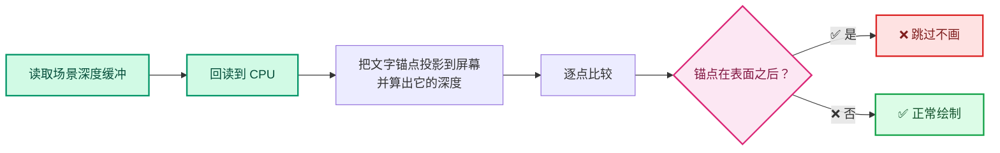

# 属性文本遮挡剔除（Attribute Text Occlusion Culling）完全解析

> **分支**: `attribute-text-depth-culling`
> **基准提交**: `bba93a5d6df` (Refactor: Mesh: Merge: Split remap index building function)
> **特性提交**: `39009b48098` (Cull attribute viewer text using scene depth)
> **规模**: 9 个文件，+304 / −24
> **文档创建**: 2026-09

---

## 这套文档是什么

针对 `39009b48098` 这一个提交（commit）的**逐行、逐概念、逐 API 完全解析**。

目标不是"看懂 diff 干了什么"，而是：

1. **看懂它为什么这么写** —— 需求是什么，有哪些替代方案，为什么选了这个。
2. **看懂它用到的每一个知识点** —— 深度缓冲、NDC、齐次坐标、透视投影、AABB 求交、GPU 回读、视口绘制顺序、DNA/RNA 属性系统。
3. **看懂它哪里写错了** —— 有一个高危的**命名陷阱**、一个真实 bug（重复投影）和若干需要改进的地方。
4. **看懂怎么提交** —— 如何拆分成多个 commit，如何写 commit message，如何回应 review。

---

## 文档索引

| 文档 | 内容 | 适合谁读 |
|------|------|----------|
| [00-总览与架构.md](./00-总览与架构.md) | 需求、方案设计、改动全景、调用链、文件清单 | 所有人，先读这个 |
| [01-背景知识与原理.md](./01-背景知识与原理.md) | 深度缓冲、NDC、齐次坐标、投影矩阵、遮挡 vs 背面、为什么要 CPU 回读 | 想彻底搞懂原理的人 |
| [02-属性层-DNA-RNA-UI.md](./02-属性层-DNA-RNA-UI.md) | DNA 位标志、RNA 属性绑定、Python UI 面板、默认值与兼容性 | 想做属性/UI 扩展的人 |
| [03-文本缓存遮挡测试核心.md](./03-文本缓存遮挡测试核心.md) | `draw_manager_text.hh/cc` 深度解析，投影数学、深度比较、偏置 | 核心逻辑 |
| [04-实例层-缓存与绘制顺序.md](./04-实例层-缓存与绘制顺序.md) | `overlay_instance.hh/cc`，ViewDepths 生命周期、绘制顺序、为什么放在那一行 | 想懂 Overlay 引擎的人 |
| [05-锚点偏移数学.md](./05-锚点偏移数学.md) | 点云半径偏移、实例包围盒偏移、1/√3 的来历、AABB 命名陷阱 | 数学与几何部分 |
| [06-API与函数参考.md](./06-API与函数参考.md) | 所有涉及的函数签名、结构体、常量速查表 | 当字典用 |
| [07-问题清单与修复.md](./07-问题清单与修复.md) | 🟠 必修 + 🟡 建议 + 🟢 小问题，含修复代码 | **提交前必读** |
| [08-提交指南.md](./08-提交指南.md) | commit 拆分方案、commit message、review 回复要点 | **提交前必读** |
| [09-Instance类完全解析.md](./09-Instance类完全解析.md) | Overlay 引擎核心类逐段解析：5 个引擎虚函数、双层设计、draw_v3d 八个阶段 | 想懂 Overlay 引擎架构的人 |
| [配色与图例约定.md](./配色与图例约定.md) | 全套流程图的七色层级语义、状态色、节点形状约定 | 读图前先看 |

⭐ **本目录含 118 张彩色流程图**（Mermaid）。读图前建议先看 [配色与图例约定](./配色与图例约定.md) —— **相同颜色 = 同一职责层**，跨文档保持一致。

---

## 30 秒速览

**做了什么**：给 3D 视口里的"属性查看器"文字加了一个**可选**的遮挡剔除。开启后，被几何体挡住的文字标签不再绘制。

**怎么做**：



**关键设计决策**：

| 决策 | 选择 | 理由 |
|------|------|------|
| 在哪里做遮挡测试 | `DRW_text_cache_draw` 内部 | 一处生效，覆盖所有几何类型 |
| 深度从哪来 | GPU 回读视口深度纹理 | 唯一能拿到"场景真实深度"的途径 |
| 何时回读 | 深度 prepass 之后、grid/axes 之前 | grid 和 axes 会写入自己的一像素深度污染数据 |
| 是否每帧回读 | 仅当有字符串请求时才回读 | 避免默认性能损失 |
| 默认值 | 关闭 | 不改变现有行为，安全 |

**发现的问题**（详见 [07](./07-问题清单与修复.md)）：

- 🟠 **命名陷阱（必修）**：`entry_distance` 实际是"穿出距离"。功能正确，但名字极易诱导维护者"修正"成真 bug。
- 🟠 **2 个必修**：`ViewDepths::w/h` 类型截断；重复投影导致采样点可能偏移 1 像素。
- 🟡 **若干建议**：`const_cast`、魔法常量、UI 文案。

> ✅ **两个曾怀疑、最终排除的问题**：AABB 参数位置、正交相机方向。完整推导见 [05-§6](./05-锚点偏移数学.md#6--aabb-参数与命名分析) 与 [05-§9.3](./05-锚点偏移数学.md#93--关于那个bug的重要更正)。

---

## 前置知识

读这套文档需要：

- **C++ 基础**：模板、`constexpr if`、结构化绑定、RAII。
- **Blender 基础**：知道什么是 Overlay 引擎、DNA/RNA、`Object`/`Mesh`。
- **图形学基础**（会解释）：矩阵变换、投影、深度缓冲。

如果完全没接触过 Blender 图形栈，建议先读同仓库的：

- [overlay 通读系列](../暂时不看的/overlay/overlay通读/README.md) — Overlay 引擎全貌
- [叠加层文本绘制系列](../暂时不看的/叠加层文本绘制/01_文本渲染系统解析.md) — 文本渲染系统
- [基础库系列](../基础库/00_Overview.md) — `Span`/`Array`/`VArray` 等容器

---

## 源码位置速查

```
source/blender/
├── makesdna/DNA_view3d_types.h              ← 位标志定义 (1<<20)
├── makesrna/intern/rna_space.cc             ← RNA 属性绑定
├── draw/
│   ├── intern/
│   │   ├── draw_manager_text.hh             ← 新增标志 + 2 个接口
│   │   └── draw_manager_text.cc             ← 遮挡测试核心实现
│   └── engines/overlay/
│       ├── overlay_private.hh               ← State 取值封装
│       ├── overlay_instance.hh              ← ViewDepths 缓存成员
│       ├── overlay_instance.cc              ← 每帧回读 + 绘制顺序
│       └── overlay_attribute_text.hh        ← 锚点偏移 + 标志透传
└── scripts/startup/bl_ui/space_view3d.py    ← 面板勾选框
```

---

## 阅读路线建议

**路线 A：只想知道怎么提交**（30 分钟）
```
本 README → 07-问题清单与修复 → 08-提交指南
```

**路线 B：想搞懂实现**（2 小时）
```
本 README → 00-总览 → 01-背景 → 03-文本缓存核心 → 04-实例层 → 05-锚点数学
```

**路线 C：想学 Blender 图形栈**（4 小时+）
```
本 README → 01-背景 → 02-属性层 → 03 → 04 → 05 → 06-API参考
再配合读 .markdown/暂时不看的/叠加层文本绘制/ 整个系列
```

---

## 约定

- 代码引用统一格式：```` ```cpp path/to/file.cc:123-145 ````
- ⭐ 表示关键点，⚠️ 表示坑，🟠（必修）/ 🟡（建议）/ 🟢（小）表示严重度
- ⭐ 本套文档记录了一次**分析自我更正**：AABB 参数与正交相机方向两个"疑似 bug"经完整推导后**被排除**。这个过程本身很有教学价值（见 [05-§9.3](./05-锚点偏移数学.md#93--关于那个bug的重要更正)）。
- "行号"均指 `39009b48098` 提交后的状态
