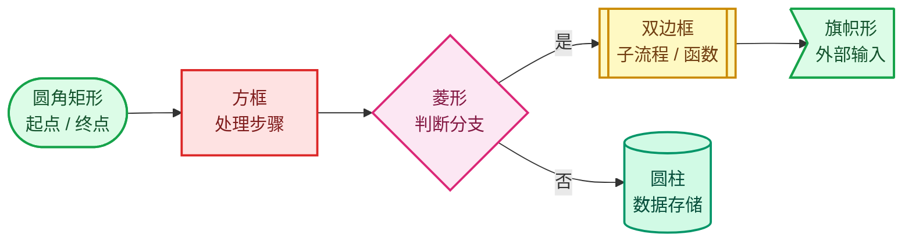

# 配色与图例约定

> 🔗 [返回索引](./README.md)

本目录的所有流程图遵循**统一的配色语义**。颜色不是装饰 —— **相同颜色的节点表示同一职责层**，让你可以跨文档建立直觉。

---

## 一、七色层级语义

| 层 | 颜色 | 填充 / 描边 | 语义 | 典型节点 |
|----|------|-------------|------|----------|
| ① UI | 🔵 蓝 | `#DBEAFE` / `#2563EB` | 用户可见的开关、面板 | DNA 位标志、RNA 属性、Python 勾选框 |
| ② Overlay | 🟣 紫 | `#EDE9FE` / `#7C3AED` | 引擎实例与状态快照 | `Instance`、`State`、`draw_v3d` |
| ③ 几何 | 🩵 青 | `#CFFAFE` / `#0891B2` | 锚点计算与坐标变换 | `AttributeTexts`、偏移计算、AABB |
| ④ 文本 | 🟡 琥珀 | `#FEF3C7` / `#D97706` | 文本缓存与字符串 | `DRWTextStore`、`ViewCachedString` |
| ⑤ 深度 | 🟢 绿 | `#D1FAE5` / `#059669` | 深度数据与回读 | `ViewDepths`、`GPU_texture_read` |
| ⑥ 判定 | 🩷 粉 | `#FCE7F3` / `#DB2777` | 投影、比较、决策分支 | `text_anchor_project_with_depth` |
| ⑦ 结果 | 🟦 靛 | `#E0E7FF` / `#4F46E5` | 最终绘制或剔除 | `BLF_draw_default`、`IS_CLIPPED` |

---

## 二、状态色（语义固定）

这三个颜色**全局含义固定**，无论出现在哪个图里：

| 状态 | 填充 / 描边 | 含义 |
|------|-------------|------|
| ✅ 绿 | `#DCFCE7` / `#16A34A` | 正确、保留、通过测试、无需修改 |
| ⚠️ 黄 | `#FEF9C3` / `#CA8A04` | 需注意、有条件成立、建议改进 |
| ❌ 红 | `#FEE2E2` / `#DC2626` | 错误、被剔除、必须修复、陷阱 |

---

## 三、严重度色（仅用于问题清单）

| 标记 | 填充 / 描边 | 含义 |
|------|-------------|------|
| 🟠 必修 | `#FFEDD5` / `#EA580C` | 提交前必须处理 |
| 🟡 建议 | `#FEF9C3` / `#CA8A04` | 推荐处理，可延后 |
| 🟢 小 | `#DCFCE7` / `#16A34A` | 清理项，无功能影响 |

---

## 四、节点形状约定

| 形状 | Mermaid 语法 | 用途 |
|------|--------------|------|
| 圆角矩形 | `id(["文本"])` | 流程起点 / 终点 |
| 方框 | `id["文本"]` | 普通处理步骤 |
| 菱形 | `id{"文本"}` | 条件判断 |
| 双边框 | `id[["文本"]]` | 子流程 / 函数调用 |
| 圆柱 | `id[("文本")]` | 数据存储 |
| 旗帜 | `id>"文本"]` | 外部输入 |

---

## 五、线条语义

| 线型 | Mermaid 语法 | 含义 |
|------|--------------|------|
| 实线箭头 | `-->` | 控制流 / 顺序执行 |
| 虚线箭头 | `-.->` | 数据流 / 引用 / 借用 |
| 粗箭头 | `==>` | 关键路径 / 高开销操作 |
| 带标签 | `-->\|标签\|` | 条件分支、真/假 |

---

## 六、阅读提示

- 🔵🟣🩵🟡🟢🩷🟦 **七色循环**，同一层在多篇文档里颜色一致
- ✅⚠️❌ **状态三色**，语义全局固定
- 图中使用**中文标签**，代码标识符保留英文原样
- 交叉引用统一写作 `[0X-文档名](./0X-文档名.md)`
- 涉及源码精确位置时，格式为 `` `文件:行号` ``

---

## 返回

[返回索引](./README.md)
