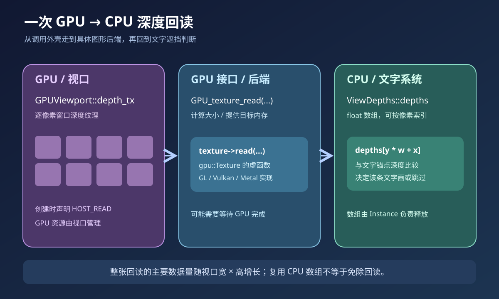

# 03 · 从屏幕区域一直追到 GPU 后端



## 1. CPU 与 GPU 在这里各做什么

CPU 负责准备绘制数据、发出 GPU 命令、保存 `DRWTextStore` 和执行逐条文字的判断。GPU 负责把几何投影并光栅化成像素，维护每个像素的深度。`GPUViewport::depth_tx` 是 GPU 纹理；`ViewDepths::depths` 是 CPU 可直接索引的数组。两者是不同资源。

“深度”在此指投影后的窗口深度值，用于表达当前像素哪个表面更靠前。透视投影下，窗口深度随距离一般非线性。读取深度纹理，是在某一绘制时刻取得这张图的**快照**；之后 GPU 继续画别的东西，不会自动更新已读到 CPU 的数组。

`update_text_depth()` 在 `draw_v3d()` 的深度预处理之后、网格和坐标轴可能改写深度之前运行，调用点见 `overlay_instance.cc:938–939`。这避免细线恰好经过文字锚点时被当成遮挡表面。真正的逐条比较在 `draw_manager_text.cc:244–301`。

## 2. `ARegion → wmDrawBuffer → GPUViewport → depth_tx`

`Instance::init()` 把绘制上下文中的 `ctx->region` 存进 `state.region`。窗口管理器为需要视口的区域创建 `wmDrawBuffer`，并在其中放入 `GPU_viewport_create()` 创建的 `GPUViewport`，见 `wm_draw.cc:748–754`。

`WM_draw_region_get_viewport(region)` 的实现读取 `region->runtime->draw_buffer->viewport`，如果没有 draw buffer 则返回空指针，见 `wm_draw.cc:954–962`。本函数的正常 3D 绘制路径假设此时视口已经存在。它没有在这里创建视口或做完整的空指针恢复。

`GPUViewport` 定义在 `gpu_viewport.cc:56–92`，有 `gpu::Texture *depth_tx` 成员。视口资源创建时，深度纹理采用 `SFLOAT_32_DEPTH_UINT_8` 格式并带 `GPU_TEXTURE_USAGE_HOST_READ`，见 `gpu_viewport.cc:173–183`。这表明深度与 stencil 共享一种纹理格式，且允许 CPU 回读。不能仅凭这个格式名称就断言运行时必然是 D24 定点深度。

`GPU_viewport_depth_texture(viewport)` 直接返回 `viewport->depth_tx`。这属于借用视口拥有的 GPU 资源指针；`Instance` 不负责释放 GPU 纹理。`Instance` 仅负责自己分配的 CPU `ViewDepths`。

## 3. `gpu::Texture` 有继承和虚函数吗

有。`gpu::Texture` 是 GPU 后端共用的抽象类，见 `gpu_texture_private.hh:101–175`，其中 `virtual void read(int mip, eGPUDataFormat format, void *dst) = 0;` 是纯虚函数。实际纹理对象由正在使用的图形后端实现。

外层 `GPU_texture_read(texture, format, mip, dst)` 是普通 C++ 函数，在 `gpu_texture.cc:554–562` 检查 `HOST_READ` 使用标志后执行 `texture->read(...)`。**这一句才发生纹理读回的虚函数分派。**

OpenGL 后端 `GLTexture::read()` 最终调用 `glGetTextureSubImage(...)`，见 `gpu/opengl/gl_texture.cc:483–525`。Vulkan 后端 `VKTexture::read_sub()` 把图像复制到暂存缓冲区，提交并等待完成，再把结果转换/复制到 CPU 目标地址，见 `gpu/vulkan/vk_texture.cc:204–333`。后端路径不完全相同，所以具体同步和耗时不能只凭外层几行代码定量断言。

## 4. 两种 `GPU_texture_read()` 重载

```cpp
void *GPU_texture_read(Texture *texture, eGPUDataFormat format, int mip);
void GPU_texture_read(Texture *texture, eGPUDataFormat format, int mip, void *dst);
```

第一种在 `gpu_texture.cc:538–552`：用 `read_size_get()` 计算尺寸，`MEM_new_uninitialized()` 分配目标内存，然后调用第二种填充，返回新分配的地址。第二种在 `554–562`：使用调用者提供的内存，并通过纹理的虚函数交给 GPU 后端。

`read_size_get()` 依据 mip 尺寸、样本数与格式计算字节数，见 `gpu_texture.cc:564–575`。对于 1920×1080、每像素一枚 4 字节浮点数的 CPU 深度数组，大小约为 7.91 MiB。**这只是 CPU 结果数组的估算**，不是整套 GPU/驱动资源的占用。

## 5. 性能瓶颈在哪里

遍历文字标志是 `O(N)`，其中 `N` 为本轮文字条数，但找到第一条需要测试的文字就结束。触发回读后，读回数据量主要随视口像素数 `W×H` 增长，不会因文字从 100 条变成 101 条就再读一遍全图。逐条文字比较另有自己的成本，透视局部平面重建只在中心深度判为遮挡等条件下执行。

GPU 与 CPU 往往并行推进。CPU 想立即拿到“GPU 此前已写完的深度”时，后端可能需要提交工作并等待，形成同步点。Vulkan 代码明确包含 `WAIT_FOR_COMPLETION`；其他后端实现与驱动行为要分别考察。因此报告性能应给出后端、视口尺寸、文字数、开启/关闭遮挡时的帧时测量，而不能把“只执行一个函数调用”理解成成本很小。
