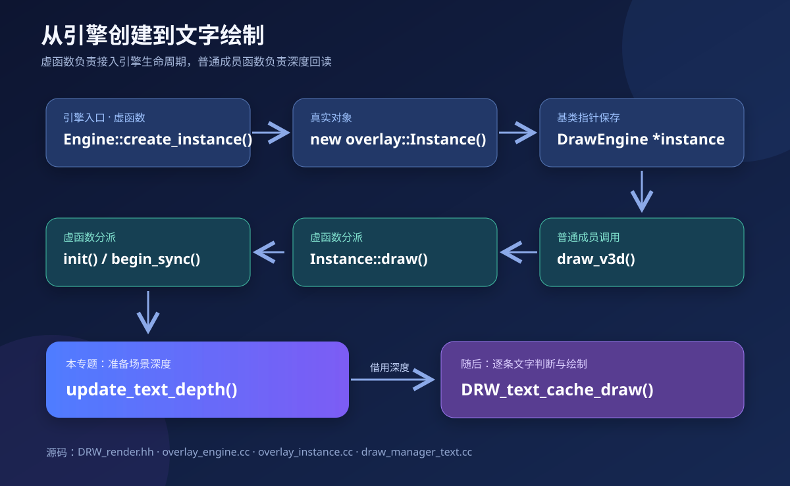
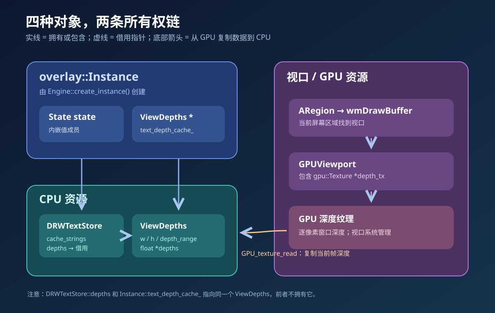
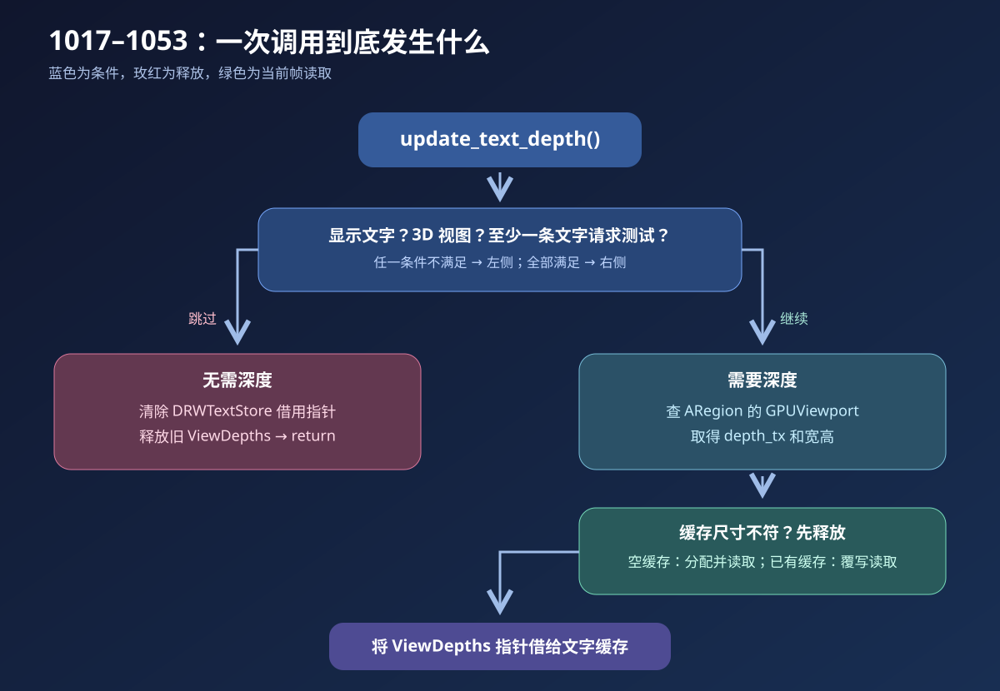
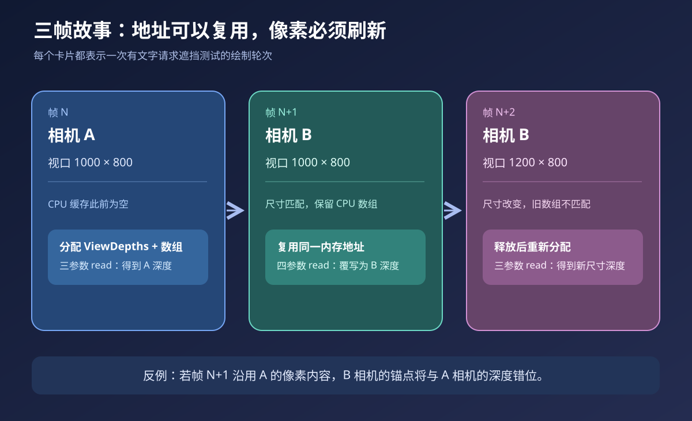

# 属性文本遮挡剔除：从 `update_text_depth()` 读懂 Blender 绘制

> 源码快照：`attribute-text-depth-culling`，HEAD `8e6da0c0ca4`，2026-10-06。  
> 主线：`source/blender/draw/engines/overlay/overlay_instance.cc:1017–1053`。  
> 本目录是学习材料。若源码更新，请先重新核对行号和调用关系。

## 阅读路线

1. [01 · 从引擎到文字](./01-从引擎到文字.md)：继承、虚函数、对象在哪里创建，`State` 和 `DRWTextStore` 如何赋值。
2. [02 · 逐行读深度回读](./02-逐行读深度回读.md)：按 `1017–1053` 的实际执行顺序讲每一行。
3. [03 · 一直追到 GPU 后端](./03-一直追到GPU后端.md)：`ARegion → GPUViewport → Texture`、GPU 与 CPU、分配、回读和虚函数分派。
4. [04 · 三帧推演与自测](./04-三帧推演与自测.md)：指针所有权、缓存刷新、性能与常见误读。

## 图解入口

| 图 | 先看什么 |
|---|---|
|  | 引擎虚函数与普通成员函数在哪一级相遇 |
|  | `Instance`、`State`、`DRWTextStore`、`GPUViewport` 各自持有什么 |
|  | 1019 的短路条件、尺寸变化和两种回读重载 |
|  | “复用分配”和“刷新内容”的区别 |
|  | 纹理、GPU 后端虚函数、CPU 数组的物理关系 |

图片均为独立 SVG，文字可缩放查看。图中的箭头有三种含义，需结合标签读：**调用**、**持有/借用**、**数据复制**，不能把所有箭头都理解为函数调用。

## 先记住一句话

`update_text_depth()` 在有文字请求遮挡测试时，把**当前帧**视口深度从 GPU 读到 `Instance` 拥有的 CPU 数组，然后把这份数组**借给**文字缓存；逐条文字是否绘制，稍后才由 `DRW_text_cache_draw()` 决定。

## 源码路径约定

正文中的相对路径均相对于 Blender 仓库根目录 `E:/blender-git/blender`。本文说明当前代码的行为；“GPU 回读可能导致同步”等性能描述是机制与风险，不等同于已经测得的具体帧时结论。
