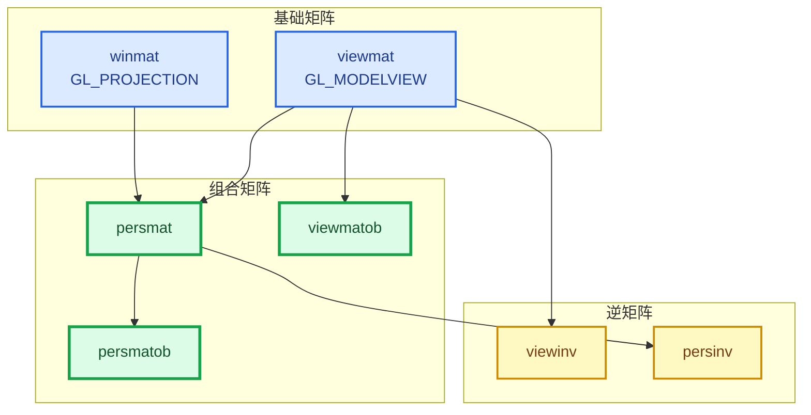
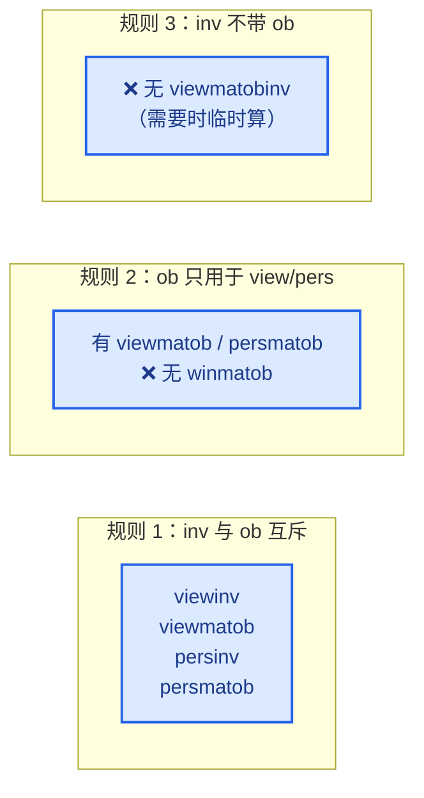
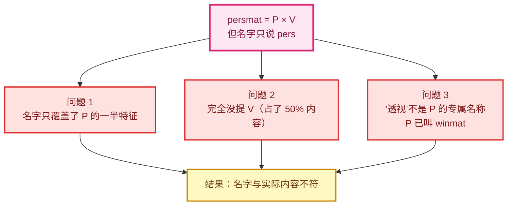

# 01 · 矩阵命名体系

> 🔗 [返回索引](./README.md) | 下一篇：[02-矩阵的来源](./02-矩阵的来源.md)

本文讲清 Blender 里 `RegionView3D` 那一堆矩阵字段的**命名规律**，以及 `persmat` 这个名字为什么**不准确**。

---

## 目录

- [1. 字段全景](#1-字段全景)
- [2. 命名规律拆解](#2-命名规律拆解)
- [3. persmat 的 "pers" 是什么](#3-persmat-的-pers-是什么)
- [4. 为什么说 persmat 名字不准确](#4-为什么说-persmat-名字不准确)
- [5. 与 OpenGL 术语的对应](#5-与-opengl-术语的对应)
- [6. 命名速查表](#6-命名速查表)

---

## 1. 字段全景

```cpp
/* DNA_view3d_types.h:464-494 */
struct RegionView3D {
  DNA_DEFINE_CXX_METHODS(RegionView3D)

  /** GL_PROJECTION matrix. */
  float winmat[4][4] = {};
  /** GL_MODELVIEW matrix. */
  float viewmat[4][4] = {};
  /** Inverse of viewmat. */
  float viewinv[4][4] = {};
  /** Viewmat*winmat. */
  float persmat[4][4] = {};
  /** Inverse of persmat. */
  float persinv[4][4] = {};
  /** Offset/scale for camera GLSL texture-coordinates. */
  float viewcamtexcofac[4] = {};

  /** viewmat/persmat multiplied with object matrix, while drawing and selection. */
  float viewmatob[4][4] = {};
  float persmatob[4][4] = {};

  /** User defined clipping planes. */
  float clip[6][4] = {};
  float clip_local[6][4] = {};
  struct BoundBox *clipbb = nullptr;
  /* ... */
};
```



---

## 2. 命名规律拆解

### 2.1 三段式命名法

Blender 的矩阵字段名遵循 **`<基础名> + <后缀>`** 模式：

```
persmatob
├───┘├──┘├┘
│    │   └─ 后缀 2：ob（object）
│    └───── 后缀 1：mat（matrix）
└────────── 基础名：pers
```

| 部分 | 含义 | 可选值 |
|------|------|--------|
| **基础名** | 这是什么矩阵 | `win` / `view` / `pers` |
| **后缀 1** | 类型标记 | `mat`（矩阵）/ `inv`（逆） |
| **后缀 2** | 额外变换 | `ob`（再乘物体矩阵） |

### 2.2 基础名对照

| 基础名 | 全称 | 对应数学符号 | 来源 |
|--------|------|-------------|------|
| `win` | **win**dow | **P** | 投影矩阵 |
| `view` | **view** | **V** | 观察矩阵 |
| `pers` | **pers**pective | **P × V** | 两者乘积 |

### 2.3 后缀对照

| 后缀 | 全称 | 作用 |
|------|------|------|
| `mat` | **mat**rix | 表示这是个矩阵（而非向量） |
| `inv` | **inv**erse | 逆矩阵 |
| `ob` | **ob**ject | 再乘上物体矩阵 |

### 2.4 组合规则



⭐ **为什么没有 `winmatob`**：

因为 `winmat` 是**纯投影矩阵**（观察空间 → 裁剪空间），它作用在观察空间。而物体矩阵 `M` 作用在**物体空间**。两者中间隔着 `viewmat`，无法直接相乘：

```
物体空间 ──M──► 世界空间 ──V──► 观察空间 ──P──► 裁剪空间
                              ↑
                         winmat 从这里开始
                         M 在这里之前
                         → 中间必须经过 V
```

⭐ **所以只有 `persmat`（已含 V）才能再乘 M**。

---

## 3. persmat 的 "pers" 是什么

⭐ **`persmat` = `pers` + `mat`，不是 `per` + `smat`。**

| 片段 | 全称 | 含义 |
|------|------|------|
| `pers` | **pers**pective | 透视 |
| `mat` | **mat**rix | 矩阵 |

### 3.1 为什么用 "pers" 而不是别的词

因为 Blender 需要区分**透视**和**正交**两种投影：

| 投影类型 | `winmat` 的第 4 行 | `w'` | 效果 |
|---------|-------------------|------|------|
| **透视** | `[0, 0, -1, 0]` | `-z_view` | 近大远小 |
| **正交** | `[0, 0, 0, 1]` | `1` | 远近同大 |

⭐ **"pers" 强调的是"这个矩阵的投影是透视的"**，因为透视会带来 `w' ≠ 1`，从而有透视除法。

### 3.2 本 patch 里的实际用途

```cpp
/* draw_manager_text.cc:327 */
if (occluded && rv3d->is_persp) {
  occluded = text_anchor_is_occluded_perspective(*dt->depths, x, y, xy, anchor_depth);
}
```

⭐ `is_persp` 就是"是否透视"，它决定要不要做**亚像素平面重建**（因为透视下深度非线性，亚像素误差更明显）。

`is_persp` 的设置位置：

```cpp
/* view3d_view.cc:328-337 */
is_ortho = ED_view3d_viewplane_get(depsgraph, v3d, rv3d, region->winx, region->winy,
                                   &full_viewplane, &clipsta, &clipend, nullptr);
rv3d->is_persp = !is_ortho;      // ★ 在这里设置
```

---

## 4. 为什么说 persmat 名字不准确

### 4.1 权威证据：persmat 的真实内容

```cpp
/* view3d_draw.cc:134-137 */
/* update utility matrices */
mul_m4_m4m4(rv3d->persmat, rv3d->winmat, rv3d->viewmat);
invert_m4_m4(rv3d->persinv, rv3d->persmat);
invert_m4_m4(rv3d->viewinv, rv3d->viewmat);
```

我核实了 `mul_m4_m4m4` 的数学语义。它的实现注释（`math_matrix_c.cc:226`）写的是：

```c
/* Matrix product: `R[j][k] = B[j][i] . A[i][k]`. */
```

展开推导可得 **`R = A × B`**（数学意义上的矩阵乘法）。

所以：

$$\texttt{persmat} = \texttt{winmat} \times \texttt{viewmat} = P \times V$$

### 4.2 名字的三个问题



| 问题 | 说明 |
|------|------|
| ① **只描述了 P** | 名字里的 "pers" 对应 `winmat` 的性质 |
| ② **完全没提 V** | `viewmat` 在里面占一半，名字一个字都没提 |
| ③ **"透视"不是 P 的名字** | P 已经有名字 `winmat`，用"透视"重新命名反而混淆 |

### 4.3 对比：`winmat` 才是纯 P

```cpp
/* DNA_view3d_types.h:467-468 */
/** GL_PROJECTION matrix. */
float winmat[4][4] = {};        // ← 这个才是纯投影矩阵
```

| 字段 | 内容 | 名字准确度 |
|------|------|-----------|
| `winmat` | 纯 P | ✅ 准确（"送进窗口空间的矩阵"） |
| `viewmat` | 纯 V | ✅ 准确 |
| **`persmat`** | **P × V** | ⚠️ **只描述了 P 的性质** |

### 4.4 ⚠️ DNA 注释也有错误

```cpp
/* DNA_view3d_types.h:474 */
/** Viewmat*winmat. */
float persmat[4][4] = {};
```

⚠️ **这个注释的顺序是反的**。真实代码是 `winmat × viewmat`。

| 来源 | 写法 | 正确性 |
|------|------|--------|
| DNA 注释 | `Viewmat*winmat` | ❌ 顺序反了 |
| 真实代码 | `mul_m4_m4m4(persmat, winmat, viewmat)` | ✅ P × V |

⭐ **为什么会写反**：作者可能用文字描述了**概念执行顺序**（先 view 后 win），但矩阵乘法**必须反过来写**（详见 [03](./03-变换顺序与乘法顺序.md)）。

### 4.5 建议的正确理解

```
不要把 persmat 读作"透视矩阵"
而应读作"透视投影与观察变换的乘积"

  persmat = P × V
           └─┬─┘
        两个变换合并
```

⭐ **实用判断法**：看到 `persmat`，想"**世界坐标 → 裁剪空间**"；看到 `persmatob`，想"**物体坐标 → 裁剪空间**"。

---

## 5. 与 OpenGL 术语的对应

### 5.1 命名对照表

| Blender | OpenGL 术语 | DNA 注释原文 | 数学符号 |
|---------|------------|-------------|---------|
| `winmat` | Projection | `GL_PROJECTION matrix` | **P** |
| `viewmat` | ModelView | `GL_MODELVIEW matrix` | **V** |
| `viewinv` | — | `Inverse of viewmat` | **V⁻¹** |
| `persmat` | — | `Viewmat*winmat`（⚠️ 顺序错） | **P × V** |
| `persinv` | — | `Inverse of persmat` | **(P×V)⁻¹** |
| `viewmatob` | — | `viewmat multiplied with object matrix` | **V × M** |
| `persmatob` | — | `persmat multiplied with object matrix` | **P × V × M** |

### 5.2 ⚠️ `viewmat` 的注释误导

```cpp
/** GL_MODELVIEW matrix. */
float viewmat[4][4] = {};
```

⚠️ **`GL_MODELVIEW` 是老 OpenGL 的合并概念** —— 它同时包含 Model（物体）和 View（相机）两部分。

但 Blender 的 `viewmat` **只有 View，没有 Model**：

```cpp
/* view3d_view.cc:405-437 —— 生成 V 时完全没用到物体矩阵 */
void view3d_viewmatrix_set(const Depsgraph *depsgraph, const Scene *scene,
                           const View3D *v3d, RegionView3D *rv3d,
                           const float rect_scale[2])
{
  if (rv3d->persp == RV3D_CAMOB) {
    obmat_to_viewmat(rv3d, ob_camera_eval);      // ← 用的是"相机"的矩阵
  }
  else {
    quat_to_mat4(rv3d->viewmat, rv3d->viewquat);
    /* ... */
  }
}
```

⭐ **`obmat_to_viewmat` 里的 `ob` 是"相机物体"，不是"被绘制的物体"**：

```cpp
static void obmat_to_viewmat(RegionView3D *rv3d, Object *ob)
{
  normalize_m4_m4(bmat, ob->object_to_world().ptr());   // ← 相机的世界变换
  invert_m4_m4(rv3d->viewmat, bmat);                    // ← 取逆
}
```

⭐⭐ **所以 `viewmat` 是"纯 V"**，DNA 注释说 `GL_MODELVIEW` 只是历史遗留的说法。

### 5.3 Model 部分在哪

物体矩阵 `M` 在 Blender 里是**单独存放**的：

```cpp
/* 不是存在 rv3d 里，而是每个物体自己持有 */
Object::object_to_world()      // ← 物体自己的 M
```

需要合并时才乘：

```cpp
/* space_view3d.cc:132 */
mul_m4_m4m4(rv3d->persmatob, rv3d->persmat, ob->object_to_world().ptr());
//                          └─ P×V ─┘            └──── M ────┘
```

⭐ **这比老 OpenGL 的"全局 MODELVIEW"更清晰** —— 每个物体有自己的 M，不会互相干扰。

---

## 6. 命名速查表

### 6.1 按字段名查

| 字段 | 拆解 | 数学 | 输入空间 → 输出空间 |
|------|------|------|-------------------|
| `winmat` | win + mat | **P** | 观察 → 裁剪 |
| `viewmat` | view + mat | **V** | 世界 → 观察 |
| `viewinv` | view + inv | **V⁻¹** | 观察 → 世界 |
| `persmat` | pers + mat | **P × V** | 世界 → 裁剪 |
| `persinv` | pers + inv | **(P×V)⁻¹** | 裁剪 → 世界 |
| `viewmatob` | view + mat + ob | **V × M** | 物体 → 观察 |
| `persmatob` | pers + mat + ob | **P × V × M** | 物体 → 裁剪 |
| `clip[6][4]` | clip | 6 个裁剪平面 | 世界空间 |
| `clip_local[6][4]` | clip + local | 6 个裁剪平面 | 物体空间 |

### 6.2 按用途查

| 我想…… | 用哪个 |
|---------|--------|
| 把世界坐标投影到屏幕 | `persmat` |
| 把物体局部坐标投影到屏幕 | `persmatob` |
| 求相机在世界的位置 | `viewinv` 的平移部分（`viewinv.location()`） |
| 求相机朝向 | `viewinv` 的 z 轴（`viewinv.z_axis()`） |
| 反投影：从屏幕回世界 | `persinv` |
| 在世界空间做裁剪测试 | `clip` |
| 在物体空间做裁剪测试 | `clip_local` |

### 6.3 缩写全表

| 缩写 | 全称 |
|------|------|
| `win` | window |
| `view` | view |
| `pers` | perspective |
| `mat` | matrix |
| `inv` | inverse |
| `ob` | object |
| `clip` | clipping |
| `local` | local（物体空间） |
| `rv3d` | RegionView3D |
| `v3d` | View3D |

---

## 小结

| 要点 | 内容 |
|------|------|
| ⭐ **命名三段式** | `<基础名> + <mat\|inv> + [ob]` |
| ⭐ **persmat = P × V** | 不是"纯透视矩阵"，名字只描述了 P 的性质 |
| ⭐ **winmat 才是纯 P** | 而 `viewmat` 是纯 V（DNA 注释的 `GL_MODELVIEW` 是历史遗留） |
| ⭐ **没有 `winmatob`** | 因为 M 和 P 中间隔着 V，必须经 `persmat` 才能乘 M |
| ⚠️ **DNA 注释有误** | `Viewmat*winmat` 顺序写反，实际是 `winmat × viewmat` |

---

## 下一篇

- 这些矩阵**具体怎么算出来** → [02-矩阵的来源](./02-矩阵的来源.md)
