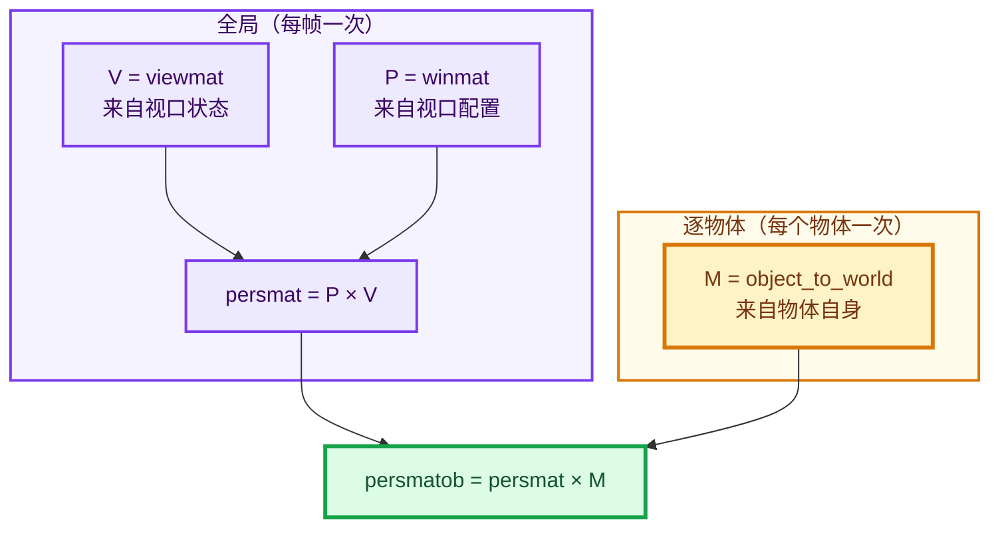
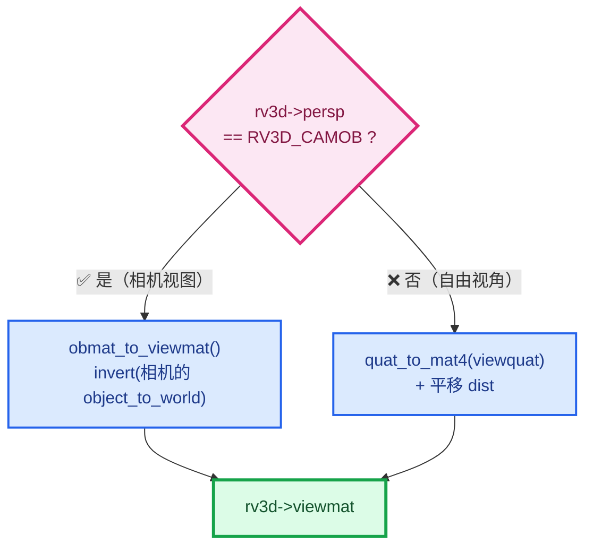
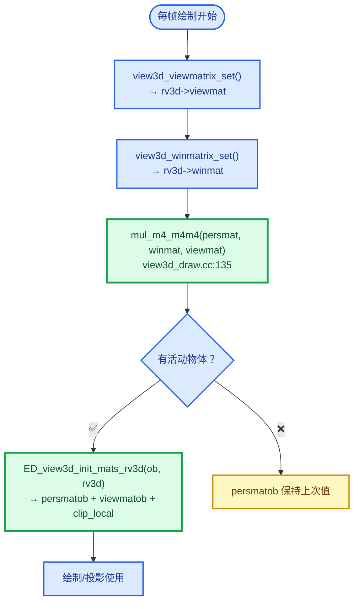
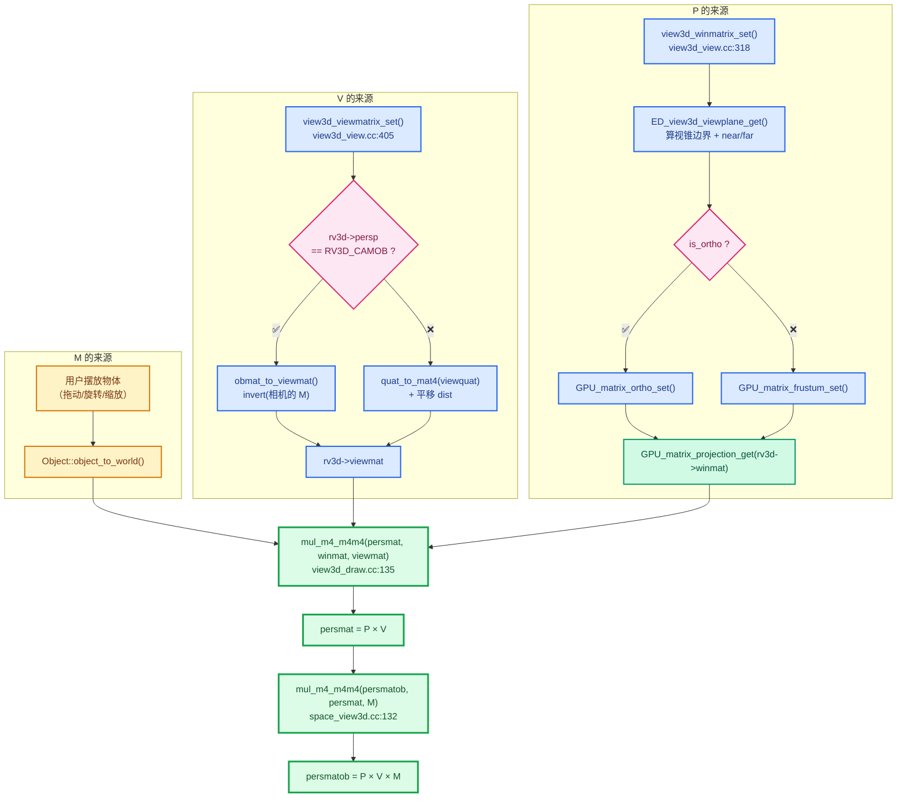

# 02 · 矩阵的来源

> 🔗 [返回索引](./README.md) | 上一篇：[01-矩阵命名体系](./01-矩阵命名体系.md) | 下一篇：[03-变换顺序与乘法顺序](./03-变换顺序与乘法顺序.md)

本文回答：**`M` / `V` / `P` 这三个矩阵，各自的数值是怎么算出来的？**

---

## 目录

- [1. 三者的来源性质](#1-三者的来源性质)
- [2. M：物体矩阵](#2-m物体矩阵)
- [3. V：观察矩阵](#3-v观察矩阵)
- [4. P：投影矩阵](#4-p投影矩阵)
- [5. 组合：persmat 与 persmatob](#5-组合persmat-与-persmatob)
- [6. 三者的完整调用链](#6-三者的完整调用链)

---

## 1. 三者的来源性质

⭐⭐ **最关键的认识：M 是"逐物体"的，V 和 P 是"全局"的。**



### 1.1 对比表

| | M | V | P |
|---|---|---|---|
| **来源性质** | 物体属性 | 视口状态 | 视口配置 |
| **谁决定** | 用户摆放物体 | 视口导航 / 相机位置 | FOV、宽高比、near/far |
| **存放位置** | `Object::object_to_world()` | `rv3d->viewmat` | `rv3d->winmat` |
| **变化时机** | 物体移动时 | 视口导航时 | 窗口缩放 / 改设置时 |
| **作用域** | **逐物体** | 全局 | 全局 |
| **生成函数** | 无（是物体属性） | `view3d_viewmatrix_set()` | `view3d_winmatrix_set()` |

### 1.2 为什么这个区分重要

```cpp
/* view3d_draw.cc:135 —— 每帧一次（全局量） */
mul_m4_m4m4(rv3d->persmat, rv3d->winmat, rv3d->viewmat);

/* space_view3d.cc:132 —— 每个物体一次（含逐物体的 M） */
mul_m4_m4m4(rv3d->persmatob, rv3d->persmat, ob->object_to_world().ptr());
```

⭐ **这解释了属性文本为什么用 `persmat`**：文本缓存是**跨物体收集**的，所有锚点统一转成世界坐标后混在一起，只能用全局的 `persmat`。若用 `persmatob` 就必须逐物体分别投影，而缓存已经混在一起了。

---

## 2. M：物体矩阵

### 2.1 M 不是"算出来的"

⭐⭐ **M 是物体的固有属性，不是运行时计算的结果。**

它就是你**在视口里拖动/旋转/缩放物体**时改变的那个变换。

```cpp
/* space_view3d.cc:131-132 —— 被使用的地方 */
mul_m4_m4m4(rv3d->viewmatob, rv3d->viewmat, ob->object_to_world().ptr());
mul_m4_m4m4(rv3d->persmatob, rv3d->persmat, ob->object_to_world().ptr());
```

### 2.2 M 的内部结构

```
        ┌                          ┐
        │        R · S       T     │
M   =   │                          │
        └   0    0    0      1     │
        ┘
          └── 3×3 ──┘   └ 3×1 ┘
           旋转·缩放     平移
```

### 2.3 ⭐ M 是怎么构造的（权威代码）

> `math_matrix_c.cc:2321-2329`

```cpp
void loc_rot_size_to_mat4(float R[4][4],
                          const float loc[3],
                          const float rot[3][3],
                          const float size[3])
{
  copy_m4_m3(R, rot);        // ① 3×3 旋转放进左上角（并清零第 4 行）
  rescale_m4(R, size);       // ② 每列乘以对应缩放
  copy_v3_v3(R[3], loc);     // ③ 第 4 列 = 平移
}
```

#### 第 ① 步：`copy_m4_m3`

```cpp
/* math_matrix_c.cc:109-130 */
void copy_m4_m3(float m1[4][4], const float m2[3][3]) /* no clear */
{
  m1[0][0] = m2[0][0];
  m1[0][1] = m2[0][1];
  m1[0][2] = m2[0][2];

  m1[1][0] = m2[1][0];
  m1[1][1] = m2[1][1];
  m1[1][2] = m2[1][2];

  m1[2][0] = m2[2][0];
  m1[2][1] = m2[2][1];
  m1[2][2] = m2[2][2];

  m1[0][3] = 0.0f;      // ← ★ 清零
  m1[1][3] = 0.0f;
  m1[2][3] = 0.0f;

  m1[3][0] = 0.0f;      // ← ★ 第 4 行 = [0,0,0,1]
  m1[3][1] = 0.0f;
  m1[3][2] = 0.0f;
  m1[3][3] = 1.0f;
}
```

⭐⭐ **这个函数把第 4 行设为 `[0,0,0,1]`** —— 这就是**仿射矩阵的标志**（详见 [04](./04-仿射变换详解.md)）。

⚠️ **注意注释 `/* no clear */`**：意思是"不清理矩阵的其余部分"，但实际上它**显式写了每一行**，所以注释略有误导。

#### 第 ② 步：`rescale_m4`

```cpp
/* math_matrix_c.cc:2152-2157 */
void rescale_m4(float mat[4][4], const float scale[3])
{
  mul_v3_fl(mat[0], scale[0]);   // 第 0 列 × sx
  mul_v3_fl(mat[1], scale[1]);   // 第 1 列 × sy
  mul_v3_fl(mat[2], scale[2]);   // 第 2 列 × sz
}
```

⭐ **按列缩放** → 数学上等于 `R · S`（旋转矩阵右乘对角缩放矩阵）：

```
        ┌ sx 0  0 ┐
S   =   │ 0  sy 0 │
        └ 0  0  sz┘

左上 3×3 = R · S
```

#### 第 ③ 步：写入平移

```cpp
copy_v3_v3(R[3], loc);     // 第 4 列 = (loc[0], loc[1], loc[2])
```

⭐ **Blender 是列主序**，所以 `R[3]` 就是**第 4 列**（详见 §2.5）。

### 2.4 另一条构造路径（欧拉角版本）

> `math_matrix_c.cc:2331-2353`

```cpp
void loc_eul_size_to_mat4(float R[4][4], const float loc[3],
                          const float eul[3], const float size[3])
{
  float rmat[3][3], smat[3][3], tmat[3][3];

  unit_m4(R);

  /* make rotation + scaling part */
  eul_to_mat3(rmat, eul);
  size_to_mat3(smat, size);
  mul_m3_m3m3(tmat, rmat, smat);       // ★ tmat = rmat × smat = R × S

  copy_m4_m3(R, tmat);
  R[3][0] = loc[0];
  R[3][1] = loc[1];
  R[3][2] = loc[2];
}
```

⭐ **`mul_m3_m3m3(tmat, rmat, smat)` = `tmat = rmat × smat`** → 得到 **R × S**。

✅ **与 `loc_rot_size_to_mat4` 的 `rescale_m4` 结果一致** —— 都得到 `R · S`。

### 2.5 ⚠️ 列主序 vs 行主序

⭐⭐ **这是最容易搞混的地方**。Blender 的 `float[4][4]` 是**列主序**。

```cpp
/* BLI_math_matrix_types.hh:12-13 */
/* The `MatBase<T, NumCol, NumRow>` is a Row x Col matrix (in mathematical notation) laid
 * out as column major in memory. */
```

| 记法 | 含义 |
|------|------|
| `m[4][4]` 的**第一个索引** | **列**（column） |
| **第二个索引** | **行**（row） |

所以：

```cpp
float mat[4][4];

mat[0]  →  第 0 列（含 4 个元素）
mat[3]  →  第 3 列  ← 平移就在这里！
```

⭐ **数学矩阵形式**：

```
        列0  列1  列2  列3
      ┌                        ┐
行0   │ m[0][0] m[1][0] m[2][0] m[3][0] │
行1   │ m[0][1] m[1][1] m[2][1] m[3][1] │
行2   │ m[0][2] m[1][2] m[2][2] m[3][2] │
行3   │ m[0][3] m[1][3] m[2][3] m[3][3] │
      └                        ┘
```

⚠️ **注意索引是"反"的**：`m[0][3]` 是**第 0 列第 3 行**（数学记法的第 4 行第 1 列）。

⭐ **这解释了为什么代码里 `R[3]` 是平移**：

```cpp
copy_v3_v3(R[3], loc);      // R[3] = 第 3 列 = 平移
```

也解释了 `location()` 的实现：

```cpp
/* BLI_math_matrix_types.hh:291-296 */
const loc_type &location() const
{
  return *reinterpret_cast<const loc_type *>(&(*this)[NumCol - 1]);
  //                                            └─ 第 3 列 ─┘
}
```

### 2.6 M 的使用

```cpp
/* overlay_attribute_text.hh:70 —— 属性文本拿到 M */
const float4x4 &object_to_world = object.object_to_world();

/* :141 / :325 —— 用它把局部坐标转世界坐标 */
const float3 center = math::transform_point(object_to_world, positions[i]);
```

---

## 3. V：观察矩阵

### 3.1 生成函数

> `view3d_view.cc:405-437`

```cpp
void view3d_viewmatrix_set(const Depsgraph *depsgraph,
                           const Scene *scene,
                           const View3D *v3d,
                           RegionView3D *rv3d,
                           const float rect_scale[2])
{
  if (rv3d->persp == RV3D_CAMOB) {        /* 情况 A：视角锁定到相机 */
    if (v3d->camera) {
      Object *ob_camera_eval = DEG_get_evaluated(depsgraph, v3d->camera);
      obmat_to_viewmat(rv3d, ob_camera_eval);
    }
    else {
      quat_to_mat4(rv3d->viewmat, rv3d->viewquat);
      rv3d->viewmat[3][2] -= rv3d->dist;
    }
  }
  else {                                   /* 情况 B：自由视角（用户旋转视口） */
    bool use_lock_ofs = false;

    if (RV3D_LOCK_FLAGS(rv3d) & RV3D_LOCK_ROTATION) {
      ED_view3d_lock(rv3d);
    }

    quat_to_mat4(rv3d->viewmat, rv3d->viewquat);      // ← 从四元数生成
    if (rv3d->persp == RV3D_PERSP) {
      rv3d->viewmat[3][2] -= rv3d->dist;              // ← 沿 -Z 平移
    }
    if (v3d->ob_center) {
      /* ... 绕某物体中心旋转的额外处理 ... */
    }
  }
}
```



### 3.2 ⭐ 情况 A：V = 相机世界变换的逆

> `view3d_view.cc:382-403`

```cpp
static void obmat_to_viewmat(RegionView3D *rv3d, Object *ob)
{
  float bmat[4][4];

  rv3d->view = RV3D_VIEW_USER; /* don't show the grid */

  normalize_m4_m4(bmat, ob->object_to_world().ptr());   // ① 相机的世界变换（归一化）
  /* Apply roll. */
  if (rv3d->camroll != 0.0f) {
    rotate_m4(bmat, 'Z', -rv3d->camroll);               // ② 应用相机滚转
  }
  invert_m4_m4(rv3d->viewmat, bmat);                    // ③ ★ 取逆

  /* view quat calculation, needed for add object */
  mat4_normalized_to_quat(rv3d->viewquat, rv3d->viewmat);

  if (rv3d->rflag & RV3D_FLIP_X) {
    transpose_m4(rv3d->viewmat);
    negate_v4(rv3d->viewmat[0]);
    transpose_m4(rv3d->viewmat);
  }
}
```

#### ⭐ 为什么取逆

```
相机的 object_to_world  = 相机 → 世界     （把相机放到世界上）
V（viewmat）            = 世界 → 相机     （把世界拉进相机视角）
                           ↑ 方向相反
```

用具体例子：

```
相机在世界 (5, 0, 0)，朝向 -X

相机矩阵 M_cam 做的事：
  把相机局部坐标 (0,0,0) 送到世界 (5,0,0)
  把相机局部 -Z 方向 送到世界 -X 方向

V = M_cam⁻¹ 做的事：
  把世界 (5,0,0) 送回 (0,0,0)     ← 相机在观察空间原点
  把世界 -X 方向 送回 -Z 方向      ← 相机看向 -Z
```

#### 归一化的作用

```cpp
normalize_m4_m4(bmat, ob->object_to_world().ptr());
```

⭐ **`normalize_m4_m4` 去掉缩放**，只保留旋转 + 平移。

**为什么**：相机的缩放对视图没有意义（相机缩放不改变看到的画面）。归一化确保 V 是**刚体变换**（正交 + 单位长度）。

⚠️ 这很重要 —— 因为后面要 `invert_m4_m4`，如果矩阵含缩放，逆矩阵会含倒数缩放，导致观察空间被"拉伸"。

#### `RV3D_FLIP_X` 的奇怪写法

```cpp
if (rv3d->rflag & RV3D_FLIP_X) {
  transpose_m4(rv3d->viewmat);
  negate_v4(rv3d->viewmat[0]);
  transpose_m4(rv3d->viewmat);
}
```

⭐ **这实际是"取负第 0 列"**：

```
第一次转置 → 第 0 列变成第 0 行
negate_v4(viewmat[0]) → 第 0 行取负
第二次转置 → 变回列形式
结果：第 0 列被取负
```

**为什么不直接 `negate_v4(rv3d->viewmat[0])`**：`negate_v4` 作用于 `float[4]`（即一列），本来就可以直接调。

⚠️ **这个三段式写法是多余的**，但可能是历史原因（早期 `negate_v4` 只作用于行？）。**结果正确，只是绕了弯路**。

### 3.3 情况 B：从四元数生成

```cpp
quat_to_mat4(rv3d->viewmat, rv3d->viewquat);
if (rv3d->persp == RV3D_PERSP) {
  rv3d->viewmat[3][2] -= rv3d->dist;
}
```

⭐ **`rv3d->viewquat`** 是视口朝向的四元数，**用户旋转视口时更新**。

| 步骤 | 作用 |
|------|------|
| `quat_to_mat4` | 四元数 → 4×4 旋转矩阵 |
| `viewmat[3][2] -= dist` | 沿 Z 轴平移（把相机推远 `dist`） |

⭐ **`viewmat[3][2]` 是第 3 列第 2 行**（列主序），即**平移的 Z 分量**。

⚠️ **为什么减 `dist`**：观察空间里相机看向 −Z，所以要把世界沿 +Z 推远，等价于相机沿 −Z 后退。

### 3.4 V 的数学性质

⭐ **V 是刚体变换**（旋转 + 平移，无缩放）：

```
        ┌ R00 R01 R02 Tx ┐
V   =   │ R10 R11 R12 Ty │
        │ R20 R21 R22 Tz │
        └  0   0   0   1 ┘
                         ↑
                  第 4 行 = [0,0,0,1]
                  → 不改变 w
                  → 不含透视
```

⭐⭐ **这就是"V 与透视无关"的证据** —— 它的第 4 行固定，`w'` 永远是 1。

### 3.5 V 的用途：求相机位置与朝向

⭐ **V 的逆 `viewinv` 才是"相机在世界空间的位姿"**：

```cpp
/* overlay_instance.cc:459-460 —— 本 patch 用到 */
state.camera_position = view.viewinv().location();     // 相机世界位置
state.camera_forward = view.viewinv().z_axis();        // 相机朝向（指向观察者）
```

| 表达式 | 含义 |
|--------|------|
| `viewinv.location()` | `viewinv` 第 4 列 = 相机在世界的位置 |
| `viewinv.z_axis()` | `viewinv` 第 3 列 = 相机朝向 |

⭐ **为什么用 `viewinv` 而不是 `viewmat`**：

```
viewmat  : 世界 → 观察（相机被搬到原点）
viewinv  : 观察 → 世界（相机在世界的位置）
```

**要问"相机在哪"，必须用 `viewinv`**。

⚠️ **`z_axis()` 的语义要注意**：

```cpp
/* draw_view_lib.glsl:31-35 —— 官方文档说明 */
/* Returns the view forward vector, going towards the viewer. */
float3 drw_view_forward()
{
  return drw_view().viewinv[2].xyz;
}
```

⭐ **`viewinv.z_axis()` 指向"观察者"**（即朝向相机），不是"相机看向的方向"。这是命名上的反直觉之处（详见 [属性文本遮挡剔除-DS/05 §7](../属性文本遮挡剔除-DS/05-锚点偏移数学.md)）。

---

## 4. P：投影矩阵

### 4.1 生成函数

> `view3d_view.cc:318-380`

```cpp
void view3d_winmatrix_set(const Depsgraph *depsgraph,
                          ARegion *region,
                          const View3D *v3d,
                          const rcti *rect)
{
  RegionView3D *rv3d = static_cast<RegionView3D *>(region->regiondata);
  rctf full_viewplane;
  float clipsta, clipend;
  bool is_ortho;

  /* ① 算视锥的 4 个边界 + 近远裁剪面 */
  is_ortho = ED_view3d_viewplane_get(depsgraph, v3d, rv3d,
                                     region->winx, region->winy,
                                     &full_viewplane, &clipsta, &clipend, nullptr);
  rv3d->is_persp = !is_ortho;          // ★ 设置透视标志

  /* ② 处理子区域（选择框选时） */
  rctf viewplane;
  if (rect) {
    viewplane.xmin = full_viewplane.xmin +
                     (BLI_rctf_size_x(&full_viewplane) * (rect->xmin / float(region->winx)));
    viewplane.ymin = full_viewplane.ymin +
                     (BLI_rctf_size_y(&full_viewplane) * (rect->ymin / float(region->winy)));
    viewplane.xmax = full_viewplane.xmin +
                     (BLI_rctf_size_x(&full_viewplane) * (rect->xmax / float(region->winx)));
    viewplane.ymax = full_viewplane.ymin +
                     (BLI_rctf_size_y(&full_viewplane) * (rect->ymax / float(region->winy)));
  }
  else {
    viewplane = full_viewplane;
  }

  /* ③ ★ 生成投影矩阵 */
  if (is_ortho) {
    GPU_matrix_ortho_set(viewplane.xmin, viewplane.xmax,
                         viewplane.ymin, viewplane.ymax, clipsta, clipend);
  }
  else {
    GPU_matrix_frustum_set(viewplane.xmin, viewplane.xmax,
                           viewplane.ymin, viewplane.ymax, clipsta, clipend);
  }

  /* ④ 从 GPU 状态读回来 */
  GPU_matrix_projection_get(rv3d->winmat);
}
```

### 4.2 三个关键点

#### ① `is_persp` 在这里被设置

```cpp
rv3d->is_persp = !is_ortho;
```

⭐ **这正是本 patch 用到的字段**：

```cpp
/* draw_manager_text.cc:327 */
if (occluded && rv3d->is_persp) {
  occluded = text_anchor_is_occluded_perspective(...);
}
```

**透视和正交的深度分布不同**（透视非线性），所以亚像素修正只在透视下需要。

#### ③ 调用 GPU 矩阵函数

```cpp
GPU_matrix_frustum_set(...);    // 透视
GPU_matrix_ortho_set(...);      // 正交
```

#### ④ ⭐ 从 GPU 状态读回来

```cpp
GPU_matrix_projection_get(rv3d->winmat);
```

⭐ **这是个有意思的设计**：不直接算 P，而是**先设进 GPU 状态，再读回来**。

**为什么**：绘制时 GPU 也要用同一个投影矩阵。这样做保证**投影计算和 GPU 渲染用的是完全相同的矩阵**，不会因为两处独立计算而产生细微差异。

```cpp
/* gpu_matrix.cc:400-429 */
void GPU_matrix_ortho_set(float left, float right, float bottom,
                          float top, float near, float far)
{
  mat4_ortho_set(Projection, left, right, bottom, top, near, far);   // 写进全局 Projection
  CHECKMAT(Projection);
  gpu_matrix_state_active_set_dirty(true);
}

void GPU_matrix_frustum_set(float left, float right, float bottom,
                            float top, float near, float far)
{
  mat4_frustum_set(Projection, left, right, bottom, top, near, far);
  CHECKMAT(Projection);
  gpu_matrix_state_active_set_dirty(true);
}
```

### 4.3 ⭐ 透视投影矩阵的元素公式

> `gpu_matrix.cc:309-333`

```cpp
static void mat4_frustum_set(
    float m[4][4], float left, float right, float bottom, float top, float near, float far)
{
  m[0][0] = 2.0f * near / (right - left);
  m[1][0] = 0.0f;
  m[2][0] = (right + left) / (right - left);
  m[3][0] = 0.0f;

  m[0][1] = 0.0f;
  m[1][1] = 2.0f * near / (top - bottom);
  m[2][1] = (top + bottom) / (top - bottom);
  m[3][1] = 0.0f;

  m[0][2] = 0.0f;
  m[1][2] = 0.0f;
  m[2][2] = -(far + near) / (far - near);
  m[3][2] = -2.0f * far * near / (far - near);

  m[0][3] = 0.0f;
  m[1][3] = 0.0f;
  m[2][3] = -1.0f;          // ★★★ w' = -z_view 的来源
  m[3][3] = 0.0f;
}
```

⚠️ **注意是 `m[列][行]` 索引**（列主序），所以 `m[2][3]` = 第 2 列第 3 行。

展开成**数学记法**（行 × 列）：

```
        ┌ 2n/(r-l)      0        (r+l)/(r-l)        0     ┐
P_persp =│    0      2n/(t-b)    (t+b)/(t-b)        0     │
        │    0          0      -(f+n)/(f-n)   -2fn/(f-n)  │
        └    0          0           -1              0     ┘
                                      ↑
                             第 4 行 = [0, 0, -1, 0]
```

⭐ **第 4 行 `[0,0,-1,0]` 的作用**：

```
w' = [0, 0, -1, 0] · [x_view, y_view, z_view, 1]ᵀ
   = -z_view
```

**相机看向 −Z，所以相机前方的点 `z_view < 0`，`w' = -z_view > 0` = 到相机的距离。**

### 4.4 正交投影矩阵的元素公式

> `gpu_matrix.cc:283-307`

```cpp
static void mat4_ortho_set(
    float m[4][4], float left, float right, float bottom, float top, float near, float far)
{
  m[0][0] = 2.0f / (right - left);
  m[1][0] = 0.0f;
  m[2][0] = 0.0f;
  m[3][0] = -(right + left) / (right - left);

  m[0][1] = 0.0f;
  m[1][1] = 2.0f / (top - bottom);
  m[2][1] = 0.0f;
  m[3][1] = -(top + bottom) / (top - bottom);

  m[0][2] = 0.0f;
  m[1][2] = 0.0f;
  m[2][2] = -2.0f / (far - near);
  m[3][2] = -(far + near) / (far - near);

  m[0][3] = 0.0f;
  m[1][3] = 0.0f;
  m[2][3] = 0.0f;          // ★★★ 这里是 0！
  m[3][3] = 1.0f;          // ★★★ 这里是 1！
}
```

展开：

```
        ┌ 2/(r-l)      0           0             0      ┐
P_ortho =│    0      2/(t-b)       0             0      │
        │    0          0      -2/(f-n)    -(f+n)/(f-n)  │
        └    0          0           0             1      ┘
                                      ↑
                             第 4 行 = [0, 0, 0, 1]
```

⭐⭐ **对比表**：

| | 第 4 行 | `w'` | 效果 |
|---|---------|------|------|
| **透视** | `[0, 0, -1, 0]` | `-z_view`（距离） | 近大远小 |
| **正交** | `[0, 0, 0, 1]` | `1`（恒定） | 远近同大 |

⭐ **这就是"透视 vs 正交"的唯一数学差异**。

### 4.5 视锥边界从哪来

```cpp
is_ortho = ED_view3d_viewplane_get(depsgraph, v3d, rv3d,
                                   region->winx, region->winy,
                                   &full_viewplane, &clipsta, &clipend, nullptr);
```

| 输出 | 含义 |
|------|------|
| `full_viewplane` | 视锥在**近裁剪面**上的 4 个边界 |
| `clipsta` | 近裁剪面距离 |
| `clipend` | 远裁剪面距离 |
| `is_ortho` | 是否正交 |

⭐ **视锥边界的决定因素**：

| 模式 | 边界来自 |
|------|---------|
| 相机视图 | 相机的 FOV / sensor / 宽高比 |
| 自由视角 | 固定的 FOV（默认 50°）+ 视口宽高比 |
| 正交 | 由 `rv3d->dist` 和缩放决定 |

---

## 5. 组合：persmat 与 persmatob

### 5.1 `persmat` 的构造

> `view3d_draw.cc:134-137`

```cpp
/* update utility matrices */
mul_m4_m4m4(rv3d->persmat, rv3d->winmat, rv3d->viewmat);
invert_m4_m4(rv3d->persinv, rv3d->persmat);
invert_m4_m4(rv3d->viewinv, rv3d->viewmat);
```

⭐ **`mul_m4_m4m4(R, A, B)` 的数学语义是 `R = A × B`**。

证据（`math_matrix_c.cc:226`）：

```c
/* Matrix product: `R[j][k] = B[j][i] . A[i][k]`. */
```

⭐ **所以 `persmat = winmat × viewmat = P × V`**。

### 5.2 `persmatob` 的构造

> `space_view3d.cc:128-136`

```cpp
void ED_view3d_init_mats_rv3d(const Object *ob, RegionView3D *rv3d)
{
  /* local viewmat and persmat, to calculate projections */
  mul_m4_m4m4(rv3d->viewmatob, rv3d->viewmat, ob->object_to_world().ptr());
  mul_m4_m4m4(rv3d->persmatob, rv3d->persmat, ob->object_to_world().ptr());

  /* initializes object space clipping, speeds up clip tests */
  ED_view3d_clipping_local(rv3d, ob->object_to_world().ptr());
}
```

⭐ **`persmatob = persmat × M = P × V × M`**。

⭐ **`ED_view3d_clipping_local`** 就是生成 `clip_local` 的地方：

```cpp
/* 概念上：把世界空间的 6 个裁剪平面转到物体空间 */
clip_local = clip × M⁻¹
```

**目的**：编辑模式下可以直接用物体空间坐标做裁剪测试，省去转世界空间的开销（DNA 注释 `:486-490` 说明了这点）。

### 5.3 调用时机



⚠️ **`persmatob` 依赖"当前物体"** —— 它是**逐物体变化的**。

⭐ **这正是属性文本用 `GLOBALSPACE`（走 `persmat`）的原因**：文本缓存跨物体收集，不能用逐物体的 `persmatob`。

### 5.4 为什么预乘

| 方案 | 每次投影成本 |
|------|-------------|
| **预乘**（当前） | 1 次矩阵×向量 = **16 次乘加** |
| 不预乘 | 3 次矩阵×向量，或 2 次矩阵×矩阵 + 1 次矩阵×向量 |

⭐ 矩阵×矩阵是 **64 次乘加**。对每帧数千个锚点来说，预乘的收益很大。

---

## 6. 三者的完整调用链



### 6.1 变化频率对照

| 矩阵 | 什么时候重新计算 | 计算量 |
|------|-----------------|--------|
| `viewmat` | 视口导航 / 相机移动 | 一次 `quat_to_mat4` 或 `invert_m4_m4` |
| `winmat` | 窗口缩放 / 改 FOV | 一次矩阵构造 + GPU 读写 |
| **`persmat`** | **每帧一次** | 一次矩阵×矩阵（64 乘加） |
| **`persmatob`** | **每个物体一次** | 一次矩阵×矩阵（64 乘加） |
| `persinv` / `viewinv` | 每帧一次 | 一次矩阵求逆 |

⭐ **`persmatob` 是热点** —— 如果有 1000 个物体，就是 1000 次 64 乘加。这也是为什么 Blender 用 SSE 优化 `mul_m4_m4m4`（`math_matrix_c.cc:227-243`）。

### 6.2 一句话总结

| | 怎么来的 | 一句话 |
|---|---------|--------|
| **M** | 物体自身的变换 | **不是算出来的，是物体属性** |
| **V** | 相机世界变换的**逆** | 把相机搬到原点 |
| **P** | 视锥边界 + near/far → GPU 函数 | 唯一决定透视的地方 |
| **P×V** | `mul_m4_m4m4(persmat, winmat, viewmat)` | 每帧一次 |
| **P×V×M** | `mul_m4_m4m4(persmatob, persmat, M)` | 每物体一次 |

---

## 小结

| 要点 | 内容 |
|------|------|
| ⭐ **M 是物体属性** | 不是运行时算的，就是 `object_to_world()` |
| ⭐ **V = 相机世界变换的逆** | `invert_m4_m4(viewmat, 相机的 object_to_world)` |
| ⭐ **P 由视锥边界生成** | 经 `GPU_matrix_frustum_set` / `ortho_set`，再读回 |
| ⭐ **透视的唯一来源是 P 的第 4 行** | 透视 `[0,0,-1,0]`，正交 `[0,0,0,1]` |
| ⭐ **M 逐物体，V/P 全局** | 这是 `persmat` vs `persmatob` 分工的根本原因 |
| ⚠️ **列主序** | `m[列][行]`，所以 `m[3]` 是第 4 列（平移） |

---

## 下一篇

- 变换与乘法的**顺序** → [03-变换顺序与乘法顺序](./03-变换顺序与乘法顺序.md)
