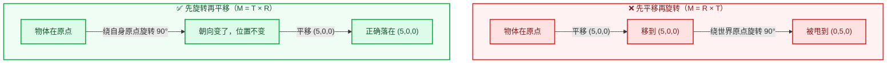
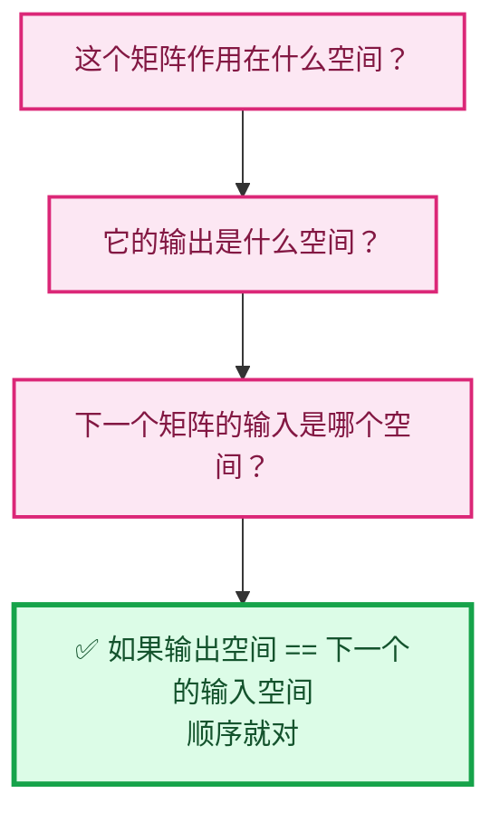

# 03 · 变换顺序与乘法顺序

> 🔗 [返回索引](./README.md) | 上一篇：[02-矩阵的来源](./02-矩阵的来源.md) | 下一篇：[04-仿射变换详解](./04-仿射变换详解.md)

本文讲清两个**最容易混淆的顺序问题**：

1. **单个矩阵内部**：缩放、旋转、平移谁先谁后？
2. **多个矩阵之间**：`P × V × M` 从哪往哪执行？

---

## 目录

- [1. 核心原理：书写顺序与执行顺序相反](#1-核心原理书写顺序与执行顺序相反)
- [2. M 的内部顺序：T · R · S](#2-m-的内部顺序t--r--s)
- [3. 为什么不能先平移](#3-为什么不能先平移)
- [4. P · V · M 的执行顺序](#4-p--v--m-的执行顺序)
- [5. 用代码验证顺序](#5-用代码验证顺序)
- [6. 常见错误对照](#6-常见错误对照)

---

## 1. 核心原理：书写顺序与执行顺序相反

### 1.1 约定

⭐ **矩阵作用于列向量**，写作 `M × v`（不是 `v × M`）。

```
        ┌     ┐   ┌   ┐   ┌   ┐
        │  M  │ × │ v │ = │ v'│
        └     ┘   └   ┘   └   ┘
```

⭐ **含义**：`M` 把 `v` 从"源坐标系"变换到"目标坐标系"。

### 1.2 复合变换的推导

假设**先做 A，再做 B**：

```
第 1 步：  p₁ = A × p₀
第 2 步：  p₂ = B × p₁
              = B × (A × p₀)
              = (B × A) × p₀        ← 矩阵乘法结合律
```

⭐⭐ **结论**：

```
"先 A 后 B"  ⟺  矩阵写作 B × A
                              ↑   ↑
                           后执行 先执行
```

**书写顺序与执行顺序相反。**

### 1.3 记忆法


⭐ **口诀**：**从右往左读，就是执行顺序。**

### 1.4 为什么必须这样

⭐ **因为矩阵乘法满足结合律，但不满足交换律**：

| 性质 | 是否满足 | 说明 |
|------|---------|------|
| 结合律 | ✅ `(AB)C = A(BC)` | 所以可以预乘成组合矩阵 |
| **交换律** | ❌ **`AB ≠ BA`** | **所以顺序至关重要** |

⚠️ **交换律不满足的后果**：

```
先旋转 90° 再平移 (5,0,0)：
  物体在 (5,0,0)，朝向转了 90°

先平移 (5,0,0) 再旋转 90°：
  物体被"甩"到 (0,5,0)，朝向转了 90°
                ↑ 位置完全不同！
```

---

## 2. M 的内部顺序：T · R · S

### 2.1 权威代码

> `math_matrix_c.cc:2321-2329`

```cpp
void loc_rot_size_to_mat4(float R[4][4],
                          const float loc[3],
                          const float rot[3][3],
                          const float size[3])
{
  copy_m4_m3(R, rot);        // ① 3×3 旋转放进左上角
  rescale_m4(R, size);       // ② 每列乘以对应缩放
  copy_v3_v3(R[3], loc);     // ③ 第 4 列 = 平移
}
```

### 2.2 逐步推导

#### 第 ① 步：放入旋转

```cpp
copy_m4_m3(R, rot);
```

结果（列主序，这里按数学记法写出）：

```
        ┌ R00 R01 R02  0 ┐
R   =   │ R10 R11 R12  0 │
        │ R20 R21 R22  0 │
        └  0   0   0   1 ┘
```

⭐ 注意 `copy_m4_m3` 同时**把第 4 行设为 `[0,0,0,1]`**、**第 4 列前 3 个设为 0**。

#### 第 ② 步：按列缩放

```cpp
void rescale_m4(float mat[4][4], const float scale[3])
{
  mul_v3_fl(mat[0], scale[0]);   // 第 0 列 × sx
  mul_v3_fl(mat[1], scale[1]);   // 第 1 列 × sy
  mul_v3_fl(mat[2], scale[2]);   // 第 2 列 × sz
}
```

⭐ **按列缩放** → 数学上等价于**右乘**对角矩阵 `S`：

```
        ┌ sx 0  0 ┐
S   =   │ 0  sy 0 │
        └ 0  0  sz┘

缩放后左上 3×3 = R · S
```

**验证**（看第 0 列）：

```
R 的第 0 列 = (R00, R10, R20)
乘以 sx    = (R00·sx, R10·sx, R20·sx)

而 (R · S) 的第 0 列 = R × (S 的第 0 列) = R × (sx, 0, 0)ᵀ
                     = (R00·sx, R10·sx, R20·sx)  ✅ 一致
```

#### 第 ③ 步：写入平移

```cpp
copy_v3_v3(R[3], loc);     // 第 4 列 = 平移向量
```

最终矩阵：

```
        ┌                          ┐
        │        R · S       T     │
M   =   │                          │
        └   0    0    0      1     ┘
```

### 2.3 作用到点上的展开

```
M · p  =  ┌        R·S        T ┐   ┌ px ┐
          │                      │ × │ py │
          └  0   0   0    1     ┘   └ pz │
                                       └ 1 ┘

       = R · S · (px, py, pz)ᵀ + T
         ↑   ↑   ↑
         │   │   └─ ③ 最后：平移
         │   └───── ② 中间：旋转
         └───────── ① 最先：缩放
```

⭐⭐ **执行顺序：缩放 → 旋转 → 平移**

### 2.4 图形化理解


⭐ **几何直觉**：

| 步骤 | 效果 |
|------|------|
| 缩放 | 在**物体自己的坐标轴**上拉伸 |
| 旋转 | 让物体**转个方向** |
| 平移 | 把物体**搬到世界某处** |

⭐ **缩放和旋转都绕物体自己的原点进行** —— 因为此时还没平移，原点还在 (0,0,0)。

### 2.5 另一条路径的验证

> `math_matrix_c.cc:2331-2353`

```cpp
void loc_eul_size_to_mat4(float R[4][4], const float loc[3],
                          const float eul[3], const float size[3])
{
  float rmat[3][3], smat[3][3], tmat[3][3];

  unit_m4(R);

  /* make rotation + scaling part */
  eul_to_mat3(rmat, eul);            // 旋转矩阵
  size_to_mat3(smat, size);          // 缩放矩阵
  mul_m3_m3m3(tmat, rmat, smat);     // ★ tmat = rmat × smat = R × S

  copy_m4_m3(R, tmat);
  R[3][0] = loc[0];
  R[3][1] = loc[1];
  R[3][2] = loc[2];
}
```

⭐ **`mul_m3_m3m3(tmat, rmat, smat)` 的语义是 `tmat = rmat × smat`** → **R × S**。

✅ **与 `loc_rot_size_to_mat4` 的 `rescale_m4` 结果完全一致** —— 两条路径都得到 `R · S`。

---

## 3. 为什么不能先平移

### 3.1 反例：先平移再旋转

假设物体原本在原点，现在要：**平移 (5,0,0) 后旋转 90°**（绕 Z 轴）。

```
如果顺序是 M = R × T（先平移，后旋转）：

  顶点 (0,0,0)
    → T 平移 (5,0,0) → (5,0,0)
    → R 旋转 90°     → (0,5,0)      ← ❌ 跑到 Y 轴了！

  期望：物体在 (5,0,0)，朝向转了 90°
  实际：物体在 (0,5,0)
```

### 3.2 正确顺序

```
M = T × R（先旋转，后平移）：

  顶点 (0,0,0)
    → R 旋转 90°     → (0,0,0)      ← 原点旋转不变
    → T 平移 (5,0,0) → (5,0,0)      ← ✅ 正确
```

### 3.3 直观图示



⭐⭐ **核心原因**：旋转是**绕原点**的。如果先平移，物体就离开了原点，再旋转就会绕"世界原点"转，而不是绕"自己"转。

### 3.4 缩放为什么在最前

⭐ **同理**：缩放也是**以原点为中心**的。

```
如果顺序是 R × S（先旋转，后缩放）：
  缩放会沿着"世界坐标轴"进行，而不是物体的局部坐标轴
  → 物体被"压扁"的方向会不对
```

⭐ **正确做法**：先在自己的坐标系里缩放（S），再旋转（R），最后搬到世界（T）。

### 3.5 通用规则

⭐⭐ **变换顺序的一般原则**：

| 顺序 | 变换 | 原因 |
|------|------|------|
| ① | 缩放 | 沿物体自己的轴缩放 |
| ② | 旋转 | 绕物体自己的原点旋转 |
| ③ | 平移 | 最后搬到世界位置 |

⭐ **一句话**：**先"改变形状和朝向"，最后"决定在哪"。**

⚠️ **例外**：有些系统（如骨骼动画）会显式支持"绕枢轴点旋转"，那需要额外的 `T(pivot) · R · T(-pivot)` 包裹：

```cpp
/* math_matrix_c.cc:2159-2171 —— 绕枢轴点变换 */
void transform_pivot_set_m4(float mat[4][4], const float pivot[3])
{
  float tmat[4][4];

  unit_m4(tmat);
  copy_v3_v3(tmat[3], pivot);
  mul_m4_m4m4(mat, tmat, mat);        // 先平移到枢轴

  negate_v3(tmat[3]);
  mul_m4_m4m4(mat, mat, tmat);        // 变换后再移回
}
```

⭐ **这就是"把枢轴点临时移到原点"的技巧**。

---

## 4. P · V · M 的执行顺序

### 4.1 三个变换的作用

| 矩阵 | 变换 | 输入空间 → 输出空间 |
|------|------|-------------------|
| **M** | 物体的缩放 + 旋转 + 平移 | 物体空间 → 世界空间 |
| **V** | 把世界拉进相机视角 | 世界空间 → 观察空间 |
| **P** | 投影 | 观察空间 → 裁剪空间 |

### 4.2 执行顺序

```
persmatob = P  ×  V  ×  M
            ↑     ↑     ↑
          最后   中间   最先
          投影   观察   物体变换
```

⭐⭐ **执行顺序（从右往左）**：


### 4.3 推导验证

```
p_clip = P × (V × (M × p_obj))
       = P × (V × M) × p_obj           ← 结合律
       = (P × V × M) × p_obj           ← 结合律
       = persmatob × p_obj
```

⭐ **结合律允许我们把三个矩阵先乘成一个**，这样每次投影只需 1 次矩阵×向量。

### 4.4 ⚠️ 关于"偏移"这个词

⭐ **M 和 V 都不是单纯的"偏移"**（offset）：

| | 包含 |
|---|---|
| **M** | 缩放 + 旋转 + 平移（**3 种**） |
| **V** | 旋转 + 平移（**2 种**，无缩放） |

⭐ **只有 V 的平移部分是纯偏移**：

```cpp
/* view3d_view.cc:431 —— V 的平移部分 */
rv3d->viewmat[3][2] -= rv3d->dist;
```

⚠️ **但 V 还有旋转**（来自 `quat_to_mat4(rv3d->viewmat, rv3d->viewquat)`）。

### 4.5 用具体数字感受

**场景**：物体在世界上 `(5, 2, 1)`，旋转 45°，缩放 2×；相机在 `(0, 0, 10)` 看向 −Z。

**① M 做的事**（物体空间 → 世界空间）：

```
顶点 (1, 0, 0)（物体空间，物体局部的一个点）
  → 缩放 ×2        → (2, 0, 0)
  → 旋转 45°       → (1.414, 1.414, 0)
  → 平移 (5,2,1)   → (6.414, 3.414, 1)      ← 世界坐标
```

**② V 做的事**（世界空间 → 观察空间）：

```
(6.414, 3.414, 1)（世界坐标）
  → 相机在 (0,0,10)，需要把相机移到原点
  → 平移 (0, 0, -10) → (6.414, 3.414, -9)   ← 观察坐标
```

⭐ **注意观察空间里 z = −9**：说明这个点在相机前方 9 米。

**③ P 做的事**（观察空间 → 裁剪空间）：

```
(6.414, 3.414, -9, 1)（观察坐标）
  → 乘 P
  → w' = -z_view = -(-9) = 9                ← 到相机的距离
  → 后续除以 9 产生透视效果
```

---

## 5. 用代码验证顺序

### 5.1 `mul_m4_m4m4` 的数学语义

> `math_matrix_c.cc:217-226`

```cpp
void mul_m4_m4m4(float R[4][4], const float A[4][4], const float B[4][4])
{
  if (ELEM(R, A, B)) {          /* 别名检查：R 与 A 或 B 相同则用临时变量 */
    float T[4][4];
    mul_m4_m4m4(T, A, B);
    copy_m4_m4(R, T);
    return;
  }

  /* Matrix product: `R[j][k] = B[j][i] . A[i][k]`. */    // ← ★ 关键注释
  /* ... */
}
```

⭐ **注释 `R[j][k] = B[j][i] . A[i][k]`** 说明：

- 外层按 `B` 的行/列展开
- 结果等于 **`A × B`**（数学意义）

⭐ **所以 `mul_m4_m4m4(R, A, B)` ⟺ `R = A × B`**。

### 5.2 验证 `persmat`

```cpp
/* view3d_draw.cc:135 */
mul_m4_m4m4(rv3d->persmat, rv3d->winmat, rv3d->viewmat);
//                         ↑ 左 = A（后执行）  ↑ 右 = B（先执行）
//                 结果 = winmat × viewmat = P × V  ✅
```

### 5.3 验证 `persmatob`

```cpp
/* space_view3d.cc:132 */
mul_m4_m4m4(rv3d->persmatob, rv3d->persmat, ob->object_to_world().ptr());
//                            ↑ 左 = A          ↑ 右 = B
//                    结果 = persmat × M = (P×V) × M  ✅
```

### 5.4 验证 M 的内部顺序

```cpp
/* math_matrix_c.cc:2344 —— 欧拉角路径 */
mul_m3_m3m3(tmat, rmat, smat);
//              ↑ 左 = A    ↑ 右 = B
//      结果 = rmat × smat = R × S  ✅ 旋转左乘缩放
```

⭐ **`R × S` 意味着执行时先 S 后 R**（从右往左）—— **先缩放，再旋转** ✅

---

## 6. 常见错误对照

### 6.1 错误类型

| 错误 | 后果 |
|------|------|
| **把 `M = T·R·S` 写成 `S·R·T`** | 物体会绕世界原点旋转，位置全错 |
| **把 `persmat = P·V` 写成 `V·P`** | 先投影再观察，物理上荒谬 |
| **把 `persmatob = persmat·M` 写成 `M·persmat`** | 先投影再变换物体，结果错误 |
| **认为"书写顺序 = 执行顺序"** | 所有推导都会反 |

### 6.2 自检方法

⭐ **问自己三个问题**：



**示例**：

```
M  : 物体空间 → 世界空间
V  : 世界空间 → 观察空间     ← 输入是"世界空间" ✅ 接得上
P  : 观察空间 → 裁剪空间     ← 输入是"观察空间" ✅ 接得上

所以顺序 M → V → P，写作 P × V × M  ✅
```

⚠️ **如果写反**：

```
P  : 观察空间 → 裁剪空间
V  : 世界空间 → 观察空间     ← ❌ P 的输出是"裁剪空间"
                                V 的输入是"世界空间"
                                接不上！
```

### 6.3 空间衔接表

| 矩阵 | 输入空间 | 输出空间 | 下一个应该是 |
|------|---------|---------|-------------|
| M | 物体 | 世界 | 输入为"世界"的矩阵 → V |
| V | 世界 | 观察 | 输入为"观察"的矩阵 → P |
| P | 观察 | 裁剪 | 无（终点） |

⭐ **这个表可以快速验证任何矩阵链**。

---

## 小结

| 问题 | 答案 |
|------|------|
| ⭐ **书写 vs 执行** | **相反**。从右往左读就是执行顺序 |
| ⭐ **M 内部顺序** | **缩放 → 旋转 → 平移**（矩阵写作 `T · R · S`） |
| ⭐ **为什么不能先平移** | 旋转绕原点，先平移会让物体"绕世界原点转"被甩出去 |
| ⭐ **P·V·M 执行顺序** | **M（物体→世界）→ V（世界→观察）→ P（观察→裁剪）** |
| ⭐ **根本原因** | 矩阵乘法**满足结合律但不满足交换律** |
| ⭐ **自检方法** | 检查"输出空间 == 下一个的输入空间" |

### 三条铁律

```
① 从右往左读 = 执行顺序
② 缩放/旋转在前，平移在后（因为旋转缩放都绕原点）
③ 空间必须衔接：物体 → 世界 → 观察 → 裁剪
```

---

## 下一篇

- **仿射**是什么，为什么它决定了 API 的选择 → [04-仿射变换详解](./04-仿射变换详解.md)
